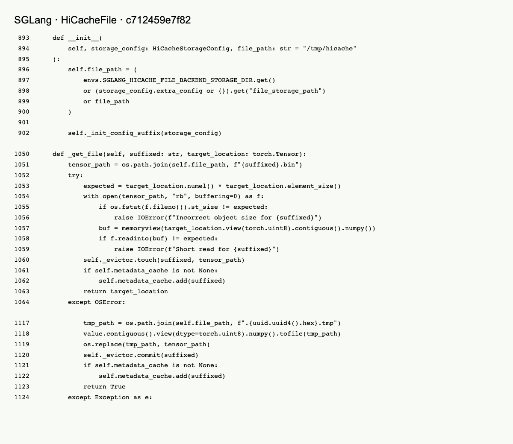

# SGLang：最底层接入 HDD

> 接口可行性 · 2026-11-16 固定版本源码核查

最小原型有明确接入点：将 HiCache 的 L3 文件后端目录放到 HDD 文件系统。这个判断来自后端路径与普通文件 I/O 的代码，并不代表 HDD 已通过性能验证。

本节把“最低级”理解为存储层级的最底层 L3，而不是修改 attention kernel。固定提交 `c712459e7f8233302fdf0bdd5d4ddcd22aa4b2ab`；未在 GPU + HDD 环境运行，模型兼容性和服务目标仍需验证。 [SGD][SGF]

| 层级 | 作用 | HDD 接入关系 |
|---|---|---|
| L1 · GPU HBM | 实际推理使用的 KV | 保留现有 GPU 计算路径 |
| L2 · CPU DRAM | 每个实例私有的 host pool | 接收 L3 预取，随后回填 GPU |
| L3 · 文件 / 远端后端 | 按页存储、匹配、恢复 KV | 本地 HDD 挂载点可承载文件；共享路径不自动保证并发一致性 |

### 源码依据

HiCacheFile 构造函数优先读取 SGLANG_HICACHE_FILE_BACKEND_STORAGE_DIR，其次 extra_config.file_storage_path，最后默认 /tmp/hicache。读取经 open(..., buffering=0)、文件大小检查和 readinto；写入先生成临时文件，再 os.replace 发布。这里没有要求存储设备必须是 SSD。



*SGLang 固定提交 HiCacheFile 原始代码节选截图：目录选择、读取和文件发布；保留行号，未改写代码* — [原始来源](https://github.com/sgl-project/sglang/blob/c712459e7f8233302fdf0bdd5d4ddcd22aa4b2ab/python/sglang/srt/mem_cache/hicache_storage.py)

### 可以直接配置的原型

```
# 示例；尚未执行。模型、GPU 资源与 page size 需符合目标版本支持范围。
# /mnt/hdd/hicache 必须实际位于 HDD，而不是系统 SSD 或 tmpfs。
SGLANG_HICACHE_FILE_BACKEND_STORAGE_DIR=/mnt/hdd/hicache \
python -m sglang.launch_server --model-path <compatible-model> \
  --enable-hierarchical-cache \
  --hicache-storage-backend file \
  --hicache-storage-prefetch-policy timeout
```

这条路径用来验证 KV 写入、冷恢复和重算回退，不应直接作为生产部署配置。L2 容量、页大小和 timeout 必须按模型与负载设置。文档中的默认 timeout 为 min(30s, 2s + 0.1s × 待取 tokens / 1024)，不等于业务可接受的等待预算。

### 接口可行、性能可行、生产可行应分别判断

| 判断层次 | 目前证据 | 尚缺验证 |
|---|---|---|
| 能否接入 | 普通文件路径后端与 HiCache L3 接口已存在 | 实际挂载介质、模型 / host pool / TP 支持、读写成功 |
| 能否比重算更合算 | 支持预取终止与部分已取前缀继续计算 | 全冷恢复耗时、有效命中、P99 TTFT、GPU 等待 |
| 能否长期运行 | 当前文件实现含容量 / LRU 相关处理与原子发布 | 掉电语义、后台写回稳定性、共享访问、压力和故障测试 |

## 本章资料

- **[SGD]** [SGLang HiCache 设计文档 · 固定提交 c712459e7f82](https://github.com/sgl-project/sglang/blob/c712459e7f8233302fdf0bdd5d4ddcd22aa4b2ab/docs/docs/advanced_features/hicache_design.mdx)
- **[SGF]** [HiCacheFile / HiCacheStorage 原始源码](https://github.com/sgl-project/sglang/blob/c712459e7f8233302fdf0bdd5d4ddcd22aa4b2ab/python/sglang/srt/mem_cache/hicache_storage.py)
