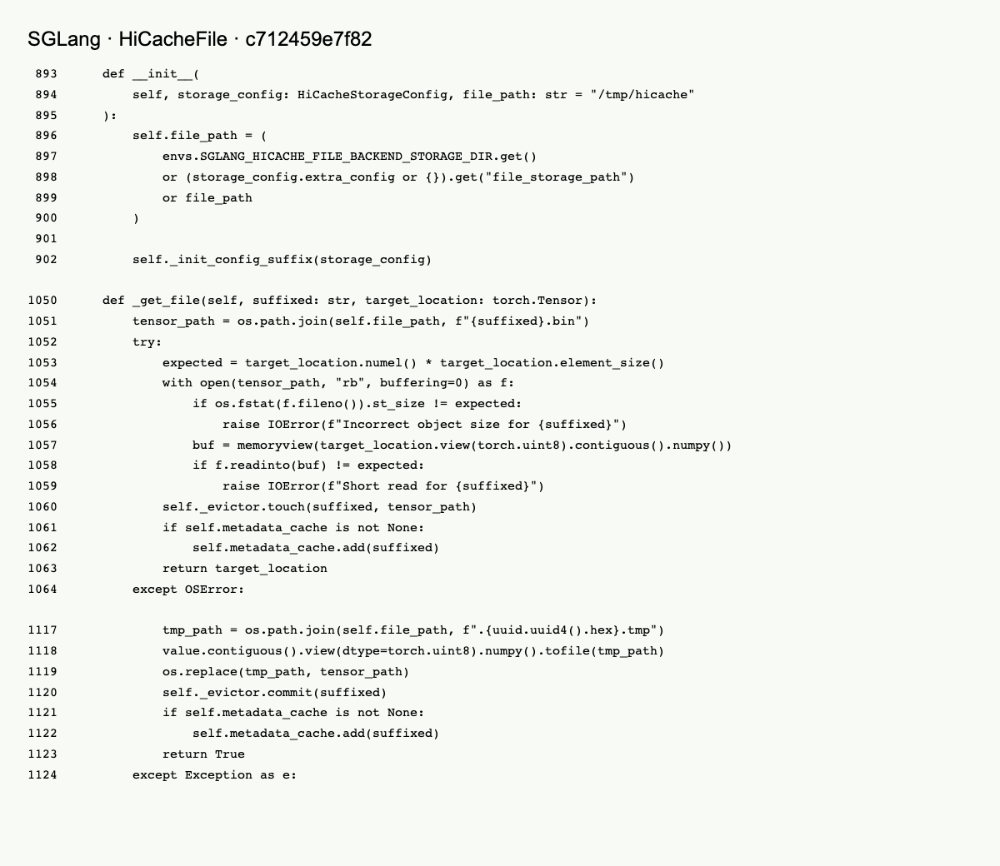

# HDD 接入路线与改动范围

> 工程可行性 · 区分现成接口与待开发优化

| 路线 | 可利用的能力 | 新增工作与边界 |
|---|---|---|
| A · file / fast_file → HDD 文件系统 | 现成 L3 文件接口；fast_file 文档列出并行读取、原子发布与后台 LRU | 先建立正确性基线；并发读不等于机械盘更快，需实测 |
| B · L3 内部 SSD + HDD 分层 | SGLang 仍看到一个 L3 后端；SSD 可承接热数据与写入 | 需由文件系统 / 块层缓存或自定义后端提供分层；HiCache 不会自动增加一个独立 SSD 层 |
| C · dynamic 自定义后端 | 文档支持 backend_name / module_path / class_name | 实现读取、写入、存在性及适用的 v2 host-pool 接口；增加合并 I/O、索引、准入和队列管理 |

[SGD][SGF][SGFAST]

### HDD 特有瓶颈

file 的 legacy batch_get 是逐页循环，v2 也按 pool / page 调用读取。每个对象独立命名不保证物理连续，扩大 page size 也不等于把多个对象自动合成一次顺序 I/O。HDD 寻道、元数据查询和多 rank 并发会使小对象随机访问变贵。

fast_file 源码明确列出 readv / writev、默认 1 个 read_workers、按模型 / 布局的 namespace，以及 max_size / min_free_space 等容量设置。锁、淘汰计数和元数据缓存为进程本地，因此多进程共享目录仍需单独核查。fast_file 的并行读是可比较的已有路径；HDD 需要按阵列和队列深度调参，不能沿用 SSD 的线程数就声称性能改善。若开发 extent 容器，需要额外解决对象到偏移映射、垃圾回收、崩溃恢复与页级有效性。

### 不要混淆三个“direct / complete”

--hicache-io-backend 的 direct / kernel 指 CPU 与 GPU 间的传输。Python buffering=0 只关闭用户态缓冲，不能证明使用 O_DIRECT 或绕过 OS page cache。os.replace 提供文件名的原子发布；所读 file 写路径未见 fsync，不能据此承诺掉电后持久化完成。

### 恢复与写回控制

文档提供 best_effort、wait_complete 和 timeout 预取策略。wait_complete 可能把 HDD 冷读等待暴露在 TTFT；timeout 可以限制等待，但还要检查停止后在途 I/O、已恢复前缀、未恢复部分重算及各 rank 一致性。文档列出 write_back / write_through / write_through_selective，不能把这些配置名理解成设备侧持久化或 HDD 顺序写保证。

工程候选：按前缀复用价值控制准入、将写回聚合为大块、为前台读保留带宽、设置后台积压上限、在预测恢复比 prefill 更慢时回退重算。这些是需要开发和对照验证的策略，不是本次已实现功能。

*原始 HiCacheFile 代码节选：文件对象与普通 I/O 是 HDD 改造路线的现有起点* — [原始来源](https://github.com/sgl-project/sglang/blob/c712459e7f8233302fdf0bdd5d4ddcd22aa4b2ab/python/sglang/srt/mem_cache/hicache_storage.py)

## 本章资料

- **[SGD]** [SGLang HiCache 设计文档 · 固定提交 c712459e7f82](https://github.com/sgl-project/sglang/blob/c712459e7f8233302fdf0bdd5d4ddcd22aa4b2ab/docs/docs/advanced_features/hicache_design.mdx)
- **[SGF]** [HiCacheFile / HiCacheStorage 原始源码](https://github.com/sgl-project/sglang/blob/c712459e7f8233302fdf0bdd5d4ddcd22aa4b2ab/python/sglang/srt/mem_cache/hicache_storage.py)
- **[SGFAST]** [HiCacheFastFile 原始源码](https://github.com/sgl-project/sglang/blob/c712459e7f8233302fdf0bdd5d4ddcd22aa4b2ab/python/sglang/srt/mem_cache/storage/fast_file/fast_file_store.py)
