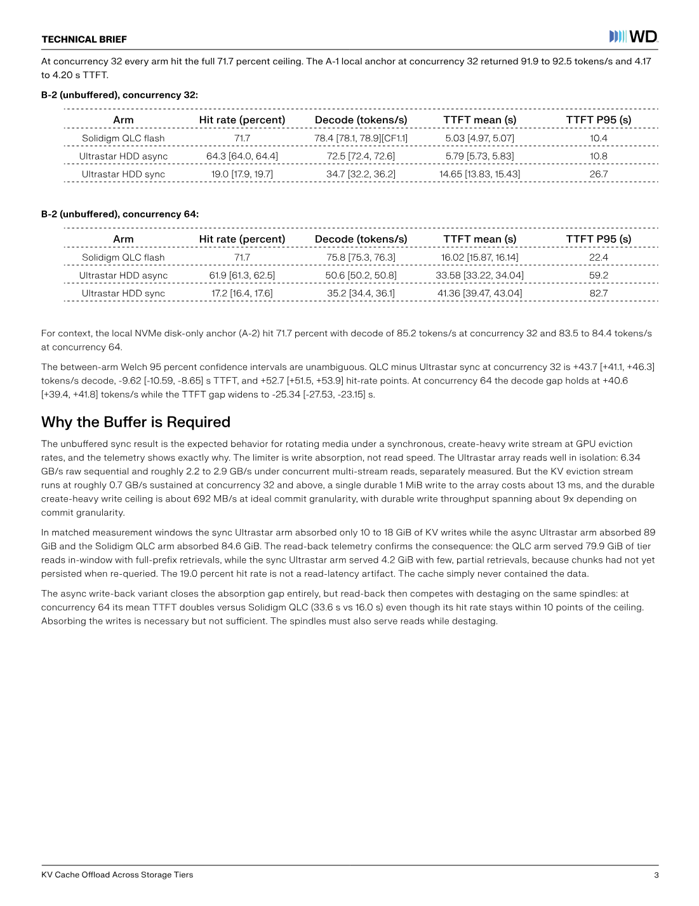

# 可行性验证与判定标准

> 研究计划 · 非实测结论

### 先验证功能，再验证 HDD 的收益

第一步，选目标版本支持的单一模型，确认 L3 写入、L1/L2 miss 后恢复、缺失或损坏对象回退以及输出正确性。仅看到文件增长不能证明恢复路径被使用。第二步，再测相同 GPU、模型、L2 容量和负载下的 SSD、HDD 与混合方案。

| 场景 | 必须控制的变量 | 主要观察 |
|---|---|---|
| 热缓存 | 区分 HBM / L2 / OS page cache 命中 | 不能把内存命中当作 HDD 实测 |
| 全冷恢复 | 独立环境控制页缓存；核实真实磁盘读取量 | P50 / P95 / P99 TTFT、磁盘等待、GPU 空闲 |
| 持续写回 + 冷读 | 运行至后台积压稳定或持续增长 | 读写争用、写放大、timeout 与有效恢复率 |
| 多轮重访 | 会话间隔和工作集超过快层容量 | 首次冷读是否能由后续复用摊薄 |
| 表示变化 | 完整 KV / 摘要 / 原文重算使用同一任务集 | 任务成功率、存储字节和全生命周期成本 |
| 失败 / 版本变化 | 对象缺失、部分页、重启、模型更新、TP 变化 | 错误命中防护、回退与命名空间隔离 |

### 建议的通过条件

功能可行：读取正确且 miss / timeout 能安全回退。性能可行：相同质量与 TTFT 服务目标下，比重算或全 SSD 基线降低总成本；冷读取尾延迟不突破预算。运行可行：长时间负载下写回积压有界、容量受控、故障可恢复。

WD × Solidigm 的热恢复由 DRAM 服务，Seagate × SK hynix 的后续多轮由 SSD 命中；它们支持设计方向，却不能替代 SGLang + HDD 的冷读测试。MEXT 的预取思路、Meta TMO 的压力反馈和 KVU 的设备路径，可作为后续控制策略参照。

*WD / Solidigm 原技术简报第 3 页：用于说明去掉前置层后必须单独测量的性能差异* — [原始来源](https://documents.westerndigital.com/content/dam/doc-library/en_us/assets/public/western-digital/collateral/tech-brief/technical-brief-kv-cache-offload-across-storage-tiers-wd.pdf)

## 本章资料

