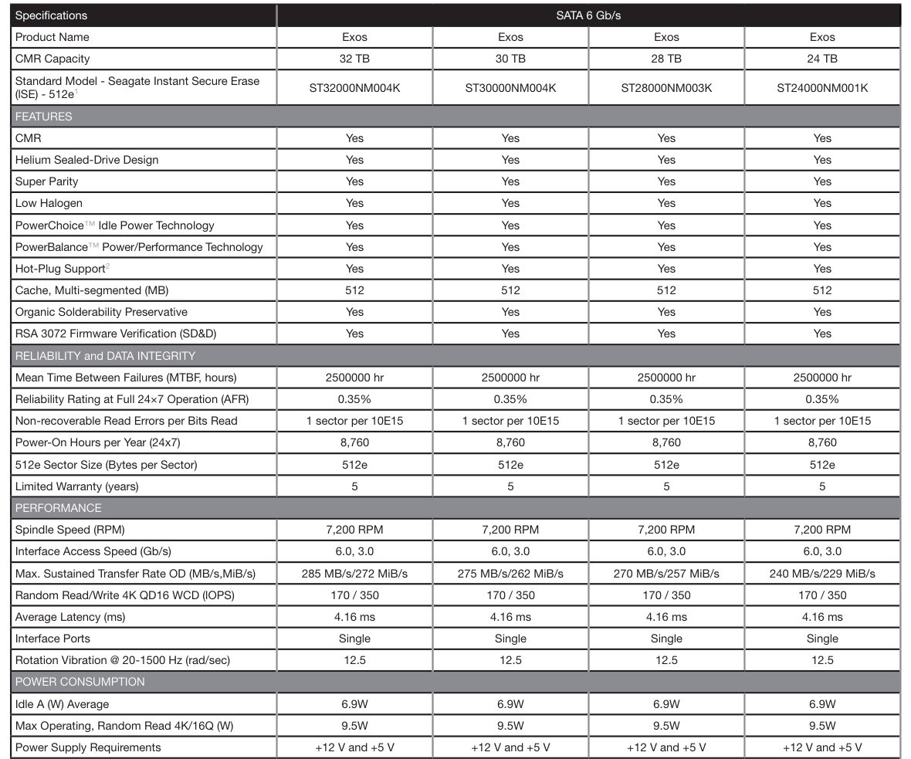
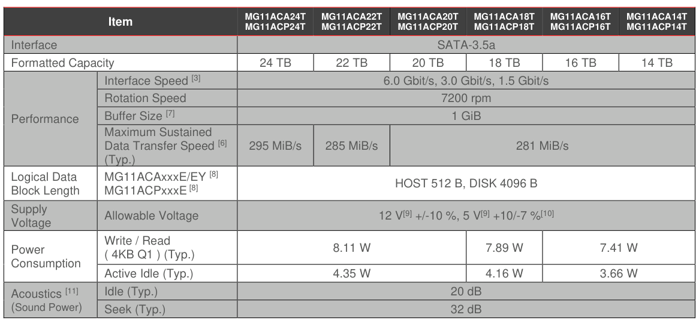
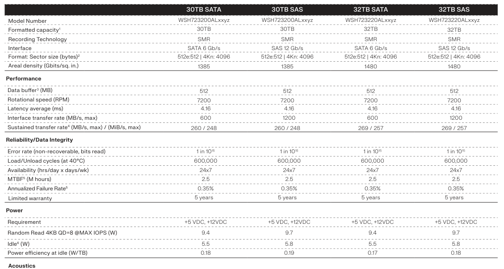
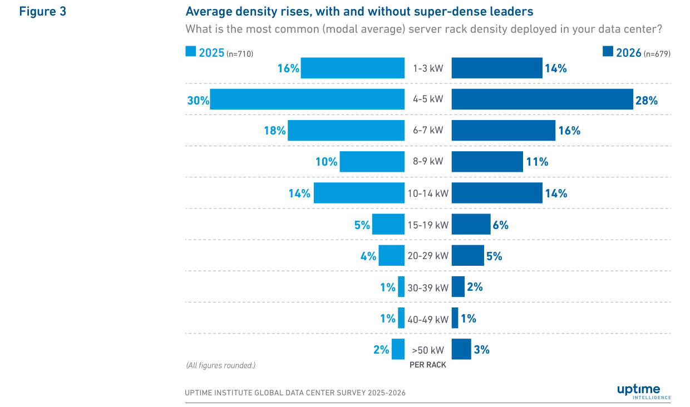

# 成本、功耗与机架密度：大容量盘的 TCO

> 容量约束分析 · 数据手册、机箱规格、LCA 报告与 TCO 推演

大容量 HDD 的核心卖点是 TCO：每 TB 采购成本更低，每 TB 功耗更低，每 U 机架空间装下的 TB 更多，每 TB 分摊的隐含碳也更少。这几项“每 TB”优势有一个共同前提：盘装进去之后容量真的能用满。如果 IOPS/TB、重建窗口或运维策略迫使用户少装数据（underfill）或只用外圈（short-stroking），分母变小，优势就会缩水，极端情况下还会倒挂。本章先用 Seagate、Western Digital、Toshiba 的数据手册确认功耗随容量的变化，再看高密 JBOD 的每 U 容量和机房供电上限，然后整理厂商的可持续性声明，最后给出一个写明公式和假设的 TCO 模型，以及若干容量档的示例推演。全文区分**来源事实**、**工程推论**和**假设**。资料采集于 2026-11-19。

### 来源事实：单盘功耗基本持平，W/TB 随容量下降

Seagate 2025 年 12 月版 Exos 数据手册把 2 TB 到 32 TB 的 7200 RPM 型号放在同一份文档中。SATA 型号的 Idle A 平均功耗为：12/16/20/24 TB（CMR）均为 6.3 W，最大运行功耗（4K 随机读/写，QD16）为 8.9/7.1 W；24/28/30/32 TB（Mozaic）均为 6.9 W，最大运行功耗 9.5 W。较老的 10 TB 型号空闲功耗反而更高，为 7.8 W [KT1]。也就是说，同一平台内容量翻倍，单盘功耗不变；换代平台功耗只多出约 0.6 W。

*Seagate Exos 数据手册（DS2046.1，2025-12）第 2 页：24/28/30/32 TB 四个容量点的随机 IOPS（170/350）、Idle A（6.9 W）和最大运行功耗（9.5 W）完全相同* — [原始来源](https://www.seagate.com/content/dam/seagate/en/content-fragments/products/datasheets/exos-portfolio-refresh/exos-ds2046.1-2512-en_us_V2_en_AS.pdf)

另外两家厂商的数据给出同样的结论。Toshiba MG11 产品手册（Rev.00，2024-08）中，SATA 型号 20/22/24 TB 共用同一组功耗值：读写（4KB Q1）8.11 W、主动空闲 4.35 W；18 TB 为 7.89/4.16 W；14/16 TB 为 7.41/3.66 W [KT2]。Western Digital Ultrastar DC HC690（11 碟，UltraSMR）的 30 TB 和 32 TB SATA 型号功耗相同：随机读 9.4 W、空闲 5.5 W。数据手册还直接给出了空闲能效：30 TB 为 0.18 W/TB，32 TB 为 0.17 W/TB [KT3]。

*Toshiba MG11 产品手册（Rev.00，2024-08）SATA 规格表：24/22/20 TB 共用 8.11 W 读写功耗和 4.35 W 主动空闲功耗* — [原始来源](https://toshiba.semicon-storage.com/content/dam/toshiba-ss-v3/master/en/storage/product/data-center-enterprise/MG11-Product-Overview_rev.0.pdf)

*Western Digital Ultrastar DC HC690 数据手册（2024-10）规格表：30/32 TB 功耗相同（随机读 9.4/9.7 W，空闲 5.5/5.8 W），并直接列出空闲能效 0.17–0.19 W/TB* — [原始来源](https://documents.westerndigital.com/content/dam/doc-library/en_us/assets/public/western-digital/product/data-center-drives/ultrastar-dc-hc600-series/data-sheet-ultrastar-dc-hc690.pdf)

| 型号 / 容量 | 空闲功耗（W，手册值） | 空闲 W/TB（推算 = W ÷ TB） | 来源 |
|---|---|---|---|
| Seagate Exos 10 TB | 7.8 | 0.78 | [KT1] |
| Seagate Exos 16 TB / 20 TB / 24 TB（CMR） | 6.3 | 0.39 / 0.32 / 0.26 | [KT1] |
| Seagate Exos 30 TB / 32 TB（Mozaic） | 6.9 | 0.23 / 0.22 | [KT1] |
| Toshiba MG11 16 TB / 24 TB（SATA） | 3.66 / 4.35 | 0.23 / 0.18 | [KT2] |
| WD HC690 30 TB / 32 TB（SATA，SMR） | 5.5 | 0.18 / 0.17（手册直接给出） | [KT3] |

厂商自己的宣传口径也是这个方向。Seagate 称典型 16 TB CMR 盘（1.78 TB/碟）为 0.59 W/TB，30 TB Mozaic 3+ 盘（3 TB/碟）为 0.32 W/TB，每 TB 功耗降低 45%；2024 年 1 月的发布新闻稿写的是“每 TB 功耗改善 40%” [KT6][KT5]。Western Digital 2025 年 12 月的博客称，老式 4 TB 空气盘约 2.85 W/TB，现代 32 TB 氦气盘约 0.3 W/TB [KT4]。这些宣传数字比上表的空闲值高，应是按运行功耗计算的。**工程推论**：在可比口径下，每 TB 驱动器功耗大致与容量成反比。但需要注意，驱动器本身只是系统功耗的一部分，下一节会看到这一点。

### 机箱与机架：TB/U、整机功耗与供电上限

高密 JBOD 把 3.5 英寸盘位做到了 4U 100 盘以上。Western Digital Ultrastar Data102 是 4U 102 盘位，2026 年 11 月第 12 版产品简介给出的容量为：使用 26 TB CMR 盘时裸容量 2.65 PB，使用 32 TB SMR 盘时 3.26 PB。电源为双路 1600/1800 W，满载 102 块 HDD 时重 121.02 kg [KT12]。Seagate Exos E 4U106 是 106 盘位，每路电源最大输出 2000 W，装满盘后重 141 kg [KT11]。同为 4U106 的 Exos CORVAULT 使用 Mozaic 3+ 盘，裸容量 2.0 PB 或 2.5 PB，运行功耗 1200–1600 W，具体取决于负载 [KT10]。国内厂商的思路相同：华为 OceanStor Pacific 9550 在 5U 内放 2 个节点和 120 块 3.5 英寸盘，官方博客称其存储密度是“4U 36 盘服务器”的 2.67 倍 [KT21]。

由这些规格可以推算两个指标。第一个是 **TB/U**：Data102 装 32 TB 盘约 816 TB/U，CORVAULT 2.5 PB 型号约 625 TB/U，而 4U 36 盘服务器装 20 TB 盘只有 180 TB/U。第二个是**系统级 W/TB**：CORVAULT 为 1200–1600 W ÷ 2500 TB ≈ 0.48–0.64 W/TB，约为盘本身空闲值的 1.7–2.2 倍（2.5 PB ÷ 106 盘位约合 24 TB/盘，24 TB Mozaic 盘为 6.9 W，即 0.29 W/TB）；摊到每个盘位约 11.3–15.1 W，比单盘 6.9 W 多出 4–8 W。可见风扇、扩展器、控制器和电源损耗不随盘容量下降，**盘位**才是机箱功耗的计量单位。

机房一侧的约束是每柜功率。Uptime Institute 2026 年全球调查显示，各数据中心“最常见机柜密度”的平均值首次超过 11 kW；去掉少数 30 kW 以上的高密设施后为 7.8 kW。4–5 kW 仍是占比最高的区间（2026 年为 28%），并且这一设计密度已经持续十多年 [KT13]。国内的情况，ODCC 2021 年白皮书统计电信运营商在用数据中心平均单机架功率约 4.46 kW，其中中国移动约 4.6 kW；国家口径的“标准机架”按 2.5 kW 计 [KT14]。工信部还要求新建大型及以上数据中心 PUE 降到 1.3 以下 [KT15]。Backblaze 2014 年的做法也说明了同样的问题：机柜按固定价格租用，电费含在 24 A 峰值以内，省下的瓦数不会直接变成省下的钱，但决定了一个柜子能放多少台设备 [KT17]。

*Uptime Institute Global Data Center Survey 2026 图 3：2025/2026 年受访数据中心最常见机柜功率密度分布，4–5 kW 仍是占比最高的区间* — [原始来源](https://datacenter.uptimeinstitute.com/rs/711-RIA-145/images/UptimeInstitute.GlobalDataCenterSurvey.2026.pdf)

**工程推论（机柜容量）**：机柜容量 = min(空间允许的盘位数, ⌊机柜 IT 功率 ÷ 每盘位功率⌋) × 单盘容量。按每盘位功率 = 单盘 Idle A + 5 W 机箱分摊估算（5 W 为假设，参照上文 CORVAULT 的每盘位推算值），并假设一个 42U 机柜放 9 台 4U106，空间上限为 954 个盘位，结果如下：

| 机柜 IT 功率 | 16 TB（11.3 W/盘位） | 24 TB（11.3 W/盘位） | 32 TB（11.9 W/盘位） |
|---|---|---|---|
| 4.6 kW（国内运营商在用均值附近） | 407 盘 → 6.5 PB | 407 盘 → 9.8 PB | 386 盘 → 12.4 PB |
| 8 kW | 707 盘 → 11.3 PB | 707 盘 → 17.0 PB | 672 盘 → 21.5 PB |
| 11 kW（Uptime 2026 均值） | 954 盘（空间封顶）→ 15.3 PB | 954 盘 → 22.9 PB | 924 盘 → 29.6 PB |

在 4–5 kW 的柜子里，高密 JBOD 只能插满不到一半的盘位，**功率先于空间成为瓶颈**。这时每柜 PB 数几乎与单盘容量成正比，大容量盘的收益最直接。此外，满载 4U106 重 141 kg，9 台合计约 1.27 t，楼板承重同样需要校核 [KT11]。

### 隐含碳与可持续性声明

Seagate 对 Mozaic 3+ 的核心可持续性声明是：30 TB Mozaic 3+ 盘与传统 16 TB PMR 盘相比，每 TB 隐含碳降低 55%。这里的隐含碳包括原材料开采、制造组装以及全程运输的排放 [KT5][KT6]。其依据是该平台“使用与 PMR 硬盘大致相同的材料组件”，碳和材料被摊到更多 TB 上。Seagate 中国站的超大规模可持续性页面给出了更激进的对比：按 5 年生命周期，Mozaic 40 TB 的隐含碳 <0.27 kg CO2e/TB/年，30.72 TB SSD 为 5.9 kg，LTO 磁带 <0.6 kg；在线功耗分别为 <0.22、0.8、1 W/TB。页面还引用 HotCarbon 2024 论文称，存储机架占通用云数据中心运行排放的 24%、隐含排放的 45% [KT9]。该页脚注说明，SSD 的数值是 Seagate 按第三方白皮书数据推算的（900 kg ÷ 30.72 TB ÷ 5 年），并非 SSD 厂商发布的 LCA 结果。

Seagate 单品 LCA 报告提供了可核对的数据。Exos X20（20 TB，2023 年报告）：常规电力下全生命周期 2.14 kg CO2e/TB·年，使用阶段占 86.0%；使用阶段改用可再生电力后为 0.37 kg [KT8]。Exos 32 TB（2026 年报告）：常规电力下 1.72 kg CO2e/TB·年，使用阶段占 79.4%；可再生电力下为 0.51 kg；年均耗电 58.9 kWh，合 1.8 kWh/TB [KT7]。**工程推论**：在常规电网下，HDD 生命周期碳排放的八成左右来自用电，因此 W/TB 改善是碳排放下降的主要来源。但两份报告的非使用阶段排放分别约为 0.30 和 0.35 kg/TB·年（按占比推算），可再生电力情形下 32 TB 反而高于 X20。两份报告年份和方法版本不同，不宜直接相减；“隐含碳降低 55%”应视为厂商声明，用于客户 ESG 核算前需要拿到同口径 LCA。

### TCO 模型：公式

以一个盘位为计算单元，记单盘容量为 C（TB），服务年限为 Y（年）：

- 单盘位全生命周期成本：L = P(C) + S + Y × 8.76 × (W_d + W_o) × PUE × e。其中 P(C) 为盘价；S 为每盘位分摊的机箱、服务器、网络和机柜建设成本；W_d 为盘功耗（W），W_o 为每盘位机箱分摊功耗（W）；e 为电价（每 kWh）；8.76 = 8760 h ÷ 1000。
- 可用容量：U = C × u × η。η 为冗余效率（三副本为 1/3，EC k+m 为 k/(k+m)），u 为实际装填率。
- 装填率上限：u = min(u_ops, IOPS_d ÷ (C × r))。u_ops 为运维水位线；IOPS_d 为单盘随机 IOPS；r 为业务要求的每 TB 已存数据 IOPS。Seagate MACH.2 技术白皮书正是这样描述的：IOPS/TB 低于客户阈值时，盘上容量无法全部利用，进而抬高“可利用容量的 $/TB”。白皮书举例称，阈值为 7 IOPS/TB 时，客户在约 12 TB 处开始出现搁浅容量；多数数据中心应用需要 5–10 IOPS/TB [KT19]。
- 每可用 TB 成本：TCO/TB = L ÷ (C × u × η)。

由此可以直接得到一个结论。当 IOPS 成为约束时，C × u = IOPS_d ÷ r 是常数，TCO/TB = L × r ÷ (IOPS_d × η)，而 L 随 C 增大（盘价随容量上升）。所以**一旦进入 IOPS 受限区，加大单盘容量只会增加成本**。重建窗口也有类似效应：若运维因重建时间限制单盘装填量，u 同样被压低。重建时间的推演见“重建与可靠性”一章。

### 示例推演（假设值，仅用于说明结构）

以下数值**均为假设**，不是报价：盘价按每 TB 15 美元，各容量相同（量级参照 Backblaze 2022 年 11 月 16 TB 盘约 0.014 美元/GB 的采购均价 [KT16]）；S = 150 美元/盘位；W_o = 5 W；PUE = 1.3；电价 0.10 美元/kWh；Y = 5 年；EC 8+3（η = 8/11）；u_ops = 85%；单盘随机读 IOPS 按 Seagate 手册取 170 [KT1]。W_d 取手册 Idle A 值，36 TB 档沿用 32 TB 的 6.9 W（**假设**，未找到 36 TB 官方功耗）。

| 容量档 | 空闲 W/TB | 单盘位 L（美元） | EC，无 IOPS 约束 | 三副本，无 IOPS 约束 | EC，r = 7（u） | EC，r = 7，30/36 TB 溢价 15% | EC，r = 10（u） |
|---|---|---|---|---|---|---|---|
| 16 TB | 0.39 | 454 | 45.9 | 100.2 | 45.9（0.85） | 45.9 | 45.9（0.85） |
| 20 TB | 0.32 | 514 | 41.6 | 90.8 | 41.6（0.85） | 41.6 | **41.6**（0.85） |
| 24 TB | 0.26 | 574 | 38.7 | 84.5 | 38.7（0.85） | 38.7 | 46.5（0.71） |
| 30 TB | 0.23 | 668 | 36.0 | 78.6 | 37.8（0.81） | 41.6 | 54.0（0.57） |
| 36 TB | 0.19* | 758 | **34.1** | 74.3 | 42.9（0.67） | 47.5 | 61.3（0.47） |

表中 TCO 单位为美元/可用 TB（5 年），带 * 的功耗为假设值。读表要点如下。（1）没有 IOPS 约束时，从 16 TB 到 36 TB，每可用 TB 成本下降约 26%，主要来自 S 和机箱功耗被更多 TB 分摊。在这组假设下，5 年电费每盘位只有约 64–68 美元，远小于盘价；功耗的价值更多体现在上一节的“每柜 PB 数”，而不是电费本身。（2）冗余方式的影响大于容量档：三副本的成本约为 EC 8+3 的 2.2 倍，因此推动 EC 化本身就是一项 TCO 杠杆。（3）r = 7 时，最优点落在 24–30 TB，36 TB 反而回升；r = 10 时，最优点退到 20 TB。（4）新容量点通常有每 TB 溢价，会进一步推迟大容量的收益。Backblaze 的经验是新容量的每 GB 价格起初高于老容量，经过一段时间才“下穿”（cross under）；历史上它通常在两者每 GB 价差约 0.005 美元时切换 [KT17]。

### 利用率是前提：对提供方的含义与资料边界

把以上推演归纳为三点。第一，**功耗和机柜空间是大容量盘的确定优势**，在 4–5 kW 的功率受限机柜里尤其明显，这是数据手册与机房统计都能支撑的结论。第二，**采购价和隐含碳的优势要靠装填率兑现**。客户实际负载的 IOPS/TB、重建窗口和水位线决定了 u；u 一旦被压到 70% 以下，30–36 TB 的每可用 TB 成本就可能高于 20–24 TB。客户说“容量不需要太大”，在 TCO 公式里可能对应的正是 r 较高、u 被压低的情形。第三，提供方要让 TCO 优势成立，需要同时拿出三样东西：提高单盘 IOPS 的产品（多磁臂等），降低 r 的系统方案（闪存缓存、写聚合、冷热分层），以及缩短重建或使重建与容量解耦的方案。还要用客户自己的 r、u、η 和电价代入上式，而不是只报 $/TB 和 W/TB。Backblaze 2026 年第一季度新部署的 10,220 块盘中，超过 9,400 块是 20 TB 及以上，说明在顺序写为主、EC 化的备份或对象存储负载中，这一前提是可以满足的 [KT18]。

资料边界：盘价、盘位成本和电价没有公开的官方数据，表中均为假设，只用于展示模型结构，结论应以客户实际参数复算。36 TB 档的功耗未找到官方手册值。可持续性数字均为厂商自报，不同年份的 LCA 报告方法不完全可比。Uptime 和 ODCC 的机柜功率是调查均值，不代表具体机房。

## 本章资料

- **[KT1]** [Seagate · Exos 数据手册 DS2046.1（2025-12；2–32 TB 各容量 Idle A / 最大运行功耗、随机 IOPS、持续传输率，采集于 2026-11-19）](https://www.seagate.com/content/dam/seagate/en/content-fragments/products/datasheets/exos-portfolio-refresh/exos-ds2046.1-2512-en_us_V2_en_AS.pdf)
- **[KT2]** [Toshiba Electronic Devices & Storage · MG11 Series Cloud-Scale Capacity HDD Product Overview（Rev.00，2024-08；14–24 TB 读写与主动空闲功耗）](https://toshiba.semicon-storage.com/content/dam/toshiba-ss-v3/master/en/storage/product/data-center-enterprise/MG11-Product-Overview_rev.0.pdf)
- **[KT3]** [Western Digital · Ultrastar DC HC690 Data Sheet（2024-10；30/32 TB SMR 功耗与空闲 W/TB）](https://documents.westerndigital.com/content/dam/doc-library/en_us/assets/public/western-digital/product/data-center-drives/ultrastar-dc-hc600-series/data-sheet-ultrastar-dc-hc690.pdf)
- **[KT4]** [Western Digital 官方博客 · Powering the Future of Cloud Storage: How HDD Innovation Meets the Energy Challenge（Xiaodong Che，2025-12-10）](https://blog.westerndigital.com/hdd-energy-efficiency-cloud-storage/)
- **[KT5]** [Seagate 投资者关系新闻稿 · Seagate’s Breakthrough 30TB+ Hard Drives Ramp Volume, Marking an Inflection Point in the Storage Industry（2024-01-17；每 TB 功耗改善 40%、隐含碳降低 55%）](https://investors.seagate.com/news/news-details/2024/Seagates-Breakthrough-30TB-Hard-Drives-Ramp-Volume-Marking-an-Inflection-Point-in-the-Storage-Industry/default.aspx)
- **[KT6]** [Seagate 资源中心 · What Is Mozaic 3+, How Does It Work, and What Can It Do for My Data Center?（中文页面；16 TB 0.59 W/TB vs 30 TB 0.32 W/TB、隐含碳定义，采集于 2026-11-19）](https://www.seagate.com/resources/what-is-mozaic-3plus-how-does-it-work-and-what-can-it-do-for-my-data-center/)
- **[KT7]** [Seagate · Exos 32TB 产品可持续性 / LCA 报告（2026；kg CO2e/TB-year、生命周期阶段占比、年均耗电）](https://www.seagate.com/content/dam/seagate/assets/sustainability/files/new-2026/exos-32tb-lca-report.pdf)
- **[KT8]** [Seagate · Exos X20 20TB Sustainability Report（2023；kg CO2e/TB-yr 与生命周期阶段占比）](https://www.seagate.com/content/dam/seagate/assets/esg/planet/product-sustainability/images/exos-x20-20tb/files/exos-x20-20tb-sustainability-report-2023.pdf)
- **[KT9]** [Seagate 中国站 · 超大规模和云 / 可持续性页面（HDD / SSD / 磁带隐含碳与在线功耗对比及脚注，采集于 2026-11-19）](https://www.seagate.com/products/hyperscale-and-cloud/sustainability/)
- **[KT10]** [Seagate · Exos CORVAULT 数据手册 DS2058-4（2023-09；4U106 裸容量 2.0/2.5 PB、运行功耗 1200–1600 W）](https://www.seagate.com/content/dam/seagate/en/content-fragments/products/datasheets/exos-pods/corvault-self-healing-storage-DS2058-4-2309US-en_US.pdf)
- **[KT11]** [Seagate · Exos E 4U106 数据手册 DS1980-12（2022-05；106 盘位、每 PSU 2000 W、满载 141 kg）](https://www.seagate.com/content/dam/seagate/migrated-assets/www-content/datasheets/pdfs/exos-e-4u106-DS1980-12-2205US-en_US.pdf)
- **[KT12]** [Western Digital · Ultrastar Data102 Hybrid Storage Platform 产品简介（2026-11，Revision 12；4U102、3.26 PB、PSU 规格）](https://documents.westerndigital.com/content/dam/doc-library/en_us/assets/public/western-digital/product/platforms/ultrastar-data102-hybrid-platform/product-brief-ultrastar-data102-hybrid-storage-platform.pdf)
- **[KT13]** [Uptime Institute · Global Data Center Survey 2026（Keynote Report；机柜功率密度分布，Figure 3）](https://datacenter.uptimeinstitute.com/rs/711-RIA-145/images/UptimeInstitute.GlobalDataCenterSurvey.2026.pdf)
- **[KT14]** [开放数据中心委员会（ODCC）· 数据中心功率密度演进白皮书 ODCC-2021-05002（2021-09-15；运营商在用数据中心平均单机架功率、标准机架 2.5 kW）](https://13115299.s21i.faiusr.com/61/1/ABUIABA9GAAg5OLwjQYouLTRvQQ.pdf)
- **[KT15]** [工业和信息化部 · 《新型数据中心发展三年行动计划（2021-2023年）》（工信部通信〔2021〕76号，北京市政府门户网站转载）](https://www.beijing.gov.cn/zhengce/zhengcefagui/qtwj/202204/t20220413_2675709.html)
- **[KT16]** [Backblaze 官方博客 · Hard Drive Cost Per Gigabyte（Andy Klein，2022-11-29）](https://www.backblaze.com/blog/hard-drive-cost-per-gigabyte/)
- **[KT17]** [Backblaze 官方博客 · Why Now Is the Time for Backblaze to Build a 270TB Storage Pod（Andy Klein，2014-08-12；容量切换价差与 cross-under、固定价机柜含 24 A 电力）](https://www.backblaze.com/blog/why-now-is-the-time-for-backblaze-to-build-a-270-tb-storage-pod/)
- **[KT18]** [Backblaze 投资者关系新闻稿 · Backblaze Publishes Q1 2026 Drive Stats: Reliability Improves as 92% of New Deployments Exceed 20TB（2026-07）](https://ir.backblaze.com/news/news-details/2026/Backblaze-Publishes-Q1-2026-Drive-Stats-Reliability-Improves-as-92-of-New-Deployments-Exceed-20TB/default.aspx)
- **[KT19]** [Seagate · MACH.2 Multi-Actuator Technology Paper TP714.1（2019-10；Problem Statement: IOPS/TB and TCO）](https://www.seagate.com/files/www-content/solutions/mach-2-multi-actuator-hard-drive/files/tp714.1-1910us-mach-2-technology-paper.pdf)
- **[KT21]** [华为企业业务官方博客 · 最实在的“数据开发商”—OceanStor Pacific 9550（2021；5U 120 盘、相对 4U 36 盘服务器 2.67 倍密度）](https://e.huawei.com/cn/blogs/storage/2021/data-developer-oceanstor-pacific-9950)
