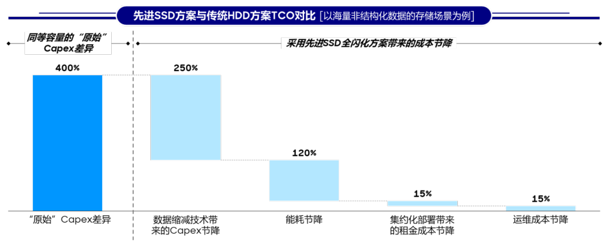
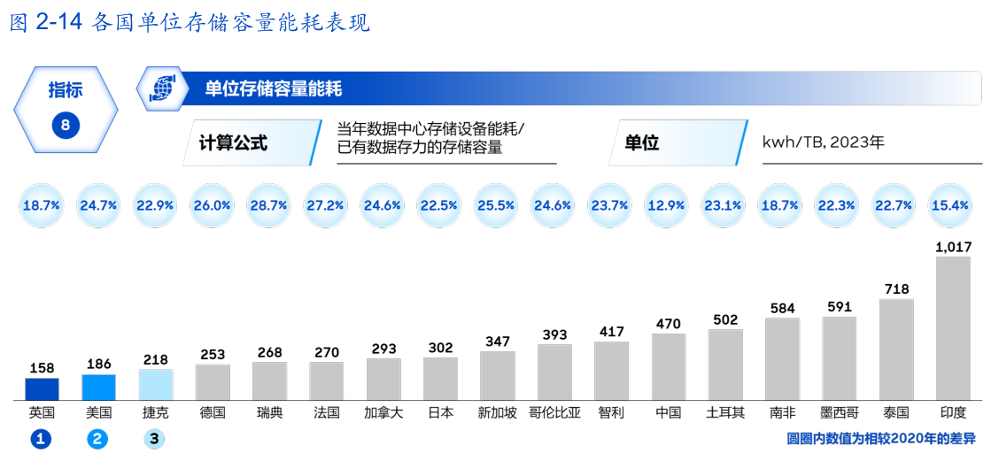
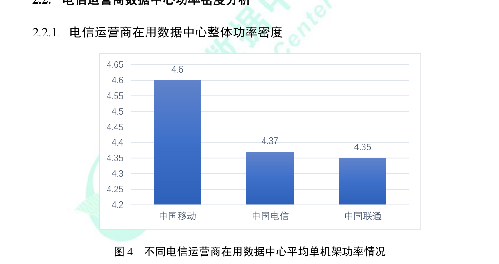

# 国内客户为何认为 HDD 容量不需要太大

> 国内客户场景 · 官方技术博客、政策文本、行业白皮书与访谈提纲

国内一些客户在交流中表示“HDD 单盘容量不需要太大”，这与 HDD 提供方继续提高单盘容量的路线相反。本章不预设谁对谁错，而是把这句话拆成可以检验的具体原因：技术栈（HDFS 三副本、计算存储混部、小文件与随机小 IO）、可靠性（重建窗口、补块）、性能（混合负载下的 IOPS/TB）、采购（按整机集采、首发容量溢价、国产化平台适配）、政策（先进存力的统计口径）、机房（单柜功率）和运维经验。材料来自字节跳动、快手、vivo、滴滴、腾讯云、阿里云、华为的官方技术文章，工信部等部门的政策文本，中国信通院和 ODCC 的报告，以及华为与罗兰贝格联合发布的《先进数据存力白皮书》（本地 PDF，仅作为数据来源）。每条原因都标注为**来源事实**（公开材料原文可查），或**推断 / 待客户访谈验证**。章末给出访谈问题清单。资料采集于 2026-11-19。

### 来源事实：国内 EB 级大数据存储的公开画像

国内头部互联网公司的大数据底座以 HDFS 为主，普遍处于“几万到十万台服务器、EB 到数十 EB 数据”的规模。各家公开材料中与盘容量有关的要点如下：

| 主体 | 公开规模 | 与 HDD 容量相关的要点 |
|---|---|---|
| 字节跳动 HDFS | 十万台级服务器、10 EB 级（火山引擎开发者社区文章）；2023 年演讲称存储规模达数十 EB | 慢节点问题“尤其是磁盘占用百分比非常高以后”层出不穷；部分业务以大量随机小 IO 为典型场景；建设了分级存储体系 [KC7][KC8] |
| 快手 HDFS | 单集群几万台、几 EB，其中 EC 数据几百 PB（2021 年） | DataNode 与 YARN NodeManager 混布，MapReduce shuffle 是磁盘繁忙的主要来源；每块盘加限速器，按负载选盘 [KC9] |
| vivo HDFS | 万台级节点、接近 EB（2025 年） | EC（RS-6-3）只用于冷数据、由后台转储；EC 补块时间长；EC 数据放到“大存储机器”的 Archive 盘上以降低 TCO [KC10] |
| 滴滴 HDFS | 离线集群上百 PB 逻辑数据（2021 年） | EC 只用于冷数据，且要求转 EC 目录的平均文件大小 ≥ 6 MB；由于 Spark/Hive/Flink 依赖 Hadoop 2，需要自行移植 EC 客户端 [KC11] |
| 腾讯云 TStor OneCOS | 单桶万亿对象、EB 级（2022 年） | 支持 60 盘位腾讯自研服务器、20 TB 大容量盘；因为磁盘 IOPS 满足不了元数据和日志读写，用 NVMe SSD 承接 WAL [KC12] |
| 阿里云磐久 | —（2024 年） | 磐久大容量存储服务器平台“规模落地大容量 SMR HDD”，用于低成本 AI 数据集存储 [KC13] |
| 华为 OceanStor Pacific 9550 | 5U 2 节点 120 盘（2021 年） | 官方以“4U 36 盘服务器”作为密度对比基线；示例按 14 TB 盘计算，单台 1.68 PB [KC14] |

这张表说明两件事。第一，国内并不缺少大容量、高密度 HDD 的实践：腾讯 60 盘位 + 20 TB、阿里 SMR 大盘、vivo 的“大存储机器”都是例子。第二，这些实践集中在**对象存储和冷数据层**。而 HDFS 热温层仍以三副本和计算存储混部为主，正是这一层的瓶颈（慢节点、混布 IO、小文件）最容易被归结为“盘太大”。**推断**：说“不需要太大”的客户，主要是指后一类集群。

### 来源事实：政策与行业叙事把“先进存力”等同于闪存化

工信部等六部门 2023 年 10 月印发的《算力基础设施高质量发展行动计划》提出，到 2025 年存储总量超过 1800 EB，先进存储容量占比达到 30% 以上 [KC3]。配套解读在“强化存力”部分写的是：促进全闪存、蓝光存储等技术创新，“紧抓存储闪存化升级的机遇”，并鼓励使用自主存储设备 [KC2]。中国信通院《中国存力白皮书（2023年）》把先进存力的支撑定义为“以 SSD 为代表的半导体介质”和 Diskless 等架构，同时把“硬件高密”列入绿色能效 [KC4]。2025 年的存力发展报告用“全国外置闪存占比超过 28%”来衡量先进存力的应用 [KC5]。

华为与罗兰贝格的《先进数据存力白皮书》（2024 年 9 月发布）是闪存阵营的代表性表述 [KC1]。白皮书称：在海量非结构化数据、5 年生命周期的场景下，先进 SSD 方案的单位容量 TCO 已可与传统 HDD 方案基本持平；当前 SSD 与 HDD 价差约 5:1，可由数据缩减（领先至少 50%）和 Opex 下降（至少 80%）弥补；相同容量下 SSD 能耗比 HDD 低 70%。它还指出，诸多企业在二级系统和备份容灾系统选型时“因侧重 Capex 成本考量而选择 HDD 方案”。白皮书统计中国全闪化率仅 6.22%（世界平均 17.01%）。但书中另一处又写“中国的闪存化率仅 29%”，两处口径不同，引用时需注明。

*华为、罗兰贝格《先进数据存力白皮书》（2024）图 2-2：以海量非结构化数据为例的“先进 SSD 方案与传统 HDD 方案 TCO 对比”瀑布图（原始 Capex 差异 400%，数据缩减抵消 250%，能耗抵消 120%，租金与运维各 15%）* — [原始来源](https://news.zol.com.cn/902/9023402.html)

值得注意的是，这份白皮书同时把“单位存储容量能耗”（存储设备年耗电 ÷ 存储容量，kWh/TB）列为国家级绿色指标。中国 2023 年为 470 kWh/TB，高于英国、美国等国家 [KC1]。**推断**：这个指标本身对 W/TB 持续下降的大容量 HDD 同样有利，但在现有叙事里它被完全归因于“闪存化率”。对 HDD 提供方而言，这是一个可以争取的统计口径。

*华为、罗兰贝格《先进数据存力白皮书》（2024）图 2-14：各国单位存储容量能耗（kWh/TB，2023 年），中国为 470* — [原始来源](https://news.zol.com.cn/902/9023402.html)

### 原因拆解（一）：技术栈与负载

| 可能原因 | 机制 | 证据 | 性质 |
|---|---|---|---|
| 1. 计算存储混部，服务器数量由算力决定 | DataNode 与 YARN 混布时，买多少台服务器由计算需求决定，每台的盘位按机型固定；单盘再大，装出来的容量也会超过需要 | 快手 DataNode 与 NodeManager 混布，shuffle 是磁盘繁忙的主要来源 [KC9] | 机制为来源事实；“因此不需要大盘”为**推断，待访谈验证** |
| 2. 三副本 + 热温数据，IOPS/TB 要求高 | 热温层不做 EC，一份数据占三块盘的容量，读写却集中在热数据上；单盘容量越大，每 TB 分到的 IOPS 越少 | vivo、滴滴的 EC 都只用于冷数据 [KC10][KC11]；Seagate 称多数数据中心应用需要 5–10 IOPS/TB [KC20] | 来源事实 + 工程推论（测算见 IOPS/TB 一章与 TCO 一章） |
| 3. 小文件、元数据与随机小 IO | 小文件转 EC 不划算，只能留在副本层；元数据和日志的随机 IO 压在 HDD 上 | 滴滴要求平均文件 ≥ 6 MB 才转 EC [KC11]；字节部分业务以随机小 IO 为主 [KC7]；OneCOS 用 NVMe SSD 承接 WAL [KC12] | 来源事实 |
| 4. 盘越满越慢，新扩容节点成为热点 | 水位线触顶后写入降级，新上线的空盘集中承接新写入和热数据；大盘节点的写入量更集中 | 字节：“磁盘占用触及红线导致写降级；新增热资源集中到少量机器” [KC7] | 现象为来源事实；与单盘容量的关联为**推断** |
| 5. 重建 / 补块窗口 | 一块盘或一台机器故障后需要补齐的数据量与容量成正比；EC 补块慢，补块期间还可能写坏数据 | vivo：EC 补块时间长，曾踩过补块导致文件损坏的坑 [KC10]；32 TB 盘按 285 MB/s 满速顺序写满约需 31 小时（推算，手册值 [KC19]） | 来源事实 + 推算；客户实际补块时间**待验证** |
| 6. 软件栈版本滞后 | Hadoop 2 客户端和老版本组件让 EC、分层、SMR 适配都来得晚，大盘的配套优化无法落地 | vivo 2021 年才从 2.6 全面升级到 3.1 [KC10]；滴滴为 2.7 客户端移植 EC [KC11] | 来源事实 |

### 原因拆解（二）：采购、政策、机房与运维

| 可能原因 | 机制 | 证据 | 性质 |
|---|---|---|---|
| 7. 按整机集采、按台限价 | 运营商按“存储型 / 冷存储型服务器”标包整机采购，盘型写在技术规范里，一个周期一到两年；新容量点要等下一轮规范 | 中国电信 2022–2023 年集采设有存储型、冷存储型标包（媒体报道） [KC16] | 标包结构为来源事实；“规范冻结导致容量滞后”为**推断** |
| 8. 国产化平台适配 | 国产 CPU 服务器占比快速上升，新盘型需要在鲲鹏、海光等多个平台和多家整机厂逐一完成兼容性验证 | 中国电信 2024–2025 年服务器集采中国产化占比 67.5%（媒体报道） [KC17] | 占比为来源事实；“适配成本抑制换代”为**推断** |
| 9. 首发容量的每 TB 溢价 | 新容量点上市初期每 TB 价格高于成熟容量点，客户等价格“下穿”后再切换；“不需要太大”可能是“不愿付首发溢价” | Backblaze：历史上在两种容量每 GB 价差约 0.005 美元时切换，并描述了新容量价格下穿老容量的过程 [KC18] | 海外来源事实；国内采购行为**待验证** |
| 10. 政策口径不计入 HDD | 先进存储按闪存口径统计，HDD 扩容对考核指标没有贡献；预算向全闪和国产 NAND 倾斜 | 行动计划解读、信通院定义、白皮书建议扶持国产 NAND [KC2][KC4][KC1] | 来源事实；对具体客户预算的影响**待验证** |
| 11. 机房单柜功率与机型 | 国内运营商机房单柜约 4–5 kW，普遍使用 4U 36 盘一类机型；在旧机型上换大盘收益有限，换高密机型又受供电和承重限制 | 运营商在用数据中心平均单机架功率约 4.46 kW [KC15]；华为以 4U 36 盘为对比基线 [KC14] | 来源事实；对决策的影响为**推断** |
| 12. 运维经验与爆炸半径 | 运维团队的经验来自 4–12 TB 时代：坏一块盘、宕一台机器影响的数据量越大，补块越久，告警和人工介入越多 | 字节、快手的慢节点治理投入 [KC7][KC9] | **推断，待访谈验证** |

*ODCC《数据中心功率密度演进白皮书》（ODCC-2021-05002）图 4：三大运营商在用数据中心平均单机架功率（中国移动约 4.6 kW，中国电信约 4.37 kW，中国联通约 4.35 kW）* — [原始来源](https://13115299.s21i.faiusr.com/61/1/ABUIABA9GAAg5OLwjQYouLTRvQQ.pdf)

其中第 11 条有两面。单柜只有 4–5 kW 时，盘位数被功率卡住，W/TB 更低的大容量盘反而是提高每柜 PB 数最直接的手段（推演见 TCO 一章）。客户感受不到这一点，往往是因为瓶颈在服务器机型（每台 12–36 盘、按台计费），而不在机柜。

### 哪些是硬约束，哪些可以消除（推断）

- **真正的硬约束**：三副本热温层和混部集群中，IOPS/TB 与补块时间确实随单盘容量恶化。在不改架构的前提下，对这类集群推 30 TB 以上的盘，客户的判断是对的。
- **可以通过系统方案消除**：小文件和元数据压力（SSD 承接元数据和 WAL，参考 OneCOS），冷数据 EC 化和大盘专池（参考 vivo 的 Archive 盘），以及写聚合和 SMR 适配（参考阿里磐久）。这些是把大盘从“混部热层”移到“存算分离的冷温层”的路径。
- **可以通过商业方案消除**：首发溢价（按每可用 TB 报价、跨容量价格保护），集采规范滞后（提前与整机厂、运营商联合认证并进入技术规范），以及国产平台适配（与国产 CPU 整机厂预先完成兼容性清单）。
- **需要改写叙事**：在“先进存力 = 闪存”的口径下，HDD 提供方应强调“单位存储容量能耗”和“硬件高密”这两项官方指标，用 W/TB、kWh/TB 与 PB/柜的实测数据参与讨论，而不是只与 SSD 比 $/TB。

### 客户访谈问题清单

1. 集群形态：说“不需要大盘”的是哪类集群？HDFS 热温层、冷存储、对象存储还是备份？是否与 YARN/Spark 计算混部？服务器数量由算力还是由容量决定？
2. 冗余方式：三副本、EC 各占多少容量？EC 的 k+m 是多少？转 EC 的门槛（文件大小、数据年龄）是什么？Hadoop 客户端和服务端版本是多少？
3. 性能：高峰期单盘 util 和 IOPS 是多少？每 TB 已存数据的 IOPS 要求（r）是多少？慢节点主要由什么触发（shuffle、元数据、热点、坏盘）？
4. 装填率：磁盘水位线设在多少？实际平均装填率是多少？新扩容节点是否出现热点？
5. 可靠性：单盘、单机故障后补块时间是多少？有没有因补块时间过长而限制单盘容量或单机盘数的内部规定？
6. 机型与机房：主力存储机型是几 U 几盘？单柜功率预算是多少？是否受承重限制？换高密 JBOD 的阻力在哪里？
7. 采购：盘是随整机集采还是单独采购？技术规范多久更新一次？评标时看单盘价、每 TB 价还是每可用 TB 价？能接受的新容量溢价是多少？
8. 国产化与政策：服务器平台中国产 CPU 的占比是多少？新盘型的兼容性认证由谁负责、需要多久？先进存储占比考核是否影响 HDD 预算？
9. 运维：运维团队最担心大盘的哪一点？是否有大盘的故障率或误报经历？是否愿意试点 SMR、多磁臂或大盘专池？
10. 决策验证：如果厂商提供可证明的每可用 TB 成本更低、补块时间不变的方案，是否愿意在冷温层试点？成功标准是什么？

### 资料边界

国内互联网公司公开的是架构和治理经验，几乎都没有披露单盘容量、机型和装填率，所以第 1、4、7、8、11、12 条只能作为推断，需要通过访谈确认。运营商集采的盘型规格写在招标附件里，本章只引用了媒体报道的标包结构。《先进数据存力白皮书》由闪存方案厂商联合发布，其中 TCO 持平等结论是厂商观点，本章仅作为“客户可能接收到的叙事”引用。部分技术文章发布于 2020–2022 年，规模数字可能已经变化。

## 本章资料

- **[KC1]** [华为 · 罗兰贝格《先进数据存力白皮书》（2024-09-20 发布；本章读取本地 PDF 文本，图 2-2 方案级 TCO、图 2-14 单位存储容量能耗、闪存化率与国产 NAND 建议；链接为中关村在线发布报道）](https://news.zol.com.cn/902/9023402.html)
- **[KC2]** [国务院客户端（gov.cn）· 《算力基础设施高质量发展行动计划》配套解读（2023-10；“强化存力高效灵活保障”：闪存化升级、鼓励使用自主存储设备）](http://app.www.gov.cn/govdata/gov/202310/10/508085/article.html)
- **[KC3]** [中央网信办网站（新华社电）· 工业和信息化部等六部门印发《算力基础设施高质量发展行动计划》（2023-10-10；存储总量 1800 EB、先进存储占比 30%）](https://www.cac.gov.cn/2023-10/10/c_1698598959340810.htm)
- **[KC4]** [新华网 · 《中国存力白皮书（2023年）》发布，阐明先进存力特征（2023-08-19；先进介质“以 SSD 为代表的半导体介质”，绿色能效含硬件高密）](http://www.news.cn/tech/20230819/dbbdb05c4fbb4bf4965e0e5dc4e52cce/c.html)
- **[KC5]** [新华网 · 数据太多存不下，先进存力来破题（2025-09-09；《2025存力发展报告》：存力规模 1680 EB，外置闪存占比超过 28%）](http://www.news.cn/liangzi/20250909/f1a435988f8b4cab847bfa8a1d82980b/c.html)
- **[KC7]** [火山引擎开发者社区（字节跳动技术团队）· 9年演进史：字节跳动 10EB 级大数据存储实战（十万台级、10 EB 级；慢节点、写降级与随机小 IO）](https://developer.volcengine.com/articles/7317094371705241609)
- **[KC8]** [火山引擎开发者社区 · 如何在大背景下降本增效，构建超大规模存储架构？（2023；字节 HDFS 演讲提纲：数十 EB、分级存储体系）](https://developer.volcengine.com/articles/7317095448735383590)
- **[KC9]** [InfoQ（DataFunTalk）· 快手 EB 级 HDFS 挑战与实践（2021-04-13；DN 与 NodeManager 混布、磁盘限速器、负载选盘）](https://www.infoq.cn/article/xcool3iioiryf5kb0k31)
- **[KC10]** [vivo 互联网技术（博客园官方账号）· vivo HDFS EC 大规模落地实践（2025-10-16；EC 仅用于冷数据、补块时间长、大存储机器 Archive 盘）](https://www.cnblogs.com/vivotech/p/19145157)
- **[KC11]** [滴滴技术（搜狐转载）· 滴滴使用 HDFS EC 节约大量存储的实践（2021-01-29；冷数据转 EC、平均文件 ≥ 6 MB、Hadoop 2.7 客户端兼容）](https://www.sohu.com/a/447407254_315839)
- **[KC12]** [腾讯云开发者社区 · TStor OneCOS 2022 新版本发布（2022-09-26；60 盘位自研服务器、20 TB 盘、NVMe SSD 承接 WAL）](https://cloud.tencent.cn/developer/article/2125835)
- **[KC13]** [阿里云开发者社区 · 阿里云面向 AI 的自研存储部件与磐久服务器创新（2024-09-04；磐久大容量存储服务器平台规模落地大容量 SMR HDD）](https://developer.aliyun.com/article/1605005)
- **[KC14]** [华为企业业务官方博客 · 最实在的“数据开发商”—OceanStor Pacific 9550（2021；5U 120 盘、相对 4U 36 盘服务器 2.67 倍密度、14 TB 盘 1.68 PB）](https://e.huawei.com/cn/blogs/storage/2021/data-developer-oceanstor-pacific-9950)
- **[KC15]** [开放数据中心委员会（ODCC）· 数据中心功率密度演进白皮书 ODCC-2021-05002（2021-09-15；运营商在用数据中心平均单机架功率）](https://13115299.s21i.faiusr.com/61/1/ABUIABA9GAAg5OLwjQYouLTRvQQ.pdf)
- **[KC16]** [电子工程专辑（媒体报道）· 中国电信 20 万台服务器集采国产芯片占比 27%（2022-03；存储型、冷存储型标包）](https://www.eet-china.com/news/202203240112.html)
- **[KC17]** [新浪财经转载通信产业网（媒体报道）· 国产占比 67.5%！中国电信 15.6 万台服务器集采出炉（2024-10-24）](https://finance.sina.com.cn/stock/relnews/cn/2024-10-24/doc-inctruic2702893.shtml)
- **[KC18]** [Backblaze 官方博客 · Why Now Is the Time for Backblaze to Build a 270TB Storage Pod（2014-08-12；容量切换价差与 cross-under）](https://www.backblaze.com/blog/why-now-is-the-time-for-backblaze-to-build-a-270-tb-storage-pod/)
- **[KC19]** [Seagate · Exos 数据手册 DS2046.1（2025-12；32 TB 最大持续传输率 285 MB/s）](https://www.seagate.com/content/dam/seagate/en/content-fragments/products/datasheets/exos-portfolio-refresh/exos-ds2046.1-2512-en_us_V2_en_AS.pdf)
- **[KC20]** [Seagate · MACH.2 Multi-Actuator Technology Paper TP714.1（2019-10；多数数据中心应用需要 5–10 IOPS/TB）](https://www.seagate.com/files/www-content/solutions/mach-2-multi-actuator-hard-drive/files/tp714.1-1910us-mach-2-technology-paper.pdf)
