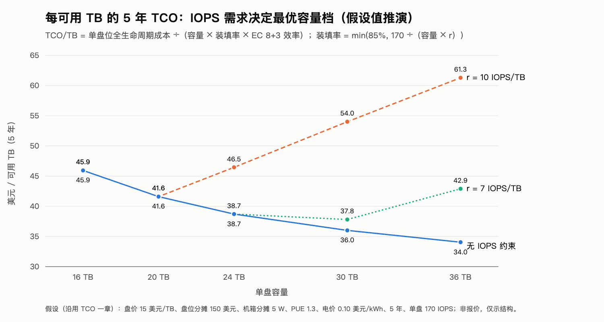
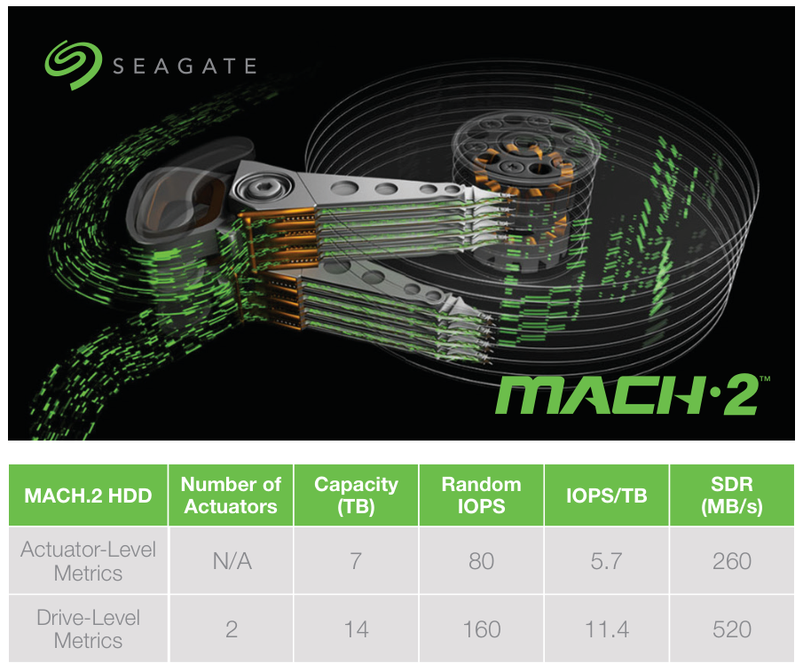

# 让高密度大容量成为真实需求：行动建议

> 综合分析 · 基于前文各章来源事实的工程推论与行动建议

前面几章分别从 IOPS/TB、重建与可靠性、写入模型、TCO 与机房、国内客户画像几个方面，分析了大容量 HDD 在 EB 级大数据存储里受到的约束。本章把这些结论落到 HDD 提供方的行动上，要回答的问题是：提供方要做什么，客户才会**真正需要**高密度、大容量的盘，而不是被动接受。这里的“真实需求”有一个可检验的定义：客户把自己的 IOPS 需求、装填率、冗余方式和电价代入 TCO 公式后，更大的盘在每可用 TB 成本、每柜 PB 数和单位容量能耗上确实更优，并且不会突破 P99 延迟和修复时间的 SLA。达不到这个定义的场景不去硬推。行动按器件、系统与软件、方案与商业三层展开，每项标出针对国内客户一章 12 条原因中的哪几条，最后给出分期路线图。来源事实沿用前文各章引用；行动建议和测算属于**工程推论**，“假设”数值需用客户数据替换。资料采集于 2026-11-19。

### 出发点：真实需求的三个条件

TCO 一章给出的模型是 `TCO/可用 TB = L ÷ (C × u × η)`，其中装填率 `u = min(u_ops, IOPS_d ÷ (C × r))`。由此可以直接写出“大盘不被 IOPS 拖累”的容量上限（**工程推论**）：`C_max = IOPS_d ÷ (r × u_ops)`。取单盘 170 IOPS（Seagate 手册 4K QD16 口径 [KI1]）、运维水位 85%：r = 5 IOPS/TB 时 C_max ≈ 40 TB，r = 7 时约 28.6 TB，r = 10 时只有 20 TB。如果换成双 actuator 的 304 IOPS [KI3]，r = 7 和 r = 10 对应的上限分别升到约 51 TB 和 36 TB。若客户的 r 是按 QD1 这种更保守的口径（80 IOPS [KI6]）统计的，上限还要再减半。Seagate 自己的 MACH.2 白皮书也认为多数数据中心应用需要 5–10 IOPS/TB [KI4]。

*本报告按 TCO 一章的模型与假设重算的每可用 TB 五年 TCO：没有 IOPS 约束时 36 TB 最便宜；r = 7 IOPS/TB 时最优点在 24–30 TB；r = 10 时退到 20 TB（假设值推演，非报价）* — [原始来源](https://www.seagate.com/files/www-content/solutions/mach-2-multi-actuator-hard-drive/files/tp714.1-1910us-mach-2-technology-paper.pdf)

据此，客户对更大容量的需求要同时满足三个条件才是真实的：

1. **IOPS 条件**：客户实际的 r（按 P99 SLO 折算，而不是按平均值）低于 `IOPS_d ÷ (C × u_ops)`。达不到时，要么由器件提高 IOPS_d（多 actuator），要么由系统降低落到 HDD 上的 r（闪存层、大 IO、热度打散）。
2. **修复条件**：满盘重建时间 `T = C ÷ B_eff` 不随容量变长。容量从 16 TB 升到 36 TB，有效重建带宽 B_eff 也要提高到 2.25 倍，否则 MTTDL 会按 `(λ·T)^f` 的规律变差（重建一章的推论 [KR3]）。这要靠去簇重建、LRC 和修复调度，而不是靠单盘。
3. **商业条件**：新容量点每可用 TB 的到手价，加上配套闪存、网络和认证成本，仍低于客户现有容量点。Backblaze 的经验是新容量的每 GB 价格要等一段时间才能“下穿”老容量 [KC18]；如果首发溢价吃掉了全部 TCO 差，客户说“不需要”也是合理的。

国内客户画像一章把 12 条原因分成三类：硬约束（IOPS/TB、混部集群的补块）、可以用系统方案消除的（元数据和小 IO、冷数据 EC 与大盘专池、SMR 写路径）、可以用商业方案消除的（首发溢价、集采规范滞后、国产平台适配），另有一条叙事问题（“先进存力 = 闪存”）。下表把各层行动和这些原因对应起来：

| 客户顾虑（编号见国内客户一章） | 性质 | 主要对策层 | 对应行动 |
|---|---|---|---|
| 1 计算存储混部，服务器数由算力决定 | 架构性，部分可消除 | 系统 | 存算分离的冷温层与大盘专池（参照阿里 OSS-HDFS [BA4]）；HDFS ARCHIVE 节点 |
| 2 三副本热温层 IOPS/TB 要求高 | 硬约束 | 器件 + 系统 | 多 actuator；热层不推最大容量；温冷层 EC 化 |
| 3 小文件、元数据、随机小 IO | 可消除 | 系统 | 按角色配闪存（元数据 / WAL / 写缓冲）；小文件合并 |
| 4 盘越满越慢，新节点成热点 | 可消除 | 系统 | 热度感知放置；新容量均匀打散，冷数据回填大盘 |
| 5 重建 / 补块窗口 | 可消除（需改架构） | 器件 + 系统 | 去簇重建、LRC、修复限流调参；depopulation |
| 6 软件栈版本滞后 | 可消除 | 系统（生态） | EC 客户端兼容、SMR 适配套件、上游贡献 |
| 7 整机集采、规范冻结 | 商业 | 商业 | 提前进入整机厂与运营商的技术规范 |
| 8 国产平台适配 | 商业 | 商业 | 与国产 CPU 整机厂预认证，发布兼容性清单 |
| 9 首发容量溢价 | 商业 | 商业 | 按可用 TB 报价、跨容量价格保护 |
| 10 政策口径不计 HDD | 叙事 | 商业 | 用 kWh/TB、硬件高密等官方指标参与讨论 |
| 11 单柜功率与机型 | 可转化为优势 | 方案 | 4–5 kW 机柜下的 PB/柜实测与高密机型参考配置 |
| 12 运维经验与爆炸半径 | 可消除 | 器件 + 方案 | 部分失效处理、故障域设计、试点数据 |

### 器件层：把“每 TB 的能力”和容量一起交付

- **多 actuator，提高 IOPS_d**（针对原因 2）。Exos 2X18 双 actuator 随机读 304 IOPS、持续传输 554 MB/s，是同代单 actuator 的约 1.8 倍 [KI3][KI12]。OCP 规范要求多 actuator 设备线性扩展，相互干扰损失不超过 3% [KI6]。Dropbox 也写到，未来可能需要双磁臂盘来满足 IOPS/TB，“只有一个 IO 通道时，密度提升终有尽头” [DBX7]。Seagate FAQ 给出的功耗代价是：随机读时双 actuator 盘功耗比单 actuator 盘高不到 20% [BH10]。竞争对手也在跟进：WD 公布了多磁头并行的“高带宽盘”和计划 2028 年推出的“双枢轴”设计 [BH11]。按器件一章的推算，单 actuator 的 44 TB 盘只有约 3.9 IOPS/TB，已经低于 5–10 IOPS/TB 区间的下沿。**建议**：在 30 TB 以上容量点提供双 actuator 型号，并给出两种形态下文件系统和 EC 层的配置指南。SAS 形态以两个 LUN 呈现；SATA 形态是一个设备，前后各 50% LBA 分属两个 actuator，Linux 5.19 起通过 `independent_access_ranges` 暴露这一划分 [BH9][BH10]。没有配置指南，客户在 SATA 形态上可能拿不到标称收益。
- **尾延迟控制**（针对原因 2、4）。Brewer 在 FAST'16 列出的数据中心盘需求里，排在前面的就是尾延迟、按读设定重试策略、主机控制后台任务和按 IO 设定优先级 [KI7]；OCP 规范要求 4K QD1 随机读 P99 不超过 20 ms [KI6]。Command Duration Limits（CDL）让主机为每条命令设定时限和超时策略；Exos M 32 TB 支持 CDL，最小时限 10 ms，WD HC690 也支持，但 Linux 6.5 起提供的 `cdl_enable` 默认关闭 [BH5][BH13][BH21][BH22]。**建议**：大容量型号默认支持 CDL，帮客户在内核和存储软件里真正打开它，并提供 HDFS hedged read、Ceph mClock 等上层机制与 CDL 联动的参考配置。尾延迟是 IOPS/TB 约束最早暴露的地方（IOPS 一章的推论），这一项的价值比提高平均 IOPS 更直接。
- **部分失效与 depopulation**（针对原因 5、12）。WD HC690、Seagate 32 TB 与 36 TB 手册都实现了存储元件 depopulation 命令，OCP 规范 COMM-9 也要求支持 [KR8][KR10][KR9][KR11]。按重建一章的推论，20 头的 36 TB 盘坏一个磁头约损失 1.8 TB；如果能以保留数据的方式处理（分区设备上只把受影响的 zone 下线），需要修复的数据只有整盘的约 1/20。**建议**：把“保留数据的 depopulation”作为大容量型号的差异化能力做实，并在 Ceph、HDFS 侧提供把“部分容量丢失”转成“局部补块”的工具，而不是整盘下线。
- **年负载额定值与后台流量**（针对原因 5）。Exos M 24–32 TB 和 WD HC690 的年负载额定都是 550 TB/年，36 TB SMR 型号为 750 TB/年，读写都计入 [KI11][KI5][KI2]。**工程推论**：36 TB 盘每月做一次全盘巡检，一年读 432 TB，占 550 TB/年 的 79%、750 TB/年 的 58%，还没算前台、重建和再均衡。**建议**：大容量型号提高或明确后台读的额定口径，并给出巡检周期的推荐值；否则客户的运维规范会自己把容量“压小”。
- **功耗模式**（针对原因 11）。单盘空闲功耗在同一平台内不随容量变化，W/TB 随容量下降 [KT1][KT3]；Dropbox 用 Deep Sleep 让空闲盘降速待机，数分钟内恢复服务 [DBX11]；Azure Pelican 在一个机架里只让 96 块盘同时转动，靠调度换取 PB/柜 [BZ3]。Seagate 36 TB 手册列出的 EPC 状态从平均空闲 6.53 W 到停转待机 1.01 W，从待机到就绪典型 30 秒；OCP 规范则要求出厂时 EPC 定时器全部关闭 [BH6][BH20]。WD 已宣布功耗降低 20%、以少量随机 IO 能力换容量和功耗的温冷层“功耗优化”盘，预计 2027 年进入客户认证 [BH11]。**建议**：对冷归档和温冷层提供由主机控制的低功耗状态、唤醒时间指标和上层调度参考配置，配合 4–5 kW 机柜做 PB/柜方案。
- **SMR / zoned 型号**（针对原因 6）。SMR 比同代 CMR 多存 10%–20%（Dropbox） [DBX4]，面密度高约 25%（阿里 SMRSTORE） [BA2]；Seagate 36 TB SMR 与同平台 32 TB CMR 相差 12.5%，WD UltraSMR 相差 23% [KW4][KW8][KW7]。前提是主机按 zone 顺序写，而 2026 年各家的最大容量点恰恰多是 SMR。写入模型一章的推论是：对跑在 ext4 / 非分区 XFS 上的 HDFS、BlueStore 或硬件 RAID 的客户，能用的最大盘其实是 CMR 档；扣掉 GC 预留后，净增益 `(1 + g)(1 − p)(1 − o) − 1`（p 为 GC 预留比例，o 为日志结构开销）在 g = 12.5%、p = 10% 时约为 0。**建议**：同一平台同时提供 CMR 与 SMR 两种格式，让写入模型成为客户的选择而不是门槛；SMR 型号要公开 GC 预留、开放 zone 数上限和恢复时间的实测数据 [KW1][KW4]。
- **NVMe HDD 与路线图**（中长期）。OCP 已发布 NVMe HDD 规范（Microsoft、Seagate、WD 参与），目标是让 HDD 与闪存共用 NVMe 接口和管理栈；规范要求 SMR 盘支持 ZNS，多 actuator 盘把每个 actuator 呈现为独立命名空间 [BH19]；Seagate Mozaic 4+ 平台已在两家超大规模云厂商量产认证，容量最高 44 TB，路线图指向单碟 10 TB、整盘 100 TB [BH1]。**建议**：容量越往上走，越要与 NVMe、多 actuator 绑定发布，否则每 TB 的接口带宽和 IOPS 会继续被摊薄（Ceph 文档“32 TB 与 3 TB 共用同一 SATA 接口”的说法 [BO11]正是客户的直观担忧）。

*Seagate MACH.2 技术白皮书 TP714.2 第 3 页：双 actuator 示意与“单个 actuator / 整盘”指标对照（7 TB、80 IOPS、5.7 IOPS/TB 对 14 TB、160 IOPS、11.4 IOPS/TB），即器件层提高 IOPS_d 的直接手段* — [原始来源](https://www.seagate.com/files/www-content/solutions/mach-2-multi-actuator-hard-drive/files/tp714-dot-2-2006us-mach-2-technology-paper.pdf)

### 系统与软件层：参考架构与生态适配

超大规模用户能用最大的盘，靠的是系统设计：S3 依靠海量租户的统计复用和热度打散 [BS1]，Colossus 让闪存只补 IO 缺口、把冷数据迁到大盘 [BG1][BG6]，Tectonic-Shift 用应用感知的闪存层把生产功耗降低 29% [BM2]，Dropbox 和阿里把写入改造成大块追加写后上了 SMR [DBX2][BA2]。国内多数 HDFS / Ceph 集群没有这些能力，提供方需要把它们做成可复用的**参考架构**，按负载层次给出配置：

| 负载层 | 推荐容量 / 形态 | 冗余与修复 | 闪存配比原则 | 依据 |
|---|---|---|---|---|
| 冷归档、备份、合规留存 | 最大容量点，SMR，可选低功耗模式 | 宽 EC 或跨区 EC；修复限流可放宽 | 只配写缓冲与元数据，按灌入带宽计 | Dropbox 冷层、Pelican、Backblaze [DBX3][BZ3][DBX15] |
| 对象存储 / 数据湖底座（存算分离） | 大容量 SMR 或 CMR，高密 JBOD | EC / LRC；去簇重建 | 元数据与 WAL 上闪存；读缓存按 IO 缺口模拟确定 | OneCOS、SMRSTORE、Pacific [KC12][BA2][BC8] |
| ML 训练语料 | 大容量 HDD + 应用感知闪存层 | EC | 按训练读带宽与预取命中率配闪存 | Tectonic-Shift [BM2] |
| HDFS 温层（EC 冷数据） | 中大容量；大存储机器 ARCHIVE 盘 | RS-6-3 或 LRC；文件 ≥ 6 MB 才转 EC | NameNode / 元数据在闪存 | vivo、滴滴、HDFS 文档 [KC10][KC11][BO2] |
| HDFS 热层（三副本、计算混部） | 不推最大容量；按 C_max 公式选 16–24 TB 或双 actuator | 三副本 | shuffle / 临时数据移出 HDD | 快手、字节 [KC9][KC7] |

参考架构里有三个技术要点需要提供方自己做验证并公开：

- **闪存按角色配，不按主机数配**。元数据和 WAL 的需求与对象数、文件数成正比（Ceph 建议 DB 不小于主设备的 2.5%，RGW 场景 4% [BO11][BO13]，对 36 TB 盘即约 0.9–1.4 TB）；读缓存的需求取决于热数据的 IO 缺口，Google 用 L4 的在线模拟来规划 SSD 采购 [BG4]；写缓冲的需求与灌入带宽成正比。反例是 Dropbox：一台主机一百多块盘共享一块 SSD 写缓存，SSD 先成了瓶颈，拆掉后写吞吐反而提高 15%–20% [DBX5]。
- **修复带宽随容量缩放**。去簇重建（Seagate ADAPT 模型中单盘重建从 55.5 小时降到 5.3 小时） [KR1]、LRC（Azure 在 1.33x 开销下把单分片修复读取从 12 降到 6） [KR2]、Backblaze 的“盘越大、校验越多” [DBX15]，都是可以直接写进参考架构的手段。国内产品也已给出修复速率指标：OceanStor Pacific HDD 机型标称“自动并发重构 2 TB/小时” [BC6]；如果这是单块故障盘可用的速率，36 TB 满盘约需 18 小时（**工程推论**），所以修复速率需要随容量点一起升级。开源栈的默认值偏保守：HDFS 复制流默认 2、硬上限 4，`dfs.datanode.failed.volumes.tolerated` 默认 0 [BO4]；Ceph `osd_max_backfills` 为 1，mClock 默认假设 HDD 为 315 IOPS [BO15]。提供方应按容量点给出经过实测的调参表。
- **热度感知放置**。新写入均匀打散，冷却后的数据回填到大盘，正是 Colossus 的做法 [BG1]，也直接对应字节“新扩容节点成为热点”的问题 [KC7]。对 HDFS，可以用存储策略加 Mover / SPS 实现分层迁移 [BO2]。

**生态适配**（针对原因 6）。国内大量集群仍有 Hadoop 2 客户端，滴滴需要自行移植 EC 客户端 [KC11]；vivo 提到 EC 补块慢，还遇到过补块导致文件损坏的问题 [KC10]。提供方可以做的是：向 Apache HDFS / Ozone / Ceph 上游贡献大容量盘相关的修复加速和测试用例；为 SMR 提供开箱即用的套件，参照 Dropbox 和 SMRSTORE 已经验证过的设计 [DBX2][BA2]。套件要正视 Linux 生态的现状：dm-zoned 官方文档因性能不可预测不推荐使用，F2FS 不支持大于 16 TiB 的设备，XFS 的分区模式 6.15 才加入、仍标为实验性，Ceph BlueStore 的 HM-SMR 支持还是研究项目，HDFS DataNode 不在原生支持名单上 [KW18][KW19][KW21][KW23]。所以套件的重点是对象存储引擎样例（zonefs / 用户态引擎）、Btrfs / XFS 分区模式的验证配置、zone 对齐的写缓冲参数和 GC 限流，以及参照 Dropbox SMRtest 的规模压测工具 [KW22][KW9]；与国内自研栈（腾讯 YottaStore、华为 Pacific 等）做联合适配。Backblaze 说 SMR 导入“与其说是换盘，不如说是立项” [DBX12]，提供方要做的就是替客户把这个项目的大部分工作提前做掉。

### 方案与商业层：按可用 TB 算账，按场景分层推进

- **按每可用 TB 报价的 TCO 工具**（针对原因 9）。工具输入客户自己的 r、IO 大小分布、水位线、冗余方式、机柜功率、电价和盘位成本，输出各容量档的每可用 TB 成本、PB/柜和修复时间，而不是只比 $/TB 与 W/TB。工具同时要能如实算出“这个场景下最优容量是 20 TB”。对新容量点提供跨容量价格保护或按可用 TB 计价，消除客户等待“价格下穿”的理由 [KC18]。
- **场景分层推进**。优先推冷归档、备份、对象存储底座、EC 化的数据湖和带闪存层的 ML 语料库；HDFS 三副本热层只推中等容量或双 actuator（见下一节）。
- **与国产整机厂、国产 CPU 平台预认证**（针对原因 7、8）。中国电信 2024–2025 年服务器集采中国产化占比 67.5%（媒体报道） [KC17]。新容量点应在发布时就完成主流国产 CPU 平台和整机厂的兼容性验证，赶在运营商下一轮技术规范冻结之前进入规范。
- **对齐政策指标**（针对原因 10、11）。《行动计划》列举的先进存储技术里包括“硬件高密” [KC2]，信通院的存力白皮书也把硬件高密列入绿色能效 [KC4]；华为与罗兰贝格的白皮书把单位存储容量能耗（kWh/TB）列为国家级绿色指标，中国 2023 年为 470 kWh/TB [KC1]。国内运营商在用机房平均单柜约 4.46 kW [KC15]，TCO 一章的推演显示，此时每柜 PB 数大致与单盘容量成正比。提供方应拿出**系统级**实测的 kWh/TB 和 PB/柜，而不是只引用单盘 W/TB 或未经同口径核对的隐含碳声明。
- **与标杆客户联合验证**（针对原因 12）。按下一章的验证方案，在客户的冷温层做试点，把访谈、测试、试点数据整理成可以公开引用的案例。对运维团队来说，自家集群的数据比任何厂商白皮书都有说服力。

### 不该硬推的地方

以下场景中，“容量不需要太大”是客户的正确判断，提供方应当承认，并推荐中等容量或其他形态：

- **IOPS 受限的热层**：三副本、计算混部、小文件多的 HDFS 热层，r 往往在 7–10 IOPS/TB 以上。按上文公式，单 actuator 盘的最优点在 20–24 TB，推 30 TB 以上只会抬高每可用 TB 成本（TCO 一章的推演）。这里可推的是双 actuator，或者把热数据搬到闪存、把冷数据搬出去。
- **没有统计复用的小集群**：几十 PB、单租户、负载突发明显的集群，缺少 S3 那样的平滑效应 [BS1]；节点少，参与修复的盘也少（Ceph 文档对 OSD 数与恢复并行度的说明 [KR5]）。
- **修复架构不变的 RAID 系统**：单目标盘重建在 36 TB 时即使 200 MB/s 满速也要 50 小时（重建一章推演）；RAID 6 掉盘时性能下降 41%–62% [KR1]。不改为去簇重建之前，不宜换最大容量。
- **首发溢价覆盖了 TCO 差的时间窗**：在价格下穿之前，硬推只会消耗客户信任。

还要看到 HDD 两头都有竞争。高性能一侧，华为全闪机型 9926 的数据手册直接拿 HDD 作对比，称容量密度是 HDD 存储的 8 倍、重构效率是 3 倍 [BC6]；深度归档一侧，华为云 TapeOBS 按 10 年测算，磁带 TCO 比 HDD 归档低 4.95 倍，HDD 池只保留约为磁带 4% 的容量做暂存和取回缓冲 [BC14]。**工程推论**：大容量 HDD 最稳固的位置是中间的“温冷在线容量层”，即需要分钟级以内随时读取、又不值得用闪存的数据，包括数据湖、对象存储底座、ML 语料和在线备份。提供方的资源应当集中在这里，而不是去和闪存争热层，或和磁带争很少读取的深度归档。

在这些地方主动说“不”，反而能提高提供方在冷温层推荐最大容量时的可信度。

### 分期路线图

| 期限 | 行动 | 责任方 | 消除的顾虑 | 预期效果 | 依据 |
|---|---|---|---|---|---|
| 短期（0–6 个月） | 发布按可用 TB 计算的 TCO 工具与访谈模板；补齐大容量型号的随机 IOPS、QD1 与 P99 数据 | 方案架构团队、产品线 | 2、9 | 销售对话从 $/TB 转到每可用 TB；客户能自己算出 C_max | TCO 模型、MACH.2 白皮书 [KI4] |
| 短期 | HDFS / Ceph 大容量调参表（修复并发、failed volumes、mClock 容量）及实测修复时间 | 生态与开源团队 | 5、6、12 | 修复时间不随容量线性增长的实证 | HDFS、Ceph 文档默认值 [BO4][BO15] |
| 短期 | 与 2–3 家标杆客户在冷温层启动联合验证 | 销售、方案团队、客户 | 1、12 | 可公开引用的国内案例 | 下一章验证方案 |
| 中期（6–18 个月） | 国产 CPU 平台与整机厂预认证，进入运营商技术规范 | 商务、整机厂 | 7、8 | 新容量点在发布同期进入集采 | 运营商集采结构 [KC16][KC17] |
| 中期 | 参考架构（分层配置、按角色配闪存、去簇重建 / LRC）与 SMR 适配套件 | 方案团队、生态团队 | 3、4、5、6 | 系统可消除类顾虑转为配置问题 | Colossus、Tectonic-Shift、SMRSTORE、Dropbox [BG1][BM2][BA2][DBX2] |
| 中期 | 30 TB 以上双 actuator 型号与 CDL 默认支持；保留数据的 depopulation | 产品线 | 2、5、12 | C_max 上移约 1.8 倍；部分失效只补局部 | Exos 2X18、OCP 规范 [KI3][KI6] |
| 中期 | 系统级 kWh/TB、PB/柜实测白皮书（4–5 kW 机柜） | 市场、方案团队 | 10、11 | 进入“硬件高密”“单位容量能耗”讨论 | 政策与白皮书 [KC1][KC2] |
| 长期（18–36 个月） | NVMe HDD 与 HAMR 大容量点同步提供多 actuator / 高 IOPS 形态；上游贡献修复加速 | 产品线、生态团队 | 2、5、6 | 容量增长不再单独摊薄每 TB 能力 | OCP NVMe HDD、Mozaic 路线图 [BH19][BH1] |

**资料边界**：本章的行动建议是根据前文各章的来源事实推出来的，没有经过实测。C_max、巡检占用年负载额定、闪存配比等数字都按公式计算；TCO 图沿用 TCO 一章的假设值，不是报价。路线图的期限和责任方划分是建议，具体要以提供方的组织方式和客户节奏为准。

## 本章资料

- **[BA2]** [USENIX FAST '23 · Su Zhou et al.（阿里巴巴）：SMRSTORE: A Storage Engine for Cloud Object Storage on HM-SMR Drives（2023-02）](https://www.usenix.org/system/files/fast23-zhou-su.pdf)
- **[BA4]** [阿里云帮助中心 · 对象存储 OSS 用户指南：什么是 OSS-HDFS 服务（采集于 2026-11-19）](https://help.aliyun.com/zh/oss/user-guide/overview-1)
- **[BC6]** [华为 · Huawei OceanStor Pacific Series Intelligent Scale-Out Storage Data Sheet（V800R001C20，H1 2026）](https://e-file.huawei.com/marketingcloud/pep/asset/20000001/Material/e93718c9bf1f4d25894b75a514630af8/M3T1A590N1246193369071251686/Huawei%20OceanStor%20Pacific%20Series%20V800R001C20-Data%20Sheet%20_H1%2026_.pdf)
- **[BC8]** [华为 · Huawei OceanStor Pacific Series 8.2.0 Technical White Paper（Issue 01，2024-01-30）](https://e-file.huawei.com/marketingcloud/pep/asset/20000001/Material/f22d2e7ee29d4d06bfd045a471f28775/M3T1A669N1135398139631067387/Huawei%20OceanStor%20Pacific%20Series%208_2_0-Technical%20White%20Paper_24H1_.pdf)
- **[BC14]** [USENIX FAST '26 · Qing Wang et al.（清华大学 / 华为云）：Cost-efficient Archive Cloud Storage with Tape: Design and Deployment（2026-02）](https://www.usenix.org/system/files/fast26-wang.pdf)
- **[BG1]** [Google Cloud Blog · Dean Hildebrand, Denis Serenyi：Colossus under the hood: a peek into Google’s scalable storage system（2021-04-20；本地网络无法直连原站，正文据原文打印版 PDF 核对，见 BG2）](https://cloud.google.com/blog/products/storage-data-transfer/a-peek-behind-colossus-googles-file-system)
- **[BG4]** [Gimasys（Google Cloud Premier Partner）· Colossus under the hood: How we deliver SSD performance at HDD prices（英文转载 / 编译版，2025-04-15，采集于 2026-11-19）](https://gcloudvn.com/en/kienthuc/colossus-under-the-hood-how-we-deliver-ssd-performance-at-hdd-prices/)
- **[BG6]** [Google · Tzu-Wei Yang 等：CacheSack: Admission Optimization for Google Datacenter Flash Caches（USENIX ATC 2022）](https://www.usenix.org/system/files/atc22-yang-tzu-wei.pdf)
- **[BH1]** [Seagate 投资者关系 · Seagate Delivers Industry's Highest Capacity Hard Drives with Next-Generation Mozaic 4+（新闻稿，2026-03-03，采集于 2026-11-19）](https://investors.seagate.com/news/news-details/2026/Seagate-Delivers-Industrys-Highest-Capacity-Hard-Drives-with-Next-Generation-Mozaic-4/default.aspx)
- **[BH5]** [Western Digital · Tech Brief: Continuous Innovation for Highest Capacities and Lower TCO（HelioSeal、TSA、ePMR、OptiNAND、ArmorCache、UltraSMR、11 碟，2024-10，采集于 2026-11-19）](https://documents.westerndigital.com/content/dam/doc-library/en_us/assets/public/western-digital/collateral/tech-brief/technical-brief-continuous-innovation.pdf)
- **[BH6]** [Western Digital · Ultrastar DC HC690 (SATA) Hard Disk Drive Specification（28–32 TB 主机管理型 SMR、11 碟 22 头、64GB iNAND、256MiB 区域、CDL 特性集，采集于 2026-11-19）](https://documents.westerndigital.com/content/dam/doc-library/en_us/assets/public/western-digital/product/data-center-drives/ultrastar-dc-hc600-series/product-manual-ultrastar-dc-hc690-sata.pdf)
- **[BH9]** [Seagate 投资者关系 · Seagate's Breakthrough 30TB+ Hard Drives Ramp Volume, Marking an Inflection Point in the Storage Industry（Mozaic 3+ 新闻稿，2024-01-17，采集于 2026-11-19）](https://investors.seagate.com/news/news-details/2024/Seagates-Breakthrough-30TB-Hard-Drives-Ramp-Volume-Marking-an-Inflection-Point-in-the-Storage-Industry/default.aspx)
- **[BH10]** [Seagate 博客 · Christina Bassani：随着数据量的增长，Mozaic（魔彩盒）也随之不断扩展（2026-03-03，采集于 2026-11-19）](https://www.seagate.com/blog/as-data-grows-mozaic-keeps-scaling-with-it/)
- **[BH11]** [Seagate · Exos 数据手册 DS2046.1-2512（12–32 TB 型号随机读写 4K QD16 与持续传输，2025-12，采集于 2026-11-19）](https://www.seagate.com/content/dam/seagate/en/content-fragments/products/datasheets/exos-portfolio-refresh/exos-ds2046.1-2512-en_us_V2_en_AS.pdf)
- **[BH13]** [Seagate · Exos 2X18 数据手册 DS2093.1-2202（MACH.2 双执行器，304/560 IOPS、554 MB/s，2022-02，采集于 2026-11-19）](https://www.seagate.com/www-content/datasheets/pdfs/exos-2x18-DS2093-1-2202US-en_US.pdf)
- **[BH19]** [Toshiba · MG11 Series Enterprise Hard Drives 产品页（第二代 FC-MAMR、10 碟、每碟 2.4TB、最高 24TB，采集于 2026-11-19）](https://storage.toshiba.com/enterprise-hdd/cloud-scale-capacity/mg11-series)
- **[BH20]** [Open Compute Project · NVMe HDD Specification Revision 1.0b（Microsoft / Seagate / Western Digital，2023-04-20；PCIE-1/2、NBASE-7、NVME-1~5，采集于 2026-11-19）](https://www.opencompute.org/documents/ocp-nvme-hdd-spec-rev1-0b-2023-4-20-docx-1-pdf/)
- **[BH21]** [Linux 内核文档 · Documentation/ABI/testing/sysfs-block-device（cdl_supported / cdl_enable，KernelVersion v6.5，采集于 2026-11-19）](https://www.kernel.org/doc/Documentation/ABI/testing/sysfs-block-device)
- **[BH22]** [Western Digital 官方 GitHub · cdl-tools：Command Duration Limits utilities（cdladm README，采集于 2026-11-19）](https://github.com/westerndigitalcorporation/cdl-tools)
- **[BM2]** [Meta & Stanford · Mark Zhao 等：Tectonic-Shift: A Composite Storage Fabric for Large-Scale ML Training（USENIX ATC 2023）](https://www.usenix.org/system/files/atc23-zhao.pdf)
- **[BO2]** [Apache Hadoop 官方文档 · Archival Storage, SSD & Memory（Hadoop 3.3.5）](https://hadoop.apache.org/docs/stable/hadoop-project-dist/hadoop-hdfs/ArchivalStorage.html)
- **[BO4]** [Apache Hadoop 官方文档 · hdfs-default.xml 默认配置（Hadoop 3.3.5）](https://hadoop.apache.org/docs/stable/hadoop-project-dist/hadoop-hdfs/hdfs-default.xml)
- **[BO11]** [Ceph 官方文档 · Storage Devices（开发版 latest）](https://docs.ceph.com/en/latest/start/hardware-storage-devices/)
- **[BO13]** [Ceph 官方文档 · BlueStore Configuration Reference（开发版 latest）](https://docs.ceph.com/en/latest/rados/configuration/bluestore-config-ref/)
- **[BO15]** [Ceph 官方文档 · mClock Config Reference（开发版 latest）](https://docs.ceph.com/en/latest/rados/configuration/mclock-config-ref/)
- **[BS1]** [All Things Distributed（Werner Vogels 博客）· Andy Warfield 客座文章：Building and operating a pretty big storage system called S3（2023-07-27）](https://www.allthingsdistributed.com/2023/07/building-and-operating-a-pretty-big-storage-system.html)
- **[BZ3]** [USENIX OSDI '14 · Balakrishnan 等（Microsoft Research / Microsoft）：Pelican: A Building Block for Exascale Cold Data Storage（2014-10）](https://www.usenix.org/system/files/conference/osdi14/osdi14-paper-balakrishnan.pdf)
- **[DBX2]** [Dropbox Tech Blog · Extending Magic Pocket Innovation with the first petabyte scale SMR drive deployment（Magic Pocket Hardware Engineering Teams，2018-06-12）](https://dropbox.tech/infrastructure/extending-magic-pocket-innovation-with-the-first-petabyte-scale-smr-drive-deployment)
- **[DBX3]** [Dropbox Tech Blog · How we optimized Magic Pocket for cold storage（Preslav Le，2019-05-06）](https://dropbox.tech/infrastructure/how-we-optimized-magic-pocket-for-cold-storage)
- **[DBX4]** [Dropbox Tech Blog · SMR: What we learned in our first year（Magic Pocket Hardware Engineering Teams，2019-07-30）](https://dropbox.tech/infrastructure/smr-what-we-learned-in-our-first-year)
- **[DBX5]** [Dropbox Tech Blog · Increasing Magic Pocket write throughput by removing our SSD cache disks（2022-12-08）](https://dropbox.tech/infrastructure/increasing-magic-pocket-write-throughput-by-removing-our-ssd-cache-disks)
- **[DBX7]** [Dropbox Tech Blog · After four years of SMR storage, here's what we love—and what comes next（Eric Shobe，2023-03-08）](https://dropbox.tech/infrastructure/four-years-of-smr-storage-what-we-love-and-whats-next)
- **[DBX11]** [Dropbox Tech Blog · Improving infrastructure efficiency for growing demand in the age of AI（Ilya Yakovlev，2026-08-18）](https://dropbox.tech/infrastructure/improving-infrastructure-efficiency-for-growing-demand-in-the-age-of-ai)
- **[DBX12]** [Backblaze Blog · Backblaze Drive Stats for Q2 2026（Stephanie Doyle，2026-09-29）](https://www.backblaze.com/blog/backblaze-drive-stats-for-q2-2026/)
- **[DBX15]** [Backblaze Blog · How Backblaze Scales Our Storage Cloud（CVT 迁移，Andy Klein，2024-05-21）](https://www.backblaze.com/blog/how-backblaze-scales-our-storage-cloud/)
- **[KC1]** [华为 · 罗兰贝格《先进数据存力白皮书》（2024-09-20 发布；本章读取本地 PDF 文本，图 2-2 方案级 TCO、图 2-14 单位存储容量能耗、闪存化率与国产 NAND 建议；链接为中关村在线发布报道）](https://news.zol.com.cn/902/9023402.html)
- **[KC2]** [国务院客户端（gov.cn）· 《算力基础设施高质量发展行动计划》配套解读（2023-10；“强化存力高效灵活保障”：闪存化升级、鼓励使用自主存储设备）](http://app.www.gov.cn/govdata/gov/202310/10/508085/article.html)
- **[KC4]** [新华网 · 《中国存力白皮书（2023年）》发布，阐明先进存力特征（2023-08-19；先进介质“以 SSD 为代表的半导体介质”，绿色能效含硬件高密）](http://www.news.cn/tech/20230819/dbbdb05c4fbb4bf4965e0e5dc4e52cce/c.html)
- **[KC7]** [火山引擎开发者社区（字节跳动技术团队）· 9年演进史：字节跳动 10EB 级大数据存储实战（十万台级、10 EB 级；慢节点、写降级与随机小 IO）](https://developer.volcengine.com/articles/7317094371705241609)
- **[KC9]** [InfoQ（DataFunTalk）· 快手 EB 级 HDFS 挑战与实践（2021-04-13；DN 与 NodeManager 混布、磁盘限速器、负载选盘）](https://www.infoq.cn/article/xcool3iioiryf5kb0k31)
- **[KC10]** [vivo 互联网技术（博客园官方账号）· vivo HDFS EC 大规模落地实践（2025-10-16；EC 仅用于冷数据、补块时间长、大存储机器 Archive 盘）](https://www.cnblogs.com/vivotech/p/19145157)
- **[KC11]** [滴滴技术（搜狐转载）· 滴滴使用 HDFS EC 节约大量存储的实践（2021-01-29；冷数据转 EC、平均文件 ≥ 6 MB、Hadoop 2.7 客户端兼容）](https://www.sohu.com/a/447407254_315839)
- **[KC12]** [腾讯云开发者社区 · TStor OneCOS 2022 新版本发布（2022-09-26；60 盘位自研服务器、20 TB 盘、NVMe SSD 承接 WAL）](https://cloud.tencent.cn/developer/article/2125835)
- **[KC15]** [开放数据中心委员会（ODCC）· 数据中心功率密度演进白皮书 ODCC-2021-05002（2021-09-15；运营商在用数据中心平均单机架功率）](https://13115299.s21i.faiusr.com/61/1/ABUIABA9GAAg5OLwjQYouLTRvQQ.pdf)
- **[KC16]** [电子工程专辑（媒体报道）· 中国电信 20 万台服务器集采国产芯片占比 27%（2022-03；存储型、冷存储型标包）](https://www.eet-china.com/news/202203240112.html)
- **[KC17]** [新浪财经转载通信产业网（媒体报道）· 国产占比 67.5%！中国电信 15.6 万台服务器集采出炉（2024-10-24）](https://finance.sina.com.cn/stock/relnews/cn/2024-10-24/doc-inctruic2702893.shtml)
- **[KC18]** [Backblaze 官方博客 · Why Now Is the Time for Backblaze to Build a 270TB Storage Pod（2014-08-12；容量切换价差与 cross-under）](https://www.backblaze.com/blog/why-now-is-the-time-for-backblaze-to-build-a-270-tb-storage-pod/)
- **[KI1]** [Seagate · Exos 数据手册 DS2046.1-2512（12–32 TB 型号规格：随机读写 4K QD16、OD 持续传输、平均延迟，2025-12，采集于 2026-11-19）](https://www.seagate.com/content/dam/seagate/en/content-fragments/products/datasheets/exos-portfolio-refresh/exos-ds2046.1-2512-en_us_V2_en_AS.pdf)
- **[KI2]** [Seagate · Exos SATA Product Manual 36TB（ST36000NM001M，SMR，Publication 210960600 Rev C，2026-05；含 10 碟 20 头、270 MB/s、<750 TB/年额定负载、Depopulation 命令支持，采集于 2026-11-19）](https://www.seagate.com/content/dam/seagate/assets/support/internal-hard-drive/enterprise-hard-drives/x-mozaic/_shared/files/Seagate_Exos_SATA_Product_Manual_36TB_210960600C.pdf)
- **[KI3]** [Seagate · Exos 2X18 数据手册 DS2093.1-2202（MACH.2 双 actuator，304/560 IOPS、554 MB/s，2022-02，采集于 2026-11-19）](https://www.seagate.com/www-content/datasheets/pdfs/exos-2x18-DS2093-1-2202US-en_US.pdf)
- **[KI4]** [Seagate · MACH.2 Multi-Actuator Technology Paper TP714.2（IOPS/TB 与 TCO、5–10 IOPS/TB 需求区间，2020-06，采集于 2026-11-19）](https://www.seagate.com/files/www-content/solutions/mach-2-multi-actuator-hard-drive/files/tp714-dot-2-2006us-mach-2-technology-paper.pdf)
- **[KI5]** [Western Digital · Ultrastar DC HC690 (SATA) Hard Disk Drive Specification（28–32 TB，持续传输、功耗表中随机读 IO/s、550 TB/年负载、Storage Element Depopulation，采集于 2026-11-19）](https://documents.westerndigital.com/content/dam/doc-library/en_us/assets/public/western-digital/product/data-center-drives/ultrastar-dc-hc600-series/product-manual-ultrastar-dc-hc690-sata.pdf)
- **[KI6]** [Open Compute Project · Datacenter SAS-SATA Device Specification Version 1.0（Meta / Microsoft / HPE，2023-03-28；PERF-RD-1、LAT-1、MULTIA-1、REL-5、COMM-9，采集于 2026-11-19）](https://www.opencompute.org/documents/datacenter-sas-sata-device-specification-rev-1-0-pdf/)
- **[KI7]** [USENIX FAST '16 · Eric Brewer（Google）主题演讲 “Disks and their Cloudy Future” 幻灯片（2016-02-23，配套白皮书 Disks for Data Centers，采集于 2026-11-19）](https://www.usenix.org/conference/fast16/technical-sessions/presentation/brewer)
- **[KI11]** [Seagate · Exos SATA Product Manual 32/30/28/24TB（Exos M，Publication 210048100 Rev E，2025-12；10 碟 20 头、<550 TB/年额定负载，采集于 2026-11-19）](https://www.seagate.com/content/dam/seagate/assets/support/internal-hard-drives/enterprise-hard-drives/exos-m/_shared/files/Seagate_Exos_SATA_Product_Manual_32-30-28-24TB_210048100E.pdf)
- **[KI12]** [Seagate · Exos X18 数据手册 DS2045.3-2102（170/550 IOPS，2021-02，采集于 2026-11-19）](https://www.seagate.com/www-content/datasheets/pdfs/exos-x18-channel-DS2045-3-2102US-en_US.pdf)
- **[KR1]** [Seagate · ADAPT: Rapid-Rebuild Technology 技术白皮书 SB505.1-1808（RAID 6 8+2 与 24/56/106 盘 ADAPT 的重建时间与性能影响，模型计算值，2018-08，采集于 2026-11-19）](https://www.seagate.com/content/dam/seagate/migrated-assets/www-content/solutions/backup/backup-and-recovery/adapt-technology.pdf)
- **[KR2]** [USENIX ATC '12 · Huang et al.（Microsoft）“Erasure Coding in Windows Azure Storage”（LRC，2012-06，采集于 2026-11-19）](https://www.usenix.org/conference/atc12/technical-sessions/presentation/huang)
- **[KR3]** [PVLDB Vol.6 No.5（VLDB 2013）· Sathiamoorthy et al.（USC / UT Austin / Facebook）“XORing Elephants: Novel Erasure Codes for Big Data”（HDFS-Xorbas，采集于 2026-11-19）](https://www.vldb.org/pvldb/vol6/p325-sathiamoorthy.pdf)
- **[KR5]** [Ceph 官方文档 · Placement Groups（Data durability：OSD 故障、恢复并行度与级联故障示例，采集于 2026-11-19）](https://docs.ceph.com/en/latest/rados/operations/placement-groups/)
- **[KR8]** [Western Digital · Ultrastar DC HC690 (SATA) Hard Disk Drive Specification（10.23 Storage Element Depopulation Feature Set、REMOVE ELEMENT AND MODIFY ZONES 的 zone 状态转换，采集于 2026-11-19）](https://documents.westerndigital.com/content/dam/doc-library/en_us/assets/public/western-digital/product/data-center-drives/ultrastar-dc-hc600-series/product-manual-ultrastar-dc-hc690-sata.pdf)
- **[KR9]** [Seagate · Exos SATA Product Manual 36TB（ST36000NM001M，SMR，Publication 210960600 Rev C，2026-05；AFR 0.35%、Depopulation 命令与能力字段，采集于 2026-11-19）](https://www.seagate.com/content/dam/seagate/assets/support/internal-hard-drive/enterprise-hard-drives/x-mozaic/_shared/files/Seagate_Exos_SATA_Product_Manual_36TB_210960600C.pdf)
- **[KR10]** [Seagate · Exos SATA Product Manual 32/30/28/24TB（Exos M，Publication 210048100 Rev E，2025-12；10 碟 20 头、Get Physical Element Status / Remove Element And Truncate / Restore Elements And Rebuild，采集于 2026-11-19）](https://www.seagate.com/content/dam/seagate/assets/support/internal-hard-drives/enterprise-hard-drives/exos-m/_shared/files/Seagate_Exos_SATA_Product_Manual_32-30-28-24TB_210048100E.pdf)
- **[KR11]** [Open Compute Project · Datacenter SAS-SATA Device Specification Version 1.0（Meta / Microsoft / HPE，2023-03-28；COMM-9 逻辑 depopulation、REL-5/6 负载基准，采集于 2026-11-19）](https://www.opencompute.org/documents/datacenter-sas-sata-device-specification-rev-1-0-pdf/)
- **[KT1]** [Seagate · Exos 数据手册 DS2046.1（2025-12；2–32 TB 各容量 Idle A / 最大运行功耗、随机 IOPS、持续传输率，采集于 2026-11-19）](https://www.seagate.com/content/dam/seagate/en/content-fragments/products/datasheets/exos-portfolio-refresh/exos-ds2046.1-2512-en_us_V2_en_AS.pdf)
- **[KT3]** [Western Digital · Ultrastar DC HC690 Data Sheet（2024-10；30/32 TB SMR 功耗与空闲 W/TB）](https://documents.westerndigital.com/content/dam/doc-library/en_us/assets/public/western-digital/product/data-center-drives/ultrastar-dc-hc600-series/data-sheet-ultrastar-dc-hc690.pdf)
- **[KW1]** [Zoned Storage（zonedstorage.io）· Shingled Magnetic Recording Hard Disks（SMR 原理、ZBC / ZAC、三种接口模型、区域类型与开放区域限制，采集于 2026-11-19）](https://zonedstorage.io/docs/introduction/smr)
- **[KW4]** [Seagate · Exos SATA Product Manual 36TB（ST36000NM001M，SMR / ZAC 主机管理型，Publication 210960600 Rev C，2026-05；10 碟 20 头、790 KTPI、256MiB 区域、1% 常规区、建议最多 1024 个开放区域，采集于 2026-11-19）](https://www.seagate.com/content/dam/seagate/assets/support/internal-hard-drive/enterprise-hard-drives/x-mozaic/_shared/files/Seagate_Exos_SATA_Product_Manual_36TB_210960600C.pdf)
- **[KW7]** [Western Digital · Tech Brief: Continuous Innovation for Highest Capacities and Lower TCO（UltraSMR：32TB HC690 比同代 CMR 多 6TB / 23%，2024-10，采集于 2026-11-19）](https://documents.westerndigital.com/content/dam/doc-library/en_us/assets/public/western-digital/collateral/tech-brief/technical-brief-continuous-innovation.pdf)
- **[KW8]** [Seagate · Exos SATA Product Manual 32/30/28/24TB（Exos M，CMR，Publication 210048100 Rev E，2025-12；10 碟 20 头、738 KTPI，采集于 2026-11-19）](https://www.seagate.com/content/dam/seagate/assets/support/internal-hard-drives/enterprise-hard-drives/exos-m/_shared/files/Seagate_Exos_SATA_Product_Manual_32-30-28-24TB_210048100E.pdf)
- **[KW9]** [Dropbox Tech Blog · SMR: What we learned in our first year（2019-07-30，采集于 2026-11-19）](https://dropbox.tech/infrastructure/smr-what-we-learned-in-our-first-year)
- **[KW18]** [Zoned Storage（zonedstorage.io）· dm-zoned（随机写缓冲机制；因性能不可预测不推荐使用，采集于 2026-11-19）](https://zonedstorage.io/docs/device-mapper/dm-zoned)
- **[KW19]** [Zoned Storage（zonedstorage.io）· f2fs（分区支持、LFS 模式、不支持大于 16 TiB 设备，采集于 2026-11-19）](https://zonedstorage.io/docs/filesystems/f2fs)
- **[KW21]** [Zoned Storage（zonedstorage.io）· XFS（6.15 起原生分区支持、realtime 设备与分区 GC，采集于 2026-11-19）](https://zonedstorage.io/docs/filesystems/xfs)
- **[KW22]** [Zoned Storage（zonedstorage.io）· zonefs（每区域一个只追加文件，采集于 2026-11-19）](https://zonedstorage.io/docs/filesystems/zonefs)
- **[KW23]** [Ceph 官方开发者文档 · Zoned Storage Support（BlueStore HM-SMR 研究项目、ZonedFreelistManager，采集于 2026-11-19）](https://docs.ceph.com/en/latest/dev/zoned-storage/)
