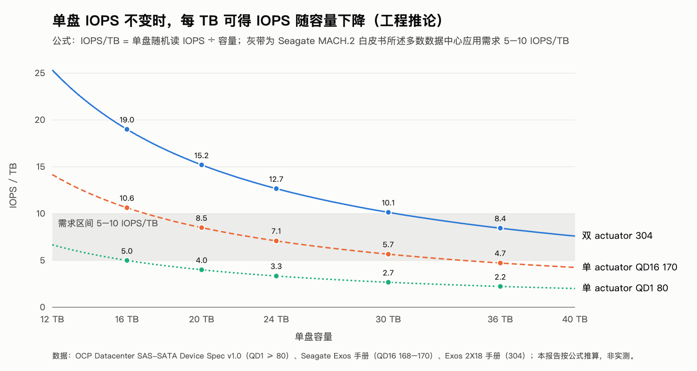
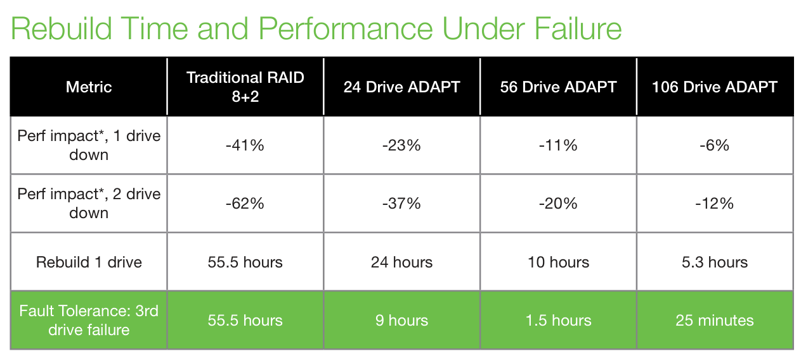

# 验证方案与判定标准

> 研究计划 · 验证方案、指标公式与判定标准（非实测结论）

上一章提出，客户对大容量盘的需求要同时满足 IOPS、修复和商业三个条件才算真实。本章把这三个条件变成一套可以在目标客户现场执行的验证方案：先采集客户自己的负载与成本数据，再在受控环境里比较“现有容量点”和“目标大容量点”，最后用事先约定的判定标准给出结论。结论可以是“这一层可以上最大容量”，也可以是“这一层的最优点是 20–24 TB”，两者都是有效结果。本章是研究计划，不是实测结论。表中的阈值标为“建议值”的，是参照前文来源设定的起点，需要和客户一起确认。资料采集于 2026-11-19。

### 先拿客户数据，再做对照测试

验证分四个阶段。第一阶段是**访谈与数据采集**（建议 2–4 周），目的是拿到 TCO 公式和 C_max 公式需要的客户参数，而不是先跑基准测试。第二阶段是**单盘与单节点测试**，确认器件在客户 IO 形态下的 IOPS、带宽、尾延迟和功耗。第三阶段是**小集群对照**，在至少一个完整故障域组合上比较两种容量点的前台性能、修复和运维行为。HDFS RS(6,3) 至少需要 9 个 DataNode，最好跨 9 个以上机架 [BO1]，对照集群的规模不能低于这个下限，否则测出来的修复并行度没有代表性（Ceph 文档对 OSD 数与恢复并行度的说明同理 [KR5]）。第四阶段是**生产灰度**，在客户的冷温层用真实数据和真实流量运行一个完整的业务周期（至少覆盖一次月度高峰）。

贯穿四个阶段的原则有两条。第一，**按相同可用 PB 比较，而不是按相同盘数比较**：客户真正面临的选择是“用较少的大盘还是较多的小盘存同样的数据”，因此大盘组的盘数要按 `C_old ÷ C_new` 相应减少，IOPS/TB 的下降才会如实暴露出来。第二，**按 P99 而不是平均值判定**：IOPS 一章的推论是，IOPS/TB 约束在尾部比平均值上更早出现。

### 需求侧数据采集清单

下表沿用“国内客户为什么说容量不需要太大”一章的访谈问题，并注明每项数据进入哪个公式。没有这些数据，后面的测试就只能用厂商假设，结论说服不了客户。

| 数据项 | 采集方式 | 用途 | 对应访谈问题 |
|---|---|---|---|
| 集群形态：热温冷各层容量、是否计算混部、服务器数由算力还是容量决定 | 访谈 + 资产清单 | 确定哪一层是验证对象；排除不该推的层 | 问题 1 |
| 冗余方式与转 EC 门槛（文件大小、数据年龄）、客户端版本 | NameNode / 集群配置导出 | η；判断 EC 和 SMR 能否落地 | 问题 2 |
| 高峰期每盘 IOPS、util、IO 大小分布，按每 TB 已存数据折算的 r（P50 / P99 时段） | iostat、DataNode / OSD 指标，至少 2 周 | C_max = IOPS_d ÷ (r × u_ops)；测试负载建模 | 问题 3 |
| 业务 P99 SLO；慢节点触发原因 | 访谈 + 监控 | 判定阈值 | 问题 3 |
| 水位线 u_ops、实际平均装填率、新扩容节点热点情况 | 容量监控 | u；是否需要热度感知放置 | 问题 4 |
| 历史单盘 / 单机修复时间、内部 SLA、近 3 年盘故障记录 | 工单与告警系统 | B_eff 基线、λ、MTTDL 估算 | 问题 5 |
| 机型（U 数、盘位）、单柜功率预算、承重、PUE、电价 | 机房资料 | PB/柜、W/TB、L 中的电费项 | 问题 6 |
| 采购方式、评标口径、盘价与盘位分摊成本、可接受的新容量溢价 | 商务访谈 | P(C)、S；商业条件 | 问题 7 |
| 服务器平台与国产 CPU 占比、兼容性认证责任方和周期 | 访谈 | 验证平台选型、认证排期 | 问题 8 |
| 运维最担心的问题、可接受的试点范围与成功标准 | 访谈 | 判定标准的客户侧确认 | 问题 9、10 |

### 测试场景与受控变量

| 场景 | 负载与方法 | 必须控制的变量 | 主要观察 |
|---|---|---|---|
| S1 冷归档 / 备份 | 持续灌入大文件或大对象，随后低频随机取回；含整盘迁出 | 相同 EC 与写缓冲；灌入速率按客户峰值 | 灌入吞吐、取回首字节时间、整盘迁出时间、W/TB |
| S2 数据湖扫描 | 用客户真实表（Parquet / ORC）跑带谓词下推和列投影的查询，记录实际 IO 大小 | 文件大小与行组大小保持客户现状；另测合并后的大文件对照 | MB/s/TB、查询完成时间、单次 IO 大小分布 |
| S3 混合 HDFS | 三副本热数据 + EC 温数据，叠加 YARN / Spark shuffle 混部负载；按客户 r 回放 | 相同可用 PB；相同水位线（不低于客户实际值）；关闭不相关的缓存 | P99 读写延迟、慢节点比例、每 TB 实得 IOPS |
| S4 负载下修复 | 在 S3 负载下拔盘、宕机，分别测单盘和单节点故障；对比 RS 与 LRC、默认与调优后的修复参数 | 相同冗余参数；故障时刻的装填率一致；记录修复参数 | 修复完成时间、修复期间前台吞吐和 P99、修复流量、数据校验结果 |
| S5 SMR 写路径 | 按客户的写入与删除模式长时间写入，直到 zone GC 进入稳态 | 同平台 CMR 对照；相同主机内存与 CPU 配额 | 稳态写吞吐、GC 写放大、主机内存 / CPU、重启恢复时间 |
| S6 闪存层配比 | 在 S2 / S3 负载上改变闪存容量（例如 0、1%、2%、4% 等档）和缓存策略 | HDD 侧配置不变 | HDD 读量削减比例、P99、每可用 TB 成本的拐点 |
| S7 功耗与机柜 | 空闲、典型负载、修复期间、低功耗模式下测整机和整柜功率 | 按客户单柜功率上限布置 | 系统级 W/TB、PB/柜、唤醒时间（Seagate 36 TB 手册标称从停转待机到就绪典型 30 秒 [BH6]） |
| S8 部分失效与尾延迟 | 在测试盘上触发 depopulation；开启与关闭 CDL 对比 | 相同负载与固件 | 需补数据量、补块时间、P99 / P99.9（Linux 6.5 起 CDL 默认关闭，需显式开启 [BH21]） |

场景设计参照了前文的来源事实。S2 关注真实 IO 大小，是因为 Meta 的读取器合并后也只有约 O(1MB)，只能用到约四分之一的顺序带宽 [KI9]；S4 的观察项包含数据校验，是因为 vivo 遇到过补块导致文件损坏 [KC10]；S5 要求测到稳态，是因为阿里评估的 dm-zoned 在持续写入下吞吐可能下降 56.1%，F2FS 在随机删除触发的 GC 下下降 61.5% [BA2]，而 GC 预留又直接决定 SMR 的净容量增益（写入模型一章）；S6 的做法对应 Google 用模拟预测不同 SSD 容量下 HDD 读量削减的思路 [BG4]。S3 要求水位线不低于客户实际值，因为字节的经验是磁盘占用高了以后慢节点会层出不穷 [KC7]。

*本报告按公式 IOPS/TB = 单盘 IOPS ÷ 容量 绘制的供给曲线，灰带为 Seagate MACH.2 白皮书所述 5–10 IOPS/TB 需求区间；验证的任务是用客户实测的 r 替换灰带，并找出曲线与 r 的交点（工程推论，非实测）* — [原始来源](https://www.seagate.com/files/www-content/solutions/mach-2-multi-actuator-hard-drive/files/tp714-dot-2-2006us-mach-2-technology-paper.pdf)

### 指标与计算口径

- **可用 TB/柜与 PB/柜**：`min(空间盘位, ⌊柜功率 ÷ 每盘位实测功率⌋) × C × u × η`。每盘位功率用 S7 实测值，不用手册空闲值（TCO 一章推算，机箱每盘位比单盘多出 4–8 W [KT10]）。
- **系统级 W/可用 TB**：整柜实测功率 ÷ 可用 TB，分空闲、典型、修复三种状态。
- **每可用 TB 成本**：`L ÷ (C × u × η)`，u 取测试中满足 P99 SLO 的最高装填率，闪存、网络和认证成本计入 S。
- **实得 IOPS/TB 与需求之比**：在 P99 满足 SLO 的前提下单盘能承受的最大 IOPS，除以单盘已存 TB，再除以客户的 r。Azure WAS 的运营目标是存储戳利用率约 70%、尽量不超过 80% [BZ1]，因此本方案要求这一比值至少为 1 ÷ 0.7 ≈ 1.4。
- **P99 / P99.9 延迟**：业务层按客户 SLO；器件层参考 OCP 规范 4K QD1 随机读 P99 不超过 20 ms [KI6]。
- **修复时间与降级吞吐**：满盘修复小时数、修复期间前台吞吐相对正常值的下降比例、修复流量（TB）。
- **MTTDL 估算**：按重建一章的近似 `数据丢失概率 ∝ (λ·T_repair)^f`，用实测 T_repair 和客户的 λ 计算新旧容量点的比值。按每 PB 计时，大盘组的盘数更少，盘故障次数按 `C_old ÷ C_new` 减少，这一项也要计入（**工程推论**，待用客户故障记录校准）。
- **SMR 净增益**：`(1 + g)(1 − p)(1 − o) − 1`，g 为同平台 SMR 相对 CMR 的标称容量增益，p 为 S5 稳态下测得的 GC 预留比例（写入模型一章记为 r，此处改记 p 以免与 IOPS 需求 r 混淆），o 为元数据、填充和对齐开销（SMRSTORE 大 IO 下约 1–2%） [KW11]。
- **年负载占用率**：（前台读写 + 巡检 + 修复 + 再均衡）每盘年 TB ÷ 额定年负载（Exos M 与 HC690 为 550 TB/年，36 TB SMR 型号为 750 TB/年 [KI11][KI5][KI2]）。

### 判定标准

| 维度 | 通过条件（建议值） | 依据 |
|---|---|---|
| 功能与数据完整性 | S4、S5、S8 全部场景结束后端到端校验零差错；修复与 GC 不产生静默错误 | vivo 补块损坏的教训 [KC10] |
| IOPS 充足 | 实得 IOPS/TB ÷ r ≥ 1.4（P99 满足 SLO 时） | WAS 约 70% 利用率目标 [BZ1] |
| 尾延迟 | 相同可用 PB 下，业务 P99 不劣于现有容量点 10% 以上，且满足客户 SLO；器件层 4K QD1 P99 ≤ 20 ms | OCP 规范 LAT-1 [KI6]；10% 为建议值 |
| 修复时间 | 满盘修复时间不长于现有容量点（即有效修复带宽至少按 C_new ÷ C_old 同比提高），且满足客户内部 SLA | 重建时间公式与 MTTDL 推论 [KR3] |
| 降级性能 | 修复期间前台吞吐下降不超过现有容量点的水平，并低于客户约定上限（建议 20%） | ADAPT 模型中去簇重建单盘故障影响 −6%，RAID 6 为 −41% [KR1]；Ceph HDD 集群节点故障时小对象吞吐最多 −79% [KR6] |
| 持久性 | 估算 MTTDL 不低于现有容量点 | 同上 |
| 年负载 | 各类读写合计不超过额定年负载的 80%（建议值） | 手册额定值 [KI11][KI2] |
| SMR 写路径 | 净增益为正，且大于双方约定的门槛（建议 ≥ 5%）；开放 zone 数不超过手册建议值（Seagate 36 TB 为 1024） [KW4]；稳态写吞吐不低于同平台 CMR 的 95%；主机内存、CPU 增量已计入 TCO；重启恢复时间在客户容忍范围内 | SMRSTORE 现网 SMR 1898.6 MB/s 对 CMR 1888.3 MB/s，内存约 2 倍、CPU 多 26.7%，20 TB 盘重启恢复 94.4 秒 [BA2] |
| 能效与密度 | 在客户单柜功率上限下，PB/柜和系统级 W/可用 TB 优于现有容量点 | TCO 一章机柜推演；ODCC 运营商机柜均值 [KC15] |
| 经济性 | 按实测 u 计算的每可用 TB 成本低于现有容量点，降幅达到双方事先约定的门槛（建议 ≥ 10%） | TCO 模型；10% 为建议值 |
| 运维 | 试点期间每 PB 的人工介入次数和告警数不高于现有集群 | 客户运维顾虑（访谈问题 9） |

*Seagate《ADAPT: Rapid-Rebuild Technology》技术白皮书第 3 页：RAID 6 与去簇 ADAPT 的单盘重建时间与故障期间性能影响（模型计算值），可作为 S4 修复场景的对照基线* — [原始来源](https://www.seagate.com/content/dam/seagate/migrated-assets/www-content/solutions/backup/backup-and-recovery/adapt-technology.pdf)

### 结果解读：不通过时意味着什么

判定的目的不是证明“越大越好”，而是在每一层找出客户真正需要的容量点。不同的失败对应不同的后续动作：

- **只在 IOPS 或尾延迟上不通过**：说明这一层是 IOPS 受限的。可以换双 actuator 重测，或者按 S6 的结果加闪存层后重测；如果仍不通过，就按 `C_max = IOPS_d ÷ (r × u_ops)` 推荐较小的容量点。这是上一章“不该硬推”的情形。
- **只在修复或降级性能上不通过**：问题在修复架构，不在容量本身（重建一章的结论）。可以改用 LRC、去簇布局或调整修复参数后重测；如果客户的系统改不了，这一层也不推最大容量。
- **SMR 写路径不通过**：先用同平台 CMR 型号落地，把 SMR 适配作为下一阶段的项目。
- **技术全部通过、只在经济性上不通过**：多半是首发溢价或盘位成本假设的问题，属于商业条件，可以用按可用 TB 计价或等价格下穿解决。
- **全部通过**：在这一层推荐最大容量点，并把测试数据整理成可以公开引用的联合案例。

无论结果如何，报告都应该包括客户参数、受控变量、原始数据和判定过程，让客户的架构师和运维团队可以自己复算。只有客户能自己复算的结论，才会进入他们下一轮的技术规范。

### 资料边界

本章是验证方案，不包含任何实测数据。场景设计和阈值参照了前文引用的论文、手册和规范，其中标为“建议值”的阈值（10%、20%、80%、1.4 倍）是本文设定的起点，需要按客户的 SLO 和风险偏好调整。MTTDL 只用了相对比较的近似式，不能替代按客户故障相关性建立的完整模型。

## 本章资料

- **[BA2]** [USENIX FAST '23 · Su Zhou et al.（阿里巴巴）：SMRSTORE: A Storage Engine for Cloud Object Storage on HM-SMR Drives（2023-02）](https://www.usenix.org/system/files/fast23-zhou-su.pdf)
- **[BG4]** [Gimasys（Google Cloud Premier Partner）· Colossus under the hood: How we deliver SSD performance at HDD prices（英文转载 / 编译版，2025-04-15，采集于 2026-11-19）](https://gcloudvn.com/en/kienthuc/colossus-under-the-hood-how-we-deliver-ssd-performance-at-hdd-prices/)
- **[BH6]** [Western Digital · Ultrastar DC HC690 (SATA) Hard Disk Drive Specification（28–32 TB 主机管理型 SMR、11 碟 22 头、64GB iNAND、256MiB 区域、CDL 特性集，采集于 2026-11-19）](https://documents.westerndigital.com/content/dam/doc-library/en_us/assets/public/western-digital/product/data-center-drives/ultrastar-dc-hc600-series/product-manual-ultrastar-dc-hc690-sata.pdf)
- **[BH21]** [Linux 内核文档 · Documentation/ABI/testing/sysfs-block-device（cdl_supported / cdl_enable，KernelVersion v6.5，采集于 2026-11-19）](https://www.kernel.org/doc/Documentation/ABI/testing/sysfs-block-device)
- **[BO1]** [Apache Hadoop 官方文档 · HDFS Erasure Coding（Hadoop 3.3.5，采集于 2026-11-19）](https://hadoop.apache.org/docs/stable/hadoop-project-dist/hadoop-hdfs/HDFSErasureCoding.html)
- **[BZ1]** [ACM SOSP '11 · Calder 等：Windows Azure Storage: A Highly Available Cloud Storage Service with Strong Consistency（2011-10）](https://sigops.org/s/conferences/sosp/2011/current/2011-Cascais/printable/11-calder.pdf)
- **[KC7]** [火山引擎开发者社区（字节跳动技术团队）· 9年演进史：字节跳动 10EB 级大数据存储实战（十万台级、10 EB 级；慢节点、写降级与随机小 IO）](https://developer.volcengine.com/articles/7317094371705241609)
- **[KC10]** [vivo 互联网技术（博客园官方账号）· vivo HDFS EC 大规模落地实践（2025-10-16；EC 仅用于冷数据、补块时间长、大存储机器 Archive 盘）](https://www.cnblogs.com/vivotech/p/19145157)
- **[KC15]** [开放数据中心委员会（ODCC）· 数据中心功率密度演进白皮书 ODCC-2021-05002（2021-09-15；运营商在用数据中心平均单机架功率）](https://13115299.s21i.faiusr.com/61/1/ABUIABA9GAAg5OLwjQYouLTRvQQ.pdf)
- **[KI2]** [Seagate · Exos SATA Product Manual 36TB（ST36000NM001M，SMR，Publication 210960600 Rev C，2026-05；含 10 碟 20 头、270 MB/s、<750 TB/年额定负载、Depopulation 命令支持，采集于 2026-11-19）](https://www.seagate.com/content/dam/seagate/assets/support/internal-hard-drive/enterprise-hard-drives/x-mozaic/_shared/files/Seagate_Exos_SATA_Product_Manual_36TB_210960600C.pdf)
- **[KI5]** [Western Digital · Ultrastar DC HC690 (SATA) Hard Disk Drive Specification（28–32 TB，持续传输、功耗表中随机读 IO/s、550 TB/年负载、Storage Element Depopulation，采集于 2026-11-19）](https://documents.westerndigital.com/content/dam/doc-library/en_us/assets/public/western-digital/product/data-center-drives/ultrastar-dc-hc600-series/product-manual-ultrastar-dc-hc690-sata.pdf)
- **[KI6]** [Open Compute Project · Datacenter SAS-SATA Device Specification Version 1.0（Meta / Microsoft / HPE，2023-03-28；PERF-RD-1、LAT-1、MULTIA-1、REL-5、COMM-9，采集于 2026-11-19）](https://www.opencompute.org/documents/datacenter-sas-sata-device-specification-rev-1-0-pdf/)
- **[KI9]** [USENIX ATC '23 · Zhao et al.（Meta / Stanford）“Tectonic-Shift: A Composite Storage Fabric for Large-Scale ML Training”（2023-07，采集于 2026-11-19）](https://www.usenix.org/conference/atc23/presentation/zhao)
- **[KI11]** [Seagate · Exos SATA Product Manual 32/30/28/24TB（Exos M，Publication 210048100 Rev E，2025-12；10 碟 20 头、<550 TB/年额定负载，采集于 2026-11-19）](https://www.seagate.com/content/dam/seagate/assets/support/internal-hard-drives/enterprise-hard-drives/exos-m/_shared/files/Seagate_Exos_SATA_Product_Manual_32-30-28-24TB_210048100E.pdf)
- **[KR1]** [Seagate · ADAPT: Rapid-Rebuild Technology 技术白皮书 SB505.1-1808（RAID 6 8+2 与 24/56/106 盘 ADAPT 的重建时间与性能影响，模型计算值，2018-08，采集于 2026-11-19）](https://www.seagate.com/content/dam/seagate/migrated-assets/www-content/solutions/backup/backup-and-recovery/adapt-technology.pdf)
- **[KR3]** [PVLDB Vol.6 No.5（VLDB 2013）· Sathiamoorthy et al.（USC / UT Austin / Facebook）“XORing Elephants: Novel Erasure Codes for Big Data”（HDFS-Xorbas，采集于 2026-11-19）](https://www.vldb.org/pvldb/vol6/p325-sathiamoorthy.pdf)
- **[KR5]** [Ceph 官方文档 · Placement Groups（Data durability：OSD 故障、恢复并行度与级联故障示例，采集于 2026-11-19）](https://docs.ceph.com/en/latest/rados/operations/placement-groups/)
- **[KR6]** [Ceph 官方文档 · mClock Config Reference（内置 profile、恢复 / 回填选项、192 OSD HDD 集群故障期间吞吐测试，采集于 2026-11-19）](https://docs.ceph.com/en/latest/rados/configuration/mclock-config-ref/)
- **[KT10]** [Seagate · Exos CORVAULT 数据手册 DS2058-4（2023-09；4U106 裸容量 2.0/2.5 PB、运行功耗 1200–1600 W）](https://www.seagate.com/content/dam/seagate/en/content-fragments/products/datasheets/exos-pods/corvault-self-healing-storage-DS2058-4-2309US-en_US.pdf)
- **[KW4]** [Seagate · Exos SATA Product Manual 36TB（ST36000NM001M，SMR / ZAC 主机管理型，Publication 210960600 Rev C，2026-05；10 碟 20 头、790 KTPI、256MiB 区域、1% 常规区、建议最多 1024 个开放区域，采集于 2026-11-19）](https://www.seagate.com/content/dam/seagate/assets/support/internal-hard-drive/enterprise-hard-drives/x-mozaic/_shared/files/Seagate_Exos_SATA_Product_Manual_36TB_210960600C.pdf)
- **[KW11]** [USENIX FAST '23 · Zhou 等（阿里巴巴）：SMRstore: A Storage Engine for Cloud Object Storage on HM-SMR Drives（2023-02，采集于 2026-11-19）](https://www.usenix.org/conference/fast23/presentation/zhou)
