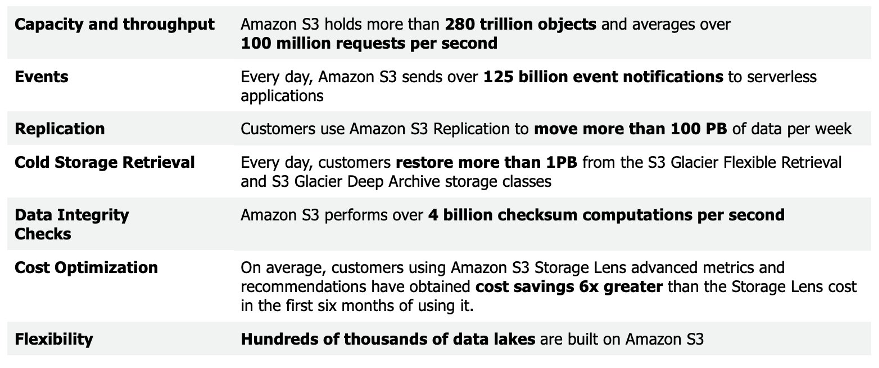
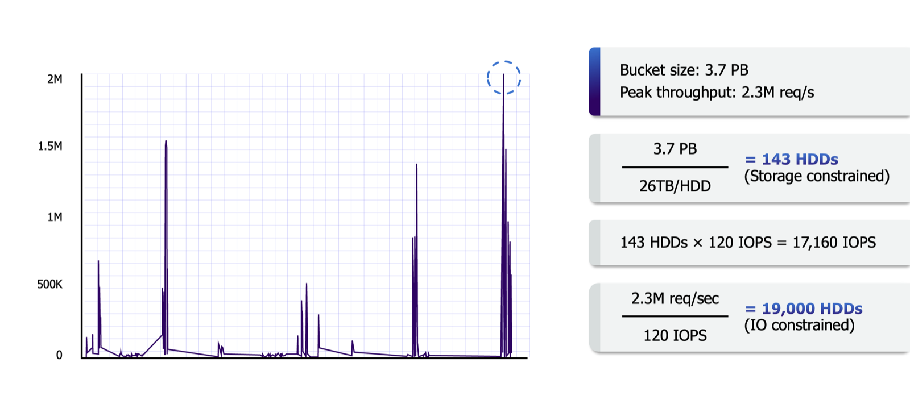
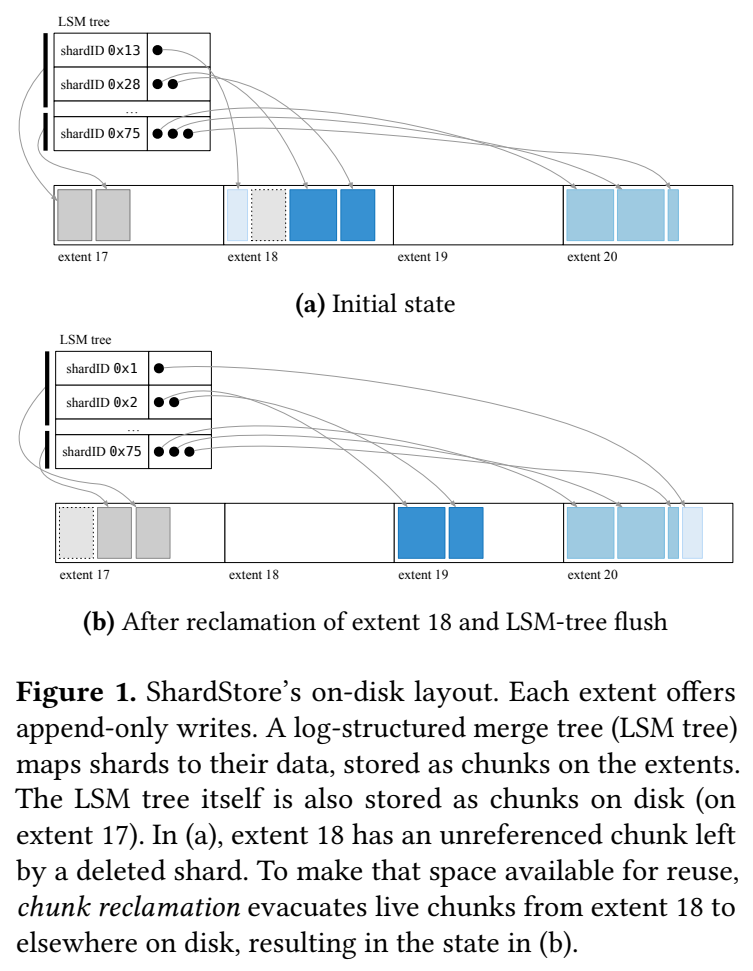

# AWS / Amazon S3

> EB 级对象存储 · HDD 热度管理 / 存储节点 / 官方演讲、论文与文档

Amazon S3 大概是公开资料最多的 EB 级 HDD 存储系统。S3 副总裁、杰出工程师 Andy Warfield 在 USENIX FAST'23 做了主题演讲，随后在 Werner Vogels 的博客 All Things Distributed 上整理成长文，把 S3 设计的核心矛盾归结为一句话：硬盘容量不断增长，随机 IO 性能基本不变 [BS1][BS2]。S3 用来化解这个矛盾的手段有三层：服务层的“热度管理”（数据放置、冗余编码、广泛打散），存储节点层的 ShardStore（基于 extent 的追加写 + LSM 索引），以及面向客户的性能指引和存储类别分层（前缀扩展、分段上传、按字节范围读取、Glacier 归档）。本章按这三层梳理 S3 IO 路径上的优化逻辑，最后讨论它对大容量 HDD 意味着什么。

### 定位与规模

Warfield 在 2023 年的文章中给出的口径是：S3 由“数百个微服务”组成，最高层可分为前端 REST API 服务群、命名空间服务、“装满硬盘”的存储服务群和负责复制、分层等后台操作的服务群；存储使用“数以百万计”的硬盘 [BS1]。同文附的“S3 by the numbers”表格给出：对象数超过 280 万亿，平均每秒超过 1 亿次请求，每天从 S3 Glacier Flexible Retrieval 与 Glacier Deep Archive 恢复超过 1 PB 数据，每秒执行超过 40 亿次校验和计算 [BS1]。

*“S3 by the numbers”原图（2023 年发布时口径）：对象数、请求率、事件通知、复制量、冷存储取回量、数据完整性校验次数等* — [原始来源](https://www.allthingsdistributed.com/2023/07/building-and-operating-a-pretty-big-storage-system.html)

到 2026 年 3 月 S3 二十周年时，AWS 官方博客更新的数字为：存储超过 500 万亿个对象，全球每秒处理超过 2 亿次请求，数据总量为“数百 EB”，分布在 39 个区域的 123 个可用区；硬盘数量为“数千万块”。2006 年上线时总容量约 1 PB，约 400 个存储节点、15 个机柜、3 个数据中心，总带宽 15 Gbps [BS4]。同一篇文章提到，过去 8 年 S3 请求路径中性能关键的代码逐步用 Rust 重写，其中“blob 搬运与磁盘存储”已经重写完成；持久性设计目标为 11 个 9，由一组审计微服务持续检查全量数据并在发现劣化时触发修复 [BS4]。

### 核心约束：容量在涨，IOPS 不涨

*Warfield 文章原图：某客户 bucket 容量 3.7 PB、峰值 2.3M req/s；按 26 TB 盘计算只需 143 块盘（容量约束），按每盘 120 IOPS 计算峰值需要约 19,000 块盘（IO 约束）* — [原始来源](https://www.allthingsdistributed.com/2023/07/building-and-operating-a-pretty-big-storage-system.html)

Warfield 拿 1956 年的 IBM RAMAC 与当时最大的 26 TB 硬盘（WD Ultrastar DC HC670）比较：容量提高 720 万倍，体积缩小 5,000 倍，每字节成本（按通胀调整）下降 60 亿倍，但寻道时间只改善了 150 倍。以最快速度做随机读写，一块盘约 120 次操作/秒，这个数字 2006 年 S3 上线时差不多就是如此，再往前十年也差不多 [BS1]。他的原话是：容量增长、性能持平之间的张力是“S3 设计的核心影响因素”；S3 需要“尽可能激进地”采用最大的盘，行业路线图指向十年内 200 TB，届时如果把随机访问平均分摊到所有数据上，每 2 TB 数据只能分到每秒 1 次 IO；S3 预计在 200 TB 盘出现后使用它们，以及“从现在到那时之间的所有容量” [BS1]。

上图把这一矛盾具体化：一个 3.7 PB 的 bucket 若只按容量配置，需要 143 块 26 TB 硬盘，合计 17,160 IOPS；而它的峰值是每秒 230 万次请求，按 120 IOPS/盘需要约 19,000 块盘，比容量所需多出两个数量级 [BS1]。按同一口径，可以把单盘 IOPS/TB 随容量的变化列成下表（**工程推论**：假设单盘随机 IOPS 恒为 120，与容量无关；公式 IOPS/TB = 120 / 容量 TB）：

| 单盘容量 | IOPS/TB | 3.7 PB 所需盘数（容量约束） | 这些盘的合计 IOPS |
|---|---|---|---|
| 16 TB | 7.5 | 约 232 | 约 27,800 |
| 20 TB | 6.0 | 185 | 22,200 |
| 26 TB（原文口径） | 4.6 | 143 | 17,160 |
| 30 TB | 4.0 | 约 124 | 约 14,900 |
| 36 TB | 3.3 | 约 103 | 约 12,300 |
| 200 TB（路线图） | 0.6 | 约 19 | 约 2,300 |

表中 200 TB 一行按 120 IOPS 计算为每 1.67 TB 一次 IO，Warfield 给出的“每 2 TB 一次”应是取了更保守的单盘 IOPS，量级一致。结论很直接：单盘越大，单个 bucket 独占的盘越少，峰值请求越难被满足——除非峰值能分摊到远多于“容量所需”的盘上。S3 的热度管理就是为此设计的。

### 关键优化一：热度管理与数据放置

S3 把“某一时刻打到某块盘上的请求数”称为热度（heat），把在海量硬盘之间平衡 IO 需求的问题称为**热度管理** [BS1]。处理逻辑可以拆为四步：

1. **问题定义：热点 → 尾延迟**。热点是少数过载的盘。请求在忙盘上排队，停顿沿存储软件栈逐层放大，又被元数据查找、纠删码等依赖 IO 再放大，最后表现为一小部分高延迟请求（straggler）；不及时处理，热点会扩大到影响所有请求的延迟 [BS1]。
2. **利用规模去相关**。写入时必须决定放置位置，但那时并不知道数据将来如何被访问；Warfield 坦言在单机硬盘或企业阵列的规模上“基本不可能”预测好热度。S3 的不同之处在于多租户规模：单个工作负载极其突发，大部分时间空闲、偶尔出现远高于均值的峰值；但聚合数百万个工作负载后，总体需求变得平滑、可预测，到一定规模后任何单个工作负载都难以影响聚合峰值 [BS1]。
3. **冗余既保护数据，也用来导流**。复制让读请求可以发往任意副本，从 IO 角度看读取效率高，但容量开销大；因此 S3 也大量使用纠删码，例如用 Reed-Solomon 把对象切成 k 个数据分片并生成 m 个校验分片，任意 k 个可用即可读出对象。把数据切成“比读取所需更多”的分片，就有了避开过载盘的选择余地 [BS1]。
4. **广泛打散**。单个对象可能编码到数十块盘上，而不同对象被有意放到不同的盘集合，使每个客户的访问分布在非常多的盘上。好处有两个：某个客户的数据在任一块盘上只占很小一部分，单个工作负载无法在一块盘上制造热点（隔离）；单个工作负载在突发时可以动用独立建设根本负担不起的盘数——文中称有数万个客户的 bucket 分布在数百万块盘上，一次基因组学并行分析的突发可以由超过一百万块盘服务 [BS1]。

总结起来，S3 不在写入时预测冷热，而是靠**统计复用**：每块盘上都混放大量不相关租户的少量数据，使单盘承受的是“很多小而不相关的需求之和”，方差远小于单个租户。冗余分片给读取路径留出绕开慢盘的余地，用来压尾延迟。

### 关键优化二：ShardStore 存储节点的追加写与 extent

*ShardStore 论文（SOSP'21）Figure 1：磁盘布局。LSM 树把 shard 映射到 extent 上的 chunk；extent 只能追加写，回收时把仍被引用的 chunk 迁出并重置写指针* — [原始来源](https://www.amazon.science/publications/using-lightweight-formal-methods-to-validate-a-key-value-storage-node-in-amazon-s3)

S3 最底层的存储节点是“把对象分片持久化到硬盘上”的键值存储。SOSP'21 论文介绍了新一代节点 **ShardStore**：用 Rust 编写，实现超过 4 万行，论文发表时正逐步部署，已存放“数百 PB”客户数据 [BS3]。与 IO 路径相关的设计要点如下 [BS3]：

- **节点不做内部冗余**：每个存储节点保存客户对象的分片（shard），持久性由控制面在多个节点间复制保证，节点本身无需再做副本。主机挂多块 HDD，**每块盘是独立故障域，运行独立的 KV 存储**，RPC 层按 shard ID 把请求路由到目标盘。RPC 接口除 put/get/delete 外，还提供用于迁移和修复的控制面操作。
- **LSM 索引 + 数据分离**：键为 shard ID，值为对象数据分片；索引是一棵 LSM 树，但分片数据存放在树外以降低写放大（与 WiscKey 类似）。LSM 树把 shard 映射为一组指向 chunk 的指针，LSM 树本身也以 chunk 形式存盘。
- **extent 顺序追加**：extent 是盘上连续的物理区域，“一块典型的盘有数万个 extent”。extent 内必须顺序写，由写指针标记下一个合法写入位置，不能原地覆盖；reset 操作把写指针拨回起点，之后才可重写。
- **按热度和访问模式放置**：ShardStore 没有把所有数据集中到一条共享日志，而是把 shard 数据分散到不同 extent，以便“按预期热度和访问模式”安排每个 shard 在盘上的位置（例如减少寻道延迟），代价是崩溃一致性更复杂。
- **回收（GC）**：删除 shard 后空间不能立即复用。后台回收任务选定一个 extent，扫描其中所有 chunk 并在 LSM 树中反查：仍被引用的迁移到新 extent 并更新指针，未引用的直接丢弃，扫完后重置写指针。
- **兼容 SMR / 分区盘**：为同时支持 zoned 盘与常规盘，ShardStore 用 `write` 系统调用自行实现 extent append：在内存中为每个 extent 维护“软写指针”，并定期随超级块刷盘。
- **崩溃一致性**：借鉴 soft updates，不经过预写日志重定向写入，而是用运行时构建的 `Dependency` 依赖图约束写回顺序；`append` 是写盘的唯一途径，由 IO 调度器保证依赖先于数据落盘。

这套设计对 HDD 的意义在于：所有写入都变成 extent 内的顺序追加，与 SMR/分区盘的“区内顺序写、整区重置”语义天然对齐；删除和覆盖转化为后台回收（读有效 chunk、顺序重写、reset），这部分额外 IO 可以由节点自行调度。论文的主题是用轻量形式化方法验证正确性：参考模型规模约为实现的 1%，在提交到生产前拦下 16 个问题 [BS3]。Warfield 也提到，这种基于可执行规约的测试，在“只有 120 IOPS 的硬盘”上直接做是不现实的 [BS1]。

### 关键优化三：客户侧访问模式与存储类别

S3 公开的性能指引，基本可以看作热度管理在 API 层面的延伸：引导客户把请求“摊开”，并按冷热把数据放进不同的介质与服务层级。

| 指引 / 机制 | 官方表述要点 | 对后端 IO 的作用（本文解读） |
|---|---|---|
| 前缀扩展 [BS5] | 每个分区前缀至少可达 3,500 次/秒 PUT/COPY/POST/DELETE 或 5,500 次/秒 GET/HEAD；前缀数量不限，10 个前缀并行读可达 55,000 次/秒；扩展是渐进的，期间可能返回 503 Slow Down | 请求按键空间分区，扩展时后台重新划分；503 相当于背压信号 |
| 热点对象 [BS7] | 对少量对象持续超过约 5,000 次/秒的请求可能收到 503；读密集场景建议用 CloudFront 或 ElastiCache 缓存 | 把对单个对象的集中读挡在 HDD 层之前 |
| 按字节范围读取 [BS6] | 用 Range 头并发读取同一对象的不同范围，提升聚合吞吐；分段上传的对象最好按相同分段大小（或对齐分段边界）读取，可用 `partNumber` 直接寻址 | 一个大对象的读取被拆到多组分片 / 多块盘上并行执行 |
| 分段上传 [BS8] | 建议 100 MB 及以上的对象使用分段上传；各段独立上传，失败只需重传该段 | 大对象以大块顺序数据进入后端，便于整块编码与顺序落盘 |
| 超时与重试 [BS7] | 大请求（如 >128 MB）跟踪吞吐、重试最慢的 5%；小请求（<512 KB）2 秒后重试，再退避 4 秒；固定大小请求可重试最慢的 1%；重试应使用新连接并重新做 DNS 解析 | 指南解释说，以 S3 的规模，重试“很可能走不同路径”——相当于在客户端绕开慢盘、压低尾延迟 |

存储类别方面，S3 Intelligent-Tiering 会把 30 天未访问的对象移到 Infrequent Access 层，90 天未访问的移到 Archive Instant Access 层（仍为毫秒级访问）；可选的 Archive Access 和 Deep Archive Access 层分别在 90 天、180 天未访问后归档，读取前需要先 restore；小于 128 KB 的对象不参与自动分层 [BS9]。Glacier 的取回分三档：Flexible Retrieval 的 Expedited 一般 1–5 分钟（250 MB 以上对象最高约 300 MB/s），Standard 3–5 小时，Bulk 5–12 小时；Deep Archive 的 Standard 在 12 小时内、Bulk 在 48 小时内；通过 Batch Operations 发起的 Standard 取回吞吐“最高每天 1–2 PB” [BS10]。分钟到小时级的取回窗口，给后端留出了排队、批量化和顺序化读取的空间。AWS 没有公开 Glacier 底层使用何种介质。

### 与 HDD 容量 / 密度的关系（本文分析）

- **来源事实**：S3 明确表示要尽可能快地换用最大容量的盘，并预期使用直至 200 TB 的所有容量档；容量增长而 IOPS 不变，被它视为设计的核心约束，而不是拒绝大盘的理由 [BS1]。
- **S3 为什么“不怕”大盘**：热度管理把 IOPS 当作*全舰队*共享的资源，而不是按租户配给的资源。只要聚合需求平滑、对象分片广泛打散，舰队总 IOPS = 盘数 × 单盘 IOPS，单个租户的峰值由数十万到上百万块盘分摊。大盘降低的是“每 TB 的 IOPS”，在多租户、去相关的统计复用下，只要平均“访问密度”（IOPS/TB）低于舰队供给，就可以继续加大单盘容量。这也说明，大盘的需求实际依赖于**规模与多租户**：同样的 26 TB 盘放进单租户、几百块盘的集群，就会遇到上表中 IOPS 与容量差两个数量级的情况。
- **阻力点**：（1）随着 IOPS/TB 下降，舰队平均访问密度一旦越过供给线，就只能靠缓存、更多副本或少装满来补，抵消一部分大盘的 TCO 收益；（2）利用冗余分片绕开慢盘的读取，以及后台修复、审计、GC（ShardStore 的回收读写），都消耗同一块盘的 IOPS，单盘越大，这部分后台 IO 的总量越大；（3）如果归档层用的是非 HDD 介质（AWS 未公开），分层越成熟，留在 HDD 层的就越是访问密度较高的温数据。
- **助力点**：ShardStore 的 extent 追加写与软写指针，已经在节点层把写入模型对齐到 SMR / 分区盘，从软件上为更高面密度的介质（SMR、HAMR+SMR）做好了准备；分段上传与按范围读取把客户 IO 塑造成大块、可并行的形态，提高每次寻道换来的有效字节数。

### 资料边界

本章的机制描述来自 Warfield 的 FAST'23 演讲整理稿与 ShardStore 论文（2021 年时 ShardStore 仍在逐步部署），S3 内部的纠删码参数、单盘写入带宽、回收策略、SSD 缓存层的规模和 Glacier 底层介质均未公开。“120 IOPS/盘”是 Warfield 给出的数量级口径，表中按容量推算的数字属于本文推论。2026 年的规模数字取自 AWS 官方博客，其中“数百 EB”“数千万块硬盘”只是数量级描述。

## 本章资料

- **[BS1]** [All Things Distributed（Werner Vogels 博客）· Andy Warfield 客座文章：Building and operating a pretty big storage system called S3（2023-07-27）](https://www.allthingsdistributed.com/2023/07/building-and-operating-a-pretty-big-storage-system.html)
- **[BS2]** [USENIX FAST '23 主题演讲 · Andy Warfield：Building and Operating a Pretty Big Storage System (My Adventures in Amazon S3)（2023-02）](https://www.usenix.org/conference/fast23/presentation/warfield)
- **[BS3]** [ACM SOSP '21 · Bornholt 等：Using Lightweight Formal Methods to Validate a Key-Value Storage Node in Amazon S3（ShardStore，2021-10）](https://www.amazon.science/publications/using-lightweight-formal-methods-to-validate-a-key-value-storage-node-in-amazon-s3)
- **[BS4]** [AWS News Blog · Sébastien Stormacq：Twenty years of Amazon S3 and building what's next（2026-03）](https://aws.amazon.com/blogs/aws/twenty-years-of-amazon-s3-and-building-whats-next/)
- **[BS5]** [Amazon S3 用户指南 · Best practices design patterns: optimizing Amazon S3 performance（采集于 2026-11-19）](https://docs.aws.amazon.com/AmazonS3/latest/userguide/optimizing-performance.html)
- **[BS6]** [Amazon S3 用户指南 · Performance guidelines for Amazon S3（采集于 2026-11-19）](https://docs.aws.amazon.com/AmazonS3/latest/userguide/optimizing-performance-guidelines.html)
- **[BS7]** [Amazon S3 用户指南 · Performance design patterns for Amazon S3（采集于 2026-11-19）](https://docs.aws.amazon.com/AmazonS3/latest/userguide/optimizing-performance-design-patterns.html)
- **[BS8]** [Amazon S3 用户指南 · Uploading and copying objects using multipart upload（采集于 2026-11-19）](https://docs.aws.amazon.com/AmazonS3/latest/userguide/mpuoverview.html)
- **[BS9]** [Amazon S3 用户指南 · Understanding and managing Amazon S3 storage classes（采集于 2026-11-19）](https://docs.aws.amazon.com/AmazonS3/latest/userguide/storage-class-intro.html)
- **[BS10]** [Amazon S3 用户指南 · Understanding archive retrieval options（采集于 2026-11-19）](https://docs.aws.amazon.com/AmazonS3/latest/userguide/restoring-objects-retrieval-options.html)
