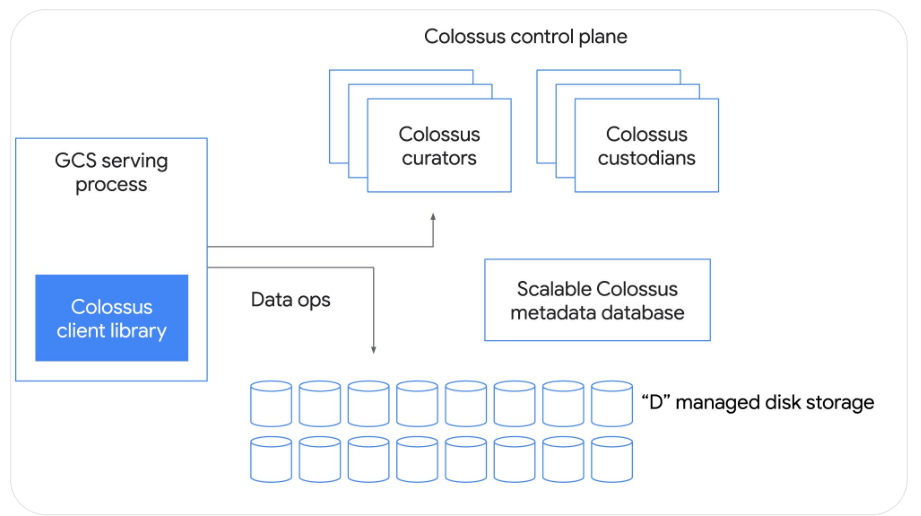
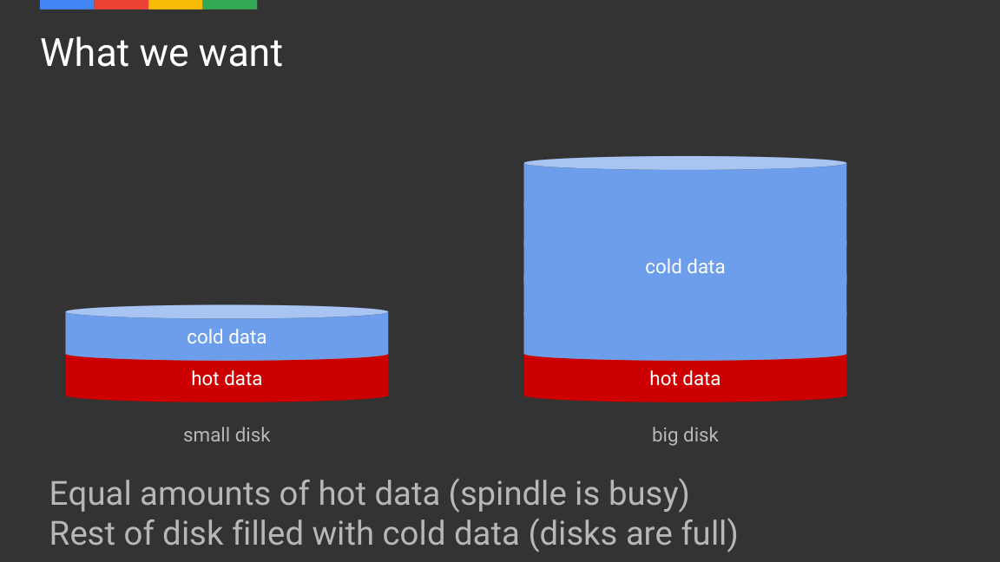
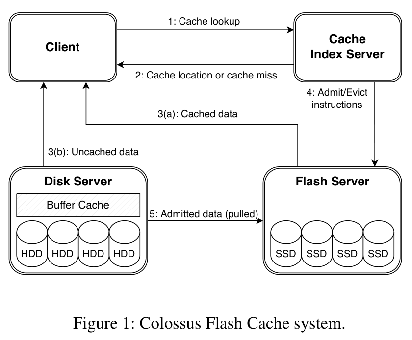
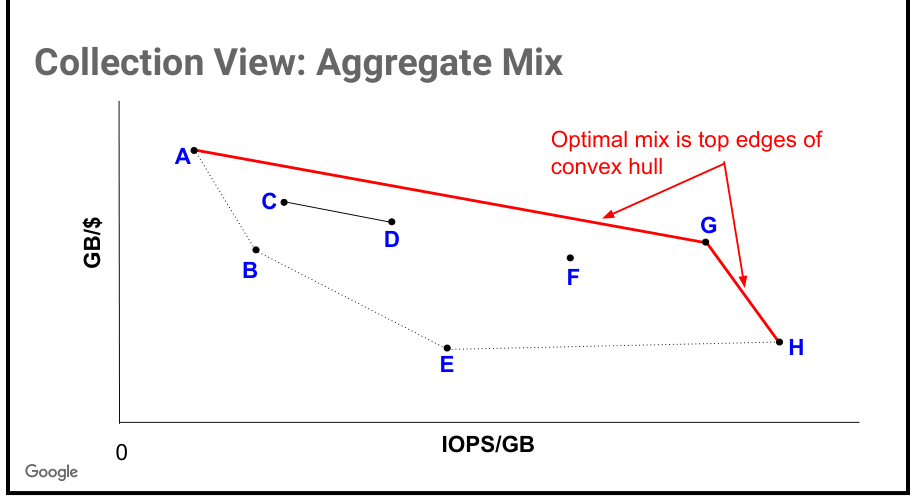

# Google / Colossus

> 集群级文件系统 Colossus · 官方博客 / 论文 / 会议主题演讲

Google 内部几乎所有产品的数据最终都落在 **Colossus** 上。Colossus 是 GFS 的继任者，YouTube、Gmail、Drive、BigQuery、Cloud Storage 都以它为底座 [BG1][BG3]。从大数据 IO 的角度看，Google 公开材料的主线很清楚：HDD 单盘容量在涨，单盘 IOPS 基本不涨，因此“每 TB 可用 IO”越来越少。Google 没有为了 IO 去买小盘，而是把这个问题交给文件系统和缓存层处理：**闪存只买到足以把整体 IO 密度拉回 HDD 能承受的范围，HDD 只按容量购买并尽量填满** [BG1][BG5]。2016 年，Google 又以白皮书和 FAST 主题演讲的形式，向 HDD 行业提出“面向数据中心的磁盘”应该如何改变 [BG7][BG8]。本章按“定位 → 架构 → 优化手段 → 数据 → 与盘容量的关系”展开。

### 定位与规模：从 GFS 到 Colossus

GFS（SOSP 2003）为大文件、追加写和顺序读设计：采用单 master，chunk 固定为 64 MB，默认保存三副本 [BG11]。Google 在 2017 年 PDSW-DISCS 的主题演讲中总结了 GFS 的结构性问题：一台 master 装不下大文件系统的元数据，元数据操作只有单一瓶颈，系统容错但不高可用，延迟也没有保证。Colossus 的做法是把元数据放进 Bigtable，由 “curator” 代替 GFS master，由 “D” 服务器代替 chunkserver [BG5]。2021 年的官方博客称，把文件元数据存入 Bigtable 后，Colossus 能比最大的 GFS 集群扩展 100 倍以上；单个集群可达 EB 级存储、数万台机器 [BG1]。

2025 年的官方博客给出了更新的规模：Colossus 一般按“每个集群一个文件系统”部署，大多数数据中心只有一个集群；许多 Colossus 文件系统容量为数 EB，其中两个各超过 10 EB；最大的文件系统读吞吐经常超过 50 TB/s、写吞吐超过 25 TB/s；最繁忙的集群读写合计超过 6 亿 IOPS [BG3][BG4]。2017 年演讲描述的“典型集群”是数万台机器、PB 级分布式 HDD，外加可选的数 TB 本地 SSD [BG5]。

### 架构与 IO 路径

*Colossus 控制平面示意图（Google Cloud 官方博客 “Colossus under the hood: a peek into Google’s scalable storage system”，2021-04-20 原图）：应用进程内的 Colossus client library 与 curators 交互完成控制操作，数据直接读写 “D” 管理的磁盘；custodians 在后台维护持久性与均衡* — [原始来源](https://cloud.google.com/blog/products/storage-data-transfer/a-peek-behind-colossus-googles-file-system)

官方博客把 Colossus 拆成四个部分 [BG1][BG2][BG3]：

- **Client library**：官方称它“可能是整个文件系统最复杂的部分”。软件 RAID 等功能放在客户端，应用可以按工作负载选用不同编码，在性能和成本之间取舍。
- **Curators**（控制平面）：负责文件创建、删除等交互式元数据操作，可水平扩展。元数据存放在 Bigtable 中。按 2017 年演讲的说法，每个文件对应 Bigtable 中的一行，文件由若干 stripe（复制组）组成，元数据约为数据量的万分之一 [BG5]。
- **D 服务器**：即“网络附加磁盘”，承载 HDD 或 SSD。数据在客户端和 D 服务器之间直接传输，以减少网络跳数。
- **Custodians**：后台存储管理器，负责磁盘空间均衡、RAID 重建等持久性和效率相关的任务。

在一台典型机器上，D 服务器与 YouTube 服务、Gmail、Bigtable、MapReduce 等任务混合部署 [BG5]。由于资源解耦，低延迟业务可以按峰值配置资源，批处理分析则利用空闲时段的 IO 运行 [BG1]。D 服务器内还有 RAM buffer cache，用来缓存最近读写的数据并做少量预取。Colossus 鼓励用户把对同一份数据的多次访问集中在几秒内完成，这样只有第一次访问真正读盘 [BG6]。

### 关键优化手段与处理逻辑

#### 1. 冷热混放：让每块盘“又满又忙”

Google 关心的是存储 TCO，而不是单盘 TCO。存储 TCO 指的是数据持久性、可用性和服务的总成本；在 Google 看来，**把盘填满并让它保持忙碌**就能把它降到最低 [BG5]。具体做法是：新写入的数据（较热）均匀分布到集群里所有盘上；数据随时间变冷后，再被再平衡迁移到容量更大的盘上 [BG1]。2017 年演讲用一张图说明目标状态：大盘和小盘承载等量的热数据，以保证各个主轴同样忙碌，剩余空间再用冷数据填满 [BG5]。这样，大容量盘的“额外容量”只装冷数据，不会多分到 IO。

*Google 在 PDSW-DISCS 2017 主题演讲 “Cluster-Level Storage @ Google” 中的 “What we want”：小盘与大盘承载等量热数据（主轴同样忙），其余空间用冷数据填满* — [原始来源](https://pdsw.org/pdsw-discs17/slides/PDSW-DISCS-Google-Keynote.pdf)

演讲也承认这件事做起来不容易：文件系统在 100% 满时表现不好；升级和维修需要腾出空余容量；各业务组不愿意把配额用到接近 100%；管理员对统计超配心存顾虑；供应链也有不确定性 [BG5]。

#### 2. 闪存只补 IO 缺口：Colossus Flash Cache 与 CacheSack

2017 年演讲给出的采购原则是：“买闪存做缓存，把 IOPS/GB 拉进磁盘能承受的范围；买磁盘只为容量，并把它们填满”。演讲随即点明两种情形：如果为了 IOPS 而买盘，单盘容量的提升就帮不上忙；如果冷数据无限增长，IO 能力就会富余 [BG5]。

CacheSack 论文（USENIX ATC’22）描述了这套机制的生产实现。它开宗明义地写道：磁盘读很贵，**磁盘容量在增长，但 IO 能力没有同比例增长**，因此为了满足 IO 需求，不得不部署大量“不是为了存储、而是为了 IO”的硬盘 [BG6]。Colossus Flash Cache 的首要设计目标是减少 HDD 读，降低延迟不是设计目标。它服务于 BigQuery、Bigtable、F1、Spanner 等系统 [BG6]。

*Colossus Flash Cache 系统结构（USENIX ATC’22 论文 CacheSack 图 1）：客户端先查 Cache Index Server，命中则直接从 Flash Server 读，未命中则从带 Buffer Cache 的 HDD Disk Server 读，准入数据由 Flash Server 从 Disk Server 拉取* — [原始来源](https://www.usenix.org/system/files/atc22-yang-tzu-wei.pdf)

处理逻辑如下 [BG6]：

- **索引与数据分离**：Cache Index Server 只在内存中保存索引。未命中时，客户端直接读 Disk Server；索引服务器独立决定是否准入，并指示 Flash Server 直接从 Disk Server 拉取数据。
- **近似 LRU，控制写放大**：每个索引服务器维护一个由固定大小 Colossus 文件（通常 1 GiB）组成的 FIFO 队列。淘汰队尾文件时，把其中最近使用的 28% 的块重新插回队头，因此写放大系数实际为 1.28。
- **按类别准入（CacheSack）**：流量按 Bigtable / Spanner 的表名、locality group 等划分成类别，类别数最多 5000。对每个类别，在 AdmitOnWrite、AdmitOnMiss、AdmitOnSecondMiss（即原先的 LARC）、NeverAdmit 四种策略之间按比例分配，并把问题建模为分数背包问题，用贪心法求解。优化目标是 HDD 读、闪存写入和闪存占用三者的总成本。
- **考虑下层 buffer cache**：论文指出，闪存命中率高不等于 HDD 读少，因为很多访问本来就会命中 D 服务器的 RAM buffer cache。AdmitOnMiss 的命中率最高，但减少磁盘读的效果反而最差。

CacheSack 在 2021 年 5 月部署，成为默认准入算法。与 LARC 相比，它的磁盘读减少 6%，闪存写入字节减少 26%，TCO 改善 6.5%（一周平均） [BG6]。论文还给出了两个与 HDD 读取模式相关的事实：60% 以上的流量只被访问一次；在被访问多次的数据中，39% 恰好被访问两次 [BG6]。

#### 3. L4：SSD 读缓存、写回放置与 SSD 采购规划

2025 年官方博客把这条线发展为 “L4” 服务。Colossus 有三种方式把数据放上 SSD [BG3][BG4]：

- **强制放置**：通过路径中的 `partition=ssd` 把所有副本放到 SSD，这是最贵的方式。
- **混合放置**：通过 `partition=ssd.1` 只把一份副本放到 SSD，成本较低；但 SSD 副本不可用时，读延迟退回到 HDD 水平。
- **L4 自动放置**：Google 大多数数据走这种方式。L4 作为读缓存时，由 index server 判断数据是否已缓存；未命中则读 HDD，并可能让 SSD 主机从 HDD 主机拉取数据入缓存。每个工作负载在“写入即缓存 / 首次读后缓存 / 短时间内第二次读后缓存”之间如何选择，由一个机器学习算法决定。

读缓存解决不了的是新写入的数据，因为它们仍然先写到 HDD。博客点名了两类不适合 HDD 的负载：一是写入后很快被读取、随即删除的数据（如大批处理作业的中间结果），二是数据库事务日志这类小追加很多的文件。**L4 写回模式**因此在文件创建时就给出建议：是否把新文件放到 SSD、放多长时间。L4 按应用提供的特征（文件类型、数据库列元数据等）把文件分桶，观察每个桶的 IO 模式，在线模拟“SSD 上放 1 小时”“放 2 小时”“不放 SSD”等策略，然后为每个桶选出最优策略；到期后文件迁回 HDD。理想情况下，文件在迁回之前就已删除，HDD 完全不需要承担它的 IO [BG3][BG4]。同一套模拟还能预测 SSD 容量增减时会有多少 IO 从 HDD 转移到 SSD，Google 用这一结果指导 SSD 采购，以及在应用之间调配 SSD 容量 [BG3][BG4]。

#### 4. 冗余：从副本到宽 LRC，按生命周期转码

Google 的公开论文显示，大规模集群里的大部分数据采用纠删码，而且在向“宽条带”发展。FAST’23 论文给出了 Google 存储集群中宽 LRC 的数据：一个部署中的编码宽度约为 80 块；另一个宽度约 50 的编码，在四个集群采样到的 278 个不可用条带上做了对比。论文据此提出 Uniform Cauchy LRC，在实际不可用事件上把可靠性提高了 33% [BG9]。

CMU 与 Google 合作的 Morph（SOSP’24）量化了“转码”的 IO 成本。新数据通常先存三副本，约一天后转为窄 RS（如 RS(8,12)），约一个月后转为中等宽度 LRC（如 LRC(32,38)），数月后再转为宽 LRC（如 LRC(64,74)）。每次转码都要读一遍、写一遍。在 Google 一个大型数据服务中，写入加转码的 IO 达到每小时 5–13 PB，其中转码占 20–33% [BG10]。Morph 的思路是：写入时采用“1 副本 + EC 条带”的混合冗余，数据膨胀 2.4×，低于三副本的 3×；后续转码改用 Convertible Codes，尽量只读校验块。论文估计，这样可以把转码 IO 降低 95% 以上，把写入加转码的总 IO 降低 50–60% [BG10]。需要说明的是，Morph 原型实现在 HDFS 上，Google 的数据只用于分析，论文并未说明 Colossus 已部署该方案。

#### 5. IO 标签、配额与尾延迟

Brewer 在 FAST’16 主题演讲中介绍了 Google 的 IO 分级方式：所有 IO 都打上 “低延迟 / 吞吐（批处理）/ 尽力而为（后台数据搬移）” 标签，前两类有配额（准入控制），标签沿整个系统传递。他同时提出，盘内调度器如果不认识这些标签，主机就只能每次只给盘下发一个或少数几个 IO，否则低延迟读会被批量 IO 阻塞 [BG7]。这些机制与上面的“冷热混放”是同一个目标：在 IO 越来越紧张的大盘上，仍然能守住在线业务的尾延迟。

### 公开数据一览

| 指标 | 数值 | 来源 |
|---|---|---|
| 单个 Colossus 文件系统容量 | 多为数 EB，其中两个各超过 10 EB | 2025 官方博客 [BG3] |
| 最大文件系统吞吐 | 读常超 50 TB/s，写常超 25 TB/s | 2025 官方博客 [BG3] |
| 最繁忙集群 IOPS | 超过 6 亿（读 + 写） | 2025 官方博客 [BG3] |
| 相对 GFS 的扩展倍数 | 超过 100× | 2021 官方博客 [BG1] |
| Hyperdisk ML（基于 Colossus SSD） | 2,500 个节点合计读 1.2 TB/s | 2025 官方博客 [BG3] |
| CacheSack 相对 LARC | 磁盘读 −6%，闪存写 −26%，TCO −6.5% | ATC’22 [BG6] |
| 闪存缓存写放大 | 1.28（淘汰时回插 28%） | ATC’22 [BG6] |
| HDD 读延迟（2016） | 均值 10 ms；P99 数百 ms；P99.9 达秒级 | FAST’16 主题演讲 [BG7] |
| 写入 + 转码 IO（单个大型服务） | 每小时 5–13 PB，其中转码占 20–33% | SOSP’24 Morph [BG10] |

### 与 HDD 容量 / 密度的关系

**Google 对盘容量的基本态度是“组合优化”，而不是“越大越好”或“越小越好”。**Brewer 在 FAST’16 演讲中说，新旧盘总是混合部署（部分原因是增量采购），Google 对整体 IOPS 与容量有总目标，挑选新盘时看的是它能否让整个机群的组合更接近这个目标。演讲用 GB/$–IOPS/GB 平面上的凸包说明这一点：盘片更大、转速更低，GB/$ 更高而 IOPS/GB 更低；目标 IOPS/GB 可以由两种盘按比例组合得到，最优组合位于凸包的上边界 [BG7]。

*Eric Brewer FAST’16 主题演讲 “Disks and their Cloudy Future” 幻灯片 “Collection View: Aggregate Mix”：以 GB/$ 和 IOPS/GB 为坐标，最优盘型组合位于凸包上边界* — [原始来源](https://files.usenix.org/s3fs-public/conference/protected-files/fast16_slides_brewer.pdf)

对大容量盘而言，Google 的材料里既有助力，也有阻力：

- **助力**：只要闪存层能吸收热 IO，HDD 就只按容量购买，大盘的 GB/$ 优势可以直接兑现。2017 年演讲明确说，更高密度的盘即使 $/GB 有溢价，算上功耗、连接开销和维修，部署成本仍可能更低 [BG5]。冷数据“再平衡到大盘”也说明，大盘在 Colossus 中有明确的冷数据角色 [BG1]。
- **阻力**：同一场演讲也警告，磁盘 IO 成本是数据中心里少数在上升的成本。想要比 HDD 更多访问能力的应用，需要“让热数据更热、冷数据更冷”；一个多年前写成的应用，可能迫使 Google 买更小的盘，从而推高存储成本 [BG5]。换句话说，如果冷热分离做得不好，IOPS/TB 约束就会把采购推向小盘。
- **对盘厂的要求**（FAST’16）：Brewer 列出数据中心盘的五个指标：更高 IOPS、更大容量、更低尾延迟、满足安全要求、更低 TCO。他提出的方向包括：按读设置重试策略（允许“快速失败”，因为别处有副本），由主机控制后台任务的时机，按 IO 标签在盘内调度，“灵活容量”（不预留备用扇区，坏道或磁头损坏后容量减小也可接受）；物理形态上可以考虑“更高的盘”（盘片更小、转速和寻道更快，从而提高 IOPS，盘片更多从而降低 GB/$），以及共享电源和缓存的多盘封装 [BG7]。演讲同时判断，SSD 每 GB 成本过高，至少 5–10 年内 Google 的大部分存储仍将是磁盘 [BG7]。

工程推论：在 Colossus 这类“闪存吸收热 IO + HDD 按容量填满”的架构中，单盘容量增大带来的 IOPS/TB 下降，主要靠更多闪存和更精确的准入、放置来抵消。大盘能否被接受，取决于两件事：一是闪存层边际成本与 HDD $/TB 下降之间的比较（Google 用 L4 模拟来量化这一点），二是应用冷热分离的程度。盘厂可以从 Brewer 清单中的尾延迟控制、主机可控的后台任务和多执行器 / 高 IOPS 形态入手，缓解大盘的劣势。

### 资料边界

本次采集环境无法直连 cloud.google.com 与 research.google，因此：2021 年 Colossus 博客依据其原文打印版 PDF 核对；2025 年 L4 博客正文依据 Google Cloud 合作伙伴 Gimasys 的英文转载版核对，并与检索摘要交叉印证；《Disks for Data Centers》白皮书 PDF 未能直接获取，相关观点均引自 USENIX 托管的 FAST’16 同题主题演讲幻灯片。Google 未公开 HDD 型号、单盘容量分布、闪存与 HDD 的容量配比，以及 CacheSack 的成本系数（论文注明这些系数保密）。

## 本章资料

- **[BG1]** [Google Cloud Blog · Dean Hildebrand, Denis Serenyi：Colossus under the hood: a peek into Google’s scalable storage system（2021-04-20；本地网络无法直连原站，正文据原文打印版 PDF 核对，见 BG2）](https://cloud.google.com/blog/products/storage-data-transfer/a-peek-behind-colossus-googles-file-system)
- **[BG2]** [Google Cloud Blog 原文打印版 PDF（2024-03-22 打印，vis.usal.es 存档；与 BG1 同一文章）](http://vis.usal.es/rodrigo/documentos/papers/Hildebrand2021.pdf)
- **[BG3]** [Google Cloud Blog · Colossus under the hood: How we deliver SSD performance at HDD prices（2025-03；本地网络无法直连原站，正文据 BG4 转载版核对）](https://cloud.google.com/blog/products/storage-data-transfer/how-colossus-optimizes-data-placement-for-performance)
- **[BG4]** [Gimasys（Google Cloud Premier Partner）· Colossus under the hood: How we deliver SSD performance at HDD prices（英文转载 / 编译版，2025-04-15，采集于 2026-11-19）](https://gcloudvn.com/en/kienthuc/colossus-under-the-hood-how-we-deliver-ssd-performance-at-hdd-prices/)
- **[BG5]** [Google · Denis Serenyi：Cluster-Level Storage @ Google — How we use Colossus to improve storage efficiency（PDSW-DISCS 2017 主题演讲幻灯片，2017-11-13）](https://pdsw.org/pdsw-discs17/slides/PDSW-DISCS-Google-Keynote.pdf)
- **[BG6]** [Google · Tzu-Wei Yang 等：CacheSack: Admission Optimization for Google Datacenter Flash Caches（USENIX ATC 2022）](https://www.usenix.org/system/files/atc22-yang-tzu-wei.pdf)
- **[BG7]** [Google · Eric Brewer：Disks and their Cloudy Future（FAST 2016 主题演讲幻灯片，2016-02-23；配套白皮书 “Disks for Data Centers”）](https://files.usenix.org/s3fs-public/conference/protected-files/fast16_slides_brewer.pdf)
- **[BG8]** [USENIX FAST’16 · Eric Brewer：Spinning Disks and Their Cloudy Future（主题演讲页面与摘要）](https://www.usenix.org/conference/fast16/technical-sessions/presentation/brewer)
- **[BG9]** [Google · Saurabh Kadekodi 等：Practical Design Considerations for Wide Locally Recoverable Codes (LRCs)（USENIX FAST 2023）](https://www.usenix.org/system/files/fast23-kadekodi.pdf)
- **[BG10]** [CMU & Google · Timothy Kim 等：Morph: Efficient File-Lifetime Redundancy Management for Cluster File Systems（ACM SOSP 2024，CMU PDL 托管 PDF）](https://www.pdl.cmu.edu/ftp/Storage/Morph_Final.pdf)
- **[BG11]** [Google · Ghemawat, Gobioff, Leung：The Google File System（ACM SOSP 2003，MIT 6.824 课程托管副本）](https://pdos.csail.mit.edu/6.824/papers/gfs.pdf)
