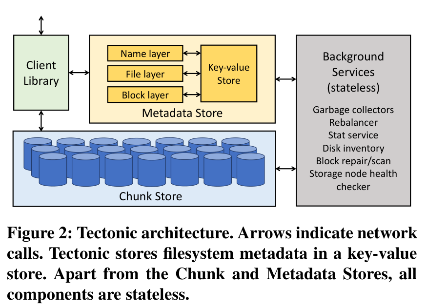
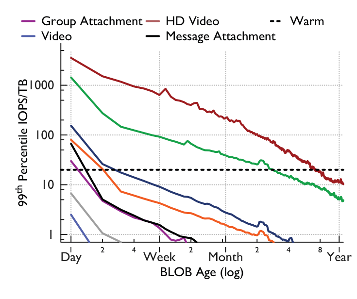
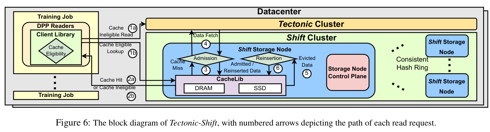
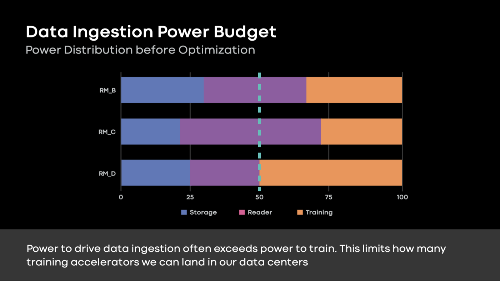

# Meta / Tectonic

> EB 级多租户文件系统 Tectonic / Tectonic-Shift · 官方论文与工程博客

Meta（原 Facebook）的大数据存储公开资料可以连成一条清晰的演进线。最初，BLOB 按“温度”拆成 Haystack（热）和 f4（温）两套专用系统，数据仓库则分散在几十个 HDFS 集群上 [BM3][BM1]。随后，EB 级多租户文件系统 **Tectonic** 把它们合并到同一个 HDD 存储底座上，用“共享磁盘时间”化解 IOPS 与容量的错配 [BM1]。ML 训练把读带宽需求推到 HDD 无法经济承受的程度之后，Meta 又在每个 Tectonic 集群前面加了一层闪存 **Shift**，组成 **Tectonic-Shift** [BM2]。这三篇论文都直接讨论了同一个现象：HDD 单盘 IOPS 不变、密度上升，导致 IOPS/TB 下降。它们是理解大容量盘在超大规模数据仓库中处境的一手材料。

### 定位与规模

据 FAST’21 论文，Tectonic 是 Meta 的 EB 级分布式文件系统，承载约十个租户，其中 blob storage 和 data warehouse 各存有 EB 级数据。单个集群可以覆盖整个数据中心，并已完全取代 Haystack、f4 和 HDFS [BM1]。论文给出了一个代表性多租户生产集群的数据：容量 1590 PB，已用 1250 PB（约占容量的 70%），文件 107 亿个，块 150 亿个，存储节点 4208 台；blob storage 约占已用空间的 49%，data warehouse 约占 51% [BM1]。数据仓库从 HDFS 迁到 Tectonic 后，集群数量减少到原来的 1/10 [BM1]。Meta 2022 年的工程博客称，AI 训练数据同样存放在 Tectonic 上，总量达 EB 级，并且增长很快 [BM4]。

### 架构与 IO 路径

*Tectonic 架构（USENIX FAST’21 论文图 2）：Client Library 编排对 Metadata Store（Name / File / Block 三层，基于 key-value 存储）与 Chunk Store 的 RPC；垃圾回收、再平衡、块修复 / 扫描等后台服务均为无状态* — [原始来源](https://www.usenix.org/system/files/fast21-pan.pdf)

- **Chunk Store**：一个扁平的分布式对象存储，chunk 数随存储节点数线性增长，chunk 以文件形式存放在各节点的 XFS 上。**每个存储节点挂 36 块 HDD，另配一块 1 TB SSD**；SSD 用于存放 XFS 元数据和缓存热 chunk，所用缓存库能感知闪存寿命 [BM1]。36 盘的节点规格来自 Meta 的 Bryce Canyon 平台：这是一个 4OU 机箱，装 72 块 3.5 英寸 HDD，可以配置成两台 36 盘的存储服务器；在面向解耦存储服务的高性能配置中，M.2 插槽可用于缓存或合并小写 [BM5]。
- **以块为持久性单位**：块由 chunk 组成，每个块可以单独选用 RS 编码或副本，各 chunk 分布在不同故障域（如不同机架） [BM1]。按 Tectonic-Shift 论文的描述，块通常为 72 MiB，chunk 通常为 8 MiB [BM2]。
- **元数据分层哈希分片**：Name、File、Block 三层分别按目录、文件和块 ID 做哈希分片，以避开热点；每个分片最多处理 10K QPS [BM1]。
- **客户端驱动**：Client Library 直接与存储节点交互，写入方式可以逐次调用配置。下文各项按租户定制的优化都以此为前提 [BM1]。

### 关键优化手段与处理逻辑

#### 1. 按温度分层：Haystack → f4，以及它的局限

f4（OSDI’14）依据“访问量随对象年龄衰减”划分温度区。不到一天的新内容，请求率是一年前内容的 100 倍以上；九类 BLOB 中有八类，请求率在一周内下降一个数量级。f4 使用 4 TB 盘，单盘在可接受延迟下最多提供 80 IOPS，因此温存储的峰值能力为 **20 IOPS/TB**；BLOB 的 P99 负载降到这条线以下，就可以迁入 f4 [BM3]。按这个标准，九类中有七类不到一周就可以迁移，照片约需 3 个月，头像约需一年 [BM3]。f4 单元由 14 个机架、每架 15 台主机组成，每台主机 30 块 4 TB 盘。数据文件采用 RS(10,4) 编码，再加上跨地域 XOR，有效副本因子从 Haystack 的 3.6 降到 2.8 或 2.1；当时 f4 存有超过 65 PB 的逻辑数据 [BM3]。块重建由无存储的 rebuilder 节点在后台完成，并主动限速，以免影响在线请求 [BM3]。

*f4 论文（USENIX OSDI’14）图 4：不同类型 BLOB 按年龄的 P99 IOPS/TB 负载（对数坐标），虚线为 4 TB 盘温存储能力 20 IOPS/TB；线条颜色图例部分沿用原文图 3* — [原始来源](https://www.usenix.org/system/files/conference/osdi14/osdi14-paper-muralidhar.pdf)

Tectonic 论文复盘了这种“按温度拆系统”方案为什么后来失效：**单盘 IOPS 保持不变而密度上升，IOPS/TB 随之下降**，Haystack 因此成为 IOPS 瓶颈，不得不为热 BLOB 多配硬盘，有效副本因子从理想的 3.6× 涨到 5.3×；而 f4 受容量限制，IO 有富余。两套系统各自搁浅一部分资源，无法互相调剂 [BM1]。

#### 2. 合并租户，共享“磁盘时间”

Tectonic 认为，blob storage 的请求小，受 IOPS 限制；数据仓库的请求大，受带宽限制。两者都无法单独用 IOPS 或带宽来公平计量，真正的瓶颈资源是**磁盘时间**（disk time），即盘处于忙碌状态的时间比例 [BM1]。在代表性集群的三个日峰值中，数据仓库的磁盘时间需求为 0.60、0.54、0.57，超过它按容量所能分到的 0.51；blob storage 的需求只有 0.11–0.14，而它能分到 0.49。合并后的总需求为 0.68–0.72，低于供给 1.00。如果数据仓库单独建集群，需要约 17% 的超配才能应付峰值 [BM1]。blob 迁入 Tectonic 后，有效副本因子从 Haystack 的 5.3× 回到约 2.8× [BM1]。

#### 3. 资源隔离与限流：TrafficGroup 与 Gold 优先

存储 IOPS 和元数据 QPS 被视为“瞬时资源”，以 TrafficGroup（每个集群约 50 个）为粒度分配。每个 TrafficGroup 归属 Gold、Silver、Bronze 三个 TrafficClass 之一，分别对应延迟敏感、普通和后台流量。富余资源先在同一租户内部按 TrafficClass 优先级分配，再分给其他租户 [BM1]。客户端用近实时分布式计数器和改进的漏桶算法做全局限流，资源不足时请求被延迟或拒绝；存储节点则用加权轮询（WRR）做本地隔离 [BM1]。为防止数据仓库的大 IO 把 blob 的小 IO 堵在盘上，存储节点还有三项措施 [BM1]：

- 低优先级请求在不影响完成时间的前提下，让位给高优先级请求；
- 限制每块盘上同时在途的非 Gold IO 数量；
- 某个 Gold 请求在盘上等待超过阈值时，暂停向该盘下发非 Gold 请求，以抵消盘内 IO 重排序的影响。

#### 4. 写入路径：整块 EC、对冲写与“先副本后转码”

- **数据仓库：整块 RS 异步写**。数据仓库是“一写多读”，文件关闭后才对读者可见，所以应用可以把数据缓冲到一个完整块，在内存中完成 RS 编码后再写出。长期数据一般用 RS(9,6)，shuffle 等短期数据一般用 RS(3,3)。由于块足够大，整块写的瓶颈是磁盘带宽而不是 IOPS [BM1]。
- **对冲仲裁写**。写一个 RS(9,6) 块时，客户端先向 19 个不同故障域的节点发预约请求，把数据写到最先响应的 15 个节点，收到 14 个成功即确认，第 15 个 chunk 离线修复。在 80% 负载的测试集群中，72 MB 整块写的 P99 延迟改善约 20% [BM1]。
- **Blob：先副本、封块后转码**。小 blob 以副本形式部分块追加写，写满两份即确认，以保证低延迟。如果直接对小追加做 RS 编码，每次 IO 数会从 3 次变成 14 次（RS(10,4)）。因此块封闭后再整体转码为 RS(10,4)，每个目标节点只需一次大 IO [BM1]。

#### 5. 修复与重建：copyset 与“重建风暴”控制

Tectonic 维持固定数量的 copyset：在内存中保存约一百个“所有盘的一致性洗牌”，用洗牌中相邻的盘组成 copyset。copyset 过多，盘故障高峰时不可用风险上升；copyset 过少，单盘故障时同伴盘的重建负载过重 [BM1]。Tectonic 采用连续（非条带）RS 布局，多数读只需一次磁盘 IO；而 RS(10,4) 下的重建读需要 10 倍 IO。节点过载会让直读失败、触发重建读，重建读又进一步加重负载，形成“重建风暴”。Tectonic 的处理方式是把重建读限制在全部读的 10% 以内，以避免为此超配磁盘 [BM1]。

#### 6. ML 训练：Tectonic-Shift 闪存层

Tectonic-Shift（ATC’23）的出发点是 HDD 的“IO 每瓦”太低。每个训练集群需要存储 EB 级数据，并以数十 TB/s 的速度读取；若只靠 HDD，为满足 IO 所需配置的容量比存放数据所需的容量高出一个数量级 [BM2]。论文用 Meta 的 HDD 和闪存服务器规格做了测算，场景是 100 PB 存储加 10 TB/s 读带宽，功耗以“HDD 只满足容量”为 1.00 归一化 [BM2]：

| 方案 | 只满足容量 | 只满足 IO | 容量与 IO 同时满足 |
|---|---|---|---|
| 纯 HDD 集群 | 1.00 | 9.92 | 9.92 |
| 纯闪存集群 | 6.53 | 1.88 | 6.53 |
| HDD（容量）+ 闪存（IO） | 1.00 | 1.88 | 2.69 |

纯 HDD 方案需要配置 9.92 倍的容量（按 RS(9,6) 计约 1.6 EB 盘）；而 IO 需求的增速是存储需求的 2 倍，这条路不可持续。复合方案的功耗只有纯 HDD 的 1/3.69 [BM2]。Meta 没有在 Tectonic 内部建一个闪存 Chunk Store，因为那样需要在闪存上额外做 RS 编码、增加元数据开销，还要让 Metadata Layer 支持子块粒度。最终选择的是**无元数据、非持久的闪存缓存** [BM2]。

*Tectonic-Shift 读路径（USENIX ATC’23 论文图 6）：Client Library 先做缓存资格判断，可缓存的读按一致性哈希发往 Shift 存储节点（CacheLib 管理 DRAM + SSD，Control Plane 负责准入 / 回插），未命中或不可缓存的读直接访问 HDD Tectonic 集群* — [原始来源](https://www.usenix.org/system/files/atc23-zhao.pdf)

Shift 的处理逻辑如下 [BM2]：

- 对用户透明，API 与 Tectonic 相同。
- Shift 节点基于 CacheLib 构建，按一致性哈希环完全去中心化。
- 块被切成 256 KB 的 segment 作为缓存对象。
- 准入和回插阈值依据训练作业的数据集声明（要读的表分区和特征）推断未来访问模式；PID 反馈环把写入速率压在闪存寿命上限以内。
- 客户端先过滤掉非 ML 流量和冷门表，因为这部分 IO 由 HDD 就能承担。

结果是：Shift 吸收的 IO 是 LRU 闪存缓存的 1.51–3.28 倍；在 PB 级生产集群上，相比纯 HDD 节省 29% 的功耗。论文同时指出，不做应用感知的闪存缓存只能吸收达到“功耗持平”所需 IO 的 0.21 倍 [BM2]。

#### 7. 读者侧减少随机 IO：特征重排与合并读

Meta 2022 年的工程博客从读者侧做了补充。训练只读取部分特征，按特征选择性寻道会让 IO 变小、IOPS 需求变高；而为减少寻道去整段多读，又会读进大量最终被丢弃的字节。博客的做法是把常被一起读取的特征写到连续区域（feature reordering），使存储层到读取层的数据量减少 45–55%，部分模型的存储服务时间改善 30–70%。连同其他优化，数据摄取的功耗预算下降 35–45% [BM4]。Tectonic-Shift 论文也提到，DPP Reader 会针对 HDD 寻道把读合并为 O(1MB) 量级的大 IO [BM2]。

*Meta 工程博客 “Scaling data ingestion for machine learning training at Meta”（2022-09-19）图 3：三个推荐模型中存储（Storage）、读取（Reader）与训练（Training）的功耗占比，数据摄取功耗常超过训练本身* — [原始来源](https://engineering.fb.com/2022/09/19/ml-applications/data-ingestion-machine-learning-training-meta/)

### 公开数据一览

| 指标 | 数值 | 来源 |
|---|---|---|
| 代表性 Tectonic 集群 | 容量 1590 PB，已用 1250 PB，4208 个存储节点 | FAST’21 [BM1] |
| 存储节点配置 | 36 块 HDD + 1 TB SSD | FAST’21 [BM1] |
| 有效副本因子 | Haystack 理想 3.6×、实际 5.3×；f4 2.8× / 2.1×；Tectonic blob 约 2.8× | FAST’21、OSDI’14 [BM1][BM3] |
| EC 配置 | 仓库长期数据 RS(9,6)，短期数据 RS(3,3)；blob 封块后转为 RS(10,4) | FAST’21 [BM1] |
| 重建读上限 | 不超过全部读的 10% | FAST’21 [BM1] |
| f4 盘与 IO 能力 | 4 TB 盘，80 IOPS，即 20 IOPS/TB | OSDI’14 [BM3] |
| Shift 效果 | IO 吸收为 LRU 的 1.51–3.28 倍；功耗 −29% | ATC’23 [BM2] |
| 训练 IO 与存储需求增速 | IO 需求增速是存储需求的 2 倍 | ATC’23 [BM2] |

### 与 HDD 容量 / 密度的关系

**来源事实**：Meta 的三篇论文都把 IOPS/TB 下降列为驱动架构变化的原因。f4 用 4 TB 盘的 20 IOPS/TB 划出冷热分界 [BM3]。Tectonic 指出，密度上升而单盘 IOPS 不变，使 Haystack 被迫多配盘 [BM1]。Tectonic-Shift 指出，HDD 只满足 IO 时需要 9.92 倍于数据量的容量 [BM2]。

**工程推论**：在 Meta 的架构中，大容量盘既有阻力，也有助力，取决于盘上放的是什么负载。

- **阻力**：热数据和高 IO 负载不能直接放在大盘上。以 f4 的标准粗算，单盘 IOPS 若保持在 80 左右，盘容量从 4 TB 升到 20 TB 时，IOPS/TB 将从 20 降到约 4，能够迁入“温存储”的数据年龄门槛相应后移（此为按 IOPS/TB = 单盘 IOPS / 容量 做的推算，非论文数据）。重建方面，Tectonic 用 copyset 和 10% 重建读上限来控制故障时的 IO 放大；单盘容量越大，单盘故障需要搬移的数据越多，这些控制就越关键。
- **助力**：Meta 给出的解法并不是买小盘。Tectonic 通过多租户合并，让 IO 密集与容量密集的负载互相填补磁盘时间；Tectonic-Shift 则把 IO 交给闪存，让 HDD 只负责容量。论文说得很直接：“HDD 因其密度是理想的存储效率型设备”，复合方案中 HDD 只按 100 PB 的容量需求来配置 [BM2]。在这种分工下，HDD 的竞争指标是每 TB 功耗和 $/TB，大容量盘的优势可以兑现。
- **前提**：要让大盘被接受，闪存层必须有足够高的 IO 吸收率（Shift 依赖应用感知策略），EC 与修复需要被限流，写入也需要整块化，以便让盘工作在带宽瓶颈而非 IOPS 瓶颈下。这与 Google 的思路一致：IO 问题由上层解决，HDD 按容量购买。

### 资料边界

本章数字均出自 Meta 在 USENIX FAST’21、ATC’23、OSDI’14 发表的论文和 Meta 工程博客。论文未披露 HDD 型号与单盘容量（f4 时代的 4 TB 除外），也未披露 Shift 闪存与 HDD 的容量配比；Tectonic-Shift 的功耗数字只针对 ML 训练负载。本次没有检索到 Meta 专门讨论 HDD IOPS/TB 或高容量 HDD 的 OCP 公开演讲，因此本章未引用 OCP 材料；Bryce Canyon 硬件信息取自 Meta 工程博客。

## 本章资料

- **[BM1]** [Meta (Facebook) · Satadru Pan 等：Facebook’s Tectonic Filesystem: Efficiency from Exascale（USENIX FAST 2021）](https://www.usenix.org/system/files/fast21-pan.pdf)
- **[BM2]** [Meta & Stanford · Mark Zhao 等：Tectonic-Shift: A Composite Storage Fabric for Large-Scale ML Training（USENIX ATC 2023）](https://www.usenix.org/system/files/atc23-zhao.pdf)
- **[BM3]** [Facebook · Subramanian Muralidhar 等：f4: Facebook’s Warm BLOB Storage System（USENIX OSDI 2014）](https://www.usenix.org/system/files/conference/osdi14/osdi14-paper-muralidhar.pdf)
- **[BM4]** [Engineering at Meta · Aarti Basant：Scaling data ingestion for machine learning training at Meta（2022-09-19）](https://engineering.fb.com/2022/09/19/ml-applications/data-ingestion-machine-learning-training-meta/)
- **[BM5]** [Engineering at Meta · Jason Adrian：Introducing Bryce Canyon: Our next-generation storage platform（2017-03-08）](https://engineering.fb.com/2017/03/08/data-center-engineering/introducing-bryce-canyon-our-next-generation-storage-platform/)
