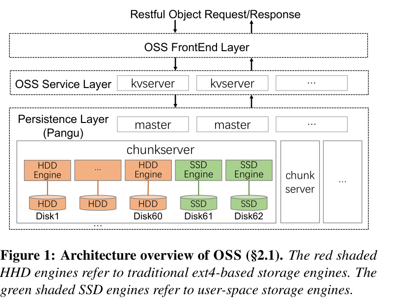
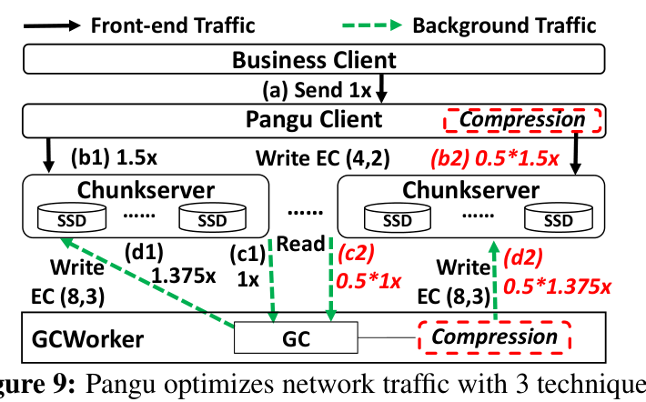
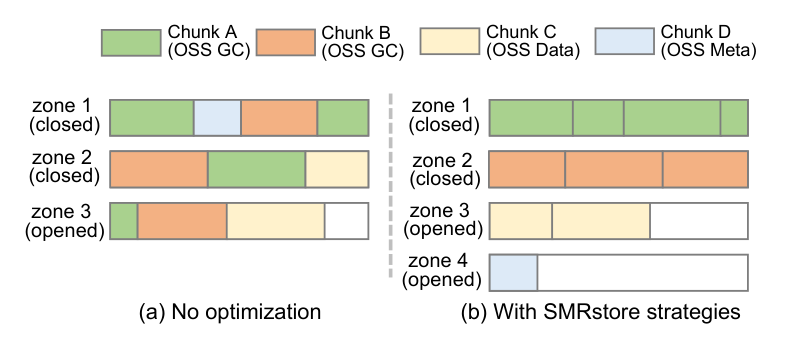

# 阿里云 / 盘古与 OSS

> EB 级统一存储底座 + SMR 对象存储引擎 · USENIX FAST'23 论文与官方文档

阿里云的大数据与对象存储都建在同一个底座上：分布式存储系统**盘古（Pangu）**。EBS 块存储、OSS 对象存储、NAS、PolarDB、MaxCompute 等云服务都运行在盘古之上 [BA1]。阿里在 USENIX FAST'23 上发表了两篇相互关联的论文。一篇是《More Than Capacity: Performance-oriented Evolution of Pangu in Alibaba》，讲盘古如何从“卖容量”转向“卖性能”。另一篇是《SMRSTORE: A Storage Engine for Cloud Object Storage on HM-SMR Drives》，讲标准型 OSS 如何把底层的 CMR 硬盘换成主机管理型叠瓦盘（HM-SMR） [BA1][BA2]。再加上 OSS 官方文档里的五级存储类型和 OSS-HDFS 数据湖服务，可以拼出一条比较完整的 HDD IO 路径：对象和大数据文件先进入 SSD 缓存，再以追加写、大块的形式落到 HDD。本章按这条路径梳理各项优化，最后讨论它们与 HDD 单盘容量和密度的关系。

### 定位与规模

盘古从 2009 年开始开发部署，是阿里巴巴集团和阿里云的统一存储平台。按论文的说法，它已发展成“EB 级容量、管理万亿级文件”的全球存储系统 [BA1]。论文把它的演进分成两代：

- **盘古 1.0（2009–2015）**：基于普通 CPU、HDD（毫秒级 IO 延迟）和 Gbps 级网络，采用内核态、基于 Ext4 的分布式文件系统，并按业务需要陆续加入 TempFile、LogFile、随机访问文件等多种文件类型。论文指出，这一时期客户主要要的是“大容量空间”，而不是高性能 [BA1]。
- **盘古 2.0 第一阶段（2015 年起）**：面向 SSD 和 RDMA，重构出统一的追加写持久层和用户态存储操作系统 USSOS，目标是百微秒级 IO 延迟 [BA1]。
- **盘古 2.0 第二阶段（2018 年起）**：企业核心业务大量上云，业务模型从“面向容量”（volume-oriented）转为“面向性能”（performance-oriented）。阿里自研了每台 96 TB SSD 的高容量存储服务器，并把网络从 25 Gbps 升级到 100 Gbps [BA1]。

HDD 在这条演进线上没有消失，而是被推到容量层。SMRSTORE 论文写道，对象存储系统“通常使用大规模的 HDD 机群”，所以成本效率是云对象存储的核心挑战。截至论文发表时，基于 SMRSTORE 的 HM-SMR 盘已在标准型 OSS 中存储“数百 PB”数据，阿里计划“在不久的将来把 SMR 盘用于 OSS 的所有存储类型” [BA2]。

### IO 路径：OSS 三层架构与盘古 chunkserver

SMRSTORE 论文给出了标准型 OSS 的三层结构 [BA2]：

- **前端层**：预处理用户的 HTTP 请求，再分发给服务层。
- **服务层**：由多台 KV server 组成。KV server 把对象写进盘古文件，并用基于 LSM-tree 的 KV 存储维护“对象名 → 盘古文件内位置”的映射，这些元数据本身也写成盘古文件。
- **持久层（盘古）**：类似 HDFS，由 master（管理盘古文件元数据，不管对象元数据）和最多数千台 chunkserver 组成。在 OSS 场景下，每台 chunkserver 独占一台物理存储服务器，配 **60 块 HDD 做持久化、2 块高性能 SSD 做缓存**。

*标准型 OSS 架构总览（SMRSTORE 论文 Figure 1）：前端层 → KV server 服务层 → 盘古持久层；每台 chunkserver 挂 60 块 HDD 与 2 块 SSD，红色为传统 Ext4 HDD 引擎，绿色为用户态 SSD 引擎。来源：USENIX FAST'23 SMRSTORE 论文* — [原始来源](https://www.usenix.org/system/files/fast23-zhou-su.pdf)

盘古的基本抽象是“只能追加写的文件”加上“chunk”。一个文件由多个 chunk 组成，只有最后一个 chunk 可以追加，其余都已封存（sealed）。chunk 在不同 chunkserver 之间用多副本或纠删码（EC）保护，单机存储引擎本身不负责冗余 [BA2]。chunkserver 上的负载按来源分成五类“流”，它们的特征差别很大（据论文 Table 1） [BA2]：

| 流类型 | 延迟要求 | 并发（打开的盘古文件数） | IO 大小 | 数据在盘上的预期寿命 | 落盘路径 |
|---|---|---|---|---|---|
| OSS 数据写 | <1 ms | 约 1500 | 512 KB–1 MB | <7 天 | 先写 SSD 缓存，再迁到 HDD |
| OSS 数据读 | <20 ms | — | 512 KB–1 MB | — | 直接读 HDD（SSD 空间有限，读不缓存） |
| OSS 元数据写 | <1 ms | 约 2000 | 4 KB–128 KB | <60 天 | 先写 SSD 缓存，再迁到 HDD；约占已用容量 2%（每台约 24 TB） |
| OSS 元数据读 | <20 ms | — | 4 KB–128 KB | — | 多数命中 KV 索引缓存 |
| OSS GC | <20 ms | 约 100 | 512 KB–1 MB | <90 天 | 后台直写 HDD；写入的 chunk 占已用容量 80% 以上 |

这张表说明了 OSS 的 HDD IO 模型：前台写入的延迟靠 SSD 缓存吸收，HDD 主要承担大块顺序写和大块读。最大的写流量来源不是用户写入，而是服务层的垃圾回收（OSS GC）。用户删除对象后，服务层把盘古文件中仍然有效的对象重写到新文件，再删除旧文件 [BA2]。

### 关键优化一：盘古 2.0 的追加写持久层、EC 与流量治理

- **统一的追加写接口 FlatLogFile**：盘古早期为不同服务提供不同接口（例如给 NAS 的 LogFile、给 MaxCompute 的 TempFile），开发和管理都很复杂。2.0 统一为只追加写的 FlatLogFile，上层服务（如 OSS）自己维护 KV 映射，并用垃圾回收压缩历史数据 [BA1]。这样，介质层只需要处理追加写。
- **自包含 chunk 布局与大块变长 chunk**：每个扇区单元由数据、填充和 footer 组成，footer 中存 chunk ID、长度和 CRC，所以一次写入就能同时落下数据和元数据，chunkserver 也可以凭 checkpoint 和 CRC 自行恢复。chunk 大小在 1 MB 到 2 GB 之间可变，既减少了元数据量，又降低了碎片化风险 [BA1]。
- **用 EC 替代三副本，降低流量放大**：以 EBS 为例，一次文件写入要经过客户端发送（1x）、三副本写入（3x）、GCWorker 读出（1x），再以 EC(8,3) 写回（1.375x），流量放大最高为 6.375x，导致 100 Gbps 网络下 EBS 的最大数据访问带宽不到 16 Gbps。把三副本换成 EC(4,2) 后放大降到 4.875x；再在客户端和 GCWorker 两侧用 LZ4 压缩（平均压缩率 50%），可以降到 2.9375x [BA1]。用 EC 存小文件会产生大量补零，盘古通过“小写请求聚合”以及“EC 与三副本的动态切换”来解决；EC 计算延迟则用 Intel ISA-L 压低，比 Jerasure 快 2.5–3 倍 [BA1]。
- **前台与后台流量的动态带宽分配**：集群空余空间充足时，系统临时压低 GC 等后台流量的阈值，把带宽让给前台。以淘宝为例，白天到午夜阈值设得低，午夜之后再调高 [BA1]。
- **面向 HDD 的用户态优化**：论文在“经验教训”一节提到，USSFS 利用自包含 chunk 减少元数据操作，并“利用磁盘内外圈的差异”提高 HDD 的写效率 [BA1]。

*盘古 2.0 的流量放大治理（论文 Figure 9）：业务写入 1x → 三副本或 EC(4,2) 写 chunkserver → GCWorker 读出 → EC(8,3) 写回；红色虚线框为客户端与 GCWorker 两侧的压缩。来源：USENIX FAST'23 盘古论文* — [原始来源](https://www.usenix.org/system/files/fast23-li-qiang_more.pdf)

### 关键优化二：SMRSTORE 让标准型 OSS 用上 HM-SMR

论文给出的动机是：SMR 通过磁道重叠，面密度比 CMR 盘高约 25%，成本效率更好，代价是不支持随机写 [BA2]。阿里评估了三类现成方案，在标准型 OSS 上都不可用：dm-zoned 这类 STL 层在持续写入下吞吐可能下降 56.1%；F2FS 在 HM-SMR 盘上会因随机删除触发频繁 GC，吞吐下降 61.5%；归档型 OSS 的做法又满足不了标准型的 SLO [BA2]。SMRSTORE 的设计有三条主线：

1. **不用本地文件系统**：作为用户态引擎直接实现盘古的 chunk 接口（create / append / read / seal / delete），通过 ZBD 接口直接管理 zone，自己维护 chunk 到 zone 的映射 [BA2]。
2. **全部写成日志**：数据和元数据（checkpoint、journal）都以变长、4 KB 对齐的 record 顺序追加写入 zone [BA2]。
3. **按负载引导数据放置，减少 SMR GC**：一是按流类型分开，只有寿命相近的同类流才能共享一个 zone，为此 OSS 的 KV 存储会把流类型随数据一起下传；二是把 chunk 的大小上限设成和 zone 一样的 256 MB，让大 chunk 尽量独占一个 zone，删除时直接重置 zone，无需迁移；三是预先打开 zone 池，给 OSS GC、数据流、元数据流分别预留 40、10、5 个打开的 zone，并轮询分配 [BA2]。实在需要 SMR GC 时，用贪心法选垃圾最多的 zone，并用限流模块动态限制 GC 吞吐，避免干扰前台 IO [BA2]。

*SMRSTORE zone 分配策略的效果（论文 Figure 13）：左为随机分配，不同流的 chunk 交错在同一 zone；右为按流类型分离、chunk 与 zone 对齐、轮询分配后，大 chunk 独占 zone，删除时可直接重置。来源：USENIX FAST'23 SMRSTORE 论文* — [原始来源](https://www.usenix.org/system/files/fast23-zhou-su.pdf)

论文中的公开数据如下 [BA2]：

| 项目 | 数值（据论文） |
|---|---|
| 测试盘 | CMR：60 × 16 TB（随机 4 KB 读 113 IOPS，顺序 512 KB 约 255 MB/s）；SMR：60 × 20 TB（121 IOPS，约 256 MB/s）；20 TB SMR 盘有 74508 个 zone（含 800 个常规 zone），每个 zone 256 MB |
| 高并发写 | 单 chunkserver 超过 110 MB/s，比上一代 CS-Ext4（CMR）高 30% |
| 宏基准 | 60 HDD + 2 SSD 的服务器稳定写入 4 GB/s，是 F2FS 的 2.16 倍 |
| 现网对比（13 台 chunkserver、共 780 块 HDD） | 每台 chunkserver 写入：SMR 1898.6 MB/s，CMR 1888.3 MB/s；读取：SMR 752.8 MB/s，CMR 723 MB/s |
| 单机重启恢复 | 20 TB SMR 盘（已用 60%）94.4 秒；16 TB CMR + Ext4 不到 20 秒；早期版本超过 4 分钟 |
| 资源与空间开销 | 内存 49.3 GB/台（约为 CS-Ext4 的 2 倍），CPU 约 19 核（多 26.7%）；对 512 KB–1 MB 的大 IO，额外空间开销 1–2% |
| 成本与规模 | 换用 SMR 盘后总成本最多下降 15%；已存储数百 PB |

### 存储类型与数据湖：用分层把冷数据推向更便宜的介质

OSS 官方文档目前列出五种存储类型 [BA3]，它们是阿里云对外的冷热分层接口（以本地冗余口径为例）：

| 类型 | 最小计量 / 最低存储时间 | 访问特点 | 冗余方式 |
|---|---|---|---|
| 标准 | 按实际大小 / 无 | 实时访问；单文件月访问大于 1 次 | 同城冗余或本地冗余（持久性设计分别为 12 个 9 和 11 个 9） |
| 低频访问 | 64 KB / 30 天 | 实时访问，有取回费用；单文件月访问不到 1 次 | 同城或本地冗余 |
| 归档 | 64 KB / 60 天 | 解冻约 1 分钟，或归档直读 | 同城或本地冗余 |
| 冷归档 | 64 KB / 180 天 | 解冻 1–12 小时 | 仅本地冗余 |
| 深度冷归档 | 64 KB / 180 天 | 解冻 12 或 48 小时；文档列出的场景包括“磁带替换” | 仅本地冗余 |

大数据场景主要通过 **OSS-HDFS（JindoFS 服务）**接入。官方文档称它完全兼容 HDFS 接口，Hadoop/Spark 作业无需修改；可支撑“EB 级、亿级文件管理、TB 级吞吐”；元数据采用多节点多活，而不是 NameNode 主备；数据块按 OSS 方式存储并计费，支持把较少访问的数据转为低频、归档和冷归档存储 [BA4]。也就是说，阿里云的大数据存储走的是存算分离加对象存储底座的路线。HDFS 的三副本语义不再落在本地盘上，冗余方式由 OSS 和盘古决定（EC 或多副本，具体参数未公开）。

### 与 HDD 容量 / 密度的关系（本文分析）

- **来源事实：阿里明确在追求更高面密度。**SMRSTORE 是一项纯粹为容量和密度服务的工程：用增加约 1 倍的内存、多 26.7% 的 CPU，换取约 25% 的面密度和最多 15% 的总成本下降，并计划推广到 OSS 全部存储类型 [BA2]。这说明，只要软件栈和介质的写入模型对齐，超大规模云厂商愿意为更高密度的盘付出工程成本。
- **来源事实：HDD 只承担“容量 + 顺序带宽”。**在 OSS 的 IO 路径中，延迟敏感的写和元数据都先进 SSD，HDD 上只有 512 KB–1 MB 的大块读写和后台 GC 流 [BA2]。盘古论文则把高性能业务整体迁到了 96 TB SSD 服务器上 [BA1]。
- **工程推论：IOPS/TB 在下降，但该栈对它不敏感。**按论文 Table 2 推算，16 TB CMR 约为 113 / 16 ≈ 7.1 IOPS/TB，20 TB SMR 约为 121 / 20 ≈ 6.1 IOPS/TB。现网 SMR 集群单台 1898.6 MB/s 的写入，平均到 60 块盘约为 31.6 MB/s/盘，只占单盘顺序带宽（约 256 MB/s）的八分之一左右。这说明在大块、追加写、SSD 前置的模型下，限制因素更可能是服务器 CPU、内存、网络和 GC 带宽，而不是单盘 IOPS。这一点是对单次基准数据的推算，不代表稳态容量利用。
- **工程推论：真正的阻力在 GC、内存和恢复。**盘越大，单盘的 zone 数越多、在内存中维护的 chunk 和 record 索引越多。论文已经把内存增长归因于这类结构（每个 chunk 约 200 字节，每个 record 索引 8 字节） [BA2]。单机重启恢复时间也随盘容量和已用量增加（20 TB SMR 为 94.4 秒）。注意，这里说的是引擎的本地恢复，不是跨节点的数据重建。阿里没有公开数据重建带宽，所以无法按“容量 / 重建带宽”算出重建时长。
- **对大容量盘总体是助力。**OSS 已把 HDD 的写入模型改造成大块追加写，并能接受 HM-SMR，为 SMR 或 HAMR+SMR 等更高面密度的介质铺好了软件路径。剩下的约束主要是网络与 GC 流量放大（盘古用 EC 和压缩已压到约 2.94x），以及冷数据层在深度冷归档上与磁带的竞争。

### 资料边界

两篇论文都发表于 2023 年。SMRSTORE 的部署规模（数百 PB）、15% 的成本下降以及“推广到全部存储类型”的计划，都是论文写作时的口径，此后的进展没有找到官方更新。盘古和 OSS 的 EC 参数、各存储类型的底层介质（包括冷归档 / 深度冷归档是否使用 SMR 或磁带）、单盘容量档位和数据重建带宽，均未见官方公开。本章中关于 IOPS/TB 和单盘写入带宽占用的数字，是本文根据论文表格推算的。

## 本章资料

- **[BA1]** [USENIX FAST '23 · Qiang Li et al.（阿里巴巴 / 厦门大学）：More Than Capacity: Performance-oriented Evolution of Pangu in Alibaba（2023-02）](https://www.usenix.org/system/files/fast23-li-qiang_more.pdf)
- **[BA2]** [USENIX FAST '23 · Su Zhou et al.（阿里巴巴）：SMRSTORE: A Storage Engine for Cloud Object Storage on HM-SMR Drives（2023-02）](https://www.usenix.org/system/files/fast23-zhou-su.pdf)
- **[BA3]** [阿里云帮助中心 · 对象存储 OSS 用户指南：存储类型（采集于 2026-11-19）](https://help.aliyun.com/zh/oss/user-guide/overview-53)
- **[BA4]** [阿里云帮助中心 · 对象存储 OSS 用户指南：什么是 OSS-HDFS 服务（采集于 2026-11-19）](https://help.aliyun.com/zh/oss/user-guide/overview-1)
