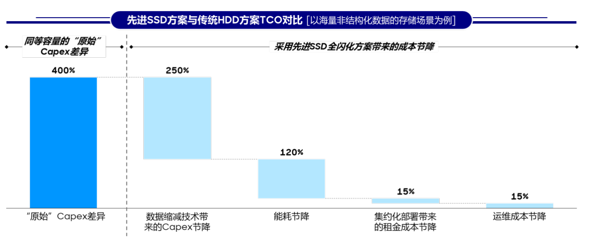
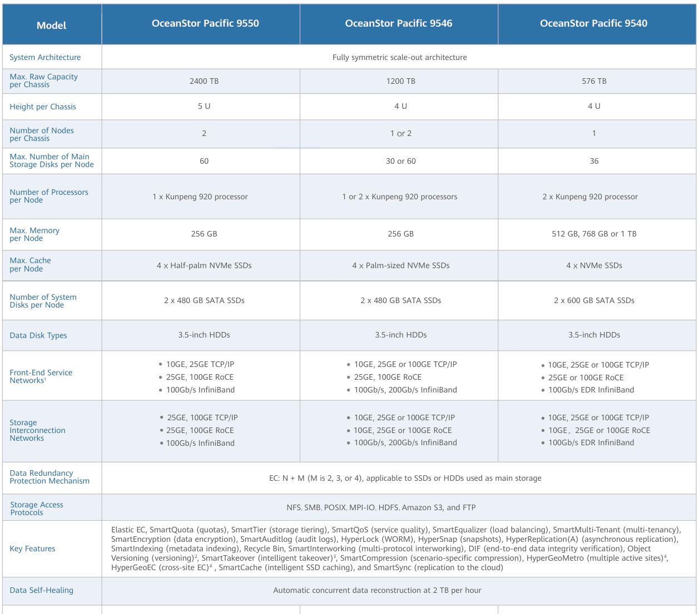
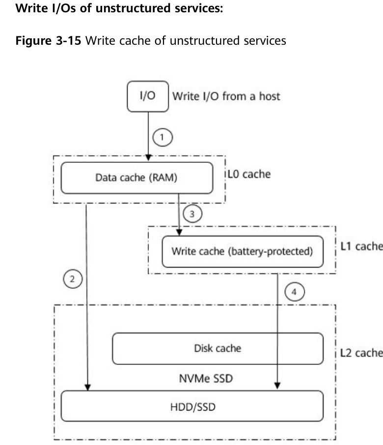

# 国内厂商与存力政策

> 国内厂商 EB 级 HDD 存储栈 + 产业政策 · 官方白皮书 / 数据手册 / 技术文章 / 政策原文

本章把国内与“EB 级大数据 HDD 存储”相关的公开材料放在一起看，分三组：一是政策与产业口径，即工信部等六部门《算力基础设施高质量发展行动计划》中的“先进存储”目标，以及华为与罗兰贝格联合发布的《先进数据存力白皮书》；二是存储厂商，即华为 OceanStor Pacific 分布式存储的高密 HDD 机型、IO 路径与大数据存算分离方案；三是云与互联网厂商，即腾讯云 COS 的存储引擎 YottaStore、字节跳动的 10 EB 级 HDFS 与 EB 级日志存储，以及华为云用磁带替换 HDD 归档的 TapeOBS。本章着重回答两个问题：国内客户的大数据 IO 栈长什么样；公开材料里有哪些线索可以解释部分客户对“大容量 HDD”的保留态度。后者只陈述来源中的内容，推论会单独标出。

### 政策与产业口径：“先进存储”、闪存化与“硬件高密”

2023 年 10 月，工业和信息化部、中央网信办、教育部、国家卫生健康委、中国人民银行、国务院国资委联合印发《算力基础设施高质量发展行动计划》。存力方面的 2025 年目标是：**存储总量超过 1800 EB，先进存储容量占比达到 30% 以上**，重点行业核心数据和重要数据的灾备覆盖率达到 100% [BC1]。全文“强化存力高效灵活保障”一节写道：“围绕全闪存、蓝光存储、硬件高密、数据缩减、编码算法、芯片卸载、多协议数据互通等技术，推动先进存储创新发展。鼓励先进存储技术的部署应用，实现存储闪存化升级”；配套行动中还有“鼓励在关键信息基础设施中使用自主的存储设备，通过全闪存储整机带动关键存储部件的国产化应用”，并要求定期发布《中国存力发展报告》 [BC2]。国务院客户端发布的配套解读把这一部分概括为“紧抓存储闪存化升级的机遇” [BC3]。

用户提供的本地 PDF《先进数据存力：加速智能经济涌现的“高性能引擎”》，与华为企业业务网站托管的文件逐字节一致（MD5 相同）。媒体报道称，它是华为与罗兰贝格于 2024-09-20 在华为全联接大会上联合发布的 [BC4][BC5]。它代表的是存储厂商的立场，倾向全闪存。白皮书中与 HDD 直接相关的数字如下：

| 主张或数据（据白皮书，页码为 PDF 页） | 内容 |
|---|---|
| 闪存化程度（p77、p73、p69） | “当前中国全闪化率仅为 6.22%，远低于世界平均水平 17.01%”；2023 年中国存储投资中闪存仅占 32.6%；2019–2023 年累计闪存投资占比 29.2% |
| HDD 仍是扩容主力（p67） | 中国 2021–2023 年存力容量扩建投资复合增长率为 24.4%（2017–2019 年为 44.7%），且“仍有相当一部分来源于二级系统的 HDD 规模增长” |
| 选型动因（p53） | “诸多企业在二级系统与备份容灾系统选型时，因侧重 Capex 成本考量而选择 HDD 方案” |
| TCO 主张（p53–54） | 在海量非结构化数据、设备生命周期 5 年的场景下，“先进 SSD 全闪化方案的单位容量 TCO 已可与传统 HDD 方案基本持平”；“当前 SSD:HDD 价差大概在 5:1 左右”；数据缩减领先至少 50%，年度 Opex 下降至少 80% |
| 性能门槛案例（p51、p30） | 某运营商规定节点读写带宽当量达到 500 MB/s 时必须使用全闪方案；某运营商备份时间每天超出 HDD 方案备份窗口上限 10% |
| 能耗与空间（p34–35） | 相同容量下 SSD 比机械硬盘能耗低 70%、空间省 50%；并提到“高密盘框的设计使得相同空间内可存储更多的数据” |

*《先进数据存力白皮书》图 2-2“先进 SSD 方案与传统 HDD 方案的 TCO 对比（以海量非结构化数据的存储场景为例）”：同等容量“原始”Capex 差异 400%，被数据缩减（250%）、能耗（120%）、集约化部署租金（15%）、运维（15%）抵消。来源：华为 × 罗兰贝格白皮书 PDF 第 54 页* — [原始来源](https://e.huawei.com/marketingcloud/pep/asset/20000001/Material/ba4c26ca5149416db7609cab0005cee8/M3T1A590N1078731126632403193/%E5%85%88%E8%BF%9B%E6%95%B0%E6%8D%AE%E5%AD%98%E5%8A%9B%E7%99%BD%E7%9A%AE%E4%B9%A6.pdf)

需要注意：政策文本列举的先进存储技术中包括“硬件高密”，但并没有把“先进存储”等同于全闪存。“闪存化”是政策鼓励的方向，而“先进存储容量占比 30%”的统计口径在原文中没有给出定义。

### 华为 OceanStor Pacific：高密 HDD 机型与大数据存算分离

OceanStor Pacific 是华为面向海量非结构化数据的分布式存储，提供文件、对象、HDFS、块四种服务，同一份数据可以通过文件、HDFS、对象协议互通访问，集群最大 4096 节点 [BC6]。2026 年上半年版数据手册中的 HDD 机型如下 [BC6]：

| 机型 | 形态 | 主存盘 | 每框裸容量（据数据手册） | 数据自愈 |
|---|---|---|---|---|
| Pacific 9550（均衡型） | 5U 2 节点，每节点 60 盘，共 120 盘 | 3.5 英寸 HDD；每节点 4 块半掌 NVMe SSD 作缓存 | 正文称 720–2880 TB；规格表写最大 2400 TB | 自动并发重构 2 TB/小时 |
| Pacific 9546 | 4U，1 或 2 节点，最多 60 盘 | 3.5 英寸 HDD | 最大 1200 TB（正文称最高 1440 TB） | 2 TB/小时 |
| Pacific 9350 / 9346（视频型） | 5U 120 盘 / 4U 60 盘 | 3.5 英寸 HDD | 9350：720–2880 TB；9346：1440 TB | — |
| Pacific 9926（全闪） | 2U 36 盘 | 15.36 / 30.72 / 61.44 TB SSD | 2211.84 TB 裸容量，叠加数据缩减后称最高 4 PB/2U | 6 TB/小时 |

*OceanStor Pacific 9550 / 9546 / 9540 规格表（HDD 主存机型）：5U 120 盘、每节点 60 盘、EC N+M（M=2/3/4）、HDFS 协议、数据自愈“自动并发重构 2 TB/小时”。来源：华为 OceanStor Pacific 系列数据手册（V800R001C20，H1 2026）第 7 页* — [原始来源](https://e-file.huawei.com/marketingcloud/pep/asset/20000001/Material/e93718c9bf1f4d25894b75a514630af8/M3T1A590N1246193369071251686/Huawei%20OceanStor%20Pacific%20Series%20V800R001C20-Data%20Sheet%20_H1%2026_.pdf)

按 120 盘折算，2880 TB 对应单盘 24 TB，2400 TB 对应 20 TB；2021 年华为博客中的示例是“采用 14 TB 硬盘时 1 台 9550 提供 1.68 PB 裸容量” [BC9]（单盘容量为本文折算）。高密硬件白皮书解释了 5U 120 盘的设计：上层 4U 是可前后双向抽拉的硬盘框，靠坦克链走线，不需要托架导轨，因此盘间距增加 50%、散热能力提升 30%；下层 1U 放两个节点、电源和 BBU。与 4U 36 盘通用服务器相比，存储密度是其 2.67 倍，同等盘数下机柜空间减少 62.5%；两个节点在正常情况下各管 60 块盘，故障时可以互相接管后端盘 [BC7]。

大数据方面，数据手册称 HDFS 服务“使用原生 HDFS 语义，计算节点无需安装插件”，支持存算一体与存算分离共存，可以“自动接管第三方 HDFS 的业务”。典型场景包括金融离线分析、互联网日志留存、运营商经营分析和政府项目 [BC6]。技术白皮书描述的 SmartTakeover 元数据网关的工作方式是：把原 HDFS 平台的 NameNode 路径挂进 Pacific 的全局命名空间，数据不在 Pacific 时通过网关回原 HDFS 读取 [BC8]。官网系列页把这一方案的收益表述为“可降低 30% TCO”，并称 EC 硬盘空间利用率 91.6%，“是传统三副本方案的 2.75 倍” [BC15][BC7]。

### Pacific 的 IO 路径：多级缓存、条带聚合与 EC 重构

- **多级缓存与大块化落盘**：在 SSD 与 HDD 混合配置下，系统构建“内存 → SSD → HDD”三级缓存。L0 是接入节点内存；L1 是带电池保护的写缓存（结构化服务则使用 SSD 上的 WAL cache，通常用小比例跨节点 EC 保护）；L2 是 SSD 上的 HDD 盘缓存。大 IO 在 L0 聚合后直接算 EC 写到持久节点；小 IO 先在 L1 中凑满条带，再在 L2 中聚合成大块后写入 HDD。白皮书举例：EC 20+2、分片 32 KB 时，凑齐 20 个 32 KB 就能形成满条带，但 32 KB 直接写 HDD“不能发挥 HDD 吞吐”，所以小于 256 KB 的块会在 L2 中继续聚合，超过 256 KB 后再下盘 [BC8]。
- **智能条带聚合**：基于“Plog 追加写”语义，把多个文件的随机小 IO 聚合成满条带写入，以支持 20+2 这类大比例 EC，避免写惩罚 [BC8]。
- **EC 与动态 EC**：EC N+M（M 为 2、3、4），最大 22+2，可以容忍 4 个节点同时故障；节点故障时自动降低 EC 比例（例如 4+2 降为 3+2），只作用于新写入的数据 [BC6][BC8]。
- **重构优化**：短时离线（拔盘、重启）的盘回来后只做状态协商，不做全盘重建；EC 分条通过虚拟化打散到全池，热备空间也分散在各盘上，一块盘故障时由大量盘并行参与重建；自研 LDEC 编码的重建网络带宽为 Reed-Solomon 的 0.75，重建时间缩短 32.45%；SSD 缓存盘故障时只增量重建尚未下刷到 HDD 的数据。白皮书提到，若缓存盘故障后采用全盘重建（需恢复已写入 HDD 的全部相关数据），重建时间“按天计算” [BC8]。

*OceanStor Pacific 非结构化服务写缓存路径（技术白皮书 Figure 3-15）：主机写 IO → L0 内存数据缓存 →（大 IO 直接 EC 下盘 / 小 IO 进 L1 电池保护写缓存）→ L2 NVMe SSD 盘缓存聚合 → HDD。来源：华为 OceanStor Pacific 8.2.0 技术白皮书第 33 页* — [原始来源](https://e-file.huawei.com/marketingcloud/pep/asset/20000001/Material/f22d2e7ee29d4d06bfd045a471f28775/M3T1A669N1135398139631067387/Huawei%20OceanStor%20Pacific%20Series%208_2_0-Technical%20White%20Paper_24H1_.pdf)

同一份数据手册在介绍全闪机型 9926 时，把 HDD 作为对比对象：“36 盘位 2U、容量密度最高 4 PB/2U，是 HDD 存储的 8 倍”；“1 TB 数据 10 分钟完成重构，效率是 HDD 存储的 3 倍”；“以 HDD 的成本实现全闪”，同规模下“性能翻倍、TCO 持平甚至更低” [BC6]。

### 云与互联网厂商：腾讯 YottaStore、字节 HDFS 与华为云 TapeOBS

- **腾讯云 COS / YottaStore**：腾讯专有云官方文章称，YottaStore 是 COS 的新一代存储引擎，同一集群可以并存任意多副本和任意 EC 编码，单集群可达百万节点。它采用**流式在线 EC**：数据在接入层直接编码写入存储节点，不再先写多副本、攒够再离线转 EC。这样省掉了缓冲层和二级索引，删除后的空间可以近实时回收，也避免了离线 EC 的重写 IO 和“重建读放大”。其他机制包括：写请求用 Top N Return、读请求用 Backup Request 来压尾延迟；存储节点采用分级令牌桶；全局均衡使平均磁盘利用率达到 95% 以上；多级巡检，并把磁盘级自动运维与数据修复联动 [BC10]。腾讯云开发者社区转载的媒体文章（鲜枣课堂）补充了历史数据：约 2015 年数据达到 500 PB 量级时，腾讯建设 BTFS，把历史数据“从三副本降到 1.33 份的纠删存储”；2017 年腾讯云数据量突破 1 EB；YottaStore 于 2018 年开始研发、2019 年上线，可适配 JBOD 以及磁带、HDD、SSD 等介质。文章还写道：“磁盘容量扩大，单机磁盘数变多，密度增高，成本也随之降低” [BC11]。
- **字节跳动 HDFS**：火山引擎官方文章（2022）称，字节的 HDFS 已发展到十万台级服务器、10 EB 级数据。DataNode 采用多副本，每个副本放在不同节点上。文章指出慢节点问题“尤其是磁盘占用百分比非常高以后”层出不穷，原因是资源平衡滞后：许多机器磁盘占用触线后写入降级，新增的热资源又集中在少量机器上。对此字节做了 Hedged Read 等读慢节点优化 [BC12]。
- **字节跳动 EB 级日志 TLS**：官方文章（2024）认为，日志读写都是顺序 IO，HDD 带宽够用、没有寿命问题、单位容量成本远低于 SSD，所以 HDD 比 SSD 更适合，但 HDD 的 IOPS 能力有限，需要大量优化。传统混合存储的做法是先以三副本写 SSD，再后台转存到 HDD，这会带来 SSD 寿命与成本、小 IO 性能、后台全量读和网络流量放大四个问题。TLS 改为全流程 EC 直写：所有写请求汇聚成一条顺序流，凑满条带后用 EC 写入 SSD；大 IO 绕过 SSD 直写 HDD；在内存中充分聚合后再以满条带 EC 写入 HDD [BC13]。
- **华为云 TapeOBS（FAST'26）**：华为云原有一套基于 HDD 的归档存储服务，后来为降本建设了磁带对象存储 TapeOBS。2022 年底开始灰度，2024 年正式商用，已存储数百 PB 原始数据。论文按 100 PB 初始容量、每年增长 50% 测算 10 年 TCO：磁带的 CapEx 低 2.68 倍，OpEx 低 16.11 倍，TCO 合计低 4.95 倍；理由包括磁带每 GB 价格比 HDD 低 50% 以上、寿命 10 年对 5 年、机房面积节省 44%。系统仍保留一个容量约为磁带 4% 的 HDD 池，作为写入暂存区和取回缓冲，并在 HDD 池中按对象寿命分组后再写入磁带 [BC14]。

### “HDD 不需要太大”：来源中能找到的依据

公开材料中没有找到国内客户直接表述“HDD 单盘容量不需要太大”的一手文本。下面按“来源事实 → 本文推论”整理与这一态度相关的线索：

| 可能的原因 | 来源事实 | 本文推论（待验证） |
|---|---|---|
| 重建窗口 | Pacific HDD 机型的数据手册写的是“自动并发重构 2 TB/小时”；华为宣称全闪机型的重构效率是 HDD 存储的 3 倍；白皮书称缓存盘全量重建“按天计算” [BC6][BC8] | 如果 2 TB/小时是一块故障盘可用的重构速率，那么写满的 24 TB 盘约需 12 小时，16 TB 盘约需 8 小时。重构时间与单盘容量成正比，这是客户偏好小盘最直接的技术理由 |
| IOPS 与热点 | 字节 HDFS 在磁盘占用高时慢节点频发；TLS 明确指出 HDD 的 IOPS 是瓶颈 [BC12][BC13] | 在副本模式下，热数据集中在少数大盘上会放大慢节点问题，IOPS/TB 随容量增大而下降 |
| HDFS 三副本遗产 | 字节 HDFS 采用多副本；华为把 EC 相对三副本 2.75 倍的利用率作为卖点；腾讯早年把历史数据从三副本改为 1.33 份 EC [BC15][BC11][BC12] | 仍跑三副本 HDFS 的集群里，大盘只是同一份数据的三份拷贝，节点故障时迁移的数据量也是三份；客户可能更在意盘数和主轴数，而不是单盘容量 |
| 采购与政策 | 政策鼓励“存储闪存化升级”，并“通过全闪存储整机带动关键存储部件的国产化应用”；白皮书称国内选择 HDD 是因为“侧重 Capex” [BC2][BC4] | 在先进存储占比考核和国产化导向下，HDD 采购更像压 Capex 的容量层，难以按容量密度溢价采购 |
| 存储厂商的定位 | 华为数据手册用“8 倍密度”“3 倍重构”把全闪与 HDD 直接比较 [BC6] | 国内存储系统厂商自身也在把客户从 HDD 引向 QLC，这会影响客户对大容量 HDD 的认知 |

也有指向相反方向的事实：华为 9550 的单框裸容量口径从 2021 年按 14 TB 盘计的 1.68 PB 提高到 2026 年的 2880 TB，支持的单盘容量持续增大；腾讯 YottaStore 的文章把“磁盘容量扩大、密度增高”直接视为降本手段；EC 直写、满条带聚合、SSD 前置缓存已经在华为、腾讯、字节的栈中普及，HDD 在这些栈里承接的是大块顺序 IO [BC6][BC9][BC11][BC13]。

### 资料边界

华为 9550 / 9150 的产品详情页已不可访问（重定向到系列页），规格以 2026 年上半年版数据手册和 2023 年高密硬件白皮书为准；手册正文与规格表对 9550 最大裸容量的表述（2880 TB 对 2400 TB）并不一致。《先进数据存力白皮书》是厂商与咨询机构的观点材料，TCO 结论依赖其自设假设。腾讯 BTFS 与 EB 级历史数据来自腾讯云社区转载的媒体文章。百度、中国移动等的 EB 级 HDD 存储，以及国内客户 HDD 单盘容量采购偏好，均未找到可核实的一手材料。

## 本章资料

- **[BC1]** [中央网信办（转新华社）· 工业和信息化部等六部门印发《算力基础设施高质量发展行动计划》（2023-10-09）](https://www.cac.gov.cn/2023-10/10/c_1698598959340810.htm)
- **[BC2]** [福建省工业和信息化厅（转载全文）· 工信部等六部门联合印发《算力基础设施高质量发展行动计划》（2023-10-11）](https://gxt.fujian.gov.cn/jdhy/zxzcfg/gjzcfg/202310/t20231011_6271322.htm)
- **[BC3]** [国务院客户端 · 《算力基础设施高质量发展行动计划》配套解读（2023-10-10）](http://app.www.gov.cn/govdata/gov/202310/10/508085/article.html)
- **[BC4]** [华为 × 罗兰贝格 · 先进数据存力：加速智能经济涌现的“高性能引擎”（《先进数据存力白皮书》PDF，2024-09；与本地文件 先进数据存力白皮书.pdf 一致）](https://e.huawei.com/marketingcloud/pep/asset/20000001/Material/ba4c26ca5149416db7609cab0005cee8/M3T1A590N1078731126632403193/%E5%85%88%E8%BF%9B%E6%95%B0%E6%8D%AE%E5%AD%98%E5%8A%9B%E7%99%BD%E7%9A%AE%E4%B9%A6.pdf)
- **[BC5]** [TOM 资讯（媒体，补充）· 华为联合罗兰贝格重磅发布《先进数据存力白皮书》（2024-09-20）](https://news.tom.com/202409/4539260818.html)
- **[BC6]** [华为 · Huawei OceanStor Pacific Series Intelligent Scale-Out Storage Data Sheet（V800R001C20，H1 2026）](https://e-file.huawei.com/marketingcloud/pep/asset/20000001/Material/e93718c9bf1f4d25894b75a514630af8/M3T1A590N1246193369071251686/Huawei%20OceanStor%20Pacific%20Series%20V800R001C20-Data%20Sheet%20_H1%2026_.pdf)
- **[BC7]** [华为 · Huawei OceanStor Pacific Series High Density Hardware Key Technical White Paper（Issue 01，2023-12-12）](https://e-file.huawei.com/marketingcloud/pep/asset/20000001/Material/6201a5233d6c4025a98f677816a6f24c/M3T1A669N1135398152448737538/Huawei%20OceanStor%20Pacific%20Series%20High%20Density%20Hardware%20Key%20Technical%20White%20Paper.pdf)
- **[BC8]** [华为 · Huawei OceanStor Pacific Series 8.2.0 Technical White Paper（Issue 01，2024-01-30）](https://e-file.huawei.com/marketingcloud/pep/asset/20000001/Material/f22d2e7ee29d4d06bfd045a471f28775/M3T1A669N1135398139631067387/Huawei%20OceanStor%20Pacific%20Series%208_2_0-Technical%20White%20Paper_24H1_.pdf)
- **[BC9]** [华为企业业务博客 · 最实在的“数据开发商”—OceanStor Pacific 9550（2021-09-27；博客声明不作为官方产品依据）](https://e.huawei.com/cn/blogs/storage/2021/data-developer-oceanstor-pacific-9950)
- **[BC10]** [腾讯专有云（腾讯云开发者社区）· 专有云TCE COS新一代存储引擎YottaStore介绍（原始发表 2021-05-21）](https://cloud.tencent.com/developer/article/2029420)
- **[BC11]** [鲜枣课堂（媒体，腾讯云开发者社区转载）· 鹅厂存储往事（原始发表 2020-11-16）](https://cloud.tencent.com/developer/article/1749550)
- **[BC12]** [火山引擎开发者社区（字节跳动）· 9年演进史：字节跳动 10EB 级大数据存储实战（2022-08-17）](https://developer.volcengine.com/articles/7132725300445577253)
- **[BC13]** [火山引擎开发者社区（字节跳动）· 字节跳动 EB 级日志系统设计与优化实践（2024-07-08）](https://developer.volcengine.com/articles/7389141787136229403)
- **[BC14]** [USENIX FAST '26 · Qing Wang et al.（清华大学 / 华为云）：Cost-efficient Archive Cloud Storage with Tape: Design and Deployment（2026-02）](https://www.usenix.org/system/files/fast26-wang.pdf)
- **[BC15]** [华为企业业务 · OceanStor Pacific 分布式存储系列产品页（采集于 2026-11-19）](https://e.huawei.com/cn/products/storage/scale-out-storage/oceanstor-pacific-series)
