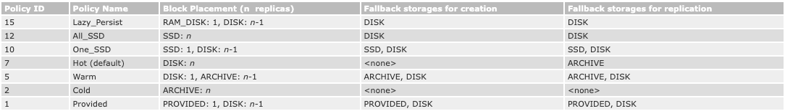
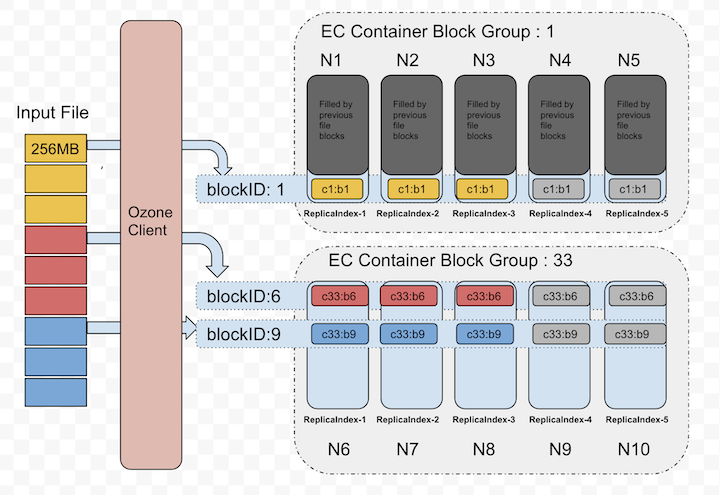
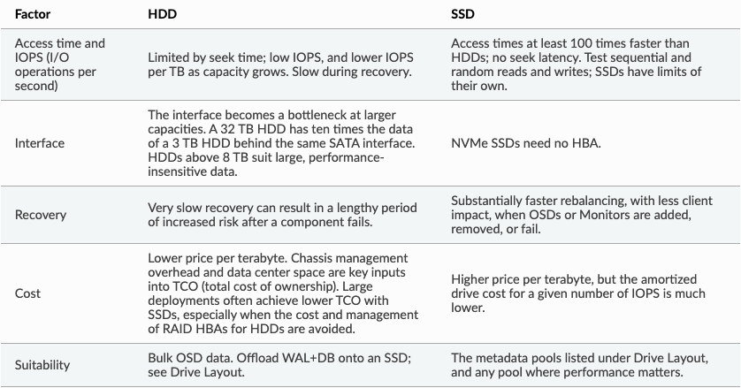

# 开源大数据存储：HDFS / Ozone / Ceph

> 开源大数据存储栈 · HDFS / Ozone / Ceph / 列存与湖仓 · 官方文档

国内大量 EB 级大数据平台并非自研对象存储，而是建立在开源栈之上：Apache HDFS（及其后继 Apache Ozone）承载 Hadoop / Spark 数仓，Ceph 承载对象与块存储，上层以 Parquet / ORC 列存文件和 Iceberg 等表格式组织数据。这些系统的 IO 优化手段写在官方文档和默认参数里，客户对“单盘该多大”的判断很大程度上也来自这些文档。本章依据 Hadoop 3.3.5 文档、Ozone 2.2 文档、Ceph 开发版（latest）文档以及 Parquet / ORC / Iceberg 官方文档（均采集于 2026-11-19），逐项说明优化手段的处理逻辑，再讨论它们对大容量 HDD 是助力还是阻力。

### 定位与 IO 路径概览

三套系统的共同点是：数据被切成较大的单元（HDFS block 默认 134217728 字节即 128 MB [BO4]；Ozone 把 block 聚合进默认 5 GB 的 container [BO8]；Ceph 把对象经 CRUSH 映射到 PG 和 OSD），由元数据服务决定放置，再由每块盘上的守护进程直接读写。冗余方式都在从多副本向纠删码（EC）迁移，后台的复制、重建、再平衡流量都与前台读写争用同一组磁盘。区别在本地存储引擎：HDFS DataNode 与 Ozone Datanode 以本地文件系统上的文件保存数据；Ceph BlueStore 直接管理裸设备，把元数据放进内嵌的 RocksDB [BO13]。

| 系统 | 数据单元 | 默认冗余 | EC 形态 | 节点内选盘 / 均衡 |
|---|---|---|---|---|
| HDFS | block（128 MB） | 3 副本 | 条带化；内置 RS-3-2 / RS-6-3 / RS-10-4 / XOR-2-1（cell 1024k），默认只启用 RS-6-3 | RoundRobin（默认）或 AvailableSpace 选盘；Disk Balancer |
| Ozone | block → container（5 GB） | RATIS/THREE | 条带化；RS-3-2 / RS-6-3 / RS-10-4，推荐 RS-6-3-1024k | CapacityVolumeChoosingPolicy（默认）；Disk Balancer |
| Ceph | RADOS 对象 → PG → OSD | replicated 池 | EC 池；默认 profile k=2 m=2，插件 isa | CRUSH 权重；一块 HDD 一个 OSD |

表中内容见 [BO1][BO4][BO7][BO9][BO14][BO11]。

### HDFS：副本、EC、分层与本地读

**3 副本与机架感知放置。**副本数为 3 时，第一副本放在写入者所在节点（或同机架随机节点），另两份放在另一机架的两个不同节点上。文档说明这样减少了跨机架写流量，代价是读取只能利用两个机架的带宽 [BO5]。

**纠删码。**Hadoop 3 文档开宗明义：默认 3 副本有 200% 的空间及网络等资源开销，而温冷数据的额外副本平时很少被读；典型 EC 配置的存储开销不超过 50%，例如 6 个块在 3 副本下占 18 个块的空间，RS(6,3) 下只占 9 个 [BO1]。HDFS 选择*条带化*布局：数据在线直接写成 EC，免去转换阶段，并能并行利用多个磁盘主轴提升顺序 IO；同时把小文件自然打散到多个 DataNode——文档提到典型集群中小文件可占总存储的 3/4 以上 [BO1]。代价也写得很清楚：编解码消耗客户端与 DataNode 的 CPU（可用 Intel ISA-L 加速）；RS(6,3) 至少需要 9 个 DataNode、理想 9 个以上机架；因跨机架打散，读写大多是 off-rack 流量，网络对分带宽“非常重要”；EC 文件不支持 hflush / hsync / append / truncate [BO1]。

**重建限流。**EC 重建由 DataNode 上的 ECWorker 完成：并行从源节点读取最少数量的块、解码、写往目标节点，默认 8 个重建线程、条带读缓冲 64 KB。调度上，NameNode 以 `dfs.namenode.replication.max-streams` 减去节点上在途 xmits 来决定给该 DataNode 派多少恢复任务；一个 EC 恢复任务的 xmits = max(读流数, 写流数) × 0.5（权重默认值），例如读 6 写 2 记为 3 [BO1]。`hdfs-default.xml` 中普通复制流上限默认 2、硬上限 4，Balancer 每节点带宽默认 100m [BO4]。这些默认值偏保守，目的是保护前台 IO，结果是单盘越大，补齐冗余所需时间越长。

**异构存储与归档策略。**Archival Storage 文档把归档定义为“把增长的存储容量与计算容量解耦”：高密度、低算力的节点作为冷存储，按策略把数据从热层迁到冷层，扩容冷存储节点即可独立增加容量 [BO2]。DataNode 的每个目录可标注 `[DISK]` / `[SSD]` / `[ARCHIVE]` / `[RAM_DISK]`；文档对 ARCHIVE 类型的描述是“存储密度高（PB 级）但算力很少” [BO2]。

*Apache Hadoop 3.3.5 官方文档《Archival Storage, SSD & Memory》中的存储策略表：Hot（全部 DISK）、Warm（1 份 DISK + n-1 份 ARCHIVE）、Cold（全部 ARCHIVE）、One_SSD / All_SSD、Lazy_Persist 及各自的回退介质（官方页面截图）* — [原始来源](https://hadoop.apache.org/docs/stable/hadoop-project-dist/hadoop-hdfs/ArchivalStorage.html)

修改策略只改命名空间，不会移动数据；需要外部 SPS（Storage Policy Satisfier）或 Mover 工具扫描并迁移块，Mover 优先在同一节点内跨介质移动，否则走网络 [BO2]。条带化 EC 文件只适用 All_SSD、Hot、Cold 三种策略 [BO2]。

**短路本地读与节点内均衡。**短路读（short-circuit read）让与数据同机的客户端绕过 DataNode 的 TCP 通路，经 UNIX 域套接字与 `/dev/shm` 共享内存协商后直接读本地块文件 [BO3]，省去一次拷贝与协议开销，对存算一体的 HDD 集群尤其有效。DataNode 默认用 RoundRobin 在各盘之间轮转写入；可改用 AvailableSpaceVolumeChoosingPolicy，在盘间剩余空间差超过 10737418240 字节（10 GB）时，以 0.75 的比例把新块优先分配给更空的盘 [BO4]。换盘或大量删写造成的节点内不均由 Disk Balancer 处理 [BO6]。另一个与盘数相关的默认值是 `dfs.datanode.failed.volumes.tolerated` = 0，即任一卷故障默认导致 DataNode 停止服务 [BO4]；高盘位节点通常需调大此值，否则一块盘故障会让整机数据进入重复制。

### Ozone：容器化放置与条带 EC

Ozone 把 HDFS 的“块级”管理提升到“容器级”。容器是 SCM 管理的复制单元（默认 5 GB），Datanode 只上报容器状态而不是每个块，文档举例：一个 196 TB 的 Datanode 约有 4 万个容器，而同等 HDFS 节点约有 150 万个块，块报告规模缩小约 40 倍 [BO9][BO8]。容器写满（约 5 GB）后关闭为不可变，从 Raft（Ratis）复制转为异步容器拷贝，所有副本都可服务读 [BO8]。这对大容量盘是正面设计：单盘容量翻倍时，元数据与心跳负担按容器数而非块数增长。

Ozone EC 同样采用条带化，由客户端把 d 个数据 chunk 依次写往 d 个节点，并缓存它们计算 p 个校验 chunk，写往其余节点；读路径在无故障时按 chunk 轮转读取，遇到故障即在客户端在线解码（降级读） [BO7]。EC 配置在 bucket 级设置，推荐 RS-6-3-1024k [BO7]。

*Apache Ozone 官方文档 Erasure Coding 页的 EC 写入示意图：Ozone 客户端把输入文件的 block 按条带写入 EC Container Block Group，以 EC(3,2) 为例分布到 N1–N5 / N6–N10 五个节点（官方原图）* — [原始来源](https://ozone.apache.org/docs/core-concepts/replication/erasure-coding)

Datanode 默认的 CapacityVolumeChoosingPolicy 随机挑两个可用卷、选利用率更低者（“两选一”），兼顾均衡与随机性；每个卷保留至少 20 GB 或 2% 的空闲空间，另有 Disk Balancer 处理加盘 / 换盘后的不均 [BO9]。

### Ceph：BlueStore、EC 池与恢复 QoS

**BlueStore 设备分离。**BlueStore 最多使用三类设备：主设备（block）、WAL 设备（block.wal）、DB 设备（block.db）。RocksDB 会尽量把元数据放在更快的 DB 设备上，满了就溢出（spill over）回主设备；只指定 DB 而不指定 WAL 时，WAL 自动与 DB 同置于快盘 [BO13]。官方硬件建议：HDD OSD 除最深的归档场景外，都应把 WAL+DB 挪到共享 SSD，SAS / SATA SSD 每块最多带 5 个 HDD OSD，PCIe Gen4 及以上 NVMe 每块最多带 15 个；自 Squid 起建议 DB 不小于主设备的 2.5% [BO11]。配置参考进一步给出：RGW 负载因大量 omap 元数据建议至少 4%（1 TB 主设备配 40 GB），RBD 通常 1%–2% [BO13]。

**小 IO 与分配粒度。**`bluestore_min_alloc_size_hdd` 在 Mimic 及之前为 64 KB，Pacific 起降为 4 KB，原因是 RGW 存放海量小对象时的空间放大：1 KB 对象在 4 KB 分配粒度下浪费约 3 KB，且每个副本都放大一次 [BO13]。BlueStore 对 HDD 的每 IO 节流成本 `bluestore_throttle_cost_per_io_hdd` 默认 670000，SSD 为 4000，反映了 HDD 寻道开销远高于 SSD [BO13]。

**EC 池。**默认 profile k=2 m=2，可承受任意两个 OSD 重叠故障，存 1 TB 只需 2 TB 而非副本池的 3 TB；profile 建池后不可改 [BO14]。Luminous 起 `allow_ec_overwrites` 支持部分写，使 RBD / CephFS 可用 EC 池；Tentacle 起的 FastEC（`allow_ec_optimizations`）支持部分读写，小写不再需要整条带读改写，并消除填充带来的空间放大；文档同时指出，对大对象顺序读写的 RGW 负载收益很小，16K stripe unit 是通用负载的最佳值，读为主可增至 256K [BO14]。

**恢复与回填的 QoS。**Ceph 默认使用基于 dmClock 的 mClock 调度器，把请求分为 client、background recovery、background best-effort（回填、scrub、快照修剪、PG 删除）三类，用 reservation / weight / limit 分配 OSD 的 IOPS 容量（`osd_op_queue` 默认即 `mclock_scheduler`） [BO15][BO16]。

| mClock 内置 profile | client 保留 | recovery 保留 | best-effort 保留 / 上限 | 用途（据官方文档） |
|---|---|---|---|---|
| balanced（默认） | 50% | 50% | 5% / 90% | 稳态：前台与恢复对等 |
| high_client_ops | 60% | 40% | 5% / 70% | 持续保证前台性能，“代价是恢复更慢” |
| high_recovery_ops | 30% | 70% | 5% / 不限 | 非高峰期临时加速恢复 |

mClock 需要知道每个 OSD 的能力：HDD 默认假设 4 KiB 随机写 315 IOPS（`osd_mclock_max_capacity_iops_hdd`）、顺序带宽 150 MiB/s（SSD 为 1200 MiB/s），启动时可自动测量 [BO15]。回填与恢复并发被锁定为 `osd_max_backfills` = 1、`osd_recovery_max_active_hdd` = 3（SSD 为 10），需显式打开 `osd_mclock_override_recovery_settings` 才能修改；启用 mClock 时，旧的 `osd_recovery_sleep_hdd`（默认 0.1 秒）等休眠参数被置零 [BO15][BO16]。文档还记录了一项基于 HDD 集群的测试（8 节点、192 个 OSD、1.5 亿个 1 KiB–256 KiB 对象）：多个 OSD 分片时，节点故障期间小对象吞吐损失高达 79%、大对象超过 20%，因此 HDD OSD 默认分片数由 5 改为 1、每分片线程由 1 改为 5 [BO15]。

### 列存与湖仓：把 IO 变大、变顺序

上层文件格式是 HDD 友好性的“第一道闸”。Parquet 官方配置建议行组（row group）取 512 MB–1 GB，理由是更大的行组带来更大的列块，“可以做更大的顺序 IO”，并建议 1 GB 行组、1 GB HDFS 块、每文件 1 个块的读优化布局；数据页建议 8 KB，但说明顺序扫描并不以页为 IO 单位 [BO18]。ORC 文件体由自包含的 stripe 组成，每个 stripe 只含完整行 [BO20]；Hive 侧默认 stripe 64 MB、文件系统块 256 MB，并以 5% 的填充容差保证 stripe 不跨 HDFS 块（默认组合下最多预留 3.2 MB 填充） [BO19]。Iceberg 表的默认目标文件大小为 512 MB，Parquet 行组默认 128 MB，读切分目标 128 MB [BO23][BO22]。

流式写入与频繁提交会制造小文件。Iceberg 维护文档指出，小文件导致更多 manifest 元数据和更低效的查询（文件打开成本），可用 `rewriteDataFiles` 并行合并 [BO21]；`rewrite_data_files` 过程默认把小于目标 75% 或大于 180% 的文件列为重写对象，文件组达到 5 个文件即触发，单组最多 100 GB，最多 5 组并发 [BO22]。快照过期、孤儿文件清理则把不再引用的文件真正删除 [BO21]。对底层 HDD 而言，合并是一次“读小写大”的后台批量 IO：它消耗盘带宽，却把此后的读放大和元数据压力降下来。

### 与 HDD 容量 / 密度的关系

把上述机制按“助力 / 阻力”归类（“来源事实”见前文引用；带“推论”字样的为本文推算）：

| 机制 | 对大容量 HDD 的作用 | 依据与说明 |
|---|---|---|
| 大块、大文件、行组 / stripe 对齐 | 助力 | 把访问变为 MB 级顺序 IO，降低每 TB 所需的随机 IOPS |
| HDFS ARCHIVE / Cold 策略 | 助力 | 官方明确面向“高密度、低算力”节点，冷数据可独立扩容 |
| Ozone 容器级管理 | 助力 | 196 TB 节点约 4 万容器，元数据规模随容量增长较缓 |
| BlueStore WAL+DB 下沉 SSD | 有条件助力 | 小写与元数据走闪存；但 DB 需按主设备的 2.5%–4% 配比，推论：一块 30 TB HDD 对应约 750 GB–1.2 TB 快盘空间 |
| EC（条带 / FastEC） | 容量上助力、重建上双刃 | 开销从 200% 降至约 50%，但重建需从 k 个节点读数据，跨机架流量大 |
| 恢复限流（max-streams、mClock、osd_max_backfills=1） | 阻力 | 保护前台的代价是恢复时间随单盘容量线性拉长 |
| 默认 failed.volumes.tolerated=0、单主机容量占比 | 阻力 | 盘位越多、单盘越大，单点故障触发的数据迁移量越大 |

*Ceph 官方文档《Storage Devices》中的“Choosing Between HDD and SSD”对比表：HDD 的 IOPS/TB 随容量下降、恢复缓慢，“32 TB HDD 与 3 TB HDD 共用同一 SATA 接口”，“8 TB 以上 HDD 适合大体量、对性能不敏感的数据”（官方页面截图）* — [原始来源](https://docs.ceph.com/en/latest/start/hardware-storage-devices/)

Ceph 文档是客户“盘不要太大”说法最直接的出处。开发版硬件建议写道：更大的 HDD 每 TB 更便宜，但每 TB 的 IOPS 更低，TCO 应综合 HBA、机箱和机房空间评估 [BO10]；“更多、更小的节点比更少、更密的节点更安全”，因为占集群容量比例大的主机故障时，恢复可能把其余 OSD 推过 full ratio，Ceph 会停止操作 [BO10]；“32 TB HDD 的数据是 3 TB HDD 的十倍，却共用同一 SATA 接口，8 TB 以上的 HDD 适合大体量、对性能不敏感的数据” [BO11]。Squid 版文档的同一段落用的是“22 TB 对 3 TB、多出七倍以上” [BO17]——随着市售容量上升，文档的比较基准也在跟进。网络章节给出复制耗时：1 TiB 在 1 Gb/s 下约 3 小时、10 Gb/s 下约 20 分钟；10 TiB 分别约 30 小时和 3 小时，并强调完成前的第二次故障可能导致数据不可用或丢失，密集节点“常需要 100 Gb/s” [BO12]。

工程推论：按 mClock 的 HDD 默认能力 315 IOPS 计，IOPS/TB 在 16 TB 盘上约 19.7，在 30 TB 盘上约 10.5；HDFS 128 MB 块下一块 30 TB 盘约存 22 万个块，整盘失效时在 max-streams = 2 的默认节流下需要逐批派发重复制任务。也就是说，开源栈本身并不限制单盘容量，限制来自*默认的保守恢复参数、每盘一个守护进程的故障域划分和固定的单盘 IOPS*。能让大容量盘“可用”的配套措施在文档里都能找到：大文件和合并（降低 IOPS 需求）、冷数据 EC 与 ARCHIVE 层（把大盘放到对 IOPS 不敏感的位置）、WAL/DB 下沉闪存（吸收小 IO）、100 Gb/s 网络与按需切换 high_recovery_ops（缩短恢复窗口）。

### 资料边界

本章参数均为官方文档中的默认值或建议值，各发行版、各版本可能不同（Hadoop 文档 stable 路径对应 3.3.5，Ceph 引用的是开发版文档，个别建议与 Squid 版措辞不同）。官方文档没有给出 HDFS、Ozone 或 Ceph 在 20 TB 以上 HDD 上的重建时长实测；文中 IOPS/TB、块数、DB 容量为按公式推算的工程推论，需在具体集群上验证。

## 本章资料

- **[BO1]** [Apache Hadoop 官方文档 · HDFS Erasure Coding（Hadoop 3.3.5，采集于 2026-11-19）](https://hadoop.apache.org/docs/stable/hadoop-project-dist/hadoop-hdfs/HDFSErasureCoding.html)
- **[BO2]** [Apache Hadoop 官方文档 · Archival Storage, SSD & Memory（Hadoop 3.3.5）](https://hadoop.apache.org/docs/stable/hadoop-project-dist/hadoop-hdfs/ArchivalStorage.html)
- **[BO3]** [Apache Hadoop 官方文档 · HDFS Short-Circuit Local Reads（Hadoop 3.3.5）](https://hadoop.apache.org/docs/stable/hadoop-project-dist/hadoop-hdfs/ShortCircuitLocalReads.html)
- **[BO4]** [Apache Hadoop 官方文档 · hdfs-default.xml 默认配置（Hadoop 3.3.5）](https://hadoop.apache.org/docs/stable/hadoop-project-dist/hadoop-hdfs/hdfs-default.xml)
- **[BO5]** [Apache Hadoop 官方文档 · HDFS Architecture（Hadoop 3.3.5）](https://hadoop.apache.org/docs/stable/hadoop-project-dist/hadoop-hdfs/HdfsDesign.html)
- **[BO6]** [Apache Hadoop 官方文档 · HDFS Disk Balancer（Hadoop 3.3.5）](https://hadoop.apache.org/docs/stable/hadoop-project-dist/hadoop-hdfs/HDFSDiskbalancer.html)
- **[BO7]** [Apache Ozone 官方文档 · Erasure Coding（Version 2.2.2，采集于 2026-11-19）](https://ozone.apache.org/docs/core-concepts/replication/erasure-coding)
- **[BO8]** [Apache Ozone 官方文档 · Storage Containers（Version 2.2.2）](https://ozone.apache.org/docs/core-concepts/replication/storage-containers)
- **[BO9]** [Apache Ozone 官方文档 · Datanodes（Version 2.2.2）](https://ozone.apache.org/docs/core-concepts/architecture/datanodes)
- **[BO10]** [Ceph 官方文档 · Hardware Recommendations（开发版 latest，采集于 2026-11-19）](https://docs.ceph.com/en/latest/start/hardware-recommendations/)
- **[BO11]** [Ceph 官方文档 · Storage Devices（开发版 latest）](https://docs.ceph.com/en/latest/start/hardware-storage-devices/)
- **[BO12]** [Ceph 官方文档 · Network Sizing（开发版 latest）](https://docs.ceph.com/en/latest/start/hardware-networks/)
- **[BO13]** [Ceph 官方文档 · BlueStore Configuration Reference（开发版 latest）](https://docs.ceph.com/en/latest/rados/configuration/bluestore-config-ref/)
- **[BO14]** [Ceph 官方文档 · Erasure code（开发版 latest）](https://docs.ceph.com/en/latest/rados/operations/erasure-code/)
- **[BO15]** [Ceph 官方文档 · mClock Config Reference（开发版 latest）](https://docs.ceph.com/en/latest/rados/configuration/mclock-config-ref/)
- **[BO16]** [Ceph 官方文档 · OSD Config Reference（开发版 latest）](https://docs.ceph.com/en/latest/rados/configuration/osd-config-ref/)
- **[BO17]** [Ceph 官方文档 · Hardware Recommendations（Squid 版）](https://docs.ceph.com/en/squid/start/hardware-recommendations/)
- **[BO18]** [Apache Parquet 官方文档 · Configurations（Row Group Size / Data Page Size）](https://parquet.apache.org/docs/file-format/configurations/)
- **[BO19]** [Apache ORC 官方文档 · Hive Configuration](https://orc.apache.org/docs/hive-config.html)
- **[BO20]** [Apache ORC 官方文档 · ORC Specification v1](https://orc.apache.org/specification/ORCv1/)
- **[BO21]** [Apache Iceberg 官方文档 · Maintenance（latest）](https://iceberg.apache.org/docs/latest/maintenance/)
- **[BO22]** [Apache Iceberg 官方文档 · Spark Procedures（rewrite_data_files，latest）](https://iceberg.apache.org/docs/latest/spark-procedures/)
- **[BO23]** [Apache Iceberg 官方文档 · Configuration（表属性默认值，latest）](https://iceberg.apache.org/docs/latest/configuration/)
