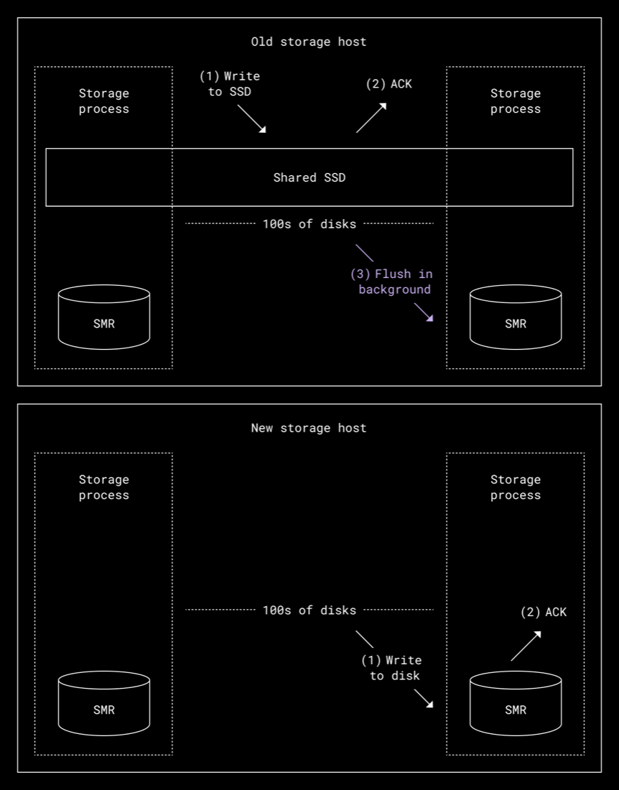
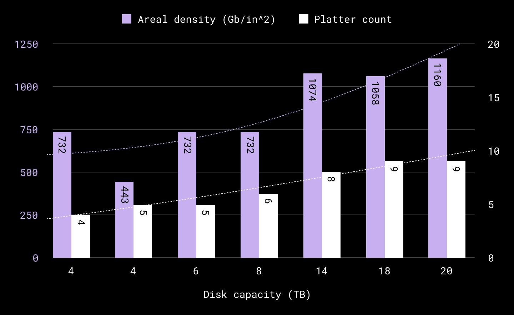
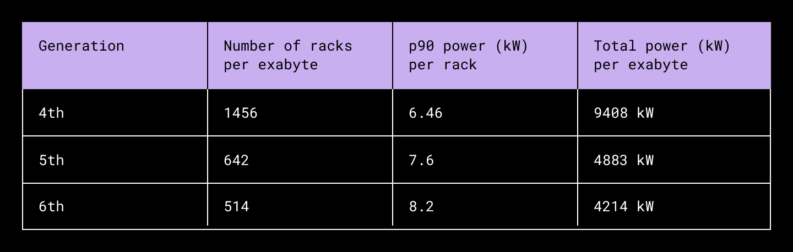
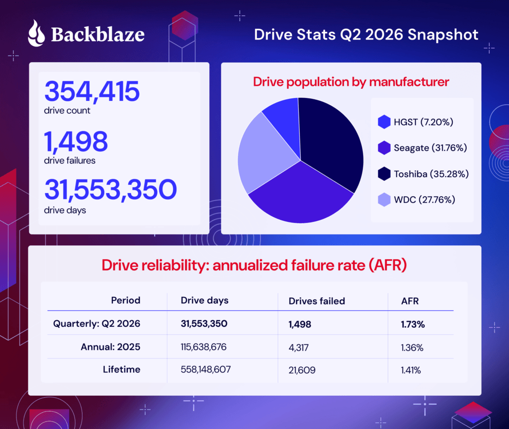

# Dropbox Magic Pocket 与 Backblaze

> EB 级自建对象存储与公开盘群数据 · Dropbox Magic Pocket / Backblaze · 官方工程博客与 Drive Stats

前几章的超大规模厂商很少公开“用多大的盘、为什么”。Dropbox 与 Backblaze 是例外：Dropbox 的工程博客连续八年记录了 Magic Pocket 从 PMR 到 host-managed SMR、从 8 TB 到 32 TB 的每一步，以及为此在软件、SSD 缓存、网络和机箱上做的取舍；Backblaze 自 2013 年起按季度公开整个盘群的型号、数量与年化故障率（AFR），并写过把 4 TB 盘迁移到 16 TB 盘的经济账。两家公司都在持续换用更大容量的盘，本章把它们作为大容量 HDD 落地的一手证据，梳理优化逻辑及其与容量 / 密度的关系。资料均采集于 2026-11-19。

### Magic Pocket：定位、规模与数据组织

Magic Pocket（MP）是 Dropbox 自建的 EB 级不可变块存储。文件被切成最大约 4 MB 的块，按哈希寻址；块被聚合进 1 GB 的逻辑容器 bucket，一个或多个 bucket 复制到一组存储节点上即为 volume。新上传的块先以多副本写入，之后 bucket 被聚合并在后台转为纠删码；每个块至少独立存放在两个地理区域，跨区复制在本地上传后一秒内完成 [DBX1]。一个 cell 约存放 50 PB 原始数据；2016 年时单台存储机已超过 1 PB、单机架超过 8 PB [DBX1]。Dropbox 2025 年的文章回顾：2015 年把当时约 600 PB 数据中的 90% 以上迁入自管机房，存储量从 2012 年的 40 PB 增至 2016 年的 600 PB 以上，如今已进入“EB 时代”，“数万台服务器、数百万块硬盘” [DBX9]。

访问模式决定了 MP 对 HDD 的要求：超过 40% 的文件读取发生在上传后一天内，超过 70% 在一个月内，超过 90% 在一年内 [DBX3]。因此 MP 本身就被设计为“相当冷、但所有块都要求低延迟读”的系统，全部数据放在 HDD 上，SSD 只留给数据库与缓存 [DBX1][DBX3]。

### 关键优化手段与处理逻辑

#### 一、把写入变成 SMR 友好的顺序追加

2018 年 Dropbox 成为首家大规模部署 SMR 的大型科技公司，选的是 host-managed SMR：驱动器不做任何缓存与搬移，由主机显式打开、填满、关闭顺序 zone，控制力最强 [DBX2]。之所以能做到，是因为 MP 的数据模型本就是追加写、不可变：

- **容器与 zone 对齐。**1 GB 的 extent 恰好等于 4 个 256 MB 的 SMR zone，不浪费空间；块元数据与数据之比约 0.03%，恰好与盘上常规区（CMR 区）和顺序区的容量比相匹配，于是频繁更新的元数据放在常规区，不可变的块数据放在顺序区 [DBX2][DBX4]。
- **大块写入。**测试发现 SMR 更适合平均 4–5 MB 的大写；最初“尽快从 SSD 刷到 SMR”的多个小写效率不高，后改为分阶段缓冲、以更少更大的写入落盘；所有写入都必须顺序且 4K 对齐 [DBX2]。
- **绕过文件系统。**每块盘一个 OSD 守护进程，独占该盘，直接以块设备管理布局，用 libzbc 下发命令，从而在软件里优化磁头移动、按 IO 类型排优先级；代价是要自己实现原本由内核提供的重试逻辑 [DBX2][DBX4]。2023 年起逐步改用 Linux 内核的 zoned 设备支持和 libzbd（异步 IO、更高队列深度、基于优先级的 IO），去掉自定义盘格式 [DBX7]。
- **前台优先、修复后置。**RPC 把在线 put 送往 SSD 缓存，get 与后台写则直接进入磁盘操作队列；在线流量（新块写入）延迟优先级最高，后台修复读写量巨大但不紧迫，可以放慢进行 [DBX2]。

收益在 2019 年的复盘中量化：同容量档的 SMR 盘比 PMR 多存约 10%–20% 数据，成本几乎相同；换用高容量 SMR 后，相对上一代存储设计整体节省超过 20%；从 8 TB 换到 14 TB 盘，单机盘数从 60 增至 100，CPU 与内存不变，功耗只略增 [DBX4]。2023 年时 90% 的 HDD 盘群已是 SMR，成本优势与第一年一致 [DBX7]；2025 年这一比例超过 99% [DBX9]。

#### 二、先加 SSD 缓存，再随密度上升把它拆掉

2018 年的设计把 RAID 卡换成 HBA（每块盘建 RAID0 的开销与固件问题太多，换后单系统上线时间从最长 2 小时降到 30 分钟），失去 RAID 写缓存后加了一块 SSD 作为写回缓存：在线写先落 SSD 即回 ACK，后台再把随机写攒成顺序大写刷入 SMR；当时已注意到 SATA 总线随密度上升成为瓶颈 [DBX2]。

*Dropbox 工程博客《Increasing Magic Pocket write throughput by removing our SSD cache disks》中的存储引擎架构对比原图：上为旧主机（写 SSD → ACK → 后台刷 SMR，数百块盘共享一块 SSD），下为新主机（直接写 SMR 后 ACK）* — [原始来源](https://dropbox.tech/infrastructure/increasing-magic-pocket-write-throughput-by-removing-our-ssd-cache-disks)

到 14–20 TB 盘时代，一台主机挂 100 多块数据盘和一块 SSD，承载 1.5–2 PB 原始数据，所有在线写都要经过这块 SSD。NVMe SSD 的写吞吐约 15–20 Gbps，远低于数百块盘的累计吞吐；而盘越大、主机越少，每台主机分摊的写入越多 [DBX5]。2020 年初还发生过一批同期上线、写入模式相似的 SSD 几乎同时耗尽写寿命、集中失效，引发大规模数据修复 [DBX5]。Dropbox 于是在 2021 年改用新的 open extent 格式，把块元数据与数据内联写入同一块 SMR 盘，启动时扫描 extent 重建内存索引。压测峰值下写吞吐提升 2–2.5 倍、写 p95 改善 15%–20%；平均负载下“最后一跳”落盘 p95 上升 10%–15%，但只占端到端写延迟的 2%；最近写入块的内存读缓存被去掉，p99 未见显著影响。2022 年 Q1 全部 SSD 移除后，全盘群写吞吐提升 15%–20%，每月 8–10 块 SSD 故障的人工维修也随之消失 [DBX5]。

这一转折说明：在“盘越来越大、主机越来越少”的趋势下，任何按主机配置的共享部件（一块 SSD、一条 SATA 链路、一张网卡）都会先于 HDD 本身成为瓶颈；对顺序追加型负载，直接写 SMR 反而更具扩展性。

#### 三、冷热分层、EC 与压实

**跨区域冷层。**2019 年上线的冷存储层与温层使用同样的 SMR 盘和网络，不改变区域内部架构，而是把一个块拆成碎片跨区域条带化：三区域时 2 个数据碎片 + 1 个 XOR 校验碎片，读取向三个区域同时请求、取最快的两份。温层复制因子为 2 × 区域内复制因子，冷层为 1.5 ×，磁盘用量减少 25%；四区域 3+1 可省 33%。冷层 p99 延迟甚至低于温层，因为“三取二”天然规避了长尾 [DBX3]。

**压实（compaction）。**不可变存储中删除不会立即释放空间，需要垃圾回收标记、压实把存活数据搬到新 volume。2026 年的文章披露：新的在线纠删编码服务 Live Coder 降低了后台写放大，但产生了大量欠填充 volume（最差时存活数据不足 5%）。Dropbox 在原有 L1（把 donor 装进高填充 host）之外新增 L2（动态规划组合多个半空 volume 填满一个新 volume，压实开销下降速度为 L1 的 2–3 倍，一周内开销低 30%–50%）和 L3（把最稀疏 volume 流式送入 Live Coder 重编码），并对压实限流、限制在 cell 内部，以免与用户流量和跨机房带宽争用；元数据服务容量成为最大约束之一 [DBX10]。MP 现已“几乎所有数据”采用纠删码 [DBX10]。

### 密度路线与硬件代际

*Dropbox 工程博客《After four years of SMR storage》原图：Dropbox 历代部署的盘容量（4–20 TB）对应的面密度（Gb/in²）与盘片数；20 TB 盘为 1160 Gb/in²、9 片* — [原始来源](https://dropbox.tech/infrastructure/four-years-of-smr-storage-what-we-love-and-whats-next)

| 时间 / 代际 | 盘与机箱 | 与容量相关的配套变化（据官方博客） |
|---|---|---|
| 2016（MP 上线） | 单机 >1 PB，单机架 >8 PB | cell 约 50 PB 原始容量 [DBX1] |
| 2018（首批 SMR） | 14 TB SMR，4U 约 100 块 LFF，单机 1.4 PB，每架 8 台 | 内存增至 96 GB（单机块数为上代 2.29 倍，内存索引同比例增长）；CPU 16→20 核以维持 >40 Gbps 写 / 45 Gbps 读；50 Gbps 网卡 + 100 Gbps 上联，以便快速灌入与排空 [DBX2] |
| 2022（第六代） | 单机 >2 PB，单架 >20 PB，>100 块盘 | 100 Gb 网卡 [DBX6] |
| 2023 | 18 / 20 TB SMR，9 片 18 头 | 空闲约 0.30 W/TB、随机读约 0.50 W/TB；第六代服务 1 EB 比第四代少用约 5 MW、机架只需三分之一 [DBX7] |
| 2025（第七代 Sonic） | WD Ultrastar HC690，最高 32 TB SMR、11 片 | 内部标准 30 Gbps/PB，目标系统带宽 200 Gbps；重做 SAS 拓扑均分每盘带宽；200G 网卡、每架 1.6 Tb/s 上联；每架 PDU 2→4 [DBX9][DBX8] |

*Dropbox 工程博客《After four years of SMR storage》原图：第四 / 五 / 六代存储服务器每 EB 所需机架数（1456 / 642 / 514）、单架 p90 功率与每 EB 总功率（9408 / 4883 / 4214 kW）* — [原始来源](https://dropbox.tech/infrastructure/four-years-of-smr-storage-what-we-love-and-whats-next)

容量上升同时暴露了新的约束，Dropbox 都写在了博客里：

- **修复带宽。**2018 年就明确“只要恢复时间满足 SLA，可接受故障域增大”，密度随网络提速同步提升 [DBX2]；为让第七代单机箱理论上容纳 6 PB 以上，必须重构网络，才能以可接受速率排空和修复数据 [DBX7]。
- **IOPS/TB。**Dropbox 预计未来可能需要双磁臂盘才能满足 IOPS/TB 要求，因为“只有一个 IO 通道时，密度提升终有尽头” [DBX7]。
- **振动与散热。**机箱盘位数自第一代以来增至 2.8 倍，但已不打算继续增加，转向振动与热设计；HDD 热窗口 45°C，最佳约 40°C；转速超过 10000 RPM 的风扇振动会引起位置误差信号乃至写故障重试，SMR 道距更窄使余量“薄如刀锋”；第七代机箱与供应商联合设计了隔振与气流，并采用 OCP HDD Acoustical Surrogate 规范 [DBX7][DBX9]。
- **能效。**2020 年以来存储侧每 PB 功耗（W/PB）下降超过 50%；Dropbox 还通过 Deep Sleep 让空闲盘降速待机或让空闲服务器下电，数分钟内可恢复服务 [DBX11]。

### Backblaze：公开盘群数据与换大盘的经济账

Backblaze 的 Vault 由 20 台存储服务器组成，同位置的 20 块盘构成一个 tome，文件切为 20 个分片用 Reed-Solomon 编码，最初为 17+3，任意 17 片即可恢复，盘上用 ext4 [DBX16]。2024 年的 CVT 迁移文章补充：目前使用 17/3、16/4、15/5 三种比例，“盘越大，校验越多”；从 4 TB 盘 Vault 迁到 16 TB 盘 Vault 时，比例由 17/3 调为 15/5，以在单盘变大后维持持久性。经济账是：用 4 TB 盘（每块 120 美元）存 16 TB，校验部分成本 72 美元；用一块 16 TB 盘（232 美元）存 16 TB，即便按 15/5 校验，校验成本也只有 58 美元——每 TB 价格的下降足以支付更高的冗余 [DBX15]。迁移以文件为单位重读重写，可以同时改变 tome 数和校验比例；截至该文已迁移 24 个 Vault、60 PB 以上数据，换大盘还降低了每 TB 电耗 [DBX15]。

*Backblaze Drive Stats Q2 2026 官方信息图：354,415 块盘、1,498 次故障、31,553,350 盘日；季度 AFR 1.73%，2025 年度 1.36%，生命周期 1.41%；按厂商的盘群构成* — [原始来源](https://www.backblaze.com/blog/backblaze-drive-stats-for-q2-2026/)

最新一期 Drive Stats（Q2 2026，2026-09-29 发布）统计 354,415 块数据盘，季度 AFR 1.73%，为近期最高；三个离群型号均为 10–14 TB，其中两个服役约 7 年和 8.5 年；20 TB 以上的盘已超过统计总数的 25%，部署持续集中在大容量档，WDC 22 TB（0.55%）、Toshiba 24 TB（0.58%）、WDC 26 TB（0.95%）的季度 AFR 处于盘群最低之列 [DBX12]。本文按该期季度表（31 个型号）以 AFR = 故障数 ÷（盘日 ÷ 365）分组计算：

| 容量档（Q2 2026） | 盘数 | 占比 | 按盘日加权的季度 AFR |
|---|---|---|---|
| ≤12 TB | 80,457 | 22.7% | 3.38% |
| 14–16 TB | 176,560 | 49.8% | 1.38% |
| 20–26 TB | 97,398 | 27.5% | 1.00% |

这一分组混入了盘龄因素（12 TB 及以下的盘大多已服役 5–9 年，20 TB 以上多在 2 年以内），不能直接解读为“越大越可靠”，但至少说明大容量盘在规模化部署初期没有表现出更高的故障率。其余数据点：2025 全年 AFR 1.36%（2024 年 1.55%），当时盘群容量构成为 0–12 TB 占 25.13%、14–16 TB 占 52.06%、20 TB 以上占 22.81%，首批 26 TB 盘在 2025 年 Q4 上线 [DBX13]；2026 年 Q1 新部署 10,220 块盘中 9,404 块大于 20 TB，20 TB 以上盘池 AFR 为 0.85% [DBX14]；2025 年在各机房更换硬盘共耗时 3,112.43 小时，平均每块约 0.74 小时 [DBX17]。Q2 2026 报告同时说明 Backblaze 盘群目前没有 SMR 盘，并指出 SMR 的导入“与其说是换盘，不如说是立项”：除容量与 AFR 外，还要评估持续写入行为、重建性能、校验 / EC 开销、固件和上层软件 [DBX12]。

### 与 HDD 容量 / 密度的关系

- **两家都在主动换大盘，且理由一致：$/TB、W/TB 与机架数。**Dropbox 的一块高密度 SMR 盘可替代四五块 4 TB 盘，容量增长的同时物理占地反而缩小，“更小的盘群意味着更少的维修” [DBX7]；Backblaze 用每 TB 成本下降支付更高的校验比例 [DBX15]。
- **大盘可用的前提是软件把负载变成大块顺序写。**MP 的不可变块 + 1 GB extent、Backblaze 的整文件分片写入，都把 HDD 的随机 IOPS 需求压到最低；SMR 的 10%–20% 额外容量只有在这种负载下才能“几乎零代价”兑现。
- **约束从盘内转移到盘外。**Dropbox 的瓶颈依次出现在 SATA 总线、共享 SSD、网卡与机架上联、PDU、机箱振动和散热；Backblaze 用加大校验比例对冲单盘变大带来的持久性风险。HDD 提供方若要推动更大容量，配套的振动 / 热规格、修复带宽规划、双磁臂等 IOPS/TB 方案与 host-managed SMR 软件生态同样关键。
- **公开故障数据未显示大容量盘更不可靠。**Backblaze 的 20 TB 以上盘在现有观察期内 AFR 处于盘群低位，但盘龄尚短，需要继续跟踪浴盆曲线后段。

### 资料边界

Dropbox 的数据全部来自其工程博客，未公开单盘重建时长、EC 具体参数和 IOPS/TB 目标值；“30 Gbps/PB”是其内部标准的转述。Backblaze 的分档 AFR 为本文按其公开表格计算，受盘龄、型号与 Vault 环境混杂影响；Q2 2026 新闻稿页面未能直接抓取，相关数字以博客原文为准。

## 本章资料

- **[DBX1]** [Dropbox Tech Blog · Inside the Magic Pocket（James Cowling，2016-05-06）](https://dropbox.tech/infrastructure/inside-the-magic-pocket)
- **[DBX2]** [Dropbox Tech Blog · Extending Magic Pocket Innovation with the first petabyte scale SMR drive deployment（Magic Pocket Hardware Engineering Teams，2018-06-12）](https://dropbox.tech/infrastructure/extending-magic-pocket-innovation-with-the-first-petabyte-scale-smr-drive-deployment)
- **[DBX3]** [Dropbox Tech Blog · How we optimized Magic Pocket for cold storage（Preslav Le，2019-05-06）](https://dropbox.tech/infrastructure/how-we-optimized-magic-pocket-for-cold-storage)
- **[DBX4]** [Dropbox Tech Blog · SMR: What we learned in our first year（Magic Pocket Hardware Engineering Teams，2019-07-30）](https://dropbox.tech/infrastructure/smr-what-we-learned-in-our-first-year)
- **[DBX5]** [Dropbox Tech Blog · Increasing Magic Pocket write throughput by removing our SSD cache disks（2022-12-08）](https://dropbox.tech/infrastructure/increasing-magic-pocket-write-throughput-by-removing-our-ssd-cache-disks)
- **[DBX6]** [Dropbox Tech Blog · A look inside our sixth generation of server hardware（2022-06-29）](https://dropbox.tech/infrastructure/sixth-generation-server-hardware)
- **[DBX7]** [Dropbox Tech Blog · After four years of SMR storage, here's what we love—and what comes next（Eric Shobe，2023-03-08）](https://dropbox.tech/infrastructure/four-years-of-smr-storage-what-we-love-and-whats-next)
- **[DBX8]** [Dropbox Tech Blog · From AI to sustainability, why our latest data centers use 400G networking（2023-11-14）](https://dropbox.tech/infrastructure/from-ai-to-sustainability-why-our-latest-data-centers-use-400g-networking)
- **[DBX9]** [Dropbox Tech Blog · Seventh-generation server hardware at Dropbox: our most efficient and capable architecture yet（2025-07-02）](https://dropbox.tech/infrastructure/seventh-generation-server-hardware)
- **[DBX10]** [Dropbox Tech Blog · Improving storage efficiency in Magic Pocket, our immutable blob store（Facundo Agriel，2026-04-02）](https://dropbox.tech/infrastructure/improving-storage-efficiency-in-magic-pocket-our-immutable-blob-store)
- **[DBX11]** [Dropbox Tech Blog · Improving infrastructure efficiency for growing demand in the age of AI（Ilya Yakovlev，2026-08-18）](https://dropbox.tech/infrastructure/improving-infrastructure-efficiency-for-growing-demand-in-the-age-of-ai)
- **[DBX12]** [Backblaze Blog · Backblaze Drive Stats for Q2 2026（Stephanie Doyle，2026-09-29）](https://www.backblaze.com/blog/backblaze-drive-stats-for-q2-2026/)
- **[DBX13]** [Backblaze Blog · Backblaze Drive Stats for 2025（2026-02-12）](https://www.backblaze.com/blog/backblaze-drive-stats-for-2025/)
- **[DBX14]** [Backblaze Blog · Backblaze Drive Stats for Q1 2026（2026-07-09）](https://www.backblaze.com/blog/backblaze-drive-stats-for-q1-2026/)
- **[DBX15]** [Backblaze Blog · How Backblaze Scales Our Storage Cloud（CVT 迁移，Andy Klein，2024-05-21）](https://www.backblaze.com/blog/how-backblaze-scales-our-storage-cloud/)
- **[DBX16]** [Backblaze Blog · Backblaze Vaults: Zettabyte-Scale Cloud Storage Architecture（2019-06-18 更新版）](https://www.backblaze.com/blog/vault-cloud-storage-architecture/)
- **[DBX17]** [Backblaze Blog · 2025: That's a Wrap, and Here Are the Stats（2025-12-23）](https://www.backblaze.com/blog/2025-thats-a-wrap-and-here-are-the-stats/)
