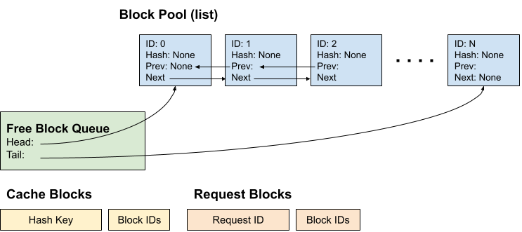
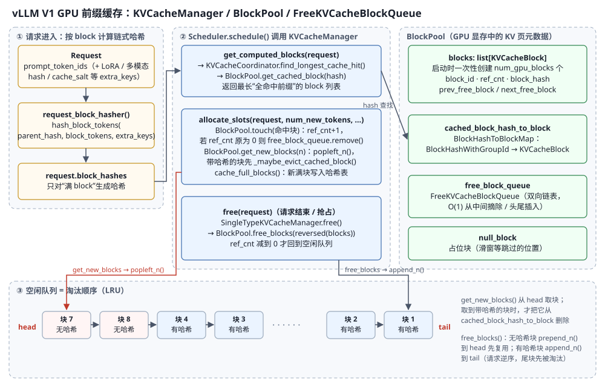
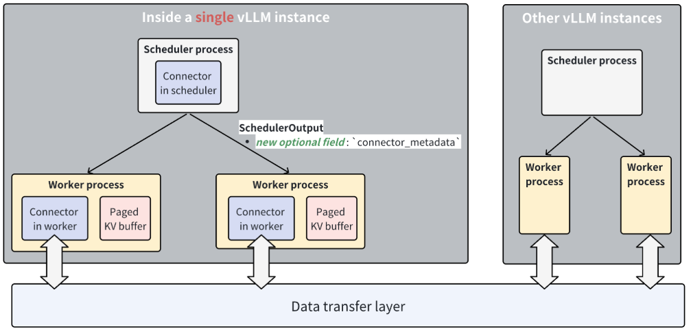
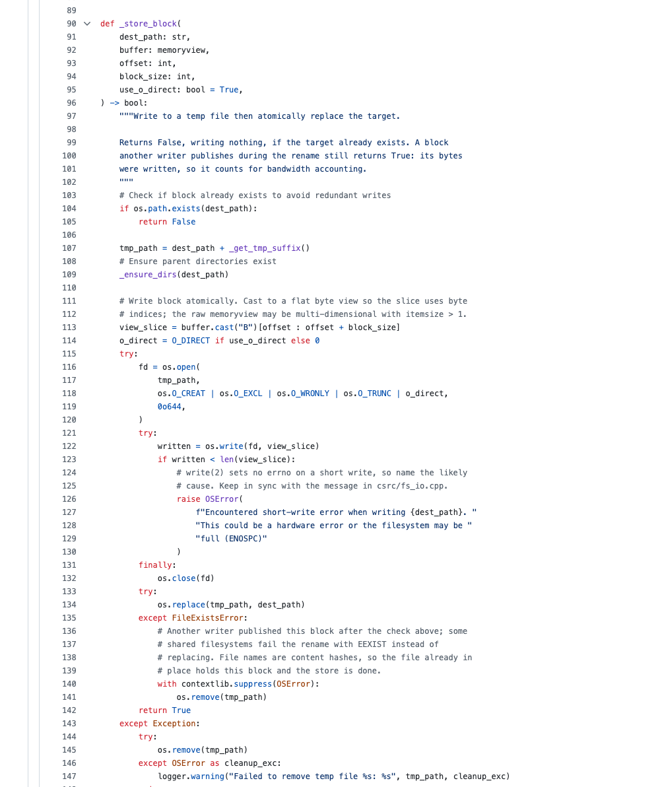
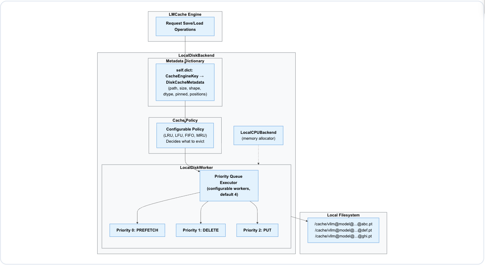

# vLLM：KV 卸载与接入 HDD

> 推理引擎 · vLLM 官方文档与固定提交源码核查

vLLM 的 KV 管理可以拆成两层来看。第一层在 GPU 内部：调度器通过 `KVCacheManager` 和 `BlockPool` 管理分页 KV 块，用块哈希做自动前缀缓存（APC），空闲块按 LRU 回收。第二层在 GPU 之外：所有跨进程、跨层级的 KV 搬运都要经过 KV Connector API（`KVConnectorBase_V1`），CPU 卸载、LMCache、NIXL 的 P/D 传输和文件系统下沉都挂在这个接口上。本章依据 vLLM GitHub main 分支固定提交 `0c80c3a6aa0201d1b4f71915f90c03fd64837cec`（提交时间 2026-11-18 08:26 UTC）阅读源码，并对照 docs.vllm.ai、vLLM 官方博客和 LMCache 官方文档，采集于 2026-11-18 [VL1][VL2][VL3]。结论先行：在这个提交里，vLLM 已有**原生的文件系统二级层**（`OffloadingConnector` + `TieringOffloadingSpec` + `type: "fs"`），把 `root_dir` 指向 HDD 挂载点即可接入，**接口可行**。但这条写路径以“每个 chunk 一个文件”的方式组织数据，不调用 fsync，fs 层本身也没有容量淘汰。在没有 DRAM 前置层吸收写流时，HDD 的性能和长期运行仍需单独验证。

### GPU 内的前缀缓存：块哈希、BlockPool 与 LRU 空闲队列

vLLM V1 的 APC 采用哈希方案：每个 KV 块的键由**父块哈希、本块 token、额外键**共同算出。额外键包括 LoRA ID、多模态输入哈希和 `cache_salt`。父块哈希参与计算，所以一个块哈希隐含了它前面的整条前缀。只有写满的块才会被缓存。自 v0.11 起默认哈希算法为 `sha256`，`--prefix-caching-hash-algo` 还可以选 `sha256_cbor`、`xxhash`、`xxhash_cbor`。官方文档提醒，非密码学哈希在多租户环境下会增加碰撞和信息泄露风险。`cache_salt` 只注入第一个块的哈希，用来把缓存复用限制在同一信任组内 [VL2]。源码中由 `hash_block_tokens(hash_function, parent_block_hash, curr_block_token_ids, extra_keys)` 计算单块哈希。链首的 `NONE_HASH` 默认由固定种子导出；选择 xxhash 类算法且未设置 `PYTHONHASHSEED` 时，种子改为每个进程随机生成，不同实例算出的哈希就对不上。后文的文件系统层正是靠这一点实现跨实例共享 [VL6][VL3]。

数据结构方面，`BlockPool` 在初始化时一次性创建 `num_gpu_blocks` 个 `KVCacheBlock`。每个块记录 `block_id`、`ref_cnt`、`block_hash`，以及 `prev_free_block` / `next_free_block` 两个指针。空闲队列 `FreeKVCacheBlockQueue` 直接用这两个指针串成双向链表：从中间摘除、在头尾插入都是 O(1)，也不用另建 Python 对象。哈希表 `cached_block_hash_to_block`（类型为 `BlockHashToBlockMap`）把带 KV 组号的哈希映射到具体的块 [VL2][VL6]。



*vLLM 官方设计文档 Automatic Prefix Caching 的组件总览图：Block Pool（KVCacheBlock 列表）、Free Block Queue（只保存头尾指针的双向链表）、Cache Blocks（哈希→块）与 Request Blocks（请求→块）* — [原始来源](https://docs.vllm.ai/en/latest/design/prefix_caching/)

控制流分三步，见下图。（1）新请求到来时，调度器先调用 `KVCacheManager.get_computed_blocks()`，经 `KVCacheCoordinator.find_longest_cache_hit()` 沿 `request.block_hashes` 逐块查哈希表，得到最长的全命中前缀。如果整个 prompt 都命中，最后一个 token 仍要重算以产生 logits。（2）`allocate_slots()` 先对命中块执行 `BlockPool.touch()`：`ref_cnt` 加 1，原来为 0 的块从空闲队列中摘除，避免被驱逐。随后 `get_new_blocks()` 用 `popleft_n()` 从队首取新块；取到的块如果还带着哈希，就在此刻经 `_maybe_evict_cached_block()` 从哈希表中删除，这就是“驱逐”。新写满的块由 `cache_full_blocks()` 登记进哈希表。（3）请求结束或被抢占时，`SingleTypeKVCacheManager.free()` 以**逆序**调用 `BlockPool.free_blocks()`。`ref_cnt` 归零后，没有哈希的块用 `prepend_n()` 放回队首优先复用；带哈希的块用 `append_n()` 放到队尾。因为是逆序放回，请求最末尾的块（覆盖的前缀最长、最难被复用）排在前面，最先被淘汰 [VL2][VL6]。V1 的块表只允许追加，同一内容可能短暂存在重复块，等请求释放后才消除 [VL2]。



*vLLM V1 GPU 前缀缓存的数据结构与控制流：请求哈希 → get_computed_blocks / allocate_slots / free → BlockPool 哈希表与 LRU 空闲队列（本文根据 vLLM 固定提交 0c80c3a6 源码 block_pool.py、kv_cache_utils.py、kv_cache_manager.py 绘制）* — [原始来源](https://github.com/vllm-project/vllm/blob/0c80c3a6aa0201d1b4f71915f90c03fd64837cec/vllm/v1/core/block_pool.py)

块大小方面，固定提交中 `CacheConfig.DEFAULT_BLOCK_SIZE = 64`。用户没有指定 `--block-size` 时，平台层会在各注意力后端都支持的取值里另选一个首选值。另有 `prefix_match_unit`（即 `hash_block_size`），可以让前缀命中落在比物理块更细的边界上 [VL14]。vLLM 博客在 2026-01-08 写的是“默认每块 16 token”，说明默认值在此后已经变化，做容量估算时应以实际运行日志为准 [VL5]。

### KV Connector API：调度侧与 Worker 侧

同一个 connector 类会被实例化两次：调度进程里一份（`KVConnectorRole.SCHEDULER`），每个 GPU worker 里各一份（`KVConnectorRole.WORKER`）。两边通过 `SchedulerOutput.kv_connector_metadata` 和回传的 `KVConnectorOutput` 交换信息 [VL4][VL7]。调度侧的核心钩子是 `get_num_new_matched_tokens(request, num_computed_tokens)`。它返回两个值：外部缓存还能在本地命中之外补上多少 token，以及是否异步加载。文档要求这个方法可以被重复调用、没有副作用，而且只能把当下确实可加载的前缀算进去。返回 `None` 表示 connector 还没查完，调度器会对该请求执行 `skip_request()`，下一步再问 [VL7][VL8]。之后的顺序是：`allocate_slots(..., num_external_computed_tokens)` 分配块，`update_state_after_alloc()` 记录本次加载计划；如果是异步加载，请求状态置为 `WAITING_FOR_REMOTE_KVS`；最后由 `build_connector_meta()` 打包本步的 load/save 元数据。Worker 侧依次执行 `bind_connector_metadata()`、`handle_preemptions()`、`start_load_kv()`，并在逐层前向中调用 `wait_for_layer_load()` 和 `save_kv_layer()`；前向结束后，`wait_for_save()`、`get_finished()` / `get_transfer_results()`、`get_block_ids_with_load_errors()` 把完成情况和失败的块回报给调度器 [VL7]。



*vLLM 官方文档 Disaggregated Prefilling 一节的 connector 高层设计图：调度进程中的 connector 通过 SchedulerOutput 的 connector_metadata 字段驱动各 worker 进程中的 connector，再经数据传输层与其他实例交换 KV* — [原始来源](https://docs.vllm.ai/en/latest/features/disagg_prefill/)

失败处理方面，`KVTransferConfig.kv_load_failure_policy` 的默认值是 `"fail"`，即加载失败的请求直接以错误结束。设为 `"recompute"` 后，调度器在 `_handle_invalid_blocks()` 中把受影响的请求重新排队、重算失败的块 [VL14][VL8]。块级的 `invalid_block_ids` 只适用于单 KV 组模型；有多个 KV 组时，connector 必须改用请求级的 `failed_recving` 上报，否则会直接抛错 [VL8]。请求结束时调度器调用 `request_finished(request, block_ids)`。如果它返回 `True`，表示 connector 还在异步发送或落盘，GPU 块要等 `finished_sending` 回报后才会释放。异步保存不阻塞推理，代价是 GPU 块被占用得更久 [VL7][VL8]。


*KVConnectorBase_V1 在一次 engine step 中的调用顺序：调度侧 get_num_new_matched_tokens → allocate_slots / update_state_after_alloc → build_connector_meta，worker 侧 start_load_kv / save_kv_layer / wait_for_save / get_finished，回到调度侧处理完成、失败与 request_finished（本文根据 vLLM 固定提交 0c80c3a6 源码 kv_connector/v1/base.py 与 v1/core/sched/scheduler.py 绘制）* — [原始来源](https://github.com/vllm-project/vllm/blob/0c80c3a6aa0201d1b4f71915f90c03fd64837cec/vllm/distributed/kv_transfer/kv_connector/v1/base.py)

固定提交的 `KVConnectorFactory` 注册了以下 connector：`ExampleConnector`（固定提交中已无 SharedStorageConnector 这一注册名，同类示例改由它承担，参数仍叫 `shared_storage_path`）、`LMCacheConnectorV1`、`LMCacheMPConnector`、`NixlConnector`（`NixlPullConnector` 的别名）/ `NixlPushConnector`、`MultiConnector`、`OffloadingConnector`、`SimpleCPUOffloadConnector`、`MooncakeConnector`、`MooncakeStoreConnector`、`FlexKVConnectorV1`、`HF3FSKVConnector`、`MoRIIOConnector`、`UMBPStoreConnector`、`HiSparseConnector`、`DecodeBenchConnector` 等 [VL1]。它们统一通过 `--kv-transfer-config` 的 JSON 配置（`kv_connector`、`kv_role`、`kv_connector_extra_config`）。另有两个快捷参数：`--kv-offloading-size`（单位 GiB，TP>1 时为各 rank 合计）和 `--kv-offloading-backend`。后者取 `native` 时映射为 `OffloadingConnector`（设置环境变量 `VLLM_USE_SIMPLE_KV_OFFLOAD` 时改为 `SimpleCPUOffloadConnector`），并令 `cpu_bytes_to_use = size × 2^30`；取 `lmcache` 时映射为 `LMCacheMPConnector`，容量交给独立的 LMCache server 管理 [VL14]。`NixlConnector` 用 NIXL 库在 P/D 实例之间做全异步的 GPU KV 收发，默认传输后端是 UCX，也可以在 `backends` 中指定 GDS 等插件。它的定位是实例间传输，不是持久化的容量层 [VL17][VL4]。

### 哪些路径能把 KV 放到本地文件系统 / HDD

按固定提交的源码和官方文档核对，能把 KV 写到普通文件路径的有四条，持久化语义各不相同：

| 路径 | 落盘形态与 I/O | 同步 / 异步与持久性 | 容量与淘汰 |
|---|---|---|---|
| OffloadingConnector + TieringOffloadingSpec，二级层 `type: "fs"`（vLLM 原生） | `root_dir/<model>_<digest>_r<rank>/<hhh>/<hh>_g<group>/<hash>.bin`，每个 chunk、每个 rank 一个文件；写入走 `open(tmp, O_CREAT\|O_EXCL[\|O_DIRECT])` → `write` → `os.replace`，读取走 `os.readv` | 由 `DualQueueThreadPool` 异步执行（读写各默认 16 线程）；临时文件 + rename 保证读不到半写的块；Python 与 C++（`csrc/fs_io.cpp`）两条路径都没有 fsync / fdatasync | fs 层没有容量上限，也不淘汰；配置变化会生成新的 digest 目录，旧目录需人工清理 |
| SimpleCPUOffloadConnector，`kv_offload_backend="disk"` | 每个 rank 一个预分配大文件 `disk_path.rank_N`，按 slot 偏移用 `pwritev` / `preadv` 读写，pinned 双缓冲 | 读、写各有一个独立线程；默认 O_DIRECT；启动和关闭时都会 `unlink` 该文件 | `disk_capacity_bytes`（默认 100 GiB）；文件不跨进程保留，只用于扩大单进程的卸载容量 |
| LMCacheConnectorV1（LMCache 进程内模式）`local_disk` / `gds_path` | 每个 chunk 一个文件（文档架构图中为 .pt），默认 `chunk_size` 256 token | put 异步、get 阻塞，可 prefetch 到 CPU；`use_odirect` 可选 | `max_local_disk_size`，按 LRU 等策略淘汰；LMCache 文档已把进程内模式标为 deprecated |
| LMCacheMPConnector + LMCache server 的 FS L2 adapter | aiofiles 写 `.data` 文件，文件名编码完整 ObjectKey | 可配临时目录，写完后原子 rename；`use_odirect` 默认 false | L1 / L2 的淘汰策略由 LMCache MP 模式管理 |

来源：fs 层见 [VL3][VL9]，disk 模式见 [VL12][VL3]，LMCache 两条路径见 [VL15][LMC24][VL16]。另外，`ExampleConnector` 会对每个请求的前缀 token 做哈希、建一个目录，在 `save_kv_layer()` 中把每一层同步写成一个 `safetensors` 文件。它的定位是调试示例，不适合当作 HDD 原型 [VL13]。



*vLLM 固定提交 0c80c3a6 中 vllm/v1/kv_offload/tiering/fs/io.py 的 _store_block()：已存在则跳过、以 O_CREAT*

原生 fs 层的数据流比文件格式更值得注意。`TieringOffloadingManager` 的设计注释写明了几条原则：任何 chunk 一旦存入 CPU 主层，就会**级联写到所有二级层**；二级层不能直接访问 GPU，读写都要经 CPU 主层中转；二级层的命中必须先“提升”（promotion）回 CPU 主层，GPU 才能读取 [VL10]。GPU 与 CPU 之间由 `CPUOffloadingWorker` 用 `swap_blocks_batch` 发起 DMA 异步拷贝 [VL5][VL10]。查找时，`OffloadingConnectorScheduler.get_num_new_matched_tokens()` 逐个 chunk 调用 `TieringOffloadingManager.lookup()`：先查 CPU 主层；未命中再由 `FsAsyncLookupManager.batch_lookup()` 在后台线程中批量检查文件是否存在（C 扩展用 faccessat）；在 fs 层命中后调用 `_initiate_promotion()` 并返回 `HIT_PENDING`。只要有一个 chunk 处于 `RETRY` 或 `HIT_PENDING`，整个查找就返回 `None`，请求留到下一步再调度。这个等待在源码里**没有超时上限** [VL10][VL9]。CPU 主层满了、无法接纳 promotion 时按 MISS 处理。批量读在第一个坏块处停止，之前读成功的块保留，失败块及其后面的块标记为 miss，交给 GPU 重算；短读的文件会被删除 [VL9]。所以二级层读失败通常会退化为局部重算，不会触发上一节的 `kv_load_failure_policy`，后者处理的是 worker 侧加载到 GPU 时的错误。


*KV 下沉到文件系统 / HDD 的三条官方路径及共同风险点：A 为 vLLM 原生 OffloadingConnector + fs 二级层（含写、读、查找与回退），B 为 LMCache 的两种 connector，C 为 SimpleCPUOffloadConnector 的 disk 模式（本文根据 vLLM 固定提交 0c80c3a6 源码 tiering/manager.py、tiering/fs/、offloading/scheduler.py、simple_kv_offload/disk_backend.py 及 LMCache 官方文档绘制）* — [原始来源](https://github.com/vllm-project/vllm/tree/0c80c3a6aa0201d1b4f71915f90c03fd64837cec/vllm/v1/kv_offload)

写入侧有可选的背压机制。在 fs 层配置 `backpressure` 后，`EMABackpressureDetector` 按“秒 / MiB”统计 store 延迟的指数移动平均，压力过高时由 `DropStorePolicy` 或 `ThrottledDropPolicy` 丢弃部分写入；连续 3 次写失败（如 ENOSPC）也会进入压力状态。fs 层默认使用 LOCAL 水位（高水位 0.010 s/MiB，低水位 0.002 s/MiB），源码注释说明这组默认值是在 NVMe 上用 fio 标定的 [VL11]。HDD 的随机写延迟与 NVMe 不在同一量级，沿用这组默认值可能让 HDD 层长期处于“丢写”状态，水位需要按实际阵列重新标定。



*LMCache 官方文档 Local storage 页的 LocalDiskBackend 架构图：元数据字典、可配置淘汰策略、带 PREFETCH / DELETE / PUT 优先级队列的 LocalDiskWorker（默认 4 个 I/O 线程），每个 chunk 一个文件* — [原始来源](https://docs.lmcache.ai/kv_cache/storage_backends/local_storage.html)

### 最小原型配置（未执行示例）

下面两组配置依据固定提交的官方文档和 LMCache 文档整理，**均未执行**。目的是在 HDD 上建立“写入 → 冷恢复 → 失败回退到重算”的正确性基线，不能直接用于生产。示例 A 走 vLLM 原生 fs 层，在 HDD 前面放 30 GiB CPU 主层，对应 WD / Solidigm 报告中 DRAM 前置层的规模；示例 B 是任务要求的 LMCache `local_disk` 写法 [VL3][VL11][VL15]。

```
# 示例 A：vLLM 原生 OffloadingConnector + fs 二级层（未执行）
# /mnt/hdd/vllm_kv 必须实际位于 HDD 阵列，不能是系统盘 SSD 或 tmpfs。
# n_read_threads / n_write_threads / blocks_per_chunk 都是待扫描的参数，不是推荐值；
# backpressure 的水位需要按 HDD 实测重新设定（默认值按 NVMe 标定）。
vllm serve <model> \
  --kv-transfer-config '{
    "kv_connector": "OffloadingConnector",
    "kv_role": "kv_both",
    "kv_connector_extra_config": {
      "spec_name": "TieringOffloadingSpec",
      "cpu_bytes_to_use": 32212254720,
      "blocks_per_chunk": 4,
      "eviction_policy": "lru",
      "secondary_tiers": [{
        "type": "fs",
        "root_dir": "/mnt/hdd/vllm_kv",
        "n_read_threads": 8,
        "n_write_threads": 4,
        "locality": "LOCAL",
        "backpressure": {"backpressure_cls": "EMABackpressureDetector",
                         "policy_cls": "ThrottledDropPolicy"}
      }]
    }
  }'

# 示例 B：LMCache 进程内模式 local_disk（未执行；LMCache 文档已将该模式标为 deprecated）
LMCACHE_CHUNK_SIZE=256 \
LMCACHE_LOCAL_CPU=True LMCACHE_MAX_LOCAL_CPU_SIZE=30 \
LMCACHE_LOCAL_DISK="file:///mnt/hdd/lmcache/" LMCACHE_MAX_LOCAL_DISK_SIZE=2000 \
LMCACHE_EXTRA_CONFIG='{"use_odirect": true, "disk_io_threads": 4}' \
vllm serve <model> \
  --kv-transfer-config '{"kv_connector":"LMCacheConnectorV1","kv_role":"kv_both"}'
```

LMCache 推荐的 MP 模式写法（同样未执行）是：先启动 `lmcache server --l1-size-gb 30 --l2-adapter '{"type":"fs","base_path":"/mnt/hdd/lmcache_l2"}'`，再用 `--kv-offloading-backend lmcache --kv-offloading-size 30` 启动 vLLM。注意 `kv_offloading_size` 在 lmcache 后端下只起开关作用，不会传给 LMCache [LMC24][VL14]。验证时，可以在请求的 `kv_transfer_params` 中设 `max_load_tokens: 0` 得到“只用 GPU 前缀缓存”的对照组，用 `kv_load_tiers` 选择是否查询二级层 [VL3]。

### HDD 特有瓶颈：对象数、随机读与写入吸收

**chunk 大小与对象数。**fs 层每个文件的大小等于单个 rank 的一个 chunk。vLLM 博客给出的 16-token 物理块在新内存布局下约为 0.5–2 MB [VL5]。以 WD / Solidigm 报告中 70B 模型每 token 320 KiB KV 估算：一个 64-token 块约 20 MiB，TP=8 时平均每个 rank 的文件约 2.5 MiB（本文估算，按 KV 在各 rank 间均分） [VL18]。TP 越大，单个文件越小，文件数越多；`canonical_layout` 可以让 MLA 等副本相同的 KV 只存一份 [VL3]。调大 `blocks_per_chunk` 可以减少对象数和元数据操作，代价是查找粒度变粗 [VL3]。每个 chunk 落盘时都要经过“检查是否存在、建目录、创建临时文件、写入、rename”这一串元数据操作，对 HDD 来说是 create-heavy 的写流。WD / Solidigm 报告测得：该阵列上一次持久化的 1 MiB 写入约需 13 ms，理想提交粒度下 create-heavy 持久写的上限约为 692 MB/s，提交粒度不同，持久写吞吐可相差约 9 倍 [VL18]。

**随机读与等待。**文件按哈希前缀分散到 `<hhh>/<hh>_g<group>` 目录。一条前缀在逻辑上是连续的，落到盘上却是一组相互独立的小文件，冷恢复因此表现为随机读。promotion 的数据要先读进 CPU 主层，再由 DMA 搬到 GPU。等待期间请求持续拿到 `None`，没有超时机制把它切换回重算。HDD 读得慢，代价会直接体现在该请求的 TTFT 上。这与 SGLang HiCache 提供 timeout 预取策略不同，需要在 vLLM 之上自行实现“预计读取比 prefill 慢就放弃加载”的判断（可以借助 `max_load_tokens`）。

**写入吸收。**“存入主层即级联到所有二级层”意味着 HDD 要承接全部卸载写流。`offload_prompt_only` 默认只卸载 prompt 块，能减少一部分写入 [VL3][VL10]。fs 层只有在 store 任务成功完成后才把键标记为存在，查找时也以文件是否存在为准，因此还没写完的 chunk 一律算 MISS [VL9]。WD / Solidigm 报告（vLLM 0.22.0 + LMCache 0.4.6，NFS 远端 HDD）观察到的正是这种现象：没有 DRAM 前置层时，同步（持久）导出的 HDD 在并发 32 下外部命中率只有 19.0%，上限为 71.7%，decode 为 34.7 tokens/s。报告的解释是“chunk 在被再次查询时尚未落盘”，并强调这不是读延迟造成的。前置 30 GiB DRAM 后，各容量层在这些测试点上的结果无法区分 [VL18]。需要说明，该报告用的是 LMCache 路径，不是本章所述的 vLLM 原生 fs 层，只能作为机制上的对照。

**持久化与重启。**vLLM 原生 fs 层的写路径没有 fsync；O_DIRECT 只是绕过页缓存，不等于掉电持久。掉电后可能留下短文件，读到短文件时实现会删除该文件并按 miss 重算，这为“重算兜底”提供了一定的自愈能力 [VL9]。另一方面，`reset_cache()` 刻意不清空 FS / 网络这类持久二级层，所以 HDD 上的 KV 能跨重启保留并复用 [VL10]。代价是 fs 层没有淘汰机制：`SecondaryTierManager` 的接口约定由层自身负责“按需淘汰”，fs 实现却没有这部分逻辑，长期运行必须依赖外部的容量监控和清理 [VL10][VL9]。此外，二级层目前不支持 worker 跨多节点的引擎 [VL3]。

### 可行性判断与资料边界

| 判断层次 | 目前证据 | 尚缺验证 |
|---|---|---|
| 能否接入 | 原生 fs 二级层已在官方文档中给出 `root_dir` 配置；源码使用普通 POSIX I/O，并会探测 O_DIRECT 是否可用、不可用时回退；LMCache 提供 local_disk 和 FS L2 两条路径 | 在实际 HDD 挂载点、目标模型、TP 配置和混合注意力模型上完成读写，以及跨实例共享时哈希种子的一致性 |
| 能否比重算更合算 | CPU 层的官方测试中 TTFT 降低 2–22 倍（H100，Llama-3.1-8B）；WD / Solidigm 报告显示有 DRAM 前置层时 HDD 与 QLC 在测试点上无差异 | HDD 全冷恢复的耗时、有效命中率、P99 TTFT；promotion 等待没有超时，需要验证“放弃加载、改为重算”的阈值策略 |
| 能否长期运行 | tmp + rename 防止读到半写文件；短读自动删除并重算；二级层数据跨 reset 和重启保留；可选背压可在压力下丢弃写入 | 没有 fsync 时的掉电语义；fs 层没有淘汰机制时的容量治理；按 HDD 重新标定背压水位；多实例共享目录、长时间压力测试与故障注入 |

表中 CPU 层的数据来自 vLLM 官方博客 [VL5]，HDD 对照来自 WD / Solidigm 报告 [VL18]。本章没有在 GPU + HDD 环境中运行任何配置，所有“可行”的判断都停留在接口和源码层面。vLLM 官方没有发布原生 fs 层在 HDD 上的测试结果。LMCache 各后端是否调用 fsync，本次没有在其固定版本源码中核实，只引用了官方文档的描述。树外 spec / tier 的加载接口在源码中标注为 experimental，`max_load_tokens` 和 `max_offload_tokens` 在文档中也标为 experimental，参数和行为可能随版本变化，复现时应重新锁定提交。

## 本章资料

- **[LMC24]** [LMCache 官方文档 · FileSystem L2 adapter（采集于 2026-11-18）](https://docs.lmcache.ai/mp/l2_storage/fs.html)
- **[VL1]** [vLLM 官方 GitHub 仓库 · main 分支固定提交 0c80c3a6aa0201d1b4f71915f90c03fd64837cec（2026-11-18；含 kv_connector/factory.py 注册表，采集于 2026-11-18）](https://github.com/vllm-project/vllm/tree/0c80c3a6aa0201d1b4f71915f90c03fd64837cec)
- **[VL2]** [vLLM 官方文档 · Design: Automatic Prefix Caching（块哈希、KVCacheBlock、Free Block Queue、分配 / 释放 / LRU 淘汰，采集于 2026-11-18）](https://docs.vllm.ai/en/latest/design/prefix_caching/)
- **[VL3]** [vLLM 官方文档 · KV Offloading Usage Guide（OffloadingConnector、TieringOffloadingSpec、fs / obj / p2p 二级层、On-Disk Layout、max_load_tokens，采集于 2026-11-18）](https://docs.vllm.ai/en/latest/features/kv_offloading_usage/)
- **[VL4]** [vLLM 官方文档 · Disaggregated Prefilling (experimental)（各 connector 用法与高层设计图，采集于 2026-11-18）](https://docs.vllm.ai/en/latest/features/disagg_prefill/)
- **[VL5]** [vLLM 官方博客 · Inside vLLM's New KV Offloading Connector: Smarter Memory Transfer for Maximizing Inference Throughput（Or Ozeri、Danny Harnik，IBM Research），2026-01-08](https://vllm.ai/blog/2026-01-08-kv-offloading-connector)
- **[VL6]** [vLLM 固定提交源码 · vllm/v1/core/block_pool.py（BlockPool、get_new_blocks、touch、free_blocks）与 kv_cache_utils.py（KVCacheBlock、FreeKVCacheBlockQueue、hash_block_tokens、NONE_HASH）](https://github.com/vllm-project/vllm/blob/0c80c3a6aa0201d1b4f71915f90c03fd64837cec/vllm/v1/core/block_pool.py)
- **[VL7]** [vLLM 固定提交源码 · vllm/distributed/kv_transfer/kv_connector/v1/base.py（KVConnectorBase_V1 调度侧 / worker 侧方法定义）](https://github.com/vllm-project/vllm/blob/0c80c3a6aa0201d1b4f71915f90c03fd64837cec/vllm/distributed/kv_transfer/kv_connector/v1/base.py)
- **[VL8]** [vLLM 固定提交源码 · vllm/v1/core/sched/scheduler.py（get_num_new_matched_tokens 调用、WAITING_FOR_REMOTE_KVS、_update_from_kv_xfer_finished、_handle_invalid_blocks）](https://github.com/vllm-project/vllm/blob/0c80c3a6aa0201d1b4f71915f90c03fd64837cec/vllm/v1/core/sched/scheduler.py)
- **[VL9]** [vLLM 固定提交源码 · vllm/v1/kv_offload/tiering/fs/manager.py 与 io.py（FileSystemTierManager、batch_store_block / batch_load_block、probe_o_direct）](https://github.com/vllm-project/vllm/blob/0c80c3a6aa0201d1b4f71915f90c03fd64837cec/vllm/v1/kv_offload/tiering/fs/manager.py)
- **[VL10]** [vLLM 固定提交源码 · vllm/v1/kv_offload/tiering/manager.py（TieringOffloadingManager：级联、promotion、lookup、reset_cache）与 kv_connector/v1/offloading/scheduler.py](https://github.com/vllm-project/vllm/blob/0c80c3a6aa0201d1b4f71915f90c03fd64837cec/vllm/v1/kv_offload/tiering/manager.py)
- **[VL11]** [vLLM 固定提交源码 · vllm/v1/kv_offload/tiering/backpressure.py（EMABackpressureDetector、DropStorePolicy、ThrottledDropPolicy 及默认水位）](https://github.com/vllm-project/vllm/blob/0c80c3a6aa0201d1b4f71915f90c03fd64837cec/vllm/v1/kv_offload/tiering/backpressure.py)
- **[VL12]** [vLLM 固定提交源码 · vllm/v1/simple_kv_offload/disk_backend.py 与 kv_connector/v1/simple_cpu_offload_connector.py（disk 模式）](https://github.com/vllm-project/vllm/blob/0c80c3a6aa0201d1b4f71915f90c03fd64837cec/vllm/v1/simple_kv_offload/disk_backend.py)
- **[VL13]** [vLLM 固定提交源码 · vllm/distributed/kv_transfer/kv_connector/v1/example_connector.py（ExampleConnector，safetensors 按层落盘示例）](https://github.com/vllm-project/vllm/blob/0c80c3a6aa0201d1b4f71915f90c03fd64837cec/vllm/distributed/kv_transfer/kv_connector/v1/example_connector.py)
- **[VL14]** [vLLM 固定提交源码 · vllm/config/cache.py（DEFAULT_BLOCK_SIZE、prefix_match_unit、kv_offloading_size / kv_offloading_backend）、config/vllm.py（_post_init_kv_transfer_config）、config/kv_transfer.py（kv_load_failure_policy）](https://github.com/vllm-project/vllm/blob/0c80c3a6aa0201d1b4f71915f90c03fd64837cec/vllm/config/cache.py)
- **[VL15]** [LMCache 官方文档 · Legacy (In-Process Mode) / Local storage（local_disk、max_local_disk_size、LocalDiskBackend 架构，采集于 2026-11-18）](https://docs.lmcache.ai/kv_cache/storage_backends/local_storage.html)
- **[VL16]** [LMCache 官方文档 · Legacy (In-Process Mode) / GDS Backend（gds_path、disk_io_threads，采集于 2026-11-18）](https://docs.lmcache.ai/kv_cache/storage_backends/gds.html)
- **[VL17]** [vLLM 官方文档 · NixlConnector Usage Guide（NIXL 传输后端选择，采集于 2026-11-18）](https://docs.vllm.ai/en/latest/features/nixl_connector_usage/)
- **[VL18]** [WD × Solidigm · KV Cache Offload Across Storage Tiers，September 2026 / Revision 02](https://documents.westerndigital.com/content/dam/doc-library/en_us/assets/public/western-digital/collateral/tech-brief/technical-brief-kv-cache-offload-across-storage-tiers-wd.pdf)
