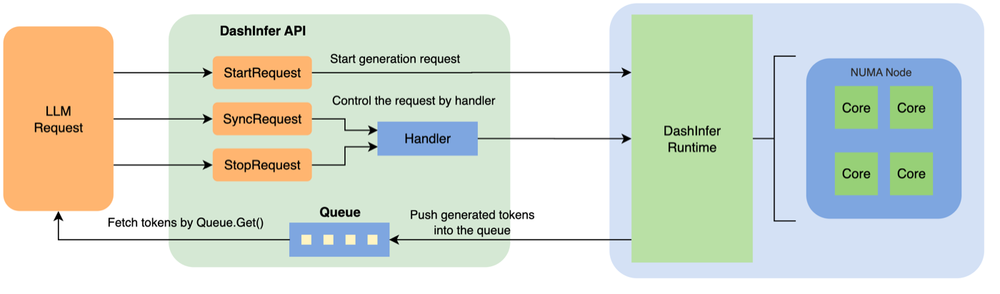
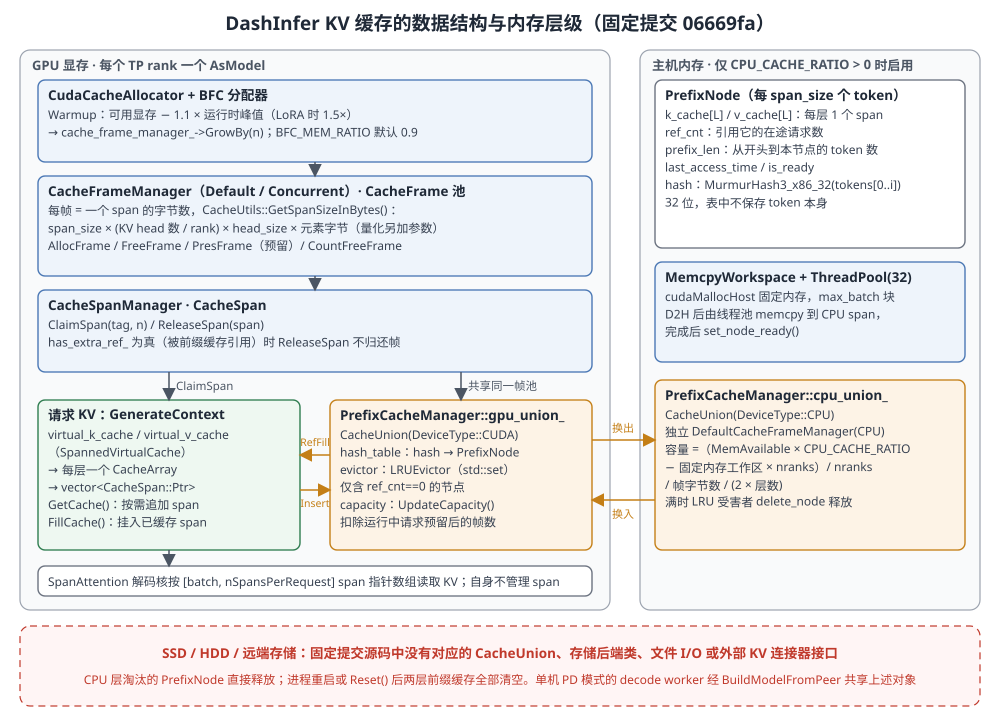
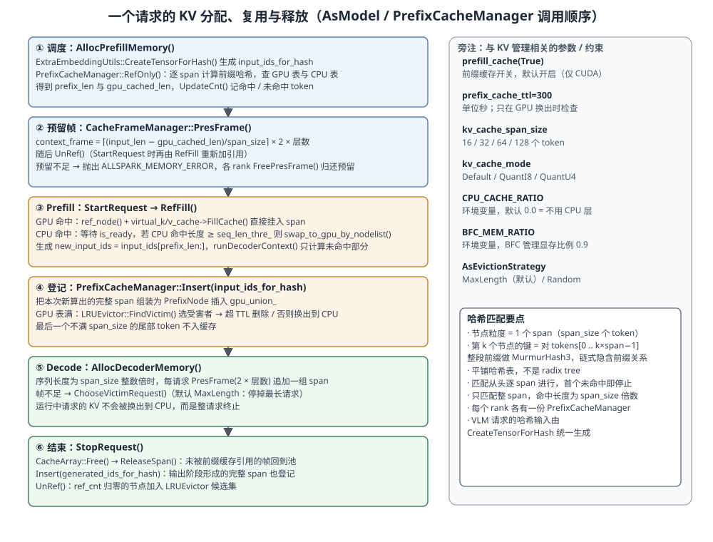
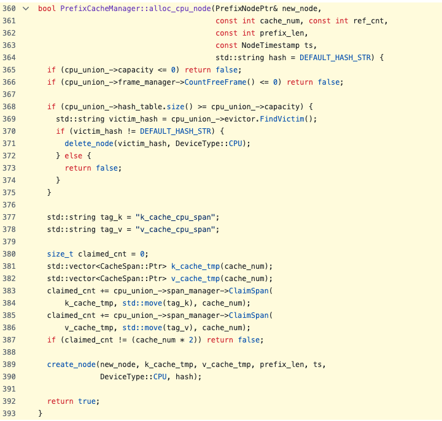
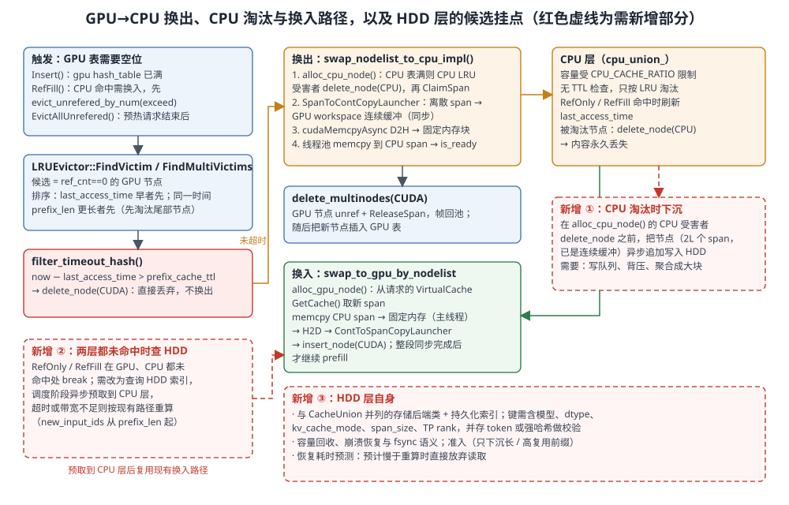
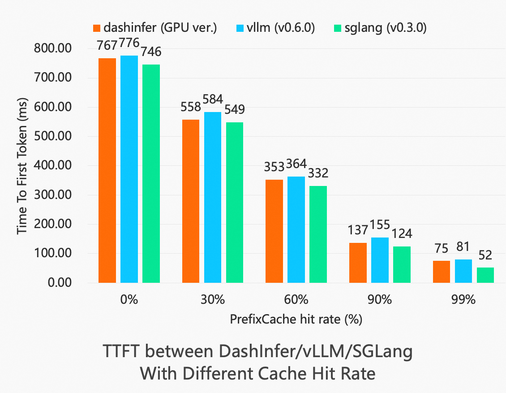

# DashInfer：KV 缓存管理与接入 HDD

> 推理引擎 · DashInfer 官方文档与固定提交源码核查

DashInfer 是阿里巴巴在 ModelScope 组织下开源的 LLM 推理引擎，运行时用 C++ 编写，对外提供 C++ 与 Python 接口，后端覆盖 CUDA、x86 和 ARMv9 CPU。 [PE] 第一部分阿里云章节只概述了它的配置项。本章换一个角度：直接读源码，看 DashInfer 的 KV 在 GPU 显存与主机内存之间如何分配、匹配、换出和淘汰，并判断 HDD 能否作为最底层接入。源码核查固定在 GitHub 默认分支 2026-11-18 的最新提交 `06669fa30816f828c53ea144a7a9ac01507df5b5`（2025-08-06，“read max model len from hf config (#94)”）。最近一次 GitHub Release 是 v2.2.5（2025-07-29），仓库另有 v2.4.0、v2.5.0 标签，文档站仍标为 DashInfer 2.0.0。 [DI1][DI11][DI12] 本章没有在 GPU + HDD 环境中实际运行。

### 运行时架构与 KV 内存分配

引擎入口是 `AsEngine`（实现类 `AsEngineImpl`）。它为每个 TP rank 创建一个 `Worker`（CUDA 或 CPU），每个 Worker 持有一个 `AsModel`。KV 的分配、复用与释放都发生在 `AsModel` 及其下的缓存对象中。 [DI4][DI5] v2.2.5 引入了“单机 PD 分离”：同一张卡上另建一个 decode Worker，用 `BuildModelFromPeer()` 复用 prefill Worker 的帧池、span 管理器和前缀缓存管理器（`need_init_shared_data_ = false`）。因此这里的 PD 分离只是同卡分流，不涉及跨节点 KV 传输。 [DI5][DI12] 官方仓库中的 API 示意图展示了请求侧的三个接口：`StartRequest` 发起生成，`SyncRequest` / `StopRequest` 经 Handler 控制请求，生成的 token 写入队列后由调用方 `Get()` 取走。下文的 KV 分配点与释放点正好对应 StartRequest 和 StopRequest。

*DashInfer 官方仓库 docs/resources/image/arch-single-numa.jpg（固定提交 06669fa）：DashInfer API（StartRequest / SyncRequest / StopRequest、Handler、输出队列）与 DashInfer Runtime 的关系；原图为 v1 CPU 单 NUMA 部署示意* — [原始来源](https://github.com/modelscope/dash-infer/blob/06669fa30816f828c53ea144a7a9ac01507df5b5/docs/resources/image/arch-single-numa.jpg)

GPU 上的 KV 采用分页布局，DashInfer 称之为 SpanAttention，一页叫一个 span。源码中的分配链自下而上分为三层： [DI3][DI4][DI10]

- **帧池**：`CacheFrameManager`（`Default` / `Concurrent` 两种实现）管理一池等长的 `CacheFrame`，每帧恰好放一个 span。帧大小由 `CacheUtils::GetSpanSizeInBytes()` 计算：span_size × 本 rank 的 KV head 数 × head_size × 元素字节。int8 / uint4 模式下，每个 token 每个 head 另加 2 个 float32（zero 与 scale）。
- **span 管理器**：`CacheSpanManager` 用 `ClaimSpan()` 和 `ReleaseSpan()` 把帧包装成带标签的 `CacheSpan`。span 上有一个 `has_extra_ref_` 标志，前缀缓存引用某个 span 时置位；置位期间 `ReleaseSpan()` 不会把帧还回池。
- **请求视图**：每个请求的 `GenerateContext` 持有 `virtual_k_cache` / `virtual_v_cache`（`SpannedVirtualCache`），每层一个 `CacheArray`，内部是 span 指针向量。SpanAttention 解码核按 [batch, nSpansPerRequest] 的 span 指针数组读 KV，子项目 README 明确说明它“不提供 span 管理 API”。

span_size 只能取 16、32、64、128，校验位于 `SpanCacheConfig`。C++ 侧 `AsModelConfig::default_span_size` 为 128，Python `kv_cache_span_size()` 的注释却写默认 32，两处不一致，部署时应显式设置。 [DI3][DI8] GPU 上没有“KV 占显存比例”这类开关。当 `cache_span_num_init` 与 `cache_span_num_grow` 都为 0 时，引擎走自适应容量：先做一次 warm-up，测出运行时显存峰值，再由 `AsModel::Warmup()` 用“可用显存 − 1.1 × 峰值”（启用 LoRA 时为 1.5 ×）计算帧数，调用 `GrowBy()` 一次性建好。 [DI4][DI5] 可用显存本身受 BFC 分配器约束，官方文档给出的公式是 (物理显存 − `BFC_LEFTOVER_MB`) × `BFC_MEM_RATIO`，默认值分别为 350 MB 和 0.9。 [DI7] CPU 后端不走 span 路径，由 `ALLSPARK_KVCACHE_ALLOC_SIZE` 按最大长度连续分配；前缀缓存管理器也只在 CUDA 设备上创建。 [DI4][DI5]

KV 量化由 `kv_cache_mode` 选择：`AsCacheDefault` 保持推理精度（通常 BF16/FP16），`AsCacheQuantI8` 与 `AsCacheQuantU4` 分别量化为 int8 和 uint4，可独立于权重量化开关。 [DI8][DI9] 文档称 int8 和 uint4 分别把占用降到 1/2 和 1/4，但这没有计入量化参数。下表按源码公式，以 Qwen2-7B（28 层、4 个 KV head、head_dim 128）和 Qwen2-72B（80 层、8 个 KV head）的公开配置估算单 token 的 K+V 字节数。 [DI3][DI13]

| 模式 | Qwen2-7B 每 token | 相对 BF16 | Qwen2-72B 每 token（全部 rank 合计） | 4000 token 前缀（7B / 72B） |
|---|---|---|---|---|
| AsCacheDefault（BF16） | 57,344 B（56 KiB） | 100% | 327,680 B（320 KiB） | 约 229 MB / 1.31 GB |
| AsCacheQuantI8 | 30,464 B | 约 53% | 174,080 B | 约 122 MB / 0.70 GB |
| AsCacheQuantU4 | 16,128 B | 约 28% | 92,160 B | 约 65 MB / 0.37 GB |

本文估算：KV 是按层、按 K/V 分别成 span 存放的，所以一个“前缀节点”（span_size 个 token）由 2 × 层数个独立 span 组成。以 Qwen2-7B BF16 为例，span_size=128 时每个 span 为 128 KiB，一个节点 56 个 span，共 7 MiB；span_size=32 时每个 span 32 KiB，一个节点 1.75 MiB。这个粒度决定了任何外部存储层的 I/O 单元。

### 前缀缓存：哈希匹配、引用计数与请求生命周期

前缀缓存由 `prefill_cache(True)` 开启（默认开），`prefix_cache_ttl` 默认 300 秒。 [DI6] 实现集中在 `csrc/runtime/cache/prefix_cache_manager*.{h,cpp,hpp}`。核心对象 `PrefixCacheManager` 有两个 `CacheUnion`：`gpu_union_` 和 `cpu_union_`。每个 `CacheUnion` 包含一张 `unordered_map<hash, PrefixNode>`、一个 `LRUEvictor`、一个容量上限，以及各自的帧池与 span 管理器。 [DI2]

*DashInfer KV 缓存数据结构与内存层级框图：帧池 → span 管理器 → 请求 VirtualCache / 前缀缓存 gpu_union_ 共享同一 GPU 帧池，cpu_union_ 使用独立主机内存帧池；红框表示源码中不存在的存储层（本文根据 DashInfer 固定提交 06669fa 源码绘制）* — [原始来源](https://github.com/modelscope/dash-infer/tree/06669fa30816f828c53ea144a7a9ac01507df5b5/csrc/runtime/cache)

匹配方式不是 radix tree，而是平铺哈希表：

- **键**：每 span_size 个 token 构成一个 `PrefixNode`，第 k 个节点的键是对 tokens[0 … k×span_size−1] 整段前缀做 `MurmurHash3_x86_32` 得到的 32 位值（`hash_tokens()`）。键里隐含了整段前缀，所以表本身不需要树结构。
- **查找**：从第一个 span 开始逐个查表，遇到第一个未命中就停止，命中长度总是 span_size 的整数倍。
- **节点内容**：每层 K、V 各 1 个 span，外加 `ref_cnt`、`prefix_len`、`last_access_time` 和 `is_ready`。
- **不做的事**：表中不保存 token，命中后也不比对内容。
- **多模态请求**：哈希输入由 `ExtraEmbeddingUtils::CreateTensorForHash()` 统一生成。

[DI2][DI4]

一个请求在 `AsModel` 中经过六步： [DI4][DI5]

1. **调度**：`AllocPrefillMemory()` 先调用 `RefOnly()` 查 GPU 表和 CPU 表，得到 `prefix_len` 与 `gpu_cached_len`。
2. **预留帧**：按 ⌈(input_len − gpu_cached_len)/span_size⌉ × 2 × 层数调用 `PresFrame()`。
3. **Prefill**：`StartRequest` 中的 `RefFill()` 把 GPU 命中的 span 用 `FillCache()` 直接挂到请求的 VirtualCache 上；CPU 命中的节点先换入 GPU。随后只把 `input_ids[prefix_len:]` 送入 `runDecoderContext()` 计算。
4. **登记**：prefill 结束后 `Insert()` 把新算出的完整 span 登记为节点。
5. **Decode**：序列长度每到 span_size 的整数倍，`AllocDecoderMemory()` 再为该请求预留 2 × 层数个帧。帧不够时，`ChooseVictimRequest()` 按 `AsEvictionStrategy`（默认 `MaxLength`）直接停止最长的请求。运行中请求的 KV 不会换出到 CPU。
6. **结束**：`StopRequest()` 先释放请求持有的 span，再用 `generated_ids_for_hash` 调用一次 `Insert()`，把输出阶段形成的完整 span 也登记下来，最后 `UnRef()`。

引用计数分两层：

- **节点层**：`ref_node()` 在节点 `ref_cnt` 从 0 变 1 时把它移出 LRU 候选集；`unref_node()` 归零后再放回。
- **span 层**：节点进入哈希表时 `ref_cache_span()` 给它的所有 span 置位 `has_extra_ref_`，因此请求结束时这些帧会留在显存里继续供命中。

[DI2][DI3]

*DashInfer 单个请求的 KV 分配、复用与释放流程框图：AllocPrefillMemory/RefOnly → PresFrame → RefFill → Insert → AllocDecoderMemory → StopRequest，右侧列出相关参数与哈希匹配要点（本文根据 DashInfer 固定提交 06669fa 源码绘制）* — [原始来源](https://github.com/modelscope/dash-infer/blob/06669fa30816f828c53ea144a7a9ac01507df5b5/csrc/core/model/model.cpp)

### GPU→CPU 换出、淘汰策略与 TTL

GPU 前缀缓存的容量由 `UpdateCapacity()` 在 warm-up 扩容后设定，取两者较小值： [DI2]

- `prefix_cache_ratio_`（源码固定为 1.0，未暴露为配置）× 总帧数 / (2 × 层数)；
- 先从总帧数中扣掉 2 × (max_length/span_size + max_batch) × 2 × 层数个帧，给运行中的请求留出余量，再除以 2 × 层数。

`Insert()` 发现 GPU 表已满时，按以下步骤腾位： [DI2]

1. **选受害者**：`LRUEvictor::FindVictim()` 从 `ref_cnt==0` 的节点里挑选。排序规则是 `last_access_time` 早者优先；时间相同时 `prefix_len` 更长者优先，即先淘汰前缀链尾部的节点。
2. **TTL 过滤**：`filter_timeout_hash()` 把距上次访问超过 `prefix_cache_ttl` 的受害者直接 `delete_node()`，不换出。
3. **换出**：其余受害者由 `swap_to_cpu_by_hashlist()` 写入 CPU 层，然后在 GPU 侧删除。
4. **无可淘汰节点**：若所有 GPU 节点都在被引用，新节点本身会被直接换出到 CPU（`swap_to_cpu_by_nodelist()`）。

换出的数据路径分四步（`swap_nodelist_to_cpu_impl()`）：

1. 用 `SpanToContCopyLauncher` 把分散的 span 拷进 GPU workspace 的连续缓冲；
2. `cudaMemcpyAsync` 拷到 `MemcpyWorkspace` 中由 `cudaMallocHost` 分配的固定内存块，并同步等待；
3. CPU 节点先插入哈希表；
4. 32 线程的线程池再把数据 `memcpy` 到各 CPU span，完成后 `set_node_ready()`。

换入（`swap_to_gpu_by_nodelist()`）走相反方向：主线程先 memcpy 到固定内存，再 H2D，再用 `ContToSpanCopyLauncher` 散回请求的新 span。换入只在 CPU 命中长度不小于 `seq_len_thre_` 时发生；否则 `prefix_len` 回退，这部分直接重算。 [DI2] 引擎里还有一个 `AsEngineImpl::TunePrefixCache()`：它用预热请求比较“带缓存”与“重算”的耗时，再据此设置阈值。但在固定提交中，这一调用在 warm-up 流程里被注释掉了，阈值保持默认值 0，所以 CPU 命中总是会被换入。 [DI5]

CPU 层的容量由环境变量 `CPU_CACHE_RATIO` 决定（默认 0.0，即不启用）。`init_cpu_union()` 读取 `/proc/meminfo` 的 `MemAvailable`，乘以该比例，减去 nranks 份固定内存工作区，再在 rank 之间平分并换算成节点数。 [DI2][DI6][DI7] CPU 层的规则更简单：

- 没有 TTL 检查；
- 节点从不被加引用，全部都是 LRU 候选；
- 满了以后，`alloc_cpu_node()` 直接 `delete_node()` 最旧的节点，见下图第 368–371 行。

也就是说，CPU 是最后一层，被淘汰的 KV 永久丢失。进程重启或调用 `Reset()` 后，两层缓存都会清空，源码中也没有任何落盘逻辑。

*DashInfer 固定提交 06669fa 的 csrc/runtime/cache/prefix_cache_manager_private.cpp 第 360–393 行 GitHub 页面截图：alloc_cpu_node() 在 CPU 表满时选 LRU 受害者并 delete_node(DeviceType::CPU)，随后 ClaimSpan 申请主机内存 span；未改写代码* — [原始来源](https://github.com/modelscope/dash-infer/blob/06669fa30816f828c53ea144a7a9ac01507df5b5/csrc/runtime/cache/prefix_cache_manager_private.cpp#L360-L393)

本文分析：这条路径有三个值得注意的同步点。

- `Insert()`、`RefFill()`、`UnRef()` 共用一把 `mtx_`，换出时的 D2H 和换入时的整段拷贝都在锁内同步完成。
- `RefFill()` 遇到尚未就绪的 CPU 节点时，以 `usleep(100)` 轮询 `is_ready`。
- 没有逐层加载或与计算重叠的机制。

对 CPU 内存来说这些开销可以接受；如果把更慢的设备放进同一条路径，等待会直接加到 TTFT 上，并阻塞其他请求的登记与释放。

*DashInfer 前缀缓存的 GPU→CPU 换出、TTL 过滤、CPU LRU 淘汰与换入路径框图，红色虚线标出 HDD 层的三个候选挂点（本文根据 DashInfer 固定提交 06669fa 源码绘制，红色部分为本文提出的扩展设计，源码中不存在）* — [原始来源](https://github.com/modelscope/dash-infer/blob/06669fa30816f828c53ea144a7a9ac01507df5b5/csrc/runtime/cache/prefix_cache_manager.cpp)

### 官方公开的性能数据

官方文档 Prefix Caching 页给出的测试条件为：`benchmark_throughput.py`，Qwen2-7B-Instruct，单张 A100，batch 1，`engine_max_length=4003`，输入 4000 token，输出 3 token，20 个请求。平均 context 时间随命中率变化如下，平均 generate 时间均为 0.040 s。 [DI6]

| 前缀命中率 | 96.0% | 89.6% | 57.6% | 28.8% | 0.0% |
|---|---|---|---|---|---|
| 平均 context 时间（s） | 0.030 | 0.044 | 0.121 | 0.185 | 0.254 |

README 的第二组测试条件为：Qwen2-72B-Instruct，4×A100，20 次，batch 1，输入 4000 token，输出 1 token。以 0% 命中为 100%，命中率 30% / 60% / 90% / 99% 时 TTFT 分别降到 72.8% / 46.0% / 17.9% / 9.8%。同图还列出与 vLLM v0.6.0、SGLang v0.3.0 的 TTFT 对比：DashInfer 在 0% 和 99% 命中时分别为 767 ms 和 75 ms，vLLM 为 776 / 81 ms，SGLang 为 746 / 52 ms。 [PE] v2.0.0 发布说明称，基于 GEMM 的 SpanAttention 批量 attention 核在 A100 上带来 3–8 倍 GQA 加速、1.6–2 倍端到端加速，具体倍数取决于 batch 与上下文长度。 [DI11] 这些数据全部来自 GPU 前缀缓存。官方没有发布 CPU 层命中、换入耗时或 `CPU_CACHE_RATIO` 相关的测试。

*DashInfer 官方 README 前缀缓存基准图（docs/resources/image/dahsinfer-benchmark-prefix-cache.png）：Qwen2-72B-Instruct、4×A100、输入 4000 token 条件下，DashInfer / vLLM v0.6.0 / SGLang v0.3.0 在 0%–99% 命中率下的 TTFT* — [原始来源](https://github.com/modelscope/dash-infer/blob/06669fa30816f828c53ea144a7a9ac01507df5b5/README.md)

### 接入 HDD：现状、扩展点与工程要求

结论先行：在固定提交中，DashInfer 没有任何可挂接 SSD、HDD、文件系统、对象存储或外部 KV 服务的接口。具体表现为：

- `PrefixCacheManager` 只有 `gpu_union_` 和 `cpu_union_` 两个成员，层级是写死的；
- 没有存储后端基类、插件注册点或连接器；
- `csrc/runtime/cache` 目录中，唯一的文件读取是 `/proc/meminfo`；
- 仓库中也检索不到 LMCache、Mooncake、3FS 等外部 KV 组件的引用。

[DI1][DI2] 与之对照，SGLang HiCache 在 L3 提供文件、Mooncake、3FS 等存储后端，以及 best_effort / wait_complete / timeout 三种预取策略，还支持动态加载自定义后端。 [DI14] vLLM 的 `KVConnectorBase_V1` 则把外部 KV 抽象为一组调度侧与 worker 侧钩子，包括 `get_num_new_matched_tokens`、`start_load_kv`、`wait_for_layer_load`、`save_kv_layer`、`wait_for_save` 和 `request_finished`，LMCache、FlexKV、Mooncake 等都通过它接入。 [DI15] 所以在 DashInfer 中接 HDD，不是改一个配置，而是要往 C++ 运行时里加一个新层级。

本文分析：最自然的扩展点有三处（见上方框图红色部分）。

1. **下沉写入**：在 `alloc_cpu_node()` 删除 CPU 受害者之前，把整个节点交给异步写队列落到 HDD。换出流程已经把一个节点的 2 × 层数个 span 拷成连续缓冲（`SpanToContCopyLauncher`），天然是大块顺序写的单元：Qwen2-7B BF16 下每个节点 1.75–7 MiB。也可以进一步把多个节点聚合成更大的 extent。
2. **未命中查询**：`RefOnly()` / `RefFill()` 在 GPU、CPU 都未命中时会 `break`。这里应改为查询 HDD 索引，并在 `AllocPrefillMemory()` 的调度阶段（而不是持锁的 `RefFill()` 中）异步预取到 CPU 层，之后复用现有的换入路径。预取超时就保持现有逻辑：`prefix_len` 截断，其余从 `new_input_ids` 开始重算。
3. **新增存储后端类**：与 `CacheUnion` 并列，负责容量回收、崩溃恢复、写入完成语义和准入控制。

另外两个问题必须一并解决：

- **哈希冲突**：现有键是 32 位 MurmurHash3，且不比对 token。按生日界估算，约 7.7 万个不同节点时，出现至少一次冲突的概率就接近 50%。千万级节点的 HDD 层上，单次查找误命中的概率约为节点数 / 2³²，即约 0.2%。因此持久层必须改用强哈希或保存 token 做校验。
- **键的维度**：键中还要加入模型、dtype、`kv_cache_mode`、span_size 和 TP rank。

本文估算：性能上的门槛可以用官方数据粗算。Qwen2-7B 在单张 A100 上全量 prefill 4000 token 的平均 context 时间为 0.254 s，而 4000 token 的 BF16 KV 约 229 MB。要让“全部从 HDD 读回”不慢于重算，在不重叠计算的前提下，有效读带宽需达到约 0.9 GB/s；int8 约 0.48 GB/s，uint4 约 0.25 GB/s。Qwen2-72B 在 4×A100 上 0% 命中的 TTFT 为 767 ms，对应约 1.31 GB 的 KV，总需求约 1.7 GB/s（每 rank 约 0.43 GB/s）。这些数字只说明：HDD 层要么依靠多盘并行和大块顺序读，要么只对 KV 量化后的长前缀、低优先级或离线批处理请求才可能划算。是否真能比重算更合算，仍需在目标阵列上实测。

| 判断层次 | 目前证据 | 尚缺验证 |
|---|---|---|
| 能否接入 | GPU / CPU 两层由 `PrefixCacheManager` 硬编码；CPU 淘汰点（`alloc_cpu_node`）与未命中点（`RefOnly` / `RefFill`）位置明确；换出路径已产生按节点连续的缓冲 | 没有现成接口，需要改 C++ 运行时：新增存储后端、持久索引、异步写队列与预取；改动后的多 rank 一致性与 VLM 哈希兼容性 |
| 能否比重算更合算 | 官方给出 GPU 前缀命中下 TTFT 的大幅下降；源码在 CPU 命中不足 `seq_len_thre_` 时回退重算；`TunePrefixCache()` 提供了“复用 vs 重算”测时的雏形（固定提交中未启用） | 官方没有 CPU 层换入耗时数据；HDD 全冷恢复耗时、P99 TTFT、与锁竞争的交互、量化后的有效带宽门槛 |
| 能否长期运行 | CPU 层容量受 `CPU_CACHE_RATIO` 约束且按 LRU 稳定回收；GPU 层有 TTL | 32 位哈希在大容量下的误命中、重启后的索引恢复、写入完成语义、HDD 写入积压与前台读的带宽隔离，以及长时间压力与故障测试 |

对比来看，SGLang HiCache 只需把 L3 文件后端目录指向 HDD，就能先做正确性原型；vLLM 可以通过 KV 连接器接入 LMCache 等现成方案。DashInfer 则缺少这一层抽象，接入 HDD 的工程量明显更大。但它的节点粒度固定、换出路径已经做了连续化拷贝，这两点让“按节点聚合写入 HDD”在结构上比较直接。

### 资料边界

本章的机制描述来自固定提交 06669fa 的源码与官方文档，没有实际编译运行，也没有在 GPU + HDD 环境中测试。官方未公开 CPU 层换入、`CPU_CACHE_RATIO` 调优或任何磁盘层的性能数据，没有 SpanAttention 内存布局的官方示意图，也没有找到 ModelScope 或阿里云官方博客对 DashInfer KV 管理的专门介绍。文中每 token 字节数、HDD 带宽门槛和哈希冲突概率均为本文按源码公式与公开模型配置做的估算。

## 本章资料

- **[DI1]** [ModelScope · dash-infer 官方仓库源码树（固定提交 06669fa30816f828c53ea144a7a9ac01507df5b5，2025-08-06）](https://github.com/modelscope/dash-infer/tree/06669fa30816f828c53ea144a7a9ac01507df5b5)
- **[DI2]** [DashInfer 源码 · csrc/runtime/cache/prefix_cache_manager.h / .cpp / _private.cpp / _member.hpp（PrefixCacheManager、CacheUnion、LRUEvictor、PrefixNode，固定提交 06669fa）](https://github.com/modelscope/dash-infer/tree/06669fa30816f828c53ea144a7a9ac01507df5b5/csrc/runtime/cache)
- **[DI3]** [DashInfer 源码 · csrc/runtime/cache/frame_manager、span_manager、virtual_cache、span_cache_config 与 csrc/interface/allspark.h（帧池、CacheSpan、GetSpanSizeInBytes、默认参数，固定提交 06669fa）](https://github.com/modelscope/dash-infer/blob/06669fa30816f828c53ea144a7a9ac01507df5b5/csrc/runtime/cache/virtual_cache.cpp)
- **[DI4]** [DashInfer 源码 · csrc/core/model/model.cpp / model.h（AsModel：AllocPrefillMemory、StartRequest、StopRequest、AllocDecoderMemory、Warmup，固定提交 06669fa）](https://github.com/modelscope/dash-infer/blob/06669fa30816f828c53ea144a7a9ac01507df5b5/csrc/core/model/model.cpp)
- **[DI5]** [DashInfer 源码 · csrc/common/as_engine.cpp / as_engine_prefill.cpp / as_engine_decode.cpp（AsEngineImpl：自适应 span 配置、warm-up、TunePrefixCache、ChooseVictimRequest、PD worker 构建，固定提交 06669fa）](https://github.com/modelscope/dash-infer/blob/06669fa30816f828c53ea144a7a9ac01507df5b5/csrc/common/as_engine_decode.cpp)
- **[DI6]** [DashInfer 2.0.0 官方文档 · Prefix Caching（采集于 2026-11-18）](https://dashinfer.readthedocs.io/en/latest/llm/prefix_caching.html)
- **[DI7]** [DashInfer 2.0.0 官方文档 · Environment Variable Usage（BFC_MEM_RATIO、BFC_LEFTOVER_MB、CPU_CACHE_RATIO 等，采集于 2026-11-18）](https://dashinfer.readthedocs.io/en/latest/get_started/env_var_options_en.html)
- **[DI8]** [DashInfer 2.0.0 官方文档 · Engine Runtime Config（采集于 2026-11-18）；及 python/pyhie/allspark/runtime_config.py 注释](https://dashinfer.readthedocs.io/en/latest/llm/runtime_config.html)
- **[DI9]** [DashInfer 2.0.0 官方文档 · KV Cache Quantization（采集于 2026-11-18）](https://dashinfer.readthedocs.io/en/latest/quant/kv_cache_quant.html)
- **[DI10]** [DashInfer 官方仓库 · span-attention 子项目 README（Span size / Span pointer array，固定提交 06669fa）](https://github.com/modelscope/dash-infer/blob/06669fa30816f828c53ea144a7a9ac01507df5b5/span-attention/README.md)
- **[DI11]** [DashInfer 官方文档 · Release Note v2.0.0（2024/11/13）](https://dashinfer.readthedocs.io/en/latest/release_note.html)
- **[DI12]** [DashInfer 官方 GitHub Release · v2.2.5（2025-07-29，Single Node P-D Disaggregate for CUDA）](https://github.com/modelscope/dash-infer/releases/tag/v2.2.5)
- **[DI13]** [Qwen 官方 Hugging Face 模型配置 · Qwen2-7B-Instruct / Qwen2-72B-Instruct config.json（层数、KV head 数）](https://huggingface.co/Qwen/Qwen2-7B-Instruct/blob/main/config.json)
- **[DI14]** [SGLang 官方仓库 · HiCache 设计文档 hicache_design.mdx（固定提交 c712459e7f82）](https://github.com/sgl-project/sglang/blob/c712459e7f8233302fdf0bdd5d4ddcd22aa4b2ab/docs/docs/advanced_features/hicache_design.mdx)
- **[DI15]** [vLLM 官方文档 · KVConnectorBase_V1 API（vllm.distributed.kv_transfer.kv_connector.v1.base，采集于 2026-11-18）](https://docs.vllm.ai/en/latest/api/vllm/distributed/kv_transfer/kv_connector/v1/base.html)
- **[PE]** [DashInfer · 官方 GitHub README（modelscope/dash-infer）](https://github.com/modelscope/dash-infer)
