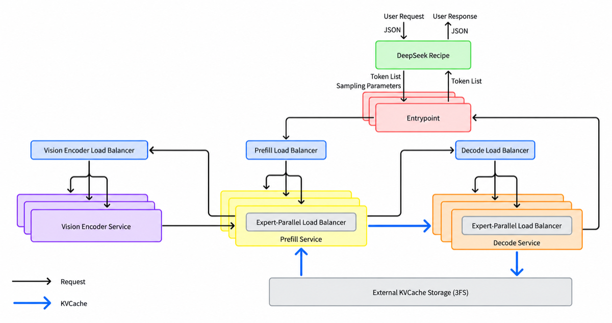
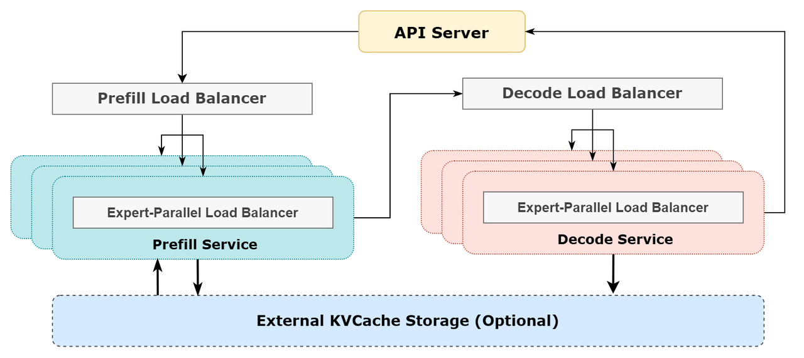
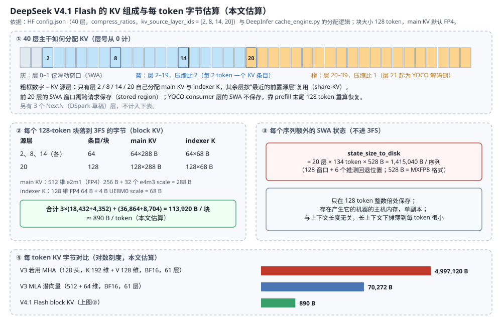
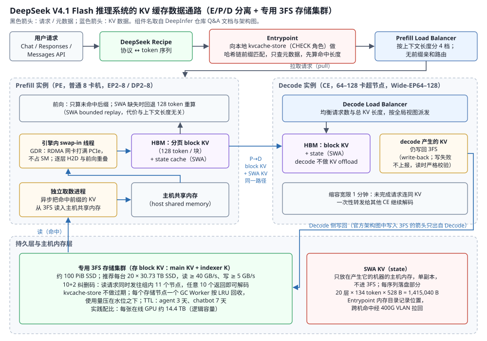
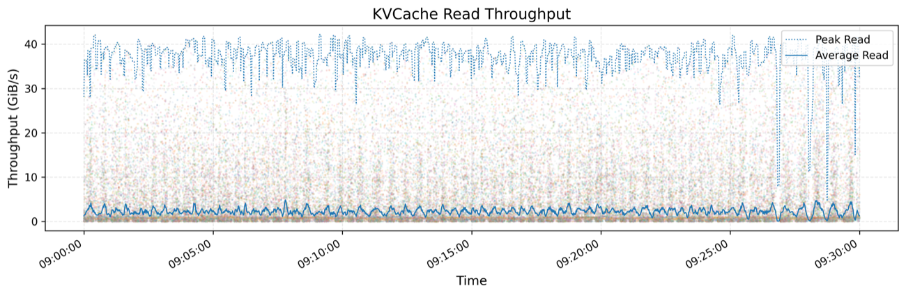
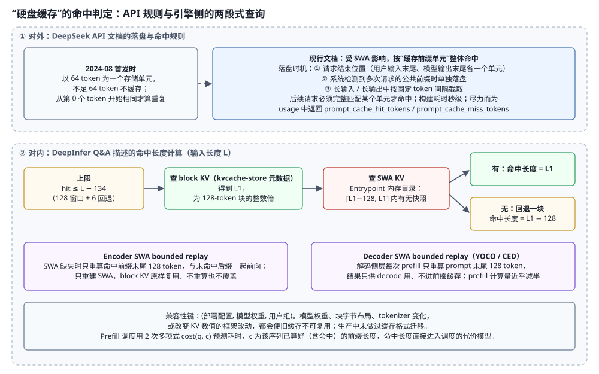

# DeepInfer：DeepSeek 推理系统的 KV 缓存管理与硬盘缓存

> 推理系统 · DeepSeek 官方文档、开源仓库与技术报告

用户所说的“DeepInfer”确有其名：DeepSeek 官方 GitHub 组织 deepseek-ai 下有仓库 `deepseek-ai/DeepInfer`（2026-10-16 创建，Apache-2.0），README 称它是“驱动 DeepSeek 大规模线上服务的高性能推理框架”，目前只支持 DeepSeek-V4.1-Flash，硬件为 NVIDIA SM100 GPU 与华为昇腾 950 NPU [DS1]。但这次开源只包括离线推理所需的引擎核心。README 明确列出“完整推理服务所需、本次未包含”的三项：**KV 缓存系统**、VE / Prefill / Decode 分离（引擎侧功能大部分已实现）、跨数据并行副本的负载均衡 [DS1]。仓库附带的部署 Q&A 也说明，KV 缓存管理与负载均衡组件与内部基础设施耦合较紧，代码尚未完整开源，相关设计见一篇知乎博文与这份 Q&A [DS2]。因此本章分两部分：引擎内部的 KV 管理依据固定提交 `a679bb86`（2026-11-03）的源码；KV 存储系统依据官方 Q&A、DeepSeek API 文档、open-infra-index 与 3FS 仓库的描述，采集于 2026-11-18。结论先行：DeepSeek API 所说的“硬盘缓存”，在官方材料中落在**基于 SSD 的 3FS 专用存储集群**上，没有任何官方材料提到 HDD。

### 定位与演进：从“不开源引擎”到 DeepInfer

2025 年 4 月，DeepSeek 在《The Path to Open-Sourcing the DeepSeek Inference Engine》中写道：内部推理引擎基于一年多前 fork 的早期 vLLM，已针对 DeepSeek 模型深度定制，又与集群管理等内部设施紧耦合，因此决定不整体开源，改为把可复用的功能拆成独立库、把优化贡献给现有开源项目 [DS10]。2026 年 10 月发布的 DeepInfer 在这一点上前进了一步：README 致谢称它“最初主要构建在 vLLM 之上”，并借鉴了 SGLang 与 TensorRT-LLM；但与 KV 存储相关的部分仍然没有放出 [DS1][DS2]。

系统形态的变化可以从两张官方架构图对比看出。2025 年 2 月 Open Source Week Day 6 公布的 V3 / R1 推理系统是 P/D 分离加跨节点 EP：Prefill 每个部署单元 4 节点（路由专家 EP32、MLA 与共享专家 DP32），Decode 每个部署单元 18 节点（EP144 / DP144），图中外部 KVCache 存储标注为“Optional” [DS9]。V4.1 Flash 的 Q&A 则把系统描述为“E/P/D 分离加专用存储节点”：Prefill 用普通 8 卡机、EP2–8 / DP2–8；Decode 用 64–128 卡超节点、EP64–128（Wide-EP）；视觉编码器单卡部署；暂不使用 TP 与 CP。设计目标第三条直接写明**KV 缓存保留 72 小时以上** [DS2]。

*DeepInfer 仓库 doc/images/architecture_overview.png：DeepSeek V4.1 Flash 推理系统参考架构。DeepSeek Recipe 负责协议与 token 互转，Entrypoint 分发到 Vision Encoder / Prefill / Decode 三类负载均衡器；蓝色箭头为 KV 数据流：External KVCache Storage（3FS）向 Prefill Service 供数，Decode Service 写入 3FS* — [原始来源](https://github.com/deepseek-ai/DeepInfer/blob/a679bb86ce36e883a98a97733492b686e5b9a08e/doc/images/architecture_overview.png)

*open-infra-index Day 6《DeepSeek-V3/R1 Inference System Overview》中的在线推理系统图（2025-02）：API Server、Prefill / Decode Load Balancer、各实例内的 Expert-Parallel Load Balancer，以及标注为 Optional 的 External KVCache Storage* — [原始来源](https://github.com/deepseek-ai/open-infra-index/blob/main/202502OpenSourceWeek/day_6_one_more_thing_deepseekV3R1_inference_system_overview.md)

### KV 有多小：从 MLA 到 V4.1 的压缩 KV

DeepSeek 自己把硬盘缓存的前提归结为 KV 体积。2024-08-02 的 API 公告写道：DeepSeek-V2 提出的 MLA 结构“大大压缩了上下文 KV Cache 的大小，使得存储所需要的传输带宽和存储容量均大幅减少，因此可以缓存到低成本的硬盘上” [DS7]。V2 论文给出的数字是：与 DeepSeek 67B 相比，KV 缓存减少 93.3% [DS14]。按 DeepSeek-V3 官方配置（61 层，`kv_lora_rank` 512，`qk_rope_head_dim` 64，128 个注意力头，`qk_nope_head_dim` 128，`v_head_dim` 128）估算：MLA 每层只缓存 576 维潜向量，BF16 下每 token 共 576 × 2 B × 61 = 70,272 B；同样的头配置若按 MHA 缓存完整 K（192 维）与 V（128 维），每 token 约 4,997,120 B，前者约为后者的 1.4%（本文估算） [DS16][DS15]。Day 6 说明 V3 / R1 线上的核心 MLA 计算使用 BF16 [DS9]。

V4.1 Flash 又往下压了一个数量级。FlashMLA README 给出 V4.1 的两种逐 token 格式：MXFP8 为 528 B（512 B e4m3 数据 + 16 B UE8M0 scale），FP4 为 288 B（256 B e2m1 数据 + 32 B e4m3 scale） [DS5]。Q&A 说明 main KV 用 per-16 e4m3 scale 的 FP4，indexer KV 用 MXFP4 [DS2]。DeepInfer 的 `ModelMetadata` 把块大小固定为 128 token；`cache_engine.py` 按层分配 KV：压缩比为 r 的层每块存 128 / r 个条目，跨层共享 KV 的层不再占用新空间 [DS3]。HF 配置中只有 2、8、14、20 四层是 KV 源层（`kv_source_layer_ids`）。其中 2–19 层压缩比为 2，20–39 层为 1，indexer 维度为 128 [DS4]。据此推算，每个 128-token 块写入 3FS 的 block KV（main KV + indexer K）为 3 × (64 × 288 + 64 × 68) + (128 × 288 + 128 × 68) = 113,920 B，约合**每 token 890 B**（本文估算）。此外，每个序列还有一份与上下文长度无关的 SWA 状态，Q&A 给出的大小为 20 层 × 134 token × 528 B = 1,415,040 B [DS2]。按这一估算，128K 上下文的 block KV 约 111 MiB，同长度的 V3 BF16 MLA 约 8.6 GiB。

*DeepSeek V4.1 Flash 的 KV 组成：40 层中 KV 源层与压缩比分布、每个 128-token 块的 block KV 字节、每序列 SWA 状态，以及与 V3 MLA / MHA 的每 token 字节对比（对数刻度，数值为本文估算；本文根据 DeepSeek 官方资料绘制：HF config.json、DeepInfer cache_engine.py 与 Q&A、FlashMLA README、DeepSeek-V3 配置）* — [原始来源](https://github.com/deepseek-ai/DeepInfer/blob/a679bb86ce36e883a98a97733492b686e5b9a08e/deepinfer/worker/cache_engine.py)

### 三层存放与端到端数据通路

Q&A 用一张表说明 KV 放在哪里：

| 内容 | 介质 | 冗余 | 管理方 |
|---|---|---|---|
| 正在计算的 block KV + state KV | 推理卡 HBM | — | Prefill / Decode 实例 |
| SWA KV | 本机主机内存 | 单副本，不进 3FS | Prefill / Decode 实例；跨机命中经 400G VLAN 拉取 |
| 分页 block KV | 专用 3FS 存储集群 | 应用层不复制，依赖 3FS 自身冗余 | kvcache-store |

来源： [DS2]。之所以不用“本地内存 + 分级存储”，Q&A 给出三点理由：专用存储集群让任何一台 Prefill 机器都能命中任何前缀，避免前缀亲和与负载均衡路由冲突；存储节点可以和计算节点分开扩缩容；KV 不受计算节点故障影响，而计算节点的故障率比存储节点高一个数量级以上 [DS2]。所以 Prefill Load Balancer 只按上下文长度分 4 档（<16K / 16–64K / 64–256K / ≥256K）、按剩余算力配额拉取请求，明确“不做前缀亲和路由” [DS2]。

一次请求的 KV 路径如下图。（1）**匹配**：Entrypoint 向本地 CHECK 角色的 kvcache-store 做哈希链前缀匹配，只查元数据。命中长度必须在路由之前算出，这一步的开销无法隐藏。（2）**取数**：一个独立进程异步把 KV 从 3FS 读进主机共享内存。（3）**swap-in**：引擎进程内的线程把 KV 从共享内存搬进 HBM，目标是逐层 H2D 与前向计算重叠。由于 CUDA copy engine 处理细粒度 KV 块拷贝的性能较差，这一步改用 GDR，由 RDMA 网卡打满 PCIe，不占用 SM [DS2]。（4）**P→D**：SWA KV 与 block KV 走同一条 P 到 D 的传输路径 [DS2]。（5）**写回**：Decode 不做 KV offload，但 decode 阶段产生的 KV 仍会以 write-back 方式写盘以提高命中率。写失败不报告给引擎，读取时由引擎严格校验数据 [DS2]。官方架构图中，指向 3FS 的写入箭头只从 Decode Service 发出，Prefill Service 与 3FS 之间只画了读方向的箭头 [DS1]。Prefill 阶段产生的 KV 是否经 Decode 统一落盘，文中没有明说。

*DeepSeek V4.1 Flash 推理系统的 KV 缓存数据通路：Entrypoint 元数据匹配 → Prefill 取数进程（3FS → 主机共享内存）→ GDR swap-in 到 HBM → P→D 传输 → Decode 写回 3FS；SWA KV 留在主机内存，由 Entrypoint 内存目录定位（本文根据 DeepSeek 官方资料绘制：DeepInfer 部署 Q&A 与架构图）* — [原始来源](https://github.com/deepseek-ai/DeepInfer/blob/a679bb86ce36e883a98a97733492b686e5b9a08e/doc/inference_deployment_qa.md)

开源引擎内部的 KV 管理相当简单。`csrc/engine/block_manager.hpp` 的 `Blocks` 用数组内嵌的 `prev` / `next` 维护空闲链表，块按 `ref_count` 管理：`allocate()` 从链表头取块，`free()` 在引用计数归零后放回链表尾；`BlockManager.free_blocks_nolock()` 逆序释放，`pin_block()` 供 fork 出的序列共享父序列的块。每个序列另从 state 管理器分得一个 state 槽位存放 SWA 等状态 [DS3]。与 vLLM、SGLang 不同，这里**没有 GPU 内的前缀哈希表**，块释放后也不保留可命中的内容。前缀复用全部交给外部的 kvcache-store 与 3FS，引擎只需知道某个序列已有多少 token 算好（`num_cached_tokens`），然后把命中部分装入分配好的块 [DS3][DS2]。

### 持久层：3FS 的实现与容量策略

3FS（Fire-Flyer File System）在 2025 年 Open Source Week Day 5 开源，定位是“充分利用现代 SSD 与 RDMA 网络带宽的并行文件系统”，官方列出的用途包括 V3 / R1 推理中的 KVCache 查找，单客户端节点 KVCache 查找峰值吞吐 40+ GiB/s [DS13]。3FS README 把 KVCache 列为一类场景，称其为“比 DRAM 缓存更具成本效益的替代方案，吞吐高、容量大得多”，并给出两张运行图：所有 KVCache 客户端（每节点 1 × 400 Gbps 网卡）的读吞吐峰值可达 40 GiB/s；GC 删除操作的 IOPS 来自同一时间段 [DS11]。

*3FS 官方仓库 README 的 KVCache Read Throughput 图：30 分钟内所有 KVCache 客户端（每节点 1×400Gbps 网卡）的峰值与平均读吞吐，峰值约 40 GiB/s，平均值远低于峰值* — [原始来源](https://github.com/deepseek-ai/3FS/blob/main/docs/images/kvcache_read_throughput.png)

3FS 设计文档描述了四个组件（cluster manager、metadata service、storage service、client），全部通过 RDMA（InfiniBand 或 RoCE）互联。每个 storage service 管理几块本地 SSD，以 CRAQ（Chain Replication with Apportioned Queries）保证强一致，“写全部、读任意”，以便吃满 SSD 与 RDMA 带宽。文件按等长 chunk 切分；chunk engine 在每块 SSD 上用固定数量的数据文件加一个 RocksDB 保存元数据，物理块从 64 KiB 到 64 MiB 按 2 的幂分 11 档，空间不够时用 `fallocate()` 一次预留 256 个物理块以减少碎片 [DS12]。FUSE 在小随机读上表现不佳，因此另有异步零拷贝 API（USRBIO） [DS12]。

V4.1 Q&A 给出了 KV 场景的具体配置：数据在 3FS 上以 **10+2 纠删码**存放，每个 EC 组可容忍两个节点同时故障；读请求同时发往组内 11 个节点，任意 10 个返回即可解码；Q&A 称 3FS 必须在节点故障和网络抖动下同时保证高可用与高性能。每个存储节点部署一个 GC Worker，定期按 LRU 淘汰最久未用的 KV，把磁盘占用控制在水位以下。kvcache-store 本身没有过期逻辑，回收完全依赖 3FS 的 GC [DS2]。容量方面，3FS 为 KV 提供约 **100 PiB SSD**，TTL 为 agent 流量 3 天、chatbot 流量 7 天。推荐每台存储服务器配 20 块 30.73 TB SSD，读不低于 40 GB/s、写不低于 5 GB/s，总容量足以保存 24 小时数据；实际配比约为每张在线 GPU 14.4 TB（逻辑容量），物理容量还要更大 [DS2]。按前文每 token 890 B 估算，14.4 TB 约可存 160 亿 token 的 block KV（本文估算）。注意，3FS 公开设计文档描述的冗余方式是 CRAQ 链式复制，10+2 EC 只出现在 V4.1 Q&A 中。

### 命中判定、计费与线上命中率

对 API 用户而言，规则经历过一次变化。2024-08-02 硬盘缓存上线时，公告写明：只有从第 0 个 token 起相同的前缀才算重复；缓存以 **64 token** 为一个存储单元，不足 64 token 的内容不缓存；缓存“尽力而为”，不保证 100% 命中；不再使用的缓存一般在几小时到几天内自动清空；每个用户的缓存逻辑上相互隔离。当时命中价格为 0.1 元 / 百万 tokens，未命中为 1 元；128K 输入且大部分重复的请求，实测首 token 延迟从 13 秒降到 500 毫秒 [DS7]。现行的“上下文硬盘缓存”指南不再提 64 token，而是说“受 Sliding Window Attention 机制的影响”，每条缓存前缀是一个独立的完整单元，后续请求必须**完整匹配**某个“缓存前缀单元”才能命中。落盘时机有三种：请求结束位置（用户输入末尾、模型输出末尾各产生一个单元）、系统检测到的公共前缀，以及长输入 / 长输出中按固定 token 间隔截取。缓存构建耗时为秒级，命中情况通过 `usage` 中的 `prompt_cache_hit_tokens` / `prompt_cache_miss_tokens` 返回 [DS6]。现行价格页上，`deepseek-flash`（DeepSeek-V4.1-Flash-1017）高峰时段输入命中 0.04 元、未命中 2 元 / 百万 tokens，命中价为未命中价的 2%；`deepseek-v4-pro` 为 0.30 元对 9.0 元。空闲时段价格减半，缓存存储本身不另收费 [DS8][DS7]。

引擎侧的判定规则解释了“完整单元”的由来。Q&A 写明：命中长度由 block KV 决定，最后一块是否需要重算由 SWA KV 决定。对长度为 L 的输入，命中上限为 L − 134（128 窗口 + 6 个推测回退位置）。先查 block KV，得到 128 的整数倍 L1；再查 SWA KV，若 [L1 − 128, L1] 内存在 SWA 快照则命中 L1，否则回退为 L1 − 128。SWA 只在 128 token 整数倍处保存；prefill 只在最后一个 chunk 保存，decode 每跨过一个 128 边界就在显存中复制一次窗口 [DS2]。缺失的 SWA 用“SWA bounded replay”补：只重算命中前缀末尾的 128 token，重算代价与上下文长度和层数无关，block KV 原样复用 [DS2][DS1]。缓存兼容性以“(部署配置, 模型权重, 用户组)”为键，权重、块字节布局、tokenizer 的变化，或改变 KV 数值的框架改动，都会使旧缓存失效；生产中没有做过缓存格式迁移 [DS2]。

*DeepSeek 硬盘缓存的命中判定：上半部分为 API 文档的规则（2024-08 的 64 token 存储单元 → 现行“缓存前缀单元”的三种落盘时机），下半部分为 DeepInfer Q&A 描述的两段式查询（block KV 得 L1，SWA 决定 L1 或 L1−128）与 bounded replay（本文根据 DeepSeek 官方资料绘制：API 指南、2024-08-02 公告、DeepInfer 部署 Q&A）* — [原始来源](https://api-docs.deepseek.com/zh-cn/guides/kv_cache)

线上效果方面，Day 6 给出了 V3 / R1 的 24 小时统计（北京时间 2025-02-27 12:00 至 02-28 12:00，含网页、App 与 API 全部请求）：输入 6,080 亿 token，其中 3,420 亿（**56.3%**）命中磁盘 KV 缓存；峰值占用 278 个节点，平均 226.75 个（每节点 8 张 H800）；Prefill 阶段每节点平均输入吞吐约 73.7k tokens/s（含缓存命中） [DS9]。V4.1 的 Q&A 没有给出总命中率，只说明当前 3FS 实现已“非常接近可达到的最大命中率”：agent 流量 72 小时、chatbot 流量 7 天的 TTL 几乎覆盖了所有可复用条目，72 小时还能跨过周末，让下一个工作日的请求复用缓存。chatbot 流量的长尾更重，少量 KV 被反复读取很多次；经验上 TTL 缩到约 3 天会让 chatbot 损失 0.5%–1% 的命中率 [DS2]。Q&A 还提到单集群目前每天服务 155 万亿 token [DS2]。

### 与 HDD 的关系：“硬盘缓存”并不在机械盘上

**官方说的介质是什么。**2024 年公告的中文措辞是把内容“缓存在分布式的硬盘阵列中” [DS7]，这里的“硬盘”是相对显存 / 内存而言的磁盘层。此后的官方材料都把介质写成 SSD：3FS 的定位是“利用现代 SSD 与 RDMA 网络” [DS13][DS12]，V4.1 Q&A 写明“约 100 PiB SSD”和每台 20 块 30.73 TB SSD [DS2]。在本次检索的 DeepSeek 官方材料中没有找到 HDD 的部署描述。

**为什么小 KV 让磁盘缓存划算。**每 token 890 B 意味着一台读带宽 40 GB/s 的存储服务器每秒可供出约 4,500 万 token 的 KV（本文估算），命中读取能与请求排队、引擎计算重叠。Q&A 在回答“是否值得做基于 CXL 的集中式 L2 缓存”时也说：V4.1 的 KV 很小，读取已与排队和计算重叠，降低命中读延迟对 TTFT 帮助有限，而且 SSD 比 DRAM 便宜得多。他们真正在意的是 SSD 写入量，即能否把热点或只用一次的条目留在内存里以减少 SSD 磨损，但目前没有这样做 [DS2]。

**加一层 HDD 会带来什么、打破什么。**可能的收益有两点：一是更便宜的容量，可用来把 TTL 延长到 7 天以上，或承接 SSD 层淘汰的冷条目；二是机械盘没有闪存那样的擦写寿命约束，可以分担 write-back 写流。但这两点在官方数据中都很有限。官方称现有 TTL 已接近最大可达命中率，且 TTL 从 7 天缩到 3 天只损失 0.5%–1%，把保留期继续拉长的边际收益更小 [DS2]。代价则落在读路径上。推荐配置相当于每块 SSD 承担约 2 GB/s 读带宽（40 GB/s ÷ 20 块，本文估算）；单块机械盘即使顺序读也只有数百 MB/s 量级，而 KV 读取是细粒度的。一个 128-token 块约 111 KiB，若按 10+2 纠删切到 10 个数据节点，每个节点每次只读 10 KiB 量级（本文估算，假设一个块单独构成一个条带；kvcache-store 的实际文件与条带布局未公开），HDD 的寻道与旋转延迟会占主导。“任意 10 个返回即可解码”的尾延迟设计也是以 SSD 的低延迟为前提的。写侧可参照 WD / Solidigm 报告：其 HDD 阵列上一次持久化的 1 MiB 写入约需 13 ms；在没有 DRAM 前置层时，写入跟不上会直接拉低命中率 [VL18]。

| 判断层次 | 结论 | 依据与缺口 |
|---|---|---|
| 接口可行 | 部分可行 | 3FS 已开源，但设计文档按“每个存储服务管理若干本地 SSD”来描述，没有提到机械盘，在 HDD 上运行属于官方未覆盖的用法；kvcache-store、取数进程等 KV 缓存系统没有开源，DeepInfer 开源版本身不含 KV 缓存系统，没有可直接挂接 HDD 层的接口 [DS1][DS2][DS12] |
| 性能可行 | 作主持久层不可行；作 SSD 之后的冷层待验证 | 推荐配置为每台 ≥ 40 GB/s 读、每块 SSD 约 2 GB/s（本文估算），读取粒度在 10–100 KiB 量级；HDD 只适合在 SSD 之后承接冷条目，需要验证从 HDD 回填的时延能否被请求排队时间吸收 |
| 生产可行 | 无官方证据 | 官方没有 HDD 部署或测试数据；TTL 已接近最大可达命中率，扩容的边际收益小；官方提到的优化方向是用内存减少 SSD 写入（CXL L2），而不是向下增加机械盘层 [DS2] |

### 资料边界

KV 缓存系统（kvcache-store、取数进程、GC Worker）的源码没有开源，本章对它的描述全部来自 DeepInfer 仓库中的部署 Q&A（截至 2026-11-03 的 v0.2）。Q&A 引用的知乎博文以及 Day 6 的中文版都在知乎上，本次抓取返回 403，没有读到原文。V4.1 每 token 890 B 是依据 HF 配置与 `cache_engine.py` 分配逻辑推算的，没有考虑引擎实际配置下的对齐、Engram 与草稿层，也没有经过运行验证。API 指南中“固定 token 间隔”的具体数值、公共前缀检测算法、10+2 EC 是否已并入 3FS 开源主线，在官方材料中都没有找到。

## 本章资料

- **[DS1]** [DeepSeek 官方 GitHub · deepseek-ai/DeepInfer README（固定提交 a679bb86ce36e883a98a97733492b686e5b9a08e，2026-11-03；含 doc/images/architecture_overview.png，采集于 2026-11-18）](https://github.com/deepseek-ai/DeepInfer/tree/a679bb86ce36e883a98a97733492b686e5b9a08e)
- **[DS2]** [DeepSeek 官方 GitHub · DeepInfer doc/inference_deployment_qa.md《DeepSeek V4.1 Flash Inference Deployment Q&A》（v0.2，2026-11-03；KV cache storage、3FS、负载均衡、SWA bounded replay，采集于 2026-11-18）](https://github.com/deepseek-ai/DeepInfer/blob/a679bb86ce36e883a98a97733492b686e5b9a08e/doc/inference_deployment_qa.md)
- **[DS3]** [DeepSeek 官方 GitHub · DeepInfer 源码 csrc/engine/block_manager.hpp、deepinfer/worker/cache_engine.py、deepinfer/model_executor/model_metadata_utils.py、deepinfer/hugging_face/config.py（固定提交 a679bb86，采集于 2026-11-18）](https://github.com/deepseek-ai/DeepInfer/blob/a679bb86ce36e883a98a97733492b686e5b9a08e/deepinfer/worker/cache_engine.py)
- **[DS4]** [DeepSeek 官方 Hugging Face · deepseek-ai/DeepSeek-V4.1-Flash-1017 config.json（num_hidden_layers、compress_ratios、kv_source_layer_ids、index_head_dim、sliding_window，采集于 2026-11-18）](https://huggingface.co/deepseek-ai/DeepSeek-V4.1-Flash-1017/blob/main/config.json)
- **[DS5]** [DeepSeek 官方 GitHub · deepseek-ai/FlashMLA README（V4.1 KV cache 格式：528 B / 288 B per token，采集于 2026-11-18）](https://github.com/deepseek-ai/FlashMLA)
- **[DS6]** [DeepSeek API 文档 · 上下文硬盘缓存（缓存前缀单元、落盘时机、prompt_cache_hit_tokens / prompt_cache_miss_tokens，采集于 2026-11-18）](https://api-docs.deepseek.com/zh-cn/guides/kv_cache)
- **[DS7]** [DeepSeek API 文档 · 新闻《DeepSeek API 创新采用硬盘缓存，价格再降一个数量级》，2024-08-02](https://api-docs.deepseek.com/zh-cn/news/news0802)
- **[DS8]** [DeepSeek API 文档 · 模型 & 价格（deepseek-flash / deepseek-v4-pro 缓存命中与未命中价格，采集于 2026-11-18）](https://api-docs.deepseek.com/zh-cn/quick_start/pricing)
- **[DS9]** [DeepSeek 官方 GitHub · open-infra-index《Day 6 - One More Thing: DeepSeek-V3/R1 Inference System Overview》，2025-02 Open Source Week](https://github.com/deepseek-ai/open-infra-index/blob/main/202502OpenSourceWeek/day_6_one_more_thing_deepseekV3R1_inference_system_overview.md)
- **[DS10]** [DeepSeek 官方 GitHub · open-infra-index《The Path to Open-Sourcing the DeepSeek Inference Engine》，2025-04](https://github.com/deepseek-ai/open-infra-index/blob/main/OpenSourcing_DeepSeek_Inference_Engine/README.md)
- **[DS11]** [DeepSeek 官方 GitHub · deepseek-ai/3FS README（Performance · KVCache 读吞吐与 GC IOPS 图，采集于 2026-11-18）](https://github.com/deepseek-ai/3FS)
- **[DS12]** [DeepSeek 官方 GitHub · 3FS docs/design_notes.md（组件、CRAQ、chunk engine、USRBIO，采集于 2026-11-18）](https://github.com/deepseek-ai/3FS/blob/main/docs/design_notes.md)
- **[DS13]** [DeepSeek 官方 GitHub · open-infra-index README（2025-02 Open Source Week Day 5：3FS 与 smallpond）](https://github.com/deepseek-ai/open-infra-index)
- **[DS14]** [DeepSeek-AI · DeepSeek-V2: A Strong, Economical, and Efficient Mixture-of-Experts Language Model（arXiv:2405.04434，2024-05）](https://arxiv.org/abs/2405.04434)
- **[DS15]** [DeepSeek-AI · DeepSeek-V3 Technical Report（arXiv:2412.19437，2024-12；§3.4 推理与部署）](https://arxiv.org/abs/2412.19437)
- **[DS16]** [DeepSeek 官方 Hugging Face · deepseek-ai/DeepSeek-V3 config.json（kv_lora_rank、qk_rope_head_dim、num_hidden_layers 等，采集于 2026-11-18）](https://huggingface.co/deepseek-ai/DeepSeek-V3/blob/main/config.json)
- **[VL18]** [WD × Solidigm · KV Cache Offload Across Storage Tiers，September 2026 / Revision 02](https://documents.westerndigital.com/content/dam/doc-library/en_us/assets/public/western-digital/collateral/tech-brief/technical-brief-kv-cache-offload-across-storage-tiers-wd.pdf)
