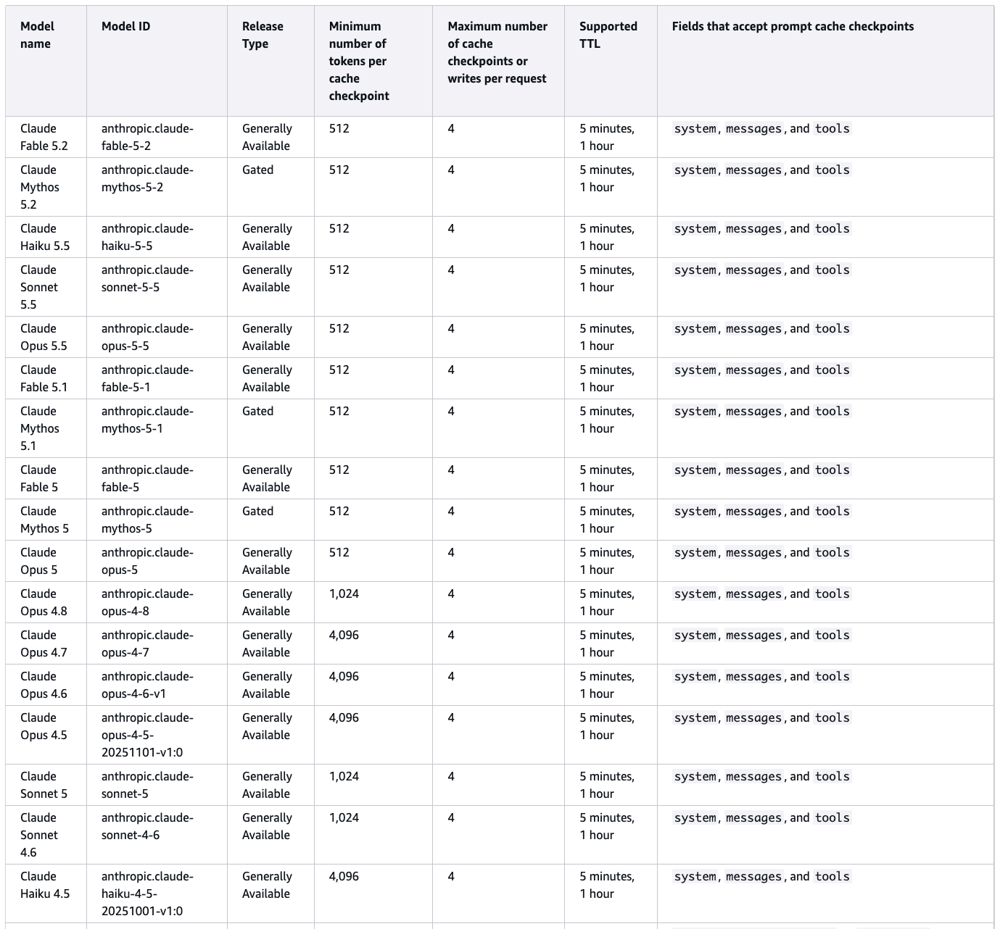
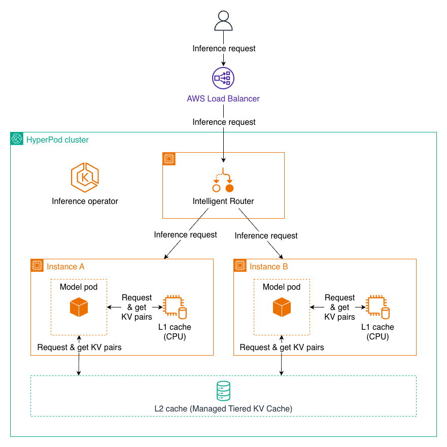
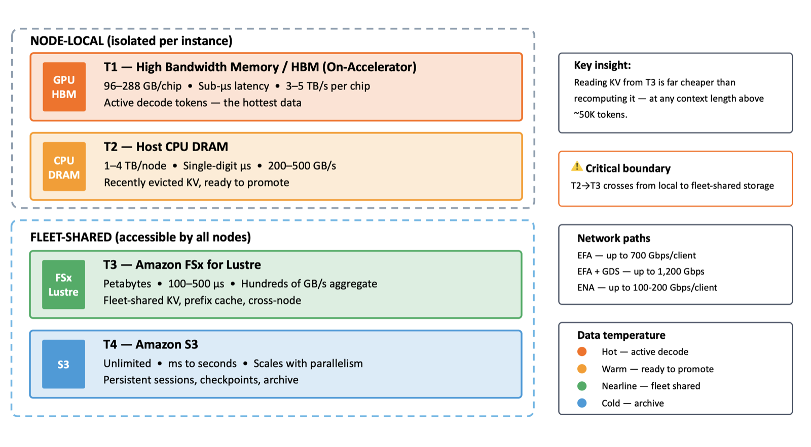

# AWS / Amazon Bedrock

> 托管 API + 自建推理集群 · 官方文档与官方博客

AWS 对外公开的 KV Cache 相关能力分布在三个层次：一是 Amazon Bedrock 托管 API 的 **prompt caching**（用户只看到前缀、检查点、TTL 与计量字段）；二是 Amazon SageMaker HyperPod 面向自部署模型的 **Managed Tiered KV Cache + Intelligent Routing**（直接管理 vLLM / LMCache 的 KV 块，并提供 CPU 内存与集群级分层存储）；三是 AWS 存储团队发布的 **KV Cache 分层存储参考架构**（HBM → 主机 DRAM → Amazon FSx for Lustre → Amazon S3）。三者披露深度差异很大：Bedrock 只公开产品语义，HyperPod 与存储博客则给出了缓存层级、路由策略和介质选择。本章按“托管 API → 托管集群 → 存储分层”的顺序展开。 [PA][AWS9][AWS16]

### 一、定位：Bedrock prompt caching 的演进与两种模式

Bedrock prompt caching 于 re:Invent 2024 以预览形式发布，官方称其“最多可降低 90% 成本、85% 延迟”；预览期缓存内容“在每次访问后最多保留 5 分钟”，且已透明支持跨区域推理（cross-Region inference）。 [AWS6] 2025-04-07 正式 GA，首批支持 Claude 3.5 Haiku、Claude 3.7 Sonnet 与 Nova Micro / Lite / Pro。 [AWS3][AWS5] 2026-01-26 起，部分 Claude 模型可选 1 小时 TTL； [AWS4] 2026-07-30 起，OpenAI GPT-5.6 系列在 Bedrock 上支持显式缓存断点与 30 分钟最短保留。 [AWS7]

当前用户指南把缓存分为两类：

| 类型 | 工作方式 | 请求配置 | 是否保证命中 |
|---|---|---|---|
| 隐式缓存（Implicit） | Bedrock 与模型自动尝试复用合格前缀 | 无需 cache control / 断点 | best effort，重复相同提示也不保证命中 |
| 显式缓存（Explicit） | 通过模型特定的 cache control 或 cache checkpoint 选择可缓存的连续前缀 | 必须带模型与 API 支持的缓存控制字段 | 只控制“可缓存范围”，同样不保证命中 |

文档同时说明：prompt caching 仅支持按需（on-demand）推理端点，不支持 batch inference API；可通过 Converse / ConverseStream、InvokeModel / InvokeModelWithResponseStream、OpenAI 兼容的 Responses API、Prompt management 及控制台 playground 使用。 [PA]

### 二、显式缓存的使用方式：检查点、顺序与 API 示例

显式缓存的核心是 **cache checkpoint**：检查点之前的全部内容构成被缓存的前缀。每个检查点有模型相关的最小 token 数，当前范围为 512–4,096 tokens；该最小值按“检查点之前的累计前缀”计算，包括 `tools`、`system`、`messages`，两个检查点之间不要求最小间距。若前缀不足最小值，请求仍然成功，只是不会被缓存。 [PA] 检查点按 `tools → system → messages` 的顺序链式处理，修改前一段（例如工具定义）会使后面各段的缓存全部失效。 [PA]

对 Claude 模型还有两点实现细节：一是带检查点的请求会向前回看约 20 个 content block，读取已缓存的最长前缀，超出此范围需增加检查点；二是可在请求顶层放一个 `cache_control` 实现“自动缓存”，由模型把检查点放在最后一个可缓存块并随对话前移，它占用 4 个检查点名额中的 1 个。同一请求可混用 1 小时与 5 分钟条目，但较长 TTL 的条目必须位于较短 TTL 条目之前。 [PA]

以下示例按官方文档的 Converse API 字段写成（Python / boto3），在工具定义与系统提示之后各放一个检查点，并读取缓存计量：

```
import boto3
client = boto3.client("bedrock-runtime", region_name="us-east-1")

resp = client.converse(
    modelId="us.anthropic.claude-sonnet-5-5",
    toolConfig={"tools": [
        {"toolSpec": {...}},                       # 稳定的工具定义
        {"cachePoint": {"type": "default"}}        # 检查点 1：tools
    ]},
    system=[
        {"text": "Long, unchanging system prompt / reference document ..."},
        {"cachePoint": {"type": "default", "ttl": "1h"}}   # 检查点 2：system，1 小时 TTL
    ],
    messages=[{"role": "user", "content": [{"text": "First question"}]}],
)

u = resp["usage"]
# 启用缓存后 inputTokens 只含未读/未写缓存的部分
total_in = u["inputTokens"] + u.get("cacheReadInputTokens", 0) + u.get("cacheWriteInputTokens", 0)
print(u.get("cacheReadInputTokens"), u.get("cacheWriteInputTokens"), total_in)
```

Converse 响应新增 `cacheReadInputTokens`、`cacheWriteInputTokens` 与记录写入 TTL 的 `cacheDetails`；总输入 token = `inputTokens + cacheReadInputTokens + cacheWriteInputTokens`。只支持 5 分钟 TTL 的模型若带上 `ttl` 字段可能返回 ValidationException。 [PA] OpenAI 模型走 Responses API：GPT-5.6 及以后模型在内容块上加 `"prompt_cache_breakpoint": {"mode": "explicit"}`，用 `prompt_cache_options.mode` 在 implicit（默认，自动在最新消息处放断点并兼用显式断点）与 explicit（只用显式断点；若无断点则不缓存、不产生写入费用）之间切换；用量在 `usage.input_tokens_details.cached_tokens` 与 `cache_write_tokens` 中返回，且两者包含在 `input_tokens` 内。 [PA][AWS7] 官方博客的预览示例中，29,841 个文档 token 首次写入缓存，后续调用全部从缓存读取，耗时比首次少 55%。 [AWS6]

### 三、生命周期与计量

缓存有 TTL，每次成功命中重置；TTL 内无命中则过期。下表汇总用户指南“Supported models, Regions, and explicit caching limits”表格与各模型族说明（采集于 2026-11-18）： [PA]

| 模型族（Bedrock 当前列表） | 每检查点最小 tokens | 每请求最多检查点 / 写入 | TTL | 写入计费 |
|---|---|---|---|---|
| Claude Opus 5 / 5.5、Sonnet 5.5、Haiku 5.5 等 5.x 新模型 | 512 | 4 | 5 分钟（默认）、1 小时 | 5 分钟写入与 1 小时写入分别定价 |
| Claude Opus 4.8、Sonnet 5、Sonnet 4.6 | 1,024 | 4 | 5 分钟、1 小时 | 同上 |
| Claude Opus 4.5 / 4.6 / 4.7、Haiku 4.5 | 4,096 | 4 | 5 分钟、1 小时 | 同上 |
| OpenAI GPT-5.6 / GPT-6 / GPT-6.1 | 1,024 | 4 次缓存写入 | 至少 30 分钟（`30m` 为唯一取值） | 写入按未缓存输入价 1.25× |
| OpenAI GPT-5.5 及更早（如 gpt-5.4） | 1,024（仅隐式） | — | 未给出固定值 | 无写入附加费 |
| Amazon Nova（Nova 2 Lite、Pro、Lite、Micro） | 1K，前缀最长 20K tokens | 4 | 5 分钟 | 隐式复用不计入缓存字段、不按缓存读取计费 |



*Amazon Bedrock 用户指南“Supported models, Regions, and explicit caching limits”表格截图（节选 Claude 部分行；GPT 与 Nova 行见正文表格），采集于 2026-11-18* — [原始来源](https://docs.aws.amazon.com/bedrock/latest/userguide/prompt-caching.html)

计费上，输入 token 分为三种费率：缓存写入（依模型可能高于标准输入价）、缓存读取（报告为 cached tokens）与普通输入。 [PA] 下表取自 AWS Price List API 中 us-east-1 的 Bedrock 基础模型价目（publicationDate 2026-11-09，采集于 2026-11-18；Global 跨区域推理口径，单位：美元 / 百万 tokens）： [AWS2][AWS1]

| 模型 | 标准输入 | 5 分钟写入 | 1 小时写入 | 缓存读取 | 读取 / 输入 |
|---|---|---|---|---|---|
| Claude Sonnet 5 | 2.00 | 2.50 | 4.00 | 0.20 | 0.10× |
| Claude Sonnet 5.5 | 2.00 | 2.50 | 4.00 | 0.10 | 0.05× |
| Claude Opus 5.5 | 4.00 | 5.00 | 8.00 | 0.20 | 0.05× |
| Claude Haiku 4.5 | 1.00 | 1.25 | 2.00 | 0.10 | 0.10× |
| GPT-5.6 Sol | 4.00 | 5.00（30 分钟写入） | — | 0.40 | 0.10× |

同一价目中的 Regional（区域内 / 地理跨区域）口径比 Global 高 10%，例如 Sonnet 5 输入 2.20、读取 0.22。定价页注明自 2026-10-07 起 Claude Sonnet 5.5 的缓存读取价下调 50%，并写明 Nova 模型缓存读取比按需输入价低 75%。 [AWS1][AWS2] AWS 2026-11-12 的成本博客据 Sonnet 5 / Opus 5 费率推导：5 分钟缓存在 5 分钟内第一次复用即回本；若同一前缀每小时至少出现两次且间隔超过 5 分钟，应改用 1 小时缓存；而要比完全不缓存更便宜，1 小时缓存每小时至少需要 3 次请求。 [AWS8] 另外，Claude 与 GPT-5.6 的缓存命中 token 不计入输入 TPM 限额。 [PA]

### 四、局部性、路由与隔离

Bedrock 文档对缓存位置给出了一个关键的工程事实：**缓存条目存放在处理该请求的服务器上**，后续请求只有在条目过期前被同一台服务器处理时才能读取；被其他服务器（例如另一个 Region）处理的请求，或在相同请求开始返回之前就到达的并发请求，都会写入新条目而非读取。 [PA] 因此跨区域推理在高峰期可能“增加缓存写入”。 [PA] 对 GPT-5.6，官方博客说明 `prompt_cache_key` 是“将请求路由到同一缓存的稳定 ID”，应在同一会话或应用的所有请求中保持一致。 [AWS7]

隔离边界方面，AWS 成本博客表述为缓存条目“作用域是账户与 Region，而非租户”；多租户应用可在可缓存前缀前加入租户相关的 SHA-256 哈希来分区，强隔离需求则应使用不同 AWS 账户。 [AWS8] Bedrock 另有 Intelligent Prompt Routing，它在同一模型族的不同模型之间按预测质量与成本选路，属于模型选择而非 KV 局部性路由。 [AWS6]（本文分析：被路由到不同模型的请求无法共享同一份前缀缓存，混用时需按模型分别评估命中率。）

### 五、SageMaker HyperPod：托管分层 KV Cache 与智能路由

2025-11-26，AWS 宣布 SageMaker HyperPod 通过 HyperPod Inference Operator 提供 Managed Tiered KV Cache 与 Intelligent Routing。 [AWS9][AWS10] 与 Bedrock 不同，这里由用户在 EKS 编排的 HyperPod 集群上部署自己的模型，AWS 托管缓存基础设施与路由器。请求经 AWS Load Balancer 进入集群内的 Intelligent Router，再分发到模型 Pod；Pod 先查 L1（CPU 内存），再查共享 L2，都未命中才完整计算，新生成的 KV 同时写入两级缓存。 [AWS9]



*SageMaker HyperPod Managed Tiered KV Cache 与 Intelligent Routing 请求流程图（AWS Machine Learning Blog 原图，2025-11-26）* — [原始来源](https://aws.amazon.com/blogs/machine-learning/managed-tiered-kv-cache-and-intelligent-routing-for-amazon-sagemaker-hyperpod/)

| 组件 | 官方披露 |
|---|---|
| L1 缓存 | 位于每个推理节点的 CPU 内存，开启 KV Cache 时默认启用，自动管理内存分配与淘汰 |
| L2 缓存（推荐：tieredstorage） | HyperPod 分离式内存方案，可扩展至 TB 级池，支持 GPU 感知与零拷贝；What's New 公告称其可“自动从 CPU 内存分层到本地 SSD” |
| L2 缓存（备选：redis） | 需填写 `l2CacheLocalUrl`；Redis 不在同一 VPC 时不保证传输加密 |
| 路由策略 | `prefixaware`（默认，维护前缀树记录各端点缓存）、`kvaware`（中心控制器实时跟踪缓存位置与淘汰事件）、`session`、`roundrobin` |
| 引擎约束 | 仅支持 vLLM 容器；kvaware 需用 `/completions` 端点，并要求 Operator ≥ v3.1.3 搭配 LMCache ≥ v0.4.3、vLLM ≥ v0.19.1 |
| 安全 | KV 数据静态存储不加密；以 tieredstorage 作为 L2 时同一集群多部署共享缓存、无隔离 |

以上见官方博客、用户指南与部署文档。 [AWS9][AWS10][AWS11][AWS12] 配置写在 `InferenceEndpointConfig` CRD 中：

```
kvCacheSpec:
  enableL1Cache: true
  enableL2Cache: true
  l2CacheSpec:
    l2CacheBackend: "tieredstorage"   # 或 "redis"
intelligentRoutingSpec:
  enabled: true
  routingStrategy: prefixaware        # kvaware / session / roundrobin
```

官方基准：Llama-3.1-70B-Instruct、7 个副本、p5.48xlarge。8K tokens 场景下 P90 TTFT 降低 40%、P50 降低 72%、吞吐提升 24%、成本降低 21%；64K tokens 场景下 P90 TTFT 降低 35%、P50 降低 94%、吞吐提升 38%、成本降低 28%；AWS 托管 tiered storage 在各场景均优于 Redis 作 L2。 [AWS9] 后续版本继续扩展：Operator v3.2（2026-06-12）引入 Disaggregated Prefill and Decode，用 LMCache 经 NIXL 与 EFA（GPU-Direct RDMA）在预填充与解码 Pod 间传输 KV；v3.7（2026-09-21）增加 LMCache MultiProcess 模式，以 sidecar 进程通过 CUDA-IPC 共享 GPU 内存。 [AWS13] Ray Serve 部署同样可接入：LMCache 通过 `sagemaker-hyperpod://$(NODE_IP):9200` 连接节点上的 Tiered Storage 服务，并用 `/dev/shm/ai_toolkit_cache` 走本地 CPU 卸载路径。 [AWS14]

2026-08-12 的 AWS 博客（与开源 Curvine 维护者合写）展示了另一种 L2：把 G6e / P5 自带的本地 NVMe 用 Curvine 分布式缓存文件系统池化成共享命名空间，通过 FUSE 以 ReadWriteMany PVC 挂载，LMCache 经 `fs://` 连接器读写，形成 L0 GPU → L1 CPU → L2 共享 NVMe 三级。测试中跨 Pod 命中率 100%（1,925/1,925 tokens），同节点 L2 写入约 9.6 GB/s，跨节点读取约 1.8 GB/s、约 56 ms；2,500 tokens 提示下 TTFT 从 774 ms 降到 287 ms（2.7×），约 1,000 tokens 以下 L2 往返成本与重算相当。该方案需要修补 Operator 环境变量，并非 CRD 原生选项。 [AWS15]

### 六、与 SSD / HDD 多级存储的关系

AWS 存储博客（2026-09-21）给出了最完整的介质分层框架，适用于 Trainium（Trn2、Trn3 UltraServer）与 NVIDIA GPU 实例： [AWS16]

| 层级 | 介质 | 容量 | 带宽 | 延迟 | 存放内容 |
|---|---|---|---|---|---|
| T1 | HBM | 80–288 GB/芯片 | 3–8 TBps/芯片 | 亚微秒 | 活跃解码 KV（热） |
| T2 | 主机 DRAM | 1–4 TB/节点 | 200–500 GBps | 个位数 μs | 刚被逐出、待提升（温） |
| T3 | Amazon FSx for Lustre | PB 级 | 数百 GBps 聚合 | 100–500 μs | 全集群共享 KV、前缀缓存（近线） |
| T4 | Amazon S3 | 不限 | 随请求并行度扩展 | 毫秒至秒 | 持久会话、检查点、归档（冻结） |



*KV Cache 四级存储层次示意图（AWS Storage Blog “Accelerate inference with KV cache tiering on AWS” Figure 1，2026-09-21）* — [原始来源](https://aws.amazon.com/blogs/storage/accelerate-inference-with-kv-cache-tiering-on-aws/)

博客给出的策略包括：HBM 占用超过 85% 时按 LRU 逐出到 T2；会话闲置超过 N 秒降到 T3，超过 M 分钟导出到 S3；超过 50,000 tokens 的上下文从 T3 提升几乎总是快于重算，10,000 tokens 以下重算更划算；前缀用 token 哈希做内容寻址文件名，靠 TTL 失效。FSx for Lustre 推荐 **Persistent SSD** 类型、与集群同可用区、使用 O_DIRECT、条带数不少于节点数，并通过 S3 数据仓库关联自动导出冷 KV；单客户端带宽可达 100 Gbps（ENA）、700 Gbps（EFA）、1,200 Gbps（EFA + GDS）。 [AWS16]

本文分析：AWS 官方材料中的“SSD 层”有三种形态——HyperPod tiered storage 内部的本地 SSD 分层、实例自带 NVMe 池化（Curvine 方案），以及 SSD 型 FSx for Lustre；更冷的一层直接落到 S3 对象存储，而不是 HDD 块设备。所读资料没有把 HDD 列为 KV 层级；对 Bedrock 托管 API，文档只披露“缓存位于处理请求的服务器”与 5 分钟 / 30 分钟 / 1 小时的 TTL，没有给出其物理介质。若要在 AWS 上评估 HDD 下沉，较接近的切入点是 T3 → T4 之间的长闲置会话，但这需要用户自行构建并测量，官方未提供基准。

### 七、资料边界

Bedrock 部分全部来自用户指南、定价页 / Price List API 与官方博客，未披露其内部 KV 存放介质、淘汰算法与跨服务器共享机制。HyperPod tiered storage 的“自动分层到本地 SSD”仅见于 What's New 公告的一句话，未给出容量比例或淘汰策略。Curvine 与 FSx for Lustre 两篇属于官方博客中的参考架构 / 解决方案，其性能数字来自作者的特定测试环境，不代表托管服务的 SLA。

## 本章资料

- **[AWS1]** [AWS · Amazon Bedrock Pricing（采集于 2026-11-18）](https://aws.amazon.com/bedrock/pricing/)
- **[AWS2]** [AWS Price List API · AmazonBedrockFoundationModels，us-east-1 价目（publicationDate 2026-11-09，采集于 2026-11-18）](https://pricing.us-east-1.amazonaws.com/offers/v1.0/aws/AmazonBedrockFoundationModels/current/us-east-1/index.json)
- **[AWS3]** [AWS What's New · Amazon Bedrock announces general availability of prompt caching，2025-04-07](https://aws.amazon.com/about-aws/whats-new/2025/04/amazon-bedrock-general-availability-prompt-caching/)
- **[AWS4]** [AWS What's New · Amazon Bedrock now supports 1-hour duration for prompt caching，2026-01-26](https://aws.amazon.com/about-aws/whats-new/2026/01/amazon-bedrock-one-hour-duration-prompt-caching/)
- **[AWS5]** [AWS Machine Learning Blog · Effectively use prompt caching on Amazon Bedrock，2025-04-07](https://aws.amazon.com/blogs/machine-learning/effectively-use-prompt-caching-on-amazon-bedrock/)
- **[AWS6]** [AWS News Blog · Reduce costs and latency with Amazon Bedrock Intelligent Prompt Routing and prompt caching (preview)，2024-12-04](https://aws.amazon.com/blogs/aws/reduce-costs-and-latency-with-amazon-bedrock-intelligent-prompt-routing-and-prompt-caching-preview/)
- **[AWS7]** [AWS Machine Learning Blog · Introducing explicit prompt caching for OpenAI models on Amazon Bedrock，2026-07-30](https://aws.amazon.com/blogs/machine-learning/introducing-explicit-prompt-caching-for-openai-gpt-5-6-models-on-amazon-bedrock/)
- **[AWS8]** [AWS Machine Learning Blog · Four Amazon Bedrock inference choices that affect cost，2026-11-12](https://aws.amazon.com/blogs/machine-learning/four-amazon-bedrock-inference-choices-that-affect-cost/)
- **[AWS9]** [AWS Machine Learning Blog · Managed Tiered KV Cache and Intelligent Routing for Amazon SageMaker HyperPod，2025-11-26](https://aws.amazon.com/blogs/machine-learning/managed-tiered-kv-cache-and-intelligent-routing-for-amazon-sagemaker-hyperpod/)
- **[AWS10]** [AWS What's New · SageMaker HyperPod now supports Managed tiered KV cache and intelligent routing，2025-11-26](https://aws.amazon.com/about-aws/whats-new/2025/11/sagemaker-hyperpod-managed-tiered-kv-cache/)
- **[AWS11]** [AWS · Amazon SageMaker AI Developer Guide：KV caching and intelligent routing（采集于 2026-11-18）](https://docs.aws.amazon.com/sagemaker/latest/dg/sagemaker-hyperpod-model-deployment-caching-routing.html)
- **[AWS12]** [AWS · Amazon SageMaker AI Developer Guide：Deploying models on Amazon SageMaker HyperPod（数据加密与隔离说明，采集于 2026-11-18）](https://docs.aws.amazon.com/sagemaker/latest/dg/sagemaker-hyperpod-model-deployment.html)
- **[AWS13]** [AWS · Amazon SageMaker HyperPod Inference release notes（Operator v3.2，2026-06-12；v3.7，2026-09-21）](https://docs.aws.amazon.com/sagemaker/latest/dg/sagemaker-hyperpod-inference-release-notes.html)
- **[AWS14]** [AWS · Amazon SageMaker AI Developer Guide：Setting up tiered KV cache（Ray Serve，采集于 2026-11-18）](https://docs.aws.amazon.com/sagemaker/latest/dg/sagemaker-hyperpod-ray-kv-cache-setup.html)
- **[AWS15]** [AWS Machine Learning Blog · Tiered KV cache for large LLMs on Amazon SageMaker HyperPod with Curvine，2026-08-12](https://aws.amazon.com/blogs/machine-learning/tiered-kv-cache-for-large-llms-on-amazon-sagemaker-hyperpod-with-curvine/)
- **[AWS16]** [AWS Storage Blog · Accelerate inference with KV cache tiering on AWS，2026-09-21](https://aws.amazon.com/blogs/storage/accelerate-inference-with-kv-cache-tiering-on-aws/)
- **[PA]** [AWS · Amazon Bedrock User Guide：Prompt caching for faster model inference（采集于 2026-11-18）](https://docs.aws.amazon.com/bedrock/latest/userguide/prompt-caching.html)
