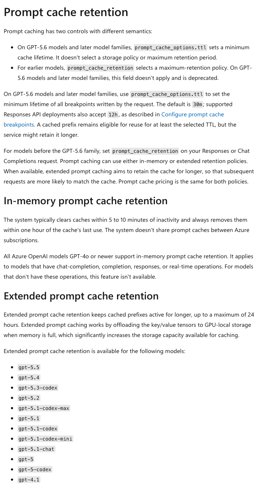
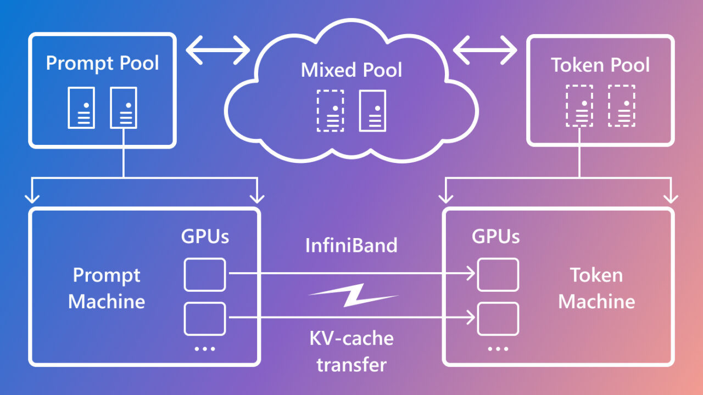
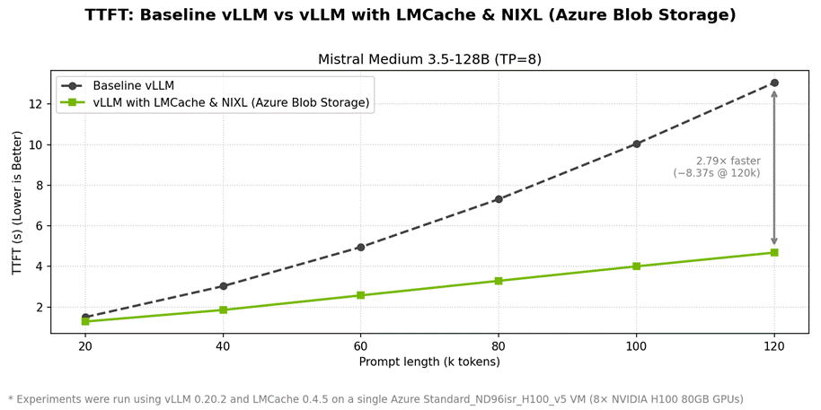

# Microsoft / Azure

> 托管 API · 官方文档 + 官方研究 / 工程博客

微软公开的 KV Cache 信息分为三层。第一层是 Azure OpenAI（Microsoft Foundry）对外提供的 prompt caching 接口，包括阈值、断点、保留策略和计量字段。第二层是 Azure 定价页与 PTU（预置吞吐）容量文档，说明缓存读写如何折算为费用和容量。第三层是 Microsoft Research / Azure Research – Systems 的推理服务研究（Splitwise 等），以及 AKS、Azure Storage 团队关于 KV 感知路由、KV 卸载到 Azure Blob 的工程博客。本章按这个顺序展开。产品行为以 Microsoft Learn 页面为准：页面标注最近更新于 2026-11-06，本文采集于 2026-11-18；原 `/azure/ai-foundry/` 路径现已重定向到 `/azure/foundry/`。 [PB]

### 定位：服务端前缀缓存的两代规则

Learn 文档对 prompt caching 的定义是：对开头内容相同的较长提示，服务保留一份“已处理输入 token 计算结果”的临时缓存，避免反复处理相同输入，从而降低整体时延和成本；除时延和费用外，不影响输出内容。这里的“计算结果”就是注意力层的 key/value 张量，文档在介绍 extended 保留策略时直接写到“offloading the key/value tensors”。缓存不在不同 Azure 订阅之间共享。 [PB]

命中需要同时满足两个条件：提示至少 1,024 tokens，且前 1,024 个 tokens 完全相同。前 1,024 个 tokens 内只要有一个字符不同就会未命中，此时 `cached_tokens` 为 0。可缓存的内容包括：完整 messages 数组（system / developer / user / assistant）；图片，链接或 base64 均可，但 `detail` 参数必须保持一致；工具定义；结构化输出 schema，它会作为前缀附加到 system 消息。支持的模型默认开启 prompt caching。 [PB]

文档按模型代际分成两套规则。GPT-5.6 之前的模型只有“自动缓存 + 保留策略”；GPT-5.6 及以后的模型族新增了显式断点、TTL 下限和缓存写入计费。差异见下表。 [PB]

| 维度 | GPT-5.6 之前（GPT-4o 及以上） | GPT-5.6 及以后模型族 |
|---|---|---|
| 最小可缓存长度 | 1,024 tokens | 1,024 tokens（以断点为止的渲染前缀计） |
| 命中粒度 | 超过 1,024 tokens 后按 128 tokens 递增（GPT-5.5 及更早） | 不再按 128 tokens 舍入 |
| 缓存控制 | 只有自动缓存；请求中带 `prompt_cache_options` / `prompt_cache_breakpoint` 会返回 400 | `prompt_cache_options.mode`：implicit（默认）/ explicit；可在内容块上设置 `prompt_cache_breakpoint` |
| 保留语义 | `prompt_cache_retention` 选择**最长**保留策略：`in_memory` 或 `24h` | `prompt_cache_options.ttl` 设定**最短**保留时间：`30m`（默认）；受支持的 Responses API 部署可用 `12h` |
| 缓存写入 | 不额外收费 | 可能收费，费率取决于所选 TTL；12 小时写入自 2026-11-01 起计费 |
| 用量字段 | `prompt_tokens_details.cached_tokens` | `cached_tokens`（读）+ `cache_write_tokens`（写，Standard PAYG） |
| PTU 部署 | 自动缓存；缓存输入不占 PTU 容量 | GPT-5.6 在 PTU 上不支持断点；GPT-6 及以后在 PTU-M 上支持断点，缓存读写按归一化权重计入容量 |

### API 用法：prompt_cache_key、断点与用量字段

**prompt_cache_key。**文档建议在 GPT-5.6 及以后模型族上设置 `prompt_cache_key`，让共享同一长前缀的请求复用同一个 key，以提高相关请求的缓存匹配。使用该参数不需要特定 API 版本，新集成建议走 v1 API。同一“前缀 + key”组合的请求如果超过约每分钟 15 次，部分请求可能未命中缓存。高流量负载应把请求分散到多个 key，同时让每个 key 与其共享前缀保持稳定映射。 [PB]

**断点。**`prompt_cache_breakpoint: {"mode": "explicit"}` 标记可复用前缀的终点，前缀包含该内容块及其之前的全部内容，断点之后的内容可以变化而不影响已缓存前缀。Responses API 可在 `input_text`、`input_image`、`input_file` 块上设置断点；Chat Completions API 可在 `text`、`image_url`、`input_audio`、`file` 块上设置。implicit 模式会在最新一条消息上自动放置断点，同时使用用户提供的显式断点；explicit 模式只使用显式断点，没有显式断点时既不读写缓存，也不产生写入费用，这也是在新模型上关闭缓存的方式。 [PB]

断点限额：每个请求最多产生 4 次新的缓存写入。implicit 模式下，最新消息的自动断点占用 1 个写入名额，因此最多再写最近 3 个显式断点；explicit 模式最多写最近 4 个。之前轮次的断点只读，可以命中但不会重写。读取时最多考虑会话中最近 50 个断点。 [PB]

下面的示例综合了 Learn 文档中的请求字段和用量字段：使用 OpenAI Python SDK 访问 Azure OpenAI v1 端点，`model` 填部署名。`prompt_cache_options` 与 `prompt_cache_breakpoint` 是 Azure 文档列出的字段，这里通过 `extra_body` 透传，避免依赖特定 SDK 版本的类型定义。

```
from openai import OpenAI

client = OpenAI(
    base_url="https://<resource>.openai.azure.com/openai/v1/",
    api_key="<AZURE_OPENAI_API_KEY>",
)

SYSTEM_POLICY = open("support_policy_v2.txt").read()   # 稳定前缀，≥1,024 tokens

resp = client.chat.completions.create(
    model="<your-gpt-5.6-deployment-name>",           # Azure 部署名
    messages=[
        {"role": "system",
         "content": [{"type": "text", "text": SYSTEM_POLICY,
                      "prompt_cache_breakpoint": {"mode": "explicit"}}]},
        {"role": "user", "content": "客户问题：……"},     # 可变部分放在断点之后
    ],
    extra_body={
        "prompt_cache_key": "tenant:contoso:support-policy-v2",
        "prompt_cache_options": {"mode": "explicit", "ttl": "30m"},
    },
)

d = resp.usage.prompt_tokens_details
print("cached_tokens     =", d.cached_tokens)                       # 缓存读取
print("cache_write_tokens=", getattr(d, "cache_write_tokens", None))  # 缓存写入（GPT-5.6+ Standard PAYG）
```

文档给出的 Chat Completions 响应样例中，`prompt_tokens` 为 1,566，`cached_tokens` 为 1,408，`cache_write_tokens` 为 0。对 GPT-5.4 及更早模型，若要启用 extended 保留，在请求中加入 `"prompt_cache_retention": "24h"` 即可。 [PB]

### 生命周期与保留：内存层与“GPU-local storage”

这是 Azure 文档中最接近“KV 多级存储”的一段公开描述。GPT-5.6 之前的模型有两种保留策略，计费相同：

| 策略 / 参数 | 适用范围 | 官方描述的生命周期 | 存储位置（文档原意） |
|---|---|---|---|
| `in_memory` | 所有 GPT-4o 及更新、具备 chat-completion / completion / responses / real-time 操作的模型；GPT-5.4 及更早的默认值 | 通常闲置 5–10 分钟后清除；最后一次使用后 1 小时内一定删除 | 内存；兼容所有数据驻留区域 |
| `24h`（extended） | gpt-5.5、gpt-5.4、gpt-5.3-codex、gpt-5.2、gpt-5.1 系列、gpt-5、gpt-5-codex、gpt-4.1；gpt-5.5 默认启用 | 保持更久，最长 24 小时 | 内存满时把 key/value 张量卸载到 **GPU-local storage**，显著扩大可用缓存容量；数据暂存在 GPU 机器上，并留在 Data Zone 或区域边界内 |
| `ttl: 30m`（GPT-5.6+） | Standard PAYG 上的 GPT-5.6 及以后模型族 | 至少保留 30 分钟，服务可能保留更久 | 未披露；TTL 不选择存储策略 |
| `ttl: 12h`（GPT-5.6+） | 受支持的 Responses API 部署 | 至少保留 12 小时 | 未披露；按 12 小时写入费率计费 |

需要注意两种参数的语义方向相反：旧参数 `prompt_cache_retention` 给出的是**上限**，“通常 5–10 分钟、最多 1 小时”说明内存层采用闲置淘汰；新参数 `ttl` 给出的是**下限**，服务承诺至少保留到该时长，并按时长对写入差别计费。从按“尽力而为”的闲置淘汰转向“付费购买最短驻留时间”，意味着服务端必须为 12 小时级别的前缀预留比 HBM 更便宜的容量层。文档没有说明这一层的具体介质。 [PB]



*Microsoft Learn「Prompt caching」页面 Prompt cache retention 一节截图（采集于 2026-11-18）：说明 ttl 与 prompt_cache_retention 的语义差异、in-memory 闲置清除规则，以及 extended 保留在内存满时把 key/value 张量卸载到 GPU-local storage* — [原始来源](https://learn.microsoft.com/en-us/azure/foundry/openai/how-to/prompt-caching)

### 计费与容量计量

对 Standard 部署，缓存读取按输入 token 价格打折计费。GPT-5.6 之前的模型写入缓存不额外收费，两种保留策略价格相同。GPT-5.6 及以后模型族在折扣读取之外，缓存写入也可能收费：12 小时写入按对应的 12 小时写入费率计费，同一写入事件不再叠加普通输入或 30 分钟写入费用，之后的命中按读取费率计费。文档建议让复用内容在请求之间保持完全一致，使费用更多落在读取而不是写入上。 [PB]

Azure OpenAI 定价页顶部的公告写明：自 2026-11-01 起，显式请求的 12 小时缓存写入按对应的 12 小时写入费率计费，默认 30 分钟选项不变。下表摘自定价页 Global 部署行，单位为美元 / 百万 tokens，采集于 2026-11-18，取页面默认视图，比例为本文计算。定价表中只有一列“Cache writes”，该视图没有单独列出 12 小时写入单价。 [AZ1]

| 模型（Global） | Input | Cached Input | Cache writes | 读取 / 输入 | 写入 / 输入 |
|---|---|---|---|---|---|
| GPT-6.1 Sol（short context） | $2 | $0.10 | $2.50 | 5% | 1.25× |
| GPT-6 Sol（short context） | $2 | $0.20 | $2.50 | 10% | 1.25× |
| GPT-5.6-sol（short context） | $4 | $0.40 | $5 | 10% | 1.25× |
| GPT-5.5 | $5 | $0.50 | — | 10% | 不收费 |
| GPT-5.4（<272k） | $2.50 | $0.25 | — | 10% | 不收费 |
| GPT-4.1-2025-04-14 | $2 | $0.50 | — | 25% | 不收费 |
| GPT-4o-2024-1120 | $2.50 | $1.25 | — | 50% | 不收费 |

PTU 部署的计量方式不同。GPT-6 之前的模型，缓存输入 token 在利用率计算中被 100% 扣除，不占用 PTU 容量。PTU 容量文档给出的公式是：归一化 TPM =（输入 TPM ×（1 − 缓存率））+ 输出/输入比 × 输出 TPM。文档的算例为 gpt-5.2、Data Zone、峰值 1,000 RPM、平均输入 200 tokens、输出 20 tokens：无缓存时需 110 PTU，缓存率 50% 时降为 80 PTU。GPT-6 及以后模型改用“归一化 token”核算，缓存读和缓存写都按权重占用容量，旧规则不再适用。 [AZ2][AZ3]

| Token 类型（归一化权重，非美元价格） | GPT-6 Astra / Sol / Luna | GPT-6.1 Sol / GPT-6.2 Sol / GPT-6.2 Astra |
|---|---|---|
| Short-context input | 1.0 | 1.0 |
| Short-context cached input | 0.1 | 0.05 |
| Short-context cache write | 1.25 | 1.25 |
| Long-context cached input / cache write | 0.2 / 2.5 | 0.1 / 2.5 |
| Short / Long-context output | 5.0 / 7.5 | 5.0 / 7.5 |

归一化权重等于该 token 类型的单价除以同一模型 short-context 输入单价，因此 PTU 上的缓存经济性与 Global Standard 按量价格保持同一比例。 [AZ2]

### 路由与局部性

Learn 文档没有公开 Azure OpenAI 的内部路由算法，但有三点间接描述：缓存按订阅隔离；`prompt_cache_key` 用于“改善相关请求的缓存匹配”；同一“前缀 + key”超过约 15 RPM 时部分请求可能未命中，应拆分到多个 key。 [PB]本文分析：这与“以前缀哈希加 key 选择一小组持有该前缀 KV 的服务器”的路由方式一致。单个 key 的吞吐上限，大致对应少数持有缓存的副本所能承受的负载，超出部分会被调度到不持有该缓存的副本。因此 key 的作用是把同一前缀族的请求“粘”到同一组节点，而不是全局共享缓存。

在微软自己发布的 AKS 工程博客中，这类局部性问题得到了量化。AKS 博客 Dynamo 系列第 3 篇（2026-03-16）说明了 KV 感知路由的代价函数：Cost = overlap_weight × Prefill_Blocks + Decode_Blocks，其中 Prefill_Blocks 指该 worker 上尚未缓存的输入块，overlap_weight 默认值为 1.0。路由器选择代价最低的 worker，避免缓存最丰富但负载最重的节点成为热点。实验在 4 台 Standard_NC80adis_H100_v5（共 8×H100）上部署 Qwen3-32B，按原始到达节奏回放约 23,000 条 Mooncake Tool Agent Traces 请求。与轮询相比，平均 TTFT 从 53,877 ms 降到 2,658 ms（约 20.4×），P99 TTFT 约提升 15.9×，平均端到端时延约提升 4.3×。 [AZ7]Startups at Microsoft 博客（2026-10-13）给出了一个小规模的直观对照：两个 Phi-3.5-mini / vLLM 副本，各用一张 T4。约 2,774 tokens 的提示在已预热副本上复用了 2,768 个缓存 token，客户端 TTFT 约 320 ms；在冷副本上 TTFT 约 4.0 秒。 [AZ9]

### 基础设施侧：官方披露的 KV 管理研究与工程

**Splitwise（ISCA 2024）。**Azure Research – Systems 将 LLM 推理的 prompt（prefill）阶段和 token 生成（decode）阶段拆到不同机器池：prompt 阶段受算力约束，token 阶段受显存带宽约束。另设一个按实时需求伸缩的混合池，prefill 完成后的 KV cache 经 InfiniBand 从 prompt 机器传到 token 机器。MSR 博客（2024-01-04）报告：与 Baseline-H100 相比，吞吐提高 1.4×、成本降低 20%；在相同成本与功率预算下，吞吐可达 2.35×。该方法已进入 vLLM。 [AZ4][AZ5]同一团队的 DynamoLLM（HPCA）研究的是推理集群的实例数、并行度和 GPU 频率的能效重配置，并非 KV 存储，这里只作背景提及。 [AZ10]



*Microsoft Research 博客「Splitwise improves GPU usage by splitting LLM inference phases」Figure 2 原图：Prompt / Token / Mixed 三个机器池，prefill 后的 KV cache 经 InfiniBand 从 Prompt Machine 传往 Token Machine* — [原始来源](https://www.microsoft.com/en-us/research/blog/splitwise-improves-gpu-usage-by-splitting-llm-inference-phases/)

**AKS 上的 Dynamo。**AKS 博客第 1 篇（2025-10-24）介绍，Dynamo 的 LLM-aware Router 通过对请求哈希、跟踪缓存位置并计算重叠分数来管理 KV；KV Block Manager（KVBM）将不常访问的 KV 块卸载到 CPU RAM、SSD 或对象存储，支持分层缓存与淘汰策略，可把缓存容量扩展到 PB 级。文章还明确引用 Splitwise 作为 PD 分离的研究依据。 [AZ6]

**KV 卸载到 Azure Blob。**Azure Storage 博客（2026-08-11）宣布 Azure Blob Storage 与 NVIDIA Dynamo 栈原生集成。其中 NIXL 的 Azure Blob 插件允许 LMCache 等 KV 管理工具把 KV cache 直接卸载到 Blob，命中时从 Blob 取回 KV 而不重算。官方图表显示：Mistral Medium 3.5-128B（TP=8），在单台 Standard_ND96isr_H100_v5（8×H100 80GB）上运行 vLLM 0.20.2 + LMCache 0.4.5，120k tokens 提示时 TTFT 比基线 vLLM 快 2.79×（少 8.37 s），正文概括为“最高 2.8×”。文中同时报告，ModelExpress 从 Blob 加载权重最高快 7.3×，冷启动最高快 4.6×。 [AZ8]



*Azure Storage 博客「Accelerate Inference on AKS with Azure Blob Storage and NVIDIA Dynamo」Figure 2 原图：基线 vLLM 与 vLLM + LMCache + NIXL（Azure Blob Storage）的 TTFT 随提示长度变化，120k tokens 时快 2.79×* — [原始来源](https://techcommunity.microsoft.com/blog/azurestorageblog/accelerate-inference-on-aks-with-azure-blob-storage-and-nvidia-dynamo/4543408)

### 与 KV Cache 多级存储（SSD / HDD 下沉）的关系（本文分析）

微软公开资料呈现出三个层次。托管 API 层只承认两级：内存层（in_memory，分钟级闲置淘汰）和“GPU-local storage”（extended，最长 24 小时，内存满时卸载）。GPU-local storage 最自然的解读是 GPU 服务器本地 NVMe SSD，但文档没有说明介质、容量或命中时延。12 小时 TTL 和单独的写入费率，说明 Azure 已把长驻留 KV 当作要消耗存储资源、需要单独定价的对象。自建推理层（AKS + Dynamo / LMCache）则公开把 KV 延伸到 CPU RAM、SSD 和 Azure Blob 对象存储，并给出 Blob 卸载的 TTFT 数据。Blob 的底层介质（SSD / HDD 混合）对用户不可见，因此这条路径在逻辑上已经存在“容量层由对象存储承载”的形态。至于 HDD 是否出现在 Azure OpenAI 托管服务的 KV 路径中，现有官方资料无法支持任何结论。

### 资料边界

Azure OpenAI 内部的 KV 分层结构、GPU-local storage 的具体介质、路由与淘汰算法均未公开。上文对 `prompt_cache_key` 路由方式的推断属于本文分析。Splitwise、AKS / Blob 博客描述的是研究原型或客户自建方案，不能等同于 Azure OpenAI 托管服务的实现。价格与模型列表变化频繁，以 2026-11-18 的采集为准。

## 本章资料

- **[AZ1]** [Microsoft Azure · Azure OpenAI pricing（定价页，采集于 2026-11-18）](https://azure.microsoft.com/en-us/pricing/details/azure-openai/)
- **[AZ2]** [Microsoft Learn · Determine PTU sizing for a workload（含 Normalized token pricing for GPT-6 Astra，采集于 2026-11-18）](https://learn.microsoft.com/en-us/azure/foundry/openai/how-to/provisioned-throughput-sizing)
- **[AZ3]** [Microsoft Learn · What is provisioned throughput（采集于 2026-11-18）](https://learn.microsoft.com/en-us/azure/foundry/openai/concepts/provisioned-throughput)
- **[AZ4]** [Microsoft Research Blog · Splitwise improves GPU usage by splitting LLM inference phases，2024-01-04](https://www.microsoft.com/en-us/research/blog/splitwise-improves-gpu-usage-by-splitting-llm-inference-phases/)
- **[AZ5]** [Microsoft Research · Splitwise: Efficient generative LLM inference using phase splitting（ISCA 2024）](https://www.microsoft.com/en-us/research/publication/splitwise-efficient-generative-llm-inference-using-phase-splitting/)
- **[AZ6]** [AKS Engineering Blog · Scaling multi-node LLM inference with NVIDIA Dynamo and ND GB200 NVL72 GPUs on AKS，2025-10-24](https://blog.aks.azure.com/2025/10/24/dynamo-on-aks)
- **[AZ7]** [AKS Engineering Blog · Scaling multi-node LLM inference with NVIDIA Dynamo and NVIDIA GPUs on AKS (Part 3)，2026-03-16](https://blog.aks.azure.com/2026/03/16/dynamo-on-aks-part-3)
- **[AZ8]** [Microsoft Tech Community · Azure Storage Blog：Accelerate Inference on AKS with Azure Blob Storage and NVIDIA Dynamo，2026-08-11](https://techcommunity.microsoft.com/blog/azurestorageblog/accelerate-inference-on-aks-with-azure-blob-storage-and-nvidia-dynamo/4543408)
- **[AZ9]** [Microsoft Tech Community · Startups at Microsoft Blog：Inference Options on Azure: An Architect’s View，2026-10-13](https://techcommunity.microsoft.com/blog/startupsatmicrosoftblog/inference-options-on-azure-an-architect%E2%80%99s-view/4563542)
- **[AZ10]** [Microsoft Research · DynamoLLM: Designing LLM Inference Clusters for Performance and Energy Efficiency（HPCA）](https://www.microsoft.com/en-us/research/publication/dynamollm-designing-llm-inference-clusters-for-performance-and-energy-efficiency/)
- **[PB]** [Microsoft Learn · Azure OpenAI in Microsoft Foundry: Prompt caching（页面更新 2026-11-06，采集于 2026-11-18）](https://learn.microsoft.com/en-us/azure/foundry/openai/how-to/prompt-caching)
