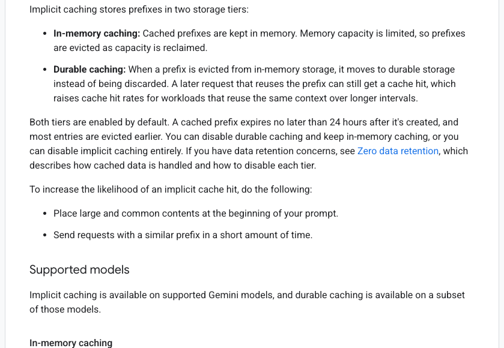
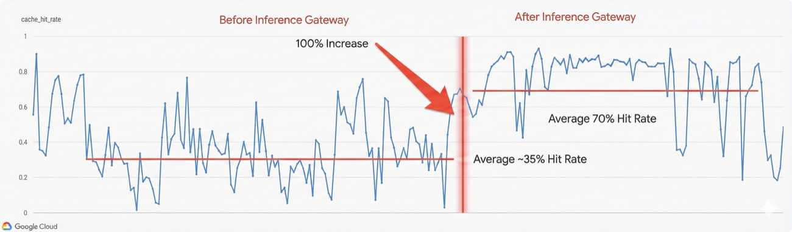
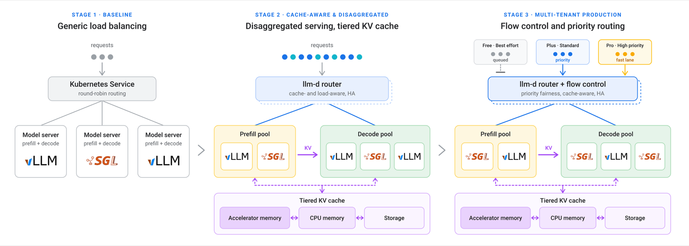
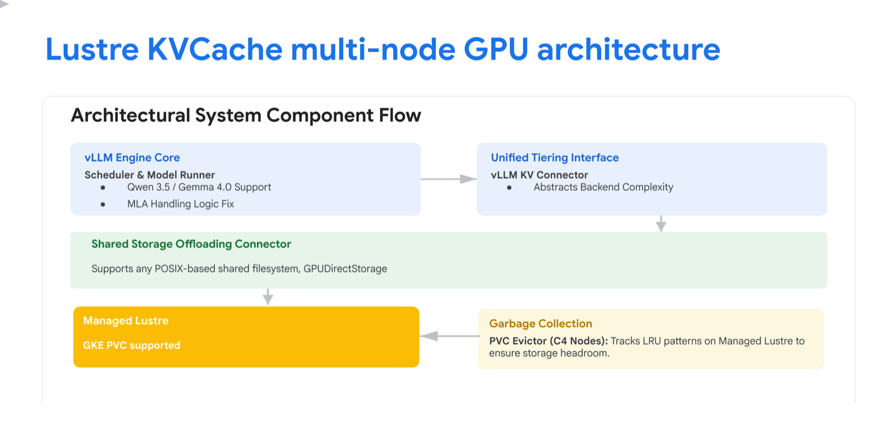

# Google Cloud / Gemini

> 托管 API + GKE 推理栈 · 官方文档 / 官方博客

Google 的 KV Cache 相关公开资料分两层。一层是面向开发者的 Gemini 托管接口：Google Cloud 侧的 Gemini Enterprise Agent Platform（原 Vertex AI 生成式 AI，文档已迁至该名称下）和 Google AI Studio 侧的 Gemini API 都提供“上下文缓存”（context caching），分为自动生效的隐式缓存和以 `CachedContent` 资源管理的显式缓存。 [GCP1][GCP7] 另一层是 Google Cloud 在 GKE 上开放的推理基础设施：GKE Inference Gateway 的前缀缓存感知路由、llm-d 的分层 KV Cache，以及以 Managed Lustre 作为外部 KV Cache 的方案。 [GCP10][GCP12][GCP13] 前者描述托管服务的行为与计费，后者给出可自建的存储分层方案，Google 官方也公开了 Vertex AI 自身采用 GKE Inference Gateway 的生产数据。 [GCP11]

### 定位与产品形态

Google 对上下文缓存的定位是降低“重复内容”请求的成本与时延：长系统指令的聊天机器人、对同一长视频的反复分析、针对大型文档集的周期性查询、代码仓库分析等场景都被官方列为典型用例。 [GCP1] Google 于 2024 年 5 月推出显式上下文缓存；2025 年 5 月 8 日，Google Developers Blog 宣布 Gemini 2.5 系列在 Gemini API 中支持隐式缓存，当时的折扣为 75%，并把 2.5 Flash 和 2.5 Pro 的最小请求长度分别降到 1,024 和 2,048 tokens。 [GCP9] 截至 2026-11-18 采集的现行文档，隐式缓存在所有 Google Cloud 项目中默认开启，缓存命中的 token 相对标准输入有 90% 折扣；显式缓存在 Gemini 2.5 及更新模型上折扣为 90%，Gemini 2.0 为 75%。 [GCP1] 原 PPT 引用的官方 notebook 仍可访问，用于演示 `caches.create` / `cached_content` 的基本流程。 [PC]

两个入口的显式缓存支持范围不同。Gemini API 文档说明：显式缓存目前为 Beta，接口位于 `v1beta`，可用于 Gemini 3 与 2.5 模型，不支持 Gemini 4 模型；Interactions API 只支持隐式缓存。 [GCP7] Agent Platform 的显式缓存支持列表同样只列出 Gemini 3.x、2.5 与 Robotics ER 2，而隐式缓存覆盖 Gemini 4 Hydrogen / Carbon / Argon 等新模型，并扩展到部分开放模型（MaaS，Preview，仅按量付费流量）。 [GCP1][GCP18]

### 缓存机制：两层隐式缓存与显式 CachedContent

Agent Platform 文档写明，隐式缓存把前缀放在**两个存储层**：一是**内存缓存**（in-memory），内存容量有限，前缀会随容量回收被驱逐；二是**持久缓存**（durable），前缀从内存中被驱逐后不直接丢弃，而是转入持久存储，之后复用同一前缀的请求仍可命中，从而提高“较长时间间隔后再次复用同一上下文”的命中率。两层默认都开启，单个缓存前缀最晚在创建后 24 小时过期，多数条目会更早被驱逐。 [GCP1] 持久缓存目前只在 Gemini 4 Hydrogen / Carbon / Argon（含 Cyber 变体）、Gemini 3.8 Flash 与 3.8 Flash Cyber 上提供。 [GCP1]



*Gemini Enterprise Agent Platform「Context caching overview」页面 Implicit caching 小节截图：隐式缓存分为 in-memory 与 durable 两个存储层，最长 24 小时* — [原始来源](https://docs.cloud.google.com/gemini-enterprise-agent-platform/models/context-cache/context-cache-overview)

“零数据保留”文档对两层的数据性质说得更具体：内存层数据“只存于内存、不落盘”，在处理请求的区域内处理，最晚 24 小时删除；持久层在内存缓存容量耗尽时，把**由输入计算得到的 key-value 表示**（derived cache data）存入 Agent Platform 服务环境内的持久存储，数据静态加密（Google 默认加密，不支持 CMEK），最晚 24 小时删除且常被更早驱逐。使用区域或多区域端点时持久缓存留在所选位置；使用 global 端点时，请求及其缓存数据可能由任一区域服务。 [GCP5] 这是本报告所查三家托管 API 中，少有的明确承认“KV 表示会在内存之外的持久介质上保存”的官方表述。

项目可以通过 `cacheConfig` 资源查询和修改缓存策略：返回 `retentionType: DURABLE` 表示两层都开启（默认），`EPHEMERAL` 表示仅保留内存层，`disableCache: true` 表示全部关闭；开关变更作用于所有 Google Cloud 区域。 [GCP5] 显式缓存与隐式缓存会相互作用，创建显式缓存时可能产生超出指定内容的额外缓存，因此若要避免缓存数据留存，需要同时关闭隐式缓存并避免创建显式缓存。 [GCP1]

最小缓存长度按模型族不同。下表对比两个入口在 2026-11-18 的文档值：

| 入口 | 模型 | 最小 token 数 |
|---|---|---|
| Agent Platform（隐式与显式） | Gemini 3（有例外）与 Gemini 4 | 4,096 |
| Agent Platform | Gemini 3.0 Flash Preview、3.1 Pro Preview、3.7 Flash、3.8 Flash（仅隐式） | 6,144 |
| Agent Platform | Gemini 2 系列 | 2,048 |
| Gemini API（隐式） | Gemini 4 Carbon / Argon / Hydrogen、3.8 Flash、3.6 Flash、3.1 Pro Preview | 4,096 |
| Gemini API（隐式） | Gemini 2.5 Flash、2.5 Pro | 2,048 |

来源： [GCP1][GCP7]。Gemini API 还对 Gemini 4 的多轮与 agent 循环给出一条细则：只有当新请求相对上一请求新增至少 2,050 tokens（模型输出、thought 和函数结果都计入）时，才缓存完整的上一请求；新增较少时，上一请求的最后 2,050 tokens 按标准输入价重新处理。 [GCP7] 这说明隐式缓存的写入按“请求边界”而不是任意 token 粒度组织。

### API 用法与生命周期

显式缓存在 Agent Platform 中是区域资源，名称格式为 `projects/PROJECT_NUMBER/locations/LOCATION/cachedContents/CACHE_ID`，内容存储在创建请求所在的区域；可缓存 Gemini 多模态支持的任意 MIME 类型，超过 10 MB 的内容必须以 Cloud Storage URI 指定。 [GCP2][GCP3] 使用缓存时，创建缓存时已指定的 system instruction、tools、tool_config 不能在请求中再次指定。 [GCP3] 下例摘编自官方 Python（Google Gen AI SDK）示例，依次为创建、引用、读取命中计量与延长 TTL： [GCP2][GCP3][GCP4]

```
# export GOOGLE_CLOUD_PROJECT=... ; GOOGLE_CLOUD_LOCATION=us-central1
# export GOOGLE_GENAI_USE_ENTERPRISE=True
from google import genai
from google.genai.types import (Content, Part, HttpOptions,
    CreateCachedContentConfig, GenerateContentConfig, UpdateCachedContentConfig)

client = genai.Client(http_options=HttpOptions(api_version="v1"))

cache = client.caches.create(
    model="gemini-3.5-flash",
    config=CreateCachedContentConfig(
        contents=[Content(role="user", parts=[
            Part.from_uri(file_uri="gs://cloud-samples-data/generative-ai/pdf/2403.05530.pdf",
                          mime_type="application/pdf")])],
        system_instruction="You are an expert researcher. ...",
        display_name="example-cache",
        ttl="86400s",                       # 不设置时默认 60 分钟
    ),
)

resp = client.models.generate_content(
    model="gemini-3.5-flash",
    contents="Summarize the pdfs",
    config=GenerateContentConfig(cached_content=cache.name),
)
print(resp.usage_metadata.cached_content_token_count)   # REST 字段 cachedContentTokenCount

client.caches.update(name=cache.name, config=UpdateCachedContentConfig(ttl="36000s"))
```

无论隐式还是显式，响应元数据中的 `cachedContentTokenCount` 给出输入中被缓存部分的 token 数；Gemini API 的 Interactions API 则使用 `usage.total_cached_tokens`。 [GCP1][GCP7] Gemini API 的显式缓存只允许修改 `ttl` 或 `expire_time`，可以列出缓存元数据但不能取回缓存内容；使用显式缓存的请求不再叠加隐式缓存，随缓存一起发送的其他输入 token 按标准价计费。 [GCP7]

| 对象 | 生命周期 / 淘汰 | 位置与控制 |
|---|---|---|
| 隐式 · 内存层 | 容量回收时驱逐；最晚写入后 24 小时删除 | 在服务请求的区域处理；不落盘；项目内隔离 |
| 隐式 · 持久层 | 由内存层驱逐而来；最晚 24 小时删除，常更早驱逐 | 静态加密、不支持 CMEK；区域端点留在所选位置，global 端点可跨区域；可按项目关闭（EPHEMERAL） |
| 显式 · Agent Platform | 默认创建后 60 分钟；最短 1 分钟，无最长限制；可用 ttl / expire_time 延长；过期后由垃圾回收删除，需重建 | 存储于创建请求的区域；支持 CMEK（global 端点除外）、VPC Service Controls、Access Transparency |
| 显式 · Gemini API | 未设置时 TTL 默认 1 小时；文档称 TTL 无上下限 | v1beta；不支持 Gemini 4 |
| Gemini 4 Hydrogen 及以后（2027-01-12 起） | 文档预告支持带 TTL 配置的 cache control，由用户选择缓存内容与有效期 | 缓存写入默认按标准输入价 1.25 倍计费，保留越久费用越高 |

来源： [GCP1][GCP2][GCP3][GCP4][GCP5][GCP7]。另需注意：以 Cloud Storage 对象构建缓存后，在缓存过期或删除前不应修改这些对象，否则缓存可能不可用。 [GCP1]

### 计费与计量（采集于 2026-11-18）

计费分三部分：创建缓存的输入 token（除适用缓存写入价的模型外，按标准输入价计）、命中时的缓存读取价，以及仅显式缓存才有的按时长计费的存储费；隐式缓存没有单独的存储费。 [GCP1] Agent Platform 价目表（Standard、Global 端点，美元 / 1M tokens）中的代表性条目如下： [GCP6]

| 模型 | 标准输入 | 缓存读取 | 缓存写入 | 显式缓存存储 |
|---|---|---|---|---|
| Gemini 4 Hydrogen | $1.50（非 global $1.65） | $0.075（非 global $0.0825） | $1.875，2027-01-12 生效 | —（不支持显式缓存） |
| Gemini 3.5 Flash | $1.50 | $0.15 | — | $0.000001 / token·小时 |
| Gemini 3.1 Pro Preview | $2.00（≤200K）/ $4.00（>200K） | $0.20 / $0.40 | — | $0.0000045 / token·小时（Gemini 3.1 Pro） |
| Gemini 2.5 Pro | $1.25 / $2.50 | $0.125 / $0.25 | — | $0.0000045 / token·小时 |
| Gemini 2.5 Flash | $0.30 | $0.03 | — | $0.000001 / token·小时 |

Gemini API 价目页以“每 1M tokens 每小时”标注同一类存储费：Gemini 2.5 Flash 为 $1.00，Gemini 3.1 Pro Preview 与 2.5 Pro 为 $4.50；Gemini 3.8 Flash 的缓存读取价为 $0.075（至 2026-12-31，2027-01-01 起 $0.15），存储价同期为 $0.50 与 $1.00；Gemini 4 Hydrogen 的缓存价为 $0.075，并注明“仅隐式缓存”。 [GCP8] 从表中可以看出，多数模型的缓存读取价为标准输入价的 10%，与概览页“90% 折扣”一致；Gemini 4 Hydrogen 的缓存读取价为输入价的 5%，同时将在 2027 年引入 1.25 倍的缓存写入价，计费模型正在从“免费写入 + 折扣读取”转向“写入付费 + 保留时长付费”。

预配吞吐（Provisioned Throughput）同样支持隐式与显式缓存（Preview），折扣通过降低消耗率（burndown）体现：以 Gemini 2.5 Pro 为例，1 个缓存输入 token 只消耗 0.1 个 token 的吞吐额度。缓存跨流量类型可用，在预配吞吐下创建的缓存也可被按量付费请求使用。 [GCP17][GCP1]

### 路由、局部性与 GKE 上的分层 KV Cache

托管接口对局部性的公开描述是“建议型”的：把大段公共内容放在提示开头，并在较短时间内发送具有相似前缀的请求，以提高隐式命中的概率；缓存数据以项目编号隔离，绝不跨项目共享。 [GCP1] 至于托管服务后端如何把请求送到持有前缀的副本，Google Cloud 博客《How we cut Vertex AI latency by 35% with GKE Inference Gateway》（2026-02-07）给出了一个官方案例：Vertex AI 工程团队在其模型服务器前部署 GKE Inference Gateway，同时使用“负载感知路由”（从模型服务器 Prometheus 端点抓取 KV Cache 利用率等指标）和“内容感知路由”（检查请求前缀，路由到 KV Cache 中已有该上下文的 Pod）。在聊天模型上线期间，团队把 prefix:queue:kv-utilization 的打分权重从默认 3:3:2 调为 3:5:2，使调度器在热点节点即使命中也会绕开；在生产流量上，前缀缓存命中率从 35% 提升到 70%，Qwen3-Coder 的 TTFT 降低 35% 以上，DeepSeek V3.1 突发聊天负载的 P95 TTFT 改善 52%。 [GCP11]



*Google Cloud 博客「How we cut Vertex AI latency by 35% with GKE Inference Gateway」原图：接入 Inference Gateway 前后 Vertex AI 生产流量的前缀缓存命中率，平均约 35% 升至 70%* — [原始来源](https://cloud.google.com/blog/products/containers-kubernetes/how-gke-inference-gateway-improved-latency-for-vertex-ai)

GKE Inference Gateway 本身是 GKE Gateway 的扩展，由 llm-d Router 驱动，不额外收费。其 Endpoint Picker（EPP）通过 ext-proc 协议被网关逐请求调用，综合三类打分选择 Pod：前缀缓存感知（跟踪各模型服务器可用的前缀缓存索引，前缀匹配越长得分越高）、负载感知（KV Cache 利用率与待处理队列深度）、LoRA 感知；此外还有基于 XGBoost 的预测时延路由（Preview）以及按 Priority 的排队与丢弃。 [GCP10] 2026-10-21 发布的 llm-d 1.0 公告进一步说明：当加速器显存写满时，llm-d 借助 vLLM 的 OffloadingConnector、Mooncake 或 SGLang 的 HiCache，把 KV Cache 先移到主机内存、再移到 SSD 或 Managed Lustre；在 Ironwood TPU（TPU 7x）的 agent 编码负载上，前缀感知路由加主机内存卸载使中位 TTFT 降低 85% 以上、总吞吐提升 2.4 倍（对比普通 Kubernetes Service）。 [GCP12]



*Google Cloud 博客「Announcing llm-d 1.0」Figure 1：从轮询负载均衡到缓存感知路由、PD 分离与“加速器内存—CPU 内存—存储”分层 KV Cache 的演进* — [原始来源](https://cloud.google.com/blog/topics/ai-infrastructure/llm-d-1-0-an-open-source-stack-for-distributed-inference)

GKE 在 Next '26（2026-04-23）上宣布了跨 RAM、Local SSD 与 GCS / Lustre 的自动 KV Cache 存储分层：10K 系统提示长度下卸载到 RAM 使 TTFT 降低 40% 以上、吞吐提升 50%；50K 系统提示长度下卸载到 Local SSD 使吞吐提升近 70%。 [GCP15] 存储侧，Managed Lustre 团队的两篇官方博客给出了外部 KV Cache 的数据：

| 来源 | 配置 | 公开结果 |
|---|---|---|
| Managed Lustre 外部 KV Cache（2025-11-01） | A3-Ultra（8×H200）上服务 DeepSeek-R1；50K 上下文、约 75% 命中、KV 总量约 3.4 TiB；基线为 1 TiB 主机内存；Lustre 性能档 1000 MB/s per TiB；32 个 I/O 线程并行读 | 总吞吐 +75%，平均 TTFT 降低 40% 以上；按 1M TPS 负载测算 TCO 降低 35%，约少用 40% 加速器 |
| 多节点 KV 卸载到 Managed Lustre（2026-07-01） | 6 节点 A3 Mega，Llama-3.3-70B；50,000 token 提示、256 token 问题、512 token 输出；95% 命中 | TCO 节省超过 50%，GPU 小时需求降低近 60%；CPU RAM + Lustre 组合相对仅 CPU 卸载 TTFT 改善约 40%、端到端时延降低 30% |

来源： [GCP13][GCP14]。前一篇建议以 `O_DIRECT` 访问 Lustre、绕过通用文件系统缓存，并提高 KV 分块文件的读取并行度；还指出在 GPU 机型上 Lustre 由本地 SSD 辅助，而 TPU 机型没有本地 SSD，Lustre 的作用更关键。 [GCP13] 后一篇给出了 vLLM `MultiConnector` 配置（CPU 层 `cpu_bytes_to_use` 加 `SharedStorageOffloadingSpec` 文件系统层，`threads_per_gpu: 32`），并说明 `llmd_fs_backend` 只负责把 KV 块写入 Lustre、本身不删除旧文件，因此另设 PVC Evictor 按 LRU 回收：建议每 72 TB Lustre 容量部署 1 个副本，示例阈值为清理触发时驱逐 10 分钟内未访问的文件。 [GCP14]



*Google Cloud 博客「Scaling LLM Inference: Multi-Node KV Cache Offloading with GKE and Managed Lustre」架构原图：vLLM KV Connector → Shared Storage Offloading Connector → Managed Lustre，PVC Evictor 按 LRU 回收* — [原始来源](https://cloud.google.com/blog/topics/developers-practitioners/scaling-llm-inference-multi-node-kv-cache-offloading-with-gke-managed-lustre)

作为补充，Google 工程师 Danna Wang 在 LMCache 官方博客（2025-10-07）发布了 GKE 上的节点内分层测试：A3 Mega（8×H100）、Llama-3.3-70B，HBM 640Gi、CPU RAM 1Ti、Local SSD 5Ti。缓存总量 4.0M–4.3M tokens 时，100K 系统提示下“HBM + CPU RAM + Local SSD”使 TTFT 降低 79%、输入吞吐提升 264%；但在缓存总量 12.6M–13.7M tokens、10K 系统提示的场景下，最佳配置的平均 TTFT 反而比纯 HBM 高 121%，吞吐仍提升 23%。 [GCP16] 这一结果说明较慢的层并非在所有负载下都改善首 token 时延。

### 与 KV Cache 多级存储（SSD / HDD 下沉）的关系（本文分析）

Google 托管服务公开的层级是“内存层 + 持久层”，持久层明确保存由输入计算得到的 KV 表示、静态加密、最长 24 小时，但文档没有说明该持久存储的介质（SSD、HDD 或分布式存储）及其容量规模。 [GCP5] 从“最长 24 小时、多数更早驱逐”的上限看，它对应的是小时级复用窗口，而不是长期归档；显式缓存可以设置任意长 TTL，但官方只描述为可计费、可延期的资源，同样没有披露落在哪一层介质上。 [GCP1][GCP7] 显式缓存存储按 token·小时计价（如 Flash 级 $1.00 / 1M tokens / 小时），说明 Google 把“保留时长”视为一项独立成本，这与本报告关注的“以更廉价介质延长 KV 保留窗口”属同一问题。 [GCP6][GCP8]

在可自建的 GKE 栈中，官方材料涉及的层级是 HBM → 主机 RAM → Local SSD → Managed Lustre / GCS，衡量指标集中在 TTFT、吞吐与 TCO；所查官方材料没有出现 HDD 作为 KV Cache 层。 [GCP12][GCP13][GCP14][GCP15] Lustre 方案的回收机制（文件级 LRU、按访问时间阈值清理）以及“需要 32 线程并行读才能发挥性能”的调优经验，对评估容量型介质同样适用：外部层的价值取决于命中率和并行 I/O，而非单盘时延。若在 GCS 或其他容量层下沉 KV，应参考 LMCache-on-GKE 中“慢层可能抬高 TTFT”的结果，按工作集大小和提示长度分别验证。

### 资料边界

本章参数均来自 2026-11-18 采集的 Google 官方文档、价目页和 Google Cloud / Google Developers 博客；LMCache-on-GKE 一文发表在 LMCache 官方博客，作者为 Google 工程师，列为补充。Gemini 第一方模型服务内部的缓存拓扑、持久层介质、跨副本迁移方式均未公开；Vertex AI 采用 GKE Inference Gateway 的数据来自其模型服务器（文中示例为 Qwen3-Coder、DeepSeek V3.1），不能直接推广到 Gemini 模型本身。价格与模型名称变动频繁，且多项价格带有 2026-11-30、2026-12-31、2027-01-12 等生效或截止日期，使用时需按目标模型重新核对。

## 本章资料

- **[GCP1]** [Google Cloud · Gemini Enterprise Agent Platform：Context caching overview（Last updated 2026-11-17，采集于 2026-11-18）](https://docs.cloud.google.com/gemini-enterprise-agent-platform/models/context-cache/context-cache-overview)
- **[GCP2]** [Google Cloud · Gemini Enterprise Agent Platform：Create a context cache（采集于 2026-11-18）](https://docs.cloud.google.com/gemini-enterprise-agent-platform/models/context-cache/context-cache-create)
- **[GCP3]** [Google Cloud · Gemini Enterprise Agent Platform：Use a context cache（采集于 2026-11-18）](https://docs.cloud.google.com/gemini-enterprise-agent-platform/models/context-cache/context-cache-use)
- **[GCP4]** [Google Cloud · Gemini Enterprise Agent Platform：Update a context cache（采集于 2026-11-18）](https://docs.cloud.google.com/gemini-enterprise-agent-platform/models/context-cache/context-cache-update)
- **[GCP5]** [Google Cloud · Gemini Enterprise Agent Platform and zero data retention（Implicit data caching / Control data caching，采集于 2026-11-18）](https://docs.cloud.google.com/gemini-enterprise-agent-platform/resources/zero-data-retention)
- **[GCP6]** [Google Cloud · Agent Platform（Generative AI）Pricing（采集于 2026-11-18）](https://cloud.google.com/vertex-ai/generative-ai/pricing)
- **[GCP7]** [Google AI Studio · Gemini API 文档：Context caching（generateContent 版本，采集于 2026-11-18）](https://aistudio.google.com/docs/caching?generate-content=true)
- **[GCP8]** [Google AI Studio · Gemini API 文档：Pricing（采集于 2026-11-18）](https://aistudio.google.com/docs/pricing)
- **[GCP9]** [Google Developers Blog · Gemini 2.5 Models now support implicit caching（Logan Kilpatrick，2025-05-08）](https://developers.googleblog.com/en/gemini-2-5-models-now-support-implicit-caching/)
- **[GCP10]** [Google Cloud · GKE 文档：About GKE Inference Gateway powered by llm-d（Last updated 2026-11-10）](https://docs.cloud.google.com/kubernetes-engine/docs/concepts/about-gke-inference-gateway)
- **[GCP11]** [Google Cloud Blog · How we cut Vertex AI latency by 35% with GKE Inference Gateway（2026-02-07）](https://cloud.google.com/blog/products/containers-kubernetes/how-gke-inference-gateway-improved-latency-for-vertex-ai)
- **[GCP12]** [Google Cloud Blog · Announcing llm-d 1.0: Open distributed inference for agents on Google Cloud TPUs and GPUs（2026-10-21）](https://cloud.google.com/blog/topics/ai-infrastructure/llm-d-1-0-an-open-source-stack-for-distributed-inference)
- **[GCP13]** [Google Cloud Blog · Reducing TCO for AI inferencing with external KV Cache on Managed Lustre（2025-11-01）](https://cloud.google.com/blog/products/storage-data-transfer/choosing-google-cloud-managed-lustre-for-your-external-kv-cache)
- **[GCP14]** [Google Cloud Blog · Scaling LLM Inference: Multi-Node KV Cache Offloading with GKE & Managed Lustre（2026-07-01）](https://cloud.google.com/blog/topics/developers-practitioners/scaling-llm-inference-multi-node-kv-cache-offloading-with-gke-managed-lustre)
- **[GCP15]** [Google Cloud Blog · What's new in GKE at Next '26（2026-04-23）](https://cloud.google.com/blog/products/containers-kubernetes/whats-new-in-gke-at-next26)
- **[GCP16]** [LMCache 官方博客 · LMCache on Google Kubernetes Engine: Boosting LLM Inference Performance with KV Cache on Tiered Storage（Danna Wang，Google，2025-10-07）](https://blog.lmcache.ai/2025-10-07-LMCache-on-GKE/)
- **[GCP17]** [Google Cloud · Gemini Enterprise Agent Platform：Measure Provisioned Throughput（Context caching 小节，采集于 2026-11-18）](https://docs.cloud.google.com/gemini-enterprise-agent-platform/models/provisioned-throughput/measure-provisioned-throughput)
- **[GCP18]** [Google Cloud · Gemini Enterprise Agent Platform：Use open models（MaaS，Context caching 小节，采集于 2026-11-18）](https://docs.cloud.google.com/gemini-enterprise-agent-platform/models/maas/use-open-models)
- **[PC]** [Google Cloud · Intro to Context Caching（官方 notebook）](https://github.com/GoogleCloudPlatform/generative-ai/blob/main/gemini/context-caching/intro_context_caching.ipynb)
