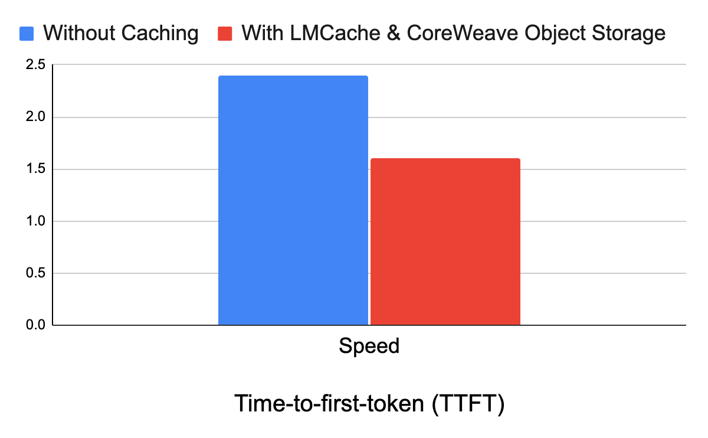
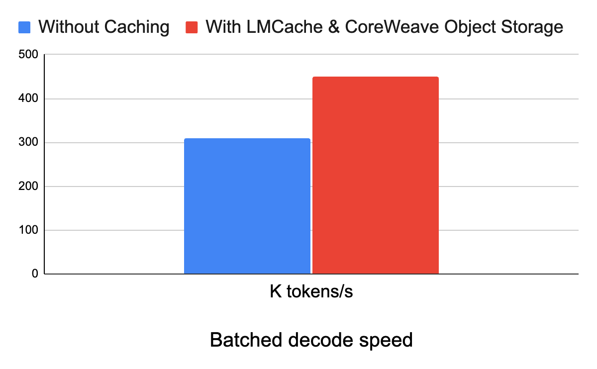
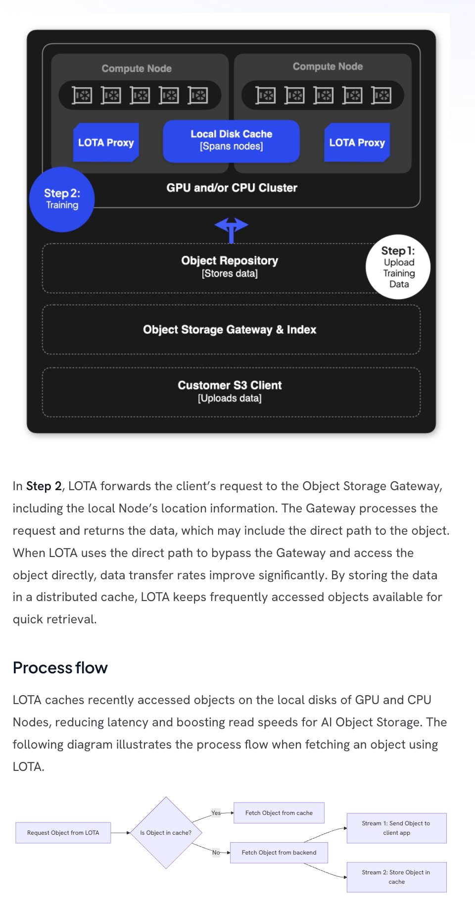

# CoreWeave / Cohere

> 联合案例 · LMCache 官方博客 / CoreWeave 官方文档

2025-10-29，LMCache 官方博客发布了一篇由三方作者联合署名的案例文章：Cohere 的 Walter Beller-Morales、CoreWeave 的 Kishor Aher 与 Tensormesh 的 Samuel Shen。文章题为“Breaking the Memory Barrier”，讲的是 Cohere 在其企业平台 North 上，用 LMCache 把 vLLM 生成的 KV Cache 序列化后存入 CoreWeave AI Object Storage，需要时再异步取回，以“远端 KV 缓存”替代重复 prefill [CW]。LMCache 仓库的更新日志把它列为 2025/11 的重点事件 [PK]。这是本报告中少数由云厂商、模型厂商与缓存软件三方共同署名、并给出量化结果的“对象存储承载 KV Cache”实例。LMCache 本身的架构见上一章；本章聚焦案例的设置、结果，以及 CoreWeave 对象存储及其 LOTA 本地缓存的工作机制。

### 背景：North 平台的 RAG 负载与远端 KV 的设想

Cohere North 帮助企业把内部私有数据安全地接入检索增强生成（RAG），让模型输出基于可信的私有知识库 [CW]。文章指出，RAG 会在每个请求前拼接检索到的上下文，这些内容不会改变模型权重，只会在 GPU 中生成 KV Cache，而 KV 通常在请求结束后就被丢弃；同一批文档被反复检索时，就要反复重新编码。上下文越长，KV 越大，对 GPU / CPU 内存的占用越高；即使是 vLLM 这样高效的引擎，规模化后也会遇到性能与成本瓶颈。文章也强调，这一问题并不限于 RAG，工具调用参数、代码、长指令等附加提示同样需要每次重新编码 [CW]。Cohere 工程团队因此要验证：**能否把 KV Cache 存到远端，在释放本地内存的同时不拖慢推理**。分工上，LMCache 负责 KV 的序列化与协调，CoreWeave AI Object Storage 提供分布式的吞吐支撑 [CW]。

### 测试设置与公开结果

测试由 LMCache 团队与 Cohere 合作完成：模型为 Cohere Command A，运行在 CoreWeave 的 GPU 基础设施上，推理引擎为 vLLM。对比了三种配置 [CW]：

| 配置 | 含义 |
|---|---|
| Baseline | 完整 prefill，不复用任何 KV Cache |
| LMCache + CoreWeave AI Object Storage | KV 序列化后存入 CoreWeave 对象存储，按需取回 |
| 替代对象存储（S3 Express） | 作为对象存储侧的性能基线，分别测冷缓存与热缓存 |

指标为 TTFT（首 token 时延，主要由 prefill 决定）和解码吞吐（prefill 结束后每秒生成的 token 数）。文章公布的结论如下 [CW]：

| 结果 | 比较对象 | 口径说明 |
|---|---|---|
| TTFT 降低 22%–32% | 完整 prefill（Baseline） | 以区间形式给出，未说明对应的上下文长度或并发分布 |
| 解码吞吐提高 41% | 完整 prefill | 图中为“Batched decode speed”，单位 K tokens/s |
| 冷缓存取回快 1.2 倍 | S3 Express | 两种对象存储之间的对比 |
| 热缓存时快 3 倍 | S3 Express | 缓存已预热的情形 |

文章附带的两张柱状图只有一个比较点。从图上读数（本文估读），无缓存与使用 LMCache + CoreWeave 对象存储时的 TTFT 分别约为 2.4 和 1.6（纵轴未标单位），批量解码速度分别约为 310 和 450 K tokens/s。LMCache 技术报告在“部署经验”一节中也写到，用户 Company C 从自有远端对象存储加载 KV，TTFT 比完整 prefill 低 22–32%，与本案例数值一致 [LMC1]。



*联合案例原文图表“Time-to-first-token (TTFT)”：蓝色为无缓存（完整 prefill），红色为 LMCache + CoreWeave Object Storage* — [原始来源](https://blog.lmcache.ai/en/2025/10/29/breaking-the-memory-barrier-how-lmcache-and-coreweave-power-efficient-llm-inference-for-cohere/)



*联合案例原文图表“Batched decode speed”（K tokens/s）：无缓存对比 LMCache + CoreWeave Object Storage* — [原始来源](https://blog.lmcache.ai/en/2025/10/29/breaking-the-memory-barrier-how-lmcache-and-coreweave-power-efficient-llm-inference-for-cohere/)

### 为什么能比重算更快：异步加载与存储吞吐

文章坦言，从纸面上看，把缓存移到远端理应更慢，因为存储带宽比 GPU / CPU 内存低一个数量级。它把收益归因于两点 [CW]：

1. **异步 KV 加载。**传统做法把 KV 视为阻塞依赖：请求需要缓存时 GPU 停下等待。LMCache 改为非阻塞加载，请求到来后立即开始从存储流式读取，同时 GPU 继续解码已在进行中的 token；若所需缓存尚未就绪，LMCache 会通知引擎“稍后再来”，GPU 不空转，再回来时缓存通常已就绪。文中示意图对比了“阻塞加载造成 GPU 空闲”与“加载和计算重叠”两种时间线。这对应上一章介绍的 KV connector 机制：`get_num_new_matched_tokens` 可以返回 None，把请求放回等待队列，用其他请求的计算掩盖本请求的 I/O [LMC1]。
2. **高吞吐远端存储。**文章给出 CoreWeave AI Object Storage 的吞吐为**每个 8-GPU 节点 8.5–10 GB/s**，并说明虽然低于 CPU-GPU 直连 I/O，但配合异步架构，存储操作可在后台“隐形”完成 [CW]。

文章还列出远端 KV 的三项衍生价值：集群缩容后会话仍可即时恢复（持久化）、缓存可在推理节点间流动（跨节点扩展），以及在不牺牲性能的前提下降低运营成本 [CW]。

### CoreWeave AI Object Storage 与 LOTA 的工作机制

CoreWeave AI Object Storage 是 CoreWeave 自建自运营的全托管对象存储，实现 S3 兼容 API，可直接使用 AWS CLI、Boto3、s3cmd 等工具 [CWV1]。官方文档披露的要点包括：

- **耐久性与范围。**设计目标为每年因设备故障丢失少于一千亿分之一的对象（11 个 9），这是架构设计目标而非服务承诺。数据以数据 + 校验分片分布在独立存储服务器上，元数据多副本保存。桶建在单个可用区内，不会自动跨可用区复制 [CWV1]。
- **一致性。**写后读（read-after-write）一致，写入后即可读到 [CWV1]。
- **计费分层。**STANDARD 存储类按最近访问时间自动归入 Hot（7 天内）、Warm（7–30 天）、Cold（30 天以上），Cold 与 Hot 性能相同、读取无延迟，被访问后回到 Hot 计价；另有需主动选用、仍为有限可用的 Archive（STANDARD_IA） [CWV1]。CoreWeave 发布 AI Object Storage 时的新闻稿称，对现有客户的典型 AI 负载，存储成本可降低 75% 以上，且不收取出口流量、请求或分层费用 [CWV6]。

**LOTA（Local Object Transport Accelerator）**是这一服务的核心。它是安装在 CKS 集群每个 GPU / CPU 节点上的智能代理，客户端只需把 S3 端点从主端点 `https://cwobject.com` 换成集群内的 `http://cwlota.com`，其余无需改动 [CWV2][CWV5]。其工作方式如下 [CWV2][CWV3]：

- **认证后绕行网关。**LOTA 先向 Object Storage Gateway 认证请求、确认授权，并附带本节点位置信息；网关可能返回对象的直接路径，此时 LOTA 绕过网关直接访问存储后端，以获得最高吞吐。
- **分布式节点本地缓存。**对象被缓存在集群各节点的本地 NVMe SSD 上，整个集群共享同一缓存，容量随节点数线性增长，每个节点默认贡献 3 TiB。放置时以整个对象（或整个上传分片）为单位计算目标节点，避免一次读取跨多个节点；未命中时，从后端取回的数据分成两路并发流，一路返回客户端，一路写入缓存。即使客户端只请求某个分片中的一段字节范围，LOTA 也会缓存整个分片，例如 100 MB 对象按 5 MB 分片上传时只缓存命中的 5 MB 分片。淘汰策略为 LRU，并保持强一致。
- **只加速读。**LOTA 只加速 HTTP GET，写操作被代理到存储后端。可以通过 `Cache-Control: no-cache / no-store` 让单个请求不进缓存或完全绕过缓存，用于测试。
- **跨区读与预热。**LOTA 可以加速读取位于其他可用区或区域的桶，首次读取后在本地缓存；对同可用区的集群自动预置，跨区集群则可以对对象发起带 `Range: bytes=0-0` 的 HeadObject，主动把整对象拉入分布式 NVMe 缓存。官方称预热后推理服务可在大模型上实现亚秒级 TTFT [CWV2][CWV4]。
- **安全注意。**LOTA 被定位为不持有用户密钥的“不受信守护进程”，缓存盘以 LUKS 加密；客户端与 LOTA 之间、以及 LOTA 实例之间的流量默认不加密，依赖网络隔离，官方建议只在运行可信负载的集群中使用，并以 NetworkPolicy 限制对 LOTA Pod 的访问 [CWV1][CWV2]。



*CoreWeave 官方文档“Local Object Transport Accelerator (LOTA)”页截图：上为数据上传与读取示意（各计算节点上的 LOTA Proxy 与跨节点 Local Disk Cache 位于对象仓库、网关与客户端之上），下为 Process flow（命中走缓存；未命中从后端取回后分两路，一路返回客户端，一路写入缓存）* — [原始来源](https://docs.coreweave.com/products/storage/object-storage/improving-performance/about-lota)

CoreWeave 的发布新闻稿引用了 Tensormesh CEO 的话：在与 Cohere 一起对 LMCache 做基准测试、在分布式集群中存储大量 KV Cache 的过程中，LOTA 的性能令人印象深刻，其速度与可扩展性是在任意上下文长度下降低 TTFT、提升吞吐的关键 [CWV6]。可见案例中的远端 KV 读取走的是 LOTA 路径。

### 接入方式：LMCache 的 CoreWeave 配置

LMCache 的 S3 后端文档专门给出了 CoreWeave 的配置示例，并注明 `cwlota.com` 是 CoreWeave 带 GPU 就近缓存的 S3 兼容存储；非 AWS 服务可设置 `disable_tls: True`，并附上了本案例的链接 [L]：

```
chunk_size: 256
local_cpu: False
max_local_cpu_size: 50
save_unfull_chunk: False
enable_async_loading: True
remote_url: "s3://test-127.cwlota.com"
remote_serde: "naive"
blocking_timeout_secs: 10
extra_config:
  s3_num_io_threads: 320
  s3_prefer_http2: False
  s3_region: "US-WEST-04A"
  s3_enable_s3express: False
  save_chunk_meta: False
  disable_tls: True
  aws_access_key_id: "your-access-key-id"
  aws_secret_access_key: "your-secret-access-key"
```

与同一页面的 AWS S3 示例（64 个 CRT I/O 线程）相比，CoreWeave 示例开启了异步加载、把 I/O 线程提高到 320、关闭 HTTP/2，并以 LOTA 端点为 bucket 域名 [L]。在 LMCache 新的 MP 模式下，相同的后端应改用 `--l2-adapter '{"type": "s3", ...}'` 的写法，且对象命名规则与旧版不兼容 [L]。CoreWeave 的性能指南还建议每次请求至少读 15 MB（低于 1 MB 时性能明显下降），并以每节点约 300 个并发作为起点调优 [CWV3]。按上一章的估算，256 token 的 chunk 对中等规模的 GQA 模型通常在几十 MB 量级，大体符合这一建议；对 KV 更紧凑的模型，则需增大 chunk（本文分析）。

### 对 KV Cache 多级存储的启示与局限

**本文分析：**这个案例在架构上相当于“GPU HBM →（可选 CPU DRAM）→ 集群内节点 NVMe 分布式缓存（LOTA）→ 对象存储后端”的四级结构，其中第三级不是 LMCache 自己管理的，而是存储服务透明提供的读缓存。这对 SSD / HDD 分层设计有三点参考价值：

- KV 以大对象的形式写入对象存储，读取时由节点本地 NVMe 吸收热点，因此对象存储后端可以更侧重容量与耐久性。不过 CoreWeave 并未公开后端介质，不能据此推断后端是 HDD。
- LOTA 只加速 GET，KV 写入（PUT）仍直达后端，所以写入带宽、请求速率（如 503 Slow Down 与键空间热点）是后端需要承担的压力；LMCache 的链式哈希键天然分散，对缓解键范围热点有利。
- 每 8-GPU 节点 8.5–10 GB/s 约合 68–80 Gbps。对照 LMCache 技术报告的带宽—上下文盈亏曲线（32 Gbps 时仅在 256K token 以上才划算，64 Gbps 以上则全长度划算），这一带宽已处于“加载普遍快于重算”的区间 [LMC1][CW]。如果用 HDD 对象池替代，需要靠聚合带宽和前置的 NVMe 读缓存才能达到同等效果。

**资料边界：**案例未公开 GPU 型号与数量、并发、上下文长度分布、命中率、KV 总量和后端介质，也没有给出 S3 Express 对比的具体配置。22–32% 与 41% 是相对完整 prefill 的端到端收益，不是存储介质的原始性能；8.5–10 GB/s 是文中给出的每节点吞吐，不代表任意租户的保证。CoreWeave 官网产品页在本次采集中被访问拦截，因此产品页上的单 GPU 吞吐宣传数字未经原文核对，没有纳入本章；新闻稿依据的是 StorageNewsletter 的转载版本。此外，CoreWeave 也是 Tensormesh 2026 年融资的投资方之一 [LMC19]，阅读三方联合案例时应考虑到这层关系。

## 本章资料

- **[CW]** [Cohere / CoreWeave / LMCache 联合案例，2025-10-29](https://blog.lmcache.ai/en/2025/10/29/breaking-the-memory-barrier-how-lmcache-and-coreweave-power-efficient-llm-inference-for-cohere/)
- **[CWV1]** [CoreWeave 官方文档 · About CoreWeave AI Object Storage（耐久性、一致性、计费分层、加密，采集于 2026-11-18）](https://docs.coreweave.com/products/storage/object-storage/about)
- **[CWV2]** [CoreWeave 官方文档 · Local Object Transport Accelerator (LOTA)（采集于 2026-11-18）](https://docs.coreweave.com/products/storage/object-storage/improving-performance/about-lota)
- **[CWV3]** [CoreWeave 官方文档 · AI Object Storage Performance best practices（采集于 2026-11-18）](https://docs.coreweave.com/products/storage/object-storage/improving-performance/best-practices)
- **[CWV4]** [CoreWeave 官方文档 · Pre-stage the LOTA cache（采集于 2026-11-18）](https://docs.coreweave.com/products/storage/object-storage/improving-performance/prestage-cache)
- **[CWV5]** [CoreWeave 官方文档 · Set endpoints（cwobject.com / cwlota.com，采集于 2026-11-18）](https://docs.coreweave.com/products/storage/object-storage/using-object-storage/configure-endpoints)
- **[CWV6]** [CoreWeave 新闻稿 · CoreWeave Unveils AI Object Storage（StorageNewsletter 转载版，2025-10-22；官网原文本轮访问被拦截）](https://www.storagenewsletter.com/2025/10/22/coreweave-unveils-ai-object-storage-redefining-how-ai-workloads-access-and-scale-data/)
- **[L]** [LMCache · S3 Backend 文档（含 S3 Express / CoreWeave 配置示例与 MP 模式 S3 L2 adapter 说明，采集于 2026-11-18）](https://docs.lmcache.ai/kv_cache/storage_backends/s3.html)
- **[LMC1]** [Liu, Yao, Cheng 等（Tensormesh / 芝加哥大学）· LMCache: An Efficient KV Cache Layer for Enterprise-Scale LLM Inference，arXiv 2510.09665（v1 2025-10-08，v2 2025-12-05）](https://arxiv.org/abs/2510.09665)
- **[LMC19]** [Tensormesh 官方新闻稿 · Tensormesh Raises $20M ... Launches Tensormesh Inference，2026-05-27](https://tensormesh.ai/newsroom/tensormesh-raises-20m/)
- **[PK]** [LMCache · 官方 GitHub README（A KV Cache Management Layer for Scalable LLM Inference，采集于 2026-11-18）](https://github.com/LMCache/LMCache)
