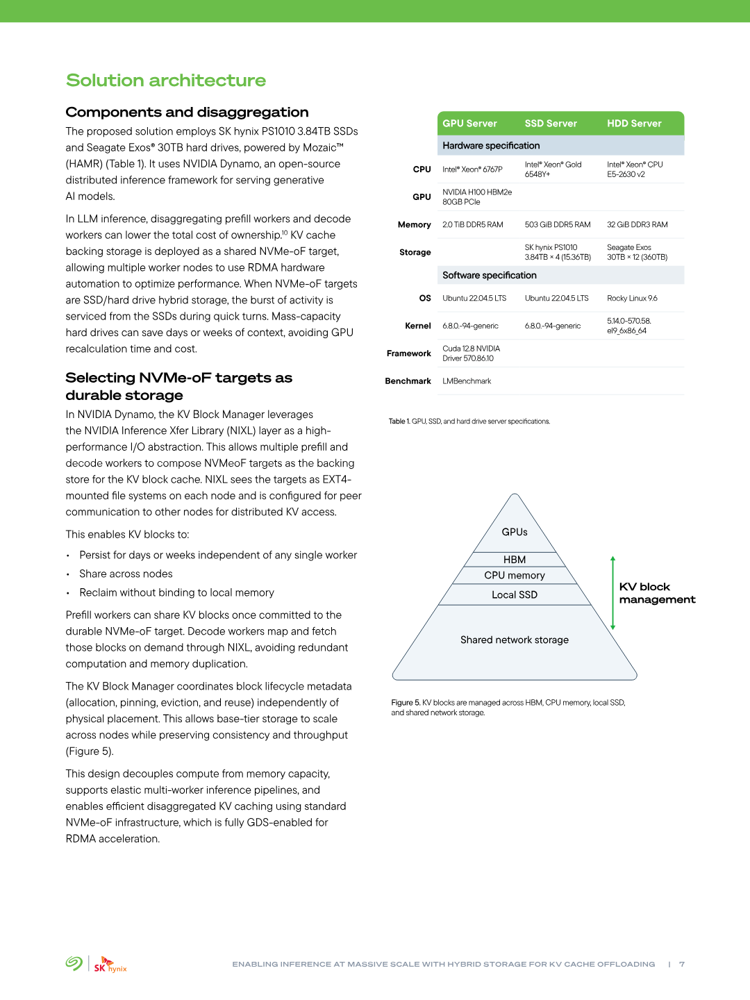
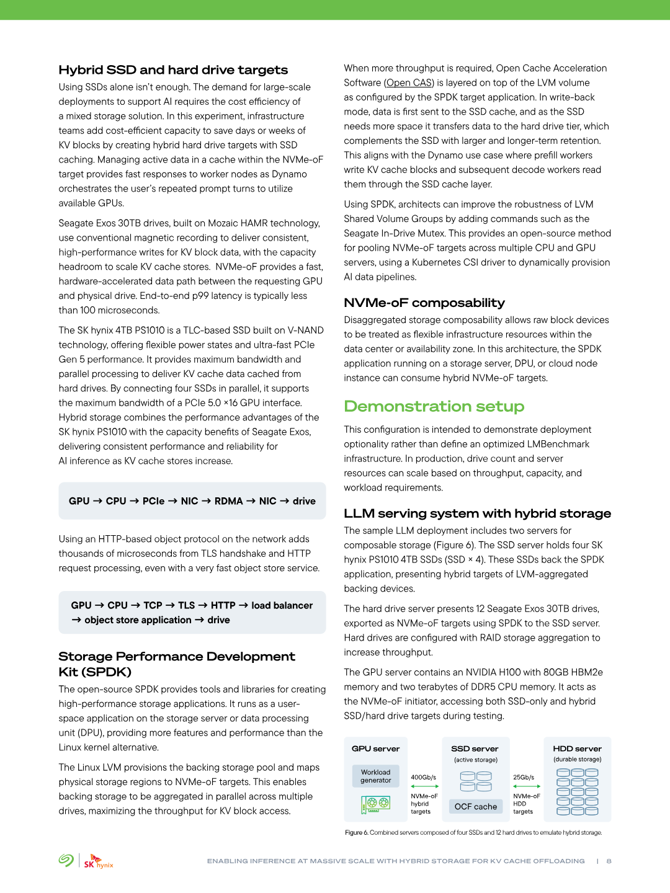
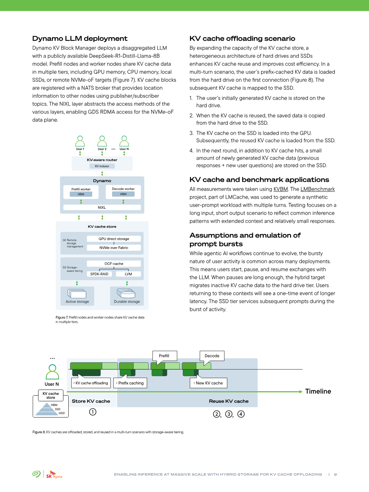
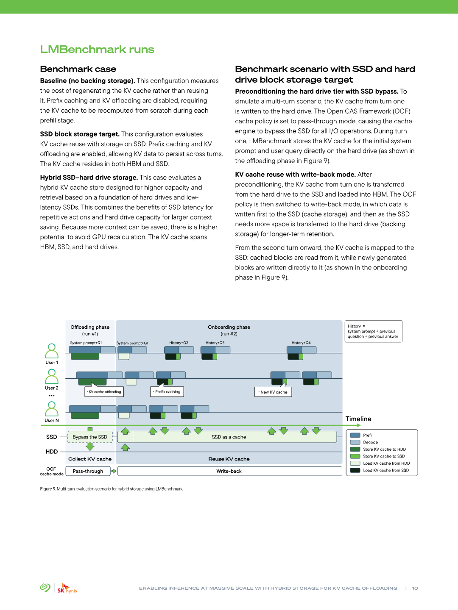

# NVIDIA / Dynamo

> Seagate / SK hynix 混合存储方案中的 NVIDIA 技术栈

这套设计把 KV 管理与物理介质分层：Dynamo / KVBM 管理推理与 KV 块，NIXL 提供传输抽象，存储端使用 SSD 缓存和 HDD 容量池组成共享 NVMe-oF target。

白皮书作者是 SK hynix 的 Kyung Soo Lee、Jin Na Yang，以及 Seagate 的 Thomas Prohofsky；NVIDIA 是所用软件和 GPU 技术栈的提供方，未列为共同作者。本文按“Seagate / SK hynix 基于 NVIDIA 技术栈的联合方案”描述，不扩大为已核实的三方联合研发关系。 [SWP]

[打开官方原始 PDF（15 页）](https://www.seagate.com/content/dam/seagate/assets/resources/enabling-inference-at-massive-scale-with-hybrid-storage-for-kv-cache-offloading/files/kv-caching-white-paper.pdf)。重点阅读：第 7 页组件分工，第 8 页存储拓扑，第 9–10 页读写流程，第 12–14 页测试，第 15 页未来工作。

### 1. 各组件分别管理什么？

| 组件 | 白皮书披露的职责 | 不能混为一谈的边界 |
|---|---|---|
| Dynamo / KVBM | 推理框架及 KV 块生命周期：分配、pinning、淘汰和复用；元数据管理独立于物理放置 | KV 块级管理不等于决定每个磁盘块何时从 SSD 下沉 |
| NIXL | 统一不同内存 / 存储层的访问方式；对接 EXT4 挂载的 NVMe-oF target，原文描述 GDS / RDMA 数据路径 | 传输抽象不是 HDD 缓存淘汰算法 |
| NATS broker | 通过发布 / 订阅分发 KV 块位置映射信息 | 传递位置与控制信息，不承载 KV payload |
| SPDK + LVM | 用户态存储服务、资源聚合、逻辑卷和 NVMe-oF target 的组成 | NVMe-oF 是对外协议，不表示后端介质全部为 NVMe SSD |
| Open CAS / OCF | 存储端 SSD 缓存；write-back 先写 SSD，容量压力下向 HDD 写回 | 这是存储块层缓存，与 KVBM 的逻辑块生命周期分属不同层 |
| SK hynix / Seagate | PS1010 SSD 服务活跃数据；Exos HDD 提供大容量后备存储 | SSD 命中性能不能用于代表 HDD 冷读性能 |

*白皮书第 7 页：KVBM、NIXL、共享存储关系及三类服务器硬件表* — [原始来源](https://www.seagate.com/content/dam/seagate/assets/resources/enabling-inference-at-massive-scale-with-hybrid-storage-for-kv-cache-offloading/files/kv-caching-white-paper.pdf)

### 2. 三台服务器如何连接？

HDD 服务器将 12 块 Exos 30TB 硬盘聚合，并通过 SPDK 导出为 NVMe-oF target。SSD 服务器接入该后备容量，配合 4 块 PS1010 SSD、LVM 和 Open CAS，向 GPU 服务器呈现 SSD-only 或 SSD/HDD hybrid target。GPU 服务器充当 NVMe-oF initiator。

表 1 的精确容量为 4 × 3.84TB SSD（正文也用约 4TB 简称）、12 × 30TB HDD；GPU 服务器为 H100 80GB、2.0 TiB DDR5，SSD 服务器为 503 GiB DDR5，HDD 服务器为 32 GiB DDR3。这是带有大量主机内存的系统，不能简化成“GPU 直接连一块 HDD”。

从逻辑路径看：worker / KVBM → NIXL → EXT4 挂载的共享 NVMe-oF target → 存储端 SSD cache / HDD backing store。原文以 GDS / RDMA 描述加速路径；各类实际 I/O 是否完全绕过 CPU 拷贝，仍需具体配置及测量确认。

*白皮书第 8 页，图 6：GPU、SSD 和 HDD 服务器组成的混合存储拓扑* — [原始来源](https://www.seagate.com/content/dam/seagate/assets/resources/enabling-inference-at-massive-scale-with-hybrid-storage-for-kv-cache-offloading/files/kv-caching-white-paper.pdf)

### 3. 一次会话恢复与后续多轮访问

1. **计算与保存：**prefill 生成 KV，KVBM 管理块的生命周期；共享后备存储使块不必绑定单个 worker 的本地内存。
2. **发现与读取：**方案通过 NATS 分发块位置，worker 经 NIXL 访问相应存储。NATS 负责“在哪里”，实际数据通过存储数据路径搬运。
3. **首次冷恢复：**既有上下文位于 HDD 时，先读回并进入 SSD，再加载到 GPU。首次读取仍承担 HDD 的读取成本。
4. **连续多轮：**已有 KV 从 SSD 复用；上一轮响应与新问题产生的增量 KV 写入 SSD。快层命中摊薄首次冷恢复的成本。
5. **再次闲置：**方案设想通过混合 target 将非活跃数据留在 HDD 上。具体冷却时间、SSD 淘汰细则和持续多租户竞争结果未完整披露。

*白皮书第 9 页，图 7–8：Dynamo 多级 KV 共享及 HDD→SSD→GPU 恢复流程* — [原始来源](https://www.seagate.com/content/dam/seagate/assets/resources/enabling-inference-at-massive-scale-with-hybrid-storage-for-kv-cache-offloading/files/kv-caching-white-paper.pdf)

### 4. 实验怎样构造“冷恢复后变热”？

第 10 页先把 OCF 设置成 **pass-through**，绕过 SSD，把首轮 KV 预填到 HDD。之后恢复 HDD 上的 KV 到 SSD / HBM，并切换为 **write-back**；第二轮起读 SSD，新增 KV 也先写 SSD。第 11 页明确说明，受控多轮场景在首次恢复后达到 100% SSD 命中。

因此，实验并未完整模拟大量会话争抢 SSD、自然老化后随机重访的长期过程。它清楚展示了首次 HDD 读取如何被后续 SSD 复用摊薄，但不直接给出任意工作集下的 SSD 命中率。

*白皮书第 10 页，图 9：pass-through 预填和 write-back 复用的实验步骤* — [原始来源](https://www.seagate.com/content/dam/seagate/assets/resources/enabling-inference-at-massive-scale-with-hybrid-storage-for-kv-cache-offloading/files/kv-caching-white-paper.pdf)

### 5. 架构能力与实测范围必须分开

架构章节讨论 prefill / decode worker 分离和共享 KV，但第 12 页明确写明：**性能实验没有采用 prefill–decode disaggregation**。所以可以将其作为分离式推理的设计参考，不能把图中的收益宣称为已完成 PD 分离部署的实测收益。

模型为 DeepSeek-R1-Distill-Llama-8B；全部测量采用 KVBM，LMCache 项目中的 LMBenchmark 仅负责生成多轮合成负载，不能因此把缓存管理实现写成 LMCache。主要延迟测试为 21K 输入、100 输出、15 用户、QPS=1、10 轮；I/O 模式测试使用 QPS=0.1。

| 结果 / 描述 | 正确口径 |
|---|---|
| TTFT 降低 95%、E2E 降低 80% | 对照为关闭 prefix caching 和 offloading 后的重算；不是对纯 SSD 的降幅 |
| HDD/SSD 平均 TTFT 差距 7.6s → 0.35s | 从 1 轮到 50 轮；首次 HDD 读取之后主要由 SSD 服务 |
| 128KB I/O，约 83% 随机读 / 72% 随机写 | 特定 QPS=0.1 负载测得；不是顺序大文件读取的简化工作负载 |
| 硬盘数量扩展 | 最多 12 块为实测，超过 12 块为估计；不能把 24 块结果写成已测 |
| 网络路径低时延描述 | 第 8 页的微秒级描述不能当作多 GB KV 的恢复时延，更不能当作 HDD 寻道时延 |

### 6. 哪些仍是未来工作？

第 15 页列出三项：利用 NATS 位置信息在 worker 编排时提前触发 **Dynamo prefetch hint**；对比本地 / 远端 **S3 与 NVMe-oF**；评估 **cuComp 压缩**对容量、吞吐和 TTFT 的影响。这些尚未构成本白皮书已完成的验证结果。In-Drive Mutex、CSI 等则是文中讨论的可组合基础设施方向，没有单独的故障恢复实测。

与第二部分的 SGLang 方案对照：这里将 SSD/HDD 分层放在存储 target 内部。SGLang 若沿用类似思路，可让 L3 看到一个后端，再由后端承担物理分层；接口兼容、文件语义与性能必须另行验证。《You don’t need long context》仍保留在第二部分讨论长期 KV 的保存价值。

## 本章资料

- **[SWP]** [Seagate / SK hynix 原始白皮书 · 15 页 · SC135.1-2605US](https://www.seagate.com/content/dam/seagate/assets/resources/enabling-inference-at-massive-scale-with-hybrid-storage-for-kv-cache-offloading/files/kv-caching-white-paper.pdf)
