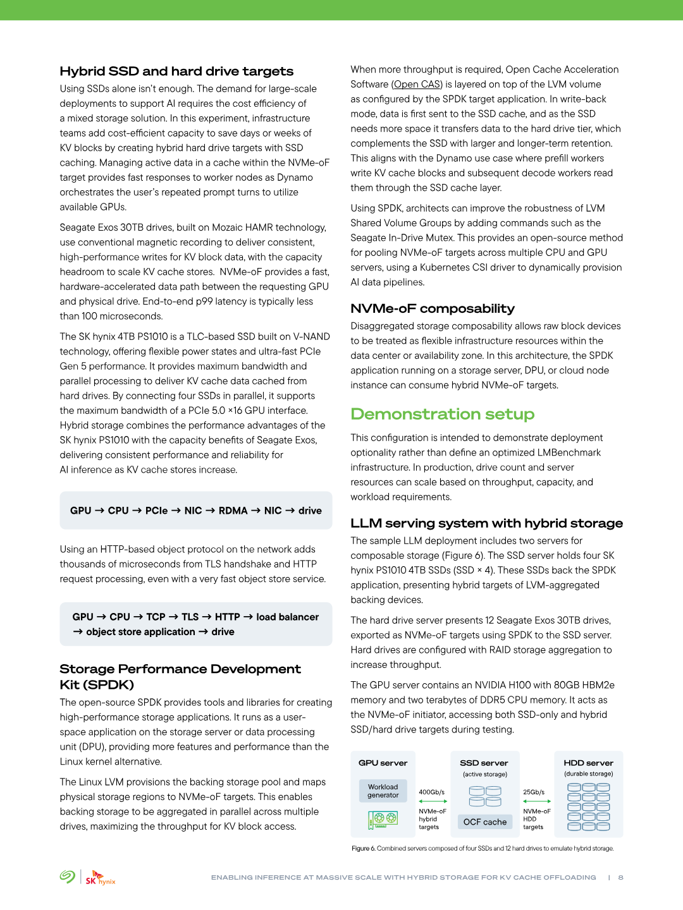
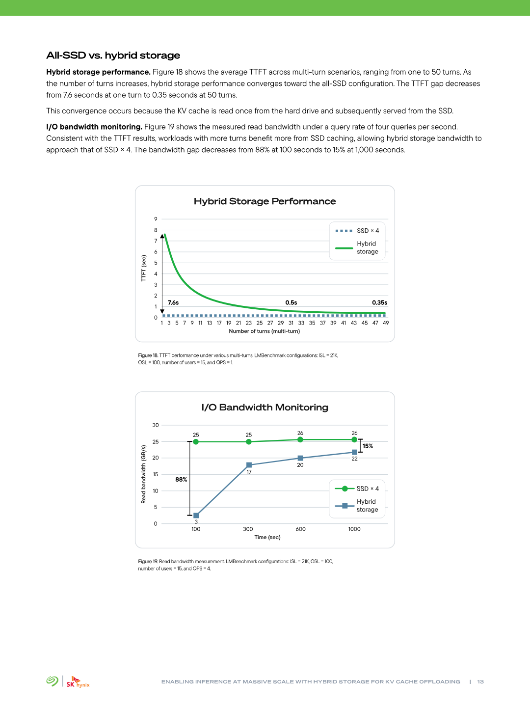

# Seagate / SK hynix

> SSD / HDD 混合 KV 联合白皮书

以 SSD 承接活跃阶段，以 HDD 延长闲置 KV 的保留窗口。核心场景是“暂停—恢复—连续多轮”。 [S]

| 项目 | 公开配置 |
|---|---|
| 模型 / GPU | DeepSeek-R1-Distill-Llama-8B / H100 80GB PCIe |
| 存储 | 4 × 3.84TB SK hynix PS1010 SSD；12 × 30TB Seagate Exos HAMR HDD |
| 原始容量 | 15.36TB SSD + 360TB HDD，未扣冗余 |
| 主机内存 / 软件 | 2.0 TiB DRAM；Dynamo KVBM、NIXL、SPDK、LVM、Open CAS |
| 工具 / 主延迟负载 | LMBenchmark；ISL 21K、OSL 100、15 用户、QPS 1、10 turns |

### 测试如何构造冷热转换

1. **预置：**OCF pass-through，使第一轮 KV 绕过 SSD 写入 HDD。
2. **恢复：**切换 write-back，HDD KV 回填 SSD 并加载至 HBM。
3. **连续交互：**后续读取命中 SSD；新增 KV 先写 SSD，再后台写回。

白皮书报告首次恢复后的 SSD 命中率为 100%。这证明了受控路径，而非验证长期交错回访下的自动冷热预测算法。LMBenchmark 来自 LMCache 项目，但实际 KV 管理由 KVBM 执行。

| 结果 | 白皮书报告值 | 解释边界 |
|---|---|---|
| TTFT / 端到端延迟 | 改善 95% / 降低 80% | 对比关闭 prefix caching 与 offload、每轮重算；非对比全 SSD |
| 容量 / 成本 | 约 11× / 约低 75% | 作者对 SSD×4 的方案口径；不是云服务整体 TCO |
| 相对全 SSD 的 TTFT 差距 | 1 turn：7.6s；50 turns：0.35s | 后续 SSD 命中摊薄首次冷恢复成本；非 HDD 读取变为 0.35s |
| I/O 特征 | 128KB 请求；72% 随机写、83% 随机读 | 对应 QPS 0.1 的 I/O 实验，不能与所有延迟图混为同一配置 |

4 / 8 / 12 块 HDD 的扩展结果为实测；更多盘数属于估算。白皮书中的 S3 对照、预取 hint、cuComp 压缩列为 future work。正文笼统的微秒级传输延迟不能当成机械盘冷读延迟。

*Seagate / SK hynix 白皮书原 PDF 第 8 页：SSD / HDD 架构与测试拓扑* — [原始来源](https://www.seagate.com/resources/enabling-inference-at-massive-scale-with-hybrid-storage-for-kv-cache-offloading/)

*白皮书原 PDF 第 13 页：容量、成本与多轮性能图，按原始口径阅读* — [原始来源](https://www.seagate.com/resources/enabling-inference-at-massive-scale-with-hybrid-storage-for-kv-cache-offloading/)

## 本章资料

- **[S]** [Seagate × SK hynix · Enabling inference at massive scale with hybrid storage for KV cache offloading](https://www.seagate.com/resources/enabling-inference-at-massive-scale-with-hybrid-storage-for-kv-cache-offloading/)
