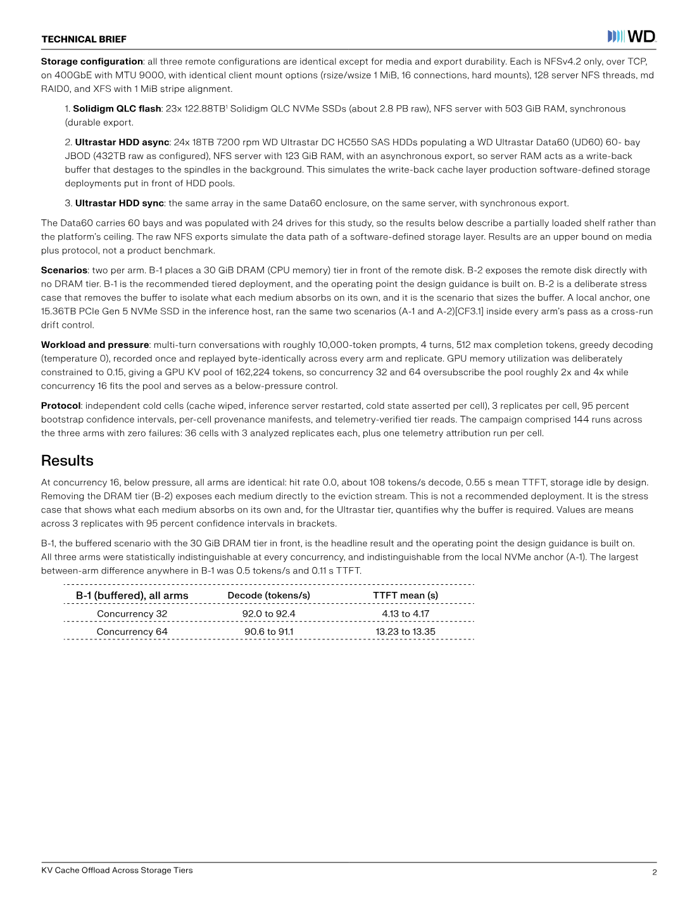
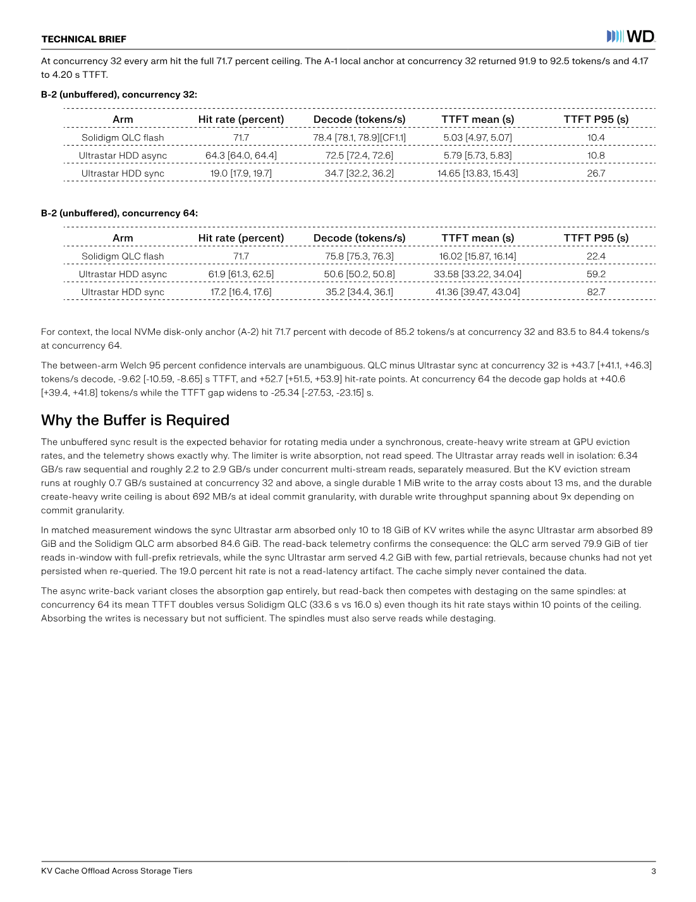

# Western Digital / Solidigm

> 缓冲层与 HDD / QLC 对照技术简报

新增重点 · September 2026 · Revision 02 · 4 页技术简报

### KV Cache Offload Across Storage Tiers

完整副标题为 *A Controlled Benchmark on an 8× NVIDIA B200 Inference Host*。报告第一页明确写明 WD 与 Solidigm 共同测量。 [W][WP]

“HDD 性能接近 SSD”成立的关键，是**30 GiB 主机 DRAM 前置层吸收写流，并服务这些测试点的热恢复读取**。

| 项目 | 报告配置（第 1–2 页） |
|---|---|
| 推理主机 | Supermicro；8 × NVIDIA B200，每卡 183 GiB HBM；TP=8 |
| 模型 / 软件 | 未披露名称的 70B 开放权重模型，BF16；vLLM 0.22.0、LMCache 0.4.6 |
| HDD 容量层 | 24 × 18TB Ultrastar DC HC550 SAS 7200rpm，Data60 机箱，432TB raw |
| QLC 容量层 | 23 × 122.88TB Solidigm QLC NVMe SSD，约 2.8PB raw |
| 远端访问 | NFSv4.2 / TCP / 400GbE；md RAID0 + XFS；未测试 RDMA |
| 负载与压力 | 约 10K-token prompt、4 turns、最多 512 completion tokens；并发 16 / 32 / 64；GPU memory utilization 限至 0.15 |
| 复现协议 | 每 cell 清缓存并重启；3 次重复；144 runs；95% 置信区间；字节相同的回放 |

### 有缓冲与无缓冲的结果

| 并发 | 方案 | Decode tokens/s | 平均 TTFT 秒 |
|---|---|---|---|
| 32 | 30 GiB DRAM + 各容量层 | 92.0–92.4 | 4.13–4.17 |
| 32 | 无主机前置层 · QLC | 78.4 | 5.03 |
| 32 | 无主机前置层 · HDD async / sync | 72.5 / 34.7 | 5.79 / 14.65 |
| 64 | 30 GiB DRAM + 各容量层 | 90.6–91.1 | 13.23–13.35 |
| 64 | 无主机前置层 · QLC | 75.8 | 16.02 |
| 64 | 无主机前置层 · HDD async / sync | 50.6 / 35.2 | 33.58 / 41.36 |

源自报告第 2–3 页；无缓冲数据为 3 次重复的均值。这里的“无缓冲”指移除主机 30 GiB DRAM 前置层；HDD async 仍使用 NFS 服务端内存异步写回。Decode 采用报告原指标，不推算整机汇总吞吐。

### 瓶颈在写入吸收能力，也在读写争用

GPU 驱逐流约 **0.7 GB/s**，KV 为 **320 KiB/token**。HDD 阵列独立顺序读可达 6.34 GB/s，但同步持久化写入受提交粒度限制，部分 KV 在下一次请求时尚未保存完成，导致外部缓存命中率下降。异步写回改善吸收能力，却会让后台落盘与读取争抢同一组磁盘。并发 64 时，无主机前置层的 HDD async 平均 TTFT 为 33.58s，QLC 为 16.02s。

报告第 4 页明确说明：有 DRAM 前置层时，这些运行点的 recalls 由 DRAM 服务。它证明缓冲可以屏蔽容量介质差异，并不证明 HDD 全冷读取与 SSD 等速。

**展开：实验限制与不能外推的结论** - 单主机、单模型配置、单一长输入多轮负载；每 cell 仅 3 次重复。 - 两类 NFS 服务器 RAM 不同：QLC 503 GiB，HDD 123 GiB；服务端 page cache 参与读取。 - 每 cell 冷启动，不代表后续每次请求都从物理冷盘读取。 - 人为限制 HBM 使用制造压力；生产应测试更大工作集和真实会话分布。 - HDD async 牺牲最近写入的持久性；KV 可重算不等于这一取舍没有代价。 - RAID0、容量不相同、原始 NFS 路径：并非等容量成本横评，也非完整生产 SDS 产品 benchmark。 - QLC 可作前置层属于设计建议。主要缓冲对照 B-1 使用 DRAM；不能把远端 QLC 对照臂说成已经完整验证了“QLC 缓冲 + HDD”部署。 - 正文写最大 TTFT 差异 0.11s，表中并发 64 的舍入范围为 13.23–13.35s；本页保留原表范围，不自行消除口径差异。

*WD / Solidigm 技术简报原 PDF 第 2 页：存储配置与 DRAM 缓冲对照* — [原始来源](https://documents.westerndigital.com/content/dam/doc-library/en_us/assets/public/western-digital/collateral/tech-brief/technical-brief-kv-cache-offload-across-storage-tiers-wd.pdf)

*原 PDF 第 3 页：无前置 DRAM 的性能表及写入吸收分析* — [原始来源](https://documents.westerndigital.com/content/dam/doc-library/en_us/assets/public/western-digital/collateral/tech-brief/technical-brief-kv-cache-offload-across-storage-tiers-wd.pdf)

## 本章资料

- **[W]** [WD × Solidigm · KV Cache Offload Across Storage Tiers，September 2026 / Revision 02](https://documents.westerndigital.com/content/dam/doc-library/en_us/assets/public/western-digital/collateral/tech-brief/technical-brief-kv-cache-offload-across-storage-tiers-wd.pdf)
- **[WP]** [WD · KV Cache Offload 官方介绍](https://www.westerndigital.com/resources/technical-brief/kv-cache-offload-tiered-storage-benchmark)
