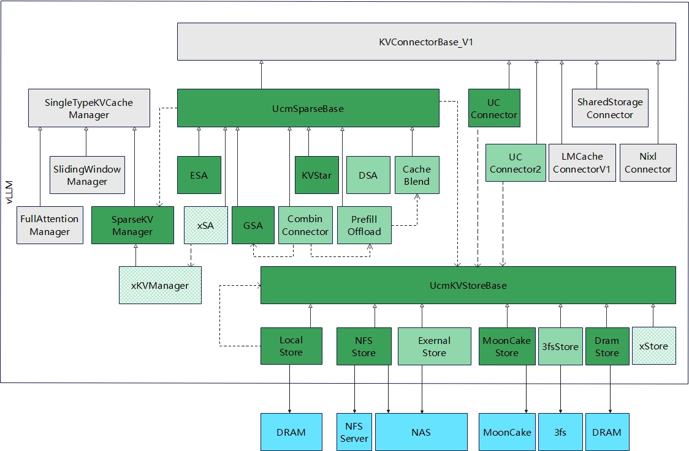
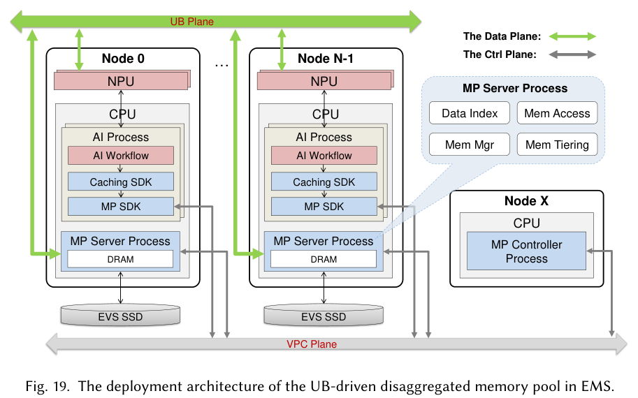
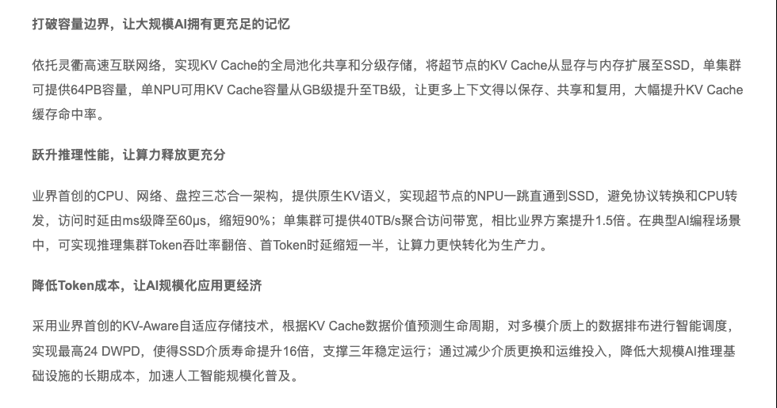
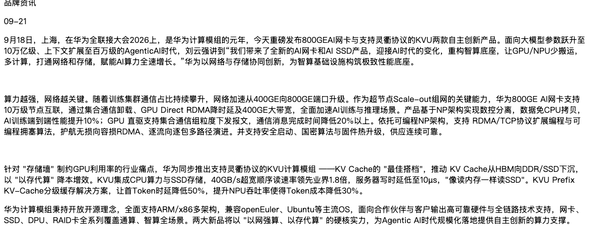

# 华为 / KVU

> 软硬协同路线 · 官方新闻稿 / 开源仓库 / 论文 + 媒体报道

华为在 KV Cache 管理上没有单一产品，而是形成了“软件 + 存储 + 云服务 + 硬件模组”四条线：开源的 UCM（Unified Cache Manager，推理记忆数据管理器）负责对接推理引擎并做分级缓存管理；OceanStor 系列 AI 存储（AI 数据平台、2026 年 9 月发布的 OceanStor M900 AI 记忆存储）提供 PB 级的外置 KV 容量；华为云 EMS（弹性内存存储）在 CloudMatrix384 超节点上把 CPU 侧 DRAM 池化并下接 SSD；计算模组产品线的 KVU 则是带 CPU 的 SSD 模组。前三条均有华为官方材料支撑，KVU 目前只有媒体报道。 [HWI1][HWI5][HWI8][HWI11][HK]

### 定位：从“以存代算”到 AI 记忆存储

华为官方材料的共同出发点是“以存代算”：把已经算过的 KV Cache 保存到容量更大的层级，后续请求命中时直接加载，省掉重复的 prefill 计算。华为数据存储产品线在 2026 年 1 月的技术文章中把 UCM 描述为“推理框架、算力、存储”三层协同，对知识库、KV Cache 和记忆库进行分级管理与智能调度，并称实测中首 Token 时延最高降低 90%、系统吞吐量最大提升 22 倍；同文给出的软件构成是：顶层连接器对接 vLLM / SGLang / MindIE 等主流推理框架，中间是运行在计算服务器中、负责分级缓存管理的加速程序，底层是与专业共享存储结合的协同器，用于提升直通效率、降低时延。 [HWI5]

2026 年 3 月 2 日 MWC26 巴塞罗那，华为发布 AI 数据平台，提出“3+1”架构：知识生成与检索、KV Cache 加速、记忆萃取与召回三大能力，加上 UCM。新闻稿称，在 AI 客服场景中，多轮对话复用历史 KV Cache 可使首 Token 时延降低 90%；部署分为以 OceanStor A800 为底座的一体化模式，和“数据引擎节点 + OceanStor Dorado”的分离式模式。 [HWI6] 2026 年 6 月的湖北移动新闻稿则写明，华为“在 2025 年底重磅推出了 UCM 推理记忆数据管理技术”，通过外置存储提供 PB 级 KV Cache，并对 KV Cache 做全生命周期的分层管理与调度。 [HWI7]

| 产品 / 项目 | 层次 | KV 所在介质 | 官方材料 |
|---|---|---|---|
| UCM（开源） | 推理引擎插件 + Store 抽象 | 主机 DRAM 缓冲、本地 / NFS 文件系统、3FS、Mooncake 等 | GitHub 仓库与文档 [HWI1][HWI2] |
| AI 数据平台 / OceanStor A800 | 共享存储系统 | OceanStor 外置存储，PB 级 | 华为新闻稿 [HWI6][HWI7] |
| OceanStor M900 AI 记忆存储 | 超节点 KV 专用存储 | 显存 / 内存 → SSD，经灵衢互联 | 华为新闻稿 [HWI8] |
| 华为云 EMS | 云服务（CloudMatrix384） | 跨节点 DRAM 池 + EVS SSD | 产品页、CloudMatrix384 论文 [HWI10][HWI11] |
| KVU 计算模组 | 设备（CPU + SSD 模组） | SSD，支持灵衢协议 | 仅媒体报道 [HK][HW] |

### UCM：开源 KV 持久化与稀疏注意力框架

UCM 由 ModelEngine-Group 在 GitHub 开源（仓库创建于 2025-07-10，MIT 许可附加条件）。README 的定位是“持久化 LLM 的 KVCache，并通过多种检索机制替代冗余计算”：除前缀缓存外，还提供多种无需训练的稀疏注意力检索方法，以及基于存算分离架构的 PD 分离方案；与 vLLM 集成后，在多轮对话和长上下文推理等场景下“可将推理延迟降低 3–10 倍”。支持特性列表为：前缀匹配、缓存融合（Cache Blend）、模型窗口外推、预填充卸载、稀疏注意力、稀疏注意力卸载、异构 PD 分离。截至采集日，main 分支对应 vLLM v0.27.1 与 vLLM-Ascend nightly-0.26.0。 [HWI1]



*UCM 官方仓库 README 架构图：灰色为 vLLM 0.9.2 已有类，绿色为 UCM 新增组件（UcmSparseBase 及 ESA / GSA / KVStar 等稀疏算法、UcmKVStoreBase 及 Local / NFS / Mooncake / 3fs / DRAM 等 Store）* — [原始来源](https://github.com/ModelEngine-Group/unified-cache-management/blob/main/docs/source/_static/images/idea.png)

README 对图中三个核心抽象的解释是：`UcmSparseBase` 是各类稀疏算法的基类，像 KV Connector 一样在 scheduler 与 `layer.py` 中挂钩子，执行稀疏 KV 块的加载、转储与计算；`SparseKVManager` 允许不同算法自定义 KV 块分配；`KVStoreBase` 把稀疏算法与外部存储解耦，用“块 ID + 偏移”标识数据，因此同一接口也天然支持前缀缓存，并通过 `KVStoreConnector` 接到 vLLM 的 `KVConnectorBase_V1`。NFSStore 是参考实现，可把 KV 存到单机本地文件系统或多机 NFS 挂载点。 [HWI1]

稀疏注意力文档给出的核心思路是：把完整 KV 卸载到专用 KV 存储，由稀疏算法挑出与当前上下文相关的关键 KV，只把这部分加载回 HBM。典型流程为 prefill 时把完整 KV 从 HBM 转储到存储；decode 时检索最相关的块并加载，同时把新生成的块写回。scheduler 侧的 UCMSparse 充当“稀疏预算控制器”，文档举例 ESA 只需普通注意力 20%–30% 的块。 [HWI4]

### UCM 的缓存层级、生命周期与后端

当前中文文档把一次复用拆成“块匹配、数据加载、新块保存”三步。Connector 按缓存粒度把 token 序列生成链式块标识，标识包含前缀关系，并纳入模型目录名、并行配置、dtype、rank 等执行设置；只有完整块进入持久化路径。Scheduler 侧先查询外部连续命中的块，换算成可复用 token 数；Worker 侧再把数据加载到引擎提供的缓冲区，Attention 使用前必须等加载完成。文档特别指出，“查到块”“加载完成”“保存结束”是三个不同事件：查找时存在的块，加载时仍可能缺失或读取失败。 [HWI2]

存储侧以 Pipeline 组合“阶段”。`Cache|Posix` 中，Cache 阶段管理主机缓冲以及设备与主机之间的搬运，Posix 阶段管理主机与文件系统之间的 I/O；按层传输让下一层加载与当前层计算重叠。可选后端包括文件系统流水线、NFS Connector、3FS（`Cache|Ds3fs`）、Mooncake 共享内存池（可组合为 `Mooncake|Posix`：优先读 Mooncake，未命中交给 Posix，dump 同时写入 Posix）以及 KV 压缩（`Cache|Compress|Posix`）。引擎侧接入 vLLM / vLLM-Ascend 与 SGLang（SGLang 由 HiCache 管理主机缓存，适配器直接使用 Posix 阶段）。 [HWI2][HWI3]

容量与回收方面，文档给出的默认主机缓冲为：原生 Cache 启用共享缓冲时 256 GiB，关闭共享时每个 worker 32 GiB，当前 vLLM Connector 启用共享缓冲时 128 GiB；`posix_capacity_gb: 0` 表示不启用基于容量的垃圾回收，正数只是逻辑预算、不预留文件系统空间，vLLM 路径下 Posix GC 由 DP0 scheduler 负责。配置示例如下（取自官方 Pipeline 文档）： [HWI3]

```
ucm_connectors:
  - ucm_connector_name: "UcmPipelineStore"
    ucm_connector_config:
      store_pipeline: "Cache|Posix"
      storage_backends: "/mnt/ucm-cache"
      io_direct: false
      # cache_buffer_capacity_gb: 256
      # posix_capacity_gb: 1024
use_layerwise: true
```

文档同时提醒：外部复用是用查询、读取、传输和同步替换一部分 prefill，只有省下的计算时间超过这些开销，端到端时延才可能改善；前缀重复比例、块粒度、存储带宽、主机缓存状态和排队都会影响结果。 [HWI2]

### 华为云 EMS：CloudMatrix384 上的 DRAM 池 + SSD 分层

华为云 EMS 产品页的定位是“通过缓存历史 KV Cache，以存代算”，把 KV Cache 缓存到主机内存 DRAM，使 HBM 容量倍级扩展；EMS 采用半托管融合部署，数据面部署在 AI 节点本地，纳管空闲内存。 [HWI10] 华为团队的 CloudMatrix384 论文（arXiv 2506.12708）给出了实现细节：CloudMatrix384 集成 384 颗昇腾 910 NPU 与 192 颗鲲鹏 CPU，经 UB（Unified Bus）网络互联；EMS 的核心是由各节点 CPU 侧 DRAM 聚合成的逻辑分离式内存池，由 MP SDK（嵌入 AI 进程，提供 Put / Get 风格的 KV 接口）、MP Controller（集中控制面，维护 DHT 视图与命名空间）和 MP Server（管理本地内存、分层与恢复）三部分组成，NPU 可经 UB 直接访问远端 DRAM。 [HWI11]



*CloudMatrix384 论文图 19：EMS 中由 UB 驱动的分离式内存池部署架构，每个节点的 MP Server 管理 DRAM，并下接 EVS SSD* — [原始来源](https://arxiv.org/abs/2506.12708)

论文描述的分层与淘汰规则相当具体：内存池下接云上 EVS SSD 作为大容量持久层，“所有数据都写入 EVS”以保证持久化，分布式 DRAM 作为其上的快速缓存；MP Server 用 LRU 和容量阈值独立管理 DRAM 驻留，被逐出 DRAM 的数据仍保留在 EVS 中，节点故障丢失内存数据时可从 EVS 恢复。单节点经擎天卡访问 EVS 的带宽通常低于 400 Gbps，但数据被切成细粒度块分布在 48 个节点上，总 EVS 访问带宽最高可达 48 × 400 Gbps。Context Caching 的 KV 按 128–512 token 分页成块，每块的哈希键由 token 序列加前缀哈希得到，可内容寻址并去重；容量接近上限时，较冷的块从 DRAM 逐出到 EVS SSD 层，SSD 也满时按 LRU 类策略删除。Prefill 命中后经 UB 直接装入 NPU 内存，新块异步写回 EMS；对 DeepSeek-R1 这类推理模型，decode 阶段的 KV 通常不存储，因为中间推理 token 不会进入下一轮，最终回复的位置会偏移。 [HWI11]

| CloudMatrix384 论文 Context Caching 实验 | 结果 |
|---|---|
| 条件 | 输入 4K token，每 NPU 批内 16K token，调节 token 复用率 12.5%–90% |
| 吞吐（EMS 经 UB） | 复用率 12.5% → 50%：prefill 吞吐提升 1.42×；90% 复用率比不使用 EMS 提升 2.28× |
| TTFT（EMS 经 UB） | 50% 复用率降低 861 ms（34%）；90% 复用率降低 1,505 ms（59%） |
| UB 与 VPC 网络对比 | UB 平面的 prefill 吞吐最高为 VPC 平面的 1.52× |

以上数字来自论文 5.4.3 节的消融实验，对比对象是“无 EMS”与“经 VPC 访问 EMS”，并非对 SSD 冷读的单独测量。 [HWI11]

### OceanStor 存储与 KVU 模组：SSD 层的硬件化

2026 年 9 月 17 日华为全联接大会上发布的 OceanStor M900 AI 记忆存储，是华为官方材料中与 SSD 下沉最直接相关的产品。新闻稿称其依托灵衢高速互联网络实现 KV Cache 全局池化共享和分级存储，把超节点的 KV Cache 从显存与内存扩展至 SSD，单集群可提供 64PB 容量，单 NPU 可用 KV Cache 容量从 GB 级提升至 TB 级；采用 CPU、网络、盘控“三芯合一”架构，提供原生 KV 语义，NPU 一跳直通到 SSD，避免协议转换和 CPU 转发，访问时延由 ms 级降至 60μs，单集群聚合访问带宽 40TB/s；在典型 AI 编程场景中，推理集群 Token 吞吐率翻倍、首 Token 时延缩短一半。 [HWI8]



*华为官网新闻稿《华为推出OceanStor M900 AI记忆存储，加速超大规模数据中心AI推理》（2026-09-17）三大核心能力段落截图* — [原始来源](https://www.huawei.com/cn/news/2026/9/hc-context-memory-storage)

M900 还提出“KV-Aware 自适应存储”：根据 KV Cache 数据价值预测生命周期，对多模介质上的数据排布做智能调度，实现最高 24 DWPD，SSD 介质寿命提升 16 倍，支撑三年稳定运行。这是官方材料中少见的、直接针对 KV 写入对 SSD 耐久压力的说明。 [HWI8] 同日华为灵衢主题新闻稿也提到，CPU、NPU、内存、SSD 等通过灵衢直接互联、实现去中心化平等访问，并指出 Agent 产生的 KV Cache “远超内存容量，必须依靠跨系统、跨层级存储”。 [HWI9]

2026 年 6 月 24 日的湖北移动现网测试新闻稿，是 UCM 与 OceanStor A800 组合的官方数据：基于 OceanStor A800 存储与昇腾 A3 超节点，部署 vLLM-Ascend，模拟 8K 至 190K 长序列输入。MiniMax M2.5 启用 UCM 后 TTFT 优化 26%–62%，TPS 在 64K / 128K 序列下分别提升 58% / 78%；GLM-5.1 的 TTFT 优化 51%–93%，TPS 提升 56%–372%（64K 为 313%，128K 为 372%）。 [HWI7]

KVU 属于计算模组产品线。IT之家 2026-07-23 报道 WAIC 2026 展示时称，KVU 依托灵衢协议带宽、自带 CPU 计算资源，顺序读 40GB/s，随机读 500 万 IOPS，写时延 10μs。 [HW] 中关村在线品牌资讯称，9 月 18 日全联接大会上华为发布支持灵衢协议的 KVU 计算模组，集成 CPU 算力与 SSD 存储，推动 KV Cache 从 HBM 向 DDR / SSD 下沉；KVU Prefix KV-Cache 分级缓存方案让首 Token 时延降低 50%，Token 成本降低 30%。 [HK] 本轮未在 huawei.com 或 e.huawei.com 找到 KVU 的官方产品页或新闻稿。



*中关村在线品牌资讯《华为计算模组“新起点，向未来”，重磅双首发 AI 网卡与 AI SSD》正文截图（媒体报道，非华为官方页面）* — [原始来源](https://m.zol.com.cn/article/12514564.html)

| 官方 / 报道指标 | 数值 | 来源性质与条件 |
|---|---|---|
| UCM TTFT / 吞吐 | 最高降低 90% / 最大提升 22 倍 | 华为技术文章“实测”，未列模型与负载 [HWI5] |
| UCM + vLLM 延迟 | 降低 3–10 倍 | 开源 README，多轮对话与长上下文场景 [HWI1] |
| M900 访问时延 / 带宽 | 60μs / 单集群 40TB/s | 新闻稿，未给出 I/O 大小与并发 [HWI8] |
| M900 SSD 耐久 | 最高 24 DWPD，寿命提升 16 倍 | 新闻稿，未给出基线介质 [HWI8] |
| KVU 读写 | 40GB/s 顺序读，500 万 IOPS，10μs 写时延 | 媒体报道，未给出块大小与队列深度 [HW][HK] |

### 与 KV Cache 多级存储（SSD / HDD 下沉）的关系

本文分析：华为官方材料覆盖了从 HBM 到 SSD 的完整层级，但没有 HDD 层。EMS 是“DRAM 池 + EVS SSD 全量持久化 + LRU”的经典两级结构，论文明确写出 EVS 单节点带宽有限、需靠 48 节点并行聚合，这恰好说明慢层可用的前提是块足够细、分布足够广。M900 则走专用硬件路线，把 SSD 访问做成原生 KV 语义并直通 NPU，同时用生命周期预测控制写放大与耐久。UCM 的 Store / Pipeline 抽象（`Cache|Posix`、`Mooncake|Posix`）在接口上允许把文件系统后端放在任何介质上，理论上可以挂接 HDD 支撑的 NFS 或分布式文件系统，但官方文档未给出 HDD 相关测试。对 HDD 下沉而言，可借鉴的是 EMS 的“写穿到持久层 + 上层 LRU”以及 M900 的“按价值预测生命周期”两种策略。

### 资料边界

UCM、M900、AI 数据平台和湖北移动数据均来自华为官方新闻稿或开源仓库，属于厂商自报，未独立复现；“首 Token 时延降低 90%、吞吐提升 22 倍”未公开测试条件。UCM 于 2025 年 8 月发布的时间与场合，本轮只见于媒体报道，未找到华为官方原文。KVU 仍仅有媒体报道；EMS 的 support 文档受访问验证拦截，EMS 内容以产品页和 CloudMatrix384 论文为准（采集于 2026-11-18）。

## 本章资料

- **[HK]** [中关村在线 · 华为计算模组“新起点，向未来”，重磅双首发 AI 网卡与 AI SSD（品牌发布资讯，2026-09）](https://m.zol.com.cn/article/12514564.html)
- **[HW]** [新浪 / IT之家 · 华为计算模组首次亮相 WAIC 2026 世界人工智能大会，2026-07-23（报道）](https://k.sina.com.cn/article_1826017320_6cd6d02802001ttwc.html)
- **[HWI1]** [ModelEngine-Group · Unified Cache Management（UCM）官方 GitHub 仓库 README / README_zh（采集于 2026-11-18）](https://github.com/ModelEngine-Group/unified-cache-management)
- **[HWI2]** [UCM 官方文档 · 总体架构 / 缓存工作原理（中文，GitHub docs，采集于 2026-11-18）](https://github.com/ModelEngine-Group/unified-cache-management/blob/main/docs/docs-site/docs/zh/developer-guide/architecture.md)
- **[HWI3]** [UCM 官方文档 · 缓存配置：Pipeline Store / Mooncake Store（中文，GitHub docs，采集于 2026-11-18）](https://github.com/ModelEngine-Group/unified-cache-management/tree/main/docs/docs-site/docs/zh/developer-guide/cache-configuration)
- **[HWI4]** [UCM 官方文档 · Sparse Attention（GitHub docs，采集于 2026-11-18）](https://github.com/ModelEngine-Group/unified-cache-management/blob/main/docs/source/user-guide/sparse-attention/index.md)
- **[HWI5]** [华为 · 华为技术（huaweitech）《AI数据基础设施：构建运营商Token经营的数据底座》，肖德刚，2026-01](https://www.huawei.com/cn/huaweitech/publication/202601/ai-data-foundation-for-carriers-token-monetization)
- **[HWI6]** [华为新闻稿 · 华为发布AI数据平台，全面重塑AI数据基础设施，2026-03-02](https://www.huawei.com/cn/news/2026/3/aidp-oceanstor-storage)
- **[HWI7]** [华为新闻稿 · 湖北移动与华为完成全国首个运营商AI推理加速方案验证，2026-06-24](https://www.huawei.com/cn/news/2026/6/mwcs-cmcc-token-economy)
- **[HWI8]** [华为新闻稿 · 华为推出OceanStor M900 AI记忆存储，加速超大规模数据中心AI推理，2026-09-17](https://www.huawei.com/cn/news/2026/9/hc-context-memory-storage)
- **[HWI9]** [华为新闻稿 · 以灵衢互联为核心，打造集群与超节点协同的新计算架构，2026-09-17](https://www.huawei.com/cn/news/2026/9/hc-lingqu-agent-ai)
- **[HWI10]** [华为云 · 弹性内存存储 EMS 产品页（采集于 2026-11-18）](https://www.huaweicloud.com/product/ems.html)
- **[HWI11]** [Huawei 等 · Serving Large Language Models on Huawei CloudMatrix384（arXiv 2506.12708v3，2025-06）](https://arxiv.org/abs/2506.12708)
