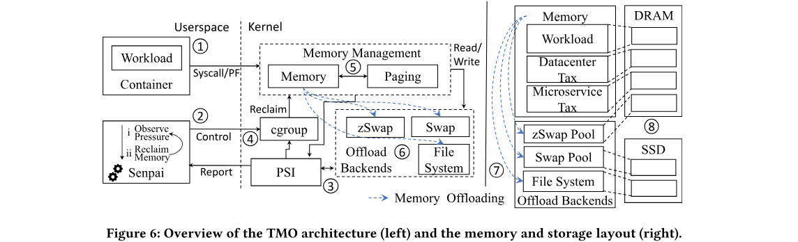
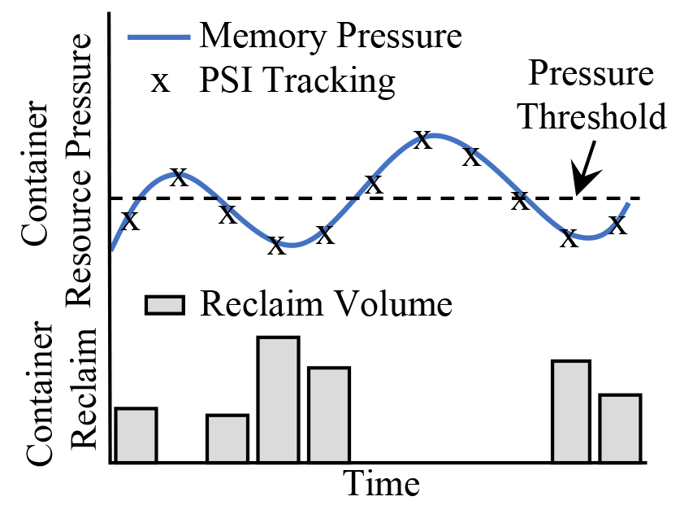
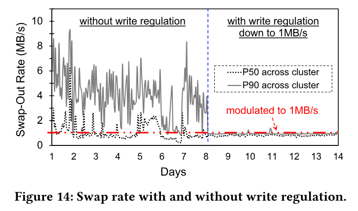
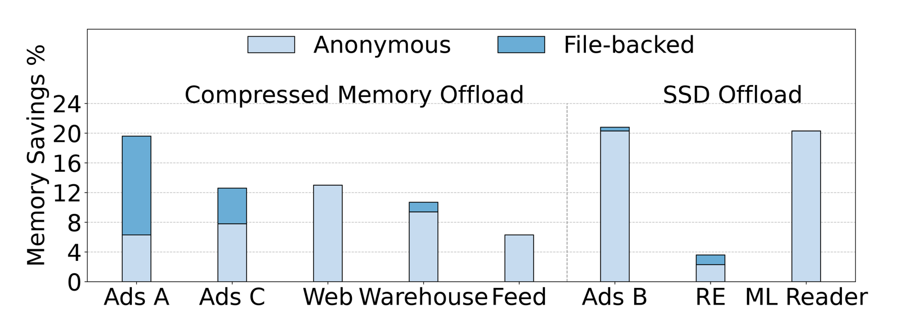

# Meta

> 官方工程实践 · 通用内存卸载 + LLM 推理并行

Meta 在本报告中的价值，不在于提供一套“KV Cache 存储服务”，而在于它公开了一套已在超大规模机群长期运行的**内存分层卸载控制系统**——Transparent Memory Offloading（TMO）。TMO 用内核 PSI（Pressure Stall Information）直接度量“因资源不足而损失的工作时间”，由用户态代理 Senpai 依据该压力反馈驱动内核回收，把冷页卸载到压缩内存（zswap）或 NVMe SSD 上的 swap。Meta 官方工程文章与 ASPLOS ’22 论文称，TMO 自 2021 年起在生产环境运行，在数百万台服务器上节省了 20%–32% 的内存。 [TMO][META1] 这套“以性能损失为反馈、按后端速度自适应调整卸载量”的思路，正是 KV Cache 从 HBM / DRAM 向 SSD、甚至 HDD 下沉时最缺的控制环节。另一方面，Meta 在 LLM 推理侧公开的资料集中在上下文并行与多轮会话的持久化 KV（persistent KV），本章一并梳理。 [META4][META5]

### 定位与背景：为什么要做透明内存卸载

官方文章开篇给出动机：机器学习等新应用的内存需求快速增长，DRAM 器件微缩放缓、价格波动大，使 DRAM 作为唯一内存容量方案在 Meta 的规模下变得过于昂贵。Meta 预计 DRAM 将占到基础设施支出的 33%，DRAM 功耗也将达到服务器基础设施功耗的 38%。 [TMO] 相比之下，NVMe SSD 在系统层面不到服务器成本的 3%（约为压缩内存的 1/3）；按与 DRAM 等容量计算，SSD 在各代服务器中都低于服务器成本的 1%，按每字节成本约比压缩内存低 10 倍。压缩内存的成本按生产负载平均 3 倍压缩比估算。 [TMO][META1]

卸载的机会来自“冷内存”。论文对 Meta 七个大型应用的统计显示，过去 5 分钟内未被访问的内存平均约占 35%，但不同应用之间差异很大，范围为 19%–62%。此外，论文把日志、性能剖析、软件包等基础设施功能占用的内存定义为“数据中心内存税”（平均 13%），把微服务拆分带来的路由、代理等开销定义为“微服务内存税”（平均 7%），两者合计平均占服务器总内存的 20%。由于这些“税”的性能 SLA 较宽松，它们成为 TMO 首批生产上线的目标。 [META1]

论文还指出，此前唯一已知的大规模内核 swap 部署是 Google 基于 zswap 的方案（论文称 g-swap）：它只支持压缩内存这一层慢速介质，并依赖离线剖析设定固定的页提升率（promotion rate）目标。TMO 要解决的正是这两点——支持性能差异巨大的异构后端，以及不依赖应用先验知识决定“卸载多少”。 [META1]

### 架构与控制回路：PSI + Senpai

TMO 由用户态和内核中的多个组件组成。未经修改的负载运行在容器中；用户态的 Senpai 负责决定每个负载卸载多少内存；内核的 PSI 模块报告压力；Senpai 通过写 cgroup 控制文件触发内核回收逻辑，由内核回收算法决定“卸载哪些页”，并对压缩内存池（zswap）或经 swap 访问的存储设备发起读写。 [META1]



*TMO 架构总览（左）与内存 / 存储布局（右）：Senpai、cgroup、PSI、zSwap / Swap / 文件系统三类卸载后端；ASPLOS ’22 论文 Figure 6 页面渲染裁切* — [原始来源](https://www.cs.cmu.edu/~dskarlat/publications/tmo_asplos22.pdf)

**PSI 的定义。**传统做法用缺页率衡量内存健康，但冷启动或工作集切换时缺页率本身就会升高；同样的缺页率在慢盘上可能是严重拖慢，在快闪存上却无关紧要。PSI 改为跟踪“因缺内存而停顿”的任务状态（例如等待刚被回收的页重新读入、为满足分配而进入回收），并聚合为两个指标：`some` 表示至少一个线程停顿，`full` 表示所有非空闲线程同时停顿，均以墙钟时间百分比报告。例如 10 秒窗口内 `full` 为 1%，即共有 100 ms 所有非空闲线程都因缺内存而无法推进；它不关心底层事件是机械盘上的 10 次缺页还是 SSD 上的 10,000 次缺页。 [TMO][META3]

**Senpai 的反馈控制。**Senpai 以 PSI 为反馈：压力低于阈值就加大回收，压力接近阈值则放缓。每次回收量按下式计算，每 6 秒执行一次，以便留出时间观察回收引起的 refault：

```
reclaim = current_mem * reclaim_ratio * max(0, 1 - psi_some / psi_threshold)
```

论文披露生产中对所有应用使用同一组参数：`reclaim_ratio = 0.0005`、`PSI_threshold = 0.1%`；单个周期最多回收负载大小的 1%，因此对大幅收缩的反应时间是分钟级，而负载扩张时的适应是即时的。Senpai 还同时监控 IO PSI，因为 refault 可能不直接表现为缺页时延，却会拖慢存储设备而间接影响负载；在 SSD 写入寿命阈值被超过或 swap 空间耗尽时，Senpai 也会调节回收。 [META1]



*Senpai 依据 PSI 压力与阈值的偏差决定每个周期的回收量；Meta Engineering 官方 TMO 文章原图* — [原始来源](https://engineering.fb.com/wp-content/uploads/2022/06/TMO.Figure5.jpg)

早期 Senpai 通过逐步下调 cgroup2 内存上限来驱动回收，但代理崩溃时会留下过紧的限制，导致极端压力乃至 OOM；负载快速扩张时也来不及上调上限。为此 Meta 在内核中加入了无状态的 `memory.reclaim` 控制文件，让 Senpai 请求内核回收精确数量的内存而不施加任何上限。 [TMO] Senpai 以开源项目形式发布，README 将其描述为“容器应用的自动内存规模测算工具”，利用 PSI 与 cgroup2 施加“恰好足够”的压力，换出名义性能不需要的冷页。 [META2]

### 回收算法与卸载后端：zswap、SSD 与写入寿命

**swap 算法改造。**官方文章解释，Linux 内核是在机械硬盘时代演化而来：旋转介质的寻道开销使 swap 产生的半随机 I/O 性能很差，而内存容量不断增长、硬盘 IOPS 却停滞，因此内核基本只在接近 OOM 时才动用 swap。高端机械硬盘大约只有百级 IOPS，而普通闪存盘可轻松处理数十万 IOPS。TMO 引入的新算法跟踪文件缓存的 refault 速率并按比例启用 swap：每有一个文件页需要反复从文件系统读回，内核就尝试换出一个匿名页；若发生 swap-in，回收又会回压文件缓存。这个反馈回路在两类内存池之间找到平衡，以最小的总分页 I/O 淘汰整体最冷的内存，并且因为只是用一种分页活动替换另一种，不会比旧算法更差，也不会让仍使用旋转介质的旧系统退化。 [TMO][META1] 实现上，内核在文件页被逐出时写入“影子条目”记录逐出计数，再次缺页时用复用距离判断是否为 refault；这一机制同时被用于计算内存 PSI。相关回收算法修改已合入上游。 [META1]

| 后端 | 论文披露的特性 | 适用场景 |
|---|---|---|
| 压缩内存（zswap，位于 DRAM） | 4 KB 读取 p90 约 40 μs，比 SSD 快一个数量级且方差小；无 SSD 写入寿命限制；生产选用 zstd 压缩与 zsmalloc 分配器 | 可压缩数据；对访问变慢较敏感的负载 |
| NVMe SSD swap | 各代 SSD 的 IOPS 相对稳定，但读写时延差异大（9.3 ms 至 470 μs）；寿命有限，需按写入速率管控 | 压缩率低的数据，如 Ads 预测模型中压缩比仅 1.3–1.4 倍的量化字节编码数据 |
| 文件系统（丢弃页缓存） | 文件页可直接丢弃，需要时从存储重新读回 | 以页缓存为主的负载 |

表中特性与适用场景分别见论文第 2.5、3.4.1、4.1 节。 [META1]

**SSD 写入寿命。**论文第 4.5 节说明，为避免 SSD 过早磨损，TMO 对卸载写入进行限速；基于机群范围分析，Meta 将 1 MB/s 认定为其机群 SSD 的安全阈值。以 Ads B 应用为例，未限速时集群 P90 swap-out 速率可达数 MB/s，开启限速后被稳定压到约 1 MB/s。 [META1] 目前后端选择仍由人工根据应用的可压缩性和对慢速访问的敏感度决定；官方认为更根本的方案是由内核管理一个卸载后端层级——较热的页用 zswap，较冷或难压缩的页用 SSD，未来再纳入 NVM 与 CXL 设备。 [TMO][META1]



*Ads B 应用在无写入限速与限速至 1 MB/s 两种情况下的 swap-out 速率（P50 / P90）；ASPLOS ’22 论文 Figure 14 页面渲染裁切* — [原始来源](https://www.cs.cmu.edu/~dskarlat/publications/tmo_asplos22.pdf)

### 公开的生产数据与条件

| 指标 | 数值 | 条件 / 口径 |
|---|---|---|
| 机群总内存节省 | 20%–32% | 生产运行一年以上，覆盖数百万台服务器；占总内存比例 |
| 应用内存节省（压缩内存后端） | 7%–12% | 五个代表性应用，相对于常驻内存 |
| 应用内存节省（SSD 后端） | 10%–19% | 压缩性差的应用；合计口径为“7%–19%，无可察觉的性能下降” |
| 内存税节省 | 平均 13%（数据中心税 9% + 应用税 4%） | 相对服务器总内存，叠加在负载节省之上 |
| Web 应用 | 容量节省 20%；压缩内存峰值约 13%，SSD 最佳约 4% | 内存受限的 Skylake 64 GB 主机，A/B 负载测试；Web 数据压缩比约 4 倍，且对访问变慢敏感 |
| Senpai 回收 CPU 开销 | 占全部 CPU 周期的 0.05% | 生产环境 |
| SSD 安全写入速率 | 1 MB/s | 基于 Meta 机群 SSD 的分析 |

以上数值均为 Meta 自有服务在其机群上的结果，节省率分别以常驻内存或服务器总内存为分母，不能直接相加。 [TMO][META1]



*八个代表性应用的内存节省（左为压缩内存后端，右为 SSD 后端，区分匿名页与文件页）；Meta Engineering 官方 TMO 文章原图，对应论文 Figure 9* — [原始来源](https://engineering.fb.com/wp-content/uploads/2022/06/TMO.trial_.jpg)

论文的另一项关键实验对比了 PSI 与页提升率：在 Web 应用上分别使用快、慢两种 SSD，慢盘配置的 swap-in 速率反而更低，但 RPS 也更低，而 PSI 的内存与 IO 压力准确反映了这一差异。Meta 据此认为，提升率不能作为异构后端（乃至同型号不同个体）下的稳健卸载指标。 [META1]

### Meta 在 LLM 推理侧公开的 KV Cache 资料

Meta Engineering 2025-10-17 的文章《Scaling LLM Inference》介绍了支撑 Meta AI App 等应用的推理并行技术。文章把推理分为 prefill（为每层生成 KV Cache，计算密集）和 decode（读取并增量更新 KV Cache，受内存带宽限制，权重与 KV Cache 占据大部分显存）两个阶段，目标为 TTFT 理想情况下低于 350 ms、逐 token 时延（TTIT）低于 25 ms。在长上下文方面，文章指出 KV Cache 随上下文线性增长，并实现了两种上下文并行（ring attention）变体：pass-KV 在 rank 间交换 K/V，pass-Q 交换 query。文章还称正在走向 prefill 与 decode 分层解耦，以便在 prefill 使用计算密集型硬件、在 decode 使用内存带宽密集型硬件。 [META4]

对应的论文《Context Parallelism for Scalable Million-Token Inference》（作者均来自 Meta Platforms，MLSys 2025）把多轮在线推理分为 full prefill、partial prefill（即 persistent KV prefill）和 decode 三个阶段：首轮与解码生成的 KV 保存在 GPU HBM 中，用户追问时新 token 关注全部已缓存 token，因此“同一用户的多轮提示之间需要 KV Cache 持久化”。按 CP rank 切分 KV Cache 也使容量随节点数增加。在 Grand Teton 平台（每台 8 × H100，96 GB HBM2e）上，Llama3 405B 在 16 节点完成 1M 上下文 prefill 用时 77 秒、128K 用时 3.8 秒。 [META5]

| 128K 上下文、4 个 CP rank | KV 缺失率 | pass-KV TTFT | pass-Q TTFT |
|---|---|---|---|
| P=126,720，T=1,280 | 1% | 1,023 ms | 899 ms |
| P=121,600，T=6,400 | 5% | 1,306 ms | 1,302 ms |
| P=64,000，T=64,000 | 50% | 6,845 ms | 7,368 ms |
| P=0，T=128,000 | 100% | 11,462 ms | 12,361 ms |

表中 P 为已在 KV Cache 中的 token 数，T 为新 token 数（摘自论文 Table 4）。论文结论是 TTFT 与持久化 KV 的缺失率近似成正比，缺失率低于 5% 时 pass-Q 更快，高于 5% 时 pass-KV 更快。 [META5] 这组数据量化了“保住历史 KV”对多轮长上下文 TTFT 的价值：1% 缺失率时的 TTFT 约为全量重算的 1/11 至 1/14。不过，两份资料讨论的持久化 KV 都位于 GPU HBM 内，均未描述把 KV 卸载到 CPU DRAM、SSD 或远端存储的机制。

### 与 KV Cache 多级存储（SSD / HDD 下沉）的关系（本文分析）

- **反馈信号可迁移。**TMO 的核心是用“损失的工作时间”而非事件计数驱动卸载，天然适应后端快慢差异。KV 下沉同样面对 DRAM、本地 SSD、远端对象存储、HDD 之间数量级的时延差。可借鉴的对应指标是 GPU 因等待 KV 恢复而空闲的时间或 TTFT 超标比例，而非单纯的缓存命中率。
- **“只拿一种分页换另一种”的平衡思想。**TMO 按文件 refault 与 swap-in 速率平衡两池。KV 多级缓存在“保留 KV 以后恢复”与“丢弃后重算 prefill”之间也存在类似权衡，CP 论文中 TTFT 与缺失率近似线性的关系可作为计算重算代价的参考。
- **写入寿命是一等约束。**TMO 以 1 MB/s 限速保护 SSD；KV 写入量远大于一般 swap（每个长会话可达 GB 级），把 SSD 用作 KV 下沉层时必须同样设置写入预算，这也是在 SSD 之下增加 HDD 容量层的动机之一。
- **HDD 的定位。**官方文章明确以机械盘百级 IOPS 解释内核过去不愿 swap 的原因，TMO 的收益建立在闪存的高 IOPS 之上。因此 TMO 不能作为 HDD 直接承接随机分页的依据；若 HDD 用于 KV，应以大块顺序读写、按会话整体回迁为前提，并由上层的快层吸收随机访问。

### 资料边界

TMO 是通用主机内存卸载方案，官方资料中的节省率与性能数据均针对 Meta 的 Web、Ads、Feed 等服务，不是 KV Cache 或 HDD 的专项测试。Meta 在 LLM 推理侧的公开资料只覆盖 HBM 内的持久化 KV 与上下文并行，本轮未找到 Meta 官方关于 KV Cache 卸载到 SSD / 远端存储的公开说明。Meta 研究官网（research.facebook.com）与 ai.meta.com 在采集时（2026-11-18）无法访问，TMO 论文取自合作者 Dimitrios Skarlatos（CMU）主页上的作者版 PDF（DOI 10.1145/3503222.3507731）。

## 本章资料

- **[META1]** [Weiner et al.（Meta / CMU）· TMO: Transparent Memory Offloading in Datacenters，ASPLOS ’22，2022（作者版 PDF，DOI 10.1145/3503222.3507731）](https://www.cs.cmu.edu/~dskarlat/publications/tmo_asplos22.pdf)
- **[META2]** [Meta（facebookincubator）· Senpai 官方 GitHub 仓库 README（采集于 2026-11-18）](https://github.com/facebookincubator/senpai)
- **[META3]** [Linux Kernel Documentation · PSI - Pressure Stall Information（采集于 2026-11-18）](https://docs.kernel.org/accounting/psi.html)
- **[META4]** [Meta Engineering · Scaling LLM Inference: Innovations in Tensor Parallelism, Context Parallelism, and Expert Parallelism，2025-10-17（官方工程文章）](https://engineering.fb.com/2025/10/17/ai-research/scaling-llm-inference-innovations-tensor-parallelism-context-parallelism-expert-parallelism/)
- **[META5]** [Yang et al.（Meta Platforms）· Context Parallelism for Scalable Million-Token Inference，MLSys 2025，arXiv:2411.01783 v3（2025-04-21）](https://arxiv.org/abs/2411.01783)
- **[TMO]** [Meta Engineering · Transparent memory offloading: more memory at a fraction of the cost and power，2022-06-20（官方工程文章）](https://engineering.fb.com/2022/06/20/data-infrastructure/transparent-memory-offloading-more-memory-at-a-fraction-of-the-cost-and-power/)
