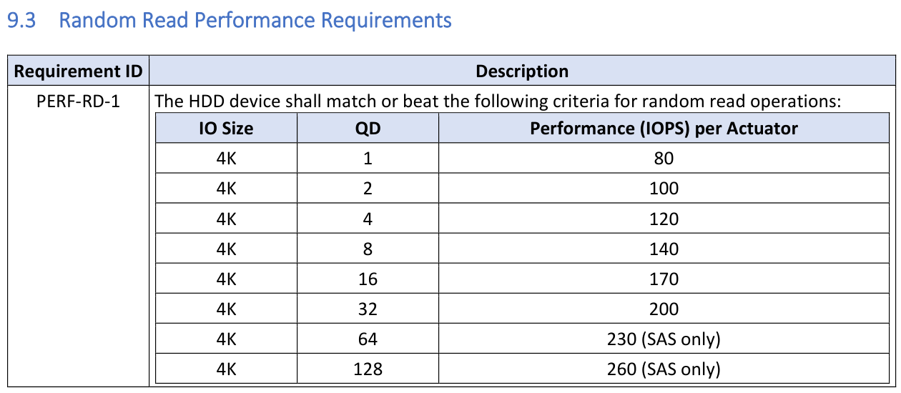
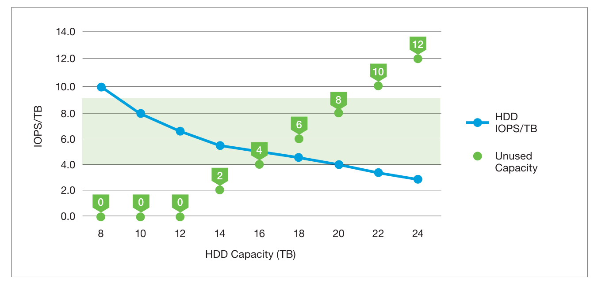
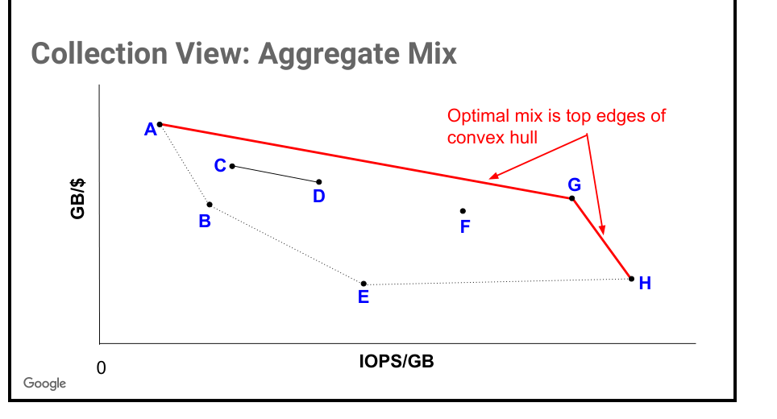
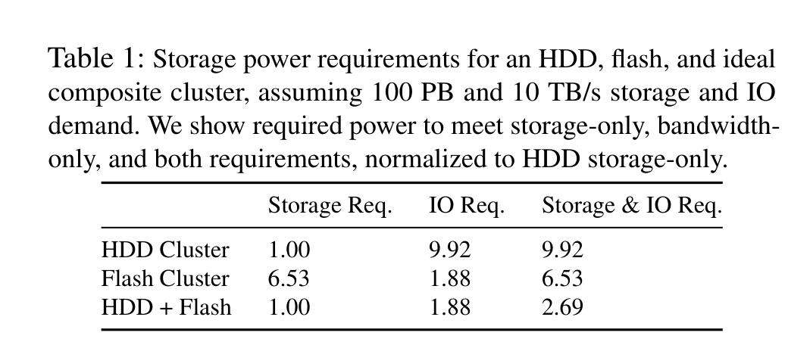

# 访问密度约束：IOPS/TB 与尾延迟

> 容量约束分析 · 数据手册、OCP 规范与超大规模论文推演

大容量 HDD 最常被提到的约束是**访问密度**：单盘每秒能完成的随机 IO 次数（IOPS）和顺序带宽基本由机械结构决定，十多年来几乎没有变化；容量却在持续增长。于是每 TB 数据能分到的 IOPS（IOPS/TB）和带宽（MB/s/TB）随容量同比例下降。本章先用厂商数据手册和 OCP 规范确认“单盘性能持平”这一事实，再按 16/20/24/30/36 TB 五个容量档做定量推演，然后结合 Google、AWS S3、Meta 的公开材料，讨论哪些大数据负载会真正被 IOPS/TB 卡住、哪些不会，以及有哪些办法可以放宽这一约束。全文区分三类内容：**来源事实**（可在所引文档中找到）、**工程推论**（由来源数据按写明的公式推出）、**待验证**（需要实测或客户数据确认）。资料采集于 2026-11-19。

### 来源事实：单盘随机 IOPS 基本不随容量变化

Seagate 2025 年 12 月版 Exos 数据手册把 12 TB 到 32 TB 的 7200 RPM 型号放在同一份文档里：12/16/20/24 TB 的 CMR 型号随机读写（4K、QD16、写缓存关闭）均为 168/550 IOPS，24/28/30/32 TB 的 Mozaic 型号均为 170/350 IOPS，平均旋转延迟都是 4.16 ms [KI1]。回看 2020 年 8 月的 Exos X16 手册，10–16 TB 型号同样是 170/440 IOPS [KI10]。换句话说，容量翻了一倍，随机读 IOPS 没有变。2026 年 5 月发布的 36 TB SMR 型号产品手册列出 10 碟 20 头、OD 最大持续传输 270 MB/s、1 GiB 缓存，但没有给出随机 IOPS 指标 [KI2]。Western Digital 32 TB 的 Ultrastar DC HC690 产品手册在功耗测试表中列出 4KB 随机读 QD1/QD4/QD8 分别为 81/117/140 IO/s，OD 持续传输 256–269 MB/s [KI5]。AWS S3 的 Andy Warfield 在 2023 年的文章中给出同样的判断：一块盘全力做随机读写大约 120 次/秒，这个数字在 2006 年 S3 上线时差不多，再往前十年也差不多 [KI8]。

超大规模用户把这一点写进了采购规范。OCP《Datacenter SAS-SATA Device Specification》v1.0（Meta、Microsoft、HPE 起草，2023-03）的随机读要求是按**每个 actuator** 而不是每 TB 规定的：4K QD1 不低于 80 IOPS，QD16 不低于 170，QD32 不低于 200 [KI6]。同一规范要求多 actuator 设备性能线性扩展，每个 actuator 受相邻 actuator 干扰的损失不超过 3%（MULTIA-1）。也就是说，规范默认单 actuator 的 IOPS 是常量，增加 IOPS 的途径是增加 actuator。

*OCP Datacenter SAS-SATA Device Specification v1.0 第 39 页：PERF-RD-1 随机读性能要求，按每个 actuator 规定 4K 各队列深度下的最低 IOPS* — [原始来源](https://www.opencompute.org/documents/datacenter-sas-sata-device-specification-rev-1-0-pdf/)

| 数据来源 | 容量 | 随机读 IOPS | OD 最大持续传输 |
|---|---|---|---|
| Seagate Exos X16 手册（2020-08） | 10–16 TB | 170（4K QD16） | 245–261 MB/s |
| Seagate Exos 手册（2025-12），CMR | 12–24 TB | 168（4K QD16） | 285 MB/s |
| Seagate Exos 手册（2025-12），Mozaic | 24–32 TB | 170（4K QD16） | 240–285 MB/s |
| Seagate Exos 36 TB SMR 产品手册（2026-05） | 36 TB | 未列出 | 270 MB/s |
| WD Ultrastar DC HC690 手册 | 28–32 TB | 81 / 117 / 140（QD1 / 4 / 8） | 256–269 MB/s |
| Seagate Exos 2X18（MACH.2 双 actuator） | 16–18 TB | 304（4K QD16，双 actuator 同时工作） | 545–554 MB/s |
| OCP 规范最低要求（每 actuator） | — | 80（QD1）/ 170（QD16） | 250 MB/s 或最大 SDR（OD） |

### 工程推论：五个容量档的 IOPS/TB 与带宽/TB

推演使用最直接的公式：`IOPS/TB = 单盘 IOPS ÷ 容量`，`带宽/TB = 持续传输率 ÷ 容量`，`整盘顺序读一遍的时间 = 容量 ÷ 持续传输率`。假设如下：单 actuator QD1 取 80 IOPS（OCP 下限，与 WD 手册的 81 一致；Seagate MACH.2 技术白皮书计算 IOPS/TB 时也用 80）；QD16 取 170；双 actuator 取 Exos 2X18 手册的 304；OD 传输率按手册取 16–24 TB 为 285 MB/s、30 TB 为 275 MB/s、36 TB 为 270 MB/s。OCP 允许内圈速率比外圈低至 50%，因此“整盘平均”按 0.75×OD 估算。年负载上限方面，Exos M 24–32 TB 产品手册和 WD HC690 均为 550 TB/年，36 TB SMR 型号为 750 TB/年 [KI11][KI5][KI2]，16/20 TB 档同样按 OCP REL-5 的 550 TB/年 计。

| 容量 | IOPS/TB（QD1=80） | IOPS/TB（QD16=170） | IOPS/TB（双 actuator 304） | MB/s/TB（OD） | 整盘读一遍（OD / 平均） | 5 IOPS/TB 门槛下闲置容量（QD1） | 年负载额定 ÷ 容量（遍/年） |
|---|---|---|---|---|---|---|---|
| 16 TB | 5.0 | 10.6 | 19.0 | 17.8 | 15.6 h / 20.8 h | 0% | 34.4 |
| 20 TB | 4.0 | 8.5 | 15.2 | 14.2 | 19.5 h / 26.0 h | 20% | 27.5 |
| 24 TB | 3.3 | 7.1 | 12.7 | 11.9 | 23.4 h / 31.2 h | 33% | 22.9 |
| 30 TB | 2.7 | 5.7 | 10.1 | 9.2 | 30.3 h / 40.4 h | 47% | 18.3 |
| 36 TB | 2.2 | 4.7 | 8.4 | 7.5 | 37.0 h / 49.4 h | 56% | 20.8 |

“闲置容量”一列按 Seagate MACH.2 技术白皮书的定义计算：如果业务要求每 TB 至少 T 个 IOPS，单盘可用容量上限就是 `IOPS ÷ T`，超出部分即使装满数据也无法按 SLA 服务。白皮书的例子是门槛 7 IOPS/TB 时，单 actuator 盘在约 12 TB 处就会“搁浅”；白皮书同时认为多数数据中心应用需要 5–10 IOPS/TB [KI4]。按 QD1 口径，16 TB 已经落在 5 IOPS/TB 的下限上，36 TB 只剩 2.2；即使双 actuator，36 TB 的 QD1 口径也只有 4.4。Warfield 的说法更直接：如果到 200 TB 盘时随机访问在数据上平均分配，每 2 TB 数据只能分到每秒 1 次 IO [KI8]。

*Seagate MACH.2 技术白皮书（TP714.2）第 2 页：单 actuator HDD 的 IOPS/TB 随容量下降，绿色区域为数据中心应用所需的 IOPS/TB 范围，绿点为在该门槛下无法利用的容量* — [原始来源](https://www.seagate.com/files/www-content/solutions/mach-2-multi-actuator-hard-drive/files/tp714-dot-2-2006us-mach-2-technology-paper.pdf)

最后一列常被忽略。年负载额定值同时计入读和写 [KI2]。550 TB/年折合约 17.4 MB/s 的全年平均吞吐，只有 OD 带宽的 6% 左右。容量越大，每 TB 每年能被读写的“遍数”越少：16 TB 约 34 遍，30 TB 约 18 遍。重建、巡检（scrub）、再均衡这类后台流量也要算在这个预算里。

### 来源事实：尾延迟比平均 IOPS 更早成为瓶颈

Google 的 Eric Brewer 在 FAST'16 主题演讲中提出数据中心盘的五个指标：更高 IOPS、更大容量、更低尾延迟、安全、更低 TCO。他给出的现状是：读请求平均 10 ms，P99 达数百毫秒，P99.9 达到秒级。原因包括扇区重映射、写阻塞读、非数据命令和固件后台任务 [KI7]。OCP 规范把尾延迟写成硬指标：4K QD1 随机读的 P99 不超过 20 ms，P99.99 不超过 40 ms，任何读写命令不超过 6 秒 [KI6]。Warfield 用 S3 的“热度”（heat）概念解释了尾延迟和容量的关系：少数被请求集中的盘形成热点，请求开始排队；排队又被元数据查询和纠删码的依赖 IO 放大，最后表现为少量高延迟的 straggler，不及时处理就会拖慢全部请求 [KI8]。

**工程推论**：盘越大，单盘上的数据越多，落到同一块盘上的请求也越多。只要访问不是完全均匀的，大盘就更容易成为热点。因此 IOPS/TB 约束在**尾部**比在平均值上更早出现。按平均负载算 IOPS 还有余量的集群，P99 可能已经超标。

Brewer 同时给出了另一种思路：不必为每块盘单独设定 IOPS/GB，而是在 GB/$–IOPS/GB 平面上把不同盘型（不同盘径、转速）组合起来，用凸包上沿的组合满足整个机群的总体目标 [KI7]。按这种“集合视角”，大容量盘的作用是拉高 GB/$，IOPS/GB 的缺口由机群里的其他介质补上。

*Google Eric Brewer FAST'16 主题演讲幻灯片“Collection View: Aggregate Mix”：横轴 IOPS/GB、纵轴 GB/$，最优盘型组合位于凸包上沿* — [原始来源](https://www.usenix.org/conference/fast16/technical-sessions/presentation/brewer)

### 哪些大数据负载会被 IOPS/TB 卡住

判断是否受 IOPS 约束，关键在于单次 IO 的大小。**工程推论**：单次 IO 的服务时间约等于 `定位时间 + IO 大小 ÷ 传输率`。下表用 QD1 下限 80 IOPS 反推的 12.5 ms 作定位时间、250 MB/s 作传输率（均为假设），计算单盘有效吞吐：

| 单次 IO 大小 | 单盘 IO/s | 单盘有效吞吐 | 占顺序带宽比例 | 典型场景 |
|---|---|---|---|---|
| 4 KB | 79.9 | 0.3 MB/s | ≈0% | 元数据、小对象、点查 |
| 64 KB | 78.4 | 5.0 MB/s | 2% | 列存投影后的小列块、碎片化读 |
| 1 MB | 60.6 | 60.6 MB/s | 24% | Meta DPP 合并后的读（O(1MB)） |
| 8 MB | 22.5 | 179.8 MB/s | 72% | Tectonic chunk（8 MiB）级别 |
| 72 MB | 3.3 | 239.6 MB/s | 96% | 整 block 顺序扫描 |

按这张表可以把负载大致分成三类。（1）**冷归档、备份、合规留存**：写一次、几乎不读，平时既不受 IOPS 约束也不受带宽约束。真正的约束是灌入、迁出和修复整盘数据所需的时间，以及年负载预算（见上一节表格）。（2）**大块顺序扫描**：日志批处理、整文件 ETL 这类负载，IO 大小达到 MB 级以上，主要看 MB/s/TB。36 TB 盘的 MB/s/TB 只有 16 TB 盘的 42%。（3）**数据湖列式读取和 ML 训练读**：表面上是“扫描”，但谓词下推和列投影会把 IO 切小。Meta 的数据预处理读取器（DPP Reader）根据文件尾部的元数据只读取所需特征的字节，再合并成 O(1MB) 的 IO，即便如此也只能用到约四分之一的顺序带宽 [KI9]。

Meta 在 Tectonic-Shift（ATC'23）中给出了来源事实：训练集群要求存储层存放 EB 级数据，同时提供每秒数十 TB 的读带宽。如果只用 HDD 满足 100 PB 存储加 10 TB/s 读带宽的需求，需要按存储需求 9.92 倍的规模部署 HDD（按 RS(9,6) 计约 1.6 EB 盘），而且 IO 需求的增长速度是存储需求的 2 倍。他们最终用闪存层 Shift 吸收热读：比 LRU 闪存缓存多吸收 1.51–3.28 倍 IO，生产环境功耗比纯 HDD 方案降低 29% [KI9]。

*Meta Tectonic-Shift（USENIX ATC'23）表 1：在 100 PB 存储与 10 TB/s IO 需求下，HDD、闪存与 HDD+闪存组合集群所需功耗（以 HDD 仅满足存储为 1.00 归一化）* — [原始来源](https://www.usenix.org/conference/atc23/presentation/zhao)

**工程推论**：在 Meta 的场景里，约束来自带宽密度而不是 4K IOPS。HDD-only 方案需要多部署近 10 倍盘才能满足带宽，这说明在高读带宽负载下，单盘容量越大，“按 IO 需求必须部署的盘数”和“按容量需要的盘数”之间的差距越大。在这种负载下，把容量做大本身不能降低成本，必须同时配一个 IO 层。

### 放宽约束的手段

- **闪存缓存或闪存层**：用闪存承担 IO、用 HDD 承担容量，是 Meta 和 Brewer 的共同结论 [KI9][KI7]。缓存效果取决于缓存策略是否了解应用：Shift 利用训练任务说明预测未来访问，吸收的 IO 是 LRU 的 1.51–3.28 倍。
- **加大 IO 尺寸**：Tectonic 使用 72 MiB block、8 MiB chunk，读取器合并成 O(1MB) 的 IO [KI9]。从上表看，IO 从 64 KB 提高到 8 MB，单盘有效吞吐提升约 36 倍。代价是需要对文件格式和读路径做顺序化改造。
- **放置和热度打散**：S3 把不同对象放到不同的盘集合上，每个客户的数据只占每块盘很小一部分；冗余编码让读请求可以绕开繁忙的盘；而海量租户叠加后，总负载会趋于平滑，单个租户几乎影响不了峰值 [KI8]。这正是 S3 敢于“尽快采用最大容量盘”、并计划使用 200 TB 盘的前提 [KI8]。
- **多 actuator**：MACH.2 把磁头分成上下两组，各自独立寻道。同代单 actuator 的 Exos X18 随机读为 170 IOPS [KI12]，Exos 2X18 提高到 304 IOPS，持续传输达到 554 MB/s [KI3]。OCP 已在规范层面要求多 actuator 线性扩展 [KI6]。按上面的推演表，双 actuator 可以让 30 TB 档回到约 10 IOPS/TB（QD16 口径）。
- **机群混配与分层**：按 Brewer 的凸包思路，大盘只承载冷数据或纠删码层，热数据放在较小的盘或闪存上，在机群层面满足 IOPS/GB 目标 [KI7]。

### 对中等容量偏好的解读与资料边界

**工程推论**：Warfield 的论述依赖规模和多租户，S3 能用大盘是因为几百万个负载叠加后需求被平滑 [KI8]。一个单租户、规模在几十 PB 量级、负载突发明显的国内私有集群缺少这种统计复用，访问往往集中在少数热表和最新分区上。对这类集群来说，换成 36 TB 盘意味着同样的数据放在更少的盘上，可用的 IOPS 和带宽同比例减少，尾延迟先变差。倾向中等容量，本质上反映的是**这类集群的访问密度需求高于大盘能提供的水平**，而系统里又没有闪存层、大 IO 改造或热度打散来弥补。对 HDD 厂商来说，有说服力的做法不是单独卖容量，而是把容量和“每 TB 的 IO 能力”一起交付：多 actuator、按 IO 能力配套闪存的参考架构、面向列存和训练读的大 IO 读路径指南，以及按客户实际 IO 分布（而不是 4K 随机读）计算的 IOPS/TB 测算。

**待验证**：36 TB 型号的官方随机 IOPS（产品手册未列出，本章沿用 32 TB 的 170）；不同客户实际负载的 IO 大小分布和 P99 目标；双 actuator 在 SATA 单 LUN 模式下对文件系统和 EC 层的实际收益。本章没有能打开 Google 白皮书《Disks for Data Centers》原文，因此 Google 部分只引用 USENIX 发布的 FAST'16 演讲幻灯片。SNIA 博客页面被访问校验拦截，没有引用。表中所有推演都是由手册参数按公式计算得出，没有经过实测。

## 本章资料

- **[KI1]** [Seagate · Exos 数据手册 DS2046.1-2512（12–32 TB 型号规格：随机读写 4K QD16、OD 持续传输、平均延迟，2025-12，采集于 2026-11-19）](https://www.seagate.com/content/dam/seagate/en/content-fragments/products/datasheets/exos-portfolio-refresh/exos-ds2046.1-2512-en_us_V2_en_AS.pdf)
- **[KI2]** [Seagate · Exos SATA Product Manual 36TB（ST36000NM001M，SMR，Publication 210960600 Rev C，2026-05；含 10 碟 20 头、270 MB/s、<750 TB/年额定负载、Depopulation 命令支持，采集于 2026-11-19）](https://www.seagate.com/content/dam/seagate/assets/support/internal-hard-drive/enterprise-hard-drives/x-mozaic/_shared/files/Seagate_Exos_SATA_Product_Manual_36TB_210960600C.pdf)
- **[KI3]** [Seagate · Exos 2X18 数据手册 DS2093.1-2202（MACH.2 双 actuator，304/560 IOPS、554 MB/s，2022-02，采集于 2026-11-19）](https://www.seagate.com/www-content/datasheets/pdfs/exos-2x18-DS2093-1-2202US-en_US.pdf)
- **[KI4]** [Seagate · MACH.2 Multi-Actuator Technology Paper TP714.2（IOPS/TB 与 TCO、5–10 IOPS/TB 需求区间，2020-06，采集于 2026-11-19）](https://www.seagate.com/files/www-content/solutions/mach-2-multi-actuator-hard-drive/files/tp714-dot-2-2006us-mach-2-technology-paper.pdf)
- **[KI5]** [Western Digital · Ultrastar DC HC690 (SATA) Hard Disk Drive Specification（28–32 TB，持续传输、功耗表中随机读 IO/s、550 TB/年负载、Storage Element Depopulation，采集于 2026-11-19）](https://documents.westerndigital.com/content/dam/doc-library/en_us/assets/public/western-digital/product/data-center-drives/ultrastar-dc-hc600-series/product-manual-ultrastar-dc-hc690-sata.pdf)
- **[KI6]** [Open Compute Project · Datacenter SAS-SATA Device Specification Version 1.0（Meta / Microsoft / HPE，2023-03-28；PERF-RD-1、LAT-1、MULTIA-1、REL-5、COMM-9，采集于 2026-11-19）](https://www.opencompute.org/documents/datacenter-sas-sata-device-specification-rev-1-0-pdf/)
- **[KI7]** [USENIX FAST '16 · Eric Brewer（Google）主题演讲 “Disks and their Cloudy Future” 幻灯片（2016-02-23，配套白皮书 Disks for Data Centers，采集于 2026-11-19）](https://www.usenix.org/conference/fast16/technical-sessions/presentation/brewer)
- **[KI8]** [All Things Distributed · Andy Warfield（AWS S3）“Building and operating a pretty big storage system called S3”（2023-07-27，采集于 2026-11-19）](https://www.allthingsdistributed.com/2023/07/building-and-operating-a-pretty-big-storage-system.html)
- **[KI9]** [USENIX ATC '23 · Zhao et al.（Meta / Stanford）“Tectonic-Shift: A Composite Storage Fabric for Large-Scale ML Training”（2023-07，采集于 2026-11-19）](https://www.usenix.org/conference/atc23/presentation/zhao)
- **[KI10]** [Seagate · Exos X16 数据手册 DS2011.3-2008（10–16 TB，170/440 IOPS，2020-08，采集于 2026-11-19）](https://www.seagate.com/www-content/datasheets/pdfs/exos-x16-DS2011-3-2008US-en_US.pdf)
- **[KI11]** [Seagate · Exos SATA Product Manual 32/30/28/24TB（Exos M，Publication 210048100 Rev E，2025-12；10 碟 20 头、<550 TB/年额定负载，采集于 2026-11-19）](https://www.seagate.com/content/dam/seagate/assets/support/internal-hard-drives/enterprise-hard-drives/exos-m/_shared/files/Seagate_Exos_SATA_Product_Manual_32-30-28-24TB_210048100E.pdf)
- **[KI12]** [Seagate · Exos X18 数据手册 DS2045.3-2102（170/550 IOPS，2021-02，采集于 2026-11-19）](https://www.seagate.com/www-content/datasheets/pdfs/exos-x18-channel-DS2045-3-2102US-en_US.pdf)
