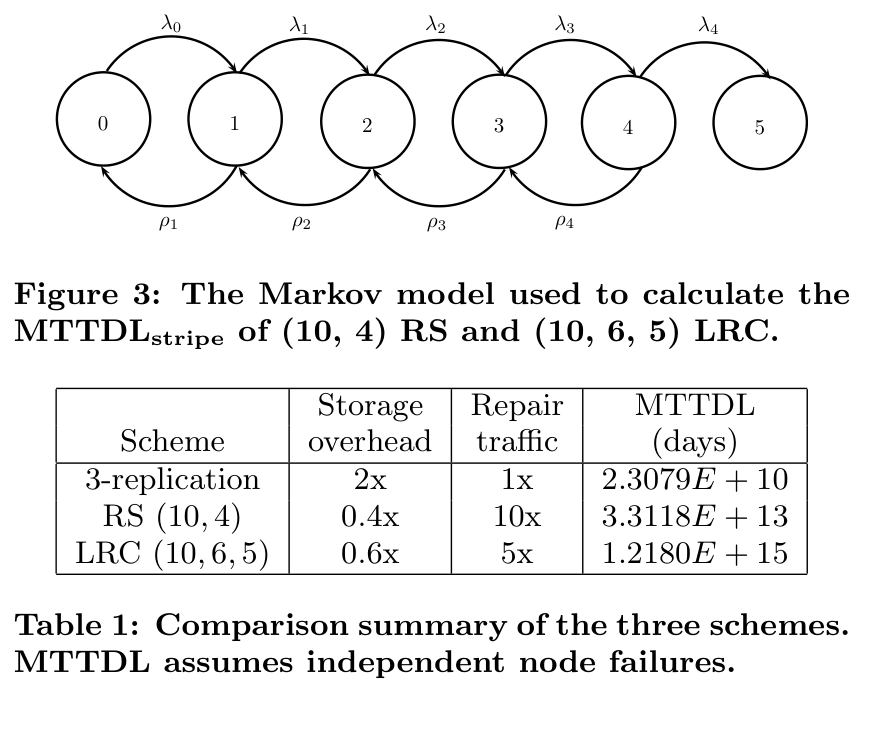
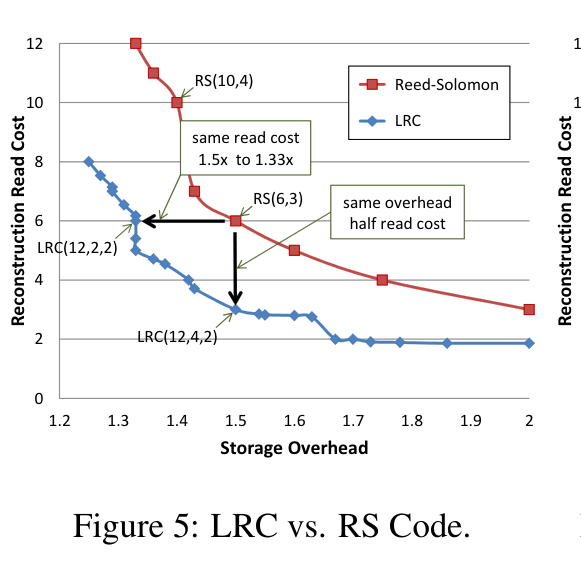
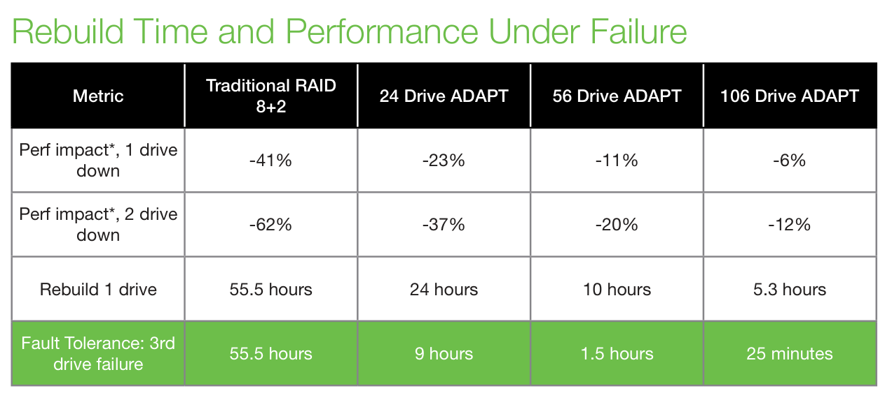
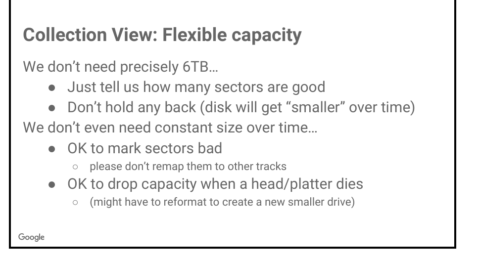

# 重建、故障域与数据可靠性

> 容量约束分析 · 纠删码论文、开源文档、厂商手册与 Backblaze 一手数据推演

反对大容量盘的第二个常见理由是可靠性：盘越大，坏一块要恢复的数据越多，重建时间越长，在重建窗口内再坏一块的概率越高；同一台服务器或同一个机箱里的数据越多，一次节点故障引发的修复流量也越大。本章先给出重建时间的公式和 16/20/24/30/36 TB 五个容量档的推演，再比较 RAID、副本、RS 纠删码和 LRC 的修复流量，用 Ceph 文档和 Facebook、Azure 的论文解释故障域与 MTTDL 的直观含义，然后用 Backblaze 2026 年 Q2 的数据检验“大盘更容易坏”这一说法，最后列出已有的缓解手段：分布式（去簇）重建、LRC、存储元件 depopulation 和重建限流调度。文中区分**来源事实**、**工程推论**和**待验证**三类内容，资料采集于 2026-11-19。

### 重建时间：公式与容量档推演

重建时间的一阶估算是 `T_rebuild = 待恢复数据量 ÷ 有效重建带宽`。差别在于“有效重建带宽”由什么决定。传统 RAID 把整块坏盘的数据重写到一块热备盘上，速度受限于单块盘的写入能力，并且通常还要给前台业务让路。分布式或去簇（declustered）方案把待恢复数据打散到许多盘上并行读写，有效带宽随参与的盘数增加。Seagate 的 ADAPT 技术白皮书正是这样表述的：传统 RAID 的重建速度“受限于单块 HDD 的性能”，在某些情况下超过 50 小时 [KR1]。

**工程推论**：下表按 `容量 × 10⁶ MB ÷ 有效带宽 ÷ 3600` 计算满盘重建时长。50/100/200 MB/s 代表单目标盘 RAID 在业务负载下限速、半速和接近满速三种情况；1 GB/s 和 5 GB/s 代表数十到上百块盘参与的分布式重建。带宽档位都是假设，用于展示量级。

| 容量 | 50 MB/s | 100 MB/s | 200 MB/s | 1 GB/s（分布式） | 5 GB/s（分布式） |
|---|---|---|---|---|---|
| 16 TB | 88.9 h | 44.4 h | 22.2 h | 4.4 h | 53 min |
| 20 TB | 111.1 h | 55.6 h | 27.8 h | 5.6 h | 67 min |
| 24 TB | 133.3 h | 66.7 h | 33.3 h | 6.7 h | 80 min |
| 30 TB | 166.7 h | 83.3 h | 41.7 h | 8.3 h | 100 min |
| 36 TB | 200.0 h | 100.0 h | 50.0 h | 10.0 h | 120 min |

可以看出，单目标盘的 RAID 重建在 36 TB 时，即使以 200 MB/s 满速写入也要两天以上，限速到 50 MB/s 时超过 8 天。分布式重建只要并行度够高，即使是 36 TB 也能把窗口压到小时级。所以“大盘重建慢”主要是**单目标盘重建架构**的问题，不是容量本身的必然结果。

还有一个按规格上限计算的数字。Seagate Exos 数据手册给出的不可恢复读错误率是每 10¹⁵ bit 1 个扇区 [KR13]。**工程推论**：一个 RAID 5（9+1）组在单盘故障后重建，需要读完其余 9 块盘。16 TB 时共读取约 1.15×10¹⁵ bit，36 TB 时约 2.59×10¹⁵ bit；按规格上限，期望出现的不可恢复扇区数分别约为 1.2 和 2.6。规格值是上限，实际发生率通常低得多（**待验证**），但这已经说明为什么大盘时代单校验 RAID 基本没人再用，以及为什么 RAID 6 一旦掉一块盘就进入“没有余量”的状态。

### 修复流量：副本、RS 与 LRC

多副本恢复一块数据只需读一份副本，代价是 3 倍存储。RS(k,m) 恢复一个分片需要读 k 个分片，修复的读放大是 k 倍。Facebook 的 XORing Elephants 论文（VLDB 2013）在一个 3000 节点、30 PB 逻辑数据的 HDFS 集群上做了测量：当时只有 8% 的数据以 RS(10,4) 编码，典型数据节点存约 15 TB，即便延迟大部分修复以过滤瞬时故障，每天仍常有 20 个以上节点故障触发修复；修复流量约占集群日均 2 PB 网络流量的 10–20%。作者估计，如果一半数据改为 RS 编码，修复流量会把集群网络打满 [KR3]。他们的 LRC(10,6,5)（HDFS-Xorbas）多用 14% 存储，换来修复磁盘 IO 和网络流量减半，在独立故障的 Markov 模型下 MTTDL 比 RS(10,4) 多两个数量级 [KR3]。

*XORing Elephants（VLDB 2013）图 3 与表 1：计算条带 MTTDL 所用的 Markov 模型，以及 3 副本、RS(10,4)、LRC(10,6,5) 的存储开销、修复流量和 MTTDL 对比* — [原始来源](https://www.vldb.org/pvldb/vol6/p325-sathiamoorthy.pdf)

Azure 存储的 LRC（ATC'12）把这一思路用到了生产环境。在相同的 1.5x 存储开销下，用 LRC(12,4,2) 替换 RS(6,3)，单分片重建成本从 6 降到 3；或者保持重建成本 6 不变，用 LRC(12,2,2) 把存储开销从 1.5x 降到 1.33x。WAS 最终选择了 LRC(12,2,2) [KR2]。论文还指出，重建时间常常由最慢的分片（straggler）决定，因此需要读的分片越少，越不容易碰上热点节点 [KR2]。Apache HDFS 当前的默认 EC 策略是 RS-6-3-1024k，文档提醒 EC 文件跨机架放置，大部分读写都跨机架，所以网络二分带宽非常重要；一个从 6 个节点读、向 2 个节点写的 EC 恢复任务按 xmits = max(6,2)×0.5 = 3 计入调度 [KR4]。

*Azure《Erasure Coding in Windows Azure Storage》（USENIX ATC'12）图 5：LRC 与 Reed-Solomon 的存储开销–重建读成本曲线，标出 RS(6,3)→LRC(12,4,2)“同开销读成本减半”和 RS(6,3)→LRC(12,2,2)“同读成本开销降到 1.33x”* — [原始来源](https://www.usenix.org/conference/atc12/technical-sessions/presentation/huang)

**工程推论**：修复读取量约等于 `坏盘数据量 × 重建读成本`。下表按满盘计算：

| 方案 | 存储放大 | 单分片重建读成本 | 坏一块 20 TB 满盘需读取 | 坏一块 36 TB 满盘需读取 |
|---|---|---|---|---|
| 3 副本 | 3.0× | 1 | 20 TB | 36 TB |
| RS(6,3) | 1.5× | 6 | 120 TB | 216 TB |
| RS(10,4) | 1.4× | 10 | 200 TB | 360 TB |
| LRC(12,2,2)（Azure） | 1.33× | 6 | 120 TB | 216 TB |
| LRC(12,4,2)（Azure） | 1.5× | 3 | 60 TB | 108 TB |
| LRC(10,6,5)（Xorbas） | 1.6× | 5 | 100 TB | 180 TB |

容量从 20 TB 增加到 36 TB，每种方案的修复读取量都增加 80%。从 3 副本迁移到 EC 节省了容量，却把修复读取放大了 5–10 倍。两者叠加，正是大盘和 EC 一起上线时修复网络压力剧增的原因。

### 故障域、爆炸半径与 MTTDL 的直观理解

Ceph 官方文档用一个 3 副本例子解释了数据丢失的路径：一块 OSD 坏掉后，所有受影响 PG 降为 2 副本；如果在新副本填满之前同一 PG 的另一块 OSD 也坏了，就只剩 1 副本；第三块再坏，对象就永久丢失 [KR5]。文档给出两个关键结论。第一，恢复速度取决于参与恢复的 OSD 数量：从 10 块扩到 20 块 OSD 后，每块 OSD 从复制约 100 GB 降到约 50 GB，在网络是瓶颈的情况下恢复快一倍。但如果扩到 200 块 OSD 而 PG 数不变，每块 OSD 只有约 7 个 PG，一块坏盘的恢复最多只有约 21 块 OSD 参与，反而变慢，所以需要增加 PG 数。第二，OSD 越多，恢复越快，级联故障导致数据丢失的风险越低 [KR5]。

**工程推论**：Markov 类模型（Xorbas 使用的就是这一类 [KR3]）的直观结论是，能容忍 f 个故障的条带，数据丢失概率大致与 `(λ·T_repair)^f` 成正比，λ 为单盘故障率。在有效重建带宽不变的前提下，容量翻倍意味着 T_repair 翻倍：3 副本（f=2）的 MTTDL 约下降到 1/4，RS(10,4)（f=4）约下降到 1/16。反过来，只要修复带宽随容量同步增长（让更多盘参与修复），MTTDL 就能保持不变。Xorbas 论文的结论也是这个意思：修复更快可以抵消额外存储带来的可靠性代价 [KR3]。

再看单次故障前后的量级。**工程推论**（假设）：RAID 6（8+2）组中一块盘坏掉后，另一块盘在重建窗口内也坏掉的概率约为 `(n−1) × AFR × T ÷ 8760`。取 n=10、AFR=1.41%（Backblaze 全生命周期平均值）、重建带宽 100 MB/s，16 TB 时约 0.064%，36 TB 时约 0.145%。单次概率不高，但大盘把暴露窗口拉长了 2.25 倍，而且多块盘同时故障在实际环境中往往相关（同批次、同机箱、同电源）。

爆炸半径还要算到节点一级。Facebook 2013 年的典型数据节点约 15 TB [KR3]。**工程推论**：如今一台 24 盘位服务器装 36 TB 盘约 864 TB，是当时的约 58 倍。如果节点故障频率不变，每次节点故障需要修复的字节数也同比例增加。对于 Ceph 这类系统，修复期间前台业务受到的影响已有官方测试：在 192 个 OSD 的 HDD 集群上做多节点故障测试时，小对象（1–256 KiB）吞吐最多下降 79%，大对象下降超过 20% [KR6]。

### 来源事实：Backblaze 2026 Q2 数据中的容量与故障率

Backblaze 2026 年 Q2 统计了 354,415 块数据盘，季度年化故障率（AFR）1.73%，是近期最高；全生命周期 AFR 为 1.41%。20 TB 及以上的盘已占数据集的 25% 以上，新部署集中在大容量段；他们的机群目前没有 SMR 盘 [KR7]。本章把官方全生命周期表按容量分组重新汇总（**工程推论**：AFR = 故障数 ÷ (盘日 ÷ 365)）：

| 容量段 | 盘数 | 累计盘日 | 累计故障 | 汇总 AFR |
|---|---|---|---|---|
| 8–10 TB | 20,980 | 83,640,809 | 4,261 | 1.86% |
| 12–14 TB | 117,766 | 289,157,718 | 12,727 | 1.61% |
| 16 TB | 116,897 | 143,335,673 | 3,633 | 0.93% |
| 20–26 TB | 97,398 | 42,014,407 | 988 | 0.86% |

汇总后看不出“容量越大越容易坏”的趋势。差异主要来自具体型号和盘龄：20 TB 以上各型号的全生命周期 AFR 分别是 Toshiba 20 TB 0.79%、Toshiba 24 TB 0.50%、WDC 22 TB 0.58%、WDC 26 TB 0.84%，而 Seagate 24 TB（ST24000NM002H，平均盘龄约 12 个月）为 3.24%；16 TB 的 Seagate ST16000NM001G 有 35,100 块，全生命周期 AFR 为 0.68% [KR7]。需要注意，20 TB 以上的盘平均更年轻，与老盘比较时盘龄是主要的混杂因素。厂商规格方面，Seagate 32 TB 和 36 TB 手册的额定 AFR 都是 0.35%（MTBF 250 万小时） [KR13][KR9]，与 16 TB 时代相同。**结论**：单盘可靠性不随容量单调恶化；变化的是**每次故障的后果**，即要恢复的数据量和恢复窗口。

### 为什么 RAID / 三副本客户担心大盘

综合以上几点，使用传统架构的客户对大盘的顾虑在技术上是成立的：（1）RAID 5/6 组的重建只能写到一块热备盘上，时间与容量成正比，36 TB 在业务负载下需要数天，期间性能下降（ADAPT 白皮书的模型中，RAID 6 8+2 掉一块盘时性能下降 41%，掉两块时下降 62% [KR1]）；（2）规格级 URE 的期望个数超过 1，单校验 RAID 不再可靠；（3）三副本或 RS 系统的节点越来越大，单节点故障引发的修复流量与容量成正比，网络和前台业务都会受影响；（4）中小规模集群的盘数少，像 Ceph 文档描述的那样，参与恢复的 OSD 数有限，并行度上不去 [KR5]。在这些条件下，选择中等容量是理性的风险规避。

### 缓解手段：让修复时间与容量解耦

- **分布式 / 去簇重建**：ADAPT 把校验和热备空间打散到整个盘组。Seagate 的模型数据显示，单盘重建时间从 RAID 6 8+2 的 55.5 小时降到 106 盘 ADAPT 的 5.3 小时，恢复到“能再承受第三块盘故障”所需的时间从 55.5 小时降到 25 分钟，单盘故障时的性能影响从 −41% 降到 −6% [KR1]。Ceph 的 CRUSH/PG 机制和 HDFS 的块级重建本质上也是去簇的，前提是 PG 数和集群规模足够大 [KR5]。
- **LRC 与局部修复**：在相同存储开销下把单分片修复读取减半（Azure），或者用 14% 额外存储换取修复流量减半（Xorbas） [KR2][KR3]。
- **存储元件 depopulation（部分失效）**：WD HC690 手册实现了 ATA 的 Storage Element Depopulation 特性集：主机用 GET PHYSICAL ELEMENT STATUS 查询各元件的健康状态，用 REMOVE ELEMENT AND TRUNCATE 移除一个元件并缩小容量，用 RESTORE ELEMENTS AND REBUILD 恢复；该型号最多可移除 2 个元件。需要注意的是，“repurposing depopulation”完成后，用户数据区的内容与之前无关，也就是盘上原有数据需要由上层重新恢复 [KR8]。对于分区（SMR）设备，REMOVE ELEMENT AND MODIFY ZONES 会把相关 zone 置为 OFFLINE [KR8]。Seagate 32 TB（10 碟 20 头）和 36 TB SMR 产品手册都列出了这组命令，36 TB 型号还包括 REMOVE ELEMENT AND MODIFY ZONES [KR10][KR9]。OCP 规范 COMM-9 要求 HDD 支持逻辑 depopulation [KR11]。这一需求最早可以追溯到 Brewer 2016 年的提法：“磁头 / 盘片坏了，允许掉容量” [KR12]。
- **修复调度与限流**：Ceph mClock 提供 balanced（默认）、high_client_ops 和 high_recovery_ops 三种内置配置，可以在业务低谷临时提高恢复优先级 [KR6]；HDFS 用 xmits 权重和重建线程数控制 EC 恢复并发 [KR4]。

*Seagate《ADAPT: Rapid-Rebuild Technology》技术白皮书第 3 页：RAID 6 8+2 与 24/56/106 盘 ADAPT 在单盘 / 双盘故障时的性能影响、单盘重建时间和恢复到可承受第三块盘故障的时间（官方注明为模型计算值）* — [原始来源](https://www.seagate.com/content/dam/seagate/migrated-assets/www-content/solutions/backup/backup-and-recovery/adapt-technology.pdf)

*Google Eric Brewer FAST'16 主题演讲幻灯片“Collection View: Flexible capacity”：允许标记坏扇区、允许在磁头 / 盘片损坏时降低容量，即后来 depopulation 特性的需求来源之一* — [原始来源](https://www.usenix.org/conference/fast16/technical-sessions/presentation/brewer)

**工程推论**：一块 20 头的 36 TB 盘，如果各盘面容量大致相同，坏一个磁头约损失 1.8 TB。如果能用保留数据的方式（例如分区设备上只把受影响的 zone 下线）处理，需要修复的数据量约为整盘故障的 1/20，盘也不用拔出更换。如果只能用会清空数据的 truncate 方式，修复量没有减少，但省去了换盘的运维时间和盘位空置。这两种方式在实际系统中的行为和主机侧（文件系统、EC 层）的支持程度属于**待验证**。

**资料边界**：重建时间、修复读取量、URE 和二次故障概率都是按公式和假设带宽计算的，不是实测值。ADAPT 数据是 Seagate 官方注明的模型计算值，原文没有说明对应的单盘容量。Backblaze 数据只包含 CMR 盘，20 TB 以上盘的盘龄普遍较短。本章没有找到超大规模厂商公开的、按单盘容量分档的实际修复时长数据；SNIA 关于 HDD depopulation 的博客页面被访问校验拦截，没有引用。

## 本章资料

- **[KR1]** [Seagate · ADAPT: Rapid-Rebuild Technology 技术白皮书 SB505.1-1808（RAID 6 8+2 与 24/56/106 盘 ADAPT 的重建时间与性能影响，模型计算值，2018-08，采集于 2026-11-19）](https://www.seagate.com/content/dam/seagate/migrated-assets/www-content/solutions/backup/backup-and-recovery/adapt-technology.pdf)
- **[KR2]** [USENIX ATC '12 · Huang et al.（Microsoft）“Erasure Coding in Windows Azure Storage”（LRC，2012-06，采集于 2026-11-19）](https://www.usenix.org/conference/atc12/technical-sessions/presentation/huang)
- **[KR3]** [PVLDB Vol.6 No.5（VLDB 2013）· Sathiamoorthy et al.（USC / UT Austin / Facebook）“XORing Elephants: Novel Erasure Codes for Big Data”（HDFS-Xorbas，采集于 2026-11-19）](https://www.vldb.org/pvldb/vol6/p325-sathiamoorthy.pdf)
- **[KR4]** [Apache Hadoop 官方文档 · HDFS Erasure Coding（默认策略 RS-6-3-1024k、ECWorker 重建、xmits 权重与重建线程配置，采集于 2026-11-19）](https://hadoop.apache.org/docs/stable/hadoop-project-dist/hadoop-hdfs/HDFSErasureCoding.html)
- **[KR5]** [Ceph 官方文档 · Placement Groups（Data durability：OSD 故障、恢复并行度与级联故障示例，采集于 2026-11-19）](https://docs.ceph.com/en/latest/rados/operations/placement-groups/)
- **[KR6]** [Ceph 官方文档 · mClock Config Reference（内置 profile、恢复 / 回填选项、192 OSD HDD 集群故障期间吞吐测试，采集于 2026-11-19）](https://docs.ceph.com/en/latest/rados/configuration/mclock-config-ref/)
- **[KR7]** [Backblaze · Backblaze Drive Stats for Q2 2026（季度与全生命周期 AFR 表、20TB+ 占比、CMR / SMR 说明，2026-09-29，采集于 2026-11-19）](https://www.backblaze.com/blog/backblaze-drive-stats-for-q2-2026/)
- **[KR8]** [Western Digital · Ultrastar DC HC690 (SATA) Hard Disk Drive Specification（10.23 Storage Element Depopulation Feature Set、REMOVE ELEMENT AND MODIFY ZONES 的 zone 状态转换，采集于 2026-11-19）](https://documents.westerndigital.com/content/dam/doc-library/en_us/assets/public/western-digital/product/data-center-drives/ultrastar-dc-hc600-series/product-manual-ultrastar-dc-hc690-sata.pdf)
- **[KR9]** [Seagate · Exos SATA Product Manual 36TB（ST36000NM001M，SMR，Publication 210960600 Rev C，2026-05；AFR 0.35%、Depopulation 命令与能力字段，采集于 2026-11-19）](https://www.seagate.com/content/dam/seagate/assets/support/internal-hard-drive/enterprise-hard-drives/x-mozaic/_shared/files/Seagate_Exos_SATA_Product_Manual_36TB_210960600C.pdf)
- **[KR10]** [Seagate · Exos SATA Product Manual 32/30/28/24TB（Exos M，Publication 210048100 Rev E，2025-12；10 碟 20 头、Get Physical Element Status / Remove Element And Truncate / Restore Elements And Rebuild，采集于 2026-11-19）](https://www.seagate.com/content/dam/seagate/assets/support/internal-hard-drives/enterprise-hard-drives/exos-m/_shared/files/Seagate_Exos_SATA_Product_Manual_32-30-28-24TB_210048100E.pdf)
- **[KR11]** [Open Compute Project · Datacenter SAS-SATA Device Specification Version 1.0（Meta / Microsoft / HPE，2023-03-28；COMM-9 逻辑 depopulation、REL-5/6 负载基准，采集于 2026-11-19）](https://www.opencompute.org/documents/datacenter-sas-sata-device-specification-rev-1-0-pdf/)
- **[KR12]** [USENIX FAST '16 · Eric Brewer（Google）主题演讲 “Disks and their Cloudy Future” 幻灯片（Flexible capacity，2016-02-23，采集于 2026-11-19）](https://www.usenix.org/conference/fast16/technical-sessions/presentation/brewer)
- **[KR13]** [Seagate · Exos 数据手册 DS2046.1-2512（12–32 TB；不可恢复读错误率 1 sector per 10E15 bits、AFR 0.35%、MTBF 250 万小时，2025-12，采集于 2026-11-19）](https://www.seagate.com/content/dam/seagate/en/content-fragments/products/datasheets/exos-portfolio-refresh/exos-ds2046.1-2512-en_us_V2_en_AS.pdf)
