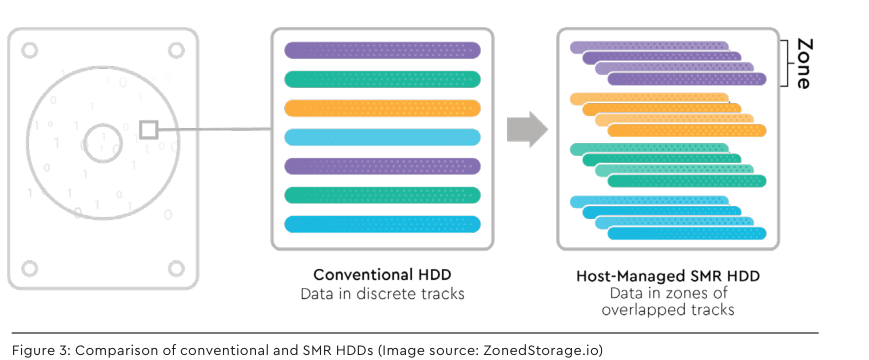
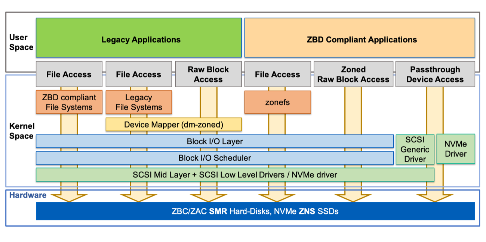
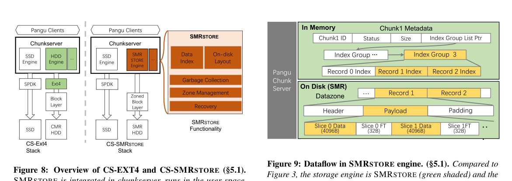

# 写入模型约束：SMR / 分区存储与软件改造

> 容量约束分析 · 厂商白皮书、zonedstorage.io / Linux 文档与 Dropbox、阿里云一手资料

最大容量档的 HDD 越来越多地以 SMR（叠瓦式磁记录）形式出现：WD 的 32 TB 和 40 TB、Toshiba 的 30–34 TB、Seagate 的 36 TB 都是 SMR 盘，同一代的 CMR 型号要小一档。SMR 多出的容量不是免费的——它要求主机按区域顺序写，不能原地改写。于是“客户能不能用上最大的盘”，在 IOPS/TB 和重建时间之外，还取决于第三个约束：**写入模型**。本章先对比 CMR、驱动器管理型 SMR（DM-SMR）和主机管理型 SMR（HM-SMR），再梳理厂商声明的容量增益、区域语义和 Linux 生态现状、软件必须改动的部分，以及 Dropbox 和阿里云两个规模化采用者的一手数据，最后讨论这对大容量盘需求意味着什么。全文区分**来源事实**、**工程推论**（写明公式和假设）与**待验证**。资料采集于 2026-11-19。

### 来源事实：三种写入模型

CMR 在相邻磁道之间留有间隙以容纳磁道错位，任一扇区都可以直接改写。SMR 的写头比读一条磁道所需的宽，写完一道后只前移半个写头宽度，下一道部分覆盖上一道，只留下可读的窄带；重叠的磁道组成固定容量的“带”即区域（zone），区域之间留有保护间隙 [KW1][KW2]。因此修改某个扇区就要重写其上方的整片“瓦”，数据流必须按区域顺序写入；读则不受影响，随机读能力与 CMR 相当 [KW1][KW2]。

*Western Digital 白皮书《Shingled Magnetic Recording (SMR) HDD Technology》（2022-10）图 3：传统 HDD 的离散磁道与主机管理型 SMR 盘的重叠磁道 / 区域（原图来源注明为 ZonedStorage.io）* — [原始来源](https://documents.westerndigital.com/content/dam/doc-library/en_us/assets/public/western-digital/collateral/white-paper/white-paper-shingled-magnetic-recording-hdd-technology.pdf)

| 模型 | 对主机呈现 | 随机写处理 | 性能可预测性 | 需要的软件改动 |
|---|---|---|---|---|
| CMR | 普通块设备 | 原地改写 | 可预测 | 无 |
| DM-SMR（驱动器管理型） | 普通块设备，无行业标准 | 先写入盘内常规区缓存，再由固件读出旧区数据、合并后重写到顺序区 | 依固件和负载而定，可能不可预测 | 无，但写放大由盘内承担 |
| HA-SMR（主机感知型） | 可当普通盘用，也可用区域命令 | 顺序写优先区，可随机写 | 按普通盘用时与 DM-SMR 类似 | 可选 |
| HM-SMR（主机管理型） | 新设备类型，需 ZBC（SCSI）/ ZAC（ATA）命令集 | 顺序写必需区：写入必须从写指针开始，否则盘直接报错中止 | 可预测 | 必须：文件系统、存储引擎或应用要区域感知 |

表中内容综合自 zonedstorage.io 与 WD 白皮书 [KW1][KW2]，以及 Dropbox 对三种类型的评估说明 [KW3]。数据中心级 SMR 基本都是 HM-SMR：WD Ultrastar DC HC600 系列、Seagate 36 TB Exos、Toshiba M12 均为主机管理型 [KW2][KW4][KW5]。OCP《Datacenter SAS-SATA Device Specification》也要求 SMR 盘遵循 ZAC-2 / ZBC-2 [KW6]。

### 来源事实与推论：SMR 到底多出多少容量

| 来源 | 表述的 SMR 增益 | 口径 |
|---|---|---|
| WD SMR 白皮书（2022-10） | 面密度最多高 11%；UltraSMR 比 CMR 多 4 TB | 同代 CMR 对比 [KW2] |
| WD 技术简报（2024-10） | 32 TB HC690 比同代 CMR 多 6 TB，即 23% | UltraSMR（加 DSEC、sTECC 纠错余量）对 26 TB CMR [KW7] |
| Seagate 产品手册 | 36 TB SMR 与 32 TB CMR 同为 10 碟 20 头，道密度 790 对 738 KTPI | 工程推论：容量差 12.5% [KW4][KW8] |
| Toshiba M12 新闻稿 | SMR 30–34 TB，CMR 型号最高 28 TB | 工程推论：最大档相差约 21%，CMR 型号规格未发布 [KW5] |
| Dropbox（2019、2023） | 同等价格下多存约 10–20% 数据；叠瓦使容量比 PMR 高约 20% | 用户侧经验 [KW9][KW10] |
| 阿里云 SMRSTORE（FAST '23） | 面密度比 CMR 高 25% | 论文引述 [KW11] |
| Backblaze（2026-09） | 同类盘片上容量大约高 10–25% | 科普表格 [KW12] |

**工程推论：净增益。**SMR 的标称增益要扣掉两项才是用户真正多得到的容量：一是日志结构带来的元数据、填充和对齐开销 o（SMRSTORE 实测大 IO 下约 1–2% [KW11]）；二是垃圾回收（GC）相对 CMR 额外需要预留的空闲空间 r。净增益 = (1 + g) × (1 − r) × (1 − o) − 1。取 o = 1.5%：g = 12.5% 时，r = 5% 净增益约 5.3%，r = 10% 则约为 0；g = 23% 时，r = 5% 约 15.1%，r = 10% 约 9.0%。也就是说，**增益越小的 SMR，越依赖上层软件把 GC 预留压低**；对象只追加、删除按大块整体失效的系统（如 Dropbox 的不可变 block、SMRSTORE 的 chunk）最容易做到。r 取值随负载而变，属于**待验证**项。

另一方面，SMR 只增加容量、不增加磁头，单盘随机读 IOPS 与同代 CMR 相当 [KW2]。按 IOPS/TB = 单盘 IOPS ÷ 容量、单盘 170 IOPS 估算（Seagate 数据手册 4K QD16 随机读口径 [KW13]，假设 SMR 型号相同）：

| CMR 档 | CMR IOPS/TB | +12.5% SMR 容量 / IOPS/TB | +23% SMR 容量 / IOPS/TB | 100 PB 裸容量所需盘数（CMR / +12.5% / +23%） |
|---|---|---|---|---|
| 24 TB | 7.08 | 27.0 TB / 6.30 | 29.5 TB / 5.76 | 4,167 / 3,704 / 3,388 |
| 28 TB | 6.07 | 31.5 TB / 5.40 | 34.4 TB / 4.94 | 3,571 / 3,175 / 2,904 |
| 32 TB | 5.31 | 36.0 TB / 4.72 | 39.4 TB / 4.32 | 3,125 / 2,778 / 2,541 |

SMR 在省盘位、省功耗的同时，进一步压低 IOPS/TB。对 IOPS/TB 已经吃紧的集群，SMR 带来的是双重约束。

### 区域语义与 Linux 软件栈现状

**区域语义（来源事实）。**ZBC / ZAC 定义了常规区（可随机写，HM 盘上可选、通常只占很小比例）和顺序写必需区；每个顺序区有写指针，写入必须对齐写指针并按物理扇区大小对齐，不能留空隙；区域可被打开、关闭、写满（finish）和重置写指针（reset，相当于整区擦除）。标准只定义一种资源限制：同时打开的区域数 [KW1][KW2]。SMR 硬盘标准里没有 zone append 命令，可由主机软件模拟 [KW1]。具体到产品：Seagate 36 TB 为 256 MiB 区域、1% 常规区，建议最多同时打开 1024 个区域，超过会“显著劣化性能、增加延迟”，常规区若被未对齐更新写满也会显著劣化 [KW4]；WD HC690 同为 256 MiB、1% 常规区 [KW14]；OCP 规范则写的是 128 MB 区域、0.8% CMR 区 [KW6]。

*zonedstorage.io《Linux Kernel Support》页面原图：Linux 访问分区块设备的六条 I/O 路径——旧应用经 ZBD 兼容文件系统、旧文件系统 + dm-zoned 或裸块访问；ZBD 兼容应用经 zonefs、分区裸块访问或 SG / NVMe 直通* — [原始来源](https://zonedstorage.io/docs/linux/overview)

**内核与文件系统（来源事实）。**Linux 4.10 起支持分区块设备，同时提供 F2FS 原生支持 [KW15]。内核块层历史上不保证请求顺序，因此用“区域写锁”串行化同一区域的写；6.10 起改为“区域写插桩”（zone write plugging），不再强制要求 mq-deadline 调度器 [KW16][KW17]。各条路径的适用性差别很大：

| 方案 | 做法 | 对大容量 HM-SMR 的适用性 |
|---|---|---|
| dm-zoned | 用常规区（或外加普通块设备）缓冲随机写，再回收到顺序区，向上呈现普通块设备 | 官方文档明确“因性能不可预测不推荐使用”；SMRSTORE 论文引用的研究显示持续写下吞吐下降 56.1% [KW18][KW11] |
| F2FS | 日志结构，强制 LFS 模式，section 与区域对齐，区域整空后重置 | 不支持大于 16 TiB 的设备，“不适合大容量 SMR 硬盘” [KW19] |
| Btrfs（5.12 起） | 写时复制；超级块改为日志式；块组对齐区域并顺序分配；数据写用 zone append | 可用；多盘 RAID 0/1/10 仍属实验特性 [KW20] |
| XFS（6.15 起） | 常规区作主设备存元数据，顺序区作 realtime 设备存数据，自带分区 GC | 新近加入，文档仍标注为实验性支持 [KW21] |
| zonefs | 每个区域映射为一个只追加文件，没有自己的元数据 | 适合 LSM 等自行管理顺序写的应用 [KW22] |
| RocksDB + ZenFS | 按写入生命周期提示把 SST 文件放进同一区域，区域全部失效后重置，不在文件系统或盘内做 GC | 面向 KV 引擎；GC 只由 RocksDB compaction 完成 [KW17] |
| Ceph BlueStore | 开发者文档中的研究项目：先支持 RGW 这类不改写负载，引入记录写指针和失效字节的 ZonedFreelistManager | 仍处研究阶段，长期目标才包括覆盖写 [KW23] |

HDFS DataNode、ext4 / XFS（非分区模式）上的传统存储引擎、硬件 RAID 卡都没有出现在原生支持名单上。WD 白皮书给出的现实选项也只有四种：自研应用直接用 ZBC / ZAC、换用支持分区的内核和文件系统、用 dm-zoned 伪装成普通盘、或依赖 HBA / 盘柜厂商的专门支持 [KW2]。

### 软件必须改什么：顺序追加、GC 与区域感知放置

阿里云 SMRSTORE 论文（USENIX FAST '23）给出了一个大数据存储引擎迁移到 HM-SMR 的完整改造清单。它把盘分为超级区、元数据区和数据区，静态划分；所有数据和元数据都以变长、4 KB 对齐的 record 写成日志；在内存中维护 chunk 元数据和 record 索引 [KW11]。

*USENIX FAST '23 论文《SMRSTORE: A Storage Engine for Cloud Object Storage on HM-SMR Drives》（阿里巴巴）图 8–9：CS-Ext4 与 CS-SMRSTORE 两种 chunkserver 栈对比（SMRSTORE 在用户态经 ZBD 子系统直接访问 HM-SMR 盘，负责数据索引、盘上布局、GC、区域管理与恢复），以及 SMRSTORE 内存索引与盘上 record 的数据流* — [原始来源](https://www.usenix.org/conference/fast23/presentation/zhou)

1. **把随机写变成大块顺序追加。**Dropbox 发现 SMR 上大写（平均 4–5 MB）效果好得多，最初从 SSD 立即以多次小写刷到 SMR 效率不佳，改为缓冲后少量大写；进入的数据并不总是 4 KB 对齐，需要暂存区来对齐 [KW3]。
2. **垃圾回收。**区域只能追加，删除后留下的失效数据要搬走才能重置区域。SMRSTORE 实测 F2FS 在随机删除触发的频繁 GC 下吞吐下降 61.5% [KW11]。
3. **按生命周期放置。**SMRSTORE 只允许同类数据流（生命周期相近）混放在一个区域，并尽量给大 chunk 独占区域，以减少 GC；ZenFS 用写入生命周期提示做同样的事 [KW11][KW17]。
4. **元数据与常规区。**Dropbox 把频繁更新的元数据放在常规区、不可变数据放在顺序区，其元数据与数据之比约 0.03%，恰好与常规区比例相符；1 GB extent 正好等于 4 个 256 MB 区域 [KW3]。
5. **开放区域与并发。**正常运行时一个 chunkserver 同时打开数百个 chunk 写入 [KW11]，而盘的建议开放区域上限是 1024 级别 [KW4]，并发写流需要汇聚到有限的区域上。
6. **资源与恢复代价。**60 盘服务器上 SMRSTORE 占用 49.3 GB 内存，约为 Ext4 方案的两倍；CPU 约 19 核，多 26.7%；60% 占用的 20 TB SMR 盘恢复需 94.4 秒，而 16 TB CMR 上的 Ext4 方案不到 20 秒 [KW11]。Dropbox 为 14 TB SMR 机型把每台主机内存加到 96 GB、CPU 从 16 核加到 20 核 [KW3]。
7. **验证与固件。**Dropbox 不走内核块设备栈直接用 libzbc 访问盘，因而需要自己实现重试逻辑；HBA、盘和机箱各有固件，联调成本高；为此向 libzbc 提交了 13 个改动，并自研 SMRtest 压测工具 [KW9]。

### 来源事实：规模化采用者

| 采用者 | 做法 | 公开结果 |
|---|---|---|
| Dropbox Magic Pocket | 2018 年评估 HA 和 HM 后选定 HM-SMR；每盘一个 OSD 进程，不用文件系统，经 libzbc 直接管理布局；14 TB SMR 机型每台 1.4 PB，配 50 Gbps 网卡保证修复时间 [KW3] | 2019 年起新盘全部为 SMR，年底近 40% 数据在 SMR 上；整体比上一代设计节省 20% 以上，单机盘数从 60 增至 100 [KW9]；2023 年 90% 盘队为 SMR，同成本多存 10–20% 的结论保持不变 [KW10] |
| Dropbox（去掉 SSD 缓存） | 原设计用 SSD 做写回缓存再异步顺序刷入 SMR；单 SSD 成为每台 100+ 盘主机的写吞吐瓶颈，且出现过 SSD 集中磨损失效；改为把 block 元数据与数据内联直接写 SMR [KW24] | 2022 Q1 全部移除 SSD，盘队写吞吐提高 15–20%；平均负载下最后一跳磁盘写 p95 延迟升高 10–15%，但只占端到端写延迟的 2% [KW24] |
| 阿里云 OSS（SMRSTORE） | 用户态存储引擎直接实现盘古 chunk 接口，全日志结构，区域感知放置；测试盘为 Seagate 20 TB SMR，74,508 个 256 MB 区域，其中 800 个常规区 [KW11] | 高并发写测试中，1 MB IO 时单盘吞吐达到 110 MB/s，比 Ext4 + CMR 高 30%，但小于 32 KB 的小 IO 吞吐偏低；整机 4 GB/s，为 F2FS 的 2.16 倍；780 盘集群对比中 SMR 与 CMR 各项指标相当；总成本最多降低 15%，已在标准型 OSS 中存储数百 PB，计划推广到所有存储类别 [KW11] |
| WD 出货口径 | — | SMR 约占 WD 容量型数据中心出货 EB 的 50%（2025-12） [KW25] |
| Backblaze | — | 2026 Q2 盘队中没有任何 SMR 盘，称引入 SMR 不是“换盘”而是“立项” [KW12] |

两家成功采用者有共同前提：数据本身不可变、按大块追加、删除以大粒度失效，并且有自研存储引擎和规模足够大的测试环境（Dropbox 测试集群约 6 个机柜、48 台、近 5,000 块盘 [KW9]）。

### 工程推论：写入模型为何决定客户能否用上最大的盘

**最大档往往就是 SMR 档。**2026 年公开产品中，WD（40 TB UltraSMR）和 Toshiba（34 TB）的最大容量都依赖 SMR；Seagate 的 36 TB 同样是 SMR，比同平台的 32 TB CMR 大 12.5% [KW4][KW5][KW26]。对一个跑在 ext4 / 非分区 XFS 上的 HDFS、Ceph BlueStore 或硬件 RAID 的国内客户，HM-SMR 盘无法直接插上就用，能用的最大盘实际是 CMR 档。这时中等容量偏好的一部分含义是：**更大的那一档无法直接使用，或者改造成本超过 12–23% 容量带来的收益**。

**改造成本是固定成本，收益与规模成正比。**按上文净增益公式，100 PB 集群从 32 TB CMR 换到 36 TB SMR，在 r = 5% 时约多出 5% 的可用容量，即 5 PB 左右；而一次性改造包括存储引擎、GC、元数据布局、测试与固件联调，持续成本包括约两倍内存和多 1/4 的 CPU（SMRSTORE 数据）。这笔账只有在 EB 级、数据以追加为主时才明显划算，与 Dropbox、阿里云 OSS 的情况一致。

**HAMR 与 SMR 是两件事。**HAMR 提高每碟密度、对主机透明，Dropbox 也认为 HAMR “对主机透明，应像普通盘一样工作” [KW10]；SMR 则是在任意记录技术之上再叠一层格式增益。对无法改造的客户，CMR 形态的 HAMR 盘是不改软件就能拿到容量增长的路径；对能改造的客户，SMR 在 HAMR 之上仍可再多出一截。

**HDD 厂商可以做的事（推论）。**一是同一平台同时提供 CMR 与 SMR 两种格式，让写入模型成为客户的选择而不是门槛；二是把 SMR 适配做成可复用的参考栈（Btrfs / XFS 分区模式、ZenFS、对象存储引擎样例、libzbd / fio 工具），并公开 GC 预留、开放区域数和恢复时间的实测数据；三是参照 Dropbox 的做法，在厂商侧用客户的真实机箱和负载做规模测试 [KW10]；四是把区域大小、常规区比例等参数与 OCP 规范对齐，减少每个客户各自适配的成本。

### 待验证与资料边界

**待验证**：不同负载下 SMR 相对 CMR 需要额外预留的 GC 空间 r；国内主流 HDFS / Ceph / 自研对象存储在 HM-SMR 上的实际吞吐与尾延迟；Seagate 44 TB Mozaic 4+ 和 WD 40 TB 的格式细节（新闻稿未写明 44 TB 是否含 SMR 型号）；XFS 分区模式在生产中的成熟度。阿里云 SMRSTORE 的成本数字（最多降低 15%）来自论文自述，未见独立复核；Dropbox 的数据截至 2023 年，之后的盘队比例未见更新。DM-SMR 在数据中心中的使用情况没有找到一手资料。

## 本章资料

- **[KW1]** [Zoned Storage（zonedstorage.io）· Shingled Magnetic Recording Hard Disks（SMR 原理、ZBC / ZAC、三种接口模型、区域类型与开放区域限制，采集于 2026-11-19）](https://zonedstorage.io/docs/introduction/smr)
- **[KW2]** [Western Digital · White Paper: Shingled Magnetic Recording (SMR) HDD Technology（面密度最多 +11%、DM / HM-SMR、UltraSMR +4TB、四种生态适配方式，2022-10，采集于 2026-11-19）](https://documents.westerndigital.com/content/dam/doc-library/en_us/assets/public/western-digital/collateral/white-paper/white-paper-shingled-magnetic-recording-hdd-technology.pdf)
- **[KW3]** [Dropbox Tech Blog · Extending Magic Pocket Innovation with the first petabyte scale SMR drive deployment（2018-06-12，采集于 2026-11-19）](https://dropbox.tech/infrastructure/extending-magic-pocket-innovation-with-the-first-petabyte-scale-smr-drive-deployment)
- **[KW4]** [Seagate · Exos SATA Product Manual 36TB（ST36000NM001M，SMR / ZAC 主机管理型，Publication 210960600 Rev C，2026-05；10 碟 20 头、790 KTPI、256MiB 区域、1% 常规区、建议最多 1024 个开放区域，采集于 2026-11-19）](https://www.seagate.com/content/dam/seagate/assets/support/internal-hard-drive/enterprise-hard-drives/x-mozaic/_shared/files/Seagate_Exos_SATA_Product_Manual_36TB_210960600C.pdf)
- **[KW5]** [Toshiba 新闻稿 · Toshiba Begins Sampling of 30-34 TB SMR Nearline Hard Disk Drives（M12 系列，主机管理型 SMR，CMR 最高 28TB，2026-03-31，采集于 2026-11-19）](https://news.toshiba.com/press-releases/press-release-details/2026/Toshiba-Begins-Sampling-of-30-34-TB-SMR-Nearline-Hard-Disk-Drives/default.aspx)
- **[KW6]** [Open Compute Project · Datacenter SAS-SATA Device Specification Version 1.0（Meta / Microsoft / HPE，2023-03-28；SMR-1~5：ZAC-2 / ZBC-2、0.8% CMR 区、128MB 区域，采集于 2026-11-19）](https://www.opencompute.org/documents/datacenter-sas-sata-device-specification-rev-1-0-pdf/)
- **[KW7]** [Western Digital · Tech Brief: Continuous Innovation for Highest Capacities and Lower TCO（UltraSMR：32TB HC690 比同代 CMR 多 6TB / 23%，2024-10，采集于 2026-11-19）](https://documents.westerndigital.com/content/dam/doc-library/en_us/assets/public/western-digital/collateral/tech-brief/technical-brief-continuous-innovation.pdf)
- **[KW8]** [Seagate · Exos SATA Product Manual 32/30/28/24TB（Exos M，CMR，Publication 210048100 Rev E，2025-12；10 碟 20 头、738 KTPI，采集于 2026-11-19）](https://www.seagate.com/content/dam/seagate/assets/support/internal-hard-drives/enterprise-hard-drives/exos-m/_shared/files/Seagate_Exos_SATA_Product_Manual_32-30-28-24TB_210048100E.pdf)
- **[KW9]** [Dropbox Tech Blog · SMR: What we learned in our first year（2019-07-30，采集于 2026-11-19）](https://dropbox.tech/infrastructure/smr-what-we-learned-in-our-first-year)
- **[KW10]** [Dropbox Tech Blog · After four years of SMR storage, here's what we love—and what comes next（2023-03-08，采集于 2026-11-19）](https://dropbox.tech/infrastructure/four-years-of-smr-storage-what-we-love-and-whats-next)
- **[KW11]** [USENIX FAST '23 · Zhou 等（阿里巴巴）：SMRstore: A Storage Engine for Cloud Object Storage on HM-SMR Drives（2023-02，采集于 2026-11-19）](https://www.usenix.org/conference/fast23/presentation/zhou)
- **[KW12]** [Backblaze · Backblaze Drive Stats for Q2 2026（CMR / SMR 对比与“盘队中没有 SMR 盘”说明，2026-09-29，采集于 2026-11-19）](https://www.backblaze.com/blog/backblaze-drive-stats-for-q2-2026/)
- **[KW13]** [Seagate · Exos 数据手册 DS2046.1-2512（12–32 TB 型号随机读写 4K QD16：168–170 IOPS 读，2025-12，采集于 2026-11-19）](https://www.seagate.com/content/dam/seagate/en/content-fragments/products/datasheets/exos-portfolio-refresh/exos-ds2046.1-2512-en_us_V2_en_AS.pdf)
- **[KW14]** [Western Digital · Ultrastar DC HC690 (SATA) Hard Disk Drive Specification（28–32 TB 主机管理型 SMR、256MiB 区域、1% 常规区，采集于 2026-11-19）](https://documents.westerndigital.com/content/dam/doc-library/en_us/assets/public/western-digital/product/data-center-drives/ultrastar-dc-hc600-series/product-manual-ultrastar-dc-hc690-sata.pdf)
- **[KW15]** [Zoned Storage（zonedstorage.io）· Linux Kernel Support / Overview（4.10 起支持分区块设备、六条 I/O 路径，采集于 2026-11-19）](https://zonedstorage.io/docs/linux/overview)
- **[KW16]** [Zoned Storage（zonedstorage.io）· Write Ordering Control（区域写锁与 6.10 起的区域写插桩，采集于 2026-11-19）](https://zonedstorage.io/docs/linux/sched)
- **[KW17]** [Zoned Storage（zonedstorage.io）· ZenFS（RocksDB 分区文件系统插件、写入生命周期提示、6.10 起区域写插桩，采集于 2026-11-19）](https://zonedstorage.io/docs/applications/zenfs)
- **[KW18]** [Zoned Storage（zonedstorage.io）· dm-zoned（随机写缓冲机制；因性能不可预测不推荐使用，采集于 2026-11-19）](https://zonedstorage.io/docs/device-mapper/dm-zoned)
- **[KW19]** [Zoned Storage（zonedstorage.io）· f2fs（分区支持、LFS 模式、不支持大于 16 TiB 设备，采集于 2026-11-19）](https://zonedstorage.io/docs/filesystems/f2fs)
- **[KW20]** [Zoned Storage（zonedstorage.io）· Btrfs（5.12 起分区支持、zone append、RAID 实验特性，采集于 2026-11-19）](https://zonedstorage.io/docs/filesystems/btrfs)
- **[KW21]** [Zoned Storage（zonedstorage.io）· XFS（6.15 起原生分区支持、realtime 设备与分区 GC，采集于 2026-11-19）](https://zonedstorage.io/docs/filesystems/xfs)
- **[KW22]** [Zoned Storage（zonedstorage.io）· zonefs（每区域一个只追加文件，采集于 2026-11-19）](https://zonedstorage.io/docs/filesystems/zonefs)
- **[KW23]** [Ceph 官方开发者文档 · Zoned Storage Support（BlueStore HM-SMR 研究项目、ZonedFreelistManager，采集于 2026-11-19）](https://docs.ceph.com/en/latest/dev/zoned-storage/)
- **[KW24]** [Dropbox Tech Blog · Increasing Magic Pocket write throughput by removing our SSD cache disks（2022-12-08，采集于 2026-11-19）](https://dropbox.tech/infrastructure/increasing-magic-pocket-write-throughput-by-removing-our-ssd-cache-disks)
- **[KW25]** [Western Digital 博客 · SMR HDD Technology for AI Data Centers（SMR 约占容量型数据中心出货 EB 的 50%，2025-12-04，采集于 2026-11-19）](https://blog.westerndigital.com/smr-hdd-technology-ai-data-centers/)
- **[KW26]** [WD（Western Digital）新闻稿 · Western Digital Accelerates Storage Innovation for AI Era（40TB UltraSMR ePMR 认证中、2026 下半年量产计划，2026-02-03，采集于 2026-11-19）](https://www.westerndigital.com/company/newsroom/press-releases/2026/2026-02-03-western-digital-accelerates-storage-innovation-for-ai-era)
