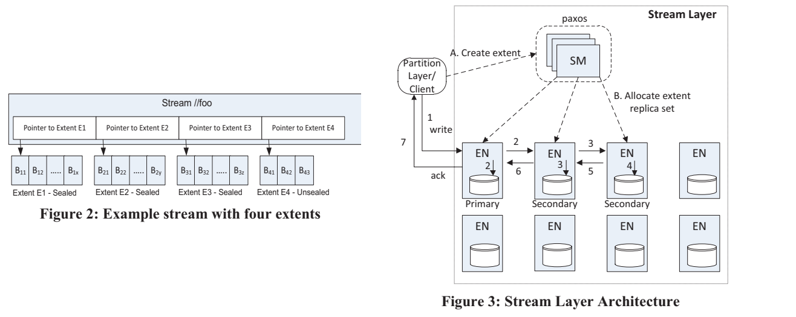
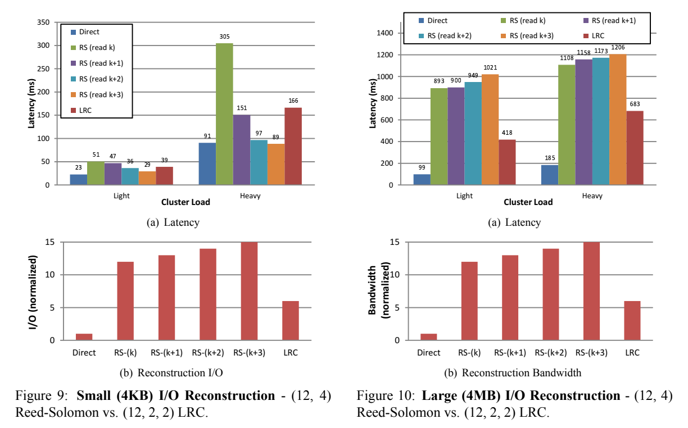
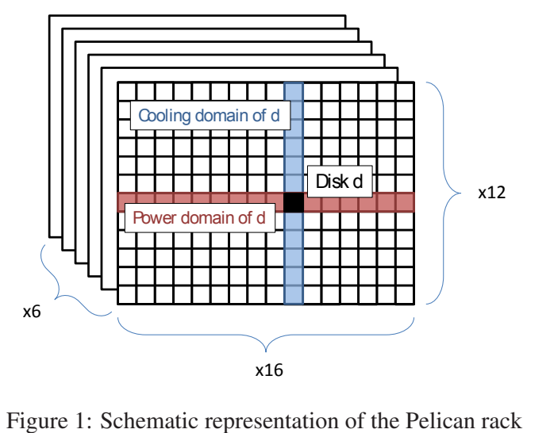

# Microsoft / Azure Storage

> 超大规模云存储 · 追加写流层 / LRC 纠删码 / 机架级冷存储 · 官方论文与文档

微软 Azure Storage（早期名为 Windows Azure Storage，WAS）有三篇和 HDD IO 路径直接相关的一手论文：SOSP'11 的 WAS 架构论文，讲只允许追加写的“流层”（stream layer）、extent 封存（seal）、日志盘和磁盘 IO 调度 [BZ1]；USENIX ATC'12 的 LRC 纠删码论文，讲如何在 1.33 倍存储开销下把重建要读的分片数减半 [BZ2]；OSDI'14 的 Pelican 论文，是微软研究院与 Azure 合作的机架级冷存储原型，按“只允许 8% 的盘同时转动”来设计供电和散热 [BZ3]。产品层面，Azure Blob 提供 hot / cool / cold / archive 四个访问层，另有 SSD 支撑的 Turbo 层（预览） [BZ4]。本章依次介绍流层、纠删码、冷存储机架和产品分层，并分析这些 IO 优化与 HDD 容量、密度的关系。

### 定位与规模

WAS 自 2008 年 11 月投入生产，提供 Blob、Table、Queue 三类抽象。SOSP'11 论文发表时，生产系统有 70 PB 裸容量，另有数百 PB 正在部署 [BZ1]。部署单元是**存储戳（storage stamp）**：由 N 个机柜组成的集群，每个机柜是独立故障域，通常 10–20 个机柜、每柜 18 个“重磁盘”存储节点；第一代存储戳每个约 2 PB 裸容量，下一代可达 30 PB [BZ1]。论文给出的运营目标很能说明问题：存储戳在容量、事务和带宽三方面都保持约 70% 的利用率，尽量不超过 80%。预留的 20% 一部分用于**磁盘短行程（short stroking）**，即只用外圈磁道，换取更短的寻道和更高的吞吐；另一部分保证机柜故障时仍有容量和可用性。利用率达到 70% 时，位置服务会把账户迁到其他存储戳 [BZ1]。到 ATC'12 时，论文称存储量“即将超过 1 EB”，每隔几天就有 1 PB 新数据写入 [BZ2]。

按当前产品文档，标准存储账户默认容量上限 5 PiB。在部分大区域，默认请求率上限为每秒 40,000 次，入口带宽 60 Gbps，出口带宽 200 Gbps；其他区域为每秒 20,000 次、25 Gbps 和 50 Gbps，均可申请提高 [BZ7]。单个块 blob 的目标请求率为每秒 3,000 次，单块最大 4,000 MiB，最多 50,000 块，单 blob 上限约 190.7 TiB [BZ6]。

### 架构与 IO 路径：流层、extent 与封存

*WAS SOSP'11 论文 Figure 2 与 Figure 3（PDF 第 4 页裁切拼接）：左为由四个 extent 指针组成的流 //foo（E1–E3 已封存，仅 E4 可追加）；右为流层架构，Stream Manager（Paxos）创建 extent 并分配副本集，写入由主 EN 链式复制到两个从 EN* — [原始来源](https://sigops.org/s/conferences/sosp/2011/current/2011-Cascais/printable/11-calder.pdf)

WAS 分三层：前端层负责请求路由；分区层理解 Blob/Table/Queue 的语义，按 PartitionName 区间切成 RangePartition 并做负载均衡；流层把比特写到盘上，并负责存储戳内的复制 [BZ1]。流层只对分区层开放，接口类似文件系统，但**所有写入只能追加** [BZ1]：

- **block**：读写的最小单位，最大 N 字节（例如 4 MB），每个 block 带一个校验和。读取时整个 block 读出并校验，所有 block 每隔几天还会做一次全量校验。
- **extent**：复制单位，默认在存储戳内保留 3 个副本，每个 extent 是 EN（Extent Node）上的一个 NTFS 文件。分区层使用的目标 extent 大小为 **1 GB**：小对象追加进同一个 extent，甚至同一个 block；TB 级的大 blob 被切分到多个 extent。
- **stream**：extent 指针的有序列表。只有最后一个 extent 可追加，之前的都不可变；把已有 extent 拼接成新流只需更新指针。
- **封存（seal）**：extent 写到目标大小后在 block 边界封存，此后不可再追加，新的追加转入新 extent。论文写道，封存后的 extent 不可变，流层可以对它做“对冷 extent 做纠删码”之类的优化。

控制面由 Stream Manager（SM，Paxos 集群）承担，不在客户请求的关键路径上。SM 负责创建 extent 并分配到 EN、监控 EN 健康、对丢失副本做**惰性重复制**、回收不再被引用的 extent、按流策略调度纠删码。放置副本时，SM 在不同故障域中随机选择 EN，避开供电、网络或同机柜带来的相关故障 [BZ1]。分区层把 Blob 数据直接写进 commit log 流以减少流写入次数；做 checkpoint 时，不再复制数据，而是把相应 extent 拼接到 RangePartition 的 blob data 流上，这是一个只改指针的快速操作 [BZ1]。论文在经验教训中说明了追加写的代价：需要高效、可扩展的 GC 来控制空间开销，而 GC 本身消耗额外 IO；盘上布局与数据抽象的逻辑地址空间不一致，所以要为大数据集的流式读取专门实现预取 [BZ1]。

### 关键优化手段与处理逻辑

#### 1. 日志盘：把同步写与数据盘解耦

流层的持久性契约是：确认写入时，系统中必须已有 3 份落在掉电安全介质上的副本。为在此前提下获得好性能，**每个 EN 预留一整块 HDD 或 SSD 作为日志盘**，只做单条顺序日志，以发挥设备的满额写吞吐。EN 追加时同时做两件事：把数据写入日志盘，并把追加排队写往 extent 文件所在的数据盘，两者任一完成即可返回成功。若日志先完成，数据会在内存中缓冲直至落到数据盘，期间的读取由内存提供。这样还能**把连续的小写合并成大写**，并更好地调度并发读写。效果是：commit log 流的小追加，端到端平均延迟由 30 ms 降到 6 ms，方差也明显减小 [BZ1]。代价是关键路径之外多一次写。

#### 2. 主轴防饿死（Spindle Anti-Starvation）

论文指出，很多 HDD 为了追求最高吞吐会牺牲公平，偏好顺序请求；WAS 观察到某些盘会被大的流水线顺序读写“锁住”，非顺序 IO 最长被阻塞 2,300 ms。对策是自定义 IO 调度：若某个主轴上预计待处理的 IO 已超过 100 ms，或者有已调度的请求超过 200 ms 仍未完成，就不再往这块盘下发新 IO。代价是部分顺序请求的延迟略有增加 [BZ1]。

#### 3. 带截止时间的读与“读重建”

三副本 extent 的读请求带有 deadline：EN 判断无法按时完成就立即回复，客户端改向另一个 EN 读取。纠删码数据用同样的思路：数据分片所在主轴过忙时，向该 extent 的所有分片发读请求，用最先返回的 N 个分片重建所需数据 [BZ1]。LRC 论文进一步说明，如果对某个分片的读看起来要花太长时间，WAS 会并行发起重建，把原分片所在节点当作离线处理，哪个结果先到就返回哪个；对持续偏热的分片，可以复制到较冷的节点，或缓存到 DRAM/SSD 上直接服务 [BZ2]。

#### 4. 封存后惰性纠删码与 LRC

*ATC'12 LRC 论文 Figure 9 / Figure 10（第 10 页裁切）：生产集群上 RS(12,4) 与 LRC(12,2,2) 的重建对比。左为 4 KB 小 IO 的延迟与重建 IO 次数，右为 4 MB 大 IO 的延迟与重建带宽（均以直接读为 1 归一化）* — [原始来源](https://www.usenix.org/system/files/conference/atc12/atc12-final181_0.pdf)

extent 先以 3 副本写入，封存后（例如达到 1 GB）在后台惰性地做纠删码，完成后删除原来的 3 个副本 [BZ2]。SOSP'11 时采用 Reed-Solomon，把 3 副本的 3 倍开销降到 1.3–1.5 倍 [BZ1]。ATC'12 提出 **LRC（Local Reconstruction Codes）**，原因是：目标开销 1.33 倍若用 RS(12,4) 实现，修复一个分片要读 12 个分片，这会增加碰上热节点的概率，也增加网络和 IO 开销；而重建时间往往取决于最慢的那几个分片 [BZ2]。生产采用的 **LRC(12,2,2)** 把 12 个数据分片分成两组，每组 6 个，各配 1 个本地校验，另加 2 个全局校验，共 16 个分片，开销同为 1.33 倍；单个数据分片的重建只需读 6 个分片，比 RS(12,4) 少一半。与 RS(6,3) 相比，在相同 1.5 倍开销下改用 LRC(12,4,2)，重建代价可从 6 降到 3；在相同重建代价下改用 LRC(12,2,2)，开销从 1.5 倍降到 1.33 倍 [BZ2]。

| 生产集群实测（每节点 1 Gbps 网卡） [BZ2] | 直接读 | RS(12,4) 读 k 个分片 | LRC(12,2,2) |
|---|---|---|---|
| 4 KB 小 IO，重负载延迟 | 91 ms | 305 ms（读 13 个分片时为 151 ms） | 166 ms，只读 6 个分片 |
| 4 MB 大 IO，轻负载延迟 | 99 ms | 893 ms | 418 ms |
| 4 MB 大 IO，重负载延迟 | 185 ms | 1,108 ms | 683 ms |
| 重建 IO / 带宽（以直接读为 1） | 1 | 12 | 6 |

工程实现上，LRC 论文给出了几项与 HDD IO 直接相关的细节 [BZ2]：每个存储戳 20 个机柜，一个 extent 的 16 个分片分别放在 16 个不同机柜；WAS 共有 10 个升级域，利用本地分组属性只用其中 9 个放分片，使任何一个升级域下线时，每个数据分片都能直接读到或在组内重建。重建以大于追加 block 的单位（最大 5 MB）执行，减少磁盘和网络 IO 次数，预读数据缓存在做重建的 EN 内存中（最多 256 MB）。客户端读写、复制、重建、scrub、迁移等多种 IO 混在一起，各层都做节流和调度：EN 跟踪网口和各盘负载，决定接受、拒绝或延后 IO；SM 跟踪复制负载，决定何时启动复制、纠删码和删除。纠删码的进度要跟上客户写入速度，即使同时有因丢盘、丢节点、丢机柜而必须做的关键重复制。

#### 5. Pelican：按功耗与散热“正好配置”的冷存储机架

*Pelican OSDI'14 论文 Figure 1：机架示意图。1,152 块盘排成 6×16×12 的立方体，同一行的盘共享供电域、同一列共享散热域* — [原始来源](https://www.usenix.org/system/files/conference/osdi14/osdi14-paper-balakrishnan.pdf)

Pelican 是一个 52U 机架，装 1,152 块归档级 3.5 英寸 SATA 盘（平均 4.55 TB，总计超过 5 PB），配两台服务器，各有双 10 Gbps 网口，合计 40 Gbps [BZ3]。设计目标是每 PB 存储提供 1 GB/s 的持续读（1 GB/PB/s），按此速率约 13 天可把整柜数据读出一遍。按每盘约 100 MB/s 有效吞吐计算，只需约 50 块活动盘就能跑满 40 Gbps，因此 Pelican 把资源压到“正好够用”：散热只够 96 块盘同时转动或起转，供电只够 144 块，PCIe 根带宽 64 Gbps，远低于每盘 1 Gbps。结果是只有 8% 的盘能同时转动，其余处于 standby（电子部件通电、盘片静止） [BZ3]。实测 standby、起转、活动三种状态的单盘功耗分别为 1.56 W、21.53 W 和 9.42 W；整柜平均功耗约 2.6 kW、峰值约 3.7 kW，若 1,152 块盘同时起转，峰值将达 25.8 kW [BZ3]。

软件栈要在这些硬约束下工作，Pelican 的做法如下 [BZ3]：

- **把约束编码为“组”**：每个散热域最多 1 块盘、每个供电域（托盘）最多 2 块盘处于转动或起转状态，另外还有 PCIe 链路和背靠背振动域的约束。1,152 块盘被分成 48 个组，每组 24 块，组内两两“域不冲突”，可以同时起转；同类的组相互完全冲突，48 组分成 4 类、每类 12 组，各类之间完全独立。IO 调度器因此只需调度 48 个组，而不是面对 1,152 块盘的组合约束。
- **数据布局**：blob（200 MB–1 TB）切成 128 KB 分片，用 Cauchy RS 编码为 15+3（容量开销 20%）。同一 blob 的所有分片放在同一组内的 18 块盘上，每块盘上的分片连续存成一个文件（stripe stack），读写基本是顺序的。组大小取 24 而不是 18，是为了坏盘后仍能在组内重建。15 块盘并发读约 1,500 MB/s，可以跑满一条 10 Gbps 链路。
- **“起转是新的寻道”**：起转约需 10 秒量级，至少 8 秒。若用 FIFO，相邻两个请求落在不同组的概率是 0.92，每分钟只能服务约 8 个请求。调度器为每类组单独维护队列，把同组请求批量合并以摊薄起转开销，并用上限 u 约束相对 FIFO 的重排幅度，在吞吐与公平之间取舍。
- **重建限速**：重建队列与普通队列之间用加权公平排队分配资源。单盘故障的修复时间约为 x/t × 1/w，其中 x 为故障盘数据量，t 为单盘吞吐（例如 100 MB/s），w 为分配给重建的资源比例。

实测与仿真结果显示，在 40 Gbps 配置下，Pelican 的吞吐与全配置机架相差不到 20%，请求率超过每秒 5 次后两者都受网络限制；但即使空载，Pelican 的平均首字节时间也有 14.2 秒，全配置机架则在数十毫秒量级 [BZ3]。论文也指出了风险：企业存储界多年来避免频繁起停盘，因为它往往带来更高且相关的故障率，同组盘一起起停意味着这些盘有完全相同的使用历史；此外，数据布局与供电、散热设计紧耦合，硬件一改就要重新设计布局和调度 [BZ3]。论文是研究原型，没有说明 Pelican 是否、以何种形式进入 Azure 归档服务。

### 产品层：Blob 访问层与写入形态

| 访问层 [BZ4] | 在线 / 离线 | 最短建议保留期 | 首字节延迟 | 可用性（RA-GRS 读） |
|---|---|---|---|---|
| Hot | 在线 | 无 | 毫秒级 | 99.9%（99.99%） |
| Cool | 在线 | 30 天 | 毫秒级 | 99%（99.9%） |
| Cold | 在线 | 90 天 | 毫秒级 | 99%（99.9%） |
| Archive | 离线，需先“重水合” | 180 天 | 小时级 | 99%（99.9%） |

文档说明，cool 与 cold 层的可用性略低，但持久性、取回延迟和吞吐特性与 hot 层相同；提前删除、覆盖或转层会按剩余天数收取提前删除费 [BZ4]。Archive 层中的 blob 不能直接读取或修改，要先重水合（rehydrate）到在线层：标准优先级对 10 GB 以下的对象最长约 15 小时，高优先级可能在 1 小时内完成；高优先级按存储账户限速，每小时最多 10 GiB。文档还提醒，“最长 15 小时”这类时限只适用于单个 blob，不会随批量操作线性扩展。文档建议归档较大的 blob，因为大量小 blob 的逐个处理开销会拖长重水合时间 [BZ5]。另有 Smart tier 在 hot/cool/cold 间按访问模式自动迁移，Turbo tier（预览）为 AI、机器学习和交互式分析提供 **SSD 支撑**的低延迟、高吞吐层 [BZ4]。

在写入形态上，性能检查清单建议客户端以大于 256 KiB 的 blob 或块上传，以触发“高吞吐块 blob”，其摄入性能不受分区命名影响；块较小时，应在分区键靠前位置加三位哈希或秒值，改善负载均衡 [BZ8]。这与 WAS 按 PartitionName 区间切分、动态均衡 RangePartition 的设计一致 [BZ1]：顺序递增的键会把写入集中到一个分区，加哈希前缀等于在键空间上做打散。

### 与 HDD 容量 / 密度的关系（本文分析）

- **追加写 + 大 extent 是对大容量盘友好的写入模型（来源事实 + 推论）**。流层只追加、1 GB 级 extent 封存后不可变，日志盘把小的同步写与数据盘分离，并把连续写合并成大写 [BZ1]；落到数据盘上的基本是大块顺序写，这与 SMR 或分区盘“区内顺序写”的约束相容。论文发表于 2011 年，未提及 SMR，此处相容性是本文推论。
- **LRC 直接降低了“大盘重建”的 IO 账单（推论）**。设故障盘上有 C TB 数据分片，用 RS(12,4) 修复约需读取 12C TB，用 LRC(12,2,2) 约 6C TB（假设每个丢失分片都按单分片重建，不计全局校验分片的修复）。C = 4 TB 时为 48 TB 对 24 TB；C = 24 TB 时为 288 TB 对 144 TB。单盘容量越大，读放大减半的绝对收益越大；同时 LRC 让升级、短暂离线期间的“读重建”只读 6 个分片，降低了大盘上热点叠加的概率 [BZ2]。
- **阻力：IO 余量是按利用率预留的**。WAS 把存储戳利用率控制在约 70%，预留部分用于短行程以换取寻道和吞吐 [BZ1]。这说明在线层对每 TB 的 IO 能力有要求，单盘容量越大，越可能要靠“少装满”来补 IOPS，从而吃掉一部分容量收益。具体到当前产品，hot/cool/cold 三层的延迟与吞吐特性相同 [BZ4]，所以这些层的盘数和介质配置无法从文档反推。
- **Pelican 显示了冷存储密度的真正上限在哪里**。Pelican 的密度不是被盘的容量限制，而是被**供电、散热和内部带宽**限制。设计按 1 GB/PB/s 配置资源，这是一个与每 PB 挂钩的带宽目标 [BZ3]。若仍是 1,152 个盘位、两台服务器、40 Gbps，把盘换成 24 TB（本文假设），整柜容量约 27.6 PB，按 5 GB/s 读完一遍约需 64 天（原设计约 13 天）；要维持 1 GB/PB/s，需要约 27.6 GB/s（约 221 Gbps）和约 276 块同时活动的盘，超过 96 块的散热预算。单盘修复时间按论文公式 x/t × 1/w 计算：t = 100 MB/s、w = 1 时，4.55 TB 约 12.6 小时，24 TB 约 67 小时，w = 0.5 时约 133 小时。换言之，大容量盘可以直接提高冷存储机架的 PB/柜和 PB/kW（standby 盘仅 1.56 W），但必须同步重新协商“每 PB 的读带宽”和“修复窗口”这两个服务指标。
- **对 HDD 厂商的启示**：Azure 的公开设计说明，大盘能否落地，取决于软件栈能否把写入顺序化（流层）、把修复读放大降下来（LRC）、把冷数据访问批量化（Pelican 调度）；这些都由云厂商自研完成。对于没有这类软件栈的客户，单盘容量增加带来的 IOPS/TB 下降和重建时间延长会直接暴露出来。

### 资料边界

三篇论文分别发表于 2011、2012、2014 年，反映的是当时 Azure 存储的设计与参数（如 1 GB extent、LRC(12,2,2)、4.55 TB 盘），微软之后未公开更新的纠删码参数、盘型或存储戳规模。Pelican 是研究原型，没有官方说明它与 Azure Archive 层的关系，Archive 层的底层介质也未公开。产品层数字取自 2026-11-19 采集的 Microsoft Learn 文档，Turbo 层仍为预览。

## 本章资料

- **[BZ1]** [ACM SOSP '11 · Calder 等：Windows Azure Storage: A Highly Available Cloud Storage Service with Strong Consistency（2011-10）](https://sigops.org/s/conferences/sosp/2011/current/2011-Cascais/printable/11-calder.pdf)
- **[BZ2]** [USENIX ATC '12 · Huang 等：Erasure Coding in Windows Azure Storage（LRC，2012-06）](https://www.usenix.org/system/files/conference/atc12/atc12-final181_0.pdf)
- **[BZ3]** [USENIX OSDI '14 · Balakrishnan 等（Microsoft Research / Microsoft）：Pelican: A Building Block for Exascale Cold Data Storage（2014-10）](https://www.usenix.org/system/files/conference/osdi14/osdi14-paper-balakrishnan.pdf)
- **[BZ4]** [Microsoft Learn · Access tiers for blob data（采集于 2026-11-19）](https://learn.microsoft.com/en-us/azure/storage/blobs/access-tiers-overview)
- **[BZ5]** [Microsoft Learn · Blob rehydration from the archive tier（采集于 2026-11-19）](https://learn.microsoft.com/en-us/azure/storage/blobs/archive-rehydrate-overview)
- **[BZ6]** [Microsoft Learn · Scalability and performance targets for Blob storage（采集于 2026-11-19）](https://learn.microsoft.com/en-us/azure/storage/blobs/scalability-targets)
- **[BZ7]** [Microsoft Learn · Scalability and performance targets for standard storage accounts（采集于 2026-11-19）](https://learn.microsoft.com/en-us/azure/storage/common/scalability-targets-standard-account)
- **[BZ8]** [Microsoft Learn · Performance checklist for Blob Storage（采集于 2026-11-19）](https://learn.microsoft.com/en-us/azure/storage/blobs/storage-performance-checklist)
