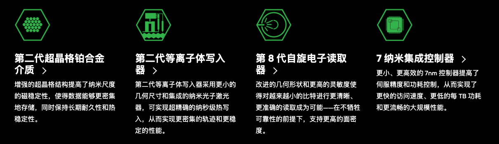
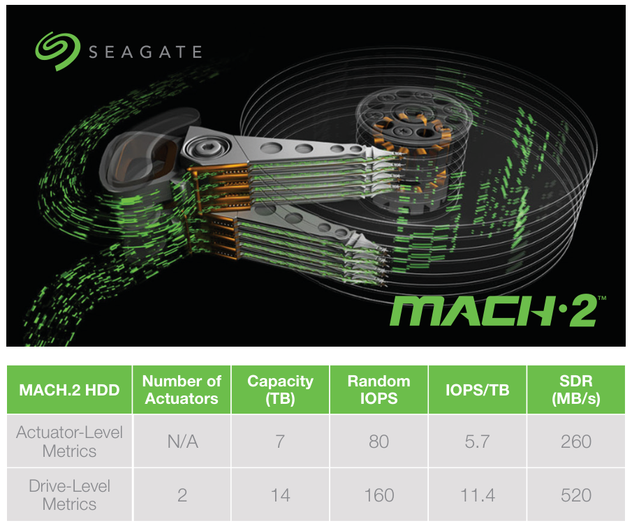
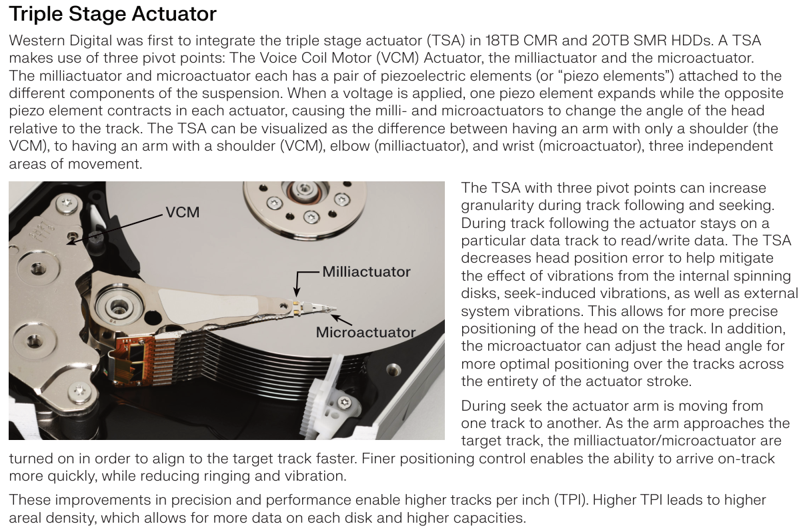
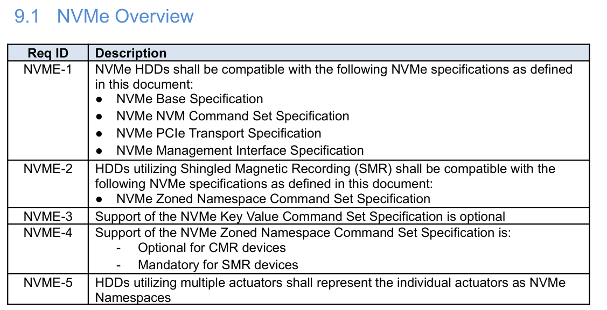

# HDD 厂商：密度与接口技术

> HDD 厂商器件级技术 · 官方新闻稿、产品手册、技术白皮书与 OCP 规范

前面各章讨论的是大数据系统怎样在软件层面使用 HDD。本章换到器件一侧：Seagate、Western Digital（2026 年起品牌简称 WD）和 Toshiba 三家近线盘厂商，怎样把单盘容量从 20 TB 级推到 30–44 TB 级；为了缓解“容量涨、IOPS 不涨”，又在执行器和接口上做了什么。单盘容量可以拆成三个因子：**每碟面密度 × 碟片数 × 记录格式带来的格式效率**（CMR 还是 SMR）。HAMR、ePMR、FC-MAMR 主要提高面密度；氦气密封、更薄的基片和 11 碟结构增加碟片数；SMR / UltraSMR 通过叠瓦写入再多出一截容量。IOPS 和带宽则由执行器数量、转速和接口决定。下文逐家说明各项技术做了什么、为什么做，以及它们对大数据负载意味着什么。资料采集于 2026-11-19。

### 当前产品线与容量来源

先用官方材料把 2026 年各家的最大容量档和对应技术列在一起。表中“每碟容量”一栏，除注明来源原文外，均按“容量 ÷ 碟片数”计算。

| 厂商 · 平台 | 最大容量与记录方式 | 碟片数 / 每碟容量 | 状态（据官方材料） |
|---|---|---|---|
| Seagate Mozaic 4+（HAMR） | 最高 44 TB | 10 碟；官方称每碟 4 TB+ | 2026-03-03 宣布已通过两家头部超大规模云厂商认证并量产出货，更大范围供货随产能爬坡 [BH1][BH2] |
| Seagate Exos M（Mozaic 3+，HAMR） | CMR 24/28/30/32 TB | 10 碟 20 头；32 TB ≈ 3.2 TB/碟 | 产品手册 Rev E（2025-12） [BH3] |
| Seagate Exos 36 TB（SMR） | 36 TB，ZAC 主机管理型 | 10 碟 20 头；3.6 TB/碟 | 产品手册 Rev C（2026-05） [BH4] |
| WD Ultrastar DC HC590 / HC690（ePMR） | CMR 26 TB；UltraSMR 32 TB | 11 碟 22 头；32 TB ≈ 2.9 TB/碟 | 技术简报（2024-10）与 HC690 规格书 [BH5][BH6] |
| WD 40 TB UltraSMR（ePMR） | 40 TB | 未公开 | 2026-02-03 称两家超大规模客户认证中，计划 2026 下半年量产 [BH7] |
| Toshiba M12（FC-MAMR） | SMR 30–34 TB；CMR 最高 28 TB | 11 碟玻璃基片；34 TB ≈ 3.1 TB/碟 | 2026-03-31 SMR 型号开始送样，CMR 型号计划 2026 Q3 送样 [BH8] |

可以看到两条路径：Seagate 靠 HAMR 把**每碟**密度做到 4 TB 以上，碟片数维持 10 片；WD 和 Toshiba 当前产品仍用能量辅助的垂直记录，靠 **11 碟**加 **SMR** 把整盘容量推到 32–40 TB。两种路径对使用方的要求不同：HAMR 对主机透明，SMR 则要求软件按区域（zone）顺序写，这一点在《写入模型约束》一章展开。

### Seagate：Mozaic 3+ / 4+ HAMR 与 Exos 系列

**做了什么。**HAMR（热辅助磁记录）在写入的瞬间用激光把介质上极小的一点加热，使高矫顽力介质可以被写入，冷却后磁化状态保持稳定。Seagate 2024-01-17 发布 Mozaic 3+ 时列出三项核心部件：铁铂超晶格介质（提高矫顽力，使更小的颗粒依然稳定）、集成纳米光子激光器的等离子体写头，以及第 7 代自旋电子读头；Exos 30 TB+ 当季向超大规模云客户批量出货 [BH9]。2026-03-03 发布的 Mozaic 4+ 把每碟密度提高到 4 TB+，最高 44 TB，新增新一代悬臂架构和增强型 SoC；激光器由 Seagate 自行设计制造，官方称这种垂直整合有利于良率、可靠性和缩短认证周期 [BH1][BH10]。官方平台页把第二代部件列为：第二代超晶格铂合金介质、第二代等离子体写入器、第 8 代自旋电子读取器和 7 nm 集成控制器，并给出到 100 TB 的路线 [BH2]；新闻稿称路线目标为每碟 10 TB、整盘最高 100 TB [BH1]。

*Seagate Mozaic 平台官方页面（中文站）截图：Mozaic 4+ 的四项核心部件——第二代超晶格铂合金介质、第二代等离子体写入器、第 8 代自旋电子读取器、7 纳米集成控制器（采集于 2026-11-19）* — [原始来源](https://www.seagate.com/cn/zh/innovation/mozaic/)

**为什么对机房有意义。**Seagate 给出的效益都是“同样占地和功耗下装更多 TB”：Mozaic 3+ 发布时称，从 16 TB PMR 盘换到 30 TB Mozaic 3+ 盘，单 TB 功耗改善 40%，单 TB 隐含碳减少 55% [BH9]；Mozaic 4+ 新闻稿称，在 1 EB 部署中相比标准 30 TB 盘，基础设施效率提升约 47%，减少约 100 平方英尺机房面积和每年约 80 万 kWh 能耗（脚注说明为基于内部测试文档的计算） [BH1]。

**对主机意味着什么。**Exos M 32 TB 是 CMR 盘：SATA 6 Gb/s、10 碟 20 头、OD 最大持续传输 285 MB/s、年负载额定值 <550 TB [BH3]。也就是说，HAMR 本身不需要上层软件改动。同一平台上的 36 TB 型号则改用 SMR，以 ZAC 主机管理型设备呈现：256 MiB 区域、约 1% 常规区、99% 顺序写区、建议最多同时打开 1024 个区域，OD 270 MB/s [BH4]。对比两份手册，36 TB SMR 的道密度为 790 KTPI，32 TB CMR 为 738 KTPI，容量多出 12.5%（工程推论：两者碟片和磁头数相同，容量差主要来自叠瓦带来的道密度和格式效率差异；两份手册对线密度一栏的口径分别为平均值和最大值，不能逐项直接相减）。性能方面，Seagate 2025-12 版 Exos 数据手册中 24–32 TB 的 Mozaic 型号随机读写为 170/350 IOPS（4K QD16，写缓存关闭），与 12–24 TB CMR 型号的 168 IOPS 读基本相同 [BH11]；44 TB 型号的性能参数尚未在公开手册中看到。

### Seagate MACH.2：用第二个执行器把 IOPS 跟上容量

**为什么做。**MACH.2 技术白皮书 TP714.2 把问题写得很直接：近线盘性能主要由转速和数据通道数决定，单执行器的随机 IOPS 基本固定，于是 IOPS/TB 随容量增长而下降；客户若要求某个 IOPS/TB 阈值，超过阈值的容量就“搁浅”无法使用。白皮书认为多数数据中心应用需要 5–10 IOPS/TB，并比较了提高转速、盘内缓存、加大队列深度和短行程（只用外圈）几种办法，指出它们要么功耗高，要么牺牲延迟或容量 [BH12]。

**怎么做。**盘内装两个可独立寻道的执行器，上半部分磁头和盘面由一个执行器负责，下半部分由另一个负责，各占一半容量，各有独立数据通道。白皮书示例中 14 TB 的 MACH.2 盘由两个 7 TB 单元组成，单执行器 80 IOPS、260 MB/s，整盘 160 IOPS、520 MB/s，IOPS/TB 从 5.7 提到 11.4 [BH12]。产品 Exos 2X18 的数据手册给出 304/560 IOPS（4K QD16）和 554 MB/s 持续传输；SAS 版呈现为两个可独立寻址的 9 TB 逻辑单元（LUN），SATA 版呈现为一个 18 TB 设备 [BH13]。

*Seagate MACH.2 技术白皮书 TP714.2 第 3 页：双执行器示意图与“执行器级 / 整盘级”指标对照（7 TB / 80 IOPS / 5.7 IOPS/TB / 260 MB/s 对 14 TB / 160 IOPS / 11.4 IOPS/TB / 520 MB/s）* — [原始来源](https://www.seagate.com/files/www-content/solutions/mach-2-multi-actuator-hard-drive/files/tp714-dot-2-2006us-mach-2-technology-paper.pdf)

**主机侧要做什么。**两个执行器只有在主机同时向两边发命令时才能翻倍。SATA 没有 LUN 概念，前 50% 的 LBA 归一个执行器，后 50% 归另一个；Seagate 推动 T13 定义了“并发定位范围”日志页（47h）来报告这种划分，Linux 5.19 起在 `/sys/block/<dev>/queue/independent_access_ranges` 中暴露每个执行器的扇区范围 [BH14]。FAQ 还给出功耗数据：4K QD16 随机读时双执行器盘功耗比单执行器盘高不到 20%，相当于用两块单执行器盘达到同样随机性能时少约 40% 功耗 [BH14]。OCP《Datacenter SAS-SATA Device Specification》v1.0 则把多执行器写进采购规范：性能应线性扩展，每个执行器因相邻执行器活动造成的性能损失不超过 3%（MULTIA-1） [BH15]。

WD 在 2026-02-03 的 Innovation Day 上公布了另两条思路：“高带宽盘”技术让多个磁头在多条磁道上同时读写，带宽最高 2 倍、远期可到 8 倍，已在客户手中验证；“双枢轴”（Dual Pivot）技术在另一个枢轴上增加一组独立执行器，顺序 IO 最高 2 倍，计划 2028 年推出。WD 称两者结合可让顺序 IO 提高到 4 倍，使 100 TB 盘保持与今天相当的每 TB IO，并特别说明双枢轴不同于此前“牺牲容量且需要大量软件改动”的双执行器设计 [BH7]。

### Western Digital：ePMR、三级执行器、OptiNAND 与 UltraSMR

WD 2024-10 的技术简报把 26 TB CMR（HC590）和 32 TB SMR（HC690）的容量来源拆成几项 [BH5]：

- **ePMR（能量辅助垂直记录）**：写入时向写头主极施加电流，产生附加磁场，使介质比特翻转更一致，减少写入抖动（jitter），从而缩小比特间距、提高线密度（BPI）。
- **三级执行器（TSA）**：在音圈电机（VCM）之外增加毫执行器和微执行器两级压电元件，相当于给机械臂加上“肘”和“腕”，减小磁头定位误差，抑制盘片、寻道和外部振动的影响，从而提高道密度（TPI）。
- **OptiNAND**：盘内集成闪存（HC690 为 64 GB iNAND [BH6]），一是把出厂生成的可重复跳动（RRO）元数据从盘面移到闪存，腾出盘面空间；二是按扇区记录写操作，只刷新受邻道干扰的扇区而非整条磁道，使磁道可以排得更密。它不在数据路径上，不是混合盘。
- **ArmorCache**：掉电时把 DRAM 写缓存快速落到闪存，使写缓存开启模式不丢数据；HC690 规格书称在写缓存开启和关闭两种模式下数据均掉电安全 [BH6]。
- **UltraSMR**：在 SMR 基础上用分布式扇区编码（DSEC）和软判决磁道级 ECC（sTECC）提高纠错余量，进一步收窄道距；32 TB HC690 比同代 CMR 盘多 6 TB，即 23% [BH5]。
- **11 碟平台**：缩小盘片间距放进第 11 片盘，并为此重新设计执行器等部件 [BH5]。

*Western Digital 技术简报《Continuous Innovation for Highest Capacities and Lower TCO》（2024-10）第 3 页：三级执行器（VCM、毫执行器、微执行器）示意与原理说明* — [原始来源](https://documents.westerndigital.com/content/dam/doc-library/en_us/assets/public/western-digital/collateral/tech-brief/technical-brief-continuous-innovation.pdf)

HC690 的规格书显示它是主机管理型 SMR，遵循 ZAC-2：256 MiB 区域，常规区占总容量 1%，其余为顺序写区；同时支持命令时长限制（CDL）特性集 [BH6]。WD 2025-12-04 的博客称 SMR 已约占其容量型数据中心出货 EB 的一半，并称已向 btrfs 和 xfs 贡献原生 SMR 支持 [BH16]。路线方面，2026-02-03 新闻稿称 40 TB UltraSMR ePMR 盘在两家超大规模客户认证中、计划 2026 下半年量产；HAMR 盘也在两家客户认证中、2027 年爬坡；ePMR 将借用 HAMR 的部分技术延伸到 60 TB，HAMR 到 2029 年做到 100 TB。同时还宣布了功耗降低 20% 的“功耗优化”盘，以少量随机 IO 能力换取更高容量和更低功耗，面向温冷数据层，预计 2027 年进入客户认证 [BH7]。

### Toshiba：FC-MAMR、玻璃基片与 11 碟

Toshiba 的能量辅助路线是微波辅助磁记录（MAMR）。2021 年 MG09（18 TB）首次采用的是 **FC-MAMR（磁通控制型 MAMR）**：在写头主极与尾部屏蔽之间放置自旋力矩振荡器（STO），主要作用是把更多磁场从主极导向介质，以增强写入能力；Toshiba 文档同时说明，垂直磁记录在约 1 Tbit/in² 附近面临读信噪比、介质热稳定性和写入能力三者难以兼顾的“三难”，前代 MG08 已用每头两个读头的 TDMR 改善读，MG09 在此基础上用 FC-MAMR 改善写 [BH17]。另一种形态 MAS-MAMR（微波辅助翻转）把 STO 产生的微波场叠加到写入场上以降低翻转所需磁场，潜力更大；Toshiba 2021-12 宣布首次演示其记录性能显著提升，目标是 30 TB 以上的近线盘 [BH18]。

当前产品中，MG11 采用第二代 FC-MAMR，10 碟氦气密封，每碟 2.4 TB，CMR 最高 24 TB，提供 SATA 6 Gb/s 和 SAS 12 Gb/s [BH19]。2026-03-31 发布的 M12 系列首次在近线盘中使用玻璃基片（更耐用、可做得更薄），装入 11 片盘，把 FC-MAMR 与主机管理型 SMR 结合，容量 30–34 TB，最大传输速率 282 MiB/s（约提升 8%），单 TB 功耗约降低 18%，年负载 550 TB、AFR 0.35%；Toshiba 同时表示下一代将基于 HAMR 并采用 12 碟结构 [BH8]。新闻稿明确写到，叠瓦会劣化随机写，因此 M12 采用由主机管理数据放置和重写的架构。

### 接口与命令集：SATA/SAS、NVMe HDD、CDL、分区与电源状态

器件层面另一组变化发生在接口上，它们决定大数据软件能否“看见”并利用盘的新能力。

| 特性 | 做了什么 | 对大数据负载的作用 |
|---|---|---|
| SATA 6 Gb/s 与 SAS 12 Gb/s | 单执行器盘 OD 270–285 MB/s，离 SATA 约 600 MB/s 上限尚远；MACH.2 白皮书称首代双执行器 520 MB/s 已接近 SATA 上限，因此首选 SAS 并以 LUN 区分执行器 [BH12] | 多执行器、多磁头并行读写之后，接口带宽开始成为约束 |
| NVMe HDD（OCP 规范 1.0b，2023-04） | 由 Microsoft、Seagate、WD 署名；3.5 英寸外形，PCIe Gen3 起步、推荐 Gen4，单端口 x1/x2 或双端口各 x1；至少 4 对 IO 队列、队列深度不低于 64；SMR 盘必须支持 NVMe 分区命名空间（ZNS），多执行器盘必须把各执行器表示为独立命名空间 [BH20] | 去掉 HBA、扩展器和协议转换芯片，与 SSD 共用 NVMe/PCIe 栈和 NVMe-oF；规范自述尚无销售数据 |
| 命令时长限制（CDL） | 主机为每条读写命令指定时长描述符，超时可按策略中止或尽早完成；Linux 6.5 起提供 `cdl_supported` / `cdl_enable` 接口，默认关闭 [BH21][BH22]；Exos M 32 TB 支持 CDL，最小时限 10 ms [BH3]，WD HC690 支持 CDL 特性集 [BH6] | 在高队列深度下限制单条命令的尾延迟，配合 EC / 副本可以超时后改从其他副本读 |
| 分区块设备（ZBC / ZAC） | T10 定义 SCSI 的 ZBC，T13 定义 ATA 的 ZAC，规定区域类型、写指针和开 / 关 / 重置区域等命令 [BH23]；OCP 规范要求 SMR 盘遵循 ZAC-2 / ZBC-2，保留 0.8% 容量为 CMR 区、区域 128 MB [BH15]，而 Seagate 36 TB 与 WD HC690 公开手册均为 256 MiB 区域、约 1% 常规区 [BH4][BH6] | SMR 容量增益的前提；要求上层顺序写和区域感知放置 |
| 扩展电源状态（EPC） | Seagate 36 TB：平均空闲 6.53 W，Idle_B 3.99 W（磁头卸载、全速旋转，默认 10 分钟进入），Idle_C 2.99 W（磁头卸载、降速），Standby_Z 1.01 W（停转），从待机到就绪典型 30 s、最长 60 s [BH4]；OCP 规范要求出厂时 EPC 定时器全部关闭 [BH15] | 冷数据、归档层可以按时间窗降功耗，但恢复时间是秒级到几十秒，需要上层调度配合 |

*OCP NVMe HDD Specification Revision 1.0b（2023-04-20）第 18 页：NVME-1 至 NVME-5 要求——SMR 盘必须支持 ZNS 命令集，多执行器盘以独立命名空间呈现各执行器* — [原始来源](https://www.opencompute.org/documents/ocp-nvme-hdd-spec-rev1-0b-2023-4-20-docx-1-pdf/)

### 对大容量盘需求的意义与资料边界

**工程推论。**按 IOPS/TB = 单盘 IOPS ÷ 容量，取 Seagate 手册中 4K QD16 随机读 170 IOPS（假设 44 TB 盘与 32 TB 盘相同）：16 TB 约 10.6，32 TB 约 5.3，44 TB 约 3.9 IOPS/TB；Exos 2X18 为 304 ÷ 18 ≈ 16.9 IOPS/TB。也就是说，单执行器 44 TB 盘已经低于 MACH.2 白皮书给出的 5–10 IOPS/TB 区间下沿。三家厂商在器件侧给出的回应可以归成三类：一是继续提高每碟密度并对主机透明（HAMR）；二是用 SMR 换 12–23% 的额外容量，但要求软件按区域顺序写；三是用多执行器、多磁头并行或新接口把 IO 能力跟上容量（MACH.2、高带宽盘、双枢轴、NVMe HDD），同时用 CDL 控制尾延迟、用 EPC 降低冷数据功耗。对于一个本身就以大块顺序写、EC 和多副本读为主的 EB 级大数据系统，第一类可以直接吃到容量红利；第二、三类则需要软件和采购规范配合，否则大容量盘的 IOPS/TB 和写入模型会成为用户倾向中等容量的直接原因。

**资料边界。**Seagate 44 TB、WD 40 TB 的完整规格书（含随机 IOPS、接口和是否为 SMR）在采集时未公开，本章只引用新闻稿和平台页。MACH.2 的公开产品停留在 Exos 2X18，未见更大容量型号的官方资料。NVMe HDD 规范已发布，但本章未找到商用 NVMe 硬盘的官方产品资料。Toshiba M12 CMR 型号的碟片数和规格尚未公布。

## 本章资料

- **[BH1]** [Seagate 投资者关系 · Seagate Delivers Industry's Highest Capacity Hard Drives with Next-Generation Mozaic 4+（新闻稿，2026-03-03，采集于 2026-11-19）](https://investors.seagate.com/news/news-details/2026/Seagate-Delivers-Industrys-Highest-Capacity-Hard-Drives-with-Next-Generation-Mozaic-4/default.aspx)
- **[BH2]** [Seagate · Mozaic（魔彩盒）平台官方页面（中文站；每碟 4TB+、最高 44TB、10 碟架构、四项核心部件、100TB 路线，采集于 2026-11-19）](https://www.seagate.com/cn/zh/innovation/mozaic/)
- **[BH3]** [Seagate · Exos SATA Product Manual 32/30/28/24TB（Exos M，CMR，Publication 210048100 Rev E，2025-12；10 碟 20 头、738 KTPI、285 MB/s、CDL 最小时限 10 ms，采集于 2026-11-19）](https://www.seagate.com/content/dam/seagate/assets/support/internal-hard-drives/enterprise-hard-drives/exos-m/_shared/files/Seagate_Exos_SATA_Product_Manual_32-30-28-24TB_210048100E.pdf)
- **[BH4]** [Seagate · Exos SATA Product Manual 36TB（ST36000NM001M，SMR / ZAC 主机管理型，Publication 210960600 Rev C，2026-05；区域配置、EPC 功耗与恢复时间，采集于 2026-11-19）](https://www.seagate.com/content/dam/seagate/assets/support/internal-hard-drive/enterprise-hard-drives/x-mozaic/_shared/files/Seagate_Exos_SATA_Product_Manual_36TB_210960600C.pdf)
- **[BH5]** [Western Digital · Tech Brief: Continuous Innovation for Highest Capacities and Lower TCO（HelioSeal、TSA、ePMR、OptiNAND、ArmorCache、UltraSMR、11 碟，2024-10，采集于 2026-11-19）](https://documents.westerndigital.com/content/dam/doc-library/en_us/assets/public/western-digital/collateral/tech-brief/technical-brief-continuous-innovation.pdf)
- **[BH6]** [Western Digital · Ultrastar DC HC690 (SATA) Hard Disk Drive Specification（28–32 TB 主机管理型 SMR、11 碟 22 头、64GB iNAND、256MiB 区域、CDL 特性集，采集于 2026-11-19）](https://documents.westerndigital.com/content/dam/doc-library/en_us/assets/public/western-digital/product/data-center-drives/ultrastar-dc-hc600-series/product-manual-ultrastar-dc-hc690-sata.pdf)
- **[BH7]** [WD（Western Digital）新闻稿 · Western Digital Accelerates Storage Innovation for AI Era（Innovation Day 2026：40TB UltraSMR、HAMR 路线、高带宽盘、双枢轴、功耗优化盘，2026-02-03，采集于 2026-11-19）](https://www.westerndigital.com/company/newsroom/press-releases/2026/2026-02-03-western-digital-accelerates-storage-innovation-for-ai-era)
- **[BH8]** [Toshiba 新闻稿 · Toshiba Begins Sampling of 30-34 TB SMR Nearline Hard Disk Drives（M12 系列，2026-03-31，采集于 2026-11-19）](https://news.toshiba.com/press-releases/press-release-details/2026/Toshiba-Begins-Sampling-of-30-34-TB-SMR-Nearline-Hard-Disk-Drives/default.aspx)
- **[BH9]** [Seagate 投资者关系 · Seagate's Breakthrough 30TB+ Hard Drives Ramp Volume, Marking an Inflection Point in the Storage Industry（Mozaic 3+ 新闻稿，2024-01-17，采集于 2026-11-19）](https://investors.seagate.com/news/news-details/2024/Seagates-Breakthrough-30TB-Hard-Drives-Ramp-Volume-Marking-an-Inflection-Point-in-the-Storage-Industry/default.aspx)
- **[BH10]** [Seagate 博客 · Christina Bassani：随着数据量的增长，Mozaic（魔彩盒）也随之不断扩展（2026-03-03，采集于 2026-11-19）](https://www.seagate.com/blog/as-data-grows-mozaic-keeps-scaling-with-it/)
- **[BH11]** [Seagate · Exos 数据手册 DS2046.1-2512（12–32 TB 型号随机读写 4K QD16 与持续传输，2025-12，采集于 2026-11-19）](https://www.seagate.com/content/dam/seagate/en/content-fragments/products/datasheets/exos-portfolio-refresh/exos-ds2046.1-2512-en_us_V2_en_AS.pdf)
- **[BH12]** [Seagate · MACH.2 Multi-Actuator Technology Paper TP714.2（IOPS/TB 与 TCO、双执行器设计、SAS LUN 选择，2020-06，采集于 2026-11-19）](https://www.seagate.com/files/www-content/solutions/mach-2-multi-actuator-hard-drive/files/tp714-dot-2-2006us-mach-2-technology-paper.pdf)
- **[BH13]** [Seagate · Exos 2X18 数据手册 DS2093.1-2202（MACH.2 双执行器，304/560 IOPS、554 MB/s，2022-02，采集于 2026-11-19）](https://www.seagate.com/www-content/datasheets/pdfs/exos-2x18-DS2093-1-2202US-en_US.pdf)
- **[BH14]** [Seagate · MACH.2 / Exos 2X Frequently Asked Questions SC702.2（SATA LBA 划分、并发定位范围日志页 47h、Linux 5.19、功耗对比，2021-01，采集于 2026-11-19）](https://www.seagate.com/content/dam/seagate/migrated-assets/www-content/solutions/mach-2-multi-actuator-hard-drive/files/sc702.2-2101us-mach-2-faq.pdf)
- **[BH15]** [Open Compute Project · Datacenter SAS-SATA Device Specification Version 1.0（Meta / Microsoft / HPE，2023-03-28；SMR-1~3、SATA-SF-5、MULTIA-1，采集于 2026-11-19）](https://www.opencompute.org/documents/datacenter-sas-sata-device-specification-rev-1-0-pdf/)
- **[BH16]** [Western Digital 博客 · SMR HDD Technology for AI Data Centers（SMR 约占容量型数据中心出货 EB 的 50%，2025-12-04，采集于 2026-11-19）](https://blog.westerndigital.com/smr-hdd-technology-ai-data-centers/)
- **[BH17]** [Toshiba Electronic Devices & Storage · High-Reliability FC-MAMR Nearline HDD with a Capacity of 18 TB（MG09 技术说明，2021-02，采集于 2026-11-19）](https://toshiba.semicon-storage.com/content/dam/toshiba-ss-v3/master/en/storage/product/data-center-enterprise/202102025_nearlineHDD_18TB_e.pdf)
- **[BH18]** [Toshiba 研究开发中心 · Toshiba Achieves World's First Demonstration of Substantial Improvements in HDD Recording Performance with MAS-MAMR（2021-12，采集于 2026-11-19）](https://www.global.toshiba/ww/technology/corporate/rdc/rd/topics/21/2112-03.html)
- **[BH19]** [Toshiba · MG11 Series Enterprise Hard Drives 产品页（第二代 FC-MAMR、10 碟、每碟 2.4TB、最高 24TB，采集于 2026-11-19）](https://storage.toshiba.com/enterprise-hdd/cloud-scale-capacity/mg11-series)
- **[BH20]** [Open Compute Project · NVMe HDD Specification Revision 1.0b（Microsoft / Seagate / Western Digital，2023-04-20；PCIE-1/2、NBASE-7、NVME-1~5，采集于 2026-11-19）](https://www.opencompute.org/documents/ocp-nvme-hdd-spec-rev1-0b-2023-4-20-docx-1-pdf/)
- **[BH21]** [Linux 内核文档 · Documentation/ABI/testing/sysfs-block-device（cdl_supported / cdl_enable，KernelVersion v6.5，采集于 2026-11-19）](https://www.kernel.org/doc/Documentation/ABI/testing/sysfs-block-device)
- **[BH22]** [Western Digital 官方 GitHub · cdl-tools：Command Duration Limits utilities（cdladm README，采集于 2026-11-19）](https://github.com/westerndigitalcorporation/cdl-tools)
- **[BH23]** [Zoned Storage（zonedstorage.io）· Shingled Magnetic Recording Hard Disks（ZBC / ZAC 标准、区域类型与开放区域限制，采集于 2026-11-19）](https://zonedstorage.io/docs/introduction/smr)
