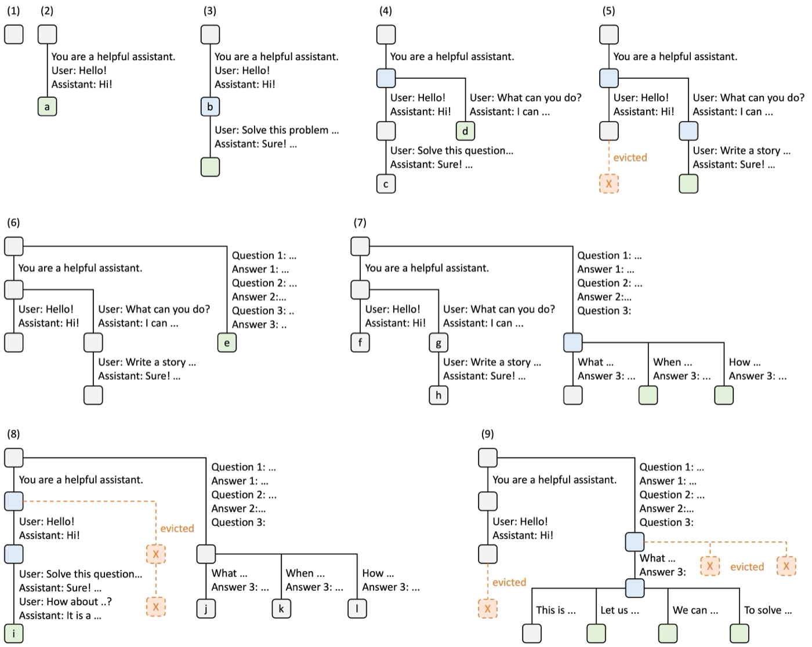
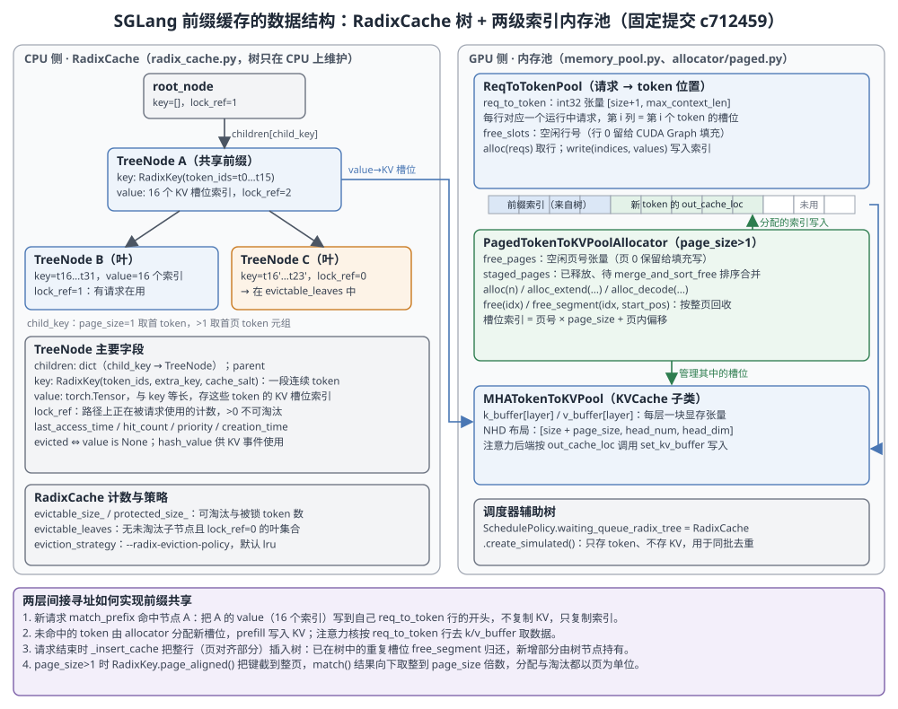
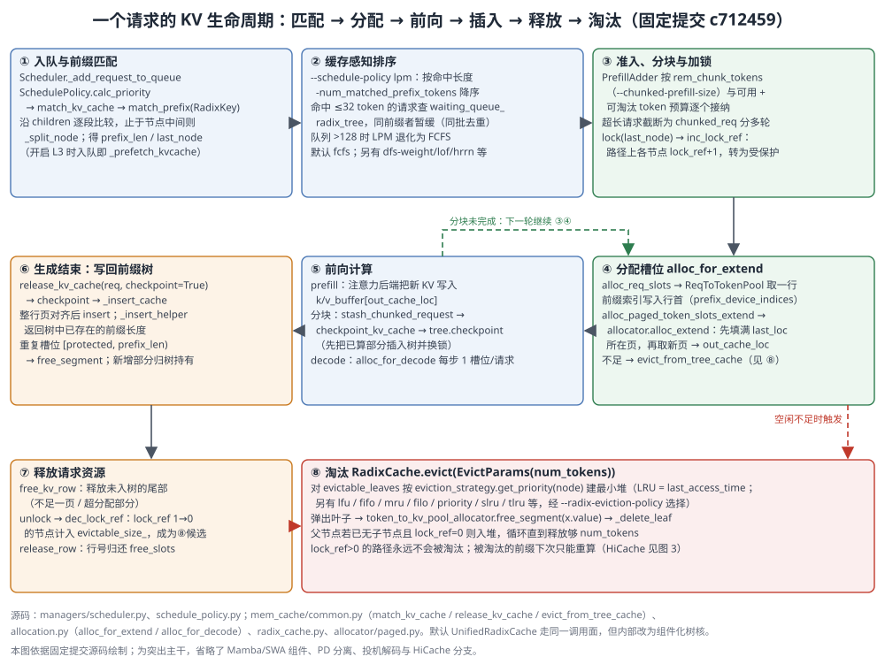

# SGLang：整体架构与 KV 缓存管理

> 推理引擎 · SGLang 固定提交源码与官方文档

### 整体架构：请求如何进入调度器并返回文本

以文本生成请求为例，服务入口将输入交给 `TokenizerManager`，后者把文本编码为 token ID，并将请求送给 `Scheduler`。调度器持有活动请求，在组织下一批计算时匹配已缓存的前缀、为剩余 token 分配位置，再交给模型执行。生成的 token ID 经 `DetokenizerManager` 还原为文本，由前端返回给客户端。因而，前缀树和内存池影响的是调度器为一次前向计算准备哪些 token 与 KV 槽位。 [SGI30][SGI16]

本节讲 SGLang 自己怎样管理 KV Cache：一条请求的前缀怎样被认出来，KV 放在显存的什么位置，什么时候释放、淘汰，开启 HiCache 后又怎样在 GPU、主机内存和外部存储三级之间流动。本节与 HDD 两节使用同一个固定提交 `c712459e7f8233302fdf0bdd5d4ddcd22aa4b2ab`（2026-11-16），类名、函数名和默认值都按该提交的源码与仓库内文档核对，并补充了 LMSYS 官方博客的设计说明 [SGI16][SGI20][SGI21]。至于把 HDD 挂成 L3 是否可行、要改哪些地方，见后面两节“SGLang：最底层接入 HDD”和“HDD 接入路线与改动范围”，本节不再重复。

### 总体分层：谁决定保留什么，谁管理内存

仓库中 `python/sglang/srt/mem_cache/README.md` 把 KV 管理拆成两条线。一条是内存栈：`allocation.py` 按批次制定分配策略，`allocator/` 分发空闲槽位（输入需要的数量，输出槽位索引），`pool/` 持有设备上的 KV 张量（L1），`pool_host/` 是主机内存镜像（L2），`storage/` 是 L3 后端，按哈希读写字节。另一条是前缀树（radix cache），它不管理内存，只决定“哪些前缀值得留、哪些可以淘汰”，再调用内存栈完成实际的分配和回收 [SGI16]。

| 层 | 主要类 / 函数（文件） | 职责 |
|---|---|---|
| 前缀树 | `RadixCache`、`TreeNode`（radix_cache.py）；默认实例为 `UnifiedRadixCache`（unified_radix_cache.py） | token 前缀 → KV 槽位索引；匹配、插入、加锁、淘汰 |
| 请求表 | `ReqToTokenPool`（memory_pool.py） | 每个运行中请求一行，记录其各 token 的 KV 槽位 |
| 槽位分配器 | `TokenToKVPoolAllocator`（allocator/token.py）、`PagedTokenToKVPoolAllocator`（allocator/paged.py） | 空闲槽位 / 页的分配与回收 |
| 设备 KV 池 | `MHATokenToKVPool`、`MLATokenToKVPool`（memory_pool.py） | 按层存放 K/V 张量，注意力后端按槽位读写 |
| 主机池 / 控制器 | `HostKVCache`（pool_host/）、`HiCacheController`（managers/cache_controller.py） | L2 槽位，以及 GPU↔主机↔存储之间的异步搬运 |
| L3 接口 | `HiCacheStorage`（hicache_storage.py） | 按页哈希读写和查询存在性 |

需要先说明一点：README 写明，按模型区分的 `radix_cache.py`、`pure_swa_radix_cache.py` 等实现正在合并到 Unified Radix Cache。在这个提交里，`registry.py` 对普通模型默认调用 `create_unified_radix_cache()`。经典的 `RadixCache` 仍然保留，`PureSWARadixCache` 和 FlexKV 后端的 `FlexKVRadixCache` 都继承它，调度器也用它建模拟树 [SGI11][SGI16]。`UnifiedRadixCache` 把 Full / SWA / Mamba 拆成组件，树核默认由 Rust 实现（环境变量 `SGLANG_UNIFIED_RADIX_TREE_CORE_BACKEND`，默认 rust），Python 版 `unified_tree_core.py` 作为参照实现 [SGI12][SGI13][SGI19]。由于两者的匹配、加锁、淘汰语义相同，下面先用代码短、容易读的 `RadixCache` 讲 RadixAttention 的机制，讲 HiCache 时再切换到 Unified 版本，因为该提交中的分层缓存只在 Unified 版本里实现。

### RadixAttention：基数树的匹配、插入、加锁与淘汰

RadixAttention 最早发表于 LMSYS 2024-01-17 的博客。它的做法是请求结束后不丢弃 KV，而是把 prompt 和生成结果的 KV 都留在一棵基数树里：键是 token 序列，值是 KV 张量；树结构在 CPU 上维护，开销很小；淘汰采用 LRU，从叶子开始递归删除，并配合缓存感知调度提高命中率。博客发表时，GPU 上的 KV 按“每页 1 个 token”的分页布局存放 [SGI20]。下图是博客中的九步示例：节点按需分裂以共享系统提示词，内存不足时淘汰最久未用的叶子。

*LMSYS 官方博客 RadixAttention 示意图（Figure 4）：两个对话会话、一批 few-shot 查询和 self-consistency 采样到来时，基数树逐步插入、分裂与按 LRU 淘汰节点（绿色为新增，蓝色为本步访问，红色为被淘汰）* — [原始来源](https://lmsys.org/blog/2024-01-17-sglang/)

在固定提交中，树节点 `TreeNode` 有这些字段：`children`（字典，键为 child_key）、`parent`、`key`（`RadixKey`，包含 token_ids 以及可选的 `extra_key`、`cache_salt` 命名空间）、`value`（与 key 等长的 `torch.Tensor`，存放这些 token 在 KV 池中的槽位索引）、`lock_ref`、`last_access_time`、`hit_count`、`priority`、`hash_value`。`value is None` 表示该节点已被淘汰（`evicted`）。所以树里只保存索引，KV 本身一直放在 GPU 池中。`extra_key` 不同的请求即使 token 相同也不会共享节点，可以用来隔离 LoRA 或租户 [SGI1]。

- **match_prefix**：EAGLE 模式下先转换为 bigram 视图，再用 `page_aligned(page_size)` 把键截到整页；随后 `_match_prefix_helper` 从根节点按 `child_key` 逐段向下比较，并刷新沿途的 `last_access_time`。如果匹配停在某个节点的中间，就调用 `_split_node` 把它拆成“公共段 + 剩余段”两个节点，得到精确的边界。返回值 `MatchResult` 包含 `device_prefix_len` 和 `last_device_node`。`RadixKey.match` 先按倍增窗口逐段比较、再二分查找第一个分歧位置，结果向下取整到 page_size 的倍数 [SGI1]。
- **insert**：`_insert_helper` 沿已有路径前进，必要时分裂节点，剩余部分挂成一个新叶子，同时 `evictable_size_` 增加；节点的 `priority` 沿路径取最大值。返回已在树中的前缀长度 `prefix_len`，调用方据此释放重复的槽位 [SGI1]。
- **lock_ref 引用计数**：`inc_lock_ref(node)` 从该节点一直走到根，逐个加 1；某节点从 0 变为 1 时，它的 token 数从 `evictable_size_` 转入 `protected_size_`。`dec_lock_ref` 反向操作。根节点的 `lock_ref` 固定为 1。只有没有未淘汰子节点、且 `lock_ref==0` 的节点才进入 `evictable_leaves` 集合 [SGI1]。
- **evict**：用 `evictable_leaves` 构建最小堆，优先级由 `eviction_strategy.get_priority(node)` 给出。LRU 取 `last_access_time`，LFU 取 `(hit_count, last_access_time)`，此外还有 FIFO、MRU、FILO、priority、SLRU、T-LRU 等策略。每弹出一个叶子，就调用 `token_to_kv_pool_allocator.free_segment(x.value)` 归还槽位，再 `_delete_leaf`；父节点如果因此没有子节点且未被锁，就加入堆，直到腾出 `num_tokens`。策略由 `--radix-eviction-policy` 选择，默认 `lru` [SGI1][SGI8][SGI9]。

*SGLang RadixCache 树与 ReqToTokenPool / PagedTokenToKVPoolAllocator / MHATokenToKVPool 的数据结构关系。本文根据 SGLang 固定提交源码绘制（radix_cache.py、memory_pool.py、allocator/paged.py）* — [原始来源](https://github.com/sgl-project/sglang/blob/c712459e7f8233302fdf0bdd5d4ddcd22aa4b2ab/python/sglang/srt/mem_cache/radix_cache.py)

### 内存池：两级索引与分页分配

SGLang 用两级间接寻址实现前缀共享。第一级是 `ReqToTokenPool.req_to_token`，一个 int32 张量，形状为 `[size+1, max_context_len]`：每个运行中请求占一行，第 i 列记录它第 i 个 token 的 KV 槽位。行 0 留给 CUDA Graph 的填充批次，空闲行号放在 `free_slots` 中。第二级是设备 KV 池，例如 `MHATokenToKVPool` 为每一层分配一块 `k_buffer[layer]` 和 `v_buffer[layer]`，普通 NHD 布局下形状为 `[size + page_size, head_num, head_dim]`，多出的那一页同样用来接收填充 token 的写入 [SGI2]。新请求命中前缀时，只需把树节点 `value` 中的索引复制到自己那一行的开头，KV 数据本身不复制；未命中的 token 再向分配器申请新槽位。

分配器有两种。page_size=1 时使用 `TokenToKVPoolAllocator`。page_size>1 时使用 `PagedTokenToKVPoolAllocator`：它维护 `free_pages` 页号张量（页 0 保留），`alloc(n)` 要求 n 按页对齐，返回连续的页内索引；`alloc_extend` 用 Triton 核 `alloc_extend_kernel` 先填满前缀最后一个槽位 `last_loc` 所在的残页，再申请新页；`alloc_decode` 在当前页写满时才取新页。释放时，`free()` 按 `索引 // page_size` 去重后整页回收，`free_segment()` 是不需要去重的定长快速路径。设置 `need_sort` 时，回收的页先暂存在 `staged_pages`，等空闲页不够时再由 `merge_and_sort_free` 排序合并；这一步可以等待“复用保护事件”，避免 PD 传输还在读的页被立即覆盖 [SGI3]。在前缀树一侧，`page_size` 决定 child_key 的粒度（取首页 token 元组）、匹配长度的取整，以及插入时只收录整页、不足一页的尾巴留给请求自己释放 [SGI1][SGI5]。

批次级的入口在 `allocation.py`。`alloc_for_extend(batch)` 先调用 `alloc_req_slots` 为每个请求取一行；page_size=1 时调用 `alloc_token_slots`，否则组装各请求的 `last_loc`，调用 `alloc_paged_token_slots_extend`，得到 `out_cache_loc`。槽位不足时，通过 `make_room` 回调到 `evict_from_tree_cache` 让树淘汰，淘汰后仍不够就报 “Prefill out of memory”。decode 阶段由 `alloc_for_decode` 为每个请求每步分配一个槽位 [SGI4][SGI5]。

### 请求生命周期与缓存感知调度

下图按顺序画出一条请求从进入到结束的 KV 处理过程。

*一条请求的 KV 生命周期：入队匹配 → 缓存感知排序 → 准入加锁 → 槽位分配 → 前向（含分块 checkpoint）→ 写回前缀树 → 释放 → LRU 淘汰。本文根据 SGLang 固定提交源码绘制（scheduler.py、schedule_policy.py、common.py、allocation.py、radix_cache.py）* — [原始来源](https://github.com/sgl-project/sglang/blob/c712459e7f8233302fdf0bdd5d4ddcd22aa4b2ab/python/sglang/srt/mem_cache/common.py)

**匹配与排序。**`SchedulePolicy.calc_priority` 对等待队列逐个调用 `match_kv_cache(req, tree_cache)`，把 `prefix_len`、`last_node`、`host_hit_length` 写回请求，并得到 `num_matched_prefix_tokens`。缓存感知策略有 `lpm`（最长前缀匹配）、`dfs-weight`、`hrrn` 和 `shortest-prefill-first`；与缓存无关的策略有 `fcfs`、`lof`、`random`、`routing-key`。LPM 的实现是 `_sort_by_longest_prefix`，按 `-num_matched_prefix_tokens` 排序。为了控制开销，等待队列超过 128（`WAITING_QUEUE_PREFIX_MATCH_MAX`）时，`_determine_active_policy` 会把 LPM 退化为 FCFS；默认开启的 bounded LPM 则只在队首 64 个请求（`BOUNDED_LPM_WINDOW_SIZE`）的窗口内做 LPM 排序。另有“同批前缀去重”：命中长度不超过 32 token 的请求，会再到 `waiting_queue_radix_tree`（一棵用 `RadixCache.create_simulated()` 建的、只存 token 不存 KV 的树）里匹配；已有同批请求覆盖了其前缀的，暂时排到后面，让第一个请求先把公共前缀算出来 [SGI6]。需要注意，该提交中 `--schedule-policy` 的默认值是 `fcfs`，要用 LPM 需显式指定 [SGI10]。

**准入、加锁与分块预填充。**`PrefillAdder` 用 `rem_chunk_tokens`（来自 `--chunked-prefill-size`，-1 表示关闭）以及“可用 + 可淘汰”的 token 预算逐个接纳请求。超出单块预算的长请求被截断，成为 `new_chunked_req`。接纳确定后，`_commit_prefill_admission` 执行 `req.lock = tree_cache.lock(req.last_node)`，把命中的前缀锁住，防止排队期间被淘汰 [SGI6]。一个分块算完后，调度器调用 `stash_chunked_request` → `checkpoint_kv_cache` → `tree_cache.checkpoint`：把已算出的部分插入树、释放重复槽位、把新的索引写回请求行，再把锁从旧节点移到新节点。请求保留自己的行，下一块从 `extend_end` 接着算 [SGI7][SGI5][SGI1]。

**结束、释放与淘汰。**请求结束时，`release_kv_cache(req, tree_cache, checkpoint=True)` 先调用 `checkpoint`。其中 `_insert_cache` 取出该请求行中按页对齐的部分插入树，树中已经存在的槽位区间 `[cache_protected_len, prefix_len)` 通过 `free_segment` 归还（这些是重复计算出的 KV）。`checkpoint` 调用时还会传入 `split_prompt=True`，在 prompt 边界把叶子拆开，这样淘汰时可以只丢掉输出部分，保留 prompt。之后依次执行：`free_kv_row` 释放未入树的尾部，`unlock` 让 lock_ref 递减，`release_row` 把行号还给 `free_slots` [SGI5][SGI1]。树持有的 KV 在 lock_ref 归零后成为淘汰候选，要等下一次分配不足时才会被 `evict` 真正回收。“请求结束”和“KV 被淘汰”是两件分开的事，RadixAttention 能在空闲显存里尽量多保留前缀，靠的就是这一点。

### HiCache：L1 / L2 / L3 三级缓存的实现

官方设计文档把 GPU 显存、主机内存和分布式存储分别称为 L1、L2、L3。L1、L2 属于单个实例私有，L3 是否在实例间共享取决于后端的配置。元数据组织在“HiRadixTree”中：每个节点记录本地 L1 / L2 的精确地址，L3 的元数据不保存也不持续同步，需要时实时向后端查询 [SGD][SGI21]。代码层面，该固定提交中已经找不到早期版本的 `HiRadixCache` 类。开启 `--enable-hierarchical-cache` 后，`create_unified_radix_cache()` 调用 `UnifiedRadixCache.init_hicache()`，后者挂载继承自 `HiCacheController` 的 `HybridCacheController` 和主机池 [SGI11][SGI12]。树节点 `UnifiedTreeNode` 为每个组件保存一个 `ComponentData`，其中包括 `value`（L1 槽位）、`host_value`（L2 槽位）、`lock_ref` 和 `host_lock_ref`。Full 组件的 `host_value` 不为空即视为已备份（`backuped`），`value` 为空即视为已从 L1 淘汰（`evicted`），两者组合出“仅 L1 / L1+L2 / 仅 L2”三种驻留状态 [SGI13]。

*HiCache 三级数据流：L1→L2 备份与写策略、L2→L3 持久化、L3→L2 预取、L2→L1 层级重叠回载，以及节点驻留状态。本文根据 SGLang 固定提交源码绘制（unified_radix_cache.py、unified_tree_core.py、managers/cache_controller.py、hicache_storage.py）* — [原始来源](https://github.com/sgl-project/sglang/blob/c712459e7f8233302fdf0bdd5d4ddcd22aa4b2ab/python/sglang/srt/managers/cache_controller.py)

| 写策略（--hicache-write-policy） | 源码中的触发条件 | L1 淘汰时的行为 |
|---|---|---|
| write_through（默认） | `write_through_threshold=1`：节点插入 / 命中后 `_inc_hit_count_and_check` 立即触发 D→H 备份 | 已备份叶子 `_demote` 为仅 L2；未备份的直接删除 |
| write_through_selective | 阈值为 2：`hit_count` 达到 2 才备份，只备份热数据 | 同上 |
| write_back | 插入时不备份（`_should_backup_after_insert` 返回 False） | `evict_device_leaf` 对未备份叶子先生成备份动作，D→H 完成后再降级；主机池满时用 `drop_subtree_no_host` 退化为删除 |

写策略与阈值来自 `init_hicache` 和 `unified_tree_core.py` [SGI12][SGI13][SGI9]。

**L1→L2 备份。**`HiCacheController.write()` 先在主机池上 `alloc` 同样数量的槽位，把 `CacheOperation` 放进 `write_queue`。`start_writing()` 合并队列中的操作，提交到 `l2_transfer_engine` 的 device_to_host 流，并把带 CUDA 事件的 `HiCacheAck` 放入确认队列。调度循环里的 `writing_check` 收到确认后，把 `host_value` 记到节点上。如果配置了 L3，就接着对每个节点调用 `write_backup_storage` [SGI14][SGI12]。主机池容量为设备池乘以 `--hicache-ratio`（cache 模式默认 2.0），也可以用 `--hicache-size` 直接指定 GB 数；默认布局为 `page_first`，I/O 后端默认为 `kernel` [SGI9]。L2 也满了时，`evict_host` → `drive_host_eviction` 淘汰只在 L2 上的叶子 [SGI12]。

**L2→L1 回载。**匹配时，如果路径后段只在 L2 上，`MatchResult` 会给出 `host_hit_length` 和 `best_match_node`。`PrefillAdder` 先用 `memory_budget.prepare_load_back` 预留显存，再调用 `tree_cache.init_load_back` → `load_back`：给锚点节点加 host 锁和设备锁，少于 `load_back_threshold`（10 token）的回载直接跳过；然后 `HiCacheController.load()` 分配设备槽位并放入 `load_queue`，由 `start_loading()` 提交 host_to_device 传输。每完成一层，`LayerDoneCounter` 记录一次，前向计算按层等待，从而实现文档所说的“计算第 N 层时加载第 N+1 层” [SGI12][SGI14][SGI6][SGD]。调度器要求回载“全部完成或完全不做”：如果只回载了一部分承诺的 token，会直接抛出 RuntimeError [SGI6]。

**L3 接口。**`HiCacheStorage` 是抽象基类，必须实现 `get`、`batch_get`、`set`、`batch_set`、`exists`。`batch_exists` 默认逐个调用 `exists`，返回从头开始连续存在的键数。零拷贝路径使用 `batch_get_v1` / `batch_set_v1`，直接传主机池索引。多池模型（Mamba、DSA 等）使用 `batch_exists_v2` / `batch_get_v2` / `batch_set_v2`，参数为 `PoolTransfer`，命中策略分 `all_pages` 和 `trailing_pages`。挂载时依次调用 `register_mem_pool_host`、`register_mem_host_pool_v2`，最后调用一次 `on_host_pools_registered` [SGI15][SGD]。L3 的键是页级链式哈希（`get_storage_hash_str`，链首用 `extra_key` / `cache_salt` 派生的命名空间种子），因此同一个键隐含了它前面的整条前缀 [SGI17]。读写按 `STORAGE_BATCH_SIZE=128` 页分批进行 [SGI15][SGI14]。

**L3→L2 预取，以及预取 token 的记账。**请求入队时，`Scheduler._add_request_to_queue` 调用 `_prefetch_kvcache`：先在本地匹配，如果最后命中的节点已经备份或者就是根节点，就把剩余 token 交给 `prefetch_from_storage`。剩余长度小于 `prefetch_threshold`（默认 256）或触发限速时不发起预取 [SGI7][SGI12][SGD]。控制器里有三个后台线程分工处理：`prefetch_thread_func` 计算页哈希，分批调用 `batch_exists`，遇到第一个缺页就停，再用 `all_reduce(MIN)` 让各 TP rank 得到相同的命中数；`prefetch_io_aux_func` 在 `_page_transfer` 中分批读入主机池，每批产生一个带 `completed_tokens` 的 `PrefetchAck`；`prefetch_sync_thread` 对这些进度再做跨 rank 归约 [SGI14]。调度器构建 prefill 批次时，对每个请求调用 `check_prefetch_progress`：`best_effort` 立即终止预取；`wait_complete` 一直等到完成；`timeout`（默认）计算截止时间，超时后由各 rank 投票终止 [SGI12][SGI9]。终止后 `_handle_prefetch_result` 只认已完成的 `host_indices[:completed_tokens]`，用 `insert_host` 把它们作为“仅 L2”节点挂到树上，已在树中的重复部分释放回主机池，其余 token 交给后续 prefill 重算；`prefetch_tokens_occupied` 和 `prefetch_loaded_tokens_by_reqid` 分别记录在途占用和每个请求实际从 L3 拿到的 token 数 [SGI12]。L2→L3 方向由 `write_storage` → `backup_queue` → `backup_thread_func` 完成，每批调用一次 `batch_set` 或 `batch_set_v1`；设计文档还说明只会传输 L3 中尚不存在的数据 [SGI14][SGD]。

### 关键参数与内置常量一览

下表列出前面提到的开关和阈值在固定提交中的默认值。前八行是命令行参数，后几行是写在源码里的常量或内部阈值，不能通过命令行直接修改（个别可通过环境变量或 `--hicache-storage-backend-extra-config` 调整）。

| 参数 / 常量 | 默认值 | 作用与出处 |
|---|---|---|
| `--radix-eviction-policy` | lru | 前缀树淘汰顺序，可改为 lfu、slru、priority、tlru 等；tlru 只支持 UnifiedRadixCache（memory.py、registry.py） |
| `--schedule-policy` | fcfs | 需显式设为 lpm 才按命中长度排序（schedule.py） |
| `--max-prefill-tokens` | 16384 | 单个 prefill 批次的 token 上限，实际取它与模型最大上下文中的较大值（schedule.py） |
| `--enable-hierarchical-cache` | 关闭 | 打开后才挂载 L2 主机池与 HiCache 控制器（memory.py） |
| `--hicache-ratio` / `--hicache-size` | cache 模式 2.0 / 0 | L2 容量相对设备池的倍数，或以 GB 直接指定，后者优先（memory.py） |
| `--hicache-write-policy` | write_through | L1→L2 备份时机，见上节表格（memory.py） |
| `--hicache-mem-layout` / `--hicache-io-backend` | page_first / kernel | 主机池布局，以及 CPU↔GPU 的拷贝方式（memory.py） |
| `--hicache-storage-prefetch-policy` | timeout | L3 预取的停止条件（memory.py） |
| prefetch_threshold | 256 token | 剩余未命中长度低于此值不发起 L3 预取，可在 extra-config 中修改（hybrid_cache_controller.py） |
| load_back_threshold | 10 token | 小于此值的 L2→L1 回载直接跳过（unified_radix_cache.py） |
| STORAGE_BATCH_SIZE | 128 页 | L3 查询、读取、写入的分批粒度（hicache_storage.py） |
| WAITING_QUEUE_PREFIX_MATCH_MAX / BOUNDED_LPM_WINDOW_SIZE | 128 / 64 | 队列过长时 LPM 退化为 FCFS，或只在队首窗口内排序（schedule_policy.py） |
| IN_BATCH_PREFIX_CACHING_*_THRESHOLD | 32 / 32 | 同批前缀去重的检查阈值与降级阈值，可用同名环境变量修改（schedule_policy.py） |

参数与常量分别出自上述文件 [SGI9][SGI10][SGI6][SGI12][SGI15][SGI18][SGI11]。从这些默认值可以看出 SGLang 的取舍：不开 HiCache 时，KV 只放在显存里，前缀树的作用是尽量保留、按需淘汰；打开 HiCache 后，默认的 write_through 让 L2 很快拥有显存热数据的副本，已完成备份的节点在 L1 被淘汰时只是“降级”，数据仍在 L2；L3 的读取则受“阈值 + 超时”双重约束，确保慢速存储不会无限拖长首 token 延迟。

### 与 HDD 章节的衔接与资料边界

结合上面的实现，HDD 会出现在 HiCache 的 L3 一侧：它承接 `backup_thread` 的分批写入和 `prefetch_io_aux` 的分批读取，读取等待受预取停止策略约束，未取回的部分退回 GPU 重算。具体的接入方式和瓶颈分析见后两节。

资料边界：本节只读源码，没有运行。树核默认是 Rust 实现，本节按 Python 参照实现 `unified_tree_core.py` 描述其语义，没有逐行核对 Rust 代码。`--chunked-prefill-size` 在参数定义中默认为空，运行时再另行确定，本节没有追踪具体取值。超时参数的文档与代码不一致：设计文档写的是 2 s 基数、每 1024 token 0.1 s、上限 30 s [SGD]，而固定提交的 `parse_storage_backend_extra_config` 和 `init_hicache` 默认值是 1 s 与 0.25 s，且没有找到 `prefetch_timeout_max` [SGI12][SGI18]，以实际运行版本为准。

## 本章资料

- **[SGD]** [SGLang HiCache 设计文档 · 固定提交 c712459e7f82](https://github.com/sgl-project/sglang/blob/c712459e7f8233302fdf0bdd5d4ddcd22aa4b2ab/docs/docs/advanced_features/hicache_design.mdx)
- **[SGI1]** [SGLang 官方仓库 · 固定提交 c712459e7f82（2026-11-16）· radix_cache.py（RadixKey / TreeNode / RadixCache：match_prefix、insert、lock_ref、evict）](https://github.com/sgl-project/sglang/blob/c712459e7f8233302fdf0bdd5d4ddcd22aa4b2ab/python/sglang/srt/mem_cache/radix_cache.py)
- **[SGI2]** [SGLang 官方仓库 · 固定提交 c712459e7f82（2026-11-16）· memory_pool.py（ReqToTokenPool、KVCache、MHATokenToKVPool）](https://github.com/sgl-project/sglang/blob/c712459e7f8233302fdf0bdd5d4ddcd22aa4b2ab/python/sglang/srt/mem_cache/memory_pool.py)
- **[SGI3]** [SGLang 官方仓库 · 固定提交 c712459e7f82（2026-11-16）· allocator/paged.py（PagedTokenToKVPoolAllocator）](https://github.com/sgl-project/sglang/blob/c712459e7f8233302fdf0bdd5d4ddcd22aa4b2ab/python/sglang/srt/mem_cache/allocator/paged.py)
- **[SGI4]** [SGLang 官方仓库 · 固定提交 c712459e7f82（2026-11-16）· allocation.py（alloc_for_extend、alloc_req_slots、alloc_paged_token_slots_extend、alloc_for_decode）](https://github.com/sgl-project/sglang/blob/c712459e7f8233302fdf0bdd5d4ddcd22aa4b2ab/python/sglang/srt/mem_cache/allocation.py)
- **[SGI5]** [SGLang 官方仓库 · 固定提交 c712459e7f82（2026-11-16）· common.py（match_kv_cache、checkpoint_kv_cache、release_kv_cache、evict_from_tree_cache）](https://github.com/sgl-project/sglang/blob/c712459e7f8233302fdf0bdd5d4ddcd22aa4b2ab/python/sglang/srt/mem_cache/common.py)
- **[SGI6]** [SGLang 官方仓库 · 固定提交 c712459e7f82（2026-11-16）· managers/schedule_policy.py（SchedulePolicy、LPM / in-batch 前缀去重、PrefillAdder）](https://github.com/sgl-project/sglang/blob/c712459e7f8233302fdf0bdd5d4ddcd22aa4b2ab/python/sglang/srt/managers/schedule_policy.py)
- **[SGI7]** [SGLang 官方仓库 · 固定提交 c712459e7f82（2026-11-16）· managers/scheduler.py（_add_request_to_queue、_prefetch_kvcache、stash_chunked_request）](https://github.com/sgl-project/sglang/blob/c712459e7f8233302fdf0bdd5d4ddcd22aa4b2ab/python/sglang/srt/managers/scheduler.py)
- **[SGI8]** [SGLang 官方仓库 · 固定提交 c712459e7f82（2026-11-16）· evict_policy.py（LRU / LFU / FIFO / MRU / FILO / Priority / T-LRU / SLRU 策略）](https://github.com/sgl-project/sglang/blob/c712459e7f8233302fdf0bdd5d4ddcd22aa4b2ab/python/sglang/srt/mem_cache/evict_policy.py)
- **[SGI9]** [SGLang 官方仓库 · 固定提交 c712459e7f82（2026-11-16）· arg_groups/fields/memory.py（--radix-eviction-policy、--hicache-* 参数与默认值）](https://github.com/sgl-project/sglang/blob/c712459e7f8233302fdf0bdd5d4ddcd22aa4b2ab/python/sglang/srt/arg_groups/fields/memory.py)
- **[SGI10]** [SGLang 官方仓库 · 固定提交 c712459e7f82（2026-11-16）· arg_groups/fields/schedule.py（--schedule-policy、--chunked-prefill-size、--page-size）](https://github.com/sgl-project/sglang/blob/c712459e7f8233302fdf0bdd5d4ddcd22aa4b2ab/python/sglang/srt/arg_groups/fields/schedule.py)
- **[SGI11]** [SGLang 官方仓库 · 固定提交 c712459e7f82（2026-11-16）· registry.py（create_tree_cache、create_unified_radix_cache、init_hicache 挂载）](https://github.com/sgl-project/sglang/blob/c712459e7f8233302fdf0bdd5d4ddcd22aa4b2ab/python/sglang/srt/mem_cache/registry.py)
- **[SGI12]** [SGLang 官方仓库 · 固定提交 c712459e7f82（2026-11-16）· unified_radix_cache.py（UnifiedRadixCache：init_hicache、load_back、prefetch_from_storage、check_prefetch_progress）](https://github.com/sgl-project/sglang/blob/c712459e7f8233302fdf0bdd5d4ddcd22aa4b2ab/python/sglang/srt/mem_cache/unified_radix_cache.py)
- **[SGI13]** [SGLang 官方仓库 · 固定提交 c712459e7f82（2026-11-16）· unified_cache/unified_tree_core.py（UnifiedTreeNode、写策略阈值、evict_device_leaf）](https://github.com/sgl-project/sglang/blob/c712459e7f8233302fdf0bdd5d4ddcd22aa4b2ab/python/sglang/srt/mem_cache/unified_cache/unified_tree_core.py)
- **[SGI14]** [SGLang 官方仓库 · 固定提交 c712459e7f82（2026-11-16）· managers/cache_controller.py（HiCacheController：write / load / prefetch / backup 线程）](https://github.com/sgl-project/sglang/blob/c712459e7f8233302fdf0bdd5d4ddcd22aa4b2ab/python/sglang/srt/managers/cache_controller.py)
- **[SGI15]** [SGLang 官方仓库 · 固定提交 c712459e7f82（2026-11-16）· hicache_storage.py（HiCacheStorage 抽象接口、STORAGE_BATCH_SIZE）](https://github.com/sgl-project/sglang/blob/c712459e7f8233302fdf0bdd5d4ddcd22aa4b2ab/python/sglang/srt/mem_cache/hicache_storage.py)
- **[SGI16]** [SGLang 官方仓库 · 固定提交 c712459e7f82（2026-11-16）· mem_cache/README.md（内存栈分层说明）](https://github.com/sgl-project/sglang/blob/c712459e7f8233302fdf0bdd5d4ddcd22aa4b2ab/python/sglang/srt/mem_cache/README.md)
- **[SGI17]** [SGLang 官方仓库 · 固定提交 c712459e7f82（2026-11-16）· mem_cache/utils.py（get_hash_str / get_storage_hash_str 页级链式哈希）](https://github.com/sgl-project/sglang/blob/c712459e7f8233302fdf0bdd5d4ddcd22aa4b2ab/python/sglang/srt/mem_cache/utils.py)
- **[SGI18]** [SGLang 官方仓库 · 固定提交 c712459e7f82（2026-11-16）· hybrid_cache/hybrid_cache_controller.py（HybridCacheController、parse_storage_backend_extra_config 默认值）](https://github.com/sgl-project/sglang/blob/c712459e7f8233302fdf0bdd5d4ddcd22aa4b2ab/python/sglang/srt/mem_cache/hybrid_cache/hybrid_cache_controller.py)
- **[SGI19]** [SGLang 官方仓库 · 固定提交 c712459e7f82（2026-11-16）· unified_cache/tree_core_registry.py（TreeCore 后端选择，默认 rust）](https://github.com/sgl-project/sglang/blob/c712459e7f8233302fdf0bdd5d4ddcd22aa4b2ab/python/sglang/srt/mem_cache/unified_cache/tree_core_registry.py)
- **[SGI20]** [LMSYS 官方博客 · Fast and Expressive LLM Inference with RadixAttention and SGLang，2024-01-17（采集于 2026-11-18）](https://lmsys.org/blog/2024-01-17-sglang/)
- **[SGI21]** [LMSYS 官方博客 · SGLang HiCache: Fast Hierarchical KV Caching with Your Favorite Storage Backends，2025-09-10（采集于 2026-11-18）](https://lmsys.org/blog/2025-09-10-sglang-hicache/)
- **[SGI30]** [SGLang · 请求处理组件：TokenizerManager、Scheduler、DetokenizerManager（固定提交）](https://github.com/sgl-project/sglang/tree/c712459e7f8233302fdf0bdd5d4ddcd22aa4b2ab/python/sglang/srt/managers)
