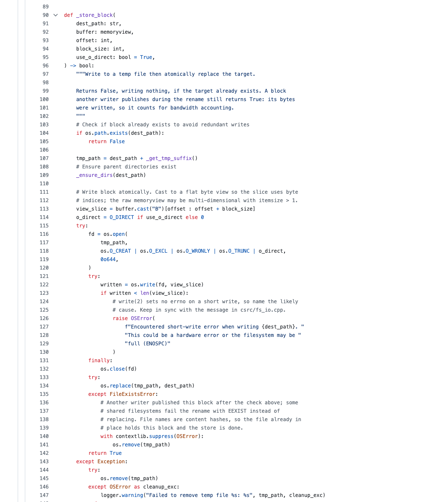
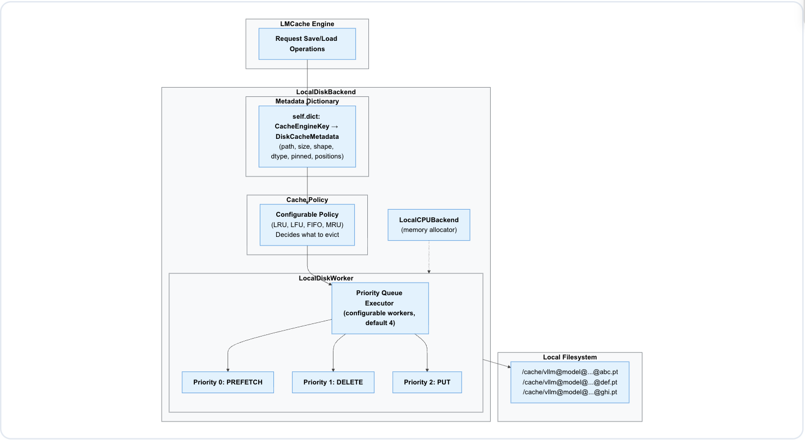

# vLLM：最底层接入 HDD

> 推理引擎 · HDD 可行性分析

### 哪些路径能把 KV 放到本地文件系统 / HDD

按固定提交的源码和官方文档核对，能把 KV 写到普通文件路径的有四条，持久化语义各不相同：

| 路径 | 落盘形态与 I/O | 同步 / 异步与持久性 | 容量与淘汰 |
|---|---|---|---|
| OffloadingConnector + TieringOffloadingSpec，二级层 `type: "fs"`（vLLM 原生） | `root_dir/<model>_<digest>_r<rank>/<hhh>/<hh>_g<group>/<hash>.bin`，每个 chunk、每个 rank 一个文件；写入走 `open(tmp, O_CREAT\|O_EXCL[\|O_DIRECT])` → `write` → `os.replace`，读取走 `os.readv` | 由 `DualQueueThreadPool` 异步执行（读写各默认 16 线程）；临时文件 + rename 保证读不到半写的块；Python 与 C++（`csrc/fs_io.cpp`）两条路径都没有 fsync / fdatasync | fs 层没有容量上限，也不淘汰；配置变化会生成新的 digest 目录，旧目录需人工清理 |
| SimpleCPUOffloadConnector，`kv_offload_backend="disk"` | 每个 rank 一个预分配大文件 `disk_path.rank_N`，按 slot 偏移用 `pwritev` / `preadv` 读写，pinned 双缓冲 | 读、写各有一个独立线程；默认 O_DIRECT；启动和关闭时都会 `unlink` 该文件 | `disk_capacity_bytes`（默认 100 GiB）；文件不跨进程保留，只用于扩大单进程的卸载容量 |
| LMCacheConnectorV1（LMCache 进程内模式）`local_disk` / `gds_path` | 每个 chunk 一个文件（文档架构图中为 .pt），默认 `chunk_size` 256 token | put 异步、get 阻塞，可 prefetch 到 CPU；`use_odirect` 可选 | `max_local_disk_size`，按 LRU 等策略淘汰；LMCache 文档已把进程内模式标为 deprecated |
| LMCacheMPConnector + LMCache server 的 FS L2 adapter | aiofiles 写 `.data` 文件，文件名编码完整 ObjectKey | 可配临时目录，写完后原子 rename；`use_odirect` 默认 false | L1 / L2 的淘汰策略由 LMCache MP 模式管理 |

来源：fs 层见 [VL3][VL9]，disk 模式见 [VL12][VL3]，LMCache 两条路径见 [VL15][LMC24][VL16]。另外，`ExampleConnector` 会对每个请求的前缀 token 做哈希、建一个目录，在 `save_kv_layer()` 中把每一层同步写成一个 `safetensors` 文件。它的定位是调试示例，不适合当作 HDD 原型 [VL13]。



*vLLM 固定提交 0c80c3a6 中 vllm/v1/kv_offload/tiering/fs/io.py 的 _store_block()：已存在则跳过、以 O_CREAT*

原生 fs 层的数据流比文件格式更值得注意。`TieringOffloadingManager` 的设计注释写明了几条原则：任何 chunk 一旦存入 CPU 主层，就会**级联写到所有二级层**；二级层不能直接访问 GPU，读写都要经 CPU 主层中转；二级层的命中必须先“提升”（promotion）回 CPU 主层，GPU 才能读取 [VL10]。GPU 与 CPU 之间由 `CPUOffloadingWorker` 用 `swap_blocks_batch` 发起 DMA 异步拷贝 [VL5][VL10]。查找时，`OffloadingConnectorScheduler.get_num_new_matched_tokens()` 逐个 chunk 调用 `TieringOffloadingManager.lookup()`：先查 CPU 主层；未命中再由 `FsAsyncLookupManager.batch_lookup()` 在后台线程中批量检查文件是否存在（C 扩展用 faccessat）；在 fs 层命中后调用 `_initiate_promotion()` 并返回 `HIT_PENDING`。只要有一个 chunk 处于 `RETRY` 或 `HIT_PENDING`，整个查找就返回 `None`，请求留到下一步再调度。这个等待在源码里**没有超时上限** [VL10][VL9]。CPU 主层满了、无法接纳 promotion 时按 MISS 处理。批量读在第一个坏块处停止，之前读成功的块保留，失败块及其后面的块标记为 miss，交给 GPU 重算；短读的文件会被删除 [VL9]。所以二级层读失败通常会退化为局部重算，不会触发上一节的 `kv_load_failure_policy`，后者处理的是 worker 侧加载到 GPU 时的错误。


*KV 下沉到文件系统 / HDD 的三条官方路径及共同风险点：A 为 vLLM 原生 OffloadingConnector + fs 二级层（含写、读、查找与回退），B 为 LMCache 的两种 connector，C 为 SimpleCPUOffloadConnector 的 disk 模式（本文根据 vLLM 固定提交 0c80c3a6 源码 tiering/manager.py、tiering/fs/、offloading/scheduler.py、simple_kv_offload/disk_backend.py 及 LMCache 官方文档绘制）* — [原始来源](https://github.com/vllm-project/vllm/tree/0c80c3a6aa0201d1b4f71915f90c03fd64837cec/vllm/v1/kv_offload)

写入侧有可选的背压机制。在 fs 层配置 `backpressure` 后，`EMABackpressureDetector` 按“秒 / MiB”统计 store 延迟的指数移动平均，压力过高时由 `DropStorePolicy` 或 `ThrottledDropPolicy` 丢弃部分写入；连续 3 次写失败（如 ENOSPC）也会进入压力状态。fs 层默认使用 LOCAL 水位（高水位 0.010 s/MiB，低水位 0.002 s/MiB），源码注释说明这组默认值是在 NVMe 上用 fio 标定的 [VL11]。HDD 的随机写延迟与 NVMe 不在同一量级，沿用这组默认值可能让 HDD 层长期处于“丢写”状态，水位需要按实际阵列重新标定。



*LMCache 官方文档 Local storage 页的 LocalDiskBackend 架构图：元数据字典、可配置淘汰策略、带 PREFETCH / DELETE / PUT 优先级队列的 LocalDiskWorker（默认 4 个 I/O 线程），每个 chunk 一个文件* — [原始来源](https://docs.lmcache.ai/kv_cache/storage_backends/local_storage.html)

### 最小原型配置（未执行示例）

下面两组配置依据固定提交的官方文档和 LMCache 文档整理，**均未执行**。目的是在 HDD 上建立“写入 → 冷恢复 → 失败回退到重算”的正确性基线，不能直接用于生产。示例 A 走 vLLM 原生 fs 层，在 HDD 前面放 30 GiB CPU 主层，对应 WD / Solidigm 报告中 DRAM 前置层的规模；示例 B 是任务要求的 LMCache `local_disk` 写法 [VL3][VL11][VL15]。

```
# 示例 A：vLLM 原生 OffloadingConnector + fs 二级层（未执行）
# /mnt/hdd/vllm_kv 必须实际位于 HDD 阵列，不能是系统盘 SSD 或 tmpfs。
# n_read_threads / n_write_threads / blocks_per_chunk 都是待扫描的参数，不是推荐值；
# backpressure 的水位需要按 HDD 实测重新设定（默认值按 NVMe 标定）。
vllm serve <model> \
  --kv-transfer-config '{
    "kv_connector": "OffloadingConnector",
    "kv_role": "kv_both",
    "kv_connector_extra_config": {
      "spec_name": "TieringOffloadingSpec",
      "cpu_bytes_to_use": 32212254720,
      "blocks_per_chunk": 4,
      "eviction_policy": "lru",
      "secondary_tiers": [{
        "type": "fs",
        "root_dir": "/mnt/hdd/vllm_kv",
        "n_read_threads": 8,
        "n_write_threads": 4,
        "locality": "LOCAL",
        "backpressure": {"backpressure_cls": "EMABackpressureDetector",
                         "policy_cls": "ThrottledDropPolicy"}
      }]
    }
  }'

# 示例 B：LMCache 进程内模式 local_disk（未执行；LMCache 文档已将该模式标为 deprecated）
LMCACHE_CHUNK_SIZE=256 \
LMCACHE_LOCAL_CPU=True LMCACHE_MAX_LOCAL_CPU_SIZE=30 \
LMCACHE_LOCAL_DISK="file:///mnt/hdd/lmcache/" LMCACHE_MAX_LOCAL_DISK_SIZE=2000 \
LMCACHE_EXTRA_CONFIG='{"use_odirect": true, "disk_io_threads": 4}' \
vllm serve <model> \
  --kv-transfer-config '{"kv_connector":"LMCacheConnectorV1","kv_role":"kv_both"}'
```

LMCache 推荐的 MP 模式写法（同样未执行）是：先启动 `lmcache server --l1-size-gb 30 --l2-adapter '{"type":"fs","base_path":"/mnt/hdd/lmcache_l2"}'`，再用 `--kv-offloading-backend lmcache --kv-offloading-size 30` 启动 vLLM。注意 `kv_offloading_size` 在 lmcache 后端下只起开关作用，不会传给 LMCache [LMC24][VL14]。验证时，可以在请求的 `kv_transfer_params` 中设 `max_load_tokens: 0` 得到“只用 GPU 前缀缓存”的对照组，用 `kv_load_tiers` 选择是否查询二级层 [VL3]。

## 本章资料

- **[LMC24]** [LMCache 官方文档 · FileSystem L2 adapter（采集于 2026-11-18）](https://docs.lmcache.ai/mp/l2_storage/fs.html)
- **[VL3]** [vLLM 官方文档 · KV Offloading Usage Guide（OffloadingConnector、TieringOffloadingSpec、fs / obj / p2p 二级层、On-Disk Layout、max_load_tokens，采集于 2026-11-18）](https://docs.vllm.ai/en/latest/features/kv_offloading_usage/)
- **[VL5]** [vLLM 官方博客 · Inside vLLM's New KV Offloading Connector: Smarter Memory Transfer for Maximizing Inference Throughput（Or Ozeri、Danny Harnik，IBM Research），2026-01-08](https://vllm.ai/blog/2026-01-08-kv-offloading-connector)
- **[VL9]** [vLLM 固定提交源码 · vllm/v1/kv_offload/tiering/fs/manager.py 与 io.py（FileSystemTierManager、batch_store_block / batch_load_block、probe_o_direct）](https://github.com/vllm-project/vllm/blob/0c80c3a6aa0201d1b4f71915f90c03fd64837cec/vllm/v1/kv_offload/tiering/fs/manager.py)
- **[VL10]** [vLLM 固定提交源码 · vllm/v1/kv_offload/tiering/manager.py（TieringOffloadingManager：级联、promotion、lookup、reset_cache）与 kv_connector/v1/offloading/scheduler.py](https://github.com/vllm-project/vllm/blob/0c80c3a6aa0201d1b4f71915f90c03fd64837cec/vllm/v1/kv_offload/tiering/manager.py)
- **[VL11]** [vLLM 固定提交源码 · vllm/v1/kv_offload/tiering/backpressure.py（EMABackpressureDetector、DropStorePolicy、ThrottledDropPolicy 及默认水位）](https://github.com/vllm-project/vllm/blob/0c80c3a6aa0201d1b4f71915f90c03fd64837cec/vllm/v1/kv_offload/tiering/backpressure.py)
- **[VL12]** [vLLM 固定提交源码 · vllm/v1/simple_kv_offload/disk_backend.py 与 kv_connector/v1/simple_cpu_offload_connector.py（disk 模式）](https://github.com/vllm-project/vllm/blob/0c80c3a6aa0201d1b4f71915f90c03fd64837cec/vllm/v1/simple_kv_offload/disk_backend.py)
- **[VL13]** [vLLM 固定提交源码 · vllm/distributed/kv_transfer/kv_connector/v1/example_connector.py（ExampleConnector，safetensors 按层落盘示例）](https://github.com/vllm-project/vllm/blob/0c80c3a6aa0201d1b4f71915f90c03fd64837cec/vllm/distributed/kv_transfer/kv_connector/v1/example_connector.py)
- **[VL14]** [vLLM 固定提交源码 · vllm/config/cache.py（DEFAULT_BLOCK_SIZE、prefix_match_unit、kv_offloading_size / kv_offloading_backend）、config/vllm.py（_post_init_kv_transfer_config）、config/kv_transfer.py（kv_load_failure_policy）](https://github.com/vllm-project/vllm/blob/0c80c3a6aa0201d1b4f71915f90c03fd64837cec/vllm/config/cache.py)
- **[VL15]** [LMCache 官方文档 · Legacy (In-Process Mode) / Local storage（local_disk、max_local_disk_size、LocalDiskBackend 架构，采集于 2026-11-18）](https://docs.lmcache.ai/kv_cache/storage_backends/local_storage.html)
- **[VL16]** [LMCache 官方文档 · Legacy (In-Process Mode) / GDS Backend（gds_path、disk_io_threads，采集于 2026-11-18）](https://docs.lmcache.ai/kv_cache/storage_backends/gds.html)
