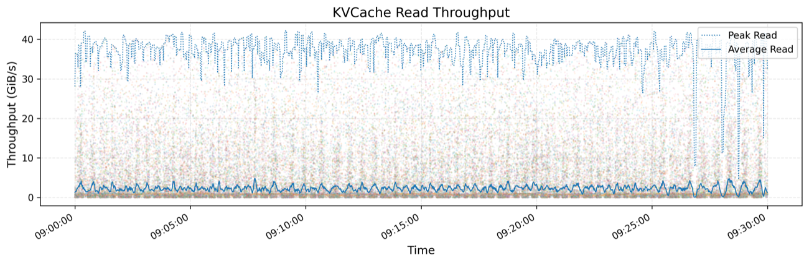

# DeepInfer：最底层接入 HDD

> 推理引擎 · HDD 可行性分析

### 持久层：3FS 的实现与容量策略

3FS（Fire-Flyer File System）在 2025 年 Open Source Week Day 5 开源，定位是“充分利用现代 SSD 与 RDMA 网络带宽的并行文件系统”，官方列出的用途包括 V3 / R1 推理中的 KVCache 查找，单客户端节点 KVCache 查找峰值吞吐 40+ GiB/s [DS13]。3FS README 把 KVCache 列为一类场景，称其为“比 DRAM 缓存更具成本效益的替代方案，吞吐高、容量大得多”，并给出两张运行图：所有 KVCache 客户端（每节点 1 × 400 Gbps 网卡）的读吞吐峰值可达 40 GiB/s；GC 删除操作的 IOPS 来自同一时间段 [DS11]。

*3FS 官方仓库 README 的 KVCache Read Throughput 图：30 分钟内所有 KVCache 客户端（每节点 1×400Gbps 网卡）的峰值与平均读吞吐，峰值约 40 GiB/s，平均值远低于峰值* — [原始来源](https://github.com/deepseek-ai/3FS/blob/main/docs/images/kvcache_read_throughput.png)

3FS 设计文档描述了四个组件（cluster manager、metadata service、storage service、client），全部通过 RDMA（InfiniBand 或 RoCE）互联。每个 storage service 管理几块本地 SSD，以 CRAQ（Chain Replication with Apportioned Queries）保证强一致，“写全部、读任意”，以便吃满 SSD 与 RDMA 带宽。文件按等长 chunk 切分；chunk engine 在每块 SSD 上用固定数量的数据文件加一个 RocksDB 保存元数据，物理块从 64 KiB 到 64 MiB 按 2 的幂分 11 档，空间不够时用 `fallocate()` 一次预留 256 个物理块以减少碎片 [DS12]。FUSE 在小随机读上表现不佳，因此另有异步零拷贝 API（USRBIO） [DS12]。

V4.1 Q&A 给出了 KV 场景的具体配置：数据在 3FS 上以 **10+2 纠删码**存放，每个 EC 组可容忍两个节点同时故障；读请求同时发往组内 11 个节点，任意 10 个返回即可解码；Q&A 称 3FS 必须在节点故障和网络抖动下同时保证高可用与高性能。每个存储节点部署一个 GC Worker，定期按 LRU 淘汰最久未用的 KV，把磁盘占用控制在水位以下。kvcache-store 本身没有过期逻辑，回收完全依赖 3FS 的 GC [DS2]。容量方面，3FS 为 KV 提供约 **100 PiB SSD**，TTL 为 agent 流量 3 天、chatbot 流量 7 天。推荐每台存储服务器配 20 块 30.73 TB SSD，读不低于 40 GB/s、写不低于 5 GB/s，总容量足以保存 24 小时数据；实际配比约为每张在线 GPU 14.4 TB（逻辑容量），物理容量还要更大 [DS2]。按前文每 token 890 B 估算，14.4 TB 约可存 160 亿 token 的 block KV（本文估算）。注意，3FS 公开设计文档描述的冗余方式是 CRAQ 链式复制，10+2 EC 只出现在 V4.1 Q&A 中。

### 与 HDD 的关系：“硬盘缓存”并不在机械盘上

**官方说的介质是什么。**2024 年公告的中文措辞是把内容“缓存在分布式的硬盘阵列中” [DS7]，这里的“硬盘”是相对显存 / 内存而言的磁盘层。此后的官方材料都把介质写成 SSD：3FS 的定位是“利用现代 SSD 与 RDMA 网络” [DS13][DS12]，V4.1 Q&A 写明“约 100 PiB SSD”和每台 20 块 30.73 TB SSD [DS2]。在本次检索的 DeepSeek 官方材料中没有找到 HDD 的部署描述。

**为什么小 KV 让磁盘缓存划算。**每 token 890 B 意味着一台读带宽 40 GB/s 的存储服务器每秒可供出约 4,500 万 token 的 KV（本文估算），命中读取能与请求排队、引擎计算重叠。Q&A 在回答“是否值得做基于 CXL 的集中式 L2 缓存”时也说：V4.1 的 KV 很小，读取已与排队和计算重叠，降低命中读延迟对 TTFT 帮助有限，而且 SSD 比 DRAM 便宜得多。他们真正在意的是 SSD 写入量，即能否把热点或只用一次的条目留在内存里以减少 SSD 磨损，但目前没有这样做 [DS2]。

### 最小验证入口

公开仓库缺少线上 kvcache-store，实现者无法按官方配置把 SSD 替换成 HDD。可先在独立挂载点回放分页 block KV 的写入与前缀读取。该原型能测出介质排队和恢复成本；要验证服务端 TTFT，还需要可观测的请求调度、取数与重算路径。SWA KV 继续按官方设计留在主机内存。 [DS1][DS2]

## 本章资料

- **[DS1]** [DeepSeek 官方 GitHub · deepseek-ai/DeepInfer README（固定提交 a679bb86ce36e883a98a97733492b686e5b9a08e，2026-11-03；含 doc/images/architecture_overview.png，采集于 2026-11-18）](https://github.com/deepseek-ai/DeepInfer/tree/a679bb86ce36e883a98a97733492b686e5b9a08e)
- **[DS2]** [DeepSeek 官方 GitHub · DeepInfer doc/inference_deployment_qa.md《DeepSeek V4.1 Flash Inference Deployment Q&A》（v0.2，2026-11-03；KV cache storage、3FS、负载均衡、SWA bounded replay，采集于 2026-11-18）](https://github.com/deepseek-ai/DeepInfer/blob/a679bb86ce36e883a98a97733492b686e5b9a08e/doc/inference_deployment_qa.md)
- **[DS7]** [DeepSeek API 文档 · 新闻《DeepSeek API 创新采用硬盘缓存，价格再降一个数量级》，2024-08-02](https://api-docs.deepseek.com/zh-cn/news/news0802)
- **[DS11]** [DeepSeek 官方 GitHub · deepseek-ai/3FS README（Performance · KVCache 读吞吐与 GC IOPS 图，采集于 2026-11-18）](https://github.com/deepseek-ai/3FS)
- **[DS12]** [DeepSeek 官方 GitHub · 3FS docs/design_notes.md（组件、CRAQ、chunk engine、USRBIO，采集于 2026-11-18）](https://github.com/deepseek-ai/3FS/blob/main/docs/design_notes.md)
- **[DS13]** [DeepSeek 官方 GitHub · open-infra-index README（2025-02 Open Source Week Day 5：3FS 与 smallpond）](https://github.com/deepseek-ai/open-infra-index)
