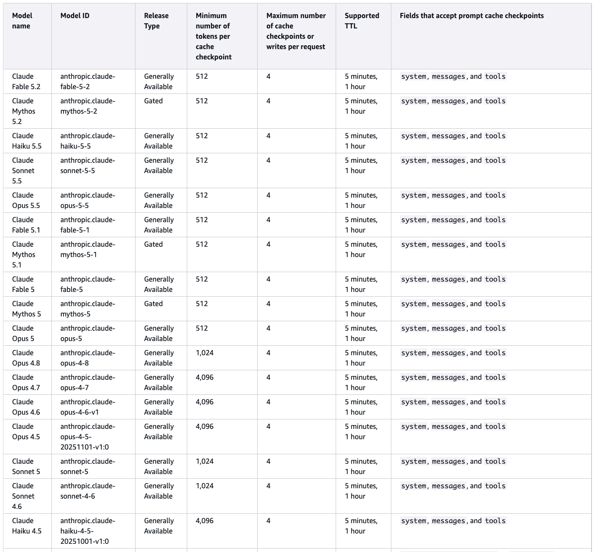
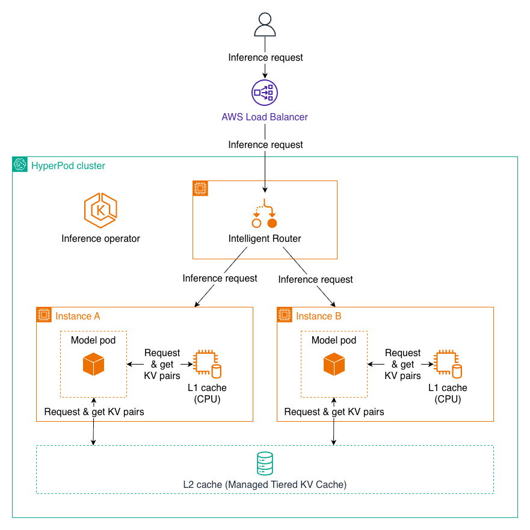
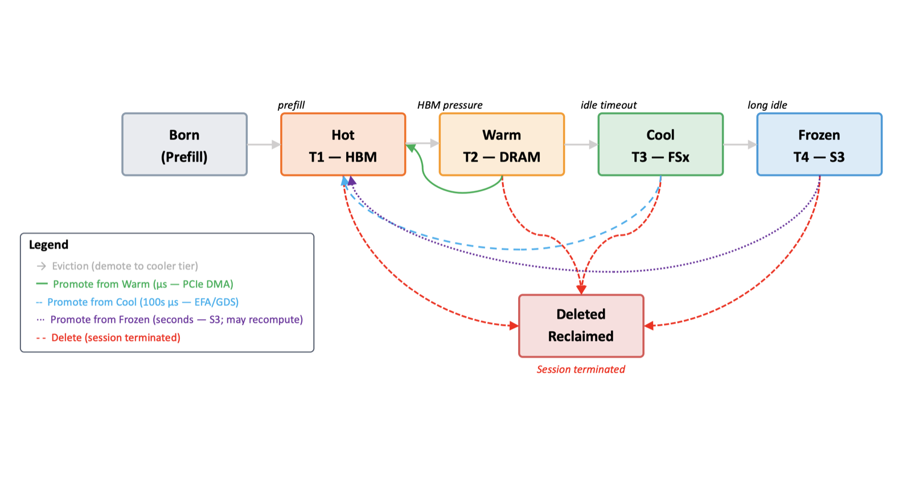

# AWS / Amazon Bedrock

> 托管 API + 自建推理集群 · 官方文档与官方博客

AWS 对外公开的 KV Cache 相关能力分布在三个层次：一是 Amazon Bedrock 托管 API 的 **prompt caching**（用户只看到前缀、检查点、TTL 与计量字段）；二是 Amazon SageMaker HyperPod 面向自部署模型的 **Managed Tiered KV Cache + Intelligent Routing**（直接管理 vLLM / LMCache 的 KV 块，并提供 CPU 内存与集群级分层存储）；三是 AWS 存储团队发布的 **KV Cache 分层存储参考架构**（HBM → 主机 DRAM → Amazon FSx for Lustre → Amazon S3）。三者披露深度差异很大：Bedrock 只公开产品语义，HyperPod 与存储博客则给出了缓存层级、路由策略和介质选择。本章按“托管 API → 托管集群 → 存储分层”的顺序展开。 [PA][AWS9][AWS16]

### 定位：Bedrock prompt caching 的演进与两种模式

Bedrock prompt caching 于 re:Invent 2024 以预览形式发布，官方称其“最多可降低 90% 成本、85% 延迟”；预览期缓存内容“在每次访问后最多保留 5 分钟”，且已透明支持跨区域推理（cross-Region inference）。 [AWS6] 2025-04-07 正式 GA，首批支持 Claude 3.5 Haiku、Claude 3.7 Sonnet 与 Nova Micro / Lite / Pro。 [AWS3][AWS5] 2026-01-26 起，部分 Claude 模型可选 1 小时 TTL； [AWS4] 2026-07-30 起，OpenAI GPT-5.6 系列在 Bedrock 上支持显式缓存断点与 30 分钟最短保留。 [AWS7]

当前用户指南把缓存分为两类：

| 类型 | 工作方式 | 请求配置 | 是否保证命中 |
|---|---|---|---|
| 隐式缓存（Implicit） | Bedrock 与模型自动尝试复用合格前缀 | 无需 cache control / 断点 | best effort，重复相同提示也不保证命中 |
| 显式缓存（Explicit） | 通过模型特定的 cache control 或 cache checkpoint 选择可缓存的连续前缀 | 必须带模型与 API 支持的缓存控制字段 | 只控制“可缓存范围”，同样不保证命中 |

文档同时说明：prompt caching 仅支持按需（on-demand）推理端点，不支持 batch inference API；可通过 Converse / ConverseStream、InvokeModel / InvokeModelWithResponseStream、OpenAI 兼容的 Responses API、Prompt management 及控制台 playground 使用。 [PA]

### 显式缓存的使用方式：检查点、顺序与 API 示例

显式缓存的核心是 **cache checkpoint**：检查点之前的全部内容构成被缓存的前缀。每个检查点有模型相关的最小 token 数，当前范围为 512–4,096 tokens；该最小值按“检查点之前的累计前缀”计算，包括 `tools`、`system`、`messages`，两个检查点之间不要求最小间距。若前缀不足最小值，请求仍然成功，只是不会被缓存。 [PA] 检查点按 `tools → system → messages` 的顺序链式处理，修改前一段（例如工具定义）会使后面各段的缓存全部失效。 [PA]

对 Claude 模型还有两点实现细节：一是带检查点的请求会向前回看约 20 个 content block，读取已缓存的最长前缀，超出此范围需增加检查点；二是可在请求顶层放一个 `cache_control` 实现“自动缓存”，由模型把检查点放在最后一个可缓存块并随对话前移，它占用 4 个检查点名额中的 1 个。同一请求可混用 1 小时与 5 分钟条目，但较长 TTL 的条目必须位于较短 TTL 条目之前。 [PA]

以下示例按官方文档的 Converse API 字段写成（Python / boto3），在工具定义与系统提示之后各放一个检查点，并读取缓存计量：

~~~python
# 出处（据此整理） [PA] https://docs.aws.amazon.com/bedrock/latest/userguide/prompt-caching.html
import boto3
client = boto3.client("bedrock-runtime", region_name="us-east-1")

resp = client.converse(
    modelId="us.anthropic.claude-sonnet-5-5",
    toolConfig={"tools": [
        {"toolSpec": {...}},                       # 稳定的工具定义
        {"cachePoint": {"type": "default"}}        # 检查点 1：tools
    ]},
    system=[
        {"text": "Long, unchanging system prompt / reference document ..."},
        {"cachePoint": {"type": "default", "ttl": "1h"}}   # 检查点 2：system，1 小时 TTL
    ],
    messages=[{"role": "user", "content": [{"text": "First question"}]}],
)

u = resp["usage"]
# 启用缓存后 inputTokens 只含未读/未写缓存的部分
total_in = u["inputTokens"] + u.get("cacheReadInputTokens", 0) + u.get("cacheWriteInputTokens", 0)
print(u.get("cacheReadInputTokens"), u.get("cacheWriteInputTokens"), total_in)
~~~

Converse 响应新增 `cacheReadInputTokens`、`cacheWriteInputTokens` 与记录写入 TTL 的 `cacheDetails`；总输入 token = `inputTokens + cacheReadInputTokens + cacheWriteInputTokens`。只支持 5 分钟 TTL 的模型若带上 `ttl` 字段可能返回 ValidationException。 [PA] OpenAI 模型走 Responses API：GPT-5.6 及以后模型在内容块上加 `"prompt_cache_breakpoint": {"mode": "explicit"}`，用 `prompt_cache_options.mode` 在 implicit（默认，自动在最新消息处放断点并兼用显式断点）与 explicit（只用显式断点；若无断点则不缓存、不产生写入费用）之间切换；用量在 `usage.input_tokens_details.cached_tokens` 与 `cache_write_tokens` 中返回，且两者包含在 `input_tokens` 内。 [PA][AWS7] 官方博客的预览示例中，29,841 个文档 token 首次写入缓存，后续调用全部从缓存读取，耗时比首次少 55%。 [AWS6]

### 生命周期与计量

缓存有 TTL，每次成功命中重置；TTL 内无命中则过期。下表汇总用户指南“Supported models, Regions, and explicit caching limits”表格与各模型族说明（采集于 2026-11-18）： [PA]

| 模型族（Bedrock 当前列表） | 每检查点最小 tokens | 每请求最多检查点 / 写入 | TTL | 写入计费 |
|---|---|---|---|---|
| Claude Opus 5 / 5.5、Sonnet 5.5、Haiku 5.5 等 5.x 新模型 | 512 | 4 | 5 分钟（默认）、1 小时 | 5 分钟写入与 1 小时写入分别定价 |
| Claude Opus 4.8、Sonnet 5、Sonnet 4.6 | 1,024 | 4 | 5 分钟、1 小时 | 同上 |
| Claude Opus 4.5 / 4.6 / 4.7、Haiku 4.5 | 4,096 | 4 | 5 分钟、1 小时 | 同上 |
| OpenAI GPT-5.6 / GPT-6 / GPT-6.1 | 1,024 | 4 次缓存写入 | 至少 30 分钟（`30m` 为唯一取值） | 写入按未缓存输入价 1.25× |
| OpenAI GPT-5.5 及更早（如 gpt-5.4） | 1,024（仅隐式） | — | 未给出固定值 | 无写入附加费 |
| Amazon Nova（Nova 2 Lite、Pro、Lite、Micro） | 1K，前缀最长 20K tokens | 4 | 5 分钟 | 隐式复用不计入缓存字段、不按缓存读取计费 |

*Amazon Bedrock 用户指南“Supported models, Regions, and explicit caching limits”表格截图（节选 Claude 部分行；GPT 与 Nova 行见正文表格），采集于 2026-11-18* — [原始来源](https://docs.aws.amazon.com/bedrock/latest/userguide/prompt-caching.html)

计费上，输入 token 分为三种费率：缓存写入（依模型可能高于标准输入价）、缓存读取（报告为 cached tokens）与普通输入。 [PA] 下表取自 AWS Price List API 中 us-east-1 的 Bedrock 基础模型价目（publicationDate 2026-11-09，采集于 2026-11-18；Global 跨区域推理口径，单位：美元 / 百万 tokens）： [AWS2][AWS1]

| 模型 | 标准输入 | 5 分钟写入 | 1 小时写入 | 缓存读取 | 读取 / 输入 |
|---|---|---|---|---|---|
| Claude Sonnet 5 | 2.00 | 2.50 | 4.00 | 0.20 | 0.10× |
| Claude Sonnet 5.5 | 2.00 | 2.50 | 4.00 | 0.10 | 0.05× |
| Claude Opus 5.5 | 4.00 | 5.00 | 8.00 | 0.20 | 0.05× |
| Claude Haiku 4.5 | 1.00 | 1.25 | 2.00 | 0.10 | 0.10× |
| GPT-5.6 Sol | 4.00 | 5.00（30 分钟写入） | — | 0.40 | 0.10× |

同一价目中的 Regional（区域内 / 地理跨区域）口径比 Global 高 10%，例如 Sonnet 5 输入 2.20、读取 0.22。定价页注明自 2026-10-07 起 Claude Sonnet 5.5 的缓存读取价下调 50%，并写明 Nova 模型缓存读取比按需输入价低 75%。 [AWS1][AWS2] AWS 2026-11-12 的成本博客据 Sonnet 5 / Opus 5 费率推导：5 分钟缓存在 5 分钟内第一次复用即回本；若同一前缀每小时至少出现两次且间隔超过 5 分钟，应改用 1 小时缓存；而要比完全不缓存更便宜，1 小时缓存每小时至少需要 3 次请求。 [AWS8] 另外，Claude 与 GPT-5.6 的缓存命中 token 不计入输入 TPM 限额。 [PA]

### 局部性、路由与隔离

Bedrock 文档对缓存位置给出了一个关键的工程事实：**缓存条目存放在处理该请求的服务器上**，后续请求只有在条目过期前被同一台服务器处理时才能读取；被其他服务器（例如另一个 Region）处理的请求，或在相同请求开始返回之前就到达的并发请求，都会写入新条目而非读取。 [PA] 因此跨区域推理在高峰期可能“增加缓存写入”。 [PA] 对 GPT-5.6，官方博客说明 `prompt_cache_key` 是“将请求路由到同一缓存的稳定 ID”，应在同一会话或应用的所有请求中保持一致。 [AWS7]

隔离边界方面，AWS 成本博客表述为缓存条目“作用域是账户与 Region，而非租户”；多租户应用可在可缓存前缀前加入租户相关的 SHA-256 哈希来分区，强隔离需求则应使用不同 AWS 账户。 [AWS8] Bedrock 另有 Intelligent Prompt Routing，它在同一模型族的不同模型之间按预测质量与成本选路，属于模型选择而非 KV 局部性路由。 [AWS6]（本文分析：被路由到不同模型的请求无法共享同一份前缀缓存，混用时需按模型分别评估命中率。）

### SageMaker HyperPod：托管分层 KV Cache 与智能路由

2025-11-26，AWS 宣布 SageMaker HyperPod 通过 HyperPod Inference Operator 提供 Managed Tiered KV Cache 与 Intelligent Routing。 [AWS9][AWS10] 与 Bedrock 不同，这里由用户在 EKS 编排的 HyperPod 集群上部署自己的模型，AWS 托管缓存基础设施与路由器。请求经 AWS Load Balancer 进入集群内的 Intelligent Router，再分发到模型 Pod；Pod 先查 L1（CPU 内存），再查共享 L2（命中后可选提升到 L1），都未命中才完整计算，新生成的 KV 同时写入两级缓存。 [AWS9]

*SageMaker HyperPod Managed Tiered KV Cache 与 Intelligent Routing 请求流程图（AWS Machine Learning Blog 原图，2025-11-26）* — [原始来源](https://aws.amazon.com/blogs/machine-learning/managed-tiered-kv-cache-and-intelligent-routing-for-amazon-sagemaker-hyperpod/)

| 组件 | 官方披露 |
|---|---|
| L1 缓存 | 位于每个推理节点的 CPU 内存，开启 KV Cache 时默认启用，自动管理内存分配与淘汰 |
| L2 缓存（推荐：tieredstorage） | HyperPod 分离式内存方案，可扩展至 TB 级池，支持 GPU 感知与零拷贝；What's New 公告称其可“自动从 CPU 内存分层到本地 SSD” |
| L2 缓存（备选：redis） | 需填写 `l2CacheLocalUrl`；Redis 不在同一 VPC 时不保证传输加密 |
| 路由策略 | `prefixaware`（默认，维护前缀树记录各端点缓存）、`kvaware`（中心控制器实时跟踪缓存位置与淘汰事件）、`session`、`roundrobin` |
| 引擎约束 | 仅支持 vLLM 容器；kvaware 需用 `/completions` 端点，并要求 Operator ≥ v3.1.3 搭配 LMCache ≥ v0.4.3、vLLM ≥ v0.19.1 |
| 安全 | KV 数据静态存储不加密；以 tieredstorage 作为 L2 时同一集群多部署共享缓存、无隔离 |

以上见官方博客、用户指南与部署文档。 [AWS9][AWS10][AWS11][AWS12] 配置写在 `InferenceEndpointConfig` CRD 中：

~~~yaml
# 出处（据此整理） [AWS9] https://aws.amazon.com/blogs/machine-learning/managed-tiered-kv-cache-and-intelligent-routing-for-amazon-sagemaker-hyperpod/
# 出处（据此整理） [AWS11] https://docs.aws.amazon.com/sagemaker/latest/dg/sagemaker-hyperpod-model-deployment-caching-routing.html
kvCacheSpec:
  enableL1Cache: true
  enableL2Cache: true
  l2CacheSpec:
    l2CacheBackend: "tieredstorage"   # 或 "redis"
intelligentRoutingSpec:
  enabled: true
  routingStrategy: prefixaware        # kvaware / session / roundrobin
~~~

官方基准：Llama-3.1-70B-Instruct、7 个副本、p5.48xlarge。8K tokens 场景下 P90 TTFT 降低 40%、P50 降低 72%、吞吐提升 24%、成本降低 21%；64K tokens 场景下 P90 TTFT 降低 35%、P50 降低 94%、吞吐提升 38%、成本降低 28%；AWS 托管 tiered storage 在各场景均优于 Redis 作 L2。 [AWS9] 后续版本继续扩展：Operator v3.2（2026-06-12）引入 Disaggregated Prefill and Decode，用 LMCache 经 NIXL 与 EFA（GPU-Direct RDMA）在预填充与解码 Pod 间传输 KV；v3.7（2026-09-21）增加 LMCache MultiProcess 模式，以 sidecar 进程通过 CUDA-IPC 共享 GPU 内存。 [AWS13] Ray Serve 部署同样可接入：LMCache 通过 `sagemaker-hyperpod://$(NODE_IP):9200` 连接节点上的 Tiered Storage 服务，并用 `/dev/shm/ai_toolkit_cache` 走本地 CPU 卸载路径。 [AWS14]

2026-08-12 的 AWS 博客（与开源 Curvine 维护者合写）展示了另一种 L2：把 G6e / P5 自带的本地 NVMe 用 Curvine 分布式缓存文件系统池化成共享命名空间，通过 FUSE 以 ReadWriteMany PVC 挂载，LMCache 经 `fs://` 连接器读写，形成 L0 GPU → L1 CPU → L2 共享 NVMe 三级。测试中跨 Pod 命中率 100%（1,925/1,925 tokens），同节点 L2 写入约 9.6 GB/s，跨节点读取约 1.8 GB/s、约 56 ms；2,500 tokens 提示下 TTFT 从 774 ms 降到 287 ms（2.7×），约 1,000 tokens 以下 L2 往返成本与重算相当。该方案需要修补 Operator 环境变量，并非 CRD 原生选项。 [AWS15]

### 放置策略：哪些 KV 放到哪一层

AWS 的三类方案在“谁决定 KV 放哪一层”上分工清楚：Bedrock 只把**可缓存范围与保留时长**交给用户，物理放置不公开；HyperPod 由 Inference Operator 托管 LMCache 的 L1 / L2 与路由器，用户只选开关、L2 后端和路由策略；FSx for Lustre 存储博客则是一份需要用户自行实现的四层策略模板。下表按维度汇总（“托管 / 自建”分列）。

| 维度 | 该系统做法 | 证据类型与引用 |
|---|---|---|
| 层级与介质 | Bedrock：仅知缓存位于“处理该请求的服务器”，介质与容量未公开。HyperPod：GPU（vLLM 前缀缓存）→ L1 节点 CPU 内存 → L2 集群级 tiered storage（TB 级内存池，并自动分层到本地 SSD）或 Redis；tieredstorage 依赖集群级 `TieredStorageConfig`，其 `InstanceMemoryAllocationPercentage` 取 20–100（Curvine 博客建议 L1 从 20% 起步）；Curvine 方案用池化本地 NVMe 作 L2。存储博客：T1 HBM（80–288 GB/芯片）→ T2 DRAM（1–4 TB/节点）→ T3 FSx for Lustre（PB 级）→ T4 S3 | Bedrock 官方明确“服务器本地”、介质未公开 [PA]；HyperPod 官方明确 [AWS9][AWS10][PLAWS2]；Curvine、存储博客为官方参考架构 [AWS15][AWS16] |
| 放置单位 | Bedrock：以检查点之前的累计前缀为单位，最小 512–4,096 tokens（随模型）。HyperPod：LMCache chunk，Ray Serve 示例 `LMCACHE_CHUNK_SIZE=256`，文档称 chunk 越小共享前缀命中率越高、条目越多；存储博客：以前缀 token 哈希命名的文件 | 官方明确 [PA][AWS14][AWS16] |
| 准入 | Bedrock 显式模式：只有检查点前且达到最小 token 数的前缀；隐式模式由服务自动挑选（best effort）。HyperPod：未满一个 256-token chunk 的提示不会写 L2；其余新算出的 KV 全部写入 L1 与 L2，无热度阈值；是否包含 decode 输出 KV 未公开 | 官方明确 [PA][AWS9][AWS15]；decode KV 未公开 |
| 写入时机 | HyperPod：计算完成后同时写 L1 与 L2（write-through 式），开启本地 CPU 时“先进 CPU 内存再写集群层”；Curvine 测试中 L2 为异步写。存储博客区分 eager（prefill 完成即写 T3，T1 保留一份）与 lazy（内存压力时才下沉） | 官方明确 [AWS9][AWS14][AWS15][AWS16] |
| 降级与淘汰 | Bedrock：TTL（5 分钟 / 1 小时 / GPT-5.6 的 30 分钟），每次命中重置。HyperPod L1：“自动管理内存分配与淘汰”，算法未公开；tieredstorage 的 SSD 分层阈值未公开；LMCache 客户端对 tiered storage 用租约（`sagemaker_hyperpod_lease_ttl_s` 默认 30 s）。存储博客：HBM > 85% 时 LRU 下沉到 T2；闲置 N 秒降到 T3；节点容量满溢出到 T3；闲置 M 分钟导出到 S3；会话结束全层删除 | Bedrock 官方明确 [PA]；HyperPod 淘汰算法未公开 [AWS9]；租约参数见 LMCache 文档 [PLAWS1]；存储博客官方明确 [AWS16] |
| 提升与预取 | HyperPod：按需查找 L1 → L2，L2 命中后“可选”提升到 L1；LMCache 初始化失败时退化为重算。存储博客：T2→T1 走 PCIe DMA（微秒），T3→T1 数百微秒，T4 秒级，“若超过重算时间就重算” | 官方明确 [AWS9][AWS11][AWS16] |
| 位置选择 | Bedrock：同服务器才能命中，跨 Region 或并发请求会重复写入；GPT-5.6 用 `prompt_cache_key` 把请求路由到同一缓存。HyperPod：`prefixaware`（前缀树）、`kvaware`（中心控制器跟踪缓存位置与淘汰事件）、`session`、`roundrobin`；L2 为集群共享 | 官方明确 [PA][AWS7][AWS9][AWS11] |
| 决策者 | Bedrock：用户（检查点、TTL、cache key）+ 服务端（隐式模式、服务器选择）。HyperPod：用户在 `InferenceEndpointConfig` 选层与路由，Operator 托管的 LMCache 与路由器执行。FSx 方案：用户自建框架（vLLM / SGLang / LMCache / Dynamo / llm-d）执行 | 官方明确 [PA][AWS11][AWS16] |
| 选择依据 | Bedrock：用户按复用频率在 TTL 间做成本取舍（5 分钟窗口内复用 1 次即回本）。HyperPod / Curvine：约 1,000 tokens 以下 L2 往返与重算相当，应依赖 L0/L1。存储博客：上下文 > 50,000 tokens 从 T3 提升几乎总快于重算，< 10,000 tokens 重算更划算；给出按淘汰率、提升率与工作集估算 FSx 容量和吞吐的公式，但无在线成本模型 | 官方明确（经验阈值） [AWS8][AWS15][AWS16] |

*KV 块状态机：Hot（HBM）→ Warm（DRAM）→ Cool（FSx）→ Frozen（S3）的降级触发与三种提升路径（AWS Storage Blog “Accelerate inference with KV cache tiering on AWS” Figure 2，2026-09-21）* — [原始来源](https://aws.amazon.com/blogs/storage/accelerate-inference-with-kv-cache-tiering-on-aws/)

**选择逻辑。**Bedrock 把“放不放”交给用户、把“放在哪”留给服务：用户的检查点决定哪段前缀有资格被缓存，TTL 决定它在服务器上保留多久，而命中与否取决于后续请求能否落到同一台服务器——所以 AWS 的建议集中在“把稳定内容放在检查点之前”“用 `prompt_cache_key` 保持亲和”“多租户在前缀前加租户哈希分区”上，而不是介质选择。 [PA][AWS7][AWS8]

HyperPod 走的是“全量写、近处读”：每个新算出的 chunk 同时进入本节点 CPU 内存与集群共享 L2，读取时按 L1 → L2 → 重算的顺序回退；L2 命中后再视情况提升到 L1。这种做法不做热度筛选，用写带宽换取跨实例复用，因此 AWS 同时提供缓存感知路由：`prefixaware` 让同前缀请求尽量回到持有 L1 的实例，`kvaware` 由中心控制器按实时缓存位置挑选命中率最高的实例。Curvine 博客的数据说明了这一取舍：写入落在本节点 NVMe 几乎不花代价，跨节点读取约 60–200 ms，路由命中能把它变成亚毫秒级的 GPU 命中。 [AWS9][AWS15]

存储博客则给出了按“温度”放置的完整规则：活跃解码 KV 留在 HBM，水位超过 85% 按 LRU 下沉 DRAM，会话闲置后降到共享 FSx，长期闲置再导出到 S3；共享前缀以 token 哈希为文件名在 T3 上“一次写、多次读”，靠 TTL 失效。P/D 分离部署必须用 eager 写入，因为 decode 节点总与 prefill 节点不同。 [AWS16]

**例子（本文按上述官方规则推演）。**一个 32k token 的多轮对话前缀在 HyperPod（tieredstorage + prefixaware）上：首轮 prefill 在 GPU 上完成，按 256-token 切成 128 个 chunk，同时写入本节点 L1 与集群 L2；下一轮若被路由回同一实例，直接命中 GPU 前缀缓存或 L1；若该实例被扩缩容替换或负载过高而被路由到别处，则新实例从 L2 读回这 128 个 chunk 而不重算。按存储博客的阈值，32k 落在“10,000–100,000 tokens 由 T1+T2 可能足够”的区间，只有在高并发或 P/D 分离时才值得引入 FSx T3；若用户长时间离开，会话再被导出到 S3，回来时由于 S3 读取为秒级，可能直接重算更快。若同样的对话走 Bedrock，用户只需在系统提示与历史末尾放检查点并选 5 分钟或 1 小时 TTL，KV 在哪种介质上则不可见。

### 硬件配置信息

下表列出本章来源提到的硬件配置。实例规格中来源只给了实例名的部分，用 EC2 官方实例规格页补全（以“规格页”标注）；GPU 显存按规格页写 GiB，博客原文写法另注。

| 场景 / 方案 | 计算（GPU / NPU 型号 × 数量，HBM 容量） | CPU 与主机内存（DRAM 容量） | 本地存储（SSD / NVMe / HDD 型号、数量、容量） | 网络（RDMA / NIC 型号与带宽） | 远端 / 共享存储（服务名与规格） | 来源 |
|---|---|---|---|---|---|---|
| Bedrock prompt caching（托管） | 未公开（仅说明缓存位于处理请求的服务器） | 未公开 | 未公开 | 未公开 | 未公开 | [PA] |
| HyperPod Managed Tiered KV 官方基准：Llama-3.1-70B-Instruct，7 副本 | p5.48xlarge：8 × H100，640 GiB（8 × 80 GiB） | AMD EPYC 7R13，192 vCPU，2,048 GiB（规格页）；L1 位于此 | 8 × 3,800 GB NVMe SSD（规格页） | 3,200 Gbps，支持 EFA（规格页） | L2：HyperPod tieredstorage（TB 级内存池 + 本地 SSD 分层）或 Redis；规格未公开 | [AWS9][AWS10][PLAWS3] |
| 同上基准的压测客户端 | 无 GPU；每 100 并发 1 台 c5.12xlarge | 48 vCPU，96 GiB（规格页） | 仅 EBS（规格页） | 12 Gbps（规格页） | — | [AWS9][PLAWS4] |
| HyperPod 分离式 Prefill / Decode（Operator v3.2） | 推荐 ml.p5.48xlarge、ml.p5e.48xlarge、ml.p5en.48xlarge、ml.p6-b200.48xlarge、ml.p6-b300.48xlarge | 未单列 | 未单列 | 要求 EFA（RDMA 读写），同一可用区；KV 经 LMCache + NIXL + GPU-Direct RDMA 传输 | — | [AWS13] |
| Ray Serve 分层 KV 示例 | `accelerator_type="A10G"` | 本地 CPU 层 `LMCACHE_MAX_LOCAL_CPU_SIZE: "100"`，经 `/dev/shm` | 未公开 | 未公开 | HyperPod Tiered Storage（节点端口 9200） | [AWS14] |
| Curvine L2 测试 1：Qwen2-7B，TP=1，2 副本跨 2 节点，500–3,000 tokens 扫描 | 2 × ml.g5.4xlarge，各 1 × A10G（博客称 24 GB；规格页 22 GiB） | 16 vCPU，64 GiB（规格页） | 1 × 600 GB NVMe SSD（规格页）；Curvine Worker 每节点 100 Gi | 10 / 最高 25 Gbps（规格页） | Curvine 池化 NVMe（FUSE，RWX PVC）；元数据节点在 EBS | [AWS15][PLAWS3] |
| Curvine L2 测试 2：四轮对话 530–2,114 tokens | 1 × ml.g6e.4xlarge（1 × L40S，博客称 48 GB；规格页 44 GiB）+ 1 × ml.g6.16xlarge（1 × L4，22 GiB） | g6e.4xlarge：16 vCPU，128 GiB；g6.16xlarge：64 vCPU，256 GiB（规格页） | g6e.4xlarge：1 × 600 GB NVMe；g6.16xlarge：2 × 940 GB NVMe（规格页）；博客称 G6e/P5 自带 NVMe 约 3 GB/s | 20 Gbps / 25 Gbps（规格页）；实测同节点 L2 写约 9.6 GB/s，跨节点读约 1.8 GB/s | 同上 | [AWS15][PLAWS3] |
| FSx for Lustre 四级分层参考架构 | Trn2、Trn3 UltraServer、P5 / P5en / P6；T1 HBM 80–288 GB/芯片；Trn3 UltraServer 为 144 颗 Trainium3、20.7 TB HBM3e（NeuronLink 706 TBps），对比 8-GPU 节点 1.1–2.3 TB HBM | T2：1–4 TB/节点，200–500 GBps | FSx 推荐 Persistent SSD 类型 | FSx 单客户端：ENA 100 Gbps、EFA 700 Gbps、EFA + GDS 1,200 Gbps（GDS 仅 NVIDIA） | T3 FSx for Lustre（吞吐档 125 / 250 / 500 / 1,000 MBps/TiB）；T4 Amazon S3 | [AWS16] |

KV 实际落地的位置：HyperPod 方案中为 GPU HBM（vLLM 前缀缓存）、节点 DRAM（L1）和集群级 tiered storage（内存池 + 本地 SSD）或 Curvine 池化的本地 NVMe；FSx 方案再加上 SSD 型 FSx for Lustre 与 S3。所读 AWS 来源都没有把 HDD 列为 KV 层，也没有披露 Bedrock 的硬件。

### 与 SSD / HDD 多级存储的关系

AWS 存储博客（2026-09-21）给出了最完整的介质分层框架，适用于 Trainium（Trn2、Trn3 UltraServer）与 NVIDIA GPU 实例： [AWS16]

| 层级 | 介质 | 容量 | 带宽 | 延迟 | 存放内容 |
|---|---|---|---|---|---|
| T1 | HBM | 80–288 GB/芯片 | 3–8 TBps/芯片 | 亚微秒 | 活跃解码 KV（热） |
| T2 | 主机 DRAM | 1–4 TB/节点 | 200–500 GBps | 个位数 μs | 刚被逐出、待提升（温） |
| T3 | Amazon FSx for Lustre | PB 级 | 数百 GBps 聚合 | 100–500 μs | 全集群共享 KV、前缀缓存（近线） |
| T4 | Amazon S3 | 不限 | 随请求并行度扩展 | 毫秒至秒 | 持久会话、检查点、归档（冻结） |

*KV Cache 四级存储层次示意图（AWS Storage Blog “Accelerate inference with KV cache tiering on AWS” Figure 1，2026-09-21）* — [原始来源](https://aws.amazon.com/blogs/storage/accelerate-inference-with-kv-cache-tiering-on-aws/)

博客给出的策略包括：HBM 占用超过 85% 时按 LRU 逐出到 T2；会话闲置超过 N 秒降到 T3，超过 M 分钟导出到 S3；超过 50,000 tokens 的上下文从 T3 提升几乎总是快于重算，10,000 tokens 以下重算更划算；前缀用 token 哈希做内容寻址文件名，靠 TTL 失效。FSx for Lustre 推荐 **Persistent SSD** 类型、与集群同可用区、使用 O_DIRECT、条带数不少于节点数，并通过 S3 数据仓库关联自动导出冷 KV；单客户端带宽可达 100 Gbps（ENA）、700 Gbps（EFA）、1,200 Gbps（EFA + GDS）。 [AWS16]

本文分析：AWS 官方材料中的“SSD 层”有三种形态——HyperPod tiered storage 内部的本地 SSD 分层、实例自带 NVMe 池化（Curvine 方案），以及 SSD 型 FSx for Lustre；更冷的一层直接落到 S3 对象存储，而不是 HDD 块设备。所读资料没有把 HDD 列为 KV 层级；对 Bedrock 托管 API，文档只披露“缓存位于处理请求的服务器”与 5 分钟 / 30 分钟 / 1 小时的 TTL，没有给出其物理介质。若要在 AWS 上评估 HDD 下沉，较接近的切入点是 T3 → T4 之间的长闲置会话，但这需要用户自行构建并测量，官方未提供基准。

### 资料边界

Bedrock 部分全部来自用户指南、定价页 / Price List API 与官方博客，未披露其内部 KV 存放介质、淘汰算法与跨服务器共享机制。HyperPod tiered storage 的“自动分层到本地 SSD”仅见于 What's New 公告的一句话，未给出容量比例或淘汰策略。Curvine 与 FSx for Lustre 两篇属于官方博客中的参考架构 / 解决方案，其性能数字来自作者的特定测试环境，不代表托管服务的 SLA。

## 本章资料

- **[AWS1]** [AWS · Amazon Bedrock Pricing（采集于 2026-11-18）](https://aws.amazon.com/bedrock/pricing/)
- **[AWS2]** [AWS Price List API · AmazonBedrockFoundationModels，us-east-1 价目（publicationDate 2026-11-09，采集于 2026-11-18）](https://pricing.us-east-1.amazonaws.com/offers/v1.0/aws/AmazonBedrockFoundationModels/current/us-east-1/index.json)
- **[AWS3]** [AWS What's New · Amazon Bedrock announces general availability of prompt caching，2025-04-07](https://aws.amazon.com/about-aws/whats-new/2025/04/amazon-bedrock-general-availability-prompt-caching/)
- **[AWS4]** [AWS What's New · Amazon Bedrock now supports 1-hour duration for prompt caching，2026-01-26](https://aws.amazon.com/about-aws/whats-new/2026/01/amazon-bedrock-one-hour-duration-prompt-caching/)
- **[AWS5]** [AWS Machine Learning Blog · Effectively use prompt caching on Amazon Bedrock，2025-04-07](https://aws.amazon.com/blogs/machine-learning/effectively-use-prompt-caching-on-amazon-bedrock/)
- **[AWS6]** [AWS News Blog · Reduce costs and latency with Amazon Bedrock Intelligent Prompt Routing and prompt caching (preview)，2024-12-04](https://aws.amazon.com/blogs/aws/reduce-costs-and-latency-with-amazon-bedrock-intelligent-prompt-routing-and-prompt-caching-preview/)
- **[AWS7]** [AWS Machine Learning Blog · Introducing explicit prompt caching for OpenAI models on Amazon Bedrock，2026-07-30](https://aws.amazon.com/blogs/machine-learning/introducing-explicit-prompt-caching-for-openai-gpt-5-6-models-on-amazon-bedrock/)
- **[AWS8]** [AWS Machine Learning Blog · Four Amazon Bedrock inference choices that affect cost，2026-11-12](https://aws.amazon.com/blogs/machine-learning/four-amazon-bedrock-inference-choices-that-affect-cost/)
- **[AWS9]** [AWS Machine Learning Blog · Managed Tiered KV Cache and Intelligent Routing for Amazon SageMaker HyperPod，2025-11-26](https://aws.amazon.com/blogs/machine-learning/managed-tiered-kv-cache-and-intelligent-routing-for-amazon-sagemaker-hyperpod/)
- **[AWS10]** [AWS What's New · SageMaker HyperPod now supports Managed tiered KV cache and intelligent routing，2025-11-26](https://aws.amazon.com/about-aws/whats-new/2025/11/sagemaker-hyperpod-managed-tiered-kv-cache/)
- **[AWS11]** [AWS · Amazon SageMaker AI Developer Guide：KV caching and intelligent routing（采集于 2026-11-18）](https://docs.aws.amazon.com/sagemaker/latest/dg/sagemaker-hyperpod-model-deployment-caching-routing.html)
- **[AWS12]** [AWS · Amazon SageMaker AI Developer Guide：Deploying models on Amazon SageMaker HyperPod（数据加密与隔离说明，采集于 2026-11-18）](https://docs.aws.amazon.com/sagemaker/latest/dg/sagemaker-hyperpod-model-deployment.html)
- **[AWS13]** [AWS · Amazon SageMaker HyperPod Inference release notes（Operator v3.2，2026-06-12；v3.7，2026-09-21）](https://docs.aws.amazon.com/sagemaker/latest/dg/sagemaker-hyperpod-inference-release-notes.html)
- **[AWS14]** [AWS · Amazon SageMaker AI Developer Guide：Setting up tiered KV cache（Ray Serve，采集于 2026-11-18）](https://docs.aws.amazon.com/sagemaker/latest/dg/sagemaker-hyperpod-ray-kv-cache-setup.html)
- **[AWS15]** [AWS Machine Learning Blog · Tiered KV cache for large LLMs on Amazon SageMaker HyperPod with Curvine，2026-08-12](https://aws.amazon.com/blogs/machine-learning/tiered-kv-cache-for-large-llms-on-amazon-sagemaker-hyperpod-with-curvine/)
- **[AWS16]** [AWS Storage Blog · Accelerate inference with KV cache tiering on AWS，2026-09-21](https://aws.amazon.com/blogs/storage/accelerate-inference-with-kv-cache-tiering-on-aws/)
- **[PA]** [AWS · Amazon Bedrock User Guide：Prompt caching for faster model inference（采集于 2026-11-18）](https://docs.aws.amazon.com/bedrock/latest/userguide/prompt-caching.html)
- **[PLAWS1]** [LMCache 官方文档 · SageMaker Hyperpod 存储后端（in-process 模式；chunk_size、lease_ttl_s 等参数，采集于 2026-11-19）](https://docs.lmcache.ai/kv_cache/storage_backends/sagemaker_hyperpod.html)
- **[PLAWS2]** [AWS · Amazon SageMaker AI Developer Guide：Set up managed tiered checkpointing（TieredStorageConfig、InstanceMemoryAllocationPercentage，采集于 2026-11-19）](https://docs.aws.amazon.com/sagemaker/latest/dg/managed-tier-checkpointing-setup.html)
- **[PLAWS3]** [AWS · Amazon EC2 Instance Types：Specifications for accelerated computing instances（p5 / g5 / g6 / g6e 规格，采集于 2026-11-19）](https://docs.aws.amazon.com/ec2/latest/instancetypes/ac.html)
- **[PLAWS4]** [AWS · Amazon EC2 Instance Types：Specifications for compute optimized instances（c5.12xlarge 规格，采集于 2026-11-19）](https://docs.aws.amazon.com/ec2/latest/instancetypes/co.html)
