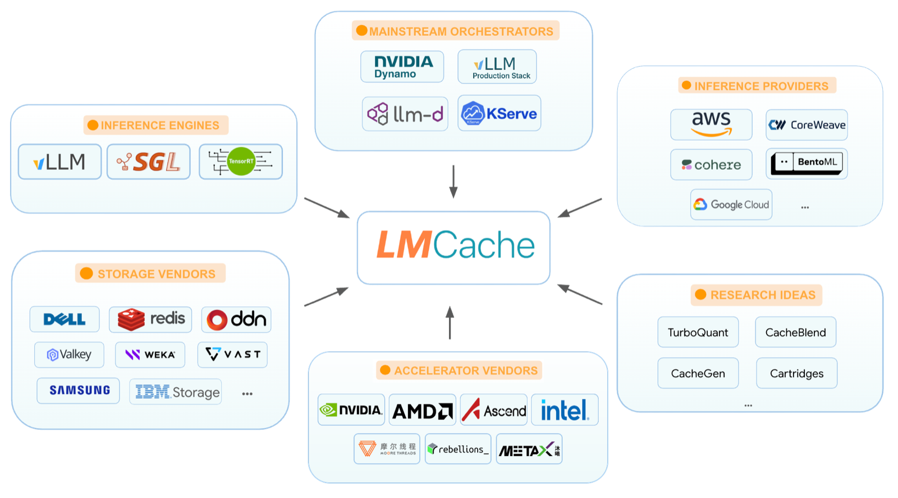
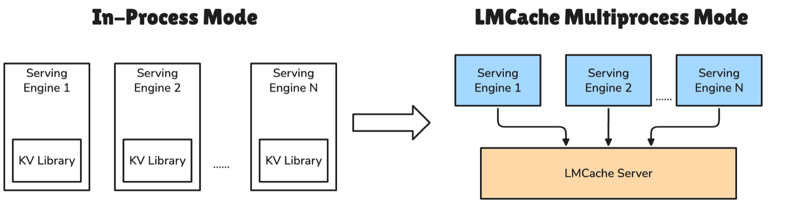
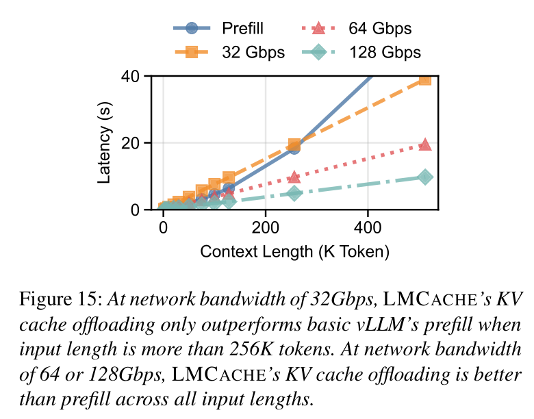

# Tensormesh / LMCache 生态

> 开源 KV Cache 管理层 · 官方仓库 / 文档 / 技术报告

LMCache 是由芝加哥大学团队发起、现由社区与 Tensormesh 共同维护的开源 KV Cache 管理层（Apache-2.0）。它不替代推理引擎，而是插在 vLLM、SGLang 等引擎与各类存储 / 网络之间，把原本只在单次请求、单块 GPU 显存内存活的 KV Cache 抽取出来，按 chunk 存入 CPU 内存、本地 SSD、远端对象存储或对端节点内存，并在后续请求命中时取回 GPU，从而跳过重复 prefill。官方 README 将其定位为“KV cache management layer”，强调持久化、跨引擎复用、可观测和可变换（压缩 / 融合）四种能力，并声明自身“vendor-neutral” [PK]。本报告后续多章都会出现它：CoreWeave / Cohere 的远端 KV 案例直接基于 LMCache；NVIDIA Dynamo 已集成 LMCache 作为 KV 缓存层；WD / Solidigm 的容量层测试使用 vLLM + LMCache；Seagate 的测试使用 LMCache 团队的 LMBenchmark 负载工具。因此本章先把它的架构、键设计、分层与淘汰、传输机制讲清楚，作为读者理解后续章节的“软件底座” [PK][LMC16]。

*LMCache 官方 README 生态图：上接推理引擎（vLLM、SGLang、TensorRT-LLM）与编排层（NVIDIA Dynamo、vLLM Production Stack、llm-d、KServe），下接存储厂商（Dell、Redis、DDN、Valkey、WEKA、VAST、Samsung、IBM Storage）与加速器厂商，右侧为推理服务商（AWS、CoreWeave、Cohere、BentoML、Google Cloud）* — [原始来源](https://github.com/LMCache/LMCache)

### 定位与公司背景：开源项目与 Tensormesh

LMCache 的技术报告（arXiv 2510.09665，v1 提交于 2025-10-08，v2 更新于 2025-12-05，作者单位为 Tensormesh 与芝加哥大学）给出了它要解决的问题：传统 KV Cache 只服务单个请求的 decode，而“跨请求复用”（context caching）与“prefill / decode 分离”（PD disaggregation）两类新需求都要求把 KV 移出 GPU；作者依据用户自愿开启的使用统计指出，用户存储的 KV 总量增长迅速，且其中超出 GPU 显存的部分在持续扩大，单个 token 的平均复用次数也在上升，超过 19% 的用户其已存 token 的平均复用超过 1.5 次 [LMC1]。报告把 LMCache 的贡献概括为三点：批量化、流水化的高性能数据搬运；与快速迭代的引擎解耦的标准化 KV connector 接口；以及 lookup / move / pin / clear / compress 等一等公民级的控制 API [LMC1]。

商业化方面，LMCache 创始团队成立了 Tensormesh。项目负责人 Junchen Jiang 在 LMCache 官方博客（2025-10-31）中宣布公司出道，首个产品是可在支持的 GPU 云上一键启动开源模型、并自动调优 LMCache 与 vLLM 参数的 SaaS 前端；同一篇博客宣布 LMCache 加入 PyTorch Foundation 成为生态项目，并承诺开放治理 [LMC17]。Tensormesh 官方新闻稿显示：2025-10-23 公司结束隐身，获得 Laude Ventures 领投的 450 万美元种子轮，新闻稿称 LMCache 已被 Bloomberg、Red Hat、Redis、Tencent、GMI Cloud、WEKA 等组织使用 [LMC18]；2026-05-27 宣布获得 AMD Ventures、CoreWeave、NVentures（NVIDIA 旗下）、Valley Capital Partners、Laude Ventures 参与的 2000 万美元融资（累计 2450 万美元），同时 Tensormesh Inference SaaS 正式可用，其定价规则是缓存命中的输入 token 计费为 0 美元 [LMC19]；2026-10-14 又发布面向企业私有部署的 Tensormesh Platform，功能包括 HBM / CPU / 存储多级缓存、前缀与非前缀（CacheBlend）复用、P2P KV 传输、pin / lookup / move / compress / clear 控制 API、多租户与策略管理 [LMC20]。值得注意的是，CoreWeave 既是 LMCache 的案例合作方，也是 Tensormesh 的投资方。

### 架构：位于引擎与存储之间的 KV 缓存层

技术报告的系统图（下图）把 LMCache 分成几层：引擎侧的 **KV Connector** 准备 token 序列与 GPU 页地址等元数据；**Token Processor** 判断哪些 token 已在后端、哪些需要新存；**Cache Engine** 下挂 **Storage Manager**（统一管理 Local / PD / P2P / Remote 四类后端）、**Event Manager**（跟踪异步加载事件）、**GPU Connector**（把数据写回分页显存）；底层由 **Memory Allocator**（GPU / CPU / SSD）和 **Transfer Channel**（NVLink / RDMA / TCP）承担实际搬运。集群层面另有 **Cache Controller**，维护全局 token 池，供路由器和运维人员查询、迁移、清理 KV [LMC1]。

*LMCache 技术报告 Figure 6“End-to-end system workflow”：KV Connector 嵌入推理引擎的 Scheduler / Model Runner，LMCache 实例内含 Cache Engine、Storage Manager、Event Manager，后端通过 Memory Allocator 与 Transfer Channel 落到 GPU / CPU / SSD 与 NVLink / RDMA / TCP，Cache Controller 对接 Router 与开发者* — [原始来源](https://arxiv.org/abs/2510.09665)

与引擎的接口是 vLLM V1 的 KV connector API。报告列出了 7 个函数：调度器侧的 `get_num_new_matched_tokens`（返回命中 token 数；也可返回 None，让 vLLM 先处理其他请求，从而把本请求的 I/O 与别人的计算重叠）、`update_state_after_alloc`、`build_connector_meta`；Model Runner 侧的 `start_load_kv / wait_load_kv / start_store_kv / wait_store_kv`。报告说明该 API 由 LMCache 团队发起、与 vLLM 团队共同实现维护，已被 NVIDIA Dynamo、Red Hat llm-d、字节 AIBrix 与 vLLM Production Stack 采用 [LMC1]。

2026 年起，官方推荐的部署形态从“进程内库”（In-Process，每个引擎进程内嵌一份 KV Library）转为**多进程（MP）模式**：每个节点运行一个独立的 `lmcache server`，多个 vLLM / SGLang 进程经 ZMQ 或 gRPC 连接它。官方文档列出的好处是故障隔离（缓存问题不拖垮引擎）、LMCache 的 Python GIL 与哈希 / 内存管理 / L2 I/O 不与推理线程争用、同节点多个 Pod 共享一份 L1 缓存、CPU 缓存容量可与 GPU 独立伸缩 [LMC2]。旧的进程内实现已拆到单独的 LMCache_inprocess 仓库维护 [LMC6]。

*LMCache 官方 README 部署模式图：左为 In-Process 模式（每个 Serving Engine 内嵌 KV Library），右为 Multiprocess 模式（多个 Serving Engine 共享一个 LMCache Server）* — [原始来源](https://github.com/LMCache/LMCache)

官方博客（2026-04-03）给出了 MP 模式的对照数据：Qwen3-235B-A22B-FP8，vLLM 以 DP=8 + 专家并行部署，LMCache server 使用 400 GB 主机内存，多轮对话负载（QPS 2.0、持续 120 秒）下，平均 TTFT 从进程内卸载的 3.98 s 降到 0.29 s，p99 从 13.55 s 降到 1.30 s，平均解码速度从 9.81 提升到 37.47 tok/s；原因是进程内模式下各 DP rank 的 KV 彼此割裂、无法互相复用 [LMC14]。

### 关键机制一：chunk、哈希键与分层存储

**Chunk 粒度。**vLLM 的分页 KV 以 16 token × 单层为一页，常见模型单页仅 20–63 KB，这种小 I/O 无法打满 PCIe 或网络带宽（报告引用的数据：两台 AMD GPU 节点经 8 张 400 Gbps 网卡互联时，消息需达 16 MB 才能打满带宽）。LMCache 因此把多页、多层的 KV 通过 GPU 内的流式缓冲区拼成连续的大 chunk 再用 DMA 搬运，默认 256 token 一个 chunk，可按 I/O 速度调整 [LMC1]。MP 模式的 `--chunk-size` 默认值仍为 256，vLLM 连接器可按模型 KV 几何向上协商 [LMC5]。

**哈希键。**键采用前缀链式哈希：每个 chunk 的哈希 = hash(前一 chunk 的哈希, 本 chunk token, 附加键)，因此任一 chunk 的键隐含了它之前的全部前缀，天然只匹配“完全相同前缀” [LMC22]。MP 模式的默认哈希算法为 blake3（可选 builtin、sha256_cbor） [LMC5]；旧版若用 Python 内置哈希，跨进程 / 跨节点共享时必须统一设置 `PYTHONHASHSEED` [LMC22]。持久化到 S3 时，MP 模式的对象名为 `<model>@<kv_rank_hex>@<chunk_hash_hex>`，与旧版命名不兼容，旧版写入的桶不能被 MP 版直接读取 [L]。此外可通过 `lmcache.tag.*` 给键追加租户、LoRA 版本等维度 [LMC5]。

**两级存储。**MP 模式把存储抽象为 L1 与 L2：L1 是快速层，默认是固定（pinned）CPU DRAM，也可配置为经 GPUDirect Storage 访问的 NVMe slab 文件或 Device-DAX / CXL 内存；L2 是持久层，由一个或多个 L2 adapter 组成。写路径上，vLLM 通过 STORE 把 chunk 写入 L1，后台 StoreController 监听到新对象后**异步**推送到每个 L2 adapter；读路径上，LOOKUP 先查 L1 前缀命中，未命中的键交给 PrefetchController 查 L2，命中后先装回 L1 再由 RETRIEVE 拷回 GPU [LMC2][LMC3]。L2 adapter 可串联（cascade），例如先 SSD 后大容量 NVMe：默认 store policy 把每个键写入**全部** adapter（因而是多份副本，而非逐层下沉），预取时按配置顺序选第一个持有该键的 adapter [LMC3]。

| 后端类别 | 官方列出的 adapter / 后端 | 说明 |
|---|---|---|
| L1 快速层 | CPU DRAM（默认）、GDS NVMe slab、Device-DAX / CXL | GDS 模式下 CPU 层停用，字节数组型 L2 adapter 不可用 |
| 高性能 I/O | NIXL（nixl_store / nixl_store_dynamic）、Native NIXL | 经 NIXL 访问 GDS、POSIX、HF3FS 等 |
| 文件与块 | fs、fs_native、raw_block | fs 为纯 POSIX 异步 I/O，每个对象一个 .data 文件，可选 O_DIRECT |
| 远端与分布式 | S3、Mooncake Store、RESP（Redis / Valkey）、Valkey、HF3FS、Bigtable、SageMaker HyperPod、Aerospike、HF Bucket、WQS | S3 adapter 基于 AWS CRT，兼容 S3 Express、MinIO、Ceph RGW 等 |
| 其他 | DAX、Plugin、Mock、Fault Inject | 插件用于自定义 / 外部存储 |

表格依据 MP 文档的“Supported Backends”与 L1 配置说明整理 [LMC4][LMC2][LMC24][L]。README 的高层清单为 CPU RAM、本地盘（SSD）、Redis / Valkey、Mooncake、InfiniStore、S3-compatible、NIXL 与 GDS [PK]；技术报告则提到社区贡献的 NFS、WEKA、GDS、Mooncake Store、NIXL、S3、InfiniStore、Valkey 等后端，以及 NVIDIA、AMD、Ascend、TPU 四类处理器 [LMC1]。

### 关键机制二：淘汰、异步加载与层级流水

**淘汰。**L1 由一个后台线程监控用量，超过 `--eviction-trigger-watermark`（默认 0.8）即按策略淘汰 `--eviction-ratio`（默认 0.2）的已分配内存；策略可选 LRU、ARC、IsolatedLRU（按 cache_salt 分租户配额）与 noop。L2 淘汰按 adapter 单独开启，同样采用水位 + 比例的形式；nixl_store、raw_block、DAX 完整支持，S3 adapter 需设置非零 `max_capacity_gb` 才会触发水位淘汰，而 fs 与 mooncake_store adapter 不支持淘汰 [LMC3]。存储策略还支持“只做缓冲”的 skip_l1 模式：写入 L2 后立即从 L1 删除，适合 L1 仅作中转、数据常驻 L2 的部署 [LMC3]。旧版进程内实现则提供 LRU / MRU / LFU / FIFO 四种策略 [LMC25]。

**异步与流水。**技术报告描述了三层重叠：其一是**层级流水**，计算与搬运各用独立 CUDA stream，第 i 层计算时异步加载第 i+1 层 KV，因此 GPU 只需一个单层大小的缓冲区；其二是**异步计算与预取**，请求排队等待期间就把 KV 从远端盘预取到本地 CPU 或 GPU；其三是**延迟写**，decode 阶段新生成的 KV 攒满一个 chunk 再批量落盘，减少小写 [LMC1]。同时用引用计数实现多目的地写入的零拷贝，并用“动态卸载”只复制 GPU 空闲页的一部分到 CPU [LMC1]。旧版 async_loading 文档说明了调度器侧异步 lookup 的实现：查找请求携带 chunk 哈希经 ZMQ 发往 worker，worker 对各层后端做批量异步 contains 后立即发起非阻塞批量 get，并用加权信号量按内存预算限流防止死锁；支持该特性的后端包括 LocalCPU、LocalDisk、S3Connector、FSConnector 与 Redis [LMC23]。

### 关键机制三：跨实例共享、PD 分离与非前缀复用

**P2P 共享。**多副本 vLLM 在负载均衡后各自只缓存自己见过的流量，形成“缓存孤岛”。MP 模式的 P2P 功能让各节点 LMCache server 向 Coordinator 注册并心跳，Coordinator 只管成员关系、不经手 KV 数据；本地未命中时向持有该前缀的对端请求加锁并获取地址，再以单边 RDMA 读把 KV 拉入本地 L1，对端不被打断。默认传输引擎为 NIXL，生产推荐 InfiniBand / RoCE，且要求 L1 为单块连续区域（因此与 GDS L1、DAX L1 不兼容） [LMC7]。官方博客（2026-01-21，Tencent 与 Tensormesh 合写）在 Llama-3.1-8B、50 个 10K token 上下文（约 62 GB 唯一 KV）的“全复用”演示中，第二个实例从对端取 KV 后平均 TTFT 由 2.028 s 降至 0.490 s，并披露控制器元数据采用分层 RegistryTree 结构、10 秒心跳、30 秒无心跳即注销、控制器重启后全量同步期间 worker 进入 Freeze 模式 [LMC15]。技术报告的控制器 API 还包括 lookup（返回实例、设备与命中 token 数，供 KV 感知路由）、move（迁移，用于缩容或负载均衡）、pin / unpin、clear、compress / decompress [LMC1]；不过截至采集日，MP 模式的 move / pin / compress 管理面仍标注为“coming soon”，旧命令保留在进程内版本中 [LMC27]。

**PD 分离。**MP 文档的做法是用 vLLM MultiConnector 同时挂两个连接器：NixlConnector 负责当前请求 prefill→decode 的 KV 交接（UCX / RDMA），LMCacheMPConnector 负责向本机 LMCache server 卸载 / 加载以实现跨请求复用；prefill 侧 KV 来源顺序为“本地 GPU 缓存 → LMCache → 重算”，最小部署为 prefill / decode 两个 vLLM、两个 LMCache server 和一个路由器，共五个进程 [LMC8]。技术报告的 PD 对比（8K 输入、200 输出、NVLink 互联）显示，相比 vLLM 原生 PD，LMCache 平均 TTFT 降低 1.53–1.84 倍、平均 ITL 降低 1.12–1.66 倍，原因是按 chunk 经 GPU 缓冲区传输，而非逐页发送 [LMC1]。

**CacheBlend 与 CacheGen。**前缀哈希只能复用“开头完全一致”的部分，而 RAG 中检索到的文档常以不同顺序出现在提示中间。CacheBlend（EuroSys 2025）复用任意位置文本块的预计算 KV，只对一小部分 token 选择性重算以恢复跨块注意力，论文报告 TTFT 降低 2.2–3.3 倍、吞吐提高 2.8–5 倍，且重算可与较慢存储上的 KV 读取流水重叠 [LMC13]。在 LMCache 中，旧版通过 `LMCACHE_ENABLE_BLENDING`、分隔串 `LMCACHE_BLEND_SPECIAL_STR` 与重算比例（示例为 0.15）启用，且要求开启层级模式 [LMC11]；MP 模式以 `lmcache server --engine-type blend` 启用 [LMC9]。CacheGen（SIGCOMM 2024）则是面向网络传输的 KV 编码器，按带宽自适应压缩等级，论文报告 KV 体积缩小 3.5–4.3 倍、取回与处理总时延降低 3.2–3.7 倍 [LMC12]；但 MP 模式下 CacheGen 尚未实现，原实现保留在进程内版本 [LMC26]，MP 模式目前通过 serde 接口提供 fp8 量化、加密等 L2 侧变换 [LMC3]。

### 公开性能数据与配置示例

| 场景（来源） | 报告结果 | 测试条件 |
|---|---|---|
| 单机 CPU 卸载（技术报告 §8.2） | QPS=1 时 TTFT 小 1.9–8.1 倍；同 TTFT 下吞吐高 2.3–14 倍 | 8×H100（GMI Cloud），LMCache v0.3.6 对比 vLLM v0.10.2 / v0.11.0 CPU 卸载及两家匿名商业服务；每请求约 10K token 文档 + 短问题，CPU 上限 500 GB |
| 真实 trace（§8.3） | 高 QPS 下 TTFT 至少降 3.7–6.8 倍，ITL 降 19–58% | 按匿名公司 F / G 的输入输出分布压缩到 1 小时内重放 |
| 集中式远端存储（§8.4） | 同 TTFT 下吞吐提升 1.3–3 倍 | 远端服务器以 15 Gbps 连接，LongBench TriviaQA |
| CPU 加载带宽（表 5） | 400 Gbps 对 vLLM 原生 88 Gbps | 按 chunk 对按页搬运 |
| 异步请求调度（§8.6） | 端到端时延降低 1.46 倍 | 加载与 prefill / decode 重叠 |
| 带宽敏感性（§8.7） | 32 Gbps 时仅当上下文 >256K token 才比重算快；64 / 128 Gbps 时所有长度都更快 | B200 上的 prefill 时延对比不同网络带宽下的加载时延 |

以上数据见 [LMC1]。报告第 9 节的部署经验同样值得注意：远端对象存储吞吐的提升（报告举例 S3 Express 从约 100 MBps 提升到接近 1 GBps）使“从远端加载比重算快”成为可能，某用户（Company C）从自有远端对象存储加载 KV，TTFT 比完整 prefill 低 22–32%；按公司 F 的真实 trace，把输入截断为只保留最新 token 会使前缀命中率从约 85% 降到 45%；公司 G 的生产环境命中率约 50% [LMC1]。其中 22–32% 与 CoreWeave / Cohere 联合案例公布的数值一致，该案例的环境与条件见下一章 [CW]。

*LMCache 技术报告 Figure 15：不同上下文长度下，B200 上直接 prefill 的时延与 32 / 64 / 128 Gbps 网络带宽下加载 KV 的时延对比；32 Gbps 时交叉点约在 256K token* — [原始来源](https://arxiv.org/abs/2510.09665)

MP 模式下的最小配置是两条命令：先启动 LMCache server，再让 vLLM 通过 `LMCacheMPConnector` 接入；生产环境应使用默认的 256 token chunk [LMC6]。下例在官方快速上手与 L2 文档的参数上组合了 L1 内存、L1 / L2 两级 LRU 淘汰与 S3 兼容 L2 后端（端点为示意） [LMC6][LMC3][L]：

~~~bash
# 出处（据此整理） [LMC6] https://docs.lmcache.ai/getting_started/quickstart.html
lmcache server --host 0.0.0.0 --port 5555 \
  --chunk-size 256 --l1-size-gb 100 \
  --eviction-policy LRU --eviction-trigger-watermark 0.8 --eviction-ratio 0.2 \
  --l2-adapter '{"type": "s3", "s3_endpoint": "rgw.example.local:8080",
                 "s3_region": "us-east-1", "disable_tls": true,
                 "max_capacity_gb": 500,
                 "eviction": {"eviction_policy": "LRU",
                              "trigger_watermark": 0.85, "eviction_ratio": 0.2}}'

vllm serve Qwen/Qwen3-8B --kv-transfer-config \
  '{"kv_connector":"LMCacheMPConnector","kv_role":"kv_both",
    "kv_connector_extra_config":{"lmcache.mp.host":"localhost","lmcache.mp.port":5555}}'
~~~

旧版进程内模式用 YAML 或 `LMCACHE_*` 环境变量配置，例如官方 CI 中的本地盘配置使用 `LMCACHE_CHUNK_SIZE=256`、`LMCACHE_LOCAL_DISK="file:///..."`、`LMCACHE_MAX_LOCAL_DISK_SIZE=10`；S3 后端则以 `remote_url: "s3://bucket"` 加 `extra_config`（区域、CRT I/O 线程数、HTTP/2 等）配置 [LMC10][L]。

### 放置策略：哪些 KV 放到哪一层

LMCache 有两套实现：官方推荐的多进程（MP）模式，以及已拆分维护的进程内（in-process）旧版。两者的放置逻辑基本一致——“prompt 的完整 chunk 全部写入、各层各自按水位淘汰、读取时近层优先并回填 DRAM”——但参数名不同，下表分别注明。源码固定在 LMCache `v0.5.8rc1`（提交 6a316c3）与 LMCache_inprocess 提交 0aebefd（2026-11-17），路由器固定在 vLLM Production Stack `vllm-stack-0.1.14`（提交 405a2fa）。

| 维度 | LMCache 做法 | 证据类型与引用 |
|---|---|---|
| 层级与介质 | GPU HBM（引擎自身分页缓存，LMCache 不管理）→ L1：本机 pinned DRAM（MP 为 `--l1-size-gb`；旧版 `local_cpu` 默认 true、`max_local_cpu_size` 默认 5.0 GB）→ L2：本地盘（旧版 `local_disk` + `max_local_disk_size`，默认 0）、NIXL/GDS、S3、Redis/Valkey、Mooncake Store 等远端（旧版 `remote_url`）；另有对端节点 DRAM（P2P） | 官方明确说明 / 源码可见 [LMC3][PLLM4][PLLM7][PLLM8] |
| 放置单位 | chunk，默认 256 token（`--chunk-size` / `chunk_size`），前缀链式哈希为键；旧版本地盘每 chunk 一个文件 | 官方明确说明 [LMC5][PLLM8] |
| 准入 | 默认只存 prompt 的**完整** chunk；decode 生成的 KV 需显式开启 `lmcache.mp.save_decode_cache`（旧版 `save_decode_cache`，均默认 false）；尾部不满一个 chunk 的部分需 `save_unfull_chunk`。没有命中次数或热度门槛 | 官方明确说明 / 源码可见 [PLLM1][PLLM4] |
| 写入时机 | GPU→L1：默认每步计算后立即提交（eager）；可选 `lmcache.mp.lazy_offload`，默认策略 `EVICTION_AWARE` 只在 GPU 块接近 vLLM 淘汰头时才卸载。L1→L2：StoreController **异步**推送，默认 store policy 写入所有 adapter，属异步 write-through、多副本；`skip_l1` 时写完即删 L1。旧版 `StorageManager.batched_put` 同样向所有已配置后端提交写任务（可用 `store_location` 限定） | 官方明确说明 / 源码可见 [LMC3][PLLM2][PLLM5] |
| 降级与淘汰 | L1：用量超 `--eviction-trigger-watermark`（0.8）即按 `--eviction-ratio`（0.2）淘汰，LRU / ARC / IsolatedLRU / noop；L2 每个 adapter 独立、需显式配置 `eviction`，fs 与 mooncake_store 不淘汰。旧版 `cache_policy` 默认 LRU，CPU 在分配不足时淘汰、本地盘超 `max_local_disk_size` 时淘汰，远端后端由外部存储自行管理。各层淘汰互相独立，**淘汰不触发向下层迁移**（数据在写入时已在下层） | 官方明确说明 / 源码可见 [LMC3][PLLM5][PLLM7][PLLM8] |
| 提升与预取 | MP：LOOKUP 先查 L1 前缀，未命中部分由 PrefetchController 按 adapter 顺序查 L2，命中后装回 L1 并保留（default prefetch policy），再 RETRIEVE 到 GPU；`lmcache.mp.eager_prefetch` 可在请求进入等待队列时就开始预取。旧版按后端创建顺序（LocalCPU → P2P → LocalDisk → GDS → Remote）做前缀接力查找，非 CPU 后端命中后回写 LocalCPU。加载失败与未命中一样回退重算 | 官方明确说明 / 源码可见 [LMC3][PLLM1][PLLM5][PLLM6][LMC7] |
| 位置选择 | 写入总在本节点（MP 为每节点一个 server）；跨节点靠 P2P 单边 RDMA 读对端 L1。Production Stack 的 `kvaware` 路由向 LMCache controller 查询各实例前缀命中 token 数，选命中最多者；若命中数 < 提示长度 − `kv_aware_threshold`（默认 2000）则退回会话哈希环或按 QPS 路由。`loadaware` 变体打分为“命中比例 − β×相对负载”。无自动热点复制 | 官方明确说明 / 源码可见 [LMC7][PLLM9][PLLM10] |
| 决策者 | 推理引擎连接器决定存什么；LMCache server 决定层级与淘汰；路由器决定实例；MP Coordinator 提供全局键目录（每个键在哪个实例 / 层 / 后端，最终一致）、按 `cache_salt` 的配额淘汰、L2 pin 与对指定 server 的预热预取（`POST /cache/prefetches`） | 官方明确说明 [PLLM3] |
| 选择依据 | 近期性（LRU / ARC）、容量水位与租户配额；没有在线的“加载 vs 重算”成本模型。技术报告只给出离线分析：32 Gbps 下仅 >256K token 时加载才快于重算 | 官方明确说明（无成本模型为未公开 / 文档未提及） [LMC3][LMC1] |

**选择逻辑。**LMCache 的思路是“存得早、存得全，靠各层淘汰各自瘦身”。它不预判哪段前缀会被复用，而是把每个请求 prompt 的完整 chunk 都写入 L1，并异步复制到所有 L2；层级之间不是 evict-to-lower 的级联，而是同一 chunk 在多层各有一份、每层按自身容量与 LRU 独立淘汰。这样读取时永远先命中最快的层，下层又天然是上层的备份，代价是写放大和下层容量占用。默认不存 decode 输出，是为了避免重放固定提示时被采样结果污染缓存；需要多轮续写复用的部署再打开 `save_decode_cache`。若下层带宽紧张，可用 `lazy_offload` 只卸载即将被 GPU 淘汰的块，或用 `skip_l1` 把 DRAM 退化为纯缓冲区。

**位置选择在 LMCache 之外。**LMCache 自身不迁移 KV 到“更合适的节点”，只提供查询与搬运能力：路由器据 controller 的命中信息把请求送到持有最长前缀的实例；P2P 让未命中节点直接读对端 DRAM；Coordinator 的键目录与预热接口让运维在流量迁移前把热门系统提示预先装入目标节点 L1。旧版 controller 的 move / pin 命令在 MP 模式中仍标注为“coming soon”，MP 目前只提供 L2 pin、删除与预热 [LMC27][PLLM3]。

**例子（按 Llama-3.1-8B 估算，每 token 约 128 KiB）。**一个 32k token 的多轮对话前缀约 4 GiB，被切成 128 个 256 token 的 chunk。第一轮 prefill 结束后，128 个 chunk 立即写入本机 L1，并异步写入每个已配置的 L2（例如本地 NVMe 与 S3 各一份）；第二轮新增的回答 token 默认不存，下一轮作为 prompt 的一部分再被写入。若该会话间隔较久、L1 已被 LRU 淘汰，则下一轮 LOOKUP 在 L1 未命中，按 adapter 顺序从 NVMe 预取回 L1 再加载到 GPU；若会话被路由到另一节点，`kvaware` 路由会优先把它送回持有前缀的节点，否则可经 P2P 从原节点 L1 读取，都不命中则重算。

### 硬件配置信息

| 场景 / 方案 | 计算（GPU / NPU 型号 × 数量，HBM 容量） | CPU 与主机内存（DRAM 容量） | 本地存储（SSD / NVMe / HDD 型号、数量、容量） | 网络（RDMA / NIC 型号与带宽） | 远端 / 共享存储（服务名与规格） | 来源 |
|---|---|---|---|---|---|---|
| 技术报告单机评测（CPU 卸载、真实 trace） | GMI Cloud 8×H100 服务器，按模型分配最少所需 GPU；HBM 未写明 | CPU 型号未公开；LMCache 卸载上限 500 GB DRAM | 未公开 | 未公开 | 无 | [LMC1] |
| 技术报告集中式远端存储 | 同单机评测 | 未公开 | 未公开 | 到远端存储服务器 15 Gbps（以太网） | 集中式存储服务器，规格未公开 | [LMC1] |
| 技术报告 PD 分离 | prefill / decode 实例 GPU 数同单机评测（H100） | 未公开 | 未公开 | 实例间 NVLink | 无 | [LMC1] |
| 技术报告 SGLang 集成 | 2×H100（TP=2），Qwen3-32B | 未公开 | 未公开 | 未公开 | 无 | [LMC1] |
| 技术报告带宽敏感性分析 | B200（数量未公开） | 未公开 | 未公开 | 模拟 32 / 64 / 128 Gbps | 未公开 | [LMC1] |
| 技术报告引用的前人数据（表 1） | 2 个 AMD GPU 节点（型号未写） | 未公开 | 未公开 | 8×Broadcom Thor-2 400 Gbps NIC | 无 | [LMC1] |
| MP 模式 MoE 博客 | 8×NVIDIA H100 80GB，DP=8 + EP | MP：`--l1-size-gb 400`；对照组每 DP rank 50 GB、合计 400 GB | 未公开 | 未公开 | 无 | [LMC14] |
| P2P 博客演示 / 文档 | Llama-3.1-8B 两实例，GPU 型号未公开 | 示例：每实例 10 GB CPU KV 缓存；演示唯一 KV 约 62 GB | 未公开 | 假定 RDMA 网卡；文档推荐 InfiniBand / RoCE | 无 | [LMC15][LMC7] |
| 旧版默认配置 | — | pinned DRAM 默认 5.0 GB | 本地盘默认 0（示例 5 GB，多 NVMe 时每 GPU 一路径） | — | `remote_url` 指向的 Redis / Mooncake / S3 等 | [PLLM4][PLLM7][PLLM8] |

上述配置中 KV 实际落地的位置是本机 pinned DRAM（L1）、对端 DRAM（P2P）以及集中式远端存储服务器；技术报告的主要评测都只用到 DRAM，SSD / NVMe 只出现在文档示例中，没有公开的盘型或容量测试。LMCache 自身来源均未出现 HDD。

### 与 KV Cache 多级存储（SSD / HDD 下沉）的关系

LMCache 的价值在于它已经把“GPU → DRAM → 本地盘 / 远端存储”的分层、异步写回、预取和淘汰做成了通用框架，SSD 或 HDD 只是 L2 adapter 后面的一种介质。**以下为本文分析**，供后续章节的 SSD / HDD 讨论参照：

- **HDD 可接入的路径有两条。**一是 fs adapter 写入挂载在 HDD 上的 POSIX 文件系统或 NFS（文档示例即 `/mnt/nfs/lmcache` 共享路径） [LMC3][LMC24]；二是 S3 adapter 对接 Ceph RGW，而 RGW 后端可以是 HDD OSD——文档明确列出 Ceph RGW 为兼容端点 [LMC4][L]。这两条路径都属于组件可组合，官方没有发布 HDD 介质上的端到端测试。
- **访问粒度对 HDD 友好。**以 Llama-3.1-8B 为例（32 层、8 个 KV 头、head_dim 128、BF16），每 token KV 约 128 KiB，一个 256 token 的 chunk 约 32 MiB（按模型结构估算），属于大块顺序 I/O；而 GQA 程度更高、或使用 MLA 等压缩结构的模型，chunk 会小得多，需相应调大 `--chunk-size`。
- **带宽决定盈亏点。**技术报告的 Figure 15 表明，32 Gbps（约 4 GB/s）下只有超长上下文才比重算划算 [LMC1]。HDD 层必须依靠多盘并行和对象存储横向扩展来提供聚合带宽，并利用 LMCache 在排队期间把 L2 数据预取到 L1 的机制来隐藏时延；更适合作为“低频但长上下文”的冷层，而非热路径。
- **运维约束需要提前设计。**fs adapter 不做淘汰，需外部生命周期管理；S3 adapter 只有设置 `max_capacity_gb` 才会按水位删除对象；S3 对象必须与目标缓冲区大小完全一致，否则按未命中处理并重算；MP 与旧版对象命名不兼容，升级时需清空或迁移桶 [LMC3][L]。Ceph 把 DB / WAL 放在 SSD 上，并不等于热 KV 数据本身有 SSD 缓存，热层仍应由 LMCache 的 L1 / 本地 NVMe 层承担。

### 资料边界

本章的性能数字主要来自 LMCache 团队自己的技术报告和博客，商业对照方被匿名，且部分测试为“全复用”演示，不能外推到任意负载。项目正处于从进程内向 MP 架构迁移的阶段，CacheGen、move / pin 等管理 API 在 MP 模式下尚未完全就位，文档与参数仍在变动，引用时应固定版本。Tensormesh 新闻稿对累计融资的表述不一致（2026-05 为 2450 万美元，2026-10 新闻稿正文为 2850 万美元），本文以各稿原文为准。

## 本章资料

- **[CW]** [Cohere / CoreWeave / LMCache 联合案例，2025-10-29](https://blog.lmcache.ai/en/2025/10/29/breaking-the-memory-barrier-how-lmcache-and-coreweave-power-efficient-llm-inference-for-cohere/)
- **[L]** [LMCache · S3 Backend 文档（含 S3 Express / CoreWeave 配置示例与 MP 模式 S3 L2 adapter 说明，采集于 2026-11-18）](https://docs.lmcache.ai/kv_cache/storage_backends/s3.html)
- **[LMC1]** [Liu, Yao, Cheng 等（Tensormesh / 芝加哥大学）· LMCache: An Efficient KV Cache Layer for Enterprise-Scale LLM Inference，arXiv 2510.09665（v1 2025-10-08，v2 2025-12-05）](https://arxiv.org/abs/2510.09665)
- **[LMC2]** [LMCache 官方文档 · Multiprocess (MP) Mode Overview（架构、L1Manager、L2 Adapters、Controllers，采集于 2026-11-18）](https://docs.lmcache.ai/mp/index.html)
- **[LMC3]** [LMCache 官方文档 · Secondary KV Storage（L1/L2 数据流、Cascade、Store/Prefetch 策略、L1/L2 淘汰，采集于 2026-11-18）](https://docs.lmcache.ai/mp/l2_storage/index.html)
- **[LMC4]** [LMCache 官方文档 · Supported Backends（L2 adapter 列表，采集于 2026-11-18）](https://docs.lmcache.ai/mp/l2_storage/supported_storages.html)
- **[LMC5]** [LMCache 官方文档 · Configuration Reference（--chunk-size、--hash-algorithm、L1 参数等，采集于 2026-11-18）](https://docs.lmcache.ai/mp/configuration.html)
- **[LMC6]** [LMCache 官方文档 · Quickstart（MP 模式 lmcache server + LMCacheMPConnector，采集于 2026-11-18）](https://docs.lmcache.ai/getting_started/quickstart.html)
- **[LMC7]** [LMCache 官方文档 · P2P KV Cache Sharing（采集于 2026-11-18）](https://docs.lmcache.ai/mp/p2p.html)
- **[LMC8]** [LMCache 官方文档 · Disaggregated Prefill（MP 模式，采集于 2026-11-18）](https://docs.lmcache.ai/mp/disaggregated_prefill.html)
- **[LMC9]** [LMCache 官方文档 · CacheBlend（MP 模式启用方式，采集于 2026-11-18）](https://docs.lmcache.ai/kv_cache_optimizations/cacheblend.html)
- **[LMC10]** [LMCache_inprocess 官方仓库 · 本地盘配置（.buildkite/configs/local_disk.yaml，LMCACHE_* 环境变量示例）](https://github.com/LMCache/LMCache_inprocess/blob/main/.buildkite/configs/local_disk.yaml)
- **[LMC11]** [LMCache_inprocess 官方文档 · Blending（进程内模式 CacheBlend 配置）](https://github.com/LMCache/LMCache_inprocess/blob/main/docs/source/legacy/kv_cache_optimizations/blending.rst)
- **[LMC12]** [Liu 等 · CacheGen: KV Cache Compression and Streaming for Fast LLM Serving，ACM SIGCOMM 2024（arXiv 2310.07240）](https://arxiv.org/abs/2310.07240)
- **[LMC13]** [Yao 等 · CacheBlend: Fast LLM Serving for RAG with Cached Knowledge Fusion，EuroSys 2025（arXiv 2405.16444）](https://arxiv.org/abs/2405.16444)
- **[LMC14]** [LMCache 官方博客 · LMCache's New Architecture Boosts MoE Inference Performance by 10×，2026-04-03](https://blog.lmcache.ai/en/2026/04/03/lmcaches-new-architecture-boosts-moe-inference-performance-by-10x/)
- **[LMC15]** [LMCache 官方博客 · LMCache Multi-node P2P CPU Memory Sharing & Control（Tencent / Tensormesh），2026-01-21](https://blog.lmcache.ai/en/2026/01/21/p2p-1/)
- **[LMC16]** [LMCache 官方博客 · NVIDIA Dynamo integrates LMCache，2025-09-18](https://blog.lmcache.ai/en/2025/09/18/nvidia-dynamo-integrates-lmcache-accelerating-llm-inference/)
- **[LMC17]** [LMCache 官方博客 · Tensormesh unveiled and LMCache joins the PyTorch Foundation，2025-10-31](https://blog.lmcache.ai/en/2025/10/31/tensormesh-unveiled-and-lmcache-joins-the-pytorch-foundation/)
- **[LMC18]** [Tensormesh 官方新闻稿 · Tensormesh Emerges From Stealth to Slash AI Inference Costs and Latency by up to 10x，2025-10-23](https://tensormesh.ai/newsroom/emerges-from-stealth/)
- **[LMC19]** [Tensormesh 官方新闻稿 · Tensormesh Raises $20M ... Launches Tensormesh Inference，2026-05-27](https://tensormesh.ai/newsroom/tensormesh-raises-20m/)
- **[LMC20]** [Tensormesh 官方新闻稿 · Tensormesh Launches Tensormesh Platform，2026-10-14](https://tensormesh.ai/newsroom/tensormesh-platform-launch-llm-inference-kv-cache/)
- **[LMC22]** [LMCache_inprocess 官方仓库 · token_database.py（ChunkedTokenDatabase 前缀链式哈希）](https://github.com/LMCache/LMCache_inprocess/blob/main/lmcache/inprocess/v1/token_database.py)
- **[LMC23]** [LMCache_inprocess 官方文档 · Async Loading](https://github.com/LMCache/LMCache_inprocess/blob/main/docs/source/legacy/kv_cache/async_loading.rst)
- **[LMC24]** [LMCache 官方文档 · FileSystem L2 adapter（采集于 2026-11-18）](https://docs.lmcache.ai/mp/l2_storage/fs.html)
- **[LMC25]** [LMCache_inprocess 官方文档 · Using Different Caching Policies](https://github.com/LMCache/LMCache_inprocess/blob/main/docs/source/legacy/kv_cache/caching_policies.rst)
- **[LMC26]** [LMCache 官方文档 · CacheGen（MP 模式状态说明，采集于 2026-11-18）](https://docs.lmcache.ai/mp/cachegen.html)
- **[LMC27]** [LMCache 官方文档 · KV Cache Management（MP 模式状态说明，采集于 2026-11-18）](https://docs.lmcache.ai/mp/kv_cache_management.html)
- **[PK]** [LMCache · 官方 GitHub README（A KV Cache Management Layer for Scalable LLM Inference，采集于 2026-11-18）](https://github.com/LMCache/LMCache)
- **[PLLM1]** [LMCache 官方仓库 v0.5.8rc1 · docs/source/mp/configuration.rst（LMCacheMPConnector extra_config：save_decode_cache、save_unfull_chunk、eager_prefetch 等，采集于 2026-11-19）](https://github.com/LMCache/LMCache/blob/v0.5.8rc1/docs/source/mp/configuration.rst)
- **[PLLM2]** [LMCache 官方仓库 v0.5.8rc1 · docs/source/mp/lazy_offload.rst（Lazy KV Cache Offload，EVICTION_AWARE / FIFO，采集于 2026-11-19）](https://github.com/LMCache/LMCache/blob/v0.5.8rc1/docs/source/mp/lazy_offload.rst)
- **[PLLM3]** [LMCache 官方仓库 v0.5.8rc1 · docs/source/mp/coordinator.rst（Multi-Server Coordination：键目录、配额淘汰、L2 pin、预热预取，采集于 2026-11-19）](https://github.com/LMCache/LMCache/blob/v0.5.8rc1/docs/source/mp/coordinator.rst)
- **[PLLM4]** [LMCache_inprocess 官方仓库（提交 0aebefd，2026-11-17）· lmcache/inprocess/v1/config.py（local_cpu、max_local_cpu_size、local_disk、remote_url、save_decode_cache、cache_policy 等默认值）](https://github.com/LMCache/LMCache_inprocess/blob/0aebefd026f5c479d3f6bcbee0d5facd1b2856ec/lmcache/inprocess/v1/config.py)
- **[PLLM5]** [LMCache_inprocess 官方仓库（提交 0aebefd）· storage_manager.py（StorageManager.batched_put / batched_get / batched_contains）](https://github.com/LMCache/LMCache_inprocess/blob/0aebefd026f5c479d3f6bcbee0d5facd1b2856ec/lmcache/inprocess/v1/storage_backend/storage_manager.py)
- **[PLLM6]** [LMCache_inprocess 官方仓库（提交 0aebefd）· storage_backend/__init__.py（CreateStorageBackends 后端创建顺序）](https://github.com/LMCache/LMCache_inprocess/blob/0aebefd026f5c479d3f6bcbee0d5facd1b2856ec/lmcache/inprocess/v1/storage_backend/__init__.py)
- **[PLLM7]** [LMCache_inprocess 官方文档（提交 0aebefd）· CPU RAM 后端（local_cpu / max_local_cpu_size，hot cache 与预取）](https://github.com/LMCache/LMCache_inprocess/blob/0aebefd026f5c479d3f6bcbee0d5facd1b2856ec/docs/source/legacy/kv_cache/storage_backends/cpu_ram.rst)
- **[PLLM8]** [LMCache_inprocess 官方文档（提交 0aebefd）· Local Storage 后端（local_disk / max_local_disk_size，按 chunk 落文件、LRU 淘汰、异步 put）](https://github.com/LMCache/LMCache_inprocess/blob/0aebefd026f5c479d3f6bcbee0d5facd1b2856ec/docs/source/legacy/kv_cache/storage_backends/local_storage.rst)
- **[PLLM9]** [vLLM Production Stack 官方仓库 vllm-stack-0.1.14（提交 405a2fa）· src/vllm_router/routers/routing_logic.py（KvawareRouter、LoadAwareRouter）](https://github.com/vllm-project/production-stack/blob/vllm-stack-0.1.14/src/vllm_router/routers/routing_logic.py)
- **[PLLM10]** [vLLM Production Stack 官方文档 vllm-stack-0.1.14 · KV Cache Aware Routing](https://github.com/vllm-project/production-stack/blob/vllm-stack-0.1.14/docs/source/use_cases/kv-cache-aware-routing.rst)
