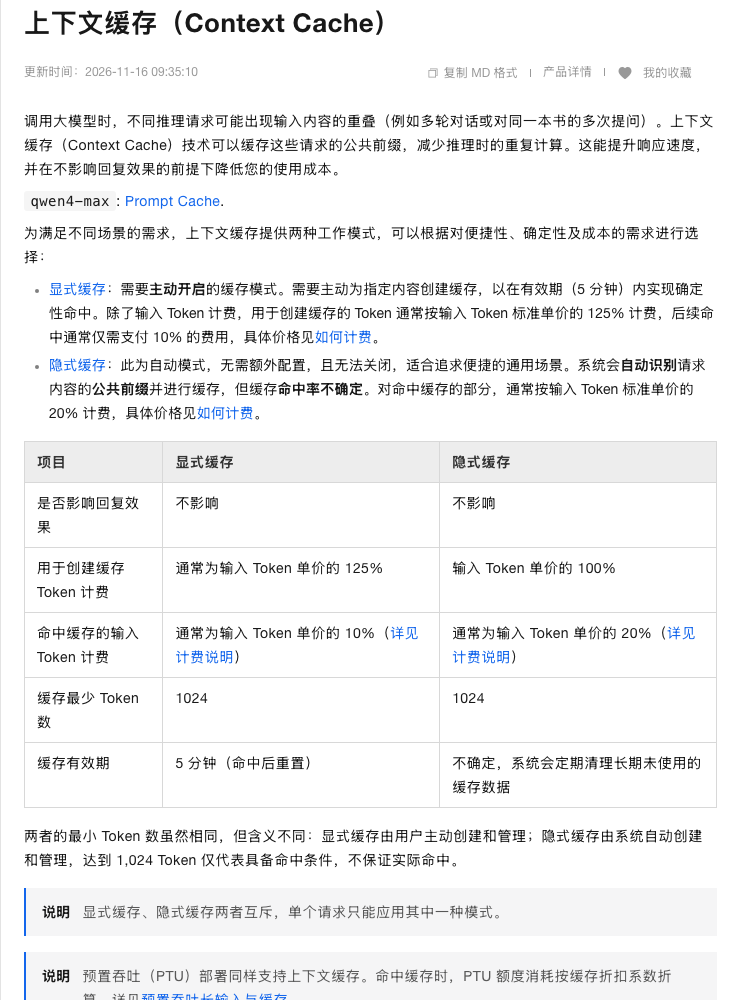
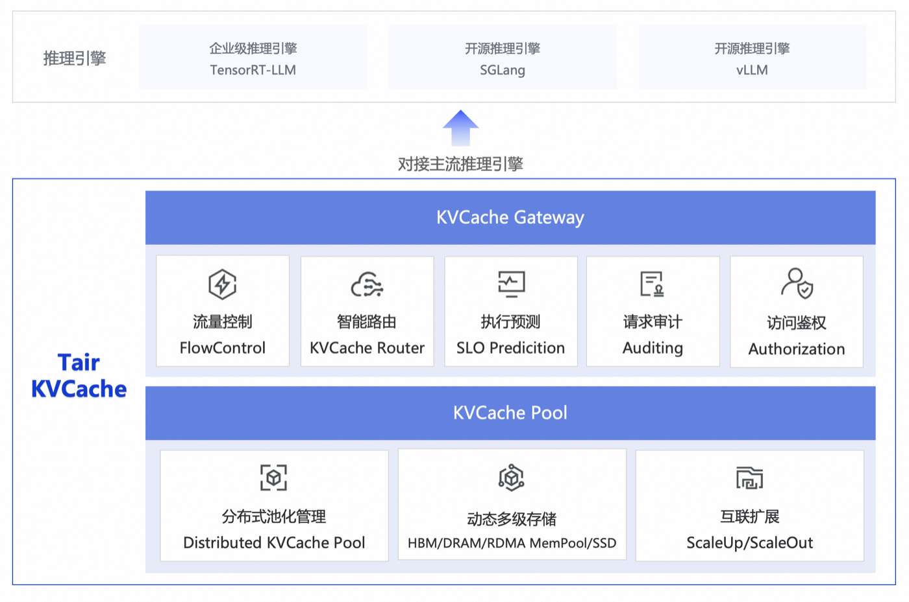
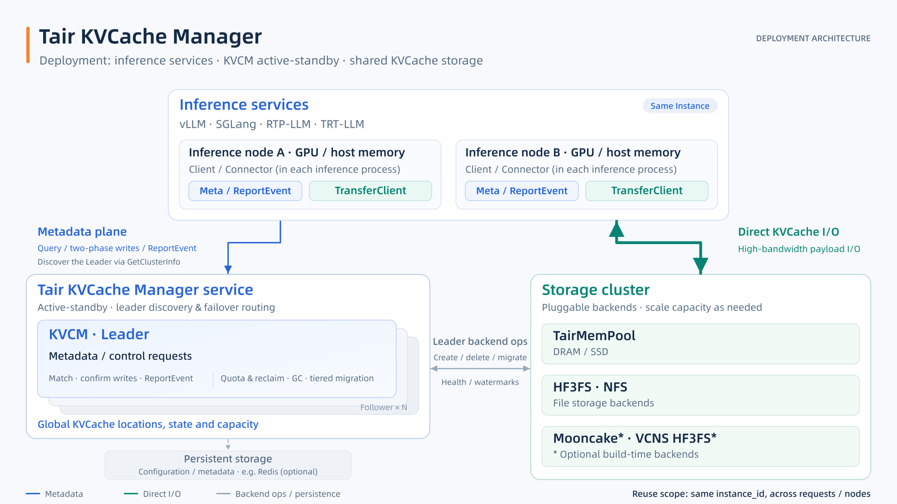

# 阿里云 / 百炼与 DashInfer

> 托管 API + 开源引擎 + 云上 KV 缓存服务 · 官方文档 / 官方仓库

阿里云公开的 KV Cache 相关资料可以分成三层。第一层是大模型服务平台百炼（Model Studio）对外提供的上下文缓存 API：用户通过隐式或显式缓存复用请求前缀，平台按“创建 / 命中 / 未命中”三种口径计费。 [PD][ALI1] 第二层是阿里开源的推理引擎 DashInfer，它在单个推理实例内部提供 GPU / CPU 前缀缓存、名为 SpanAttention 的分页 KV 布局，以及 int8 / uint4 KV 量化。 [PE][ALI2][ALI3] 第三层是云基础设施产品：数据库团队的 Tair KVCache（含开源的全局元数据服务 Tair KVCache Manager），以及人工智能平台 PAI 的 KV Cache 服务 FlashKV 和 LLM 智能路由。这些产品把 KV 从显存扩展到内存、SSD / 磁盘和远端存储，并在多个推理副本之间共享。 [ALI5][ALI8][ALI9][ALI10] 三层资料分属不同产品线，本章分开描述，不把引擎或基础设施的能力推断为百炼托管服务的内部实现。

### 百炼上下文缓存：隐式与显式两种模式

百炼文档把上下文缓存定义为“缓存这些请求的公共前缀，减少推理时的重复计算”。它提供两种互斥的工作模式，单个请求只能使用其中一种。 [PD]

- **隐式缓存**：对支持的模型自动开启，**无法关闭**。系统按前缀匹配原则查找 `messages` 内容的公共前缀：命中就直接复用，未命中则把本次提示词的前缀写入缓存。对阿里云百炼部署的模型，请求之间要有不少于 1024 Token 的相同前缀，才具备写入和命中的技术条件；智谱部署的 GLM 和稀宇科技部署的 MiniMax 为 512。文档明确说明命中概率并非 100%，即使上下文完全一致也可能未命中。隐式缓存没有固定有效期，系统会“定期清理长期未使用的缓存数据”。 [PD]
- **显式缓存**：在 `messages` 的 content 块上添加 `"cache_control": {"type": "ephemeral"}` 标记。系统以每个标记为终点，向前回溯最多 20 个 content 块尝试命中。未命中时，从数组开头到标记处的内容被创建为新缓存块，有效期 5 分钟；命中时选取最长匹配前缀，并把有效期重置为 5 分钟。缓存块最少 1024 Token，单次请求最多 4 个标记，超过 4 个时只有最后 4 个生效。缓存在模型响应之后才创建，因此文档建议等创建请求完成后再发起命中请求。 [PD]

文档还规定了哪些内容可以缓存，以及缓存的隔离边界：

- 系统、用户、助手和工具消息都可以加标记。`tools` 定义作为系统消息的一部分参与缓存计算，但不能单独加标记，所以工具列表顺序、字段顺序和字段结构必须每次一致。
- 隐式和显式缓存的数据都在**账号级别隔离**；同一账号下，不同模型之间也不共享。
- 服务端会在提示词之后追加少量内部 Token（通常不超过 10 个），这部分不计入缓存的创建或读取。

[PD]

*阿里云百炼“上下文缓存（Context Cache）”官方帮助文档截图：显式缓存与隐式缓存在计费、最小 Token 数和有效期上的对照表（页面更新时间 2026-11-16，采集于 2026-11-18）* — [原始来源](https://help.aliyun.com/zh/model-studio/context-cache)

#### Qwen4 系列：自动缓存与 1 小时 TTL

针对 Qwen4 系列，百炼另有一份“显式缓存（Qwen4）”文档，在原有断点用法之外增加了以下能力： [ALI1]

- **新的断点字段**：`prompt_cache_breakpoint: {"mode": "explicit"}`，原有的 `cache_control` 继续兼容。
- **自动缓存**：通过 `prompt_cache_options` 开启，系统在最后一条输入消息末尾自动设置一个断点，并随对话增长后移。自动断点占用 4 个有效断点中的 1 个。
- **有效期（TTL）**：可选 `5m` 或 `1h`。命中时，新的到期时间取“原到期时间”与“本次处理开始时间 + 本次 TTL”中较晚的一个，缓存保留较高档位。用 1h 请求命中 5m 缓存时，命中部分按 1h 重新创建计费。多个请求并发写入同一缓存时可能相互覆盖，不保证保留最晚的到期时间。

### 计费口径与可观测字段

百炼的缓存计费只影响输入 Token，输出 Token 按原价计。各类 Token 的通用比例和主要例外如下表。 [PD][ALI1]

| Token 类型 | 通用计费比例（相对标准输入单价） | 文档列出的例外 / 说明 |
|---|---|---|
| 显式缓存创建（5 分钟） | 通常 125% | 若新缓存以已有缓存为前缀，只对新增部分按创建计费。例如已有 1200 Token 缓存 A、新缓存 AB 为 1500 Token，则 1200 按命中、300 按创建计费 |
| 显式缓存创建（Qwen4，1 小时 TTL） | 约 200% | 仅 Qwen4 系列；5m 创建约 125% |
| 显式缓存命中 | 通常 10% | qwen4-max、qwen3.8-max、qwen3.8-flash 等不适用通用比例，以控制台为准 |
| 隐式缓存写入 | 100%（不额外收费） | 开启隐式缓存无需额外付费 |
| 隐式缓存命中 | 阿里云百炼部署的模型通常 20% | 比例因模型来源而异：例如 deepseek-v4.1-flash 为 2%，deepseek-v4-pro-0813 为 10%，kimi-k3 为 10%，智谱部署的 GLM-5 系列为 25%；OpenAI 兼容 Batch（文件输入）调用不享受缓存折扣 |

文档给出的隐式缓存算例：10,000 个输入 Token 中有 5,000 个命中，按 20% 计价，总输入费用相当于无缓存时的 60%。 [PD]

命中情况通过响应中的 `usage` 字段观察，字段名随接口而不同：

- OpenAI 兼容接口：`prompt_tokens_details.cached_tokens` 和 `cache_creation_input_tokens`。
- Anthropic 兼容接口：`cache_read_input_tokens`，且该值不计入 `input_tokens`。
- Qwen4：另外返回 `cache_write_tokens`，并按 TTL 拆分为 `ephemeral_5m_input_tokens` / `ephemeral_1h_input_tokens`。

控制台“模型监控”页提供 `cache_tokens` 指标，可按分钟或小时统计。 [PD][ALI1] 文档中的显式缓存示例如下：第一次请求创建 1605 个缓存 Token；第二次请求只改问题，命中 1605 个 Token，另有 15 个 Token 既未命中也未创建。 [PD]

~~~python
# 出处（据此整理） [PD] https://help.aliyun.com/zh/model-studio/context-cache
client = OpenAI(api_key=os.getenv("DASHSCOPE_API_KEY"),
    base_url="https://{WorkspaceId}.cn-beijing.maas.aliyuncs.com/compatible-mode/v1")
messages = [
  {"role": "system", "content": [{"type": "text", "text": long_text_content,
     "cache_control": {"type": "ephemeral"}}]},   # 以此处为终点创建 / 命中缓存块
  {"role": "user", "content": user_input}]        # 每次不同的问题放在标记之后
completion = client.chat.completions.create(model="qwen3.8-max", messages=messages)
print(completion.usage.prompt_tokens_details.cache_creation_input_tokens,
      completion.usage.prompt_tokens_details["cached_tokens"])
~~~

### DashInfer：引擎内的前缀缓存、分页与 KV 量化

DashInfer 是阿里在 ModelScope 下开源的 C++ 推理引擎。v2.0（2024/12）的发布说明列出了 GPU 与 CPU 交换的 prefix caching、guided decoding、面向 GQA 优化的 attention、无锁 reactor 引擎，以及对 VLM 和 MoE 的支持。 [PE] 与 KV Cache 管理相关的机制有三项。

- **前缀缓存（Prefix Cache）**：把 KV 长时间保存在 GPU 或 CPU 内存中；新 prompt 与旧 prompt 前缀相同时直接复用，避免重复计算。运行时用 `prefill_cache(enable=True)` 开关（默认开启），`prefix_cache_ttl` 默认 300 秒。环境变量 `CPU_CACHE_RATIO`（默认 0.0，范围 0–1）决定拿出当前剩余 CPU 内存的多少比例存放 KV，设为 0 时不使用 CPU 内存。 [ALI2]
- **SpanAttention 分页布局**：一个 KV 页称为一个 span。长度为 queryLen 的序列占用 ceil(queryLen / spanLen) 个 span。未量化时每个 span 大小为 spanLen × kvHeads × headSize × sizeof(FT)；量化时为 spanLen × kvHeads × headSize × bits / 8，另加 2 × spanLen × kvHeads × sizeof(float) 的量化参数。headSize 目前固定为 128。SpanAttention 不提供 span 管理 API，span 的分配由上层负责。 [ALI4]
- **KV 量化**：`kv_cache_mode` 有三种取值。`AsCacheDefault` 与推理数据类型一致；`AsCacheQuantI8` 相对 BF16 将 KV 占用减半；`AsCacheQuantU4` 减至 1/4。量化方法与 IQ 权重量化相同，可独立于权重量化开关。 [ALI3]

~~~python
# 出处（据此整理） [ALI2] https://dashinfer.readthedocs.io/en/latest/llm/prefix_caching.html
# 出处（据此整理） [ALI3] https://dashinfer.readthedocs.io/en/latest/quant/kv_cache_quant.html
runtime_cfg_builder.prefill_cache(True)                       # 前缀缓存（默认开）
runtime_cfg_builder.kv_cache_mode(AsCacheMode.AsCacheQuantI8) # 或 AsCacheQuantU4
# 环境变量：CPU_CACHE_RATIO=0.3  → 用剩余 CPU 内存的 30% 存放 KV
~~~

文档公布的前缀缓存测试条件为：Qwen2-7B-Instruct，单张 A100，batch 1，输入 4000 Token，输出 3 Token，20 个请求。在此条件下，平均 context（prefill）时间随命中率变化如下，平均 generate 时间均为 0.040 s。 [ALI2] README 另用 Qwen2-72B-Instruct、4×A100、输入 4000 Token 给出了 TTFT 随命中率下降的图表。 [PE]

| 前缀命中率 | 96.0% | 89.6% | 57.6% | 28.8% | 0.0% |
|---|---|---|---|---|---|
| 平均 context 时间（s） | 0.030 | 0.044 | 0.121 | 0.185 | 0.254 |

### 云上 KV 分级缓存：Tair KVCache、HiCache 与 PAI FlashKV

#### Tair KVCache 与 Tair KVCache Manager

Tair KVCache 是阿里云数据库 Tair 产品线下面向大模型推理的缓存服务。按帮助文档的定义，它对 GPU 服务器的 HBM 和 DRAM 做池化管理，把 KV Cache 从“纯显存驻留”升级为“显存–内存–存储”三级缓存，即“以存代算”。产品分三层： [ALI5]

- **Gateway**：负责流量控制、智能路由和访问权限。
- **Model Serving**：提供企业级推理引擎和开源推理引擎。
- **KVCache Pool**：通过内存池、多级存储和弹性扩展管理 KV 数据。

动态多级缓存统一管理 GPU 显存、CPU 内存、SSD 和远端存储，单卡显存只保留热数据。产品还提供 Redis 语义接口，用于限流、队列化负载均衡和多轮对话缓存，并适配 TensorRT-LLM、vLLM 和 SGLang。 [ALI5][ALI7] 官方给出的效果数字包括：TTFT 缩短 90%、批处理规模提升 5–10 倍（“实验显示”）、吞吐提升 30%、成本降低 20%。这些数字均未附模型、硬件和负载条件。 [ALI5][ALI7] 计费按模型档位和 Token 计算：kvcache.model.t1 到 t6 共六档，各档命中缓存的输入单价均为未命中单价的 20%，例如 t1 为 0.00036 元/千 Token（未命中）和 0.000072 元/千 Token（命中）。 [ALI6]

*阿里云 Tair KVCache 官方产品文档中的产品架构图：上层对接 TensorRT-LLM / SGLang / vLLM，中间是 KVCache Gateway（流量控制、智能路由、SLO 预测、审计、鉴权），底层是 KVCache Pool（分布式池化、HBM/DRAM/RDMA MemPool/SSD 动态多级存储、ScaleUp/ScaleOut）* — [原始来源](https://help.aliyun.com/zh/redis/product-overview/tair-kvcache/)

阿里在 GitHub 开源了其中的全局元数据组件 Tair KVCache Manager（KVCM）。它采用“集中式元数据管理 + 去中心化数据传输”的设计，分三个平面： [ALI8]

- **元数据平面**：只回答“数据在哪、是否可读”，不承载 KV 负载。
- **数据平面**：推理引擎拿到存储 URI 后，通过 TransferClient 直接读写 KV。
- **控制平面**：管理存储、实例组、配额和迁移。

KVCM 的主要机制如下： [ALI8]

- **匹配**：前缀匹配、滑动窗口匹配，以及 Mamba / SWA 混合注意力匹配。
- **两阶段写入**：先预留位置、写入，再确认；只有确认过的 block 才对后续读取可见。
- **配额与回收**：按 Instance Group 设配额和后端水位，采用 Group LRU 或按用量比例回收，淘汰异步执行。
- **冷热分层**：DRAM / SSD 冷热分层，由水位触发后台 Copy 或 Mark 迁移；读取时 DRAM 与 SSD 副本默认权重相同，冷层命中不会自动回填热层。 [PLAL1]
- **状态上报**：推理侧通过 ReportEvent 把 L1.5 / L2 缓存状态上报到全局索引。
- **存储后端**：包括 TairMemPool（DRAM / SSD）、HF3FS、NFS 和 Mooncake。
- **引擎接入**：客户端已接入 vLLM、SGLang、RTP-LLM 和 TRT-LLM。

*阿里巴巴官方 GitHub 仓库 alibaba/tair-kvcache 中的 Tair KVCache Manager 部署架构图：推理节点经元数据平面向 KVCM（主备 Leader）查询与两阶段写入，经 Direct KVCache I/O 直接读写 TairMemPool / HF3FS / NFS / Mooncake 存储集群* — [原始来源](https://github.com/alibaba/tair-kvcache)

#### SGLang HiCache 与 3FS

阿里云开发者社区上 Tair KVCache 团队的系列文章（2025-12-15）介绍了团队与 SGLang 社区、Mooncake 团队合作的 HiCache 工作：把 SGLang 的 RadixTree 扩展为 HiRadixTree，形成“显存–内存–本地磁盘 / 远端分布式存储（如 DeepSeek 3FS）”的层级。 [ALI11] 文章描述的机制包括：

- **预取与卸载**：GPU→内存的备份由 `--hicache-write-policy` 决定（v0.5.23 默认 `write_through`，`write_through_selective` 在命中 2 次后才备份），内存备份完成后再写入存储层；请求入队时即触发 prefetch_from_storage，预取策略分 best_effort、timeout（默认）和 wait_complete 三种。 [ALI11][PLAL4][PLAL6]
- **逐层加载**：Host 到 GPU 按层加载（load_to_device_per_layer），与前向计算重叠。
- **布局转换**：Host 侧采用 page-first 布局，让同一 page 的各层数据物理连续，从而零拷贝写入存储。
- **PD 分离集成**：在 PD 分离架构中，Decode 节点通过 DecodeOffloadManager 把 KV 异步卸载，供下一轮 Prefill 复用。

文章称：在 Novita AI 等生产场景中，缓存命中率由 40% 提升到 80%，平均 TTFT 降低 56%，推理 QPS 提升 2 倍；40GB 显存借助 CPU 内存可扩展到 200GB 以上的有效缓存，再加上存储层可达 TB 级。 [ALI11]

#### PAI：FlashKV 与 LLM 智能路由

PAI 的 KV Cache 服务（FlashKV）是独立于推理服务部署的分布式缓存，只使用 CPU 和内存，不需要 GPU。它把 KV 张量按“内存 → 磁盘 → 远端”分层持久化，绑定同一服务的推理副本共享缓存，引擎侧无需额外配置。其流程是“算完即存、用前先取”。 [ALI9] 部署要求和监控能力如下： [ALI9]

- **容量**：内存至少 400 GB；用灵骏资源配额部署时，默认挂载 NVMe 本地盘扩展容量。
- **元数据**：需要一个独立的 Redis / Tair 实例存放元数据，灵骏部署时每个 KVS 实例约预留 3 GB。
- **故障恢复**：进程重启后，磁盘中的缓存可以直接复用。
- **监控**：指标覆盖内存 Eviction 与磁盘 Cleanup 回收、从本地磁盘 Restore / Preload 的加载量、TCP / RDMA 传输量，以及 Put / Get / Query 的平均与 P99 时延。

LLM 智能路由由 LLM Gateway 和 LLM Scheduler 组成，默认调度策略为 `prefix-cache`，即把历史上下文相同的请求发往已缓存其 KV 的实例。可选策略还有 `least-request`、`least-token` 和静态 PD 分离 `pd-split`。 [ALI10] 官方测试条件为：vLLM 0.7.3，ShareGPT 多轮数据，5 个后端实例。在此条件下，QwQ-32B 的平均 TTFT 从 1144.62 ms 降到 859.42 ms（+25.0%），Qwen2.5-72B 从 508.55 ms 降到 389.66 ms（+23.4%），Distill-Qwen-7B 仅改善 4.5%；三种模型的吞吐提升在 2.5%–5.95% 之间。文档注明这些结果仅供参考。 [ALI10]

~~~jsonc
// 出处（据此整理） [ALI10] https://help.aliyun.com/zh/pai/user-guide/use-llm-intelligent-router-to-improve-inference-efficiency
{"llm_scheduler": {"cpu": 2, "memory": 4000, "policy": "prefix-cache"},
 "llm_gateway":   {"max_queue_size": 128, "retry_count": 2},
 "metadata": {"type": "LLMGatewayService", "instance": 2, "group": "group_llm_gateway"}}
~~~

### 放置策略：哪些 KV 放到哪一层

阿里云的 KV 放置分属两类。百炼托管 API 只开放**用户侧放置控制**，物理位置不公开。基础设施侧有四个组件公开了机制：SGLang HiCache（引擎内 L1/L2/L3）、Tair KVCache Manager（KVCM，跨节点的 L3 元数据与冷热分层）、PAI FlashKV（独立缓存服务）和 DashInfer（单实例 GPU/CPU）。下表按维度对照，“官方”指产品文档或仓库设计文档，“源码”指固定版本的代码。

| 维度 | 阿里云各组件做法 | 证据类型与引用 |
|---|---|---|
| 层级与介质 | 百炼：未公开。HiCache：L1 GPU、L2 主机内存（默认为 GPU 池的 2 倍，`--hicache-ratio` / `--hicache-size`）、L3 存储后端（`file` / `mooncake` / `hf3fs` 等）。KVCM：TairMemPool DRAM（`ST_TAIRMEMPOOL`）与 SSD（`ST_TAIRMEMPOOL_SSD`），另可接 HF3FS、NFS、Mooncake。FlashKV：内存→磁盘→远端，内存至少 400 GB。DashInfer：GPU 加 CPU（`CPU_CACHE_RATIO`） | 官方 [PD][PLAL4][PLAL8][PLAL1][ALI9][ALI2] |
| 放置单位 | 百炼：以断点为终点的前缀“缓存块”，至少 1024 Token。HiCache：page，大小由 `--page-size` 决定。KVCM：Block，token 数在 Instance 注册时固定，一个 Block 可以有多个 CacheLocation。DashInfer：span，可选 16/32/64/128 token；C++ 默认 128，Python 注释写 32 | 官方 [PD][PLAL4][PLAL3]；源码 [PLAL10][PLAL11] |
| 准入 | 百炼：隐式缓存要求相同前缀 ≥1024 Token（部分第三方模型为 512）；显式缓存只对标记过的前缀生效，每个请求最多 4 个断点。HiCache：`write_through` 不设门槛（阈值为 1）；`write_through_selective` 在节点 `hit_count`≥2 时才备份；`write_back` 只在淘汰时写下层。L3 预取要求命中 ≥256 token。PD 分离时 Decode 输出也会写到 L3 | 官方 [PD][ALI1][PLAL4]；源码 [PLAL6][PLAL7] |
| 写入时机 | HiCache：先 GPU→内存，备份确认后由 `write_backup_storage` 写 L3，只传 L3 中还没有的 page。KVCM：两阶段写（`StartWriteCache`→`FinishWriteCache`），按 `data_storage_strategy` 在候选存储中选一层，不自动双写；水位触发 Copy，或打 Mark 后在下次写入时补写，`KEEP_BOTH` 时保留冷热两份。FlashKV：Prefill 完成后写入（“算完即存”） | 官方 [PLAL1][ALI9]；源码 [PLAL6] |
| 降级与淘汰 | 百炼：显式缓存 TTL 为 5 分钟或 1 小时，命中即续期；隐式缓存由系统定期清理。HiCache：默认 `radix_eviction_policy=lru`，可选 lfu、slru 等。KVCM：`CacheReclaimer` 按水位采样，默认 `GROUP_LRU`；示例配置迁移阈值 0.70、回收阈值 0.85，回收不保证最后一份副本保留。DashInfer：GPU 上按最近访问时间做 LRU，超过 `prefix_cache_ttl`（默认 300 s）的节点直接删除，其余换出到 CPU。FlashKV：内存 Eviction、磁盘 Cleanup，有主动和超时两种触发，算法未公开 | 官方 [PD][ALI1][PLAL1][PLAL2][ALI9]；源码 [PLAL8][PLAL9] |
| 提升与预取 | HiCache：请求入队即从 L3 预取到 L2；`timeout` 策略的上限为 min(30, 2+0.1×token/1024) 秒，超时后只用已取到的部分，其余重算。L2→GPU 按层加载，少于 10 token 不回载。KVCM：读取时在可读副本中按权重随机选，冷层命中不回填热层。FlashKV：从磁盘做 Restore（同步）或 Preload（预加载） | 官方 [PLAL4][PLAL1][ALI9]；源码 [PLAL6] |
| 位置选择 | HiCache 的 L1 和 L2 是实例私有的，跨实例复用只能通过 L3。KVCM 只在同一个 Instance 内复用，配额按 Instance Group 计算。PAI 智能路由的默认策略 `prefix-cache` 把请求发往已缓存其前缀的实例。百炼缓存按账号隔离，同一账号下不同模型也不共享 | 官方 [PLAL5][PLAL3][ALI10][PD] |
| 决策者 | 百炼：用户（断点、TTL、`prompt_cache_options`）加平台。HiCache：引擎内的 HiRadixTree 与 cache controller。KVCM：元数据服务负责选层、迁移和回收，引擎只负责搬数据。PAI：LLM Scheduler 做路由 | 官方 [ALI1][PLAL4][ALI8][ALI10] |
| 选择依据 | 文档中可见的依据有：命中次数、容量水位、TTL、预取超时（SLO）。HiCache 设计文档用“加载比重算快”说明 offload 的合理性，但没有逐请求比较两者成本的模型。各组件均无公开的显式成本模型 | 官方 [ALI11][PLAL4]；成本模型：未公开 |

**选择逻辑。**引擎侧（HiCache、DashInfer）沿用“前缀树 + 逐层下沉”的思路。GPU 只保留正在用和最近用过的页，下一层负责扩大容量。HiCache 默认采用 `write_through`，带宽代价是每个缓存页都多一份主机内存副本，换来的是 GPU 淘汰时不必临时写盘。I/O 紧张时可以改用 `write_through_selective`，只有第二次命中的数据才下沉；容量紧张时用 `write_back`。最佳实践文档提醒：write_through 下，主机池中留给 L3 命中数据暂存的空间只有“主机池 token 数减 GPU 池 token 数”，主机池不大于 GPU 池时，存储命中会被直接丢弃，改为重算。 [PLAL5] DashInfer 更保守：CPU 层默认关闭（`CPU_CACHE_RATIO=0`），GPU 淘汰时先剔除超过 300 秒未访问的节点，只有较新的节点才换出到 CPU。 [PLAL9][ALI2]

跨节点一层（KVCM、FlashKV）把“放在哪”交给独立服务决定。KVCM 写入时只选一个存储，冷热分层由后台按水位完成：源类型用量达到迁移阈值时复制到 SSD，达到回收阈值时按 Group 内 LRU 删除。这样前台写路径保持简单，代价是读路径不区分冷热，SSD 副本与 DRAM 副本被选中的概率相同。 [PLAL1][PLAL2] 托管 API 侧，用户唯一能影响的是“哪段前缀值得留、留多久”：把稳定内容放在断点之前，按复用间隔在 5 分钟和 1 小时 TTL 之间选择（1 小时创建单价约为 200%）。 [ALI1]

**例子（本文按文档推演）**：一个 32k token 的多轮对话前缀，在 SGLang（v0.5.23 默认参数，page_size 64）加 KVCM 管理的 TairMemPool L3 上的去向如下。第 1 轮 Prefill 后，约 500 个 page 留在 GPU（L1），按 write_through 备份到 L2；备份确认后，写往 L3 的数据由 KVCM 落在 DRAM 层。DRAM 类型用量达到 70% 时，后台把这些 Block 复制到 SSD；达到 85% 时按 Group LRU 回收 DRAM 副本。第 2 轮被路由到同一 KVCM Instance 下的另一台机器时，L1/L2 未命中，L3 命中 32k token（超过 256 的门槛），于是触发预取，超时上限约为 2+0.1×32000/1024≈5.1 秒。取回的 page 逐层加载到 GPU，没取回的部分重新计算。 [PLAL1][PLAL4][PLAL6]

### 硬件配置信息

| 场景 / 方案 | 计算（GPU / NPU 型号 × 数量，HBM 容量） | CPU 与主机内存（DRAM 容量） | 本地存储（SSD / NVMe / HDD 型号、数量、容量） | 网络（RDMA / NIC 型号与带宽） | 远端 / 共享存储（服务名与规格） | 来源 |
|---|---|---|---|---|---|---|
| 百炼上下文缓存（托管 API） | 未公开 | 未公开 | 未公开 | 未公开 | 未公开 | [PD][ALI1] |
| Tair KVCache 产品 | “GPU 服务器 HBM”，型号未公开 | DRAM 池化，容量未公开 | SSD，规格未公开 | 示意图含 RDMA MemPool，规格未公开 | KVCache Pool（分布式池化），规格未公开 | [ALI5] |
| KVCM 分层存储示例配置 | 未涉及 | DRAM 层配额 200 GB（示例值） | SSD 层配额 800 GB（示例值） | 未公开 | TairMemPool（`pace://`）；Group 总配额 1 TB | [PLAL1] |
| Tair KVCache HiSim 旧版验证 | H20，数量未公开 | 未公开 | 未公开 | 未公开 | 未公开 | [ALI8] |
| HiCache 文章中的容量示例 | 单卡约 100 GB 显存；示例中 40 GB 显存可扩展到 200 GB 以上 | CPU 内存承担扩展部分 | 未公开 | RDMA（3FS） | 3FS：RDMA + NVMe SSD，180 节点集群读带宽 6.6 TiB/s | [ALI11] |
| PAI FlashKV 部署要求 | 不使用 GPU | 内存至少 400 GB | 灵骏资源配额部署时默认挂载 NVMe 本地盘，容量未公开 | Transfer Engine 支持 TCP / RDMA | Redis / Tair 元数据实例，每个 KVS 实例约 3 GB | [ALI9] |
| PAI LLM 智能路由测试（Distill-Qwen-7B、QwQ-32B） | `ml.gu8tf.8.40xlarge`：8×GU8T，H20 96 GB | 160 vCPU，1800 GB | 未公开 | 未公开 | 未涉及 | [ALI10][PLAL12] |
| PAI LLM 智能路由测试（Qwen2.5-72B） | `ml.gu7xf.8xlarge-gu108`，官方页未给卡数与显存 | 未公开 | 未公开 | 未公开 | 未涉及 | [ALI10] |
| PAI LLM Gateway 示例 | 无 GPU，`ecs.c7.large` | 默认 4 核 / 8 GB | 未公开 | 未公开 | 未涉及 | [ALI10] |
| DashInfer 前缀缓存测试 | A100 ×1（Qwen2-7B）；README 另有 4×A100（Qwen2-72B） | 未公开 | 未公开 | 未公开 | 未涉及 | [ALI2][PE] |

上述配置中，KV 实际落在 GPU HBM、主机 DRAM（HiCache L2、DashInfer CPU 层、FlashKV 内存、TairMemPool DRAM）、本地 NVMe SSD（FlashKV 灵骏本地盘、TairMemPool SSD）和远端文件系统（3FS）。阿里云来源中没有 HDD。

### 与 KV Cache 多级存储（SSD / HDD 下沉）的关系

本文分析：阿里云公开资料中，KV 下沉的最深一层是 SSD、本地 NVMe 盘或分布式文件系统，没有任何资料涉及 HDD。

- Tair KVCache 的分层止于“GPU 显存、CPU 内存、SSD 以及远端存储”，KVCM 的冷热分层写明是 DRAM / SSD。 [ALI5][ALI8]
- HiCache 的远端层 3FS 是基于 RDMA + NVMe SSD 的文件系统。 [ALI11]
- FlashKV 使用磁盘扩展容量，在灵骏环境下默认挂载 NVMe 本地盘。 [ALI9]

本文分析：这些组件已经具备接入更慢一层的条件。KVCM 用存储抽象和 URI 隔离后端（含 NFS），按水位做异步冷热迁移，并在前台匹配路径之外完成回收，这让理论上挂一个更慢的容量层成为可能；但 KV 读取的时延预算和预取窗口是否能覆盖 HDD 的寻道与排队，阿里云资料中没有验证。从 API 侧看，百炼显式缓存的生命周期是 5 分钟或 1 小时，隐式缓存由系统定期清理。这样的生命周期主要对应内存或 SSD 级别的热数据，用户无法指定小时级以上的长期保存。

### 资料边界

百炼文档只描述 API 行为与计费，没有说明后端是否使用 Tair KVCache、FlashKV 或 DashInfer，本章没有把它们关联起来。Tair KVCache 的 TTFT 缩短 90%、吞吐提升 30% 等产品页数字，以及 HiCache 文章中的生产数据，都没有附完整测试条件；HiCache 文章发布在开发者社区，属于团队技术文章，不是产品文档。百炼支持的模型列表和缓存折扣比例更新频繁，本章以 2026-11-18 采集的页面为准。

## 本章资料

- **[ALI1]** [阿里云百炼 · 显式缓存（Qwen4）帮助文档（页面更新于 2026-11-16，采集于 2026-11-18）](https://help.aliyun.com/zh/model-studio/explicit-cache-qwen4)
- **[ALI2]** [DashInfer 2.0.0 官方文档 · Prefix Caching](https://dashinfer.readthedocs.io/en/latest/llm/prefix_caching.html)
- **[ALI3]** [DashInfer 2.0.0 官方文档 · KV Cache Quantization / Engine Runtime Config](https://dashinfer.readthedocs.io/en/latest/quant/kv_cache_quant.html)
- **[ALI4]** [DashInfer 2.0.0 官方文档 · SpanAttention 子项目](https://dashinfer.readthedocs.io/en/latest/sub_proj/spanattn.html)
- **[ALI5]** [阿里云帮助中心 · 云数据库 Tair · Tair KVCache 产品简介（页面更新于 2025-06-09）](https://help.aliyun.com/zh/redis/product-overview/tair-kvcache/)
- **[ALI6]** [阿里云帮助中心 · Tair KVCache 计费说明（页面更新于 2025-12-29）](https://help.aliyun.com/zh/redis/product-overview/billing-for-tair-kvcache)
- **[ALI7]** [阿里云 · Tair KVCache 产品页与产品功能页](https://cn.aliyun.com/product/kvcache)
- **[ALI8]** [阿里巴巴官方 GitHub · alibaba/tair-kvcache README（Tair KVCache Manager / HiSim）](https://github.com/alibaba/tair-kvcache)
- **[ALI9]** [阿里云帮助中心 · 人工智能平台 PAI · KV Cache 服务（FlashKV）（页面更新于 2026-11-02）](https://help.aliyun.com/zh/pai/inferx-kv-cache)
- **[ALI10]** [阿里云帮助中心 · PAI-EAS · 使用 LLM 智能路由提升推理效率（页面更新于 2026-08-04）](https://help.aliyun.com/zh/pai/user-guide/use-llm-intelligent-router-to-improve-inference-efficiency)
- **[ALI11]** [阿里云开发者社区 · 阿里云 Tair 联手 SGLang 共建 HiCache，构建面向“智能体式推理”的缓存新范式（Tair KVCache 团队系列文章，2025-12-15）](https://developer.aliyun.com/article/1693182)
- **[PD]** [阿里云百炼 · 上下文缓存（Context Cache）帮助文档（页面更新于 2026-11-16，采集于 2026-11-18）](https://help.aliyun.com/zh/model-studio/context-cache)
- **[PE]** [DashInfer · 官方 GitHub README（modelscope/dash-infer）](https://github.com/modelscope/dash-infer)
- **[PLAL1]** [阿里巴巴官方 GitHub · alibaba/tair-kvcache · docs/design/tiered_storage.md《分层存储设计》（更新于 2026-10-08；固定到提交 8f4048c，采集于 2026-11-19）](https://github.com/alibaba/tair-kvcache/blob/8f4048c712c415eb2264533769511cc9609a4542/docs/design/tiered_storage.md)
- **[PLAL2]** [阿里巴巴官方 GitHub · alibaba/tair-kvcache · docs/design/cache_reclaimer_group_lru.md《CacheReclaimer Instance Group 级 LRU 逐出设计》（更新于 2026-09-14；提交 8f4048c）](https://github.com/alibaba/tair-kvcache/blob/8f4048c712c415eb2264533769511cc9609a4542/docs/design/cache_reclaimer_group_lru.md)
- **[PLAL3]** [阿里巴巴官方 GitHub · alibaba/tair-kvcache · docs/design/basic_concepts.md《基本概念》（提交 8f4048c）](https://github.com/alibaba/tair-kvcache/blob/8f4048c712c415eb2264533769511cc9609a4542/docs/design/basic_concepts.md)
- **[PLAL4]** [SGLang 官方文档 · HiCache System Design and Optimization（hicache_design.mdx，v0.5.23，2026-11-02 发布）](https://github.com/sgl-project/sglang/blob/v0.5.23/docs/docs/advanced_features/hicache_design.mdx)
- **[PLAL5]** [SGLang 官方文档 · HiCache Best Practices（hicache_best_practices.mdx，v0.5.23）](https://github.com/sgl-project/sglang/blob/v0.5.23/docs/docs/advanced_features/hicache_best_practices.mdx)
- **[PLAL6]** [SGLang 源码 · python/sglang/srt/mem_cache/unified_radix_cache.py（write_through_threshold、load_back_threshold、write_backup_storage；v0.5.23）](https://github.com/sgl-project/sglang/blob/v0.5.23/python/sglang/srt/mem_cache/unified_radix_cache.py)
- **[PLAL7]** [SGLang 源码 · rust/sglang-radix-tree/src/unified_tree_core.rs（inc_hit_count_and_check_；v0.5.23）](https://github.com/sgl-project/sglang/blob/v0.5.23/rust/sglang-radix-tree/src/unified_tree_core.rs)
- **[PLAL8]** [SGLang 源码 · python/sglang/srt/arg_groups/fields/memory.py（hicache_write_policy / prefetch_policy / radix_eviction_policy 默认值；v0.5.23）](https://github.com/sgl-project/sglang/blob/v0.5.23/python/sglang/srt/arg_groups/fields/memory.py)
- **[PLAL9]** [DashInfer 源码 · csrc/runtime/cache/prefix_cache_manager*.{cpp,hpp}（LRUEvictor、filter_timeout_hash、swap_to_cpu；提交 06669fa）](https://github.com/modelscope/dash-infer/tree/06669fa30816f828c53ea144a7a9ac01507df5b5/csrc/runtime/cache)
- **[PLAL10]** [DashInfer 源码 · csrc/interface/allspark.h（default_span_size=128、prefix_cache_ttl=300；提交 06669fa）](https://github.com/modelscope/dash-infer/blob/06669fa30816f828c53ea144a7a9ac01507df5b5/csrc/interface/allspark.h)
- **[PLAL11]** [DashInfer 源码 · python/pyhie/allspark/runtime_config.py（kv_cache_span_size：16/32/64/128；提交 06669fa）](https://github.com/modelscope/dash-infer/blob/06669fa30816f828c53ea144a7a9ac01507df5b5/python/pyhie/allspark/runtime_config.py)
- **[PLAL12]** [阿里云帮助中心 · PAI-EAS 服务部署：配置模型缓存加速（含 ml.gu8tf.8.40xlarge 规格：160vcpu+1800GB+8*GU8T，H20 96G；页面更新于 2026-08-05，采集于 2026-11-19）](https://help.aliyun.com/zh/pai/model-cache-acceleration)
