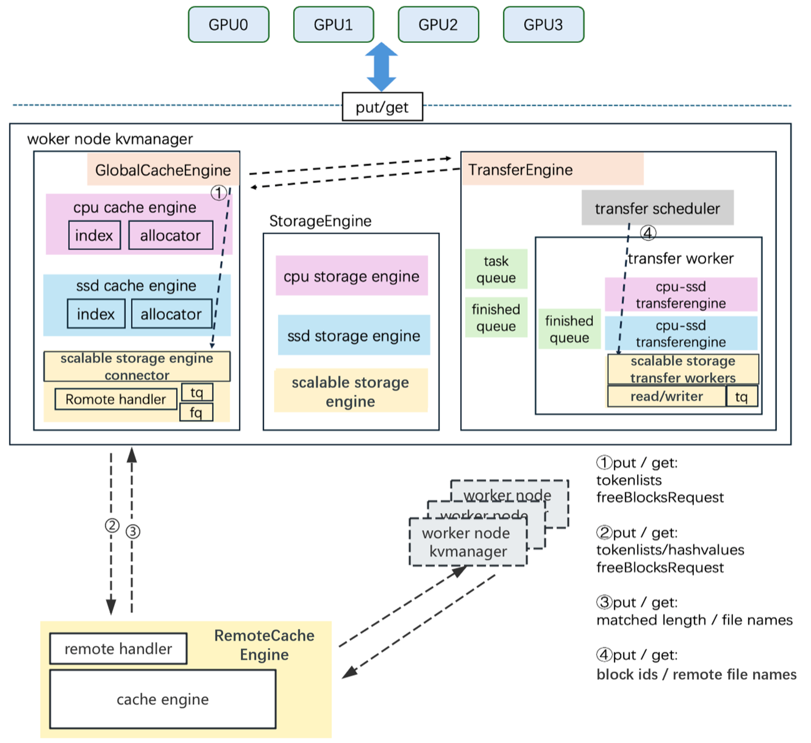
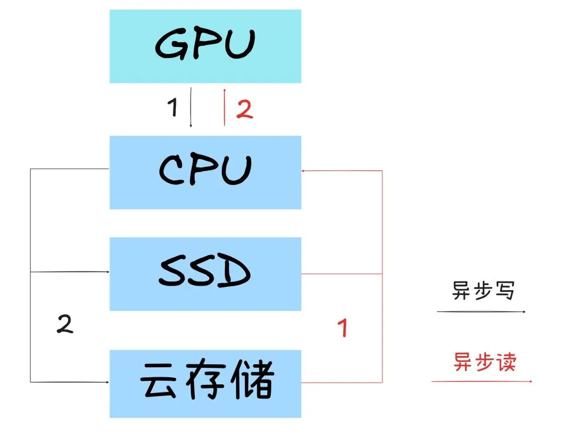

# 腾讯云 / TACO FlexKV

> 开源多级缓存 + 引擎内前缀卸载 · 官方仓库 / 官方文档 / 官方文章

腾讯云在 KV Cache 管理上的公开资料分为两条线：一是腾讯云 TACO 团队主导开源的 **FlexKV**，定位为“面向大规模 LLM 推理的分布式 KV Store 与多级缓存管理系统”，以 Apache-2.0 协议发布，位于推理引擎 GPU KV 之下，管理 CPU 内存、本地 SSD 与可扩展（云）存储三级外部缓存 [F]；二是腾讯云异构计算产品 TACO Kit 中的推理加速引擎 **TACO-LLM**，其官方文档描述了引擎内 Auto Prefix Caching 以及把被驱逐前缀 KV 卸载到 CPU 内存的 Prefix Cache Offload [TX14]。前者是可独立接入 vLLM、SGLang、TensorRT-LLM 和 NVIDIA Dynamo 的开源组件，后者是腾讯云商用引擎的功能开关，两者在资料中分别出现，本章分开叙述。

### 定位与发展时间线

腾讯开源官方专栏在 2025-10-10 发布的开源文章称，FlexKV 由腾讯云主导，“将 KV Cache 逐层缓存至内存、SSD 及云端扩展存储，充分利用整个推理集群节点上的存储资源及外置扩展资源，以存换算”，并在 2025 年腾讯全球数字生态大会主峰会上宣布开源 [TX1]。2026-04-14 腾讯云开发者社区转载的官方稿件把它进一步表述为 GPU → CPU → SSD → 远程存储的“四级缓存体系”（将 GPU 显存计为第一级），称可用缓存容量“最高可扩展至 GPU 显存的 100 倍以上” [TX2]。按仓库 README 与更新日志，主要节点如下 [F][TX12]：

| 时间 | 事件（据官方仓库 / 文章） |
|---|---|
| 2025-08-29 | 0.1.0 初始版本（client-server 模式） |
| 2025-09-11 | 1.0.0：缓存引擎改为推理引擎可直接调用的库，增加 C++ RadixTree（`index_accel`）与 `evict_ratio` |
| 2025-11-25 | 1.2.0：支持 CPU、SSD 与 PCFS 分布式 KV 共享，GDS，TP16，TensorRT-LLM 集成；SSD I/O 优化、频率感知宽限时间改进驱逐 |
| 2026-01-28 | 集成 Mooncake Transfer Engine，支持基于 RDMA 的跨节点分布式 KVCache 复用 |
| 2026-03 | 合入 NVIDIA Dynamo（3 月 3 日，PR #5858）与 vLLM 主干（3 月 17 日公告，vLLM v0.17.2 起内置 `FlexKVConnectorV1`）；2026-04 官方稿件称已合入 Dynamo、vLLM、TensorRT-LLM 三大框架官方主线 |
| 2026-06 ~ 07 | 层级（layerwise）传输、Pipeline Parallel、HugePage 主机缓存；SGLang 主线合入（`--enable-flexkv`）；Mooncake Store 作为按 key 寻址的远端缓存层；DeepSeek-V4 支持 |
| 2026-07 ~ 10 | GPU↔CPU 自适应多路径传输、SSD 向量化 I/O、Op 级传输 Trace；DeepSeek-V4.1 支持 |

TACO-LLM 则早于 FlexKV：腾讯云计算产品团队在 2023-11-17 发布的文章介绍其 Continuous Batching、Paged Attention、投机采样与异步调度，并称在客户场景中吞吐提升 78% [TX15]。这些数字针对的是整个引擎，并非多级 KV 缓存的独立收益。

### FlexKV 架构：三大引擎

*FlexKV 官方 README 架构原图：worker 节点 kvmanager 内的 GlobalCacheEngine（cpu / ssd cache engine 的 index 与 allocator、scalable storage connector）、StorageEngine 与 TransferEngine（transfer scheduler / worker），以及远端 RemoteCache Engine* — [原始来源](https://github.com/taco-project/FlexKV/blob/main/docs/images/flexkv_architecture.png)

README 把 FlexKV 划分为三个核心模块 [F][TX1]：

- **StorageEngine（存储引擎）**：按配置初始化三级缓存；把请求的多个 token 组成一个 block，以 block 为单位存放 KV，保持与 GPU 显存中一致的 KV 形状，物理偏移由 block ID 计算。可启用 *block-wise 模式*，把多个层以及 K/V 的缓存合并为更大的 block，以增大 I/O 单位、加快传输。配置层面，CPU / SSD / REMOTE / GDS 的布局均可在 `LAYERFIRST` 与 `BLOCKFIRST` 间选择，默认且推荐 `BLOCKFIRST` [TX4]。
- **GlobalCacheEngine（控制面）**：决定传输方向及源 / 目的 block ID；包含用于前缀匹配（match / insert）的 **RadixTree** 和跟踪空间占用、触发淘汰的 **mempool**。新请求到达时，它比较三级存储各自匹配到的 token 数，决定从 SSD 或可扩展存储取哪些 block，经 CPU 内存中转送往 GPU（启用 GDS 时 SSD 段直接读入 GPU，不经 CPU 中转 [PLTX1]）。
- **TransferEngine（数据面）**：执行控制面下发的搬运；每个进程用多线程并行传输，并使用 io_uring 等高性能 I/O 机制。

接口层面，*get* 可异步调用，匹配与传输时间可通过预取与前序计算重叠；*put* 也可异步调用，GPU→CPU 拷贝与后续计算重叠，而 CPU、SSD、可扩展存储之间的搬运完全由 TransferEngine 异步完成，对主进程透明 [F]。2025 年 11 月起 FlexKV 由 client-server 模式改为可直接调用的库（v1.0.0 API），以减少进程间通信开销 [F][TX5]。

### 缓存层级、写入与淘汰

*腾讯官方稿件中的四级缓存读写示意图：GPU→CPU 写入后异步写往 SSD 与云存储（黑线），读取时由 SSD / 云存储异步读回 CPU 再送 GPU（红线）* — [原始来源](https://cloud.tencent.com/developer/article/2654280)

FlexKV 只管理 GPU 之下的层级，GPU KV 仍由推理引擎管理，不在其驱逐范围内 [TX3]。官方驱逐策略文档对层间关系的描述比较明确 [TX3]：

- **近似 inclusive / write-through**：*put* 时数据先写入 CPU 缓存；若 SSD 或远端存储启用且可用，再把对应层尚未命中的 block 补写下去，因此同一 KV block 通常在多层各有副本。
- **驱逐不触发下沉**：某层驱逐只从该层的 Radix Tree 移除 block 并回收空间，不触发写回、迁移或额外传输；CPU 层驱逐不会主动发起 CPU→SSD 传输。README 称之为“逻辑 LRU 淘汰，不触发物理数据移动” [F]。
- **尽力而为**：下层未启用、被跳过、空间不足或传输失败时可能没有副本，上层驱逐后只能从其他层命中或未命中。源码中的细节是：仅有 CPU/SSD 时，若 SSD 腾不出所需 block，本次 put 整体放弃（CPU 也不写）；启用远端层时，SSD 分配失败只跳过 SSD 副本 [PLTX1]。

可选策略有 `lru`（默认）、`lfu`、`slru`、`fifo`、`mru`、`filo`。驱逐在两种情况下触发：利用率达到 `evict_start_threshold`（默认 1.0），或当前请求所需 block 数大于空闲 block 数；实际驱逐量取“满足请求的最少块数”“降回阈值以下所需块数”“`evict_ratio` × 总块数”（默认 0，即不设最小批量）三者最大值。`hit_reward_seconds` 为 LRU 增加命中奖励，每次命中把有效访问时间后推若干秒；SLRU 以 `slru_protected_threshold`（默认 2 次命中）划分试用段与保护段，文档称其可抵抗一次性请求造成的缓存扫描污染 [TX3]。

| 配置项（文件 / 环境变量） | 默认值 | 含义（据官方配置指南） |
|---|---|---|
| `cpu_cache_gb` / `FLEXKV_CPU_CACHE_GB` | 16 | CPU 缓存层容量（GB），不能超过物理内存 |
| `ssd_cache_gb` / `FLEXKV_SSD_CACHE_GB` | 0 | SSD 层容量；0 表示不启用 SSD，建议大于 CPU 层并为单文件上限的整数倍 |
| `ssd_cache_dir` | ./flexkv_ssd | 多块 SSD 用分号分隔多个挂载路径，以提升带宽 |
| `enable_gds` / `FLEXKV_ENABLE_GDS` | 关闭 | GPU Direct Storage，提升 SSD 到 GPU 的吞吐 |
| `FLEXKV_IOURING_ENTRIES` | 512 | io_uring 队列深度 |
| `FLEXKV_MAX_FILE_SIZE_GB` | -1 | 单个 SSD 文件最大大小，-1 不限 |
| `FLEXKV_INDEX_ACCEL` | 1 | 使用 C++ 版 RadixTree（0 为 Python 版） |
| `FLEXKV_CPU_LAYOUT` 等 | BLOCKFIRST | 各层存储布局 |

以上见 [TX4]。GDS 路径需要安装 `nvidia-gds`、加载 `nvidia_fs` 模块，ext4 示例以 `data=ordered` 挂载，编译时设置 `FLEXKV_ENABLE_GDS=1`；cuFile 的 `allow_compat_mode` 为 true 时，GDS 不可用会回退到经 CPU 的兼容模式 [TX9]。

#### 分布式复用与远端层

跨节点复用是 FlexKV 区别于单机卸载方案的部分。README 列出四个要点 [F]：每个节点维护全局索引的本地快照（**分布式 RadixTree**），查询时避免中心化瓶颈和网络往返；**lease 机制**保证跨节点传输期间数据有效；本地索引定期上传到 **Global Meta Store**（GMS，通常为 Redis），并拉取其他节点元数据重建分布式索引（Upload & Rebuild）；节点间数据由 **Mooncake Transfer Engine** 经 RDMA 传输。官方部署文档示例需要两个 Redis 实例（一个给 Mooncake，一个给 FlexKV），编译前设置 `FLEXKV_ENABLE_P2P=1`，其“最佳配置”一节仍为 TODO [TX8]。

2026-07-24 起，Mooncake Store 可作为 FlexKV 按 key 寻址的远端缓存层，以零拷贝 RDMA 实现集群级复用 [F]。远端读取的并发与内存压力由一组可选控制项约束：`FLEXKV_MOONCAKE_GET_CONCURRENCY` 默认 1（可设 1–8 个并行 Get），`FLEXKV_MOONCAKE_GET_MAX_INFLIGHT_BYTES` 默认 536870912 字节，每个对象按 `ceil(size/4096)*4096+8192` 计入预算；文档举例 512 MiB 预算下 8 个 64 MiB 对象因对齐开销最多只能用 7 个 reader [TX11]。SGLang 路径还可开启分块远端预取（默认关闭），以 `wait_complete` / `timeout` / `best_effort` 策略控制准入；超时只限制准入、不硬取消在途传输，结果是连续成功发布的前缀；分块路径不支持 SSD 与 FlexKV P2P 共享 [TX6]。同一共享 Store 中需保持模型、权重、dtype、TP 与 KV 布局一致，因为现有 key 并未对完整布局做指纹 [TX6]。

单机层面另有多实例模式：多个推理实例通过同一 `FLEXKV_SERVER_RECV_PORT` 共享一套 CPU/SSD 缓存，但目前仅支持单机，且各实例并行配置（TP、block_size 等）必须一致 [TX10]。在 Dynamo 中，官方多 worker 示例以 `--router-mode kv` 启动前端，各 vLLM worker 通过 ZMQ `kv-events` 发布缓存事件，实现 KV 感知路由；PD 分离部署时 prefill worker 用 `PdConnector` 组合 `FlexKVConnectorV1` 与 `NixlConnector`，官方注明该模式为实验性 [TX13]。

### 引擎接入与配置示例

vLLM ≥ 0.17.2 已内置连接器，无需打 patch；官方示例用 32 GB CPU 内存与 1 TB SSD 作为二、三级缓存 [TX5]：

~~~bash
# 出处（据此整理） [TX5] https://github.com/taco-project/FlexKV/blob/main/docs/vllm_adapter/README_zh.md
cat <<EOF > ./flexkv_config.yml
cpu_cache_gb: 32
ssd_cache_gb: 1024
ssd_cache_dir: /data0/flexkv_ssd/;/data1/flexkv_ssd/
enable_gds: false
EOF
export FLEXKV_CONFIG_PATH="./flexkv_config.yml"

# 官方示例节选（其余参数略）
VLLM_USE_V1=1 python -m vllm.entrypoints.cli.main serve Qwen3/Qwen3-32B \
  --tensor-parallel-size 8 --enable-chunked-prefill --enable-prefix-caching \
  --kv-transfer-config '{"kv_connector":"FlexKVConnectorV1","kv_role":"kv_both"}'
~~~

vLLM 还有实验性的 layer-wise 加载（`"use_layerwise":true`），让第 N+1 层 KV 的搬运与第 N 层计算重叠，目前只对 GET/H2D 做逐层流水，不支持 Context Parallel 与 GDS，单层等待超过 `FLEXKV_LAYERWISE_WAIT_TIMEOUT_S`（默认 60 秒）则 forward 失败 [TX5]。SGLang v0.5.16 及以上用 `--enable-flexkv --flexkv-config-file`（等价于 `--radix-cache-backend flexkv`）启用 [TX6]；TensorRT-LLM 通过 `TENSORRT_LLM_USE_FLEXKV=1` 与 `kv_connector_config` 中的 `FlexKVSchedulerConnector` / `FlexKVWorkerConnector` 接入，文档基于 v1.1.0rc2 并要求 `enable_partial_reuse: false` [TX7]；Dynamo 以 `DYNAMO_USE_FLEXKV=1` 启用 [TX13]。运行时可设 `FLEXKV_ENABLE_METRICS=1`，以 Prometheus 端点导出命中 / 未命中、内存池状态与传输统计 [F]。

#### TACO-LLM 的前缀缓存与 CPU 卸载

~~~text
# 出处：腾讯云《TACO LLM 推理加速引擎》第 36 页，命令行帮助节选
# https://main.qcloudimg.com/raw/document/product/pdf/1573_115165_cn.pdf#page=36
--enable-prefix-cache-offload
--cpu-prefill-memory-utilization CPU_PREFILL_MEMORY_UTILIZATION
--apc-offload-not-lazy
--apc-offload-min-access-threshold APC_OFFLOAD_MIN_ACCESS_THRESHOLD
--apc-offload-enable-hit-cnt
--apc-offload-gpu-evictor-limit APC_OFFLOAD_GPU_EVICTOR_LIMIT
~~~

TACO-LLM 官方文档“Auto Prefix Caching”一节（更新于 2025-04-17）说明，`--enable-prefix-caching` 开启跨请求前缀 KV 复用；在此基础上 `--enable-prefix-cache-offload` 让显存中被驱逐的 prefix cache 卸载到 CPU 内存，命中时再加载回 GPU [TX14]。相关参数包括：`--cpu-prefill-memory-utilization`（用于 KV 的 CPU 内存比例，默认 0.3，按机器总内存计算并按卡均分）、`--apc-offload-min-access-threshold`（block 被卸载的最小使用次数，默认 1 即全部卸载，调大则只卸载多次使用的 block）、`--apc-offload-enable-hit-cnt`（每 100 个 block 打印一次命中日志）。文档举例：GPU 共 100 个 block、11 个不同前缀各占 10 个 block 时，Q11 结束后 Q1 的前缀已被驱逐，与 Q1 同前缀的 Q12 只能依靠 CPU 卸载层获得加速；示例日志显示 GPU 命中 12.34%、CPU 命中 37.21%、未命中 50.44% [TX14]。这是一条 GPU→CPU 两级、单机引擎内的路径，文档未提及 SSD 层。

### 公开性能数据

| 来源 | 场景与条件 | 公开结果 |
|---|---|---|
| FlexKV 开源文章（2025-10） [TX1] | 群联电子（Phison）实测；产品说明增强搜索，预缓存说明文档 KV | TTFT 降低 70% |
| 同上 | 医疗问答助手，预缓存多个医疗知识库 KV | 对话时延降低 57% |
| 官方稿件（2026-04） [TX2] | “启用 FlexKV 后”的实测，未给出模型、硬件、负载与基线 | TTFT 降低 60%，TPOT 降低 13%，单集群 QPM 提升 16% |
| 同上 | 架构能力描述 | 可用缓存容量最高可扩展至 GPU 显存的 100 倍以上 |
| TACO-LLM 文章（2023-11） [TX15] | WizardCoder-15B，A100-80G 单卡，32 请求，输入 4–512 / 输出 300–1024 tokens | 解码延时比 vLLM 低 52.7%；总吞吐比 vLLM 高 42.8%（引擎整体，非 KV 卸载） |

FlexKV 仓库自身没有给出基准数字。README 对仍在评审中的缓存恢复优化（#323）明确说明，CPU / mock 生命周期测试与 CUDA 字节测试各有范围，模型输出一致性、跨机性能与持续容量需要单独验证 [F][TX11]。

### 放置策略：哪些 KV 放到哪一层

以下按 FlexKV 官方文档与固定提交 `542b11c`（main 分支，2026-11-16）的源码逐项核对。FlexKV 只管 GPU 之下的层级，GPU 内哪些前缀保留由推理引擎决定。TACO-LLM 的 GPU→CPU 卸载见上文，不在此表内。

| 维度 | FlexKV 做法 | 证据类型与引用 |
|---|---|---|
| 层级与介质 | GPU（引擎管理）→ CPU 内存 → 本地 SSD（可多盘、可 GDS）→ 远端层（第三方存储 / PCFS，或 Mooncake Store）；另有同层的 P2P 对等节点 CPU/SSD。容量由 `cpu_cache_gb`（默认 16）和 `ssd_cache_gb`（默认 0，即关闭）设定，启用时必须大于 CPU 层；远端容量由外部存储决定 | 源码可见 / 官方明确说明 [PLTX3][TX4] |
| 放置单位 | block，`tokens_per_block` 取引擎页大小（配置默认 16）；block 字节数等于单 token KV 字节数 × `tokens_per_block`；索引以 block 哈希链组成 RadixTree 前缀 | 源码可见 [PLTX3] |
| 准入 | 无热度门槛：vLLM 适配器在请求正常结束（STOP / LENGTH）时，把 `all_token_ids` 中满块部分全部 put，**包括 decode 输出 KV**；只写尚未命中的 block（`_need_to_put` 仅判断未命中数大于 0），最后不满一块的尾部不写。中止的请求默认不写 | 源码可见 [PLTX2] |
| 写入时机 | put 时 GPU→CPU（D2H），CPU 段完成后即可读；再从 CPU 异步写 SSD（H2DISK）和远端层，即近似 inclusive 的 write-through，多层各有副本；Mooncake Store 按已命中前缀去重，避免重复写入 | 官方明确说明 + 源码可见 [TX3][PLTX1] |
| 降级与淘汰 | 每层独立：`take()` 在利用率 ≥ `evict_start_threshold` 或空闲块不足时，从 RadixTree 中淘汰未加锁的叶子节点，块归还 mempool；默认策略 `lru`，可选 lfu / slru / fifo / mru / filo；驱逐不下沉、不迁移 | 源码可见 / 官方明确说明 [PLTX1][TX3] |
| 提升与预取 | get 时 CPU 命中段直接 H2D；SSD 多出的段读入新分配的 CPU block，完成后挂到 CPU 树上（即提升到 CPU），GDS 时直读 GPU；远端段经 CPU 读入，若 SSD 前缀连续，还会补写到 SSD。Mooncake 远端读**只在预取中执行**，计算路径的 get 强制 `ignore_remote`，没取回的部分由引擎重算；预取有 `wait_complete` / `timeout` / `best_effort` 三种策略 | 源码可见 [PLTX1][PLTX4] |
| 位置选择 | 单机内多实例共享一套 CPU/SSD；启用 P2P 时，每层同时匹配本地索引和分布式快照，取较长前缀，相等时优先本地，两者不拼接；实例级路由交给 Dynamo KV router 等上层组件 | 源码可见 / 官方明确说明 [PLTX5][TX10][TX13] |
| 决策者 | 引擎连接器决定何时 get / put；GlobalCacheEngine 决定读哪层、写哪层；用户侧只有 `namespace` 隔离与 `CacheStrategy`（`ignore_ssd` / `ignore_remote` 等），没有 TTL 或断点 | 源码可见 / 官方明确说明 [PLTX1] |
| 选择依据 | 固定层序（CPU 优先，其次 SSD、远端）加最长前缀匹配；不估算复用概率，也不比较加载代价与重算代价，没有显式成本模型 | 源码可见；成本模型未公开（未发现） [PLTX1] |

**选择逻辑。**FlexKV 的放置规则可以概括为“全写、逐层副本、各层独立 LRU”。它不在写入时判断哪些 KV 值得保留，而是把每个结束请求的全部满块（包括输出）写进 CPU，并在启用时同步写到 SSD 和远端层，由各层容量和淘汰算法筛出热数据。这样实现简单，命中路径也短：任意一层驱逐都不需要数据搬迁，下层通常已有副本。代价是写放大，SSD 写入量约等于所有未命中 put 的总量。官方提供的调节手段在淘汰侧，例如 `slru` 防扫描、`hit_reward_seconds` 奖励命中，而不在准入侧。

读路径按层序拼接前缀：GPU 已有部分跳过；CPU 能接上的段为 fragment1；SSD 比 CPU 更长的部分为 fragment2；远端再长的部分为 fragment3。下层命中的 block 会经 CPU 中转并挂到 CPU 树上，所以“被读到”本身就是一次提升，SSD 也会通过远端读顺带回填。Mooncake 远端读被限制在预取阶段，原因是跨节点读取时延不确定；计算路径不等待远端，未取回的部分直接由引擎重算，取舍偏向保 TTFT。

**例子（本文按源码推演，数值为估算）。**以官方 vLLM 示例的 Qwen3-32B（64 层、8 个 KV 头、head_dim 128、BF16 [PLTX6]）为例，单 token 的 KV 为 2×64×8×128×2 B = 256 KiB，16 token 的 block 约 4 MiB。32k token 的多轮对话前缀约 2048 个 block、8 GiB。第一轮结束时，这 8 GiB 写入 CPU 层（示例 32 GB），并异步写入 SSD（示例 1 TB）。下一轮到达时，若 GPU 中仍有该前缀，只需补算新增部分；若已被 GPU 驱逐，则从 CPU 读回。如果 CPU 层被其他会话挤满，该前缀的叶子按 LRU 先被淘汰，此时 SSD 副本仍在，读回时会重新提升到 CPU。只有 SSD 也被淘汰、又没有远端副本时，才需要整段重算。

### 硬件配置信息

下表列出本章所读腾讯官方资料和 FlexKV 仓库文档中给出的硬件或容量配置。开源文档多为“示例配置”，而非性能测试平台；所有资料都没有提到腾讯云实例规格名。

| 场景 / 方案 | 计算（GPU / NPU 型号 × 数量，HBM 容量） | CPU 与主机内存（DRAM 容量） | 本地存储（SSD / NVMe / HDD 型号、数量、容量） | 网络（RDMA / NIC 型号与带宽） | 远端 / 共享存储（服务名与规格） | 来源 |
|---|---|---|---|---|---|---|
| FlexKV × vLLM 官方示例（Qwen3-32B，TP=8） | 8 卡（型号、HBM 未公开） | FlexKV CPU 层 32 GB；主机内存总量未公开 | SSD 层 1024 GB，分布在 `/data0`、`/data1` 两个挂载目录；型号未公开 | 未公开 | 未启用 | [TX5] |
| FlexKV × TensorRT-LLM 官方示例 | 未公开 | CPU 层 32 GB | SSD 层 1024 GB，两个挂载目录；型号未公开 | 未公开 | 未启用 | [TX7] |
| FlexKV × Dynamo 多 worker 示例 | 4 个 worker × TP=2，共 8 卡（型号未公开） | 每个 worker 的 CPU 层 32 GB | 每个 worker 的 SSD 层 128 GB（`/data/flexkv_ssd/worker_i`）；型号未公开 | 未公开（KV 事件经 ZMQ TCP 发布） | 未启用 | [PLTX8] |
| GDS 配置示例 | 未公开 | CPU 层 32 GB | SSD 层 1024 GB；挂载示例为 `/dev/nvme0n1`（ext4，`data=ordered`），型号未公开 | 未公开 | 未启用 | [TX9] |
| 分布式 KV 复用基准配置（P2P CPU） | 合成 4 层模型，TP=1（GPU 型号未公开） | CPU 层 4 GB | SSD 关闭（0） | Mooncake Transfer Engine，`rdma` 协议，网卡 `mlx5_0,mlx5_1,mlx5_4,mlx5_5`（带宽未公开） | Redis 作元数据存储（规格未公开） | [PLTX10][TX8] |
| radixshmem 多机集群示例（4 节点） | 未公开 | 每节点 `radix-server --data-bytes 1024G` 主机内存作 CPU 层 | 该模式必须关闭 SSD 层 | 控制面 `mlx5_bond_0`，数据面 `mlx5_0`–`mlx5_7` 共 8 张网卡（带宽未公开） | etcd 协调（规格未公开） | [PLTX7] |
| Gemma4 31B 支持复现 | 2 卡，“2×A100-80G 或类似配置”（约需 60 GB 显存） | 未公开 | 未公开 | 未公开 | 未公开 | [PLTX9] |
| TACO-LLM 发布测试（WizardCoder-15B） | A100-80G × 1 | 未公开 | 未公开 | 未公开 | 未公开 | [TX15] |
| TACO-LLM Prefix Cache Offload | 未公开 | KV 卸载占机器总内存的比例，默认 0.3，按卡均分 | 不涉及 | 未公开 | 不涉及 | [TX14] |
| Phison 实测 / 2026 官方稿件性能数据 | 未公开 | 未公开 | 未公开 | 未公开 | 未公开 | [TX1][TX2] |

这些配置中，KV 实际落在 GPU HBM（引擎管理）、主机 DRAM（FlexKV CPU 层或 radixshmem SlotStore）和本地 NVMe SSD 上；跨节点复用依靠 RDMA 网卡读取对端 DRAM，或使用 Mooncake Store。所有来源都没有给出 SSD 型号或整机规格（GPU 型号只有 TACO-LLM 与 Gemma4 文档写明为 A100-80G），也没有任何 HDD 配置。

### 与 SSD / HDD 多级存储的关系（本文分析）

FlexKV 是本报告所调研的云厂商方案中，把 SSD 作为常规缓存层写进默认配置示例最直接的一个：block 级布局、block-wise 合并大 I/O、io_uring 队列深度 512、多 SSD 目录并行和 GDS 都针对顺序性较好的大块读写设计，异步 put 与 write-through 让下沉写入不阻塞推理。“驱逐不触发下沉”的语义意味着慢层的数据是 put 时就写入的副本（另有一种情况：从远端层读回的 block 会顺带补写一份到 SSD），而不是上层驱逐时降级下去的数据；若在 SSD 之下再接 HDD 或对象存储，写入量与 put 量相当，读回则受 get 预取窗口与 TTFT 预算约束。远端层目前以 Mooncake Store、PCFS 等为对象，公开资料没有出现机械盘作为缓存层的配置或测试；TACO-LLM 的卸载止于 CPU 内存。

### 资料边界

本章架构与配置均来自 FlexKV 官方仓库（采集于 2026-11-18 的 main 分支；放置策略一节的源码核对固定到提交 `542b11c`，采集于 2026-11-19），README 中标注为 proposed / under review 的功能不视为稳定发布能力。2026 年的 60% / 13% / 16% 来自官方稿件中的图片，缺少测试条件；Phison 数据为合作方实测转述。TACO-LLM 的前缀卸载是否在腾讯云托管模型服务（如混元 API）中默认启用，未找到公开说明。

## 本章资料

- **[F]** [腾讯云 TACO · FlexKV 官方 GitHub 仓库 README（main 分支，采集于 2026-11-18）](https://github.com/taco-project/FlexKV)
- **[PLTX1]** [FlexKV 源码 · flexkv/cache/cache_engine.py（GlobalCacheEngine get/put/take，提交 542b11c，2026-11-16，采集于 2026-11-19）](https://github.com/taco-project/FlexKV/blob/542b11c8f22ee74c34ceeb6c8b63db7832e31ece/flexkv/cache/cache_engine.py)
- **[PLTX2]** [FlexKV 源码 · flexkv/integration/vllm/vllm_v1_adapter.py（request_finished / _need_to_put，提交 542b11c）](https://github.com/taco-project/FlexKV/blob/542b11c8f22ee74c34ceeb6c8b63db7832e31ece/flexkv/integration/vllm/vllm_v1_adapter.py)
- **[PLTX3]** [FlexKV 源码 · flexkv/common/config.py（CacheConfig / UserConfig 默认值，提交 542b11c）](https://github.com/taco-project/FlexKV/blob/542b11c8f22ee74c34ceeb6c8b63db7832e31ece/flexkv/common/config.py)
- **[PLTX4]** [FlexKV 源码 · flexkv/prefetch/policy.py（预取停止策略，提交 542b11c）](https://github.com/taco-project/FlexKV/blob/542b11c8f22ee74c34ceeb6c8b63db7832e31ece/flexkv/prefetch/policy.py)
- **[PLTX5]** [FlexKV 源码 · flexkv/cache/hie_cache_engine.py（本地 / 分布式索引 match_all，提交 542b11c）](https://github.com/taco-project/FlexKV/blob/542b11c8f22ee74c34ceeb6c8b63db7832e31ece/flexkv/cache/hie_cache_engine.py)
- **[PLTX6]** [ModelScope · Qwen/Qwen3-32B config.json（采集于 2026-11-19）](https://modelscope.cn/models/Qwen/Qwen3-32B/file/view/master/config.json)
- **[PLTX7]** [FlexKV 官方文档 · radixshmem 模式配置（docs/radixshmem/config_zh.md，提交 542b11c）](https://github.com/taco-project/FlexKV/blob/542b11c8f22ee74c34ceeb6c8b63db7832e31ece/docs/radixshmem/config_zh.md)
- **[PLTX8]** [FlexKV 官方文档 · Dynamo 集成（docs/dynamo_integration/README_zh.md，提交 542b11c）](https://github.com/taco-project/FlexKV/blob/542b11c8f22ee74c34ceeb6c8b63db7832e31ece/docs/dynamo_integration/README_zh.md)
- **[PLTX9]** [FlexKV 官方文档 · Gemma4 支持（docs/gemma4_support.md，提交 542b11c）](https://github.com/taco-project/FlexKV/blob/542b11c8f22ee74c34ceeb6c8b63db7832e31ece/docs/gemma4_support.md)
- **[PLTX10]** [FlexKV 仓库 · 分布式 KVCache 基准配置（benchmarks/example_dist_config.yml，提交 542b11c）](https://github.com/taco-project/FlexKV/blob/542b11c8f22ee74c34ceeb6c8b63db7832e31ece/benchmarks/example_dist_config.yml)
- **[TX1]** [腾讯开源 · 分布式KVCache多级缓存架构 - FlexKV正式开源！（腾讯云开发者社区，2025-10-10）](https://cloud.tencent.com/developer/article/2574815)
- **[TX2]** [腾讯云开发者社区（小腾资讯君，转载）· 腾讯这项省Token技术，成为全球主流推理框架官方方案（2026-04-14）](https://cloud.tencent.com/developer/article/2654280)
- **[TX3]** [FlexKV 官方文档 · 缓存驱逐策略指南（docs/eviction_policy/README_zh.md）](https://github.com/taco-project/FlexKV/blob/main/docs/eviction_policy/README_zh.md)
- **[TX4]** [FlexKV 官方文档 · 配置使用指南（docs/flexkv_config_reference/README_zh.md）](https://github.com/taco-project/FlexKV/blob/main/docs/flexkv_config_reference/README_zh.md)
- **[TX5]** [FlexKV 官方文档 · 在 vLLM 中使用 FlexKV（docs/vllm_adapter/README_zh.md）](https://github.com/taco-project/FlexKV/blob/main/docs/vllm_adapter/README_zh.md)
- **[TX6]** [FlexKV 官方文档 · Using FlexKV with SGLang（flexkv/integration/sglang/README.md，状态核对于 2026-08-06）](https://github.com/taco-project/FlexKV/blob/main/flexkv/integration/sglang/README.md)
- **[TX7]** [FlexKV 官方文档 · 在 TensorRT-LLM 中使用 FlexKV（docs/trtllm_adaption/README_zh.md）](https://github.com/taco-project/FlexKV/blob/main/docs/trtllm_adaption/README_zh.md)
- **[TX8]** [FlexKV 官方文档 · 分布式 KVCache 重用功能（docs/dist_reuse/README_zh.md）](https://github.com/taco-project/FlexKV/blob/main/docs/dist_reuse/README_zh.md)
- **[TX9]** [FlexKV 官方文档 · GDS (GPU Direct Storage) 使用指南（docs/gds/README_zh.md）](https://github.com/taco-project/FlexKV/blob/main/docs/gds/README_zh.md)
- **[TX10]** [FlexKV 官方文档 · 多实例模式使用指南（docs/multi_instance/README_zh.md）](https://github.com/taco-project/FlexKV/blob/main/docs/multi_instance/README_zh.md)
- **[TX11]** [FlexKV 官方文档 · 缓存层性能控制（docs/cache_tier_performance_controls_zh.md）](https://github.com/taco-project/FlexKV/blob/main/docs/cache_tier_performance_controls_zh.md)
- **[TX12]** [FlexKV · 更新日志（CHANGELOG_zh.md）](https://github.com/taco-project/FlexKV/blob/main/CHANGELOG_zh.md)
- **[TX13]** [NVIDIA Dynamo 官方文档 · FlexKV 集成（v1.3.0）](https://docs.nvidia.com/dynamo/v1.3.0/integrations/kv-cache-integrations/flex-kv)
- **[TX14]** [腾讯云官方文档 · 计算加速套件 TACO Kit：TACO LLM 推理加速引擎（PDF，Auto Prefix Caching 一节更新于 2025-04-17）](https://main.qcloudimg.com/raw/document/product/pdf/1573_115165_cn.pdf)
- **[TX15]** [腾讯云计算产品团队 · TACO-LLM发布！助力大模型极致加速（腾讯云开发者社区，2023-11-17）](https://cloud.tencent.com/developer/article/2359653)
