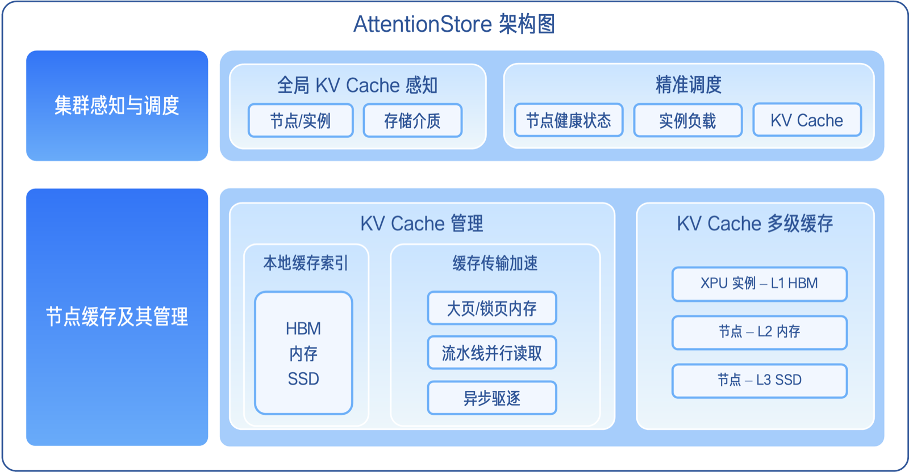
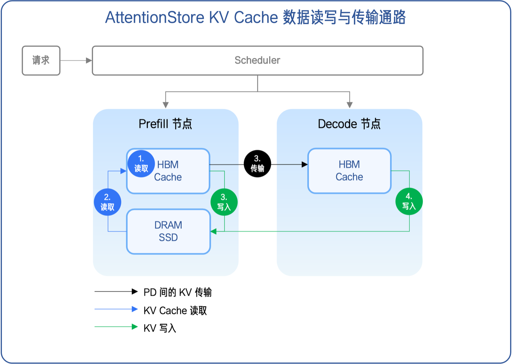
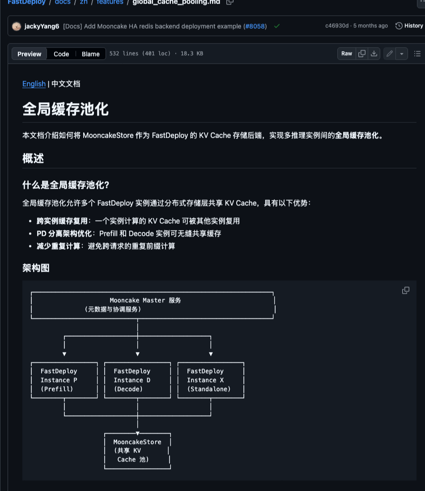
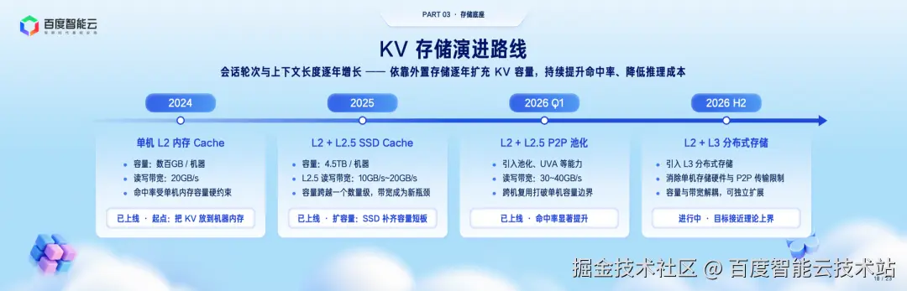

# 百度 / PaddlePaddle FastDeploy

> 开源引擎 + 托管 API + 百舸平台 · 官方文档 / 官方仓库 / 官方技术文章

百度的 KV Cache 公开资料分三层。第一层是千帆 ModelBuilder 面向 API 用户的 **prompt cache（自动）**和**前缀缓存（显式创建）**；第二层是百度百舸（AIHC）平台和千帆 MaaS 背后的 KV Cache 系统 **AttentionStore**，以及 HBM / DRAM / SSD 多级存储；第三层是 PaddlePaddle 开源推理引擎 **FastDeploy**，提供前缀缓存、CPU swap、PD 分离传输，以及基于 MooncakeStore 的全局缓存池化。三层资料来源不同，开源引擎的能力不能直接视为千帆线上服务的实现。 [BD7][BD8][BD10][PG]

### 定位与资料分层

| 层次 | 载体 | 公开要点 | 资料类型 |
|---|---|---|---|
| 托管 API | 千帆 prompt cache | 支持的模型自动开启；命中部分按 prompt_tokens 单价的 40% 计费；不保证命中 | 官方文档 [BD7] |
| 托管 API | 千帆前缀缓存 | 通过 `/v2/caching` 显式写入，按 ttl 保留；费用分输入、命中、存储、输出四项；目前为邀测 | 官方文档 [BD8] |
| 平台部署 | 百舸 AIAK 推理引擎 | 多角色服务组做 PD 分离部署，控制台提供“Kv Cache感知调度”开关 | 官方文档 [BD9] |
| 平台 KV 系统 | AttentionStore | 以独立进程运行；HBM / DRAM / SSD 三级；全局索引；按缓存位置调度 | 百度智能云官方技术文章 [BD10][BD11][BD12] |
| 开源引擎 | FastDeploy | GPU 前缀缓存 + CPU swap；RDMA / IPC PD 传输；存储后端可选 mooncake / attention_store / file | 官方仓库文档与源码 [BD1][BD2][BD3][PG][BD5] |

### 千帆托管 API：prompt cache 与前缀缓存

**prompt cache（隐式）**：千帆文档（更新时间 2026-11-11）说明，系统会把含有重复内容的请求路由到处理过相同提示的服务器。支持的模型对所有用户自动开启，无需修改代码，系统自行判断请求前缀是否已在缓存中。文档目前列出的支持模型为 `ernie-5.5-flash-preview` 和 `ernie-light-dt-1.0`。命中的 `cached_tokens` 按 `prompt_tokens` 单价的 40% 计费，命中量可从返回的 `usage.prompt_tokens_details.cached_tokens` 读取。文档也写明：系统会定期清理一段时间未使用的缓存；即便上下文完全一致，请求仍有可能不命中。 [BD7]

**前缀缓存（显式）**：文档（更新时间 2026-01-05）称其为“一次性缓存”，适合人设、开场白、规则化模板、超长文本分析等固定前缀。使用前要先调用缓存创建 API 写入内容。支持型号包括 DeepSeek-V3.2、V3.1、V3、R1 等。该能力目前为邀测，需要提交工单开通。 [BD8]

~~~http
# 出处（据此整理） [BD8] https://cloud.baidu.com/doc/qianfan-docs/s/Lmhuc7c2o
# 1. 创建前缀缓存（官方文档示例，鉴权头从略）
POST https://qianfan.baidubce.com/v2/caching
{"model": "deepseek-v3.1-250821",
 "messages": [{"role": "system", "content": "你是一个专业的百度千帆技术客服，……"}],
 "ttl": 3600}
# 返回: {"id": "cache-20251107212205-xxxxxx", "mode": "common_prefix", "ttl": 3600, "usage": {"prompt_tokens": 23, ...}}

# 2. 对话时用 cache_id 引用，其余与 v2/chat/completions 一致
POST https://qianfan.baidubce.com/v2/chat/completions
{"cache_id": "cache-20251107212205-xxxxxx", "model": "deepseek-v3.1-250821",
 "messages": [{"role": "user", "content": "你是谁"}]}

# 3. 查询（返回 expire_at）/ 删除：GET 与 DELETE https://qianfan.baidubce.com/v2/caching/{cache_id}
~~~

生命周期与计费：`ttl` 以秒为单位，从创建时开始计时，超时后缓存被删除；每次用该缓存发起对话，过期时间都会按 ttl 重新计算。费用分四部分：未命中的输入按标准输入单价；命中的输入按标准输入单价的 20% 或 25%；缓存存储按“每个自然小时的最大缓存量 × 单价”累加，从创建时起计，直到缓存被删除（ttl 到期或调用删除 API）为止，不足 1 小时按 1 小时计；输出按标准单价。以价目表为例，deepseek-v3.2 在输入 [0, 32k] 档的输入 / 命中 / 存储 / 输出单价依次为 0.002 / 0.0004 / 0.000017（元/千 tokens/小时）/ 0.003 元/千 tokens。可见这一 API 把缓存当作带有存储时长成本的资源来收费，不只是命中折扣。 [BD8]

### 百舸平台与 AttentionStore：三级 KV 缓存与全局调度

在百舸控制台用 AIAK 推理引擎做 PD 分离部署时（以 DeepSeek R1 为例，文档更新时间 2025-10-16），服务配置里有“Kv Cache感知调度”一项。开启后，平台会感知 Prefill 节点的缓存命中率，把请求调度到命中率高的实例；环境变量 `MEM_FRACTION_STATIC`（分配给 KV Cache 等的固定显存比例）推荐值为 0.95。 [BD9]

百度智能云官网 2026-04-01 发布的技术文章更完整地介绍了百舸自研的 KV Cache 系统 AttentionStore。文章指出生产落地需要解决三个问题：调度看不到缓存分布、多级介质之间搬运效率低、推理进程退出后缓存丢失。对应的设计如下： [BD10]

- **与推理引擎解耦**：AttentionStore 作为独立进程运行在每个推理节点上。推理进程重启、故障恢复或升级时，KV Cache 仍保存在 AttentionStore 管理的存储空间中。主机侧缓存介质为共享内存和 SSD；AttentionStore 自身重启后可通过本地索引表恢复。
- **全局索引与按缓存调度**：汇聚各节点的 KV Block 信息（BlockHash、所在介质 HBM / DRAM / SSD），实时捕获创建与销毁事件，形成 Host → Blocks 映射。调度器先把候选范围收敛到高命中节点，再结合命中长度和介质读取效率给节点打分。
- **数据通路**：Prefill 节点先在显存中匹配；显存未命中时，通过节点间池化把缓存迁到目标节点的主机内存；仍未命中的部分现场计算。Prefill 生成的 KV 传给 Decode，同时异步回写主机内存 / SSD；Decode 新生成的 KV 增量也异步回写到 Prefill 节点的内存 / SSD。
- **读写加速**：HBM、DRAM、SSD 混合命中时，各介质的读取并行发起，不再串行；共享内存使用大页并在整个生命周期内锁页，DRAM→HBM 通信效率比基线提升 4 倍；KV 的序列化、打包和跨节点传输交给 C++ SDK 的异步线程池，回写与 P→D 传输拆成细粒度任务同时进行。

*百度百舸 AttentionStore 架构图：集群感知与调度层（全局 KV Cache 感知、精准调度）与节点缓存管理层（本地索引、大页锁页、流水线并行读取、异步驱逐；L1 HBM / L2 内存 / L3 SSD）。来源：百度智能云官网技术文章原图* — [原始来源](https://cloud.baidu.com/article/6296264)

*AttentionStore KV Cache 读写与传输通路：Prefill 节点先读 HBM，再从 DRAM / SSD 读取；P→D 传输与回写并行；Decode 增量 KV 回写到 Prefill 侧 DRAM / SSD。来源：同一篇官方文章原图* — [原始来源](https://cloud.baidu.com/article/6296264)

2026 年 9 月 SGLang Meetup 上，“百度智能云技术站”发布了两篇演讲整理稿，补充了线上体系的细节。千帆采用“全局网关 → 地域级 → 集群内”三层调度：地域级保证 Session 亲和；集群内在低负载时让请求靠近 Cache，高负载时通过池化把 Cache 搬到请求所在节点。Cache 系统由各节点 Agent 与地域级 Master 组成，以事件驱动方式构建全局索引；调度器订阅增量 KV 事件。请求如果没有落到命中最高的节点，会触发预取：本地从 SSD 预取到内存，远程经 RDMA 拉取其他节点的内存；引擎开始向 L1 加载时，预取可以被打断。在引擎侧，百舸把 Rolling Hash 的计算前移到 Tokenizer，用 C++ 实现 Radix Tree，并用 UVA 拷贝来衔接 L2 的 Page First 布局与 L1 的 Layer First 布局。 [BD11][BD12]

### FastDeploy：开源引擎中的分层缓存与全局池化

**本地两级：GPU + CPU**。服务化部署加 `--enable-prefix-caching` 后，默认只开启一级（GPU）缓存；要开启 CPU 缓存，需要用 `--swap-space` 指定 CPU Cache 大小（单位 GB）。文档注明 ERNIE-4.5-VL 多模态模型暂不支持前缀缓存。参数文档规定：KV Cache 管理粒度 `block_size` 推荐默认值为 64 token；`kv_cache_ratio` 按比例（默认 0.75）把块分给 Prefill 和 Decode；可分配块数由显存余量自动推算，并在日志中输出 `total_block_num`。KV 量化通过 `mix_quant` 的 `kv_cache_quant_type` 指定，文档注明只有 AppendAttn 后端支持在线 `block_wise_fp8`。`enable_output_caching` 把输出 token 的 KV 也纳入缓存，仅在 V1 调度器（`ENABLE_V1_KVCACHE_SCHEDULER=1`）下生效。 [BD1][BD3]

**PD 分离传输**。单机内用 `cudaMemcpyPeer` 在 GPU 之间传 KV，多机之间用自研 RDMA 传输库（`--cache-transfer-protocol rdma,ipc`）。Golang Router 负责选 PD 实例对；P 实例先向 D 实例申请 Cache Block，生成首 token 的同时按层（layerwise）把 Cache 传给 D。 [BD2] 该 RDMA 库的 README 给出一组单线程对比（单张 ConnectX-7 400G 单端口，BATCH_SIZE 1538）：块大小 1K 时 KVTransferManager 为 10.67 GB/s，Mooncake transfer_engine_bench 为 1.54 GB/s；块大小 256K 时二者分别为 45.01 与 40.71 GB/s。多线程下两者都能接近网卡带宽上限。 [BD4]

**全局缓存池化**。`--kvcache-storage-backend mooncake` 把 MooncakeStore 接为 KV Cache 存储后端，多个实例（含 P / D / Standalone）通过 Mooncake Master（元数据与协调）共享同一个 KV 池。网络推荐 RDMA，也可以用 TCP。`global_segment_size` 指每个 TP 进程贡献给全局共享内存的空间，默认 1GB；`local_buffer_size` 默认 128MB。PD 场景中，建议在 Decode 实例开启 `--enable-output-caching`，这样 Prefill 能读取 Decode 产生的输出缓存，从而优化多轮对话。日志中 `storage_cache_token_num > 0` 表示命中了全局池。高可用方面，可以运行多个 `mooncake_master`，用 etcd 或 redis 选主；示例脚本 `kill -9` 掉 leader 后验证 failover。 [PG]

*FastDeploy 官方文档《全局缓存池化》GitHub 页面截图：Mooncake Master 协调多个 FastDeploy 实例（Prefill / Decode / Standalone）共享 MooncakeStore KV 池（采集于 2026-11-18）* — [原始来源](https://github.com/PaddlePaddle/FastDeploy/blob/develop/docs/zh/features/global_cache_pooling.md)

~~~bash
# 出处（据此整理） [PG] https://github.com/PaddlePaddle/FastDeploy/blob/develop/docs/features/global_cache_pooling.md
# Decode 实例（官方文档场景二节选）
export MOONCAKE_MASTER_SERVER_ADDR="127.0.0.1:15001"
export MOONCAKE_METADATA_SERVER="http://127.0.0.1:15002/metadata"
export MOONCAKE_PROTOCOL="rdma"
python -m fastdeploy.entrypoints.openai.api_server --model ${MODEL_NAME} --port 52500 --splitwise-role decode --cache-transfer-protocol rdma --router "0.0.0.0:52700" --enable-output-caching --kvcache-storage-backend mooncake
~~~

**源码层面的三级层次与写策略**（develop 分支，采集于 2026-11-18；2026-11-19 按提交 `d923caf` 复核）：命令行 `--kvcache-storage-backend` 的可选值为 `mooncake`、`attention_store`、`file`。设置后会自动开启前缀缓存，且要求 V1 调度器。`--write-policy` 可选 `write_through`、`write_through_selective`（参数默认值，按 `--write-through-threshold` 命中次数阈值写入，默认 2）、`write_back`。 [BD5] 但这三种策略只在环境变量 `ENABLE_V1_KVCACHE_MANAGER=1`（默认 0）时可选。默认的旧版 cache manager 会把 `write_policy` 强制改为 `write_through`，含义是请求结束时把整条前缀写入存储后端。 [PLBD1] 新版 `cache_manager/v1` 的注释把层次定义为 Device（GPU）→ Host（CPU）→ Storage，并说明 Storage 中的数据需要先取到 Host。其中 `write_through` 被规范化为阈值为 1 的 `write_through_selective`，写策略管的是 Device→Host 的备份；v1 中写入 Storage 的函数目前仍是 TODO。RadixTree 为 Device 和 Host 分别维护可淘汰集合，按 `last_access_time` 选出 LRU 节点；`ref_count` 为 0 的节点才可淘汰。write_back 策略下，Device 块被淘汰时转移到 Host。 [BD6][PLBD4] `file` 后端把每个 KV 键写成目录下的一个 `{key}.pd` 文件，`attention_store` 后端依赖 `attentionstore_sdk` 包。这两个后端目前只在源码中出现，《全局缓存池化》文档只写了 Mooncake。 [BD5][BD6]

### 公开性能数据（按原口径）

| 来源 | 条件 | 公开数据 |
|---|---|---|
| AttentionStore 官方文章 [BD10] | PD 分离；DeepSeek R1 671B；昆仑芯 P800；2 台 Prefill 节点 TP4 / DP4 | 上下文 8K 以上时 TTFT 稳定优化 50%–80%；多轮对话整体吞吐提升 5.4 倍；64K 场景相对引擎默认 Chunk-Prefill 缓存策略 TTFT 降低 6.2 倍；缓存命中率最高 80%–90% |
| Meetup 整理稿（多芯适配） [BD11] | 昆仑芯 XPU；SGLang HiCache L2；PD 分离、Agent 真实数据集；未开 L3；基线为关闭 HiCache | TTFT 降幅：初步适配 23.4%，加上 Host 内存形态优化后 27.7%，再加 TP 组共享 Host KV 后 33.7%，L2 容量收敛到饱和点后 36%；TP=8 时共享使 L2 有效容量放大 8 倍 |
| Meetup 整理稿（稳定性） [BD12] | 千帆 / 百舸线上体系 | 命中率稳定在理论上限的 90% 以上；该稿以“常态 90% 降至 40%”为例，此时 Prefill 算力占比从 10% 升至 60% |
| FastDeploy RDMA 库 README [BD4] | 单 ConnectX-7 400G、单线程 | 1K 块 10.67 GB/s；256K 块 45.01 GB/s |

另外，多芯适配稿给出了 Cache 损耗与计费的关系：命中率 80%、命中部分按一折收费时，Cache 损耗必须低于 28.6% 才能抵消折扣造成的收入差额；在总损耗中，由 Cache 管理造成的“间隙损耗”占 80% 以上。 [BD11]

### 放置策略：哪些 KV 放到哪一层

百度的放置决策分三处：千帆托管 API 只把“是否缓存、留多久”交给用户；百舸 / 千帆线上体系由 AttentionStore 与调度器决定层级和节点；开源 FastDeploy 的规则写在源码里。下表按 9 个维度对照，左侧为百舸 AttentionStore / 千帆线上体系，右侧为 FastDeploy（默认的旧版 cache manager，提交 `d923caf`）。

| 维度 | 百舸 AttentionStore / 千帆线上 | FastDeploy（开源） | 证据类型 |
|---|---|---|---|
| 层级与介质 | L1 HBM；L2 主机内存（单机数百 GB）；L2.5 本地 SSD（单机 4.5 TB）；L2 + L2.5 已 P2P 池化；L3 分布式存储在建 | GPU 块池；CPU 块池（块数 = `--swap-space` GB ÷ 每块字节数）；存储后端 mooncake / attention_store / file | 官方技术文章 [BD10][BD12]；源码可见 [PLBD1] |
| 放置单位 | KV Block，用 BlockHash 标识；L2 采用 Page First 布局，便于整页落盘；每块 token 数未公开 | 块，`block_size` 默认 64 token；键为链式哈希（前一块的键参与本块哈希） | 官方文章 [BD10][BD11]；源码可见 [BD3][PLBD2] |
| 准入 | HiCache L1→L2 用 `write_through_selective`，只写命中过的前缀；百度加了 Ghost List（只保存 64-bit Page Hash），前缀被淘汰后再次重建时若在名单中命中，就直接写入 L2。Prefill 生成的 KV 与 Decode 增量都会回写 | 默认请求结束时整条前缀写入存储，无阈值；输出 token 的 KV 需开启 `--enable-output-caching` 才会写入；请求被抢占时也会写入（`FD_SAVE_OUTPUT_CACHE_FOR_PREEMPTED_REQUEST` 默认 1） | 官方演讲稿 [BD11]；源码可见 [PLBD2][PLBD3] |
| 写入时机 | P→D 传输与回写 DRAM / SSD 同时进行，异步执行；Decode 增量异步回写到 P 节点 | 存储层：请求结束或被抢占时同步下发写任务（write-through）；CPU 层：GPU 淘汰时换出（evict-to-lower）；源码未设置副本数 | 官方文章 [BD10]；源码可见 [PLBD2][PLBD5] |
| 降级与淘汰 | LRU（出现在命中率漏斗描述中）；节点侧异步驱逐；触发水位未公开 | 需要 GPU 块时，从 `last_used_time` 最小、`shared_count` 为 0 的叶子开始淘汰；CPU 块足够就换出到 CPU，否则直接丢弃；存储侧的淘汰交给后端 | 官方演讲稿 [BD12]；源码可见 [PLBD2] |
| 提升与预取 | HBM / DRAM / SSD 并行读取；调度后若请求不在最高命中节点，就预取到本机 L2（本地 SSD→内存，或经 RDMA 拉远端内存）；引擎开始加载 L1 时预取立即停止 | 按 GPU→CPU→存储的顺序匹配；CPU 命中块同步换回 GPU；剩余部分不少于 1 块时，按链式键从存储直接读入新分配的 GPU 块，读任务默认超时 30 s，未命中的块释放后重算 | 官方演讲稿 [BD11]；源码可见 [PLBD2][PLBD5] |
| 位置选择 | 地域级 Session 亲和；集群内低负载时让请求靠近 Cache，高负载时用池化把 Cache 搬到请求所在节点；跨地域时，未命中请求去低负载地域，长会话留在原地域 | Router 选 PD 实例对；Mooncake 池内由 Master 分配位置，FastDeploy 不指定 | 官方演讲稿 [BD11][BD12]；源码 / 文档 [BD2][PG][PLBD5] |
| 决策者 | 每个节点的 Agent（AttentionStore 进程）+ 地域级 Master；调度器订阅 KV 事件；用户无控制项 | 引擎内 PrefixCacheManager；存储侧为 Mooncake Master | 官方文章 [BD10][BD11]；源码可见 [PLBD2] |
| 选择依据 | 命中长度 × 介质读取效率打分；命中概率 + 负载水位；没有公开的显式成本模型 | 只看块是否存在与容量，没有代价模型 | 官方文章 [BD10][BD12]；源码可见 [PLBD2] |

**用户侧放置控制（千帆）**。物理层级和节点未公开。隐式 prompt cache 对用户只有一个效果：系统把重复前缀“路由到处理过相同提示的服务器”，并定期清理一段时间未用的缓存，没有断点或 key 参数。 [BD7] 显式前缀缓存是唯一能由用户控制的部分：用户通过 `/v2/caching` 决定缓存哪段前缀，用 `ttl`（秒，每次使用都会重新计时）决定保留多久，用 DELETE 主动释放，并按小时为存储量付费。 [BD8]

**选择逻辑**。百舸的取舍以命中率为核心。2026-10-21 演讲稿算过一笔账：命中率从 90% 降到 40% 时，Prefill 算力占比会从 10% 升到 60%。 [BD12] 因此线上体系先尽量保证“不丢”：生成的 KV 全部异步回写 DRAM / SSD，单机 4.5 TB 的 SSD 扩大保留窗口，独立进程保证引擎重启后缓存仍在。然后才谈“读得快”：调度器按命中长度和介质读取效率打分，把请求送到最合适的节点；负载均衡把请求分到别的节点时，用预取把数据搬过来，而且预取可以被打断，避免拖慢引擎。L1→L2 的准入较严（selective 加 Ghost List），原因是 L2 带宽和写放大是瓶颈；L2 往下的层把容量放在第一位。FastDeploy 默认采用简单的“结束即写全量”和 LRU 换出，更精细的 selective / write_back 策略只在 v1 cache manager 中出现，而 v1 写 Storage 的路径尚未实现。

**例子：一个 32k token 的多轮对话前缀**。在百舸线上，第一轮请求先按 Session 亲和落到某个地域和集群，由节点 A 的 Prefill 计算；KV 驻留 A 的 HBM，一边传给 Decode，一边异步写入 A 的 DRAM 和 SSD，Decode 新增的 KV 也回写到 A。第二轮请求，如果调度器把它派回 A，HBM / DRAM / SSD 中的块并行读回；如果因负载派到节点 B，B 的 Agent 经 RDMA 从 A 的内存预取到 B 的 L2，B 引擎开始加载 L1 时预取立即停止，没取到的部分现场重算。 [BD10][BD11] 在 FastDeploy 中，同一前缀为 512 个 64-token 块：请求结束时这 512 个块被写入 MooncakeStore；GPU 紧张时 LRU 叶子块先换出到 CPU（如果配置了 `--swap-space`）。下一轮请求依次匹配 GPU、CPU，剩余块从 Mooncake 拉回 GPU，日志中的 `storage_cache_token_num` 记录这部分命中量。 [PLBD2][PG]

### 硬件配置信息

| 场景 / 方案 | 计算（GPU / NPU 型号 × 数量，HBM 容量） | CPU 与主机内存（DRAM 容量） | 本地存储（SSD / NVMe / HDD 型号、数量、容量） | 网络（RDMA / NIC 型号与带宽） | 远端 / 共享存储（服务名与规格） | 来源 |
|---|---|---|---|---|---|---|
| 百舸 AttentionStore 系统验证（PD 分离，DeepSeek R1 671B） | 昆仑芯 P800 集群；2 台 Prefill 节点，TP4 / DP4；卡数与 HBM 容量未公开 | AttentionStore 用共享内存（大页、锁页）做主机缓存；容量未公开 | SSD 作主机缓存介质；型号与容量未公开 | 未公开（节点间池化） | 未公开 | [BD10] |
| AttentionStore 文章中的显存容量估算（示例，非测试环境） | 80GB 显存加速卡：Qwen3-32B（FP16，约 0.25MB/token）扣除 60GB 权重和 5–10GB 运行时开销后，剩余约 10GB，可容纳约 40K token | — | — | — | — | [BD10] |
| 千帆 / 百舸线上 KV 存储演进（2024–2026） | 未公开 | L2 单机内存 Cache，单机数百 GB，读写约 20 GB/s（2024） | L2.5 SSD Cache，单机 4.5 TB，读写 10–20 GB/s（2025）；型号与盘数未公开 | 2026 Q1 起 L2 + L2.5 P2P 池化（含 UVA），读写带宽 30–40 GB/s；网卡型号未公开 | L3 分布式存储正在引入，规格未公开 | [BD12] |
| 百舸 HiCache L2 昆仑芯适配（PD 分离，Agent 数据集，未开 L3） | 昆仑芯 P800、P900；示例为 TP=8；HBM 容量未公开 | “多种机型”，NUMA 与 PCIe 拓扑各异；NUMA 绑定测试中 HiCache 容量为 15 / 40 / 80 GB | 未开启 L3 | 远程预取经 RDMA；型号未公开。部分平台两颗 XPU 共享一条 PCIe 上行链路 | — | [BD11] |
| 百舸 MLA 类 Cache 读写优化 | 未公开型号；每卡经 PCIe 读 1/8 数据，再用 NVLink AllGather 汇聚 | 未公开 | 未公开 | 卡间 NVLink（规格未公开） | — | [BD11] |
| 百舸 AIAK PD 分离部署 DeepSeek R1（推荐配置） | Hopper 架构算力；Prefill、Decode 各 32 卡，单实例 4 个 Pod（4 台机器）；TP 4、DP 8；`MEM_FRACTION_STATIC` 0.95；HBM 容量未写 | 资源规格推荐 CPU 100 核、内存 1024G | 未公开 | 多机通信，建议开启 RDMA；型号未公开 | BOS 对象存储挂载模型权重（不存 KV） | [BD9] |
| FastDeploy KVTransferManager RDMA 基准 | 未公开（支持 Hopper、昆仑 XPU、Ampere） | 未公开 | — | 单张 Mellanox ConnectX-7 400G 单端口；单线程 256K 块 45.01 GB/s | — | [BD4] |
| FastDeploy 全局缓存池化（MooncakeStore） | “支持 CUDA 的 NVIDIA GPU” | 每个 TP 进程向全局池贡献 `global_segment_size`，默认 1GB | 未提及 | 生产环境推荐 RDMA，也可以用 TCP；`rdma_devices` 默认自动检测 | MooncakeStore + Mooncake Master（可用 etcd / redis 做多 master 高可用） | [PG] |
| FastDeploy 前缀缓存与 file 后端 | GPU 一级缓存 | `--swap-space`（GB），按加载模型后机器可用内存设置 | `file` 后端写入 `FILE_BACKEND_STORAGE_DIR`（默认 `/tmp/fastdeploy`），介质不限 | — | — | [BD1][PLBD1] |
| 千帆 prompt cache / 前缀缓存 | 未公开 | 未公开 | 未公开 | 未公开 | 未公开 | [BD7][BD8] |

来源中 KV 实际落地的层是：加速卡 HBM（L1）、节点共享内存 DRAM（L2，单机数百 GB）、本地 SSD（L2.5，单机 4.5 TB），以及经 RDMA P2P 池化的其他节点 DRAM / SSD。开源侧还有 MooncakeStore 分布式内存池。L3 分布式存储仍在建设，BOS 只用于存放模型权重。所读资料都没有提到 HDD。

### 与 KV Cache 多级存储（SSD / HDD 下沉）的关系

百度公开了线上 SSD 缓存层的容量与带宽规格。官方演讲稿的“KV 存储演进路线”称：2024 年上线单机 L2 内存 Cache，容量为每台机器数百 GB，读写带宽约 20 GB/s；2025 年引入 L2.5 SSD Cache，单机容量 4.5 TB，L2.5 读写带宽 10–20 GB/s；2026 年第一季度完成 L2 + L2.5 的 P2P 池化，带宽提升到 30–40 GB/s；下一阶段引入 L3 分布式存储，使容量与带宽解耦。演讲还提到，后续工作会探索 L3、L3.5、L4 及专用存储硬件。 [BD12][BD11]

*百度智能云“KV 存储演进路线”幻灯片：2024 单机 L2 内存 → 2025 L2 + L2.5 SSD（4.5TB / 机）→ 2026 Q1 P2P 池化 → 2026 H2 L3 分布式存储。来源：百度智能云技术站 SGLang Meetup 演讲整理稿配图* — [原始来源](https://juejin.cn/post/7698734382195015722)

本文分析：百度公开的介质层级止于 SSD 和“L3 分布式存储”，没有提及 HDD。若在 L3 或更低层放置 HDD，可借鉴三类已公开的机制：write_through_selective 加 Ghost List 只把确实被复用过的前缀写入下层；预取把慢层数据提前搬到 L2；L2 采用 Page First 布局，让下层可以“一次大 IO 落盘”。按演讲中“L3 数据须经 L2 中转”的描述，HDD 的随机读延迟会叠加在 L2 预取链路上，因此只适合承载命中概率低、可提前预测的长会话前缀。FastDeploy 的 `file` 后端按“每个块键一个文件”的方式写到本地目录，理论上可挂在任意文件系统上，但官方没有给出任何介质的性能数据。

### 资料边界

AttentionStore 与 Meetup 材料是百度智能云的官方技术文章，没有对应的开源代码或独立复现。其中的数字均为特定硬件和模型下的厂商自测，基线各不相同。千帆 prompt cache 与前缀缓存的支持模型、单价和邀测状态以采集当日页面为准。FastDeploy 的 `attention_store` / `file` 后端和 v1 cache manager 只在源码中出现，尚无正式文档；部分 v1 storage connector 仍是占位实现。公开资料没有说明 FastDeploy 中的 `attention_store` 与百舸 AttentionStore 的具体关系。

## 本章资料

- **[BD1]** [PaddlePaddle FastDeploy · Prefix Caching 官方文档（中文），develop 分支，采集于 2026-11-18](https://github.com/PaddlePaddle/FastDeploy/blob/develop/docs/zh/features/prefix_caching.md)
- **[BD2]** [PaddlePaddle FastDeploy · 分离式部署官方文档（中文），develop 分支，采集于 2026-11-18](https://github.com/PaddlePaddle/FastDeploy/blob/develop/docs/zh/features/disaggregated.md)
- **[BD3]** [PaddlePaddle FastDeploy · 参数说明官方文档（中文），develop 分支，采集于 2026-11-18](https://github.com/PaddlePaddle/FastDeploy/blob/develop/docs/zh/parameters.md)
- **[BD4]** [PaddlePaddle FastDeploy · KVTransferManager（RDMA KV Cache 传输库）中文 README，采集于 2026-11-18](https://github.com/PaddlePaddle/FastDeploy/blob/develop/fastdeploy/cache_manager/transfer_factory/kvcache_transfer/README_CN.md)
- **[BD5]** [PaddlePaddle FastDeploy · 源码 engine/args_utils.py（--kvcache-storage-backend / --write-policy）及 transfer_factory 存储后端，develop 分支，采集于 2026-11-18](https://github.com/PaddlePaddle/FastDeploy/blob/develop/fastdeploy/engine/args_utils.py)
- **[BD6]** [PaddlePaddle FastDeploy · 源码 cache_manager/v1（cache_manager.py、radix_tree.py、storage/），develop 分支，采集于 2026-11-18](https://github.com/PaddlePaddle/FastDeploy/tree/develop/fastdeploy/cache_manager)
- **[BD7]** [百度智能云 · 千帆 ModelBuilder 文档《prompt cache》，更新时间 2026-11-11](https://cloud.baidu.com/doc/qianfan-docs/s/7m8r1wke3)
- **[BD8]** [百度智能云 · 千帆 ModelBuilder 文档《前缀缓存》，更新时间 2026-01-05](https://cloud.baidu.com/doc/qianfan-docs/s/Lmhuc7c2o)
- **[BD9]** [百度智能云 · 百舸 AIHC 文档《AIAK推理加速引擎PD分离部署DeepSeek》，更新时间 2025-10-16](https://cloud.baidu.com/doc/AIHC/s/Mmfcd7r5v)
- **[BD10]** [百度智能云官网文章 · 《拒绝 OpenClaw 成为「吞金龙虾」，百度百舸打造极致 KV Cache 调度与加速引擎》（AttentionStore），2026-04-01](https://cloud.baidu.com/article/6296264)
- **[BD11]** [百度智能云技术站（掘金官方账号）· 《极致 KVCache 推理服务效能优化与多芯软硬协同实践》，SGLang Meetup 北京站演讲整理，2026-10-15](https://juejin.cn/post/7696696661667151908)
- **[BD12]** [百度智能云技术站（掘金官方账号）· 《让推理服务稳定可控，从负载治理到 KVCache 全域感知》，SGLang Meetup 北京站演讲整理，2026-10-21](https://juejin.cn/post/7698734382195015722)
- **[PG]** [PaddlePaddle FastDeploy · 全局缓存池化（Global Cache Pooling）官方文档，develop 分支，采集于 2026-11-18](https://github.com/PaddlePaddle/FastDeploy/blob/develop/docs/features/global_cache_pooling.md)
- **[PLBD1]** [PaddlePaddle FastDeploy · 源码 fastdeploy/config.py（CacheConfig：ENABLE_V1_KVCACHE_MANAGER=0 时 write_policy 强制为 write_through、num_cpu_blocks 由 swap_space 推算）及 engine/args_utils.py、envs.py，提交 d923caf（2026-09-24），采集于 2026-11-19](https://github.com/PaddlePaddle/FastDeploy/blob/d923caf15e1eb0da8e2efd75b0152e65cefeeddd/fastdeploy/config.py)
- **[PLBD2]** [PaddlePaddle FastDeploy · 源码 cache_manager/prefix_cache_manager.py（request_match_blocks、free_block_ids_async、write_cache_to_storage），提交 d923caf（2026-09-24），采集于 2026-11-19](https://github.com/PaddlePaddle/FastDeploy/blob/d923caf15e1eb0da8e2efd75b0152e65cefeeddd/fastdeploy/cache_manager/prefix_cache_manager.py)
- **[PLBD3]** [PaddlePaddle FastDeploy · 源码 engine/sched/resource_manager_v1.py（请求结束 / 抢占时写入存储），提交 d923caf（2026-09-24），采集于 2026-11-19](https://github.com/PaddlePaddle/FastDeploy/blob/d923caf15e1eb0da8e2efd75b0152e65cefeeddd/fastdeploy/engine/sched/resource_manager_v1.py)
- **[PLBD4]** [PaddlePaddle FastDeploy · 源码 cache_manager/v1/cache_manager.py 与 radix_tree.py（write_through_selective / write_back、Device→Host→Storage），提交 d923caf（2026-09-24），采集于 2026-11-19](https://github.com/PaddlePaddle/FastDeploy/blob/d923caf15e1eb0da8e2efd75b0152e65cefeeddd/fastdeploy/cache_manager/v1/cache_manager.py)
- **[PLBD5]** [PaddlePaddle FastDeploy · 源码 cache_manager/cache_tasks.py（读写存储任务默认 timeout 30s）与 transfer_factory/mooncake_store/mooncake_store.py，提交 d923caf（2026-09-24），采集于 2026-11-19](https://github.com/PaddlePaddle/FastDeploy/blob/d923caf15e1eb0da8e2efd75b0152e65cefeeddd/fastdeploy/cache_manager/cache_tasks.py)
