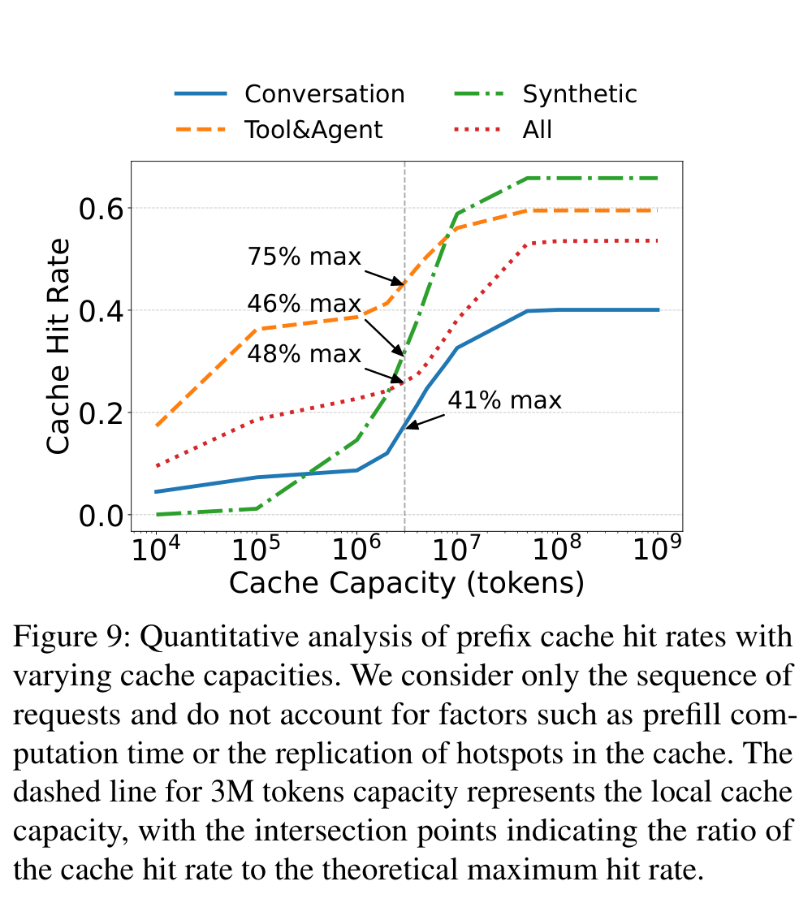
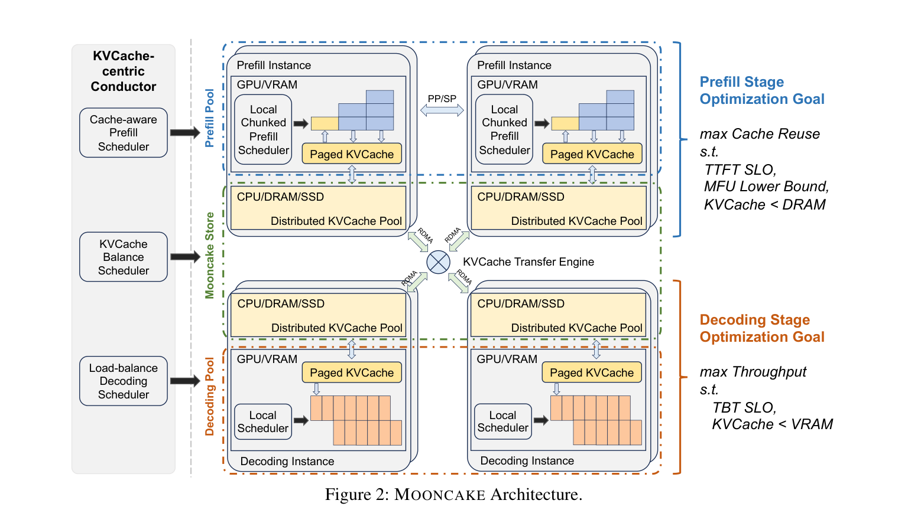
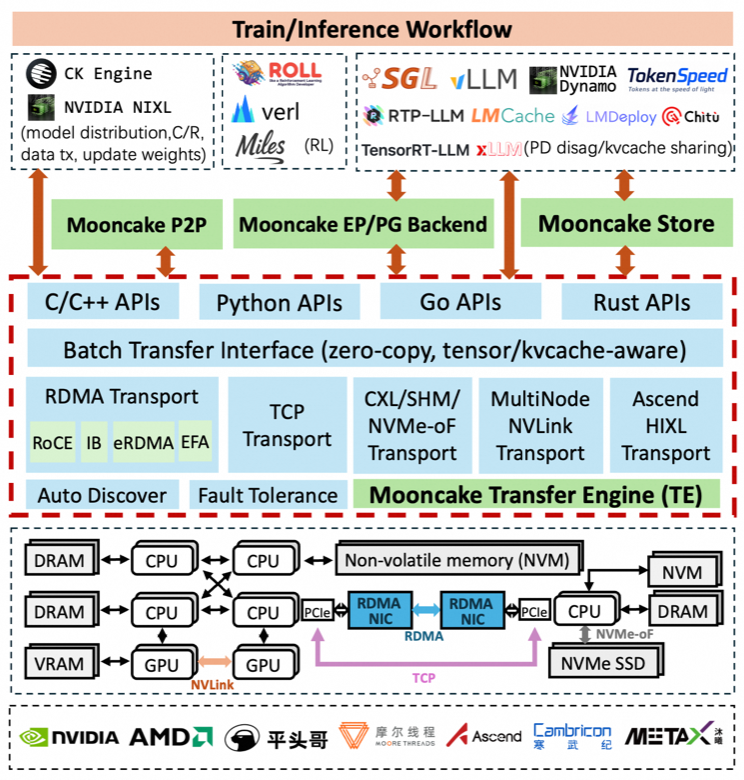
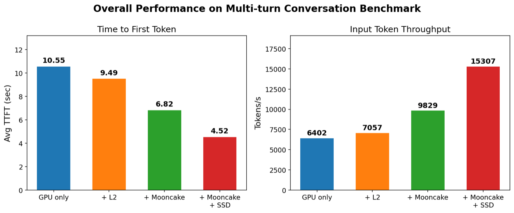

# Moonshot AI / Kimi

> 服务平台 · 开源项目 · FAST'25 最佳论文 · 官方文档

Mooncake 是 Moonshot AI 旗下 Kimi 的推理服务平台，后以 kvcache-ai/Mooncake 仓库开源。官方 README 将其概括为“以 KV Cache 为中心的分离式架构”：把 prefill 与 decode 拆成两个集群，同时把 GPU 集群里闲置的 CPU、DRAM、SSD 资源聚合成分离式 KV Cache 池。 [M] 它不是传统意义上的 IaaS 云厂商产品，而是一家大模型服务商把自身生产架构写成论文、拆成组件开源的案例。论文最早以技术报告形式于 2024-06 发布在 arXiv，扩展版发表于 FAST 2025（第 23 届 USENIX 文件与存储技术会议），README 记载其于 2025-02-25 获得该会议最佳论文奖。 [MP][MC1][M]

### 定位：用更多存储换更少计算

FAST'25 论文的标题是“Trading More Storage for Less Computation”。作者先给出复用前缀 KV 的收益条件：若请求长度为 n、命中前缀长度为 p，复用能省掉约 l×(ap²d+bpd²) 的 prefill 计算，但需要把 p×l×(2×d/gqa)×s 字节的 KV 搬进 GPU HBM；只有当加载带宽 B 与 GPU 算力 G 之比超过一个与 d、p 相关的阈值时，复用才对 TTFT 有利。按论文表 1 的 LLaMA3-70B 参数，在 8×A800 上、前缀长 8192 时，所需的最低 B 约为 6 GB/s，换成 8×H800 则升到 19 GB/s；由于各传输阶段不可能完全重叠，实际要求更高。 [MC1]

第二个论据是容量。LLaMA3-70B 每个 token 的 KV 约 320 KB，单机即使预留约 1 TB DRAM 也只能放约 300 万 token；在论文的三类负载中，3M token 的本地缓存在多数情况下达不到理论最大命中率的 50%，而约 5000 万 token 的容量才接近理论最大值，这至少需要汇聚 20 个节点的 DRAM。这就是 Mooncake 坚持“全局”而非“本地”缓存的原因。 [MC1]

*FAST'25 论文图 9：缓存容量（token）与前缀命中率的关系；虚线为单机约 3M token 的本地缓存容量（PDF 第 12 页渲染）* — [原始来源](https://www.usenix.org/system/files/fast25-qin.pdf)

### 论文架构：Conductor、Prefill/Decode 池与 Mooncake Store

论文图 2 把系统分成三部分：左侧的全局调度器 Conductor（含 cache-aware prefill 调度、KV Cache 均衡调度、负载均衡 decode 调度）；右侧的 Prefill 池与 Decoding 池，每个实例的 GPU/VRAM 中保留分页 KV Cache；以及位于两池之间、由各节点 CPU/DRAM/SSD 组成并经 RDMA 互联的分布式 KV Cache 池，即 Mooncake Store。Prefill 阶段的目标是在 TTFT SLO、MFU 下限和“KV Cache 小于 DRAM”的约束下最大化缓存复用；Decode 阶段的目标是在 TBT SLO 和“KV Cache 小于 VRAM”约束下最大化吞吐。 [MC1]

*FAST'25 论文图 2：Mooncake 架构——Conductor、Prefill/Decoding 池与基于 CPU/DRAM/SSD 的分布式 KV Cache 池（PDF 第 3 页渲染）* — [原始来源](https://www.usenix.org/system/files/fast25-qin.pdf)

一次请求的典型流程分四步：（1）KV Cache 复用：被选中的 prefill 节点拿到原始输入、可复用前缀块的 key 和为整个请求分配的块 key，从远端 CPU 内存把前缀 KV 加载进 GPU；（2）增量 prefill：计算未命中的部分，并把新生成的增量 KV 写回 CPU 内存，未命中 token 超过阈值（通常大于 1000 token）时分块流水执行；（3）KV Cache 传输：与增量 prefill 重叠，逐层把 KV 流式送到目标 decode 节点的 CPU 内存；（4）Decoding：KV 全部到达后，请求以 continuous batching 方式加入下一批。 [MC1]

对于长上下文，论文没有采用跨节点张量并行或序列并行，而是提出分块流水并行（CPP）：每 X 个 prefill 节点组成一个流水组，同一请求的不同 chunk 由不同节点同时处理，只在流水级边界通信，从而减少与 KV 传输争抢网络。 [MC1]

### 关键机制：块管理、淘汰、传输与调度

**块与淘汰。**论文中，Mooncake Store 以分页块保存所有 KV，块大小按模型规模和最佳网络传输粒度确定，通常为 16–512 token（评测设为 256）；每个块的 hash key 由自身内容和前缀共同决定，用于去重；同一 key 可在不同节点有多个副本以缓解热点，副本数由 Conductor 的缓存负载均衡策略控制。缓存池满时采用 LRU 淘汰，但正在被请求访问的块不淘汰。 [MC1] 开源版的淘汰机制更细：Master 在空间使用达到高水位（`eviction_high_watermark_ratio`，v0.3.14 默认 0.90）或 PutStart 分配失败时触发淘汰，按比例（`eviction_ratio`，默认 0.05）回收对象，并借助按租约截止时间分桶的索引优先淘汰租约已过期的对象；硬 pin 对象和活跃租约受保护，软 pin 对象仅在没有其他候选时才被淘汰（可配置为不可淘汰）。开源版的副本数由写入方在 `replica_num` 中指定（默认 1），不会按热度自动增减。 [MC3][PLMO1]

**传输引擎。**Transfer Engine 对上提供 Segment（可远程访问的地址空间，可在 DRAM 或加速器显存中；NVMe-oF 存储作为持久 Segment 暴露）和 BatchTransfer（批量异步读写）两类抽象；控制面（etcd/Redis/HTTP 元数据或 P2P 握手）只交换位置信息，不承载数据。 [MC2] 论文披露的实现要点包括：按 NUMA/PCIe 拓扑生成“首选/备选”网卡矩阵，单次请求按 16 KB 切片分散到多张 RDMA 网卡，端点池用 SIEVE 算法淘汰连接，链路故障时自动换路重传。 [MC1] 官方协议文档列出 tcp、rdma、efa 为主要传输，nvmeof、nvlink、hip、cxl、ascend 等为高级选项；检测不到 RDMA 网卡时自动回落到 TCP。 [MC6]

**KV 感知调度。**论文算法 1 对每个 prefill 实例估算 TTFT＝远端 KV 传输时间＋排队时间＋剩余 prefill 执行时间（执行时间由离线数据拟合的多项式回归模型预测），选 TTFT 最小者；若最佳远端前缀比本地前缀长出一定倍数（kvcache_balancing_threshold，目前人工设定），就先把 KV 拉到目标实例，从而自动复制热点块。若 TTFT 或 TBT 预计无法满足 SLO，Conductor 直接返回 HTTP 429。 [MC1] arXiv 技术报告还讨论了过载场景下的“早拒绝”及“基于预测的早拒绝”：在 prefill 开始前就同时评估 decode 池负载，并预测 prefill 完成后的 decode 负载，以避免 prefill 与 decode 负载反相振荡。 [MP]

### 开源组件与 SSD / 对象存储下沉

*Mooncake 官方 README 组件总览原图（Transfer Engine、Mooncake Store、EP/PG 等，范围比本文关注的 KV 管理更广）* — [原始来源](https://github.com/kvcache-ai/Mooncake)

开源仓库的组件与论文并非一一对应。按官方架构文档：Transfer Engine 是嵌入数据所属进程的传输库，可单独用于 PD 传输；Mooncake Store 由 Master Service（控制面，负责对象目录、分配与淘汰、副本、租约、租户配额，不转发数据）和 Client（直接经 Transfer Engine 搬运切片）组成；开源版的 Conductor 是供网关/路由器查询的全局前缀索引服务，订阅 vLLM、SGLang 与 Store master 的 KV 事件，按 device、cpu_local、cpu_share、disk 四个层级记录前缀所在位置，并不等同于论文中完整的调度器。 [MC2][MC7] 另有 P2P Store 用于检查点等对象的点对点分发，文档称其已用于 Moonshot AI 的检查点传输服务。 [MC10]

SSD 下沉由 Store 的 real client 后台子系统完成，对应用透明：心跳线程定期向 Master 领取待从内存淘汰的对象，读出后写入本地 SSD，成功后 Master 为对象增加一个 LOCAL_DISK 副本；Get 找不到内存副本时自动回落到 SSD——持有该盘的客户端把数据读入预注册的 O_DIRECT 对齐暂存区，再由请求方经 Transfer Engine（RDMA 或 TCP）拉取。默认的 BucketStorageBackend 把对象攒成桶后写盘，单桶上限默认 256 MB 或 500 个 key；盘上淘汰支持 FIFO/LRU 和高低水位，另有逻辑容量与物理容量两种上限。 [MC4] 可选的“存在即预取”功能会在 is_exist 查询时尽力把仅在 SSD 上的对象提升回 DRAM，默认关闭。 [MC8] 同一 FileStorage 路径还可接 NVMe KV 命名空间以及阿里云 OSS、S3 兼容对象存储（含 MinIO、Ceph RGW 等）。 [MC9]

生态集成是开源 Mooncake 被广泛引用的主要原因。README 的集成目录显示：SGLang 同时使用 Transfer Engine 做 PD/EPD 传输，并把 Mooncake Store 作为 HiCache 的外部存储层，在设备、主机、远端三级上扩展 RadixAttention；vLLM 通过 MooncakeConnector 做 PD 间 KV 传输，通过 MooncakeStoreConnector 让多个实例基于块哈希前缀共享集群级 KV 池；LMCache 将 Mooncake Store 作为远端存储及多进程模式下的 L2 适配器；TensorRT-LLM、LMDeploy、vLLM-Ascend、FastDeploy、FlexKV、NIXL、Dynamo、llm-d 等也各自接入了 Transfer Engine 或 Store。README 同时提醒，具体能力取决于上游版本与配置，部署时应以各项目的链接文档为准。 [M] 换言之，开源 Mooncake 更像一套可被多种推理引擎复用的“KV 传输 + 共享池”基础设施，而调度策略多由上游引擎或路由层自行实现。

### 公开性能数据与条件

Mooncake 不同材料中的数字口径差异很大，引用时必须带上条件：

| 数字 | 来源 | 条件 |
|---|---|---|
| 多处理 115%（A800）/ 107%（H800）请求 | FAST'25 摘要与第 5 节 | Kimi 历史统计，对比此前基于 vLLM 的自有系统；非受控实验 |
| 有效请求容量 +59%～+498% | FAST'25 图 1 | 真实对话 trace，16 台 8×A800，LLaMA3-70B 结构的 dummy 模型；TTFT 阈值 30 s，TBT 阈值 100/200/300 ms 分别对应 +498%/+157%/+59% |
| 吞吐提升最高 525% | arXiv v1 摘要与 8.1.2 节 | 模拟数据（16k–128k 输入、50% 前缀缓存），Mooncake-[3P+1D]/[2P+2D] 对比 vLLM-[4M]，范围 50%～525%；LLaMA2-70B 结构 dummy 模型 |
| 多处理约 75% 请求 | arXiv v1 8.1.3 节 | 23,000 条真实请求重放，10P+10D 对比 20 个 vLLM 实例；TTFT≤30 s、TBT≤0.1 s；vLLM 仅约 57% 请求满足 TBT |
| 全局缓存命中率最高为本地缓存的 2.36×，prefill 计算时间最多降 48% | FAST'25 图 10 | 10 个 prefill 节点、每节点 3M token 容量、输出长度限制为 1 |
| 平均 TTFT 3.07 s（全局缓存感知）vs 3.58 s（本地）vs 5.27 s（负载均衡）vs 19.65 s（随机） | FAST'25 图 5 | 16 台 8×A800，对话 trace |
| 87 GB/s 与 190 GB/s，约为 TCP 的 2.4× 与 4.6× | FAST'25 5.4.1 节、README | 传输 40 GB（约 LLaMA3-70B 128k token 的 KV），4×200 Gbps 与 8×400 Gbps RoCE，并发 64，最小粒度 128 KB |
| 128k 输入时 prefill 时间降 92%，计入开销后 TTFT 降 86% | FAST'25 5.4.3 节 | 前缀缓存比例 95% 对比 0% |

论文还建议网络总带宽不低于 100 Gbps：在合成负载下低于该值时 TTFT 急剧上升、实际传输时间显著偏离理论值；P/D 节点比约 1:1 时有效请求容量最高。 [MC1] 开源项目给出的 SSD 下沉基准（单台 8×A100-40GB、双 200 Gb/s IB 网卡、5 块 NVMe SSD 组 RAID0，Qwen3-8B，SGLang 多轮对话基准、每轮输入 4096、输出 1 token）显示：开启 SSD 后平均 TTFT 比纯 GPU 降 57%、比不带 SSD 的 Mooncake 降 34%，输入吞吐约为纯 GPU 的 2.4 倍；第 7 轮起 80 GB 内存池装不下时，不带 SSD 的命中率从 83% 跌到 36%，带 SSD 的仍保持 84% 以上。 [MC5] README 另记载 Mooncake 支撑 Kimi K2 在 128 张 H200 上以 PD 分离部署，达到 224k token/s 的 prefill 和 288k token/s 的 decode 吞吐。 [M]

*Mooncake 官方文档 SSD Offload Benchmark 总体结果：GPU only、+L2、+Mooncake、+Mooncake+SSD 的平均 TTFT 与输入吞吐* — [原始来源](https://kvcache-ai.github.io/Mooncake/performance/mooncake/ssd-offload-benchmark-results.html)

与官方基准一致的最小配置示例（Master 与 Client 开启下沉，SGLang 以 Mooncake 作 HiCache 存储后端）：

~~~bash
# 出处（据此整理） [MC5] https://kvcache-ai.github.io/Mooncake/performance/mooncake/ssd-offload-benchmark-results.html
mooncake_master -enable_offload=true -http_metadata_server_port=8081
MOONCAKE_OFFLOAD_FILE_STORAGE_PATH=/mnt/data/file_storage \
MOONCAKE_OFFLOAD_LOCAL_BUFFER_SIZE_BYTES=21474836480 \
mooncake_client --global_segment_size=80GB --protocol=rdma ...
python3 -m sglang.launch_server ... --enable-hierarchical-cache \
  --hicache-storage-backend mooncake
~~~

[MC5]

### 放置策略：哪些 KV 放到哪一层

Mooncake 的放置决策分在三处：论文中的 Conductor 决定“请求去哪、KV 是否搬过去”，Mooncake Store 的 Master 决定“对象放在哪个段、何时从 DRAM 淘汰或下沉到 SSD”，上游引擎的连接器（vLLM MooncakeStoreConnector、SGLang HiCache）决定“哪些 KV 写进 Store、何时取回”。下表区分论文（FAST'25）与开源实现（Mooncake v0.3.14，2026-11-03 发布）。

| 维度 | Mooncake 的做法 | 证据类型与引用 |
|---|---|---|
| 层级与介质 | GPU HBM（实例私有分页 KV）→ 各节点 CPU DRAM 汇成的分布式池（Store 的 memory segment）→ 本地 SSD（LOCAL_DISK 副本）→ 可选的共享文件系统 / S3 兼容对象存储；论文估算单机 DRAM 约 300 万 token（LLaMA3-70B），接近最大命中率需约 5000 万 token | 论文明确说明 [MC1]；开源文档明确说明 [MC3][MC4][MC9] |
| 放置单位 | 论文：分页块，通常 16–512 token（评测 256），键由自身与前缀共同哈希；开源 Store 是通用对象（key→切片），粒度由上层决定：vLLM 按 block（可用 `store_chunk_size` 调大），SGLang L3 按 page 存取 | 论文明确 [MC1]；官方文档明确 [PLMO3][SGD] |
| 准入 | 论文：prefill 新算出的增量 KV 写回 CPU 内存，未提及热度门槛或最小长度。vLLM：prefill 侧（kv_producer / kv_both）写入，decode 输出 KV 默认不写，`save_decode_cache` 置 true 才追加已填满的 decode block。SGLang：`--hicache-write-policy` 为 `write_through`（全部写）、`write_through_selective`（命中次数超阈值才写）或 `write_back`（被上层淘汰时才写） | 论文明确 [MC1]；官方文档明确 [PLMO3][SGD] |
| 写入时机与副本 | Store 采用两阶段 PutStart / PutEnd，写入请求的 `replica_num`（默认 1）份内存副本，同一切片的副本必在不同段，尽力而为；DRAM→SSD 不是写穿，而是 Master 选出待淘汰对象后由客户端心跳线程异步按桶（默认 256 MB 或 500 个 key）写盘，成功后增加 LOCAL_DISK 副本 | 官方文档 + 源码可见 [MC3][MC4][PLMO1] |
| 降级与淘汰 | 论文：池满时 LRU，正被访问的块不淘汰。开源：用量达 `eviction_high_watermark_ratio`（默认 0.90）或分配失败时淘汰 `eviction_ratio`（默认 0.05）；按租约截止时间分桶，优先淘汰租约最早过期者；读取授予租约（`default_kv_lease_ttl` 默认 10 s），硬 pin 永不淘汰，软 pin（默认 30 分钟）最后才淘汰。SSD 层按桶 FIFO / LRU，容量上限与高低水位可选，默认不淘汰 | 论文明确 [MC1]；文档 + 源码 v0.3.14 可见 [MC3][MC4][PLMO1][PLMO2] |
| 提升与预取 | Get 先读内存副本，无内存副本时回落 SSD：持盘客户端读入 O_DIRECT 暂存区，再经 RDMA / TCP 拉取；可选 is_exist 时预取回 DRAM（默认关）。vLLM 支持异步加载与到达即查（`lookup_prefetch_limit`），查询超时（`lookup_timeout_s` 默认 1 s）按未命中处理并重算；SGLang 在 L3 命中超过 256 token 时预取进 L2，按 `best_effort` / `wait_complete` / `timeout` 终止 | 官方文档明确 [MC4][MC8][PLMO3][SGD] |
| 位置选择 | 论文：Conductor 按“传输 + 排队 + prefill”估算 TTFT 选 prefill 实例；最佳远端前缀与本地前缀之比超过 `kvcache_balancing_threshold` 时把 KV 拉到目标实例，热块由此自动多副本。开源 Store：`--allocation_strategy` 默认 `random`，另有 `free_ratio_first`、`ssd_free_ratio_first`、`local_first`、`cxl`；`preferred_segment` 优先、失败回落随机；vLLM 用 `MOONCAKE_PREFERRED_SEGMENT` 指定本机 owner 段 | 论文明确 [MC1]；文档 + 源码可见 [MC3][PLMO2][PLMO3] |
| 决策者 | 论文：全局调度器 Conductor。开源：Store Master 管分配 / 淘汰 / 下沉；Conductor 只是前缀索引（按 device、cpu_local、cpu_share、disk 返回各实例命中 token 数），选实例由外部网关 / 路由器完成；写什么由引擎连接器决定 | 论文明确 [MC1]；文档明确 [MC7] |
| 选择依据 | 论文有显式代价模型：预测 TTFT（多项式回归拟合的 prefill 时间 + 传输时间 + 排队），并以 TTFT / TBT SLO 决定接收或拒绝（429）；Store 层依据容量水位、租约与 pin，无复用概率模型；阈值目前人工设定 | 论文明确 [MC1]；文档明确 [MC3] |

**选择逻辑。**论文的出发点是“复用前缀比重算便宜，前提是加载够快”，因此放置与调度是同一个决策：Conductor 并不预测哪些块将来会热，而是在每次调度时比较“在已有前缀的实例上排队”和“把前缀拉到空闲实例再算”两条路径的 TTFT。远端前缀不够长（与本地前缀之比不超过阈值）就宁可重算；够长且目标实例更空就拉取并留在本地，热点前缀由此在 prefill 池中自然复制。论文图 11 显示，对话与工具 / Agent 负载中前 100 个热键在系统稳定后几乎在每个 prefill 实例上都有副本，而共享前缀少的合成负载副本少且波动大 [MC1]。冷块则按 LRU 被换出，论文称“最冷的块应被换出以降低保留成本”，但没有给出换出到 SSD 的具体阈值 [MC1]。

开源 Store 把这套机制拆成更通用的原语：副本数由写入方在 `ReplicateConfig` 中指定，而不是由 Store 根据热度自动增减；论文所说的由 Conductor 通过 `change_replica` 调整副本数的热点复制，在开源 Store 文档中未见对应的自动策略，需要上层路由 / 连接器配合实现 [MC1][MC3]。DRAM 层的保护顺序是“活跃租约 / 硬 pin > 软 pin > 普通对象”，系统提示词这类高复用前缀官方推荐用软 pin 保留；SSD 只接收被 Master 选中淘汰的对象，属于 evict-to-lower 而非写穿，因此 SSD 上的数据天然是“曾经进入过 DRAM、但近期不够热”的部分 [MC3][MC4]。引擎侧的取舍在于写入带宽：SGLang 官方最佳实践示例均用 `write_through` 换取最高复用，`write_through_selective` 只备份命中达到阈值的热数据，`write_back` 只在主机层淘汰时才写 L3 [SGD]；vLLM 则默认只写 prompt 前缀，decode 输出是否入池交给 `save_decode_cache` [PLMO3]。

**例子（按公开参数推算）。**一个 32k token 的多轮对话前缀，在 LLaMA3-70B 结构下约 320 KB/token，总量约 10 GB；按 256 token 一块约为 128 块、每块约 80 MB（本文按论文参数估算） [MC1]。第一轮：prefill 实例在 HBM 中算出 KV，并把增量 KV 写入 Store 的 DRAM 段（开源默认 1 份副本、段位置随机或优先本机段），同时逐层传给 decode 节点。第二轮：路由器向 Conductor 查询，若持有该前缀的实例过忙、而空闲实例只命中很短前缀，则把 32k 前缀拉到空闲实例，形成第二份副本。会话沉寂后，若 DRAM 用量越过 90% 水位、该对象租约已过期且未被 pin，它会进入淘汰批次；开启 `enable_offload` 时由客户端写入本地 SSD 桶成为 LOCAL_DISK 副本，下次命中时从 SSD 读回经 RDMA 送达；在 SGLang 中，这次 L3 命中会先预取到实例私有的主机内存（L2），超时则只用已取回的部分，其余重算 [MC3][MC4][SGD]。

### 硬件配置信息

| 场景 / 方案 | 计算（GPU / NPU 型号 × 数量，HBM 容量） | CPU 与主机内存（DRAM 容量） | 本地存储（SSD / NVMe / HDD 型号、数量、容量） | 网络（RDMA / NIC 型号与带宽） | 远端 / 共享存储（服务名与规格） | 来源 |
|---|---|---|---|---|---|---|
| Kimi 线上生产（论文所述现网） | NVIDIA A800 与 H800 集群（标准 HGX 机型），“数千节点”；单机卡数与总卡数未公开 | 未公开 | 未公开（论文图中节点含 SSD，型号容量未公开） | 每张 A800 配 100/200 Gbps 网卡，每张 H800 配 200/400 Gbps 网卡；RDMA 互联最高 8×400 Gbps | Mooncake Store（各节点 CPU / DRAM / SSD 汇聚的分布式 KV 池），规模未公开 | [MC1] |
| FAST'25 收益条件分析（理论推算） | 8×A800 或 8×H800 单机，LLaMA3-70B | 按“约 1 TB DRAM 本地缓存”估算可存约 300 万 token | 未涉及 | 每张 A800 满载一张 100 Gbps 网卡即可满足条件（论文分析） | 未涉及 | [MC1] |
| FAST'25 端到端 / 调度实验平台 | 16 台节点，每台 8×NVIDIA-A800-SXM4-80GB | 未公开（全局缓存实验中每节点按 3M token 容量设定） | 未公开 | 每节点 4×200 Gbps RDMA 网卡 | Mooncake Store，块大小 256 token | [MC1] |
| arXiv v1 技术报告实验平台 | 每节点 8×NVIDIA-A800-SXM4-80GB（每卡 80 GB HBM），NVLink 互联；节点数随实验而定（如 10P+10D 对比 20 个 vLLM 实例） | 未公开 | 未公开 | RDMA 网卡，节点间互联带宽最高 800 Gbps | Mooncake Store | [MP] |
| Transfer Engine 带宽测试（40 GB，约 LLaMA3-70B 128k token 的 KV） | 未公开 | 未公开（测试含 DRAM 与显存两类缓冲） | 未涉及 | 4×200 Gbps 与 8×400 Gbps RoCE，分别达 87 GB/s 与 190 GB/s | 未涉及 | [MC1][M] |
| 开源 SSD Offload 基准（SGLang HiCache + Mooncake） | 单台 DGX，8×NVIDIA A100-SXM4-40GB；Qwen3-8B，TP=1 | 主机 DRAM 总量未公开；Mooncake 分布式内存池 80 GB（`--global_segment_size`），SSD 下沉本地缓冲 20 GB；HiCache L2 为 `--hicache-ratio 2` | 5 块 Samsung NVMe 组 RAID0：3×PM1733 3.84 TB（PCIe Gen4，单盘顺序读 7,000 MB/s）+ 2×PM983 1.92 TB（PCIe Gen3，3,000 MB/s），可用约 14 TB，理论聚合顺序读约 27 GB/s | 2 张 RDMA 网卡，InfiniBand 4X HDR，每张 200 Gb/s | 无（Mooncake 内存池与 SSD 均在本机） | [MC5] |
| Kimi K2 PD 分离 + 大规模 EP 部署（SGLang + Mooncake） | 128×NVIDIA H200（NVIDIA DGX Cloud 提供），1P1D：prefill 4 节点、decode 12 节点 | 未公开 | 未公开 | RDMA 加速 KV 传输，网卡型号与带宽未公开 | 未公开 | [M][PLMO4] |

上述配置中，KV 实际落地的层是 GPU HBM（实例私有）、各节点 CPU DRAM（Mooncake Store 内存段）以及本地 NVMe SSD（开源 SSD 下沉基准中的 RAID0 阵列）；论文与官方基准都没有使用远端共享存储承载 KV。所查资料（FAST'25 论文、arXiv v1、官方 README 与 SSD 下沉基准、LMSYS Kimi K2 部署博客）均未出现 HDD。

### 与 SSD / HDD 多级存储的关系（本文分析）

Mooncake 的价值在于把“KV 放在哪一层”和“请求调度到哪里”放在一起决策：Conductor 的代价模型显式计入传输时间，Store 用副本和淘汰决定热数据留在 DRAM，SSD 作为 DRAM 之下的 LOCAL_DISK 副本层。若再往下加 HDD，有几点可直接从公开资料推出：第一，论文的收益条件给出了每台机器需要 6–19 GB/s 级别的有效加载带宽，这一量级远高于单块机械盘，HDD 不适合放在请求关键路径上直接被读；第二，现有 SSD 后端按 256 MB 级的桶聚合写入，写入模式偏向大块顺序，这对容量型介质友好，但桶内对象零散失效会造成空间回收滞后，文档也承认逻辑计数会落后于实际占用；第三，S3 兼容后端可接 Ceph RGW 等对象存储，理论上可把 HDD 集群作为最底层，但官方材料没有任何 HDD 介质的测试，也没有 SSD→HDD 的分层迁移策略。因此较稳妥的定位是：HDD 只承接冷前缀的长期保存，并依赖预取在请求到达前把数据提升到 SSD 或 DRAM。

### 资料边界

论文的受控实验均使用 dummy 模型和重放 trace，115%/107% 来自线上历史统计，二者不能互换。开源组件与 Kimi 生产内部实现的对应关系没有完整披露，开源 Conductor 也不是论文调度器的完整实现。SSD 基准为单机、小模型、单一负载，没有公开 HDD 或对象存储层的性能数据。

## 本章资料

- **[M]** [Mooncake](https://github.com/kvcache-ai/Mooncake)
- **[MC1]** [USENIX FAST'25 · Qin et al. · Mooncake: Trading More Storage for Less Computation — A KVCache-centric Architecture for Serving LLM Chatbot，2025-02（会议论文 PDF）](https://www.usenix.org/system/files/fast25-qin.pdf)
- **[MC2]** [Mooncake 官方文档 · Mooncake Architecture（采集于 2026-11-18）](https://kvcache-ai.github.io/Mooncake/design/architecture.html)
- **[MC3]** [Mooncake 官方文档 · Mooncake Store 设计（Eviction Policy 等，采集于 2026-11-18）](https://kvcache-ai.github.io/Mooncake/design/store/mooncake-store.html)
- **[MC4]** [Mooncake 官方文档 · SSD Offload Design（采集于 2026-11-18）](https://kvcache-ai.github.io/Mooncake/design/store/ssd-offload.html)
- **[MC5]** [Mooncake 官方文档 · Mooncake SSD Offload Benchmark（采集于 2026-11-18）](https://kvcache-ai.github.io/Mooncake/performance/mooncake/ssd-offload-benchmark-results.html)
- **[MC6]** [Mooncake 官方文档 · Supported Protocols（采集于 2026-11-18）](https://kvcache-ai.github.io/Mooncake/getting_started/supported-protocols.html)
- **[MC7]** [Mooncake 官方文档 · Conductor Architecture（采集于 2026-11-18）](https://kvcache-ai.github.io/Mooncake/design/conductor/conductor-architecture-design.html)
- **[MC8]** [Mooncake 官方文档 · SSD Prefetch-on-Exist（采集于 2026-11-18）](https://kvcache-ai.github.io/Mooncake/design/store/ssd-prefetch.html)
- **[MC9]** [Mooncake 官方文档 · Object Storage Offload（采集于 2026-11-18）](https://kvcache-ai.github.io/Mooncake/deployment/object-storage-offload.html)
- **[MC10]** [Mooncake 官方文档 · P2P Store（采集于 2026-11-18）](https://kvcache-ai.github.io/Mooncake/design/p2p-store.html)
- **[MP]** [Qin et al. · Mooncake: Kimi’s KVCache-centric Architecture for LLM Serving，2024，v1](https://arxiv.org/html/2407.00079v1)
- **[PLMO1]** [Mooncake 官方仓库 · v0.3.14（2026-11-03 发布）· mooncake-store/include/types.h（DEFAULT_EVICTION_HIGH_WATERMARK_RATIO=0.90、DEFAULT_EVICTION_RATIO=0.05、默认租约 10000 ms、软 pin 30 分钟）](https://github.com/kvcache-ai/Mooncake/blob/v0.3.14/mooncake-store/include/types.h)
- **[PLMO2]** [Mooncake 官方仓库 · v0.3.14 · mooncake-store/src/master.cpp（allocation_strategy 默认 random、enable_offload 默认 false 等 master 启动参数）](https://github.com/kvcache-ai/Mooncake/blob/v0.3.14/mooncake-store/src/master.cpp)
- **[PLMO3]** [vLLM 官方文档 · MooncakeStoreConnector Usage Guide（latest 开发版文档，save_decode_cache、lookup_timeout_s、MOONCAKE_PREFERRED_SEGMENT 等，采集于 2026-11-19）](https://docs.vllm.ai/en/latest/features/mooncake_store_connector_usage/)
- **[PLMO4]** [LMSYS 官方博客 · Deploying Kimi K2 with PD Disaggregation and Large-Scale Expert Parallelism on 128 H200 GPUs，2025-07-20（采集于 2026-11-19）](https://lmsys.org/blog/2025-07-20-k2-large-scale-ep/)
- **[SGD]** [SGLang HiCache 设计文档 · 固定提交 c712459e7f82](https://github.com/sgl-project/sglang/blob/c712459e7f8233302fdf0bdd5d4ddcd22aa4b2ab/docs/docs/advanced_features/hicache_design.mdx)
