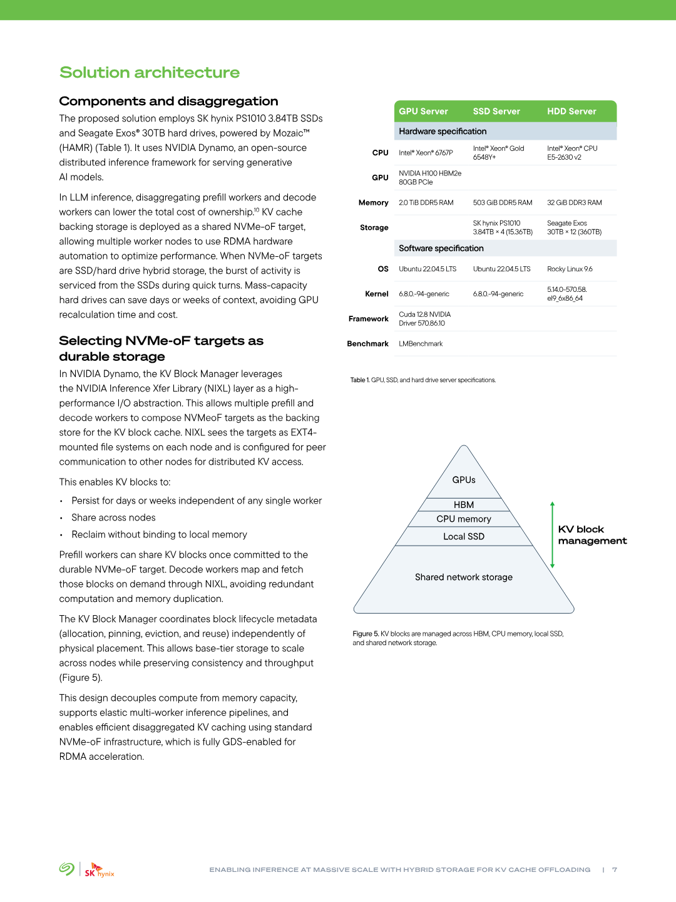
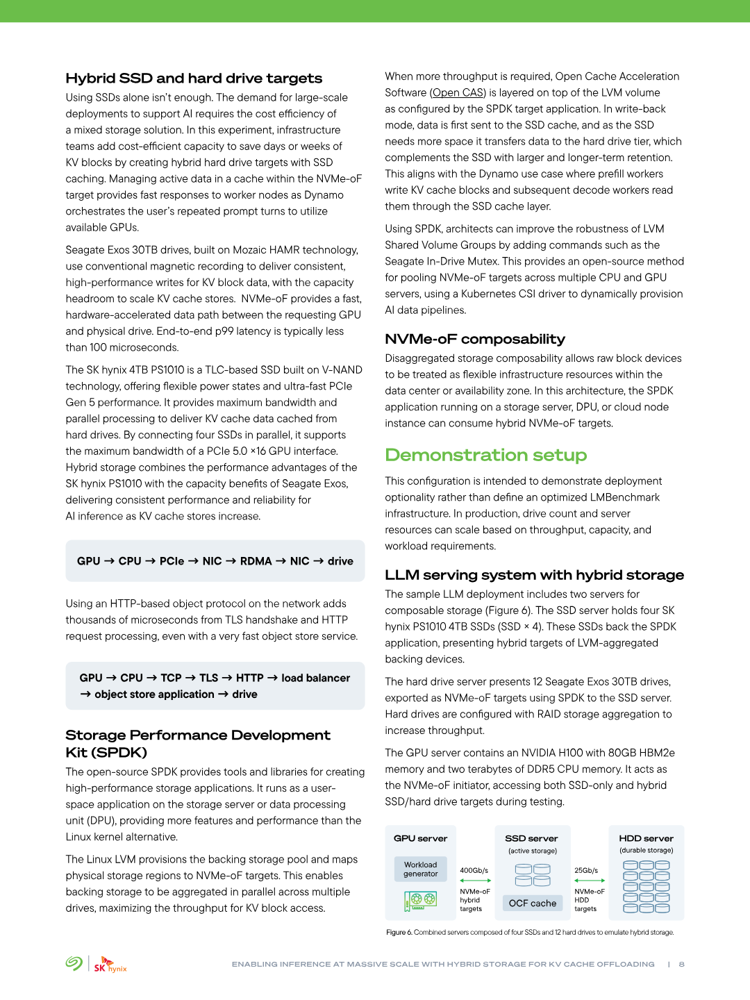
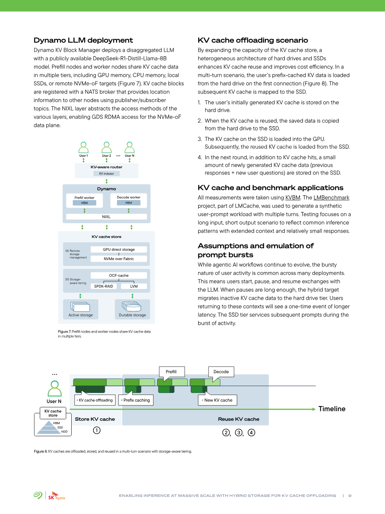
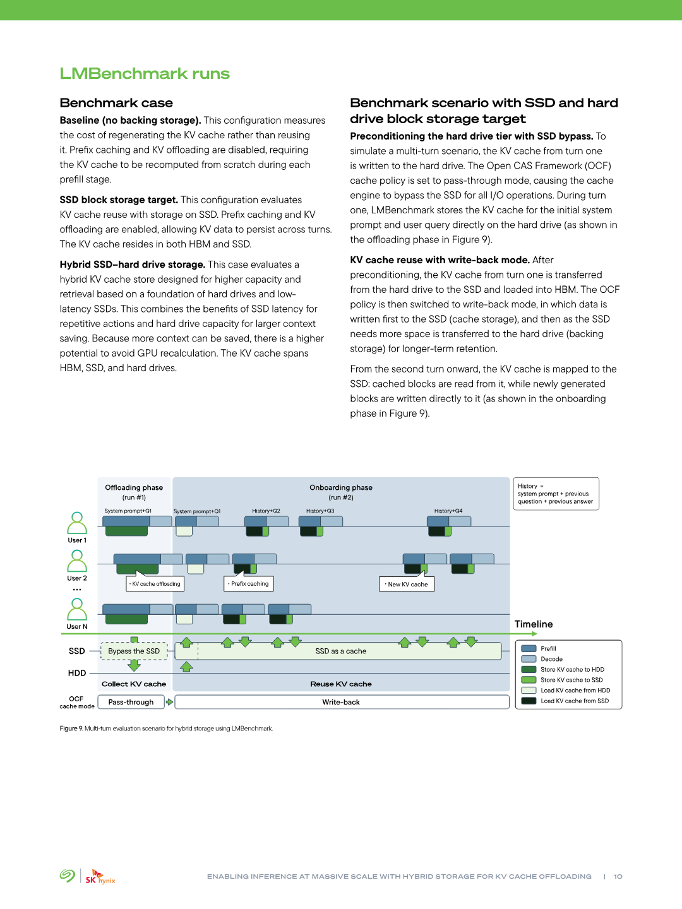
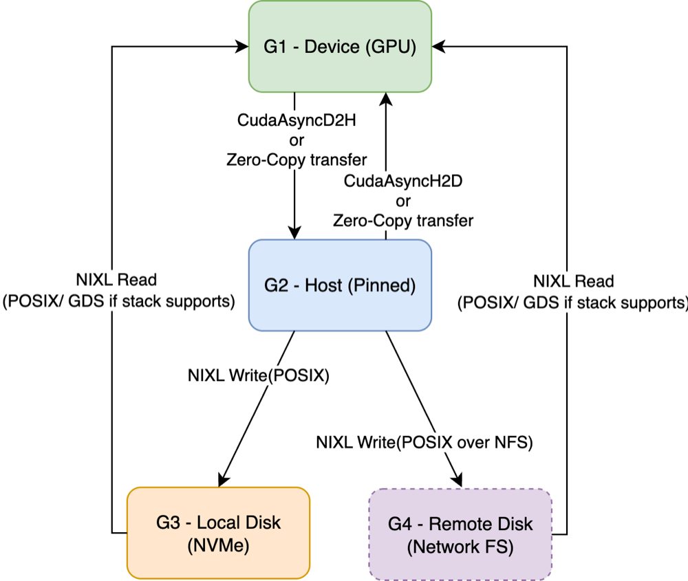

# NVIDIA / Dynamo

> Seagate / SK hynix 混合存储方案中的 NVIDIA 技术栈

这套设计把 KV 管理与物理介质分层：Dynamo / KVBM 管理推理与 KV 块，NIXL 提供传输抽象，存储端使用 SSD 缓存和 HDD 容量池组成共享 NVMe-oF target。

白皮书作者是 SK hynix 的 Kyung Soo Lee、Jin Na Yang，以及 Seagate 的 Thomas Prohofsky；NVIDIA 是所用软件和 GPU 技术栈的提供方，未列为共同作者。本文按“Seagate / SK hynix 基于 NVIDIA 技术栈的联合方案”描述，不扩大为已核实的三方联合研发关系。 [SWP]

[打开官方原始 PDF（15 页）](https://www.seagate.com/content/dam/seagate/assets/resources/enabling-inference-at-massive-scale-with-hybrid-storage-for-kv-cache-offloading/files/kv-caching-white-paper.pdf)。重点阅读：第 7 页组件分工，第 8 页存储拓扑，第 9–10 页读写流程，第 12–14 页测试，第 15 页未来工作。

### 1. 各组件分别管理什么？

| 组件 | 白皮书披露的职责 | 不能混为一谈的边界 |
|---|---|---|
| Dynamo / KVBM | 推理框架及 KV 块生命周期：分配、pinning、淘汰和复用；元数据管理独立于物理放置 | KV 块级管理不等于决定每个磁盘块何时从 SSD 下沉 |
| NIXL | 统一不同内存 / 存储层的访问方式；对接 EXT4 挂载的 NVMe-oF target，原文描述 GDS / RDMA 数据路径 | 传输抽象不是 HDD 缓存淘汰算法 |
| NATS broker | 通过发布 / 订阅分发 KV 块位置映射信息 | 传递位置与控制信息，不承载 KV payload |
| SPDK + LVM | 用户态存储服务、资源聚合、逻辑卷和 NVMe-oF target 的组成 | NVMe-oF 是对外协议，不表示后端介质全部为 NVMe SSD |
| Open CAS / OCF | 存储端 SSD 缓存；write-back 先写 SSD，容量压力下向 HDD 写回 | 这是存储块层缓存，与 KVBM 的逻辑块生命周期分属不同层 |
| SK hynix / Seagate | PS1010 SSD 服务活跃数据；Exos HDD 提供大容量后备存储 | SSD 命中性能不能用于代表 HDD 冷读性能 |

*白皮书第 7 页：KVBM、NIXL、共享存储关系及三类服务器硬件表* — [原始来源](https://www.seagate.com/content/dam/seagate/assets/resources/enabling-inference-at-massive-scale-with-hybrid-storage-for-kv-cache-offloading/files/kv-caching-white-paper.pdf)

### 2. 三台服务器如何连接？

HDD 服务器将 12 块 Exos 30TB 硬盘聚合，并通过 SPDK 导出为 NVMe-oF target。SSD 服务器接入该后备容量，配合 4 块 PS1010 SSD、LVM 和 Open CAS，向 GPU 服务器呈现 SSD-only 或 SSD/HDD hybrid target。GPU 服务器充当 NVMe-oF initiator。

表 1 的精确容量为 4 × 3.84TB SSD（正文也用约 4TB 简称）、12 × 30TB HDD；GPU 服务器为 H100 80GB、2.0 TiB DDR5，SSD 服务器为 503 GiB DDR5，HDD 服务器为 32 GiB DDR3。这是带有大量主机内存的系统，不能简化成“GPU 直接连一块 HDD”。

从逻辑路径看：worker / KVBM → NIXL → EXT4 挂载的共享 NVMe-oF target → 存储端 SSD cache / HDD backing store。原文以 GDS / RDMA 描述加速路径；各类实际 I/O 是否完全绕过 CPU 拷贝，仍需具体配置及测量确认。

*白皮书第 8 页，图 6：GPU、SSD 和 HDD 服务器组成的混合存储拓扑* — [原始来源](https://www.seagate.com/content/dam/seagate/assets/resources/enabling-inference-at-massive-scale-with-hybrid-storage-for-kv-cache-offloading/files/kv-caching-white-paper.pdf)

### 3. 一次会话恢复与后续多轮访问

1. **计算与保存：**prefill 生成 KV，KVBM 管理块的生命周期；共享后备存储使块不必绑定单个 worker 的本地内存。
2. **发现与读取：**方案通过 NATS 分发块位置，worker 经 NIXL 访问相应存储。NATS 负责“在哪里”，实际数据通过存储数据路径搬运。
3. **首次冷恢复：**既有上下文位于 HDD 时，先读回并进入 SSD，再加载到 GPU。首次读取仍承担 HDD 的读取成本。
4. **连续多轮：**已有 KV 从 SSD 复用；上一轮响应与新问题产生的增量 KV 写入 SSD。快层命中摊薄首次冷恢复的成本。
5. **再次闲置：**方案设想通过混合 target 将非活跃数据留在 HDD 上。具体冷却时间、SSD 淘汰细则和持续多租户竞争结果未完整披露。

*白皮书第 9 页，图 7–8：Dynamo 多级 KV 共享及 HDD→SSD→GPU 恢复流程* — [原始来源](https://www.seagate.com/content/dam/seagate/assets/resources/enabling-inference-at-massive-scale-with-hybrid-storage-for-kv-cache-offloading/files/kv-caching-white-paper.pdf)

### 4. 实验怎样构造“冷恢复后变热”？

第 10 页先把 OCF 设置成 **pass-through**，绕过 SSD，把首轮 KV 预填到 HDD。之后恢复 HDD 上的 KV 到 SSD / HBM，并切换为 **write-back**；第二轮起读 SSD，新增 KV 也先写 SSD。第 11 页明确说明，受控多轮场景在首次恢复后达到 100% SSD 命中。

因此，实验并未完整模拟大量会话争抢 SSD、自然老化后随机重访的长期过程。它清楚展示了首次 HDD 读取如何被后续 SSD 复用摊薄，但不直接给出任意工作集下的 SSD 命中率。

*白皮书第 10 页，图 9：pass-through 预填和 write-back 复用的实验步骤* — [原始来源](https://www.seagate.com/content/dam/seagate/assets/resources/enabling-inference-at-massive-scale-with-hybrid-storage-for-kv-cache-offloading/files/kv-caching-white-paper.pdf)

### 5. 架构能力与实测范围必须分开

架构章节讨论 prefill / decode worker 分离和共享 KV，但第 12 页明确写明：**性能实验没有采用 prefill–decode disaggregation**。所以可以将其作为分离式推理的设计参考，不能把图中的收益宣称为已完成 PD 分离部署的实测收益。

模型为 DeepSeek-R1-Distill-Llama-8B；全部测量采用 KVBM，LMCache 项目中的 LMBenchmark 仅负责生成多轮合成负载，不能因此把缓存管理实现写成 LMCache。主要延迟测试为 21K 输入、100 输出、15 用户、QPS=1、10 轮；I/O 模式测试使用 QPS=0.1。

| 结果 / 描述 | 正确口径 |
|---|---|
| TTFT 降低 95%、E2E 降低 80% | 对照为关闭 prefix caching 和 offloading 后的重算；不是对纯 SSD 的降幅 |
| HDD/SSD 平均 TTFT 差距 7.6s → 0.35s | 从 1 轮到 50 轮；首次 HDD 读取之后主要由 SSD 服务 |
| 128KB I/O，约 83% 随机读 / 72% 随机写 | 特定 QPS=0.1 负载测得；不是顺序大文件读取的简化工作负载 |
| 硬盘数量扩展 | 最多 12 块为实测，超过 12 块为估计；不能把 24 块结果写成已测 |
| 网络路径低时延描述 | 第 8 页的微秒级描述不能当作多 GB KV 的恢复时延，更不能当作 HDD 寻道时延 |

### 6. 哪些仍是未来工作？

第 15 页列出三项：利用 NATS 位置信息在 worker 编排时提前触发 **Dynamo prefetch hint**；对比本地 / 远端 **S3 与 NVMe-oF**；评估 **cuComp 压缩**对容量、吞吐和 TTFT 的影响。这些尚未构成本白皮书已完成的验证结果。In-Drive Mutex、CSI 等则是文中讨论的可组合基础设施方向，没有单独的故障恢复实测。

与第二部分的 SGLang 方案对照：这里将 SSD/HDD 分层放在存储 target 内部。SGLang 若沿用类似思路，可让 L3 看到一个后端，再由后端承担物理分层；接口兼容、文件语义与性能必须另行验证。《You don’t need long context》仍保留在第二部分讨论长期 KV 的保存价值。

### 放置策略：哪些 KV 放到哪一层

NVIDIA Dynamo 把 KV 放置拆成两层决策：节点内由 KV Block Manager（KVBM）决定一个块在 G1–G4 哪一层；集群内由 KV-aware Router 根据各 worker 上报的 KV 事件决定请求（以及随之产生的 KV）落到哪个实例。下表依据 Dynamo v1.6.2 标签源码与 v1.6.1 / v1.4.2 官方文档整理（v1.5 起 KVBM 设计页已从当前文档目录移除，仅保留配置参考，设计细节引用最后一版 v1.4.2） [PLNV1][PLNV2][PLNV3]。

| 维度 | Dynamo / KVBM 的做法 | 证据类型与引用 |
|---|---|---|
| 层级与介质 | G1 GPU HBM → G2 主机锁页内存（`DYN_KVBM_CPU_CACHE_GB`）→ G3 本地 NVMe / SSD（`DYN_KVBM_DISK_CACHE_GB`、`DYN_KVBM_DISK_CACHE_DIR`）→ G4 远端存储：设计文档写作网络文件系统（NFS / Lustre / GPFS），v1.6 配置参考写作 S3 兼容对象存储（`DYN_KVBM_OBJECT_ENABLED`、`DYN_KVBM_OBJECT_BUCKET`）。各层容量由用户按 GB 或块数指定，无默认值 | 官方明确说明 [PLNV1][PLNV2] |
| 放置单位 | 块（block），即 `[num_layers][page_size × inner_dim]`，以 `sequence_hash` 去重；page_size 跟随引擎（示例中 vLLM `--block-size 16`、SGLang `--page-size 64`） | 官方明确说明 [PLNV2][PLNV5] |
| 准入 | G1→G2：块注册（填满并提交）后自动送入 offload 管理器，按优先级队列处理，可用 `DYN_KVBM_HOST_OFFLOAD_PREFIX_MIN_PRIORITY` 提高门槛。G2→G3：默认启用“频次过滤”，频次初值 1、每次命中翻倍、每个衰减周期减 1，**≥2** 才写盘，目的是延长 SSD 寿命，可用 `DYN_KVBM_DISABLE_DISK_OFFLOAD_FILTER` 关闭。新版 kvbm-config 提供 `pass_all` / `presence` / `presence_lfu`（`min_lfu_count` 默认 8）策略，按 AND 组合。未填满的末尾块不注册，因此不卸载；decode 期间填满的块是否同样卸载，文档未单列说明 | 官方明确说明 + 源码可见 [PLNV1][PLNV3][PLNV4][PLNV13]；decode 部分未公开 |
| 写入时机 | 前向计算完成后异步批量卸载（批量 8–64 块、10 ms 刷新）；G1 中的块仍保留，属于“注册即复制”的 write-through 式行为，而非淘汰时才下沉；每层只写一份，无多副本 | 源码可见 [PLNV13][PLNV6] |
| 降级与淘汰 | 每层空闲块进入 InactivePool，容量不足时按块元数据优先级（低者先）、再按归还顺序回收，相当于带优先级的 LRU；无 TTL；G2→G3 频次表有衰减与条目上限 | 源码可见 [PLNV8][PLNV4] |
| 提升与预取 | 按需加载：调度器侧连接器先查 G2、再查 G3，命中后 Host→Device（CUDA H2D）或 Disk→Device（NIXL 读，可走 GDS）直接回 G1（v1.4.2 设计文档）；新版 kvbm-engine 的 `find_matches` 则把 G3 命中先暂存到 G2 再上 GPU；`onboard.mode` 默认 `inter`（异步），可选 `intra`（逐层同步）。超时回退重算未公开 | 官方明确说明 + 源码可见 [PLNV2][PLNV1][PLNV7] |
| 位置选择 | KV Router 维护全局前缀树，按代价最小选 worker；下层命中按权重折算：`--router-host-cache-hit-weight` 默认 0.75、`--router-disk-cache-hit-weight` 默认 0.25；可用 `router_temperature` 做 softmax 采样分散负载。无热点复制或主动迁移 | 官方明确说明 [PLNV9][PLNV10] |
| 决策者 | KVBM leader（调度器侧）决定卸载 / 加载，worker 只执行搬运；Router 决定实例；G4 之下的进一步分层可由存储厂商订阅 Store / Remove 事件自行实现 | 官方明确说明 [PLNV2][PLNV7] |
| 选择依据 | 层级选择是规则式（容量、频次、优先级），没有“加载代价 vs 重算代价”的成本模型；实例选择有显式代价函数（以块为单位的 prefill + decode 负载） | 官方明确说明 [PLNV9] |

*Dynamo 官方 KVBM 设计文档“KVBM Data Flows”：G1→G2 为 CUDA 异步拷贝，G2→G3 / G4 为 NIXL POSIX 写，G3 / G4 可经 NIXL 读（POSIX 或 GDS）直接回到 G1* — [原始来源](https://github.com/ai-dynamo/dynamo/blob/v1.6.2/docs/fern/assets/img/kvbm-data-flows.png)

**选择逻辑。**KVBM 的思路是“GPU 释放前先把已提交块复制到主机内存，主机内存再有选择地下沉到盘”。G2 门槛很低，因为 DRAM 带宽高、没有寿命问题；G3 加了频次过滤，只有被复用过的块才写盘，这样既控制 SSD 写放大，也避免一次性前缀挤占容量。官方特别提醒：CPU 缓存若小于 GPU KV 缓存，KVBM 会在每次前向后反复卸载，性能反而下降，建议 `DYN_KVBM_CPU_CACHE_GB ≥ 100` 且盘缓存不小于 CPU 缓存 [PLNV1]。MLA 模型的 KV 在各 rank 上是复制而非切分，新版引擎只让 rank 0 持有 G2 / G3，再经 NCCL 广播到其他 rank（`DYN_KVBM_NCCL_MLA_MODE`），这是“放在哪张卡”的特殊规则 [PLNV1][PLNV7]。

**路由与层级的耦合。**Router 的代价为 `prefill_load_scale × max(0, prefill_blocks − overlap_score_credit × 设备命中 − host_cache_hit_weight × 主机命中 − disk_cache_hit_weight × 盘命中 − shared_cache_multiplier × 共享池命中) + potential_decode_blocks`，取最小者；旧参数 `overlap_score_weight` 已迁移为 `prefill_load_scale` [PLNV9][PLNV10]。0.75 / 0.25 的默认权重相当于承认“主机命中比重算便宜得多、盘命中只省一部分”。但能否利用分层命中取决于引擎是否上报带介质标记的 KV 事件：v1.6 支持矩阵中，vLLM 原生 `OffloadingConnector` 与 SGLang HiCache 可做分层感知路由，vLLM 的盘层“可用但未充分验证”，共享池索引仍在规划；TensorRT-LLM 只提供 GPU + 主机合并视图 [PLNV5]。KVBM 自身的事件发布（`KVBM_EVENTS_ENABLED`）默认关闭 [PLNV1]。

**例子（本文按上述规则推演）。**vLLM + KVBM、block size 16，一段 32k token 的多轮对话前缀约 2048 个块。第一轮 prefill 在 Router 选中的 worker A 上完成，每个填满的块注册后被复制到 G2；它们首次经过盘过滤器时频次为 1，不写 G3。第二轮请求到达，Router 看到 A 的设备前缀命中而继续选 A；若此时 G1 已回收，KVBM 从 G2 命中并 H2D 加载，这些块在 G2 层的频次翻倍到 2，此后才被允许写入 G3。会话闲置更久、G2 被新数据挤占后，块只留在 G3；再次访问时从 G3 读回 GPU，Router 只按 0.25 的权重折算这部分命中，若别的 worker 负载低很多，请求可能被派往别处重算。启用 G4 时，块按桶（可用 `{worker_id}` 模板分 worker）进入对象存储，但跨 worker 共享池的路由索引尚未完成。

### 硬件配置信息

| 场景 / 方案 | 计算 | CPU 与主机内存 | 本地存储 | 网络 | 远端 / 共享存储 | 来源 |
|---|---|---|---|---|---|---|
| Seagate / SK hynix 白皮书 GPU 服务器（KVBM 测试） | NVIDIA H100 HBM2e 80GB PCIe（数量未公开） | Intel Xeon 6767P；2.0 TiB DDR5 | 未公开 | 经 RDMA 访问 NVMe-oF target（网卡型号未公开） | NVMe-oF target（EXT4 挂载） | [SWP] |
| 同上 · SSD 服务器（缓存层） | 无 | Intel Xeon Gold 6548Y+；503 GiB DDR5 | SK hynix PS1010 3.84TB × 4（15.36TB） | 未公开 | 以 Open CAS 作 HDD 前端缓存 | [SWP] |
| 同上 · HDD 服务器（容量层） | 无 | Intel Xeon E5-2630 v2；32 GiB DDR3 | Seagate Exos 30TB × 12（360TB） | 未公开 | SPDK 导出 NVMe-oF target | [SWP] |
| Dynamo 官方 recipe：Qwen3-32B 聚合 + KVBM | 1 × H200（141 GB）或 B200（192 GB）；H100 80GB 不推荐 | 节点主机内存 ≥ 约 150 GiB；`DYN_KVBM_CPU_CACHE_GB=100`（G2） | 未使用 G3 | 未公开 | 无 | [PLNV11] |
| Dynamo 示例脚本 agg_kvbm.sh | 1 GPU，Qwen3-0.6B | `DYN_KVBM_CPU_CACHE_GB=20` | 未使用 | 未公开 | 无 | [PLNV12] |

上述配置中，KV 实际落在 HBM（G1）、主机 DRAM（G2）以及白皮书方案中的远端 NVMe-oF 目标（由 PS1010 SSD 缓存 + Exos HDD 承载）。Dynamo 官方文档本身只给出 NVMe / 网络文件系统 / 对象存储作为 G3 / G4，没有提到 HDD；HDD 仅出现在 Seagate / SK hynix 白皮书中，且位于存储端块缓存之下，KVBM 并不感知。

## 本章资料

- **[PLNV1]** [NVIDIA Dynamo 官方文档 v1.6.1 · KVBM Configuration Reference（DYN_KVBM_* 与 KVBM_* / TOML，采集于 2026-11-19）](https://docs.nvidia.com/dynamo/v1.6.1/reference/components/kvbm-configuration)
- **[PLNV2]** [NVIDIA Dynamo 官方文档 v1.4.2 · KVBM Design（G1–G4、数据流、块状态机、事件面，采集于 2026-11-19）](https://docs.nvidia.com/dynamo/v1.4.2/knowledge-base/modular-components/kvbm/kvbm-design)
- **[PLNV3]** [NVIDIA Dynamo 官方文档 v1.4.2 · KVBM Guide（CPU / 盘缓存配置与盘卸载频次过滤，采集于 2026-11-19）](https://docs.nvidia.com/dynamo/v1.4.2/knowledge-base/modular-components/kvbm/kvbm-guide)
- **[PLNV4]** [ai-dynamo/dynamo 源码 v1.6.2（commit 28f9765）· lib/llm/src/block_manager/offload/filter.rs（FrequencyFilter）](https://github.com/ai-dynamo/dynamo/blob/v1.6.2/lib/llm/src/block_manager/offload/filter.rs)
- **[PLNV5]** [NVIDIA Dynamo 官方文档 v1.6.1 · Offloading Support Matrix（KV 路由的分层可见性，采集于 2026-11-19）](https://docs.nvidia.com/dynamo/v1.6.1/knowledge-base/modular-components/router/offloading-support-matrix)
- **[PLNV6]** [ai-dynamo/dynamo 源码 v1.6.2（commit 28f9765）· lib/kvbm-engine/docs/offload.md（Offload 流水线与批量参数）](https://github.com/ai-dynamo/dynamo/blob/v1.6.2/lib/kvbm-engine/docs/offload.md)
- **[PLNV7]** [ai-dynamo/dynamo 源码 v1.6.2（commit 28f9765）· lib/kvbm-engine/docs/onboarding.md（leader / worker、find_matches、MLA 复制模式）](https://github.com/ai-dynamo/dynamo/blob/v1.6.2/lib/kvbm-engine/docs/onboarding.md)
- **[PLNV8]** [ai-dynamo/dynamo 源码 v1.6.2（commit 28f9765）· lib/llm/src/block_manager/pool/managed/priority_key.rs（InactivePool 回收顺序）](https://github.com/ai-dynamo/dynamo/blob/v1.6.2/lib/llm/src/block_manager/pool/managed/priority_key.rs)
- **[PLNV9]** [NVIDIA Dynamo 官方文档 v1.6.1 · Router Design（代价函数与 worker 选择，采集于 2026-11-19）](https://docs.nvidia.com/dynamo/v1.6.1/knowledge-base/modular-components/router/router-design)
- **[PLNV10]** [NVIDIA Dynamo 官方文档 v1.6.1 · Router Configuration and Tuning（host / disk cache hit weight 等，采集于 2026-11-19）](https://docs.nvidia.com/dynamo/v1.6.1/knowledge-base/modular-components/router/configuration-and-tuning)
- **[PLNV11]** [ai-dynamo/dynamo 源码 v1.6.2 · recipes/qwen3-32b/vllm/agg-kvbm/README.md（Qwen3-32B + KVBM 硬件要求）](https://github.com/ai-dynamo/dynamo/blob/v1.6.2/recipes/qwen3-32b/vllm/agg-kvbm/README.md)
- **[PLNV12]** [ai-dynamo/dynamo 源码 v1.6.2 · examples/backends/vllm/launch/agg_kvbm.sh（KVBM 聚合示例）](https://github.com/ai-dynamo/dynamo/blob/v1.6.2/examples/backends/vllm/launch/agg_kvbm.sh)
- **[PLNV13]** [ai-dynamo/dynamo 源码 v1.6.2（commit 28f9765）· lib/llm/src/block_manager/offload.rs（OffloadManager：注册即入卸载队列、按优先级处理）](https://github.com/ai-dynamo/dynamo/blob/v1.6.2/lib/llm/src/block_manager/offload.rs)
- **[SWP]** [Seagate / SK hynix 原始白皮书 · 15 页 · SC135.1-2605US](https://www.seagate.com/content/dam/seagate/assets/resources/enabling-inference-at-massive-scale-with-hybrid-storage-for-kv-cache-offloading/files/kv-caching-white-paper.pdf)
