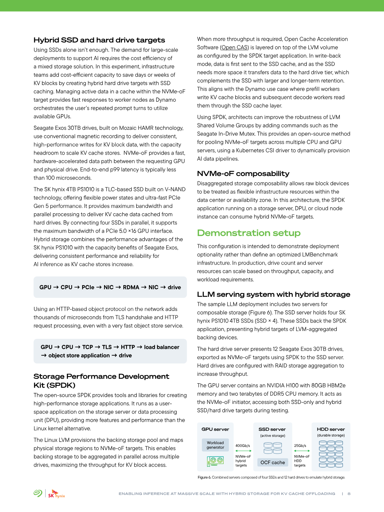
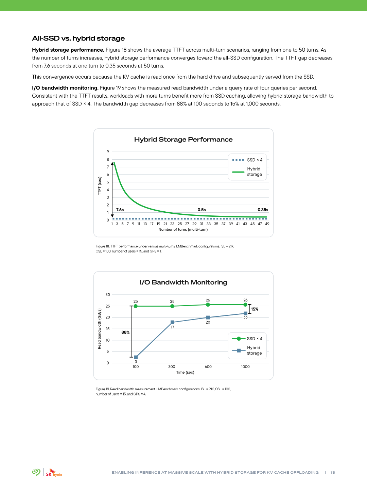
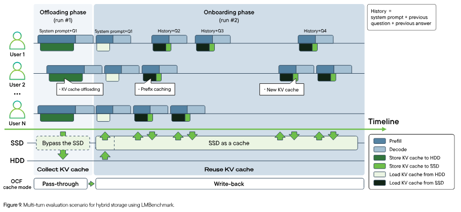

# Seagate / SK hynix

> SSD / HDD 混合 KV 联合白皮书

以 SSD 承接活跃阶段，以 HDD 延长闲置 KV 的保留窗口。核心场景是“暂停—恢复—连续多轮”。 [S]

| 项目 | 公开配置 |
|---|---|
| 模型 / GPU | DeepSeek-R1-Distill-Llama-8B / H100 80GB PCIe |
| 存储 | 4 × 3.84TB SK hynix PS1010 SSD；12 × 30TB Seagate Exos HAMR HDD |
| 原始容量 | 15.36TB SSD + 360TB HDD，未扣冗余 |
| 主机内存 / 软件 | 2.0 TiB DRAM；Dynamo KVBM、NIXL、SPDK、LVM、Open CAS |
| 工具 / 主延迟负载 | LMBenchmark；ISL 21K、OSL 100、15 用户、QPS 1、10 turns |

### 测试如何构造冷热转换

1. **预置：**OCF pass-through，使第一轮 KV 绕过 SSD 写入 HDD。
2. **恢复：**切换 write-back，HDD KV 回填 SSD 并加载至 HBM。
3. **连续交互：**后续读取命中 SSD；新增 KV 先写 SSD，再后台写回。

白皮书报告首次恢复后的 SSD 命中率为 100%。这证明了受控路径，而非验证长期交错回访下的自动冷热预测算法。LMBenchmark 来自 LMCache 项目，但实际 KV 管理由 KVBM 执行。

| 结果 | 白皮书报告值 | 解释边界 |
|---|---|---|
| TTFT / 端到端延迟 | 改善 95% / 降低 80% | 对比关闭 prefix caching 与 offload、每轮重算；非对比全 SSD |
| 容量 / 成本 | 约 11× / 约低 75% | 作者对 SSD×4 的方案口径；不是云服务整体 TCO |
| 相对全 SSD 的 TTFT 差距 | 1 turn：7.6s；50 turns：0.35s | 后续 SSD 命中摊薄首次冷恢复成本；非 HDD 读取变为 0.35s |
| I/O 特征 | 128KB 请求；72% 随机写、83% 随机读 | 对应 QPS 0.1 的 I/O 实验，不能与所有延迟图混为同一配置 |

4 / 8 / 12 块 HDD 的扩展结果为实测；更多盘数属于估算。白皮书中的 S3 对照、预取 hint、cuComp 压缩列为 future work。正文笼统的微秒级传输延迟不能当成机械盘冷读延迟。

*Seagate / SK hynix 白皮书原 PDF 第 8 页：SSD / HDD 架构与测试拓扑* — [原始来源](https://www.seagate.com/resources/enabling-inference-at-massive-scale-with-hybrid-storage-for-kv-cache-offloading/)

*白皮书原 PDF 第 13 页：容量、成本与多轮性能图，按原始口径阅读* — [原始来源](https://www.seagate.com/resources/enabling-inference-at-massive-scale-with-hybrid-storage-for-kv-cache-offloading/)

### 放置策略：哪些 KV 放到哪一层

这套方案的放置由两层软件决定。上层是 Dynamo KVBM，它管理 KV 块在 GPU HBM、CPU 内存和“磁盘”之间的分配、固定（pinning）、淘汰与复用，白皮书称这些元数据“独立于物理位置” [SWP]。下层是 Open CAS（OCF），负责 SSD 与 HDD 之间的放置。对 KVBM 和 NIXL 来说，NVMe-oF 目标只是一个 EXT4 挂载的文件系统，SSD 与 HDD 的分工发生在这个卷内部，按缓存行进行，不感知前缀或会话 [SWP][PLSG1]。因此，“哪些 KV 放 SSD、哪些放 HDD”并不是 KV 语义层面的决策，而是块缓存策略的结果。

| 维度 | 该方案做法 | 证据类型与引用 |
|---|---|---|
| 层级与介质 | H100 HBM 80GB → 主机 DRAM（GPU 服务器 2.0 TiB；KVBM CPU 层实际配置多大未写）→ NVMe-oF 混合卷：SSD 缓存 4 × 3.84TB（15.36TB），HDD 容量层 12 × 30TB（360TB，RAID 聚合） | 官方明确说明（白皮书第 7–9 页） [SWP] |
| 放置单位 | KVBM 以 KV block 为单位，白皮书未写块大小；存储侧每个 I/O 为 128KB，等于混合卷的 MDTS；OCF 按 cache line 映射（Open CAS 默认 4 KiB），白皮书未写实际设置 | 官方明确（第 11 页）；cache line 大小未公开 [SWP][PLSG2] |
| 准入 | 白皮书没有写长度或热度门槛。首轮的系统提示加问题、之后各轮新增的 KV（上一轮回答加新问题）都会写入，也就是包括 decode 输出的 KV。KVBM 当前文档默认开启“磁盘卸载过滤”：只有频率 ≥ 2 的块才从 CPU 层下沉到磁盘层（`DYN_KVBM_DISABLE_DISK_OFFLOAD_FILTER` 可关闭）。白皮书没有说明所用 KVBM 版本，也没有说明是否关闭了这项过滤 | 官方明确（第 9 页）；过滤为 KVBM 文档 v1.4.2 [SWP][PLSG3] |
| 写入时机 | KVBM 文档自述为 write-through 缓存，各层容量须逐层递增。OCF 处于 write-back 模式：数据先写入 SSD 即确认，SSD 需要空间时再转到 HDD，由后台 cleaning 刷回（ALRU 默认在最后一次写入 120 s 后、每 20 s 唤醒一次）。白皮书未写 cleaning 参数和副本数 | 官方明确（第 8、10 页）；参数为 Open CAS 文档默认值 [SWP][PLSG1][PLSG2][PLSG3] |
| 降级与淘汰 | 白皮书说法：容量满时淘汰“最少使用的块”；停顿足够久时，混合卷把不活跃的 KV 迁到 HDD。OCF 的淘汰算法是 LRU（按 cache line）。测试中“首轮 KV 在 HDD”是用 pass-through 模式人为预置的，不是自然老化的结果 | 官方明确（第 5、9、10 页）；LRU 为 OCF 文档 [SWP][PLSG1] |
| 提升与预取 | 命中 HDD 的 KV 读一次后被复制进 SSD，再加载到 HBM，之后的轮次全部命中 SSD。没有预取：Dynamo prefetch hint 被列为未来工作。白皮书未描述超时后回退重算 | 官方明确（第 9、13、15 页） [SWP] |
| 位置选择 | 采用共享 NVMe-oF target，多个 prefill / decode worker 经 NIXL 访问。KV 块位置通过 NATS broker 的发布 / 订阅主题告知其他节点，前端为 KV-aware router（Figure 7） | 官方明确（第 7、9 页） [SWP] |
| 决策者 | KVBM 管理块生命周期；OCF 决定 SSD / HDD；运维人员决定缓存模式切换与 SSD : HDD 容量配比 | 官方明确 [SWP] |
| 选择依据 | 主要是成本和保留时长：SSD 每 TB 成本约为 HDD 的 16 倍，DRAM 每字节约为 NVMe SSD 的 44 倍；目标是把 KV 保留数天到数周。4 块 SSD 并行，以匹配 PCIe 5.0 ×16 的带宽。没有公开逐块的成本模型 | 官方明确（第 5–6、8 页）；成本模型未公开 [SWP] |

**选择逻辑。**白皮书的依据是 I/O 特征加上“突发”假设：用户的会话会开始、暂停、再恢复。写入阶段 72% 是随机写，读回阶段 83% 是随机读 [SWP]，这类随机小块 I/O 由 SSD 承接；HDD 只承担“长时间没人访问、但值得保留”的 KV。每次冷恢复要付一次 HDD 读，之后的多轮对话都由 SSD 服务，所以这笔代价会随轮数摊薄：混合方案与全 SSD 的 TTFT 差距，1 轮时为 7.6 s，50 轮时降到 0.35 s [SWP]。这个取舍对会话长、回访集中的负载有利；如果大量会话只回访一次，每次都要付冷读代价。

**需要注意的边界。**write-back 模式下，最新的 KV 在被 cleaning 刷回之前只存在于 SSD 上，HDD 并不是实时的完整副本。KV 可以重算，所以这个风险可以接受，但应该写明。OCF 还提供 nhit 晋升过滤（只有访问达到 n 次的 core line 才进入缓存）和顺序流旁路（Sequential Cutoff），白皮书没有使用，也没有评估 [PLSG1][PLSG2]。正文中“新增 KV 先写 SSD，再后台写回”的准确含义是 OCF 的后台 cleaning，不是 KVBM 自身的动作。

**例子（本文按公开参数推算）。**DeepSeek-R1-Distill-Llama-8B 有 32 层、8 个 KV 头，head 维度 128，按 BF16 计算每 token 的 KV 约 128 KiB，一个 21K token 的提示约 2.6 GiB。流程如下：第 1 轮在 HBM 完成 prefill，KV 经 KVBM 卸载，在 pass-through 模式下直接写入 HDD；第 2 轮命中前缀，这约 2.6 GiB 从 HDD 读出，同时被插入 SSD，再送到 HBM；本轮约 100 个输出 token 和新问题产生的 KV 写入 SSD，成为 dirty 数据，之后由 cleaning 刷到 HDD；用户长时间离开后，SSD 按 LRU 回收这些缓存行，只剩 HDD 上的副本；用户再回来时，又要付一次 HDD 读。

*Seagate / SK hynix 白皮书原 PDF 第 10 页 Figure 9：首轮在 OCF pass-through 下绕过 SSD、写入 HDD，此后切换为 write-back，SSD 作为缓存，读回与新增 KV 都经过 SSD* — [原始来源](https://www.seagate.com/content/dam/seagate/assets/resources/enabling-inference-at-massive-scale-with-hybrid-storage-for-kv-cache-offloading/files/kv-caching-white-paper.pdf)

### 硬件配置信息

| 场景 / 方案 | 计算（GPU / NPU 型号 × 数量，HBM 容量） | CPU 与主机内存（DRAM 容量） | 本地存储（SSD / NVMe / HDD 型号、数量、容量） | 网络（RDMA / NIC 型号与带宽） | 远端 / 共享存储（服务名与规格） | 来源 |
|---|---|---|---|---|---|---|
| GPU 服务器（NVMe-oF initiator，跑 DeepSeek-R1-Distill-Llama-8B） | 1 × NVIDIA H100 PCIe，80GB HBM2e | Intel Xeon 6767P；2.0 TiB DDR5 | 未公开 | 到 SSD 服务器 400Gb/s，NVMe-oF over RDMA，GDS；NIC 型号未公开 | NVMe-oF 混合目标（SSD-only 或 SSD + HDD），以 EXT4 挂载 | 白皮书第 7–8 页 [SWP] |
| SSD 服务器（active storage，SPDK + LVM + OCF 缓存） | — | Intel Xeon Gold 6548Y+；503 GiB DDR5 | 4 × SK hynix PS1010 3.84TB（PCIe Gen5，TLC），共 15.36TB | 上联 GPU 服务器 400Gb/s；下联 HDD 服务器 25Gb/s（Figure 6） | 对外提供 NVMe-oF 混合目标 | 白皮书第 7–8 页 [SWP] |
| HDD 服务器（durable storage） | — | Intel Xeon E5-2630 v2；32 GiB DDR3 | 12 × Seagate Exos 30TB（Mozaic HAMR，CMR），共 360TB，RAID 聚合（级别未公开） | 25Gb/s NVMe-oF 到 SSD 服务器（Figure 6） | 由 SPDK 以 NVMe-oF 导出给 SSD 服务器 | 白皮书第 7–8 页 [SWP] |
| HDD 扩展实验（不用 SSD，只测首轮） | 同上 | 同上 | 4 / 8 / 12 块 HDD 为实测，24 / 36 块为估算 | 正文写 36 块以上受网络上限“25GB/s”约束（与 Figure 6 的 25Gb/s 单位不一致，按原文列出） | 同上 | 白皮书第 14 页 [SWP] |
| 全 SSD 对照（SSD × 4） | 同 GPU 服务器 | 同上 | 4 × PS1010 3.84TB | 同上 | SSD-only NVMe-oF 目标 | 白皮书第 10–13 页 [SWP] |

KV 实际落在 H100 HBM、SSD 服务器上的 15.36TB SSD 缓存，以及 HDD 服务器上的 360TB HDD 容量层；GPU 服务器的 2.0 TiB DRAM 可作为 KVBM 的 CPU 层，但白皮书没有写这一层的配置值。HDD 在来源中明确出现，是 NVMe-oF 后端的 durable 层，不直接连接 GPU 服务器。

## 本章资料

- **[PLSG1]** [Open CAS 官方文档 · Cache configuration / Cache operations / Promotion policies（cache 模式、LRU 淘汰、nhit 晋升，open-cas.github.io 提交 bb4455a，采集于 2026-11-19）](https://github.com/Open-CAS/open-cas.github.io/blob/bb4455adecc144fa9585e2d42b9d36379bafda61/content/concepts/cache-operations.md)
- **[PLSG2]** [Open CAS Linux 官方文档 · casadm Tool Reference（cache line 大小、cleaning-alru、promotion、seq-cutoff 默认值，提交 bb4455a，采集于 2026-11-19）](https://github.com/Open-CAS/open-cas.github.io/blob/bb4455adecc144fa9585e2d42b9d36379bafda61/content/open-cas-linux/tool-reference.md)
- **[PLSG3]** [NVIDIA Dynamo 官方文档 · KVBM Guide（v1.4.2：write-through、DYN_KVBM_* 容量参数、SSD 寿命保护的磁盘卸载过滤，采集于 2026-11-19）](https://docs.nvidia.com/dynamo/v1.4.2/knowledge-base/modular-components/kvbm/kvbm-guide)
- **[S]** [Seagate × SK hynix · Enabling inference at massive scale with hybrid storage for KV cache offloading](https://www.seagate.com/resources/enabling-inference-at-massive-scale-with-hybrid-storage-for-kv-cache-offloading/)
- **[SWP]** [Seagate / SK hynix 原始白皮书 · 15 页 · SC135.1-2605US](https://www.seagate.com/content/dam/seagate/assets/resources/enabling-inference-at-massive-scale-with-hybrid-storage-for-kv-cache-offloading/files/kv-caching-white-paper.pdf)
