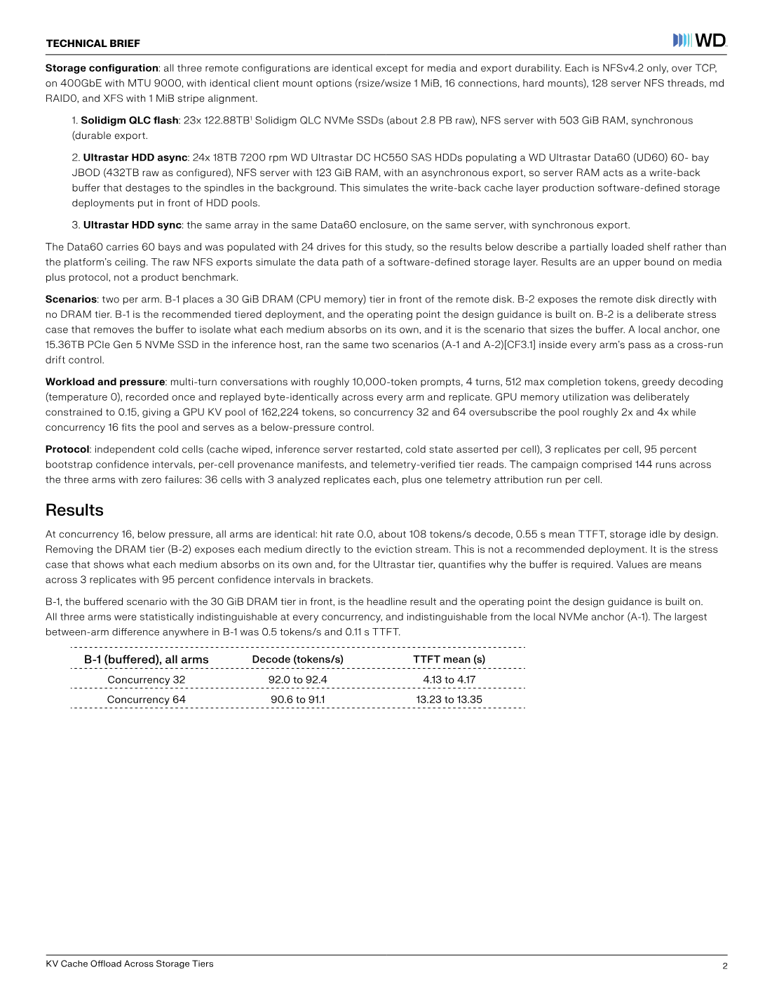
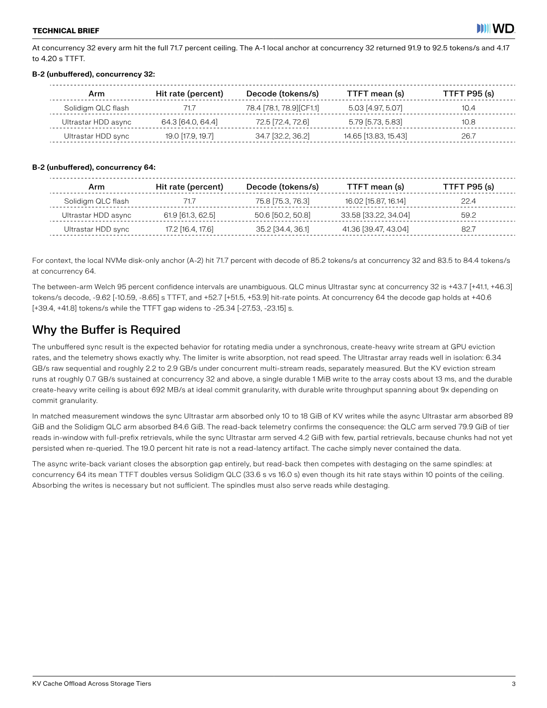

# Western Digital / Solidigm

> 缓冲层与 HDD / QLC 对照技术简报

新增重点 · September 2026 · Revision 02 · 4 页技术简报

### KV Cache Offload Across Storage Tiers

完整副标题为 *A Controlled Benchmark on an 8× NVIDIA B200 Inference Host*。报告第一页明确写明 WD 与 Solidigm 共同测量。 [W][WP]

“HDD 性能接近 SSD”成立的关键，是**30 GiB 主机 DRAM 前置层吸收写流，并服务这些测试点的热恢复读取**。

| 项目 | 报告配置（第 1–2 页） |
|---|---|
| 推理主机 | Supermicro；8 × NVIDIA B200，每卡 183 GiB HBM；TP=8 |
| 模型 / 软件 | 未披露名称的 70B 开放权重模型，BF16；vLLM 0.22.0、LMCache 0.4.6 |
| HDD 容量层 | 24 × 18TB Ultrastar DC HC550 SAS 7200rpm，Data60 机箱，432TB raw |
| QLC 容量层 | 23 × 122.88TB Solidigm QLC NVMe SSD，约 2.8PB raw |
| 远端访问 | NFSv4.2 / TCP / 400GbE；md RAID0 + XFS；未测试 RDMA |
| 负载与压力 | 约 10K-token prompt、4 turns、最多 512 completion tokens；并发 16 / 32 / 64；GPU memory utilization 限至 0.15 |
| 复现协议 | 每 cell 清缓存并重启；3 次重复；144 runs；95% 置信区间；字节相同的回放 |

### 有缓冲与无缓冲的结果

| 并发 | 方案 | Decode tokens/s | 平均 TTFT 秒 |
|---|---|---|---|
| 32 | 30 GiB DRAM + 各容量层 | 92.0–92.4 | 4.13–4.17 |
| 32 | 无主机前置层 · QLC | 78.4 | 5.03 |
| 32 | 无主机前置层 · HDD async / sync | 72.5 / 34.7 | 5.79 / 14.65 |
| 64 | 30 GiB DRAM + 各容量层 | 90.6–91.1 | 13.23–13.35 |
| 64 | 无主机前置层 · QLC | 75.8 | 16.02 |
| 64 | 无主机前置层 · HDD async / sync | 50.6 / 35.2 | 33.58 / 41.36 |

源自报告第 2–3 页；无缓冲数据为 3 次重复的均值。这里的“无缓冲”指移除主机 30 GiB DRAM 前置层；HDD async 仍使用 NFS 服务端内存异步写回。Decode 采用报告原指标，不推算整机汇总吞吐。

### 瓶颈在写入吸收能力，也在读写争用

GPU 驱逐流约 **0.7 GB/s**，KV 为 **320 KiB/token**。HDD 阵列独立顺序读可达 6.34 GB/s，但同步持久化写入受提交粒度限制，部分 KV 在下一次请求时尚未保存完成，导致外部缓存命中率下降。异步写回改善吸收能力，却会让后台落盘与读取争抢同一组磁盘。并发 64 时，无主机前置层的 HDD async 平均 TTFT 为 33.58s，QLC 为 16.02s。

报告第 4 页明确说明：有 DRAM 前置层时，这些运行点的 recalls 由 DRAM 服务。它证明缓冲可以屏蔽容量介质差异，并不证明 HDD 全冷读取与 SSD 等速。

**展开：实验限制与不能外推的结论** - 单主机、单模型配置、单一长输入多轮负载；每 cell 仅 3 次重复。 - 两类 NFS 服务器 RAM 不同：QLC 503 GiB，HDD 123 GiB；服务端 page cache 参与读取。 - 每 cell 冷启动，不代表后续每次请求都从物理冷盘读取。 - 人为限制 HBM 使用制造压力；生产应测试更大工作集和真实会话分布。 - HDD async 牺牲最近写入的持久性；KV 可重算不等于这一取舍没有代价。 - RAID0、容量不相同、原始 NFS 路径：并非等容量成本横评，也非完整生产 SDS 产品 benchmark。 - QLC 可作前置层属于设计建议。主要缓冲对照 B-1 使用 DRAM；不能把远端 QLC 对照臂说成已经完整验证了“QLC 缓冲 + HDD”部署。 - 正文写最大 TTFT 差异 0.11s，表中并发 64 的舍入范围为 13.23–13.35s；本页保留原表范围，不自行消除口径差异。

*WD / Solidigm 技术简报原 PDF 第 2 页：存储配置与 DRAM 缓冲对照* — [原始来源](https://documents.westerndigital.com/content/dam/doc-library/en_us/assets/public/western-digital/collateral/tech-brief/technical-brief-kv-cache-offload-across-storage-tiers-wd.pdf)

*原 PDF 第 3 页：无前置 DRAM 的性能表及写入吸收分析* — [原始来源](https://documents.westerndigital.com/content/dam/doc-library/en_us/assets/public/western-digital/collateral/tech-brief/technical-brief-kv-cache-offload-across-storage-tiers-wd.pdf)

### 放置策略：哪些 KV 放到哪一层

简报自述，它的结论是“一条分层规则，测量只用来定规模” [W]。逐 chunk 的放置、淘汰和召回由 vLLM 0.22.0 + LMCache 0.4.6 执行，但简报没有公开 LMCache 的运行模式（进程内或多进程）、chunk 大小、淘汰策略和写入方式。下表把“简报明确的”和“LMCache 文档的一般机制”分开标注。

| 维度 | 该方案做法 | 证据类型与引用 |
|---|---|---|
| 层级与介质 | B200 HBM：每卡 183 GiB，但 GPU memory utilization 人为限制为 0.15，KV 池只有 162,224 token。其下依次为：主机 DRAM 层 30 GiB（B-1 场景）；经 NFS 访问的远端容量层，即 QLC（约 2.8PB raw）或 HDD（432TB raw）；NFS 服务器内存（503 / 123 GiB）也起 page cache 或异步写回缓冲的作用。本地 15.36TB Gen5 NVMe（A-1 / A-2）只作漂移对照 | 官方明确（第 1–2、4 页） [W] |
| 放置单位 | 简报称为 “chunks”，大小未公开。LMCache MP 模式的 `--chunk-size` 默认 256 token；若沿用默认值，按每 token 320 KiB 计约 80 MiB/chunk（本文推算）。NFS 的 rsize / wsize 为 1 MiB，RAID0 条带按 1 MiB 对齐 | chunk 大小未公开；默认值来自 LMCache 文档 [W][LMC5] |
| 准入 | GPU 驱逐流（eviction stream）全部进入缓冲层，简报没有描述长度或热度门槛；是否保存 decode 输出的 KV 也未公开。负载本身的前缀复用上限为 71.7% | 门槛未公开；复用上限为官方明确 [W] |
| 写入时机 | 先由缓冲层吸收写流，容量层在后台承接。HDD async 导出相当于服务端内存 write-back，HDD sync 则每次写入都持久化。简报给出的规则是：**不要让 GPU 驱逐流以同步写的方式直接落到机械盘**。按 LMCache MP 文档，写入 L1 的对象由 StoreController 异步推送到 L2，但简报没有说明采用这种模式 | 规则为官方明确（第 4 页）；L1→L2 异步为 LMCache 文档 [W][LMC2][LMC3] |
| 降级与淘汰 | 简报未公开。LMCache MP 模式的 L1 淘汰由水位触发（默认 0.8，每次淘汰 0.2），可选 LRU / ARC 等策略 | LMCache 文档的一般机制 [LMC3] |
| 提升与预取 | 在这些测试点，召回全部由 DRAM 服务。L1 未命中时，LMCache 先到 L2 查找，取回 L1 后再拷到 GPU。如果 chunk 被再次查询时还没有持久化完成（HDD sync 无缓冲的情况），就是缓存未命中，GPU 只能重算，命中率降到 19.0% | 官方明确（第 3–4 页）；路径为 LMCache 文档 [W][LMC3] |
| 位置选择 | 单台推理主机加一台远端 NFS 服务器，不涉及跨实例路由或副本 | 官方明确 [W] |
| 决策者 | 每个 chunk 的去留由 LMCache 决定；层级配比和缓冲容量由架构师按规则确定 | 官方明确 [W] |
| 选择依据 | 缓冲层容量按“驱逐速率 + 热召回集”定，而不是按背后容量层的大小定。有缓冲时，容量介质的选择是每 TB 成本与容量问题，不再是性能问题。简报没有给出显式成本模型 | 官方明确（第 1、4 页） [W] |

**选择逻辑。**简报把瓶颈定位在写入吸收，而不是读取速度。8 卡主机的驱逐流约 0.7 GB/s；24 块 HDD 单次持久化 1 MiB 写入约需 13 ms，理想提交粒度下的持久化写入上限约 692 MB/s，低于驱逐流 [W]。因此快层不只是为了让读更快，还负责“先接住刚被驱逐的 KV，并服务很快会被召回的那部分”。HDD 只接收后台写入并提供容量，不在读取的关键路径上。QLC 能直接吸收同样的写流（并发 32 时吸收 84.6 GiB，命中率保持 71.7%），所以 DRAM 不够时 QLC 可以当缓冲层；但“QLC 缓冲 + HDD”这一组合简报并未实测 [W]。

**取舍。**HDD async 换来了写入吸收能力，但牺牲了最近写入的持久性，而且读回要和后台落盘争用同一批磁盘：并发 64、无缓冲时，它的平均 TTFT 是 QLC 的两倍多（33.58 s 对 16.02 s） [W]。简报每个 cell 都从冷启动开始，对话很短（约 10K token、4 轮），没有覆盖闲置数小时后再从 HDD 冷召回的情况。

**例子（本文按简报参数推算）。**一个约 10,000 token 的对话前缀，按每 token 320 KiB 计约 3.05 GiB。并发 32 时，KV 池容量约为需求的一半，这段前缀的部分 chunk 被驱逐出 HBM，与其他会话一起以约 0.7 GB/s 的速度涌入 30 GiB DRAM 层，相当于约 46 s 的驱逐量。下一轮提问在这个窗口内到达，因此直接从 DRAM 召回；同时这些 chunk 在后台写入 NFS 上的 QLC 或 HDD。如果去掉 DRAM 层，改为同步写 HDD，下一轮到达时 chunk 可能还没落盘，只能重算。

### 硬件配置信息

| 场景 / 方案 | 计算（GPU / NPU 型号 × 数量，HBM 容量） | CPU 与主机内存（DRAM 容量） | 本地存储（SSD / NVMe / HDD 型号、数量、容量） | 网络（RDMA / NIC 型号与带宽） | 远端 / 共享存储（服务名与规格） | 来源 |
|---|---|---|---|---|---|---|
| 推理主机（全部场景共用） | 8 × NVIDIA B200，每卡 183 GiB HBM3e（合计约 1.4 TiB），TP=8；GPU memory utilization 0.15，KV 池 162,224 token | Supermicro 主机；CPU 型号与总内存未公开；B-1 场景配置 30 GiB DRAM 层 | 1 × 15.36TB PCIe Gen5 NVMe SSD（本地对照 A-1 / A-2） | 400GbE，NFSv4.2 over TCP，MTU 9000，16 个连接；NIC 型号未公开，未测试 RDMA | 见下三行 | 简报第 1–2、4 页 [W] |
| 远端 Solidigm QLC 臂 | — | NFS 服务器，503 GiB RAM（CPU 未公开） | 23 × 122.88TB Solidigm QLC NVMe SSD，约 2.8PB raw；md RAID0 + XFS（1 MiB 条带） | 同上；128 个 NFS 服务端线程 | 同步（持久）NFS 导出 | 简报第 2 页 [W] |
| 远端 Ultrastar HDD async 臂 | — | NFS 服务器，123 GiB RAM，同时作为写回缓冲 | 24 × 18TB WD Ultrastar DC HC550 SAS 7200rpm，装在 Ultrastar Data60（60 盘位，装了 24 块）中，432TB raw；md RAID0 + XFS | 同上 | 异步 NFS 导出 | 简报第 2 页 [W] |
| 远端 Ultrastar HDD sync 臂 | — | 同一台服务器，123 GiB RAM | 同一 HDD 阵列 | 同上 | 同步（持久）NFS 导出 | 简报第 2 页 [W] |

KV 实际落在 B200 HBM、主机 30 GiB DRAM 层（B-1）以及远端 QLC 或 HDD（经 NFS，并有服务端 page cache 参与）；A 组对照落在本地 NVMe。来源明确给出 HDD：24 块 7200rpm SAS 盘，测试中只承担写入和容量，有缓冲时召回全部由 DRAM 服务。

## 本章资料

- **[LMC2]** [LMCache 官方文档 · Multiprocess (MP) Mode Overview（架构、L1Manager、L2 Adapters、Controllers，采集于 2026-11-18）](https://docs.lmcache.ai/mp/index.html)
- **[LMC3]** [LMCache 官方文档 · Secondary KV Storage（L1/L2 数据流、Cascade、Store/Prefetch 策略、L1/L2 淘汰，采集于 2026-11-18）](https://docs.lmcache.ai/mp/l2_storage/index.html)
- **[LMC5]** [LMCache 官方文档 · Configuration Reference（--chunk-size、--hash-algorithm、L1 参数等，采集于 2026-11-18）](https://docs.lmcache.ai/mp/configuration.html)
- **[W]** [WD × Solidigm · KV Cache Offload Across Storage Tiers，September 2026 / Revision 02](https://documents.westerndigital.com/content/dam/doc-library/en_us/assets/public/western-digital/collateral/tech-brief/technical-brief-kv-cache-offload-across-storage-tiers-wd.pdf)
- **[WP]** [WD · KV Cache Offload 官方介绍](https://www.westerndigital.com/resources/technical-brief/kv-cache-offload-tiered-storage-benchmark)
