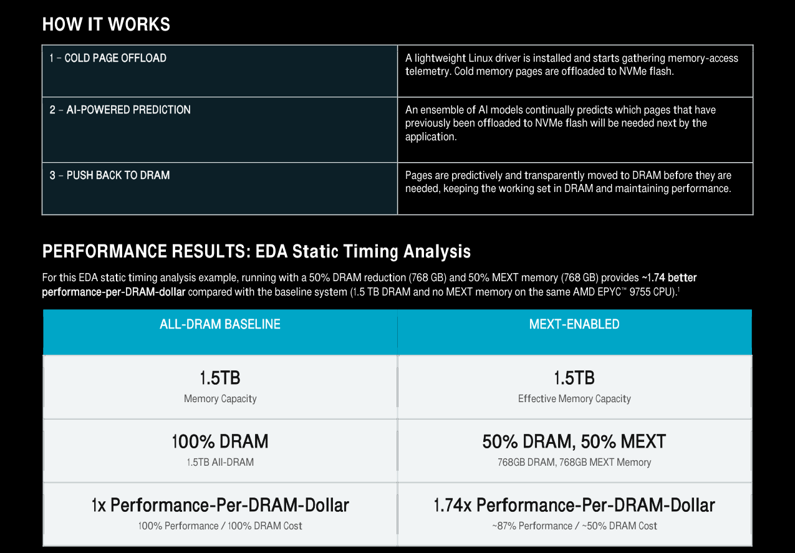
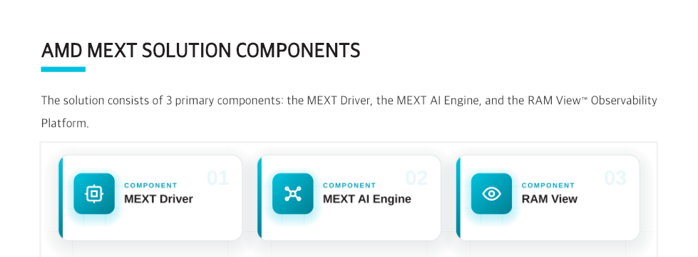
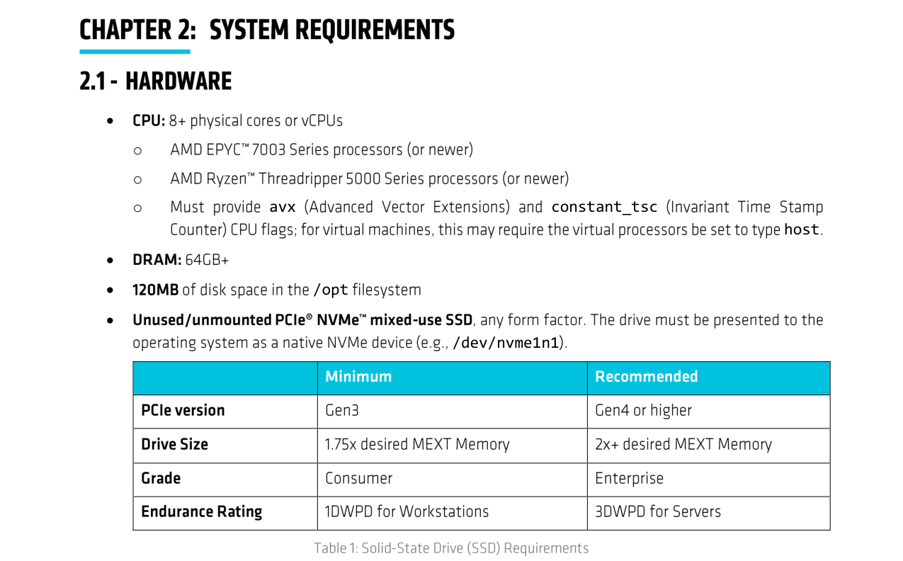
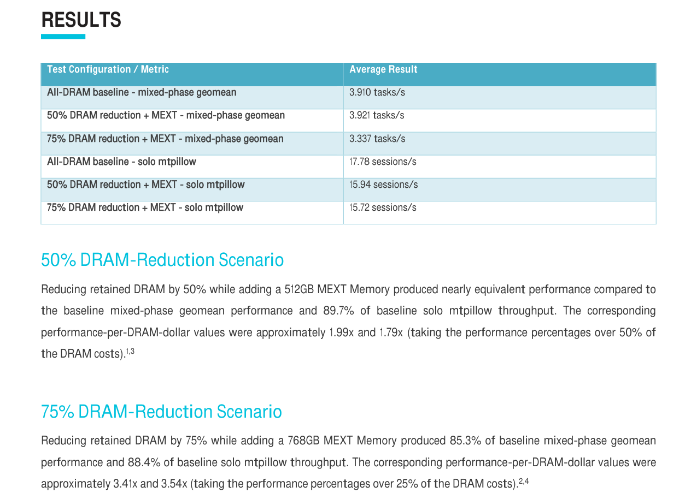

# AMD / MEXT

> 预测式 DRAM / NVMe 闪存分层 · AMD 官方产品页、白皮书、安装指南与案例

AMD MEXT Predictive Memory™ 是一款纯软件的内存分层产品。它把较冷的内存页从 DRAM 卸载到 NVMe 闪存，再用本地运行的 AI 预测引擎判断哪些页即将被访问，并在应用发起访问之前把它们搬回 DRAM。AMD 官方产品页的定位语是 “Making Flash Work Like DRAM”：让低成本、大容量的闪存在应用看来像 DRAM 速度的内存，形成介于 DRAM 和存储之间的新“性价比层”，以降低对昂贵 DRAM 的依赖。 [AMD1] 本章依据 AMD 官方产品页、收购博客、产品简报、安装指南、6 份性能白皮书和 AMD IT 内部部署案例整理，均为 2026-11-18 采集的官方材料。

### 1. 收购背景与产品定位

AMD 于 **2026-06-15** 在官方博客宣布收购 MEXT。博客将内存描述为云和企业环境中 AI 模型、数据分析、虚拟化和 HPC 负载共同面对的关键约束，称 MEXT 是“AI 驱动内存优化技术的先行者”，其预测式内存技术“让闪存表现得更像 DRAM”，AMD 计划把这项技术整合到整个数据中心产品组合中，并吸收 MEXT 在内存系统和 AI 基础设施方面的团队。 [AMD2] AMD 在 2026 年第二季度财报（2026-08-04）中也把“收购 MEXT，为 AI 负载增加 AI 驱动的预测式内存技术、优化内存使用并扩展可用容量”列为当季数据中心业务进展之一。 [AMD10]

产品简报把 MEXT 要解决的问题归纳为三点：一是修复 DRAM 利用率不足——大量已配置的 DRAM 在相当长时间内处于不活跃状态；二是以“drop-in”方式实现，尽量不改硬件和软件；三是把闪存纳入内存域。 [AMD3] 白皮书进一步列出 DRAM 的四个痛点：每比特成本已使 DRAM 成为数据中心最昂贵的部件；作业所需内存难以预估，估错会触发 OOM 和作业失败，所以团队普遍超配以避开“memory cliff”；大容量内存的可选规格粒度很粗，无法按“需求 + 10%”精确采购；即使容量恰好，实际利用率也常常很低。 [AMD5] 安装指南称，数据中心中常见超过一半的已配置内存并未被应用活跃使用，可视为冷内存，而闪存的成本约为 DRAM 的 1/50。 [AMD4]

由此，MEXT 给出两种使用方式：**缩减 DRAM**——在更小的物理 DRAM 上运行原有负载，差额由“MEXT + 闪存”构成的 MEXT Memory™ 补足；**扩展容量**——在现有系统上通过软件和一块专用 NVMe 盘增加可用内存，避免为单个大作业采购更大机器或把数据切分到多台机器。 [AMD3][AMD4]

### 2. 工作原理：冷页卸载 → AI 预测 → 提前推回 DRAM

官方产品页和产品简报把机制概括为三步： [AMD1][AMD3]

1. **冷页卸载（Cold Page Offload）**：安装轻量级 Linux 驱动后开始采集内存访问遥测，持续区分 DRAM 中正在被使用的热页和已经变冷的页，把冷页卸载到 NVMe 闪存。
2. **AI 预测（AI-Powered Prediction）**：一组 AI 模型持续预测已被卸载到闪存的页中，哪些即将被应用访问，即哪些页将“由冷转热”。
3. **推回 DRAM（Push Back to DRAM）**：在应用真正发出请求之前，透明地把这些页移回 DRAM，使工作集保持在 DRAM 中。

白皮书的表述是：MEXT 让闪存在操作系统看来是“类 DRAM 内存”，AI 引擎用来“抵消闪存时延的影响”；从应用的视角看，相关内存页总是已经驻留在 DRAM 中，因此性能得以保持。 [AMD5] 与传统 swap 的区别在于方向：swap 是缺页之后被动换入，访问时延直接暴露给应用；MEXT 则是预测之后主动提前迁回，把闪存读取移出关键路径。

*AMD MEXT 产品简报第 2 页：How It Works 三步流程，以及 EDA 静态时序分析的“1.5TB 全 DRAM vs 768GB DRAM + 768GB MEXT”对比* — [原始来源](https://www.amd.com/en/products/software/mext.html)

AMD 的 SIGGRAPH 2026 官方博客用同样的语言描述该技术：识别哪些页在用、哪些已经变冷，把冷页卸载到 NAND 闪存，再用基于 AI 的预测引擎在应用再次请求前把它们移回 DRAM。 [AMD9]

### 3. 软件组成：驱动、AI 引擎、守护进程与 RAM View

安装指南（v1.2，2026-10-08）说明，MEXT 以单一安装包交付三个软件组件；白皮书另把可观测性工具 RAM View™ 列为第三个主要组件。 [AMD4][AMD5]

| 组件 | 官方描述 | 运行位置 / 资源 |
|---|---|---|
| MEXT Driver | 可动态加载的内核模块，不修改标准 Linux 内核；向 AI 引擎提供进程与内存页遥测；安装时按主机 OS 与内核版本现场编译 | 内核态 |
| MEXT AI Engine | 预测哪些页应从闪存推回 DRAM，推理耗时“不到一秒的一小部分”；由极轻量的启发式预测器和更强的神经网络模型组成的模型族，按负载自动选用表现最好的模型或组合；持续比对“预测的页是否真被使用”，获得精度反馈并自我优化 | 用户态进程，单个 CPU 核，不需要 GPU |
| MEXT Daemon（mextd） | 接收 AI 引擎的预测，执行 DRAM 与闪存之间的页迁移 | systemd 服务，占 1 个 CPU 核 |
| RAM View | 可观测性工具，实时显示应用内存占用和页的冷热分布：按最近访问时间分为 <15s、<1min、<2min、<3min、<5min、>5min 六档 | 随 MEXT 提供 |

官方 FAQ 明确 MEXT 运行需要两个 CPU 核：一个给 AI 引擎、一个给守护进程，不需要 GPU，也没有网络或防火墙要求。 [AMD1] 白皮书描述 AI 引擎的设计灵感来自现代神经网络技术，但预测对象不是文字，而是“未来内存页访问的序列”。 [AMD5]

*AMD MEXT 白皮书（Agentic AI，2026-11）第 5 页：MEXT Driver、MEXT AI Engine、RAM View 三个解决方案组件* — [原始来源](https://www.amd.com/content/dam/amd/en/documents/epyc-business-docs/white-papers/amd-mext-white-paper-agentic-ai-in-6th-gen-amd-epyc.pdf)

### 4. 部署要求与配置方式

安装指南给出的系统要求如下。 [AMD4]

| 项目 | 要求 |
|---|---|
| CPU | 8 个以上物理核或 vCPU；AMD EPYC 7003 系列或更新、Ryzen Threadripper 5000 系列或更新；必须提供 avx 与 constant_tsc 标志，虚拟机可能需要把 vCPU 类型设为 host |
| DRAM | 64GB 以上；FAQ 称需要 64GB 以上 DRAM 的内存密集型负载受益最大 |
| 闪存 | 一块未使用、未挂载的 PCIe NVMe mixed-use SSD，以原生 NVMe 设备呈现（如 /dev/nvme1n1）；PCIe Gen3 起，推荐 Gen4+；容量至少为目标 MEXT Memory 的 1.75 倍，推荐 2 倍以上；耐久度工作站 1 DWPD、服务器推荐 3 DWPD 企业级盘 |
| 操作系统 | RHEL 8.6–10.1+、Oracle Linux（仅 RHCK 内核，不支持 UEK）、SLES 15 SP4–SP7、Ubuntu 22.04 / 24.04 / 26.04，各有最低内核版本；Rocky Linux 跟随 RHEL 矩阵 |
| 其他 | 安装需 root；必须关闭 Secure Boot；系统中不能配置磁盘 swap 设备 |
| 部署形态 | 裸金属或虚拟机均可；虚拟化环境部署在 guest OS 内，而非 hypervisor 层；云上只要满足软硬件要求即可，与云资源供给方式无关 |

*AMD MEXT 安装指南 v1.2 第 5 页：硬件要求与 SSD 规格表（PCIe 代际、容量倍数、等级、耐久度）* — [原始来源](https://www.amd.com/en/search/documentation/hub.html#sortCriteria=%40amd_release_date%20descending&f-amd_product_brand=AMD%20MEXT%20Software&f-amd_document_type=User%20Guides)

安装流程是解压 AMD 提供的安装包、阅读 EULA 和 README 后执行 `sudo ./install.sh`，官方称整个过程不到 5 分钟，且无需修改应用或操作系统。安装后默认提供相当于物理 DRAM 20% 的 MEXT Memory，可在 `free -h` 中直接看到增加的内存。调整容量用 `mext-config` 并重启，例如在 1TB 物理内存的系统上：

~~~bash
# 出处（据此整理） [AMD4] https://www.amd.com/en/search/documentation/hub.html#sortCriteria=%40amd_release_date%20descending&f-amd_product_brand=AMD%20MEXT%20Software&f-amd_document_type=User%20Guides
sudo mext-config --set-config mextMemory=40%   # 或 mextMemory=410G
/opt/mext/bin/mext_status.sh                     # 查看组件状态
/opt/mext/bin/mext_stress.sh                     # 运行示例负载验证
sudo systemctl enable mextd && sudo systemctl start mextd
~~~

配置文件位于 `/etc/opt/mext/mextd.conf`。指南特别提示：运行中不允许停止 mextd，因为这相当于从运行中的系统拔掉一条内存 DIMM；要停用必须先 disable 服务再重启。 [AMD4] 获取方式方面，官方 FAQ 和产品简报均要求通过 AMD 销售代表启动免费的概念验证（PoC），未公开标价。 [AMD1][AMD3]

### 5. 官方公开的性能结果

AMD 官方产品页列出的目标负载为 EDA / 芯片设计、媒体与娱乐、Agentic AI、数据库与分析。 [AMD1] 截至采集日，AMD 文档中心共有 6 份 MEXT 白皮书，全部为 AMD 内部测试，每个场景跑 3 次取平均。白皮书统一使用“performance-per-DRAM-dollar”指标：相对全 DRAM 基线的归一化性能，除以保留的 DRAM 比例。脚注明确说明该指标**不计入 NVMe、MEXT 授权和其他系统成本，也不等同于整机性价比或 TCO**。 [AMD3][AMD5][AMD6][AMD7]

| 负载 / 平台 | 对比配置 | 结果 | 性能 / DRAM 美元 |
|---|---|---|---|
| Agentic AI 基准（5 个 agent persona 并发），2× EPYC 9996，Solidigm 3.84TB NVMe，MEXT 1.2 | 全 DRAM ~1TB/socket vs 512GB DRAM + 512GB MEXT | 混合阶段几何平均 3.910 → 3.921 tasks/s，近乎持平 | 约 1.99x |
| 同上 | 256GB DRAM + 768GB MEXT（DRAM 减 75%） | 3.337 tasks/s，为基线的 85.3% | 约 3.41x |
| 同上，单独运行内存密集的图像处理 agent mtpillow | DRAM 减 50% / 75% | 17.78 → 15.94 / 15.72 sessions/s（89.7% / 88.4%） | 约 1.79x / 3.54x |
| Synopsys PrimeTime，1× EPYC 9755，1.5TB | 1.5TB 全 DRAM vs 768GB DRAM + 768GB MEXT | 约 98,000s → 112,000s，约为基线 87%；仅减 DRAM 不加 MEXT 则 OOM | 约 1.74x |
| PrimeTime，1× EPYC 9755，512GB 基线 | 256 / 192 / 128GB DRAM + MEXT | 96.7% / 92.5% / 83.7% | 1.93x / 2.47x / 3.35x |
| PrimeTime，6th Gen EPYC 9686F，512GB 基线 | 256 / 192 / 128GB DRAM + MEXT | 95% / 90% / 80% | 1.90x / 2.40x / 3.22x |
| PrimeTime，Azure HX VM（2× EPYC 9V33X，约 1.4TB DRAM） | DRAM-only 2 个并发作业 vs 加约 1.2TB MEXT 后 4 个并发作业 | 0.4314 → 0.6029 jobs/h，吞吐 +39.7%（单作业耗时 16,689s → 23,886s） | —（扩容场景） |
| Apache Spark SQL（TPC-DS 派生，SF 10000），Azure EPYC 9V45 VM | 256GiB vs 128GiB DRAM + MEXT | 5,774.7s → 5,815.3s，为基线 99.3% | 约 1.99x |

*AMD MEXT Agentic AI 白皮书第 7 页：全 DRAM 基线与 DRAM 减 50% / 75% 两种场景的实测结果表* — [原始来源](https://www.amd.com/content/dam/amd/en/documents/epyc-business-docs/white-papers/amd-mext-white-paper-agentic-ai-in-6th-gen-amd-epyc.pdf)

Azure 扩容白皮书说明了“扩展容量”用法的原理：每个 PrimeTime 作业峰值常驻内存约 600GB，4 个并发作业约需 2.4TB，超出 VM 的 1.4TB DRAM；加入约 1.2TB 的 MEXT Memory 池后，同一台 VM 可以跑 4 个作业，单作业变慢，但总吞吐提高 39.7%。该测试中 MEXT 独占一块 1.92TB 的 Microsoft NVMe Direct Disk，并为 MEXT 预留 2 个 CPU。 [AMD6] SIGGRAPH 博客另引用 MEXT 被收购前对 MoonRay 渲染器的评测：Threadripper PRO 上 512GB DRAM 与 256GB DRAM + 256GB NAND 的渲染性能几乎相同，预测引擎对下一个所需页的预测准确率为 97.9%，RAM 相关成本下降约 40%、总 TCO 下降 29%（MEXT 自行撰写的评测）。 [AMD9]

### 6. 生产部署：AMD IT 内部案例

AMD 官方案例披露，AMD IT 从 2026 年 9 月起在工程师使用的生产计算基础设施（4th / 5th Gen EPYC 服务器）上推广 MEXT，作为“customer zero”实践。首批部署覆盖 86 台主机，提供约 58TB 额外可用内存；按同等 DRAM 容量采购估算约需 330 万美元，MEXT 部署成本约 60.1 万美元，节省约 278 万美元（82%），即以等量 DRAM 18% 的成本获得约 20% 的额外可用内存。AMD IT 计划在新服务器上默认安装 MEXT，预计 2027 年 3 月覆盖约 700 台服务器、累计节省约 2,100 万美元；2027 年底全量 2,000 台服务器时节省超过 6,000 万美元。 [AMD8] 这里的节省额为 AMD IT 自行测算的采购成本对比，案例未给出相应的应用性能数据。

### 7. 与 KV Cache 多级存储的关系（本文分析）

截至 2026-11-18，AMD 官方材料中没有 MEXT 用于 LLM 推理 KV Cache、vLLM / SGLang 集成或 GPU 显存分层的描述。官方明确的 AI 场景是 Agentic AI 的 CPU 侧负载（多 agent 并发的工作集），而不是 GPU 上的 KV。以下为本文结合前后章节的分析：

- **层级位置不同**：MEXT 管理的是 CPU DRAM ↔ NVMe 之间的操作系统内存页；KV Cache 系统（LMCache、SGLang HiCache、Dynamo KVBM、FlexKV）管理的是 HBM → DRAM → SSD → 远端 / HDD 之间的 KV 块。两者可以并存，但不是同一层。推理引擎的 CPU KV 池通常使用为 DMA 锁定的 pinned 内存，这类页一般不能被换出；MEXT 官方未说明是否、以及如何处理锁定页，因此不能假设 MEXT 会透明地把 L2 KV 池下沉到闪存。
- **可借鉴的是“预测式提前迁回”**：MEXT 把访问时延藏在预测之后，与 KV 侧的预取思路一致——SGLang 的 prefetch 策略、Seagate 白皮书将 Dynamo prefetch hint 列为未来工作、Mooncake 调度器计入远端 KV 传输代价。不同点是 KV 的访问模式更结构化：会话恢复、相同前缀、调度队列都可以作为比页级访问序列更强的预测信号。
- **可借鉴的是冷热度量与反馈闭环**：RAM View 按 15s 到 5min 以上分档统计页的冷热，AI 引擎用“预测是否命中”持续校准模型；KV 分层同样需要会话闲置时间分布和召回命中反馈来决定下沉深度。Meta TMO 用 PSI 压力反馈调节卸载量，是同类的另一种做法。
- **闪存耐久与写入吸收是共同约束**：MEXT 要求服务器使用 3 DWPD 的 mixed-use 企业级盘、容量为目标内存的 2 倍以上，说明页级换出会产生持续写入。KV 卸载的写入更重：WD / Solidigm 测得 8 卡 B200 主机的驱逐流约 0.7 GB/s，按此估算每天约 60TB 写入，对单块 3.84TB 盘相当于约 15 DWPD（本文估算）。这再次说明 KV 下沉需要准入控制和缓冲层。
- **HDD 不在 MEXT 的支持范围内**：MEXT 要求原生 NVMe 设备，页粒度的随机迁回也不适合机械盘。在“HBM → DRAM → SSD → HDD”的 KV 链路中，MEXT 若参与，最可能的位置是扩大 GPU 主机上 CPU 侧进程（agent 沙箱、RAG 检索、工具执行）的可用内存，从而把更多物理 DRAM 留给 KV 池。

### 8. 资料边界

全部性能数字均为 AMD 内部测试或 AMD IT 自测，未见第三方复现；performance-per-DRAM-dollar 不含 NVMe、授权和整机成本。官方未公开 AI 模型的结构、页粒度、预测窗口、迁移带宽上限以及 DRAM 不足时的回退策略。Agentic AI 白皮书表中 50% 场景为 3.921 vs 3.910 tasks/s，而脚注按“基线的 99.7%”折算出 1.99x，两处口径略有出入，本文按原文分别列出。

## 本章资料

- **[AMD1]** [AMD · MEXT Predictive Memory Software 官方产品页（Overview / How It Works / Workloads / FAQs，采集于 2026-11-18）](https://www.amd.com/en/products/software/mext.html)
- **[AMD2]** [AMD 官方博客 · AMD Acquires MEXT to Advance Memory Optimization for Compute Infrastructure，2026-06-15](https://www.amd.com/en/blogs/2026/amd-acquires-mext-for-memory-optimization.html)
- **[AMD3]** [AMD · AMD MEXT Predictive Memory Software Product Brief（2 页，AMD 文档中心 Product Briefs）](https://www.amd.com/en/search/documentation/hub.html#sortCriteria=%40amd_release_date%20descending&f-amd_product_brand=AMD%20MEXT%20Software&f-amd_document_type=Product%20Briefs)
- **[AMD4]** [AMD · AMD MEXT Predictive Memory Installation Guide，Version 1.2，2026-10-08（AMD 文档中心 User Guides）](https://www.amd.com/en/search/documentation/hub.html#sortCriteria=%40amd_release_date%20descending&f-amd_product_brand=AMD%20MEXT%20Software&f-amd_document_type=User%20Guides)
- **[AMD5]** [AMD 白皮书 · Achieving up to 3.5x Higher Performance-per-DRAM-Dollar for Agentic AI（6th Gen EPYC + MEXT），2026-11](https://www.amd.com/content/dam/amd/en/documents/epyc-business-docs/white-papers/amd-mext-white-paper-agentic-ai-in-6th-gen-amd-epyc.pdf)
- **[AMD6]** [AMD 白皮书 · MEXT Software Performance for Synopsys PrimeTime（1.5TB EPYC 9755、512GB EPYC 9755、6th Gen EPYC 9686F、Azure HX 四份，AMD 文档中心 White Papers）](https://www.amd.com/en/search/documentation/hub.html#sortCriteria=%40amd_release_date%20descending&f-amd_product_brand=AMD%20MEXT%20Software&f-amd_document_type=White%20Papers)
- **[AMD7]** [AMD 白皮书 · AMD MEXT Software Performance for Apache Spark（Azure EPYC 9V45）](https://www.amd.com/content/dam/amd/en/documents/epyc-business-docs/white-papers/amd-mext-white-paper-spark-on-5th-gen-amd-epyc.pdf)
- **[AMD8]** [AMD 官方案例 · AMD IT Avoids 82% of DRAM Expansion Costs with AMD MEXT Software](https://www.amd.com/en/resources/case-studies/amd-it-avoids-82-of-dram-expansion-costs.html)
- **[AMD9]** [AMD 官方博客 · Open Standards, Real Solutions: AMD at SIGGRAPH 2026](https://www.amd.com/en/blogs/2026/open-standards-real-solutions-amd-at-siggraph-2026.html)
- **[AMD10]** [AMD 投资者关系 · 2026 年第二季度财报（8-K EX-99.1，2026-08-04）](https://ir.amd.com/financial-information/sec-filings/content/0000002488-26-000121/q22026991.htm)
