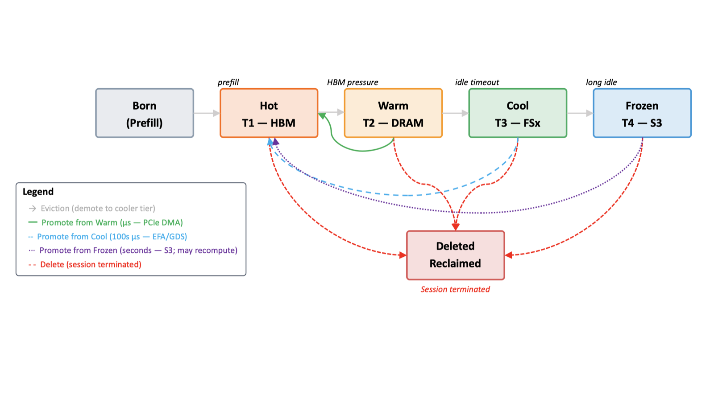
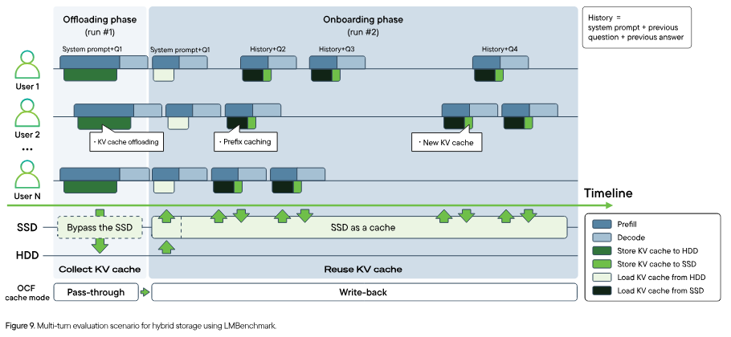

# KV Cache 放置策略横向对比

> 横向对比 · 15 章放置策略与硬件配置汇总

本章把前面 15 章中“放置策略”和“硬件配置信息”两个小节的内容放在一起对比。这里的“放置”指四件事：**哪些 KV** 可以离开 GPU（准入）；**放到哪一层**（层级与介质）；**什么时候**写入、淘汰和提升（时机）；**由谁决定**（用户 API、推理引擎、独立缓存层、全局调度器或存储系统）。本章不引入新事实，数值都来自各章已经核对过的来源。标为“本文分析”的段落，是根据这些事实做的推论。

按放置决策由谁做出，15 个对象可以分成五类：

- **托管 API**：AWS Bedrock、Azure OpenAI、Gemini、阿里云百炼、百度千帆。用户只能控制断点、TTL、缓存键等参数，物理放置不公开。
- **云基础设施分层方案**：SageMaker HyperPod 托管分层 KV 与 FSx for Lustre 参考架构（AWS），KAITO 与 Blob 配方（微软），GKE / llm-d（Google），CoreWeave AI Object Storage + LOTA，Tair KVCM / PAI（阿里云），百舸 AttentionStore（百度），UCM / EMS（华为）。
- **开源缓存层与推理系统**：LMCache、NVIDIA Dynamo KVBM、Mooncake（月之暗面）、FlexKV（腾讯），以及各章涉及的 SGLang HiCache、DashInfer、FastDeploy。
- **存储与内存厂商方案**：Seagate / SK hynix 混合存储白皮书，WD / Solidigm 分层简报。
- **通用内存分层**：AMD MEXT，Meta TMO / TPP。二者管理的是进程内存页，不是 KV。Meta 公开的 LLM KV 只放在 HBM 中。

### 横向对比表

同一厂商有多个方案时，下表每行以公开机制最完整的基础设施方案为主；托管 API 的用户侧控制放在下一节单独列出。“—”表示不适用，“未公开”表示来源没有写。

| 系统 | 层级链 | 放置单位 | 准入 | 写入时机 | 淘汰 | 提升 / 预取与回退 | 位置选择（路由） | 决策者 |
|---|---|---|---|---|---|---|---|---|
| AWS HyperPod（另有 FSx 参考架构） | HBM → 节点 DRAM L1 → 集群 tiered storage（内存池 + 本地 SSD）或 Redis；FSx 方案：HBM → DRAM → FSx → S3 | 256-token chunk | 满 chunk 全部写入，无热度阈值 | 同时写 L1 与 L2（write-through）；FSx 方案分 eager / lazy 两种 | L1 算法未公开；FSx 方案在 HBM > 85% 时按 LRU 下沉，闲置后再降层 | L1 → L2 → 重算 | `prefixaware` / `kvaware` | Operator 托管的 LMCache 与路由器 [AWS9][AWS15][AWS16] |
| 微软 KAITO / Blob 配方 | KAITO：HBM → 主机 DRAM（不支持 NVMe 或对象存储）；配方：HBM → CPU 暂存 → Premium Blob | 256-token chunk | 可复用块全部写入 | 配方用 `nixl_async_put` 异步上传 | KAITO：LRU | 按需读回；配方经 NIXL 流式读回 | AKS + Dynamo 的 KV 感知代价 | LMCache sidecar [PLMS1][PLMS2][PLMS3][AZ7] |
| Google GKE / llm-d | HBM → CPU 层 → 二级层（共享 FS / 对象存储 / P2P），二级层只能经 CPU 层访问 | block，建议 256–512 token | 从 HBM 逐出的块，无热度阈值 | 异步 DMA，多线程读写 | CPU 层 `lru` / `arc`；`fs` 层自身不淘汰，由 PVC Evictor 清理 | 经 CPU 层回到 GPU；P2P 失败或部分命中时重算 | EPP 层加权：gpu 1.0、cpu 0.8 | 引擎连接器 + EPP [PLGG1][PLGG2][GCP14] |
| CoreWeave + LMCache | HBM →（示例中关闭 CPU 层）→ LOTA 节点 NVMe 读缓存（默认 3 TiB / 节点）→ AI Object Storage | 256-token chunk，一个对象；LOTA 只缓存 > 4 MB 的对象 | 满 chunk 全部写入 | prefill 后直接 PUT 到后端；LOTA 为 read-through | LOTA：LRU；桶生命周期或 MP adapter 水位 | 异步加载，`blocking_timeout_secs: 10` | 远端层共享，无需路由；LOTA 按兼容节点 + 负载选择 | LMCache + LOTA [CW][L][CWV2] |
| LMCache | HBM → pinned DRAM L1 → L2 adapter（本地盘 / S3 / Redis / Mooncake 等）+ P2P | 256-token chunk，前缀链式哈希 | prompt 的完整 chunk；decode 输出需开启 `save_decode_cache` | 异步 write-through 到所有 L2，多副本 | 每层独立：水位 0.8、每次淘汰 0.2，LRU / ARC；淘汰不下沉 | 先 L1 后 L2，命中后回填 L1；失败时重算 | `kvaware`，`kv_aware_threshold` 默认 2000 | 连接器 / server / 路由器 [LMC3][PLLM1][PLLM5][PLLM9] |
| NVIDIA Dynamo KVBM | G1 HBM → G2 DRAM → G3 本地 NVMe → G4 网络 FS / S3 | 引擎 block，按 `sequence_hash` 去重 | G2：所有注册块；G3：频次 ≥2 | 异步批量复制（注册即复制），单副本 | 先按优先级、再按 LRU；无 TTL | 按需加载，先查 G2 再查 G3；超时回退未公开 | Router 权重：设备 1、主机 0.75、盘 0.25 | KVBM leader + Router [PLNV1][PLNV3][PLNV10][PLNV13] |
| Mooncake | HBM → 分布式 DRAM 池 → 本地 SSD → 可选 S3 | 论文：块（评测 256 token）；Store：对象 | 由引擎决定；decode 输出需开启 `save_decode_cache` | DRAM 写 `replica_num` 份（默认 1）；被淘汰对象异步写 SSD（evict-to-lower） | 水位 90% 时淘汰 5%，租约先到期者优先；支持软 / 硬 pin | Get 回落 SSD；`lookup_timeout_s` 1 s 超时后重算 | Conductor 估算 TTFT 选实例，热块拉取形成副本 | Conductor / Master / 连接器 [MC1][MC3][MC4][PLMO3] |
| 阿里云 HiCache / KVCM | HBM → 主机内存（默认为 GPU 池的 2 倍）→ L3（3FS / Mooncake / file）；KVCM：DRAM → SSD | page；KVCM 为 Block | `write_through` / `write_through_selective`（命中 ≥2）/ `write_back` | 备份确认后写 L3；KVCM 写入时只选一层，靠水位 Copy | HiCache 默认 lru；KVCM 70% 时迁移、85% 时按 Group LRU 回收 | L3 命中 ≥256 token 才预取；超时上限 min(30, 2+0.1×token/1024) s，其余重算 | L1 / L2 实例私有；PAI 用 `prefix-cache` 路由 | HiRadixTree / KVCM 元数据服务 [PLAL4][PLAL1][PLAL6][ALI10] |
| 腾讯 FlexKV | CPU（默认 16 GB）→ SSD（默认关闭）→ 远端（PCFS / Mooncake） | 引擎页大小的 block | 请求结束时写入全部满块，**包括 decode 输出** | 先写 CPU，再异步写 SSD 和远端，各层都有副本 | 各层在 `evict_start_threshold` 时淘汰 RadixTree 叶子（LRU），不下沉 | CPU → SSD → 远端，读到的块提升到 CPU；远端只在预取中读取 | 本地 / P2P 取最长前缀；实例路由交给上层 | GlobalCacheEngine [PLTX1][PLTX2][PLTX3] |
| 百度 AttentionStore（另有 FastDeploy） | HBM → DRAM（单机数百 GB）→ 本地 SSD（单机 4.5 TB），L2 / L2.5 已 P2P 池化，L3 在建 | KV Block；FastDeploy 默认 64 token | L1→L2：selective + Ghost List；prefill KV 与 decode 增量都回写 | 异步回写；FastDeploy 在请求结束时写入整条前缀 | LRU；FastDeploy 淘汰 GPU 叶子块，换出到 CPU 或丢弃 | 多层并行读；调度后预取，可被打断；FastDeploy 读超时 30 s 后重算 | Session 亲和；按“命中长度 × 介质读取效率”打分 | 节点 Agent + 地域 Master [BD10][BD11][BD12][PLBD2] |
| 华为 UCM / EMS | UCM：HBM → 主机 DRAM 缓冲 → FS（本地 / NFS / 3FS）或内存池；EMS：HBM → DRAM 池 → EVS SSD | UCM 示例 128-token 块；EMS 每页 128–512 token | 提示词的完整块（可设 `persist_token_threshold`），不含 decode 输出 | 异步写穿；EMS 全部写入 EVS | 主机缓冲用 CLOCK；Posix GC 在 70% 时按 mtime 删除 10%；EMS 类 LRU | 前缀连续查找，layerwise 流水；失败时重算 | UCM 由挂载点决定；EMS 一致性哈希，不做亲和 | Connector / Store；MP Controller [PLHW1][PLHW2][PLHW4][HWI11] |
| Seagate / SK hynix | HBM → DRAM → NVMe-oF 混合卷（SSD 缓存 15.36TB + HDD 360TB） | KVBM block；OCF 按 cache line（默认 4 KiB） | 全部写入，包括 decode 输出 | KVBM 为 write-through；OCF 为 write-back，后台 cleaning 刷到 HDD | OCF LRU，按 cache line | HDD 命中后首次复用即提升到 SSD；无预取 | 共享 NVMe-oF + KV-aware router | KVBM + OCF + 运维 [SWP][PLSG1] |
| WD / Solidigm | HBM → 30 GiB DRAM 层 → 经 NFS 的 QLC 或 HDD 容量层 | chunk（大小未公开） | GPU 驱逐流全部写入 | 由缓冲层吸收，容量层在后台写；不允许同步写机械盘 | 未公开 | 召回由 DRAM 服务；尚未持久化的 chunk 视为未命中，重算 | 单机，无路由 | LMCache + 架构规则 [W] |
| AMD MEXT | DRAM ↔ 专用 NVMe（默认为 DRAM 的 20%） | 内存页 | 冷页（阈值未公开） | 主动卸载 | 未公开 | AI 预测即将变热的页，提前迁回 | 单机 | 驱动 + AI 引擎 + mextd [AMD1][AMD4] |
| Meta TMO / CP 推理 | TMO：DRAM → zswap → SSD；LLM KV 只放 HBM | 页；CP 按 token 段切分 | PSI 决定回收量；KV 全部留在 HBM | 主动回收；SSD 写入限速 1 MB/s | 内核 LRU | 按需读回；KV 缺失时重算，缺失率 5% 是 pass-Q / pass-KV 的分界 | cgroup；CP rank | Senpai + 内核；推理运行时 [META1][META5] |

表中的“写入”有两种语义，要先区分。**写穿式**指数据还在上层时就复制一份到下层，下层是上层的超集或备份。**淘汰时下沉**指只有被上层逐出的数据才进入下层，下层存放的是“近期不够热”的部分。LMCache、FlexKV、UCM、EMS、HyperPod 属于前者。Mooncake 的 DRAM → SSD、Gemini 的内存层 → 持久层、Azure OpenAI 的 extended 保留属于后者。 [LMC3][PLTX1][MC4][GCP5][PB]

### 设计模式归纳

#### 1. 三种写入 / 下沉模式

- **写穿到所有层（write-through-to-all）**：LMCache 默认把每个 chunk 异步推送到所有已配置的 L2 adapter。各层独立淘汰，淘汰不会触发向下层迁移，因为数据在写入时已经在下层。FlexKV 先写 CPU，再异步写 SSD 和远端层。HyperPod 同时写 L1 与 L2。UCM `Mooncake|Posix` 在 dump 时同时写两个后端。 [LMC3][PLLM5][PLTX1][AWS9][PLHW4]
- **淘汰时下沉（evict-to-lower）**：Mooncake Master 选出待淘汰对象后，由客户端按桶（默认 256 MB 或 500 个 key）写入 SSD。DashInfer 在 GPU 淘汰时把较新的节点换出到 CPU。Gemini 在内存回收时写入持久层。 [MC4][PLAL9][GCP5]
- **按频次过滤后下沉**：KVBM 的 G2 → G3 过滤器给频次初值 1，每次命中翻倍，频次 ≥2 才写盘，目的是延长 SSD 寿命。HiCache `write_through_selective` 在 `hit_count` ≥2 时才备份。百度在 selective 之上加了 Ghost List，只保存 64-bit Page Hash，用来识别“被淘汰后又被重建”的前缀。 [PLNV3][PLNV4][PLAL6][BD11]

第四种做法是按水位在层间复制。KVCM 在 DRAM 用量达到 70% 时把 Block 复制到 SSD，达到 85% 时按 Group LRU 回收。它既不是写穿，也不是严格的淘汰下沉。 [PLAL1]

*KV 块状态机：Hot（HBM）→ Warm（DRAM）→ Cool（FSx）→ Frozen（S3）的降级触发与三种提升路径（AWS Storage Blog “Accelerate inference with KV cache tiering on AWS” Figure 2，2026-09-21）* — [原始来源](https://aws.amazon.com/blogs/storage/accelerate-inference-with-kv-cache-tiering-on-aws/)

#### 2. “全量准入”是主流

在公开了机制的非托管系统中，大多数没有复用门槛，只有“块必须填满”这一结构性条件。LMCache 和 CoreWeave 示例不写不满一个 chunk 的尾部，FlexKV 不写不满一块的尾部，UCM 只设长度门槛 `persist_token_threshold`（默认 0）。真正按复用概率筛选的只有 KVBM 的 G3、HiCache 的 selective 模式和百度的 Ghost List，而且都只作用在某一层的入口，不是全链路。是否保存 decode 输出也不统一：FlexKV、Seagate 白皮书和百舸默认保存；LMCache、vLLM + Mooncake 默认不保存；UCM 不保存；FastDeploy 需要 `--enable-output-caching`。 [PLLM1][L][PLTX2][PLHW2][SWP][BD10][PLMO3][PLBD3]

#### 3. 按层加权的路由打分

层级信息开始进入路由器，但权重都是人工设定的常数：

- Dynamo 的代价函数把主机命中折算为 0.75、盘命中折算为 0.25（设备命中按 1 计）。 [PLNV9][PLNV10]
- llm-d EPP 的权重为 `gpu = 1.0`、`cpu = 0.8`。 [PLGG2]
- 百舸按“命中长度 × 介质读取效率”打分。 [BD10][BD12]
- LMCache `kvaware` 只看命中 token 数，命中少于“提示长度 − 2000”时退回会话哈希或 QPS 路由。 [PLLM9]
- Mooncake 论文的 Conductor 估算“传输 + 排队 + prefill”的 TTFT，并在远端前缀足够长时把热块拉到目标实例。 [MC1]
- 华为 EMS 明确不做亲和路由，理由是 UB 让访问远端 DRAM 的代价足够低。 [HWI11]

#### 4. 加载还是重算：阈值与超时

各系统用经验阈值或超时来回答“读回比重算快吗”：

- AWS 存储博客：上下文 > 50,000 tokens 时，从 FSx 提升几乎总比重算快；< 10,000 tokens 时重算更划算。Curvine 博客认为约 1,000 tokens 以下 L2 往返与重算相当。 [AWS16][AWS15]
- HiCache 预取超时上限为 min(30, 2+0.1×token/1024) 秒，32k token 时约 5.1 s。 [PLAL4]
- FastDeploy 读任务超时 30 s，Mooncake vLLM 连接器 `lookup_timeout_s` 为 1 s，CoreWeave 示例 `blocking_timeout_secs` 为 10 s。 [PLBD2][PLMO3][L]
- LMCache 技术报告的离线分析：在 32 Gbps 带宽下，只有超过 256K token 时加载才快于重算。 [LMC1]
- Meta CP 推理以 5% 的 KV 缺失率为界，在 pass-Q 与 pass-KV 之间切换。 [META5]

#### 5. TTL 是面向用户的放置控制

托管 API 没有暴露层级，用户只能通过“哪段前缀、留多久、发到哪”间接影响放置：

| 服务 | 哪段前缀（准入） | 留多久（保留 / TTL） | 发到哪（亲和） |
|---|---|---|---|
| AWS Bedrock | 检查点之前的前缀，最小 512–4,096 tokens | 5 分钟 / 1 小时（GPT-5.6 为 30 分钟），命中即重置 | 同一服务器才能命中；`prompt_cache_key` [PA][AWS7] |
| Azure OpenAI | ≥1,024 tokens 或断点 | `in_memory` 闲置 5–10 分钟清除；`24h` 在内存满时卸载到 GPU-local storage；GPT-5.6+ 的 `ttl`（30m / 12h）为最短保留 | `prompt_cache_key`，每个“前缀 + key”约 15 RPM [PB] |
| Gemini | 最小 2,048–6,144 tokens；显式 `CachedContent` | 隐式最晚 24 小时；显式默认 60 分钟；`DURABLE` / `EPHEMERAL` | 项目隔离，区域内服务 [GCP1][GCP5] |
| 阿里云百炼 | ≥1024 Token，每个请求最多 4 个断点 | 5 分钟 / 1 小时，命中即续期；1 小时的创建单价约为 200% | 按账号隔离 [PD][ALI1] |
| 百度千帆 | 显式 `/v2/caching`；隐式自动 | `ttl` 每次使用都重新计时，存储按小时计费；隐式缓存定期清理 | 隐式缓存路由到处理过相同前缀的服务器 [BD7][BD8] |

长 TTL 被单独定价（Azure 12h 的写入费率、百炼 1 小时 200%、Gemini 的存储 token·小时费），这说明服务商把长期驻留当作占用容量层的行为来收费。 [PB][ALI1][GCP1][GCP6] 在基础设施内部，对应的机制是租约和 pin：Mooncake 读取时授予 10 s 租约，系统提示词这类前缀推荐用软 pin（默认 30 分钟）保留。 [MC3]

#### 6. 没有系统公开显式成本模型

各章“选择依据”一栏的结论一致：层级选择依据的是容量水位、近期性、命中频次和超时。没有系统把介质单价、复用概率和重算代价放进同一个在线模型。最接近的是 Mooncake 论文中按 TTFT 和 SLO 做的调度代价模型，但它决定的是实例，不是介质。 [MC1] 存储厂商只给出静态的成本论据：Seagate 白皮书称 SSD 每 TB 成本约为 HDD 的 16 倍；WD 简报主张缓冲层容量按“驱逐速率 + 热召回集”确定，有缓冲时容量介质的选择只是成本问题。 [SWP][W]

### 对 HDD 层的含义

本文分析。在上述策略下，HDD 有三个可能的接入位置，每个位置对策略的要求不同：

1. **放在 SSD 之下、对 KV 层透明。**这是 Seagate / SK hynix 的做法：KVBM 只看到一个 EXT4 卷，由 Open CAS 以 write-back 方式先写 SSD，再由后台 cleaning 刷到 HDD；HDD 上的数据在首次复用时提升回 SSD。好处是不改推理栈；代价是放置按 cache line 进行，不感知前缀和会话。白皮书也没有使用 OCF 的 nhit 晋升过滤和顺序流旁路。 [SWP][PLSG1]
2. **放在 DRAM 缓冲之后，作为远端容量层。**这是 WD / Solidigm 的规则：GPU 驱逐流约 0.7 GB/s，而 24 块 HDD 的持久化写入上限约 692 MB/s，所以永远不让驱逐流同步写到机械盘；缓冲层容量按驱逐速率和热召回集确定。同步写 HDD 且没有缓冲时，命中率降到 19.0%。 [W]
3. **作为缓存层的一个下层 adapter。**如果直接挂在 LMCache 或 FlexKV 这类“写穿到所有层”的系统下面，HDD 要承受全量写流，等同于 WD 简报中被否定的配置。挂在 Mooncake 这类“淘汰时下沉”的 SSD 之下更合适：进入 HDD 的只有被 SSD 淘汰的数据，流量更小，也更冷。 [LMC3][PLTX1][MC4]

现有的过滤器和水位是为 SSD 设计的，套用到 HDD 上还不够。KVBM 的 ≥2 过滤保护的是 SSD 寿命；KVCM 的 70% / 85%、Mooncake 的 90% / 5%、UCM 的 70% / 10% 都只看容量。HDD 准入需要同时考虑写带宽预算和复用概率。路由侧也只有一个 0.25 的“盘”权重，HDD 需要单独一档。 [PLNV3][PLAL1][MC3][PLHW4][PLNV10] 时延量级也要对齐：Seagate 白皮书中混合方案在 1 轮时比全 SSD 的 TTFT 多 7.6 s，50 轮时降到 0.35 s；同一量级已超过 HiCache 在 32k token 下约 5.1 s 的预取超时。两者测试条件不同，这里只说明量级。 [SWP][PLAL4]

据此，一个 HDD 层至少需要以下策略特征（本文分析）：

- **异步写**：只在后台从 SSD 或 DRAM 下沉，不进入 GPU 驱逐的关键路径。 [W]
- **按复用概率准入**：例如频次过滤、Ghost List 式的“曾被重建”信号或会话级活跃度，而不是“全量准入”。
- **大粒度顺序 I/O**：按会话或多 chunk 聚合写入。参考 CoreWeave 建议单次读取 ≥15 MB、LOTA 只缓存 > 4 MB 的对象。 [CWV3][CWV2]
- **会话恢复前预取**：Seagate 把 Dynamo prefetch hint 列为未来工作，Baidu 的可打断预取和 HiCache 的入队即预取可以作为参照。 [SWP][BD11][PLAL4]
- **超时回退到重算**：超时阈值要随前缀长度增长，读不完的部分重算。
- **天到周级的保留与生命周期管理**：白皮书的目标保留期是数天到数周。 [SWP]

*Seagate / SK hynix 白皮书原 PDF 第 10 页 Figure 9：首轮在 OCF pass-through 下绕过 SSD、写入 HDD，此后切换为 write-back，SSD 作为缓存，读回与新增 KV 都经过 SSD* — [原始来源](https://www.seagate.com/content/dam/seagate/assets/resources/enabling-inference-at-massive-scale-with-hybrid-storage-for-kv-cache-offloading/files/kv-caching-white-paper.pdf)

### 硬件配置汇总

下表从 15 章的硬件配置表中各选取与 KV 放置最相关的测试或方案。数值照搬各章（实例规格补全的部分沿用该章的规格页引用），“未公开”表示原来源没有给出。

| 场景 | 计算 | 主机内存 | 本地存储 | 网络 | 远端存储 | 是否出现 HDD | 来源 |
|---|---|---|---|---|---|---|---|
| AWS HyperPod 分层 KV 基准（7 × p5.48xlarge） | 每台 8 × H100，640 GiB | 2,048 GiB（L1 所在） | 8 × 3,800 GB NVMe | 3,200 Gbps EFA | tiered storage 或 Redis，规格未公开 | 否 | [AWS9][AWS10][PLAWS3] |
| AWS FSx for Lustre 四级参考架构 | Trn3 UltraServer：144 颗 Trainium3，20.7 TB HBM3e；8-GPU 节点 1.1–2.3 TB HBM | T2：1–4 TB / 节点 | — | EFA + GDS 最高 1,200 Gbps | FSx for Lustre（125–1,000 MBps/TiB）+ S3 | 否 | [AWS16] |
| Azure LMCache + NIXL → Blob 基准 | ND96isr_H100_v5：8 × H100 80GB | 1,900 GiB；50 GiB 暂存缓冲 | 28 TiB NVMe（未用作 KV 层） | 80 Gbps 以太网（跑满） | Premium 块 Blob，LRS | 否 | [AZ8][PLMS3][PLMS6] |
| GKE Managed Lustre KV 基准 | A3-Ultra：8 × H200 141 GB | 1 TiB 主机内存基线 | 未公开 | 未公开 | Managed Lustre，1000 MB/s per TiB | 否 | [GCP13] |
| LMCache on GKE 节点内分层 | A3 Mega，HBM 640Gi | 1Ti | Local SSD 5Ti | 未公开 | — | 否 | [GCP16] |
| Cohere / CoreWeave / LMCache | 8-GPU 节点，型号未公开 | 未公开 | LOTA NVMe 每节点默认 3 TiB | 未公开 | AI Object Storage，每节点 8.5–10 GB/s；后端介质未公开 | 否（后端介质未公开） | [CW][CWV2] |
| LMCache 技术报告 | GMI Cloud 8 × H100 | 卸载上限 500 GB DRAM | 未公开 | 到集中存储 15 Gbps | 集中式存储服务器 | 否 | [LMC1] |
| Dynamo Qwen3-32B + KVBM recipe | 1 × H200 或 B200 | ≥ 约 150 GiB；G2 100 GB | 未使用 G3 | 未公开 | 无 | 否 | [PLNV11] |
| Mooncake FAST'25 实验平台 | 16 节点 × 8 × A800-SXM4-80GB | 未公开 | 未公开 | 每节点 4 × 200 Gbps RDMA | Mooncake Store | 否 | [MC1] |
| Mooncake SSD 下沉基准 | 8 × A100-SXM4-40GB | 内存池 80 GB | 5 块 Samsung NVMe RAID0，约 14 TB | 2 × 200 Gb/s InfiniBand HDR | 无 | 否 | [MC5] |
| 阿里云 PAI 智能路由测试 | ml.gu8tf.8.40xlarge：8 × H20 96 GB | 1800 GB | 未公开 | 未公开 | — | 否 | [ALI10][PLAL12] |
| 阿里云 3FS（HiCache L3） | — | — | NVMe SSD | RDMA | 180 节点读带宽 6.6 TiB/s | 否 | [ALI11] |
| 腾讯 FlexKV × vLLM 示例 | 8 卡，型号未公开 | CPU 层 32 GB | SSD 层 1024 GB | 未公开 | 未启用 | 否 | [TX5] |
| 百度千帆 / 百舸线上 KV 存储 | 验证平台为昆仑芯 P800 | 单机数百 GB，约 20 GB/s | 单机 4.5 TB SSD | P2P 池化 30–40 GB/s | L3 在建 | 否 | [BD10][BD12] |
| 华为 CloudMatrix384（EMS） | 384 × 昇腾 910 | 192 × 鲲鹏，DRAM 容量未公开 | 未公开 | UB + RDMA 平面 | EMS DRAM 池 + EVS，48 节点聚合最高 48 × 400 Gbps | 否 | [HWI11] |
| 华为 UCM 示例 | 8 × B200 / B300，或 Atlas 800 A2 8 × 64 GB | 主机缓冲 128 GiB | 挂载目录，介质未指定 | 未公开 | 无 | 否 | [PLHW7] |
| Seagate / SK hynix 白皮书 | 1 × H100 PCIe 80GB | 2.0 TiB DDR5 | SSD 服务器：4 × SK hynix PS1010 3.84TB；HDD 服务器：12 × Exos 30TB（360TB） | NVMe-oF over RDMA 400Gb/s；SSD–HDD 25Gb/s | NVMe-oF 混合目标 | **是** | [SWP] |
| WD / Solidigm 简报 | 8 × B200，每卡 183 GiB | 30 GiB DRAM 层 | 1 × 15.36TB Gen5 NVMe（对照） | 400GbE，NFSv4.2 over TCP | QLC：23 × 122.88TB；HDD：24 × 18TB HC550（432TB） | **是** | [W] |
| AMD MEXT Agentic AI 白皮书 | 无 GPU | 2 × EPYC 9996，基线每路 1,024.7 GiB | Solidigm 3.84TB NVMe | 未公开 | 无 | 否 | [AMD5] |
| Meta CP 推理（GTT） | 8 × H100 96GB，最多 16 台 | 未公开 | 未公开 | 每 GPU 400 Gb/s RDMA | 无 | 否 | [META5] |
| Meta TMO Web A/B 测试 | — | Skylake，64GB | 快 / 慢 NVMe SSD | 未公开 | 无 | 否 | [META1] |

汇总来看，KV 实际落地的层是 HBM、主机 DRAM 和 SSD / NVMe（本地盘、池化 NVMe、3FS、EVS、Lustre 等）。在上表的测试中，对象存储（S3、Azure Blob、CoreWeave AI Object Storage）只在 AWS FSx 架构、微软 Blob 配方和 CoreWeave 案例中作为 KV 层；LMCache、llm-d、KVBM 虽然支持 S3 类后端，但所列测试没有用到。主机 DRAM 是配置最普遍的一层，规模从 KAITO 文档算例的 100 GiB L1 到 p5.48xlarge 的 2,048 GiB 不等。 [PLMS1][PLAWS3] HDD 只出现在两份存储厂商的测试平台中：Seagate / SK hynix 的 12 块 Exos 30TB，以及 WD / Solidigm 的 24 块 Ultrastar HC550。两者都位于远端存储服务器上，通过 NVMe-oF 或 NFS 访问，前面都有 SSD 或 DRAM 缓冲。 [SWP][W] 云厂商和开源项目的来源没有一份给出 HDD；CoreWeave 等对象存储的后端介质也没有公开。

### 资料边界

本章完全依赖前 15 章已核对的来源，没有重新采集；各系统的版本以各章固定的版本为准，之后的参数默认值可能变化。托管 API 的物理放置、多数系统的副本数、HDD 在对象存储后端的使用情况均未公开，表中相应格子只能写“未公开”。另需注意，Dynamo v1.6 文档已把 vLLM 的卸载后端列为 native、KVBM、LMCache、FlexKV 四种，SGLang 走 HiCache；KVBM 设计页自 v1.5 起从当前文档目录移除，只保留配置参考和示例，因此本章引用的 KVBM 机制细节（来自 v1.4.2 设计文档）可能已过时。 [PLNV5][PLNV1][PLNV2]

## 本章资料

- **[ALI1]** [阿里云百炼 · 显式缓存（Qwen4）帮助文档（页面更新于 2026-11-16，采集于 2026-11-18）](https://help.aliyun.com/zh/model-studio/explicit-cache-qwen4)
- **[ALI10]** [阿里云帮助中心 · PAI-EAS · 使用 LLM 智能路由提升推理效率（页面更新于 2026-08-04）](https://help.aliyun.com/zh/pai/user-guide/use-llm-intelligent-router-to-improve-inference-efficiency)
- **[ALI11]** [阿里云开发者社区 · 阿里云 Tair 联手 SGLang 共建 HiCache，构建面向“智能体式推理”的缓存新范式（Tair KVCache 团队系列文章，2025-12-15）](https://developer.aliyun.com/article/1693182)
- **[AMD1]** [AMD · MEXT Predictive Memory Software 官方产品页（Overview / How It Works / Workloads / FAQs，采集于 2026-11-18）](https://www.amd.com/en/products/software/mext.html)
- **[AMD4]** [AMD · AMD MEXT Predictive Memory Installation Guide，Version 1.2，2026-10-08（AMD 文档中心 User Guides）](https://www.amd.com/en/search/documentation/hub.html#sortCriteria=%40amd_release_date%20descending&f-amd_product_brand=AMD%20MEXT%20Software&f-amd_document_type=User%20Guides)
- **[AMD5]** [AMD 白皮书 · Achieving up to 3.5x Higher Performance-per-DRAM-Dollar for Agentic AI（6th Gen EPYC + MEXT），2026-11](https://www.amd.com/content/dam/amd/en/documents/epyc-business-docs/white-papers/amd-mext-white-paper-agentic-ai-in-6th-gen-amd-epyc.pdf)
- **[AWS7]** [AWS Machine Learning Blog · Introducing explicit prompt caching for OpenAI models on Amazon Bedrock，2026-07-30](https://aws.amazon.com/blogs/machine-learning/introducing-explicit-prompt-caching-for-openai-gpt-5-6-models-on-amazon-bedrock/)
- **[AWS9]** [AWS Machine Learning Blog · Managed Tiered KV Cache and Intelligent Routing for Amazon SageMaker HyperPod，2025-11-26](https://aws.amazon.com/blogs/machine-learning/managed-tiered-kv-cache-and-intelligent-routing-for-amazon-sagemaker-hyperpod/)
- **[AWS10]** [AWS What's New · SageMaker HyperPod now supports Managed tiered KV cache and intelligent routing，2025-11-26](https://aws.amazon.com/about-aws/whats-new/2025/11/sagemaker-hyperpod-managed-tiered-kv-cache/)
- **[AWS15]** [AWS Machine Learning Blog · Tiered KV cache for large LLMs on Amazon SageMaker HyperPod with Curvine，2026-08-12](https://aws.amazon.com/blogs/machine-learning/tiered-kv-cache-for-large-llms-on-amazon-sagemaker-hyperpod-with-curvine/)
- **[AWS16]** [AWS Storage Blog · Accelerate inference with KV cache tiering on AWS，2026-09-21](https://aws.amazon.com/blogs/storage/accelerate-inference-with-kv-cache-tiering-on-aws/)
- **[AZ7]** [AKS Engineering Blog · Scaling multi-node LLM inference with NVIDIA Dynamo and NVIDIA GPUs on AKS (Part 3)，2026-03-16](https://blog.aks.azure.com/2026/03/16/dynamo-on-aks-part-3)
- **[AZ8]** [Microsoft Tech Community · Azure Storage Blog：Accelerate Inference on AKS with Azure Blob Storage and NVIDIA Dynamo，2026-08-11](https://techcommunity.microsoft.com/blog/azurestorageblog/accelerate-inference-on-aks-with-azure-blob-storage-and-nvidia-dynamo/4543408)
- **[BD7]** [百度智能云 · 千帆 ModelBuilder 文档《prompt cache》，更新时间 2026-11-11](https://cloud.baidu.com/doc/qianfan-docs/s/7m8r1wke3)
- **[BD8]** [百度智能云 · 千帆 ModelBuilder 文档《前缀缓存》，更新时间 2026-01-05](https://cloud.baidu.com/doc/qianfan-docs/s/Lmhuc7c2o)
- **[BD10]** [百度智能云官网文章 · 《拒绝 OpenClaw 成为「吞金龙虾」，百度百舸打造极致 KV Cache 调度与加速引擎》（AttentionStore），2026-04-01](https://cloud.baidu.com/article/6296264)
- **[BD11]** [百度智能云技术站（掘金官方账号）· 《极致 KVCache 推理服务效能优化与多芯软硬协同实践》，SGLang Meetup 北京站演讲整理，2026-10-15](https://juejin.cn/post/7696696661667151908)
- **[BD12]** [百度智能云技术站（掘金官方账号）· 《让推理服务稳定可控，从负载治理到 KVCache 全域感知》，SGLang Meetup 北京站演讲整理，2026-10-21](https://juejin.cn/post/7698734382195015722)
- **[CW]** [Cohere / CoreWeave / LMCache 联合案例，2025-10-29](https://blog.lmcache.ai/en/2025/10/29/breaking-the-memory-barrier-how-lmcache-and-coreweave-power-efficient-llm-inference-for-cohere/)
- **[CWV2]** [CoreWeave 官方文档 · Local Object Transport Accelerator (LOTA)（采集于 2026-11-18）](https://docs.coreweave.com/products/storage/object-storage/improving-performance/about-lota)
- **[CWV3]** [CoreWeave 官方文档 · AI Object Storage Performance best practices（采集于 2026-11-18）](https://docs.coreweave.com/products/storage/object-storage/improving-performance/best-practices)
- **[GCP1]** [Google Cloud · Gemini Enterprise Agent Platform：Context caching overview（Last updated 2026-11-17，采集于 2026-11-18）](https://docs.cloud.google.com/gemini-enterprise-agent-platform/models/context-cache/context-cache-overview)
- **[GCP5]** [Google Cloud · Gemini Enterprise Agent Platform and zero data retention（Implicit data caching / Control data caching，采集于 2026-11-18）](https://docs.cloud.google.com/gemini-enterprise-agent-platform/resources/zero-data-retention)
- **[GCP6]** [Google Cloud · Agent Platform（Generative AI）Pricing（采集于 2026-11-18）](https://cloud.google.com/vertex-ai/generative-ai/pricing)
- **[GCP13]** [Google Cloud Blog · Reducing TCO for AI inferencing with external KV Cache on Managed Lustre（2025-11-01）](https://cloud.google.com/blog/products/storage-data-transfer/choosing-google-cloud-managed-lustre-for-your-external-kv-cache)
- **[GCP14]** [Google Cloud Blog · Scaling LLM Inference: Multi-Node KV Cache Offloading with GKE & Managed Lustre（2026-07-01）](https://cloud.google.com/blog/topics/developers-practitioners/scaling-llm-inference-multi-node-kv-cache-offloading-with-gke-managed-lustre)
- **[GCP16]** [LMCache 官方博客 · LMCache on Google Kubernetes Engine: Boosting LLM Inference Performance with KV Cache on Tiered Storage（Danna Wang，Google，2025-10-07）](https://blog.lmcache.ai/2025-10-07-LMCache-on-GKE/)
- **[HWI11]** [Huawei 等 · Serving Large Language Models on Huawei CloudMatrix384（arXiv 2506.12708v3，2025-06）](https://arxiv.org/abs/2506.12708)
- **[L]** [LMCache · S3 Backend 文档（含 S3 Express / CoreWeave 配置示例与 MP 模式 S3 L2 adapter 说明，采集于 2026-11-18）](https://docs.lmcache.ai/kv_cache/storage_backends/s3.html)
- **[LMC1]** [Liu, Yao, Cheng 等（Tensormesh / 芝加哥大学）· LMCache: An Efficient KV Cache Layer for Enterprise-Scale LLM Inference，arXiv 2510.09665（v1 2025-10-08，v2 2025-12-05）](https://arxiv.org/abs/2510.09665)
- **[LMC3]** [LMCache 官方文档 · Secondary KV Storage（L1/L2 数据流、Cascade、Store/Prefetch 策略、L1/L2 淘汰，采集于 2026-11-18）](https://docs.lmcache.ai/mp/l2_storage/index.html)
- **[MC1]** [USENIX FAST'25 · Qin et al. · Mooncake: Trading More Storage for Less Computation — A KVCache-centric Architecture for Serving LLM Chatbot，2025-02（会议论文 PDF）](https://www.usenix.org/system/files/fast25-qin.pdf)
- **[MC3]** [Mooncake 官方文档 · Mooncake Store 设计（Eviction Policy 等，采集于 2026-11-18）](https://kvcache-ai.github.io/Mooncake/design/store/mooncake-store.html)
- **[MC4]** [Mooncake 官方文档 · SSD Offload Design（采集于 2026-11-18）](https://kvcache-ai.github.io/Mooncake/design/store/ssd-offload.html)
- **[MC5]** [Mooncake 官方文档 · Mooncake SSD Offload Benchmark（采集于 2026-11-18）](https://kvcache-ai.github.io/Mooncake/performance/mooncake/ssd-offload-benchmark-results.html)
- **[META1]** [Weiner et al.（Meta / CMU）· TMO: Transparent Memory Offloading in Datacenters，ASPLOS ’22，2022（作者版 PDF，DOI 10.1145/3503222.3507731）](https://www.cs.cmu.edu/~dskarlat/publications/tmo_asplos22.pdf)
- **[META5]** [Yang et al.（Meta Platforms）· Context Parallelism for Scalable Million-Token Inference，MLSys 2025，arXiv:2411.01783 v3（2025-04-21）](https://arxiv.org/abs/2411.01783)
- **[PA]** [AWS · Amazon Bedrock User Guide：Prompt caching for faster model inference（采集于 2026-11-18）](https://docs.aws.amazon.com/bedrock/latest/userguide/prompt-caching.html)
- **[PB]** [Microsoft Learn · Azure OpenAI in Microsoft Foundry: Prompt caching（页面更新 2026-11-06，采集于 2026-11-18）](https://learn.microsoft.com/en-us/azure/foundry/openai/how-to/prompt-caching)
- **[PD]** [阿里云百炼 · 上下文缓存（Context Cache）帮助文档（页面更新于 2026-11-16，采集于 2026-11-18）](https://help.aliyun.com/zh/model-studio/context-cache)
- **[PLAL1]** [阿里巴巴官方 GitHub · alibaba/tair-kvcache · docs/design/tiered_storage.md《分层存储设计》（更新于 2026-10-08；固定到提交 8f4048c，采集于 2026-11-19）](https://github.com/alibaba/tair-kvcache/blob/8f4048c712c415eb2264533769511cc9609a4542/docs/design/tiered_storage.md)
- **[PLAL4]** [SGLang 官方文档 · HiCache System Design and Optimization（hicache_design.mdx，v0.5.23，2026-11-02 发布）](https://github.com/sgl-project/sglang/blob/v0.5.23/docs/docs/advanced_features/hicache_design.mdx)
- **[PLAL6]** [SGLang 源码 · python/sglang/srt/mem_cache/unified_radix_cache.py（write_through_threshold、load_back_threshold、write_backup_storage；v0.5.23）](https://github.com/sgl-project/sglang/blob/v0.5.23/python/sglang/srt/mem_cache/unified_radix_cache.py)
- **[PLAL9]** [DashInfer 源码 · csrc/runtime/cache/prefix_cache_manager*.{cpp,hpp}（LRUEvictor、filter_timeout_hash、swap_to_cpu；提交 06669fa）](https://github.com/modelscope/dash-infer/tree/06669fa30816f828c53ea144a7a9ac01507df5b5/csrc/runtime/cache)
- **[PLAL12]** [阿里云帮助中心 · PAI-EAS 服务部署：配置模型缓存加速（含 ml.gu8tf.8.40xlarge 规格：160vcpu+1800GB+8*GU8T，H20 96G；页面更新于 2026-08-05，采集于 2026-11-19）](https://help.aliyun.com/zh/pai/model-cache-acceleration)
- **[PLAWS3]** [AWS · Amazon EC2 Instance Types：Specifications for accelerated computing instances（p5 / g5 / g6 / g6e 规格，采集于 2026-11-19）](https://docs.aws.amazon.com/ec2/latest/instancetypes/ac.html)
- **[PLBD2]** [PaddlePaddle FastDeploy · 源码 cache_manager/prefix_cache_manager.py（request_match_blocks、free_block_ids_async、write_cache_to_storage），提交 d923caf（2026-09-24），采集于 2026-11-19](https://github.com/PaddlePaddle/FastDeploy/blob/d923caf15e1eb0da8e2efd75b0152e65cefeeddd/fastdeploy/cache_manager/prefix_cache_manager.py)
- **[PLBD3]** [PaddlePaddle FastDeploy · 源码 engine/sched/resource_manager_v1.py（请求结束 / 抢占时写入存储），提交 d923caf（2026-09-24），采集于 2026-11-19](https://github.com/PaddlePaddle/FastDeploy/blob/d923caf15e1eb0da8e2efd75b0152e65cefeeddd/fastdeploy/engine/sched/resource_manager_v1.py)
- **[PLGG1]** [llm-d 官方文档（v1.0）· Architecture › KV Cache Management › KV-Cache Offloading（采集于 2026-11-19）](https://llm-d.ai/docs/architecture/kv-management/kv-offloader)
- **[PLGG2]** [llm-d 官方文档（v1.0）· Architecture › KV Cache Management › KV-Cache Indexer（KVEvents、按层加权打分、推测性索引，采集于 2026-11-19）](https://llm-d.ai/docs/architecture/kv-management/kv-indexer)
- **[PLHW1]** [UCM 官方文档 · 配置参数参考（中文，提交 863dfc2，采集于 2026-11-19）](https://github.com/ModelEngine-Group/unified-cache-management/blob/863dfc2ab469174cdedcd3f5ae7c93af1abadcf9/docs/docs-site/docs/zh/reference/config-parameters.md)
- **[PLHW2]** [UCM 源码 · ucm/integration/vllm/ucm_connector.py（persist_token_threshold、lookup_on_prefix、load/dump 块范围；提交 863dfc2）](https://github.com/ModelEngine-Group/unified-cache-management/blob/863dfc2ab469174cdedcd3f5ae7c93af1abadcf9/ucm/integration/vllm/ucm_connector.py)
- **[PLHW4]** [UCM 源码 · Cache 阶段 trans_buffer.cc / dump_queue.cc（主机缓冲 CLOCK 复用、D2H 后写后端；提交 863dfc2）](https://github.com/ModelEngine-Group/unified-cache-management/tree/863dfc2ab469174cdedcd3f5ae7c93af1abadcf9/ucm/store/cache/cc)
- **[PLHW7]** [UCM 官方文档 · 模型导览 DeepSeek（DeepSeek-V4-Flash UCM 示例，中文，提交 863dfc2）](https://github.com/ModelEngine-Group/unified-cache-management/blob/863dfc2ab469174cdedcd3f5ae7c93af1abadcf9/docs/docs-site/docs/zh/user-guide/model-tour/deepseek/index.md)
- **[PLLM1]** [LMCache 官方仓库 v0.5.8rc1 · docs/source/mp/configuration.rst（LMCacheMPConnector extra_config：save_decode_cache、save_unfull_chunk、eager_prefetch 等，采集于 2026-11-19）](https://github.com/LMCache/LMCache/blob/v0.5.8rc1/docs/source/mp/configuration.rst)
- **[PLLM5]** [LMCache_inprocess 官方仓库（提交 0aebefd）· storage_manager.py（StorageManager.batched_put / batched_get / batched_contains）](https://github.com/LMCache/LMCache_inprocess/blob/0aebefd026f5c479d3f6bcbee0d5facd1b2856ec/lmcache/inprocess/v1/storage_backend/storage_manager.py)
- **[PLLM9]** [vLLM Production Stack 官方仓库 vllm-stack-0.1.14（提交 405a2fa）· src/vllm_router/routers/routing_logic.py（KvawareRouter、LoadAwareRouter）](https://github.com/vllm-project/production-stack/blob/vllm-stack-0.1.14/src/vllm_router/routers/routing_logic.py)
- **[PLMO3]** [vLLM 官方文档 · MooncakeStoreConnector Usage Guide（latest 开发版文档，save_decode_cache、lookup_timeout_s、MOONCAKE_PREFERRED_SEGMENT 等，采集于 2026-11-19）](https://docs.vllm.ai/en/latest/features/mooncake_store_connector_usage/)
- **[PLMS1]** [KAITO 项目（kaito-project/kaito）· KV Cache Offloading 文档（website/docs/kv-cache-offloading.md，提交 3d5ca31，2026-10-29 合并 PR #2364）](https://github.com/kaito-project/kaito/blob/3d5ca31f7fd2fcdb796f6e15f99b2a9e489f2560/website/docs/kv-cache-offloading.md)
- **[PLMS2]** [KAITO 项目源码 · presets/workspace/inference/vllm/lmcache_server.py（--chunk-size 256、--eviction-policy LRU、L1 容量计算，提交 3d5ca31）](https://github.com/kaito-project/kaito/blob/3d5ca31f7fd2fcdb796f6e15f99b2a9e489f2560/presets/workspace/inference/vllm/lmcache_server.py)
- **[PLMS3]** [Azure Storage 博客链接的配方（GitHub Gist，kyleknap）· Enhancing vLLM with Azure Blob Storage KV Cache Offload via LMCache & NIXL（更新于 2026-05-27，采集于 2026-11-19）](https://gist.github.com/kyleknap/6b19dec51fd555e22930edfbde6cd8d5)
- **[PLMS6]** [Microsoft Learn · ND H100 v5 sizes series（Standard_ND96isr_H100_v5 规格，采集于 2026-11-19）](https://learn.microsoft.com/en-us/azure/virtual-machines/sizes/gpu-accelerated/ndh100v5-series)
- **[PLNV1]** [NVIDIA Dynamo 官方文档 v1.6.1 · KVBM Configuration Reference（DYN_KVBM_* 与 KVBM_* / TOML，采集于 2026-11-19）](https://docs.nvidia.com/dynamo/v1.6.1/reference/components/kvbm-configuration)
- **[PLNV2]** [NVIDIA Dynamo 官方文档 v1.4.2 · KVBM Design（G1–G4、数据流、块状态机、事件面，采集于 2026-11-19）](https://docs.nvidia.com/dynamo/v1.4.2/knowledge-base/modular-components/kvbm/kvbm-design)
- **[PLNV3]** [NVIDIA Dynamo 官方文档 v1.4.2 · KVBM Guide（CPU / 盘缓存配置与盘卸载频次过滤，采集于 2026-11-19）](https://docs.nvidia.com/dynamo/v1.4.2/knowledge-base/modular-components/kvbm/kvbm-guide)
- **[PLNV4]** [ai-dynamo/dynamo 源码 v1.6.2（commit 28f9765）· lib/llm/src/block_manager/offload/filter.rs（FrequencyFilter）](https://github.com/ai-dynamo/dynamo/blob/v1.6.2/lib/llm/src/block_manager/offload/filter.rs)
- **[PLNV5]** [NVIDIA Dynamo 官方文档 v1.6.1 · Offloading Support Matrix（KV 路由的分层可见性，采集于 2026-11-19）](https://docs.nvidia.com/dynamo/v1.6.1/knowledge-base/modular-components/router/offloading-support-matrix)
- **[PLNV9]** [NVIDIA Dynamo 官方文档 v1.6.1 · Router Design（代价函数与 worker 选择，采集于 2026-11-19）](https://docs.nvidia.com/dynamo/v1.6.1/knowledge-base/modular-components/router/router-design)
- **[PLNV10]** [NVIDIA Dynamo 官方文档 v1.6.1 · Router Configuration and Tuning（host / disk cache hit weight 等，采集于 2026-11-19）](https://docs.nvidia.com/dynamo/v1.6.1/knowledge-base/modular-components/router/configuration-and-tuning)
- **[PLNV11]** [ai-dynamo/dynamo 源码 v1.6.2 · recipes/qwen3-32b/vllm/agg-kvbm/README.md（Qwen3-32B + KVBM 硬件要求）](https://github.com/ai-dynamo/dynamo/blob/v1.6.2/recipes/qwen3-32b/vllm/agg-kvbm/README.md)
- **[PLNV13]** [ai-dynamo/dynamo 源码 v1.6.2（commit 28f9765）· lib/llm/src/block_manager/offload.rs（OffloadManager：注册即入卸载队列、按优先级处理）](https://github.com/ai-dynamo/dynamo/blob/v1.6.2/lib/llm/src/block_manager/offload.rs)
- **[PLSG1]** [Open CAS 官方文档 · Cache configuration / Cache operations / Promotion policies（cache 模式、LRU 淘汰、nhit 晋升，open-cas.github.io 提交 bb4455a，采集于 2026-11-19）](https://github.com/Open-CAS/open-cas.github.io/blob/bb4455adecc144fa9585e2d42b9d36379bafda61/content/concepts/cache-operations.md)
- **[PLTX1]** [FlexKV 源码 · flexkv/cache/cache_engine.py（GlobalCacheEngine get/put/take，提交 542b11c，2026-11-16，采集于 2026-11-19）](https://github.com/taco-project/FlexKV/blob/542b11c8f22ee74c34ceeb6c8b63db7832e31ece/flexkv/cache/cache_engine.py)
- **[PLTX2]** [FlexKV 源码 · flexkv/integration/vllm/vllm_v1_adapter.py（request_finished / _need_to_put，提交 542b11c）](https://github.com/taco-project/FlexKV/blob/542b11c8f22ee74c34ceeb6c8b63db7832e31ece/flexkv/integration/vllm/vllm_v1_adapter.py)
- **[PLTX3]** [FlexKV 源码 · flexkv/common/config.py（CacheConfig / UserConfig 默认值，提交 542b11c）](https://github.com/taco-project/FlexKV/blob/542b11c8f22ee74c34ceeb6c8b63db7832e31ece/flexkv/common/config.py)
- **[SWP]** [Seagate / SK hynix 原始白皮书 · 15 页 · SC135.1-2605US](https://www.seagate.com/content/dam/seagate/assets/resources/enabling-inference-at-massive-scale-with-hybrid-storage-for-kv-cache-offloading/files/kv-caching-white-paper.pdf)
- **[TX5]** [FlexKV 官方文档 · 在 vLLM 中使用 FlexKV（docs/vllm_adapter/README_zh.md）](https://github.com/taco-project/FlexKV/blob/main/docs/vllm_adapter/README_zh.md)
- **[W]** [WD × Solidigm · KV Cache Offload Across Storage Tiers，September 2026 / Revision 02](https://documents.westerndigital.com/content/dam/doc-library/en_us/assets/public/western-digital/collateral/tech-brief/technical-brief-kv-cache-offload-across-storage-tiers-wd.pdf)
